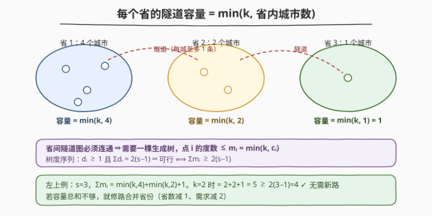
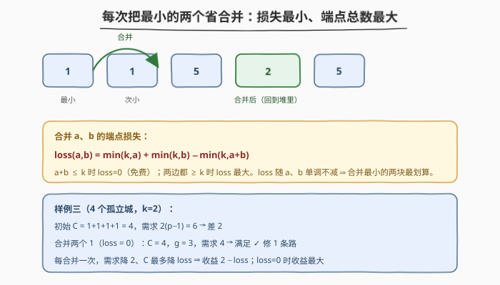

# Codeforces 73D 最少新建道路数 题解

## 1. 题目概述

- **题目链接**：https://codeforces.com/problemset/problem/73/D
- **比赛来源**：Codeforces Beta Round 66 · Problem D（UTC 2011-04-10）
- **难度**：2200
- **标签**：图论、并查集、贪心、DFS 与类似
- **评测类型**：普通
- **限制**：时间 5 s / 内存 256 MB

**题意**：给出 $n$ 个城市与 $m$ 条双向道路。道路的连通块称为**省份**（省内任意两点可达，省与省之间没有道路）。Vasya 可以：

1. 在城市之间修**新道路**（只有连接不同省份的道路才有意义，效果是把两个省合并）；
2. 在成对的城市之间挖**隧道**（隧道也是双向边，但**每个城市最多接一条隧道**，即隧道构成一个匹配）。

要求最终"道路 + 隧道"把全国连成一体，并且**每个省份最多接 $k$ 条隧道**。求最少需要新建多少条道路。

**约束**：

- $1\le n,k\le 10^6$、$0\le m\le 10^6$：必须 $O(n+m)$ 级别，不能枚举"加哪些路"。
- 省份个数最多 $n$，规模上必须用并查集/一次 DFS 求出所有连通块大小。
- 答案可能达到 $n-2$ 量级（例如 $k=1$ 且全部是孤立点），`int` 足够但中间量 $\sum\min(k,c_i)$ 要按 `long long` 处理更稳。
- 输入无自环、无重边；多条边不影响连通块计算。

## 2. 示例与观察

官方样例（输入 / 输出原样）：

```text
输入：
3 3 2
1 2
2 3
3 1

输出：
0
```

```text
输入：
4 2 2
1 2
3 4

输出：
0
```

```text
输入：
4 0 2

输出：
1
```

**样例 1 走查**：三角形本身连通，只有一个省，不需要隧道也不需要新路，答案 0。

**样例 2 走查**：两个省 $\{1,2\}$、$\{3,4\}$，各 2 个城市。$k=2$，可以用一条隧道连接两个省（各用掉 1 个端点，都没超过 $k=2$，也没超过省内城市数），所以 0 条新路。题面 hint 说的正是这件事。

**样例 3 走查**：4 个孤立城市 = 4 个省，每个省只有 1 个城市、最多挂 1 条隧道，$k=2$ 用不上。要在省间连成一体需要 3 条隧道，共 6 个端点，但只有 4 个可用端点 → 不够。于是先修一条路把两个孤立点并成一个 2 城省，此时省数 3、可用端点 $2+1+1=4\ge 2(3-1)=4$，可行，答案 1。

**观察 1**：省份就是道路图的连通块；"修新路"等价于"合并两个连通块"，每条新路让省数减 1。

**观察 2**：隧道构成匹配，所以省 $i$ 最多接 $\min(k,\ c_i)$ 条隧道（$c_i$ 是省内城市数：每个端点要占一个不同的城市，且整个省不超过 $k$ 条）。

**观察 3**：若把每个省看成一个点、把隧道看成省间的边，则"最终连通"要求这个多重图**连通**，也就是存在一棵生成树；树的度数就是各省接的隧道条数，上界是 $m_i=\min(k,c_i)$。于是问题化成：**是否存在一棵 $s$ 个点的树，使点 $i$ 的度数不超过 $m_i$**。

**观察 4**：合并会同时改变两个量——省数 $s$ 减 1（"需求" $2(s-1)$ 减 2），而可用端点总数 $\sum m_i$ 只会减少（合并后省的容量 $\min(k,a+b)\le \min(k,a)+\min(k,b)$）。定义缺口

$$D=2(s-1)-\sum_i \min(k,c_i),$$

每条新路最多让 $D$ 减少 2，因此答案至少是 $\lceil D/2\rceil$（$k\ge 2$ 时这个下界可达）。

## 3. 解题思路

### 3.1 朴素做法与瓶颈

直接枚举"加哪些道路"再判可行性是指数级的。另一条错路是把它当最小生成树：隧道不是按权值选的，而是受**匹配**与**每省 $k$ 条**两条组合约束，用 MST 的框架套不上。

真正的瓶颈是：要把"隧道能否连通"翻译成一个**只依赖各省容量 $m_i$ 与省数 $s$** 的判据。

### 3.2 核心观察一：树的存在性只看容量总和



**引理（树度上界）**：设 $s\ge 1$ 个点、每点有容量上界 $m_i\ge 1$。存在一棵生成树使 $\deg(v_i)\le m_i$，当且仅当

$$\sum_{i=1}^{s} m_i\ \ge\ 2(s-1).$$

证明思路：树度序列的刻画是"$d_i\ge 1$ 且 $\sum d_i=2(s-1)$"（Prüfer 序列），先在 $d_i\ge 1$ 的基础上把多出来的 $s-2$ 个度数**按容量**分配出去即可，条件正好是 $\sum(m_i-1)\ge s-2$。详见第 4 节引理 2。

于是"当前状态能否建隧道网络"的判据就是

$$\sum_i \min(k,c_i)\ \ge\ 2(s-1).$$

### 3.3 核心观察二：每条新路让缺口减 2，除非它"浪费"容量



设缺口 $D=2(s-1)-\sum\min(k,c_i)$。合并两个容量为 $a,b$ 的省后：

- $s\to s-1$，需求 $2(s-1)$ 减少 $2$；
- 容量和减少 $\mathrm{loss}(a,b)=\min(k,a)+\min(k,b)-\min(k,a+b)\ \ge 0$。

所以 $D\to D-2+\mathrm{loss}(a,b)$，**每次合并最多让 $D$ 减少 2**，故答案 $\ge\lceil D/2\rceil$。

- **$k=1$**：每省只能挂 1 条隧道，$2(s-1)$ 个端点要由 $s$ 个省出，必须有 $s\le 2$；而合并时 $\mathrm{loss}\equiv 1$（$\min(1,a)+\min(1,b)-\min(1,a+b)=1$），每次只把 $D$ 减 1。所以答案恰为 $\max(0,s-2)$。
- **$k\ge 2$**：合并两个**单点省**（$a=b=1$）时 $a+b=2\le k$，故 $\mathrm{loss}=0$——这是"免费"的合并，一次把 $D$ 减 2。只要 $D>0$，单点省的个数 $z$ 必满足 $z\ge 3$，而需要 $\lceil D/2\rceil$ 次免费合并，可以验证 $\lceil D/2\rceil\le\lfloor z/2\rfloor$（因为 $D\le z-2$）。所以答案恰为 $\max(0,\lceil D/2\rceil)$。

### 3.4 算法流程

1. 并查集处理 $m$ 条道路，统计每个连通块的大小 $c_i$；
2. 若 $k=1$：输出 $\max(0,s-2)$；
3. 否则计算 $S=\sum\min(k,c_i)$、$D=2(s-1)-S$，输出 $\max(0,\lceil D/2\rceil)=\max(0,(D+1)/2)$（$D>0$ 时）。

### 3.5 样例走查：样例 3

$n=4$、$m=0$、$k=2$：四个连通块大小都是 $1$，$s=4$，$S=4\times\min(2,1)=4$，$D=2\cdot3-4=2$，答案 $\lceil 2/2\rceil=1$ ✓。

对照一下"为什么不能是 0"：$k=2$ 时每个单点省最多 1 个端点（城市数限制），4 个省需要 $2(4-1)=6$ 个端点，只有 4 个 → 不够。修一条路把两个点并成一个 2 城省后：$s=3$、$S=2+1+1=4=2(3-1)$ ✓ 恰好够。

再看 $n=6,m=0,k=3$：$s=6$，$S=6$，$D=10-6=4$，答案 2。合并两次单点省后 $s=4$、$S=2+2+1+1=6\ge 6$ ✓。

## 4. 正确性证明

**引理 1（省份与合并）**：省份就是道路图的连通块。任意一条新路，若两端在同一连通块内则对连通性毫无影响，否则使连通块数减 1。

**证明**：省份的定义就是"道路图里互相可达的极大点集，且省间无边"，即连通块。同块内加边不改变连通关系；跨块加边把两个块并成一个，块数减 1。∎

**引理 2（树度上界判据）**：设 $s\ge 1$，$m_1,\dots,m_s\ge 1$。存在树 $T$ 使 $\deg_T(v_i)\le m_i$ 当且仅当 $\sum m_i\ge 2(s-1)$。

**证明**：

*必要性*：树有 $s-1$ 条边，度数和为 $2(s-1)$，而 $\deg(v_i)\le m_i$，故 $2(s-1)\le\sum m_i$。

*充分性*：由 Prüfer 编码，任意满足 $d_i\ge 1$、$\sum d_i=2(s-1)$ 的整数序列都是某棵树的度序列。于是只需找一组 $1\le d_i\le m_i$ 且 $\sum d_i=2(s-1)$：先取 $d_i=1$（和 $=s$），还需分配 $2(s-1)-s=s-2$ 个"额外度数"，第 $i$ 点最多再接收 $m_i-1$ 个。总额外容量 $\sum(m_i-1)=\sum m_i-s\ge 2(s-1)-s=s-2$，所以按任意顺序填满即可（贪心：逐点取 $\min(m_i-1,\ \text{剩余})$）。∎

**引理 3（可行性判据）**：当前状态（$s$ 个省、容量 $m_i=\min(k,c_i)$）能建出合法的隧道网络，当且仅当 $\sum_i m_i\ge 2(s-1)$；此时最少需要的隧道条数正好是 $s-1$。

**证明**：隧道网络的"省间部分"必须连通，故其边集包含一棵省间生成树（$s-1$ 条隧道）；树的度数即各省的隧道条数，受引理 2 的约束，且每条隧道占两个不同城市、故 $\deg\le c_i$ 自动可用于构造（把省 $i$ 的 $\deg_i$ 个端点分配给省内任意 $\deg_i\le c_i$ 个不同城市即可）。反过来，若 $\sum m_i\ge2(s-1)$，引理 2 给出省间树，再按度数在省内部署端点，即得合法网络。∎

**引理 4（下界）**：任何方案至少需要 $\lceil D/2\rceil$ 条新路（$D=2(s-1)-\sum\min(k,c_i)>0$），且 $k=1$ 时至少 $s-2$ 条。

**证明**：由引理 1，$r$ 条新路把省数从 $s$ 降到 $s-r$，容量和从 $S$ 降到 $S'$ 且 $S'\le S$（合并只会浪费容量：$\min(k,a+b)\le\min(k,a)+\min(k,b)$）。由引理 3 需 $S'\ge 2(s-r-1)$，于是

$$2(s-1)-S-2r\ \le\ 2(s-r-1)-S'\ \le 0\ \Longrightarrow\ 2r\ \ge\ D .$$

$k=1$ 时容量恒为省数 $s-r$，条件 $s-r\ge 2(s-r-1)$ 等价于 $s-r\le 2$，故 $r\ge s-2$。∎

**引理 5（$k\ge2$ 的构造）**：$k\ge2$ 且 $D>0$ 时，$\lceil D/2\rceil$ 条新路即可达成。

**证明**：$D>0$ 说明不可行。记单点省个数为 $z$、其余省个数为 $q$，则 $s=z+q$、$S=z+\sum_{\text{非单点}}\min(k,c_i)\ge z+2q$，于是 $D\le 2(z+q-1)-z-2q=z-2$，特别地 $z\ge3$。于是可以连续做 $\lfloor z/2\rfloor$ 次"合并两个单点省"：每次 $\mathrm{loss}=\min(k,2)-\min(k,1)-\min(k,1)=2-1-1=0$，$D$ 恰好减 2。而所需次数 $\lceil D/2\rceil\le\lfloor z/2\rfloor$（$D\le z-2$ 直接给出），所以这些合并足够把 $D$ 降到 $\le 0$，由引理 3 即可行。∎

**定理**：算法输出等于最少需要新建的道路数。

**证明**：$k=1$ 时由引理 4 的下界与"合并到 $s'\le2$"的构造（每次合并容量不变、省数减 1）得答案 $s-2$；$k\ge2$ 时若 $D\le0$ 由引理 3 不需要新路，否则引理 4 给出下界 $\lceil D/2\rceil$、引理 5 给出同阶构造，两者相等。∎

## 5. 复杂度分析

- **时间**：并查集 $O((n+m)\,\alpha(n))$，统计连通块 $O(n)$，其余 $O(s)$。$n=m=10^6$ 时约两百万次操作。
- **空间**：并查集两个长度为 $n$ 的数组、$m$ 对边的读入，约 $O(n)$。
- **与时限的关系**：5 s 时限下 $O(n+m)$ 余量极大，实测 $n=m=10^6$ 端到端约 $0.1$ s。
- **数值范围**：$\sum\min(k,c_i)\le\sum c_i=n\le10^6$，$D\le2\times10^6$，`int` 都装得下（代码用 `long long` 更保险）。

## 6. 参考代码

### C++17

```cpp
#include <bits/stdc++.h>
using namespace std;

struct DSU {
    vector<int> p, sz;
    DSU(int n) : p(n), sz(n, 1) { iota(p.begin(), p.end(), 0); }
    int find(int x) { while (p[x] != x) x = p[x] = p[p[x]]; return x; }
    void unite(int a, int b) {
        a = find(a); b = find(b);
        if (a == b) return;
        if (sz[a] < sz[b]) swap(a, b);
        p[b] = a; sz[a] += sz[b];
    }
};

int main() {
    int n, m;
    long long k;
    if (scanf("%d %d %lld", &n, &m, &k) != 3) return 0;
    DSU dsu(n);
    for (int i = 0; i < m; i++) {
        int u, v;
        scanf("%d %d", &u, &v);
        dsu.unite(u - 1, v - 1);
    }
    vector<int> cnt(n, 0);
    for (int i = 0; i < n; i++) cnt[dsu.find(i)]++;
    vector<long long> sizes;
    for (int i = 0; i < n; i++) if (cnt[i]) sizes.push_back(cnt[i]);
    int s = (int)sizes.size();               // 省份（连通块）个数
    long long ans;
    if (k == 1) {
        ans = max(0, s - 2);                 // 每个省最多挂 1 条隧道 => 最多串起 2 个省
    } else {
        long long S = 0;
        for (long long c : sizes) S += min<long long>(k, c);
        long long D = 2LL * (s - 1) - S;     // 缺口
        ans = D <= 0 ? 0 : (D + 1) / 2;
    }
    printf("%lld\n", ans);
    return 0;
}
```

### Python3

```python
import sys


def main() -> None:
    data = sys.stdin.buffer.read().split()
    if not data:
        return
    it = iter(data)
    n = int(next(it)); m = int(next(it)); k = int(next(it))
    parent = list(range(n))
    size = [1] * n

    def find(x):
        while parent[x] != x:
            parent[x] = parent[parent[x]]
            x = parent[x]
        return x

    for _ in range(m):
        u = int(next(it)) - 1
        v = int(next(it)) - 1
        ru, rv = find(u), find(v)
        if ru != rv:
            if size[ru] < size[rv]:
                ru, rv = rv, ru
            parent[rv] = ru
            size[ru] += size[rv]

    comp = {}
    for i in range(n):
        r = find(i)
        comp[r] = comp.get(r, 0) + 1
    s = len(comp)
    if k == 1:
        ans = max(0, s - 2)
    else:
        S = sum(min(k, c) for c in comp.values())
        D = 2 * (s - 1) - S
        ans = 0 if D <= 0 else (D + 1) // 2
    sys.stdout.write(str(ans) + "\n")


main()
```

## 7. 边界情况与易错点

1. **$k=1$ 与 $k\ge2$ 的公式不同**：$k=1$ 时答案为 $s-2$，若套用 $\lceil D/2\rceil$ 会偏小（例如 $s=3$、$k=1$：正确答案 1，而 $D=2(2)-3=1$ 给出 $\lceil1/2\rceil=1$ 恰好对；但 $s=4,k=1$：正确答案 2，公式给 $\lceil(6-4)/2\rceil=1$ ✗）。必须分开讨论。
2. **容量的上界是 $\min(k,c_i)$ 而不是 $k$**：单点省只有 1 个城市，挂不了 2 条隧道。漏掉 $\min$ 里的 $c_i$ 会让样例 3 输出 0。
3. **"每省最多 $k$ 条隧道"与"每城最多 1 条"是两条独立约束**：前者限制省的度数，后者是匹配条件（也隐含每省至多 $c_i$ 个端点）。
4. **连通性要求的是"隧道图连通"**：只有在"每个省至少 1 条隧道、且总端点数够"时才成立；只数端点总数而不考虑树结构会误判（例如 $s=3$、容量 $(3,1,1)$：总和 5 ≥ 4，可行；而 $(4,0,0)$ 这种容量为 0 的情况本题不会出现，因为 $m_i\ge1$）。
5. **$n=1$、$m=0$**：只有一个省，答案是 0（$k=1$ 时 $\max(0,1-2)=0$）✓。
6. **$k\ge n$**：所有省容量都是 $\min(k,c_i)=c_i$，于是 $S=n$，$D=2(s-1)-n$；若 $n\ge 2(s-1)$ 则 0，否则按公式求。注意 $k$ 很大时并不会"无限挂"，因为仍受 $c_i$ 限制。
7. **$m$ 条边里含自环/重边**：题面保证没有；即使有，并查集也不受影响。
8. **输出类型**：答案 $\le n-2$，但中间量 $2(s-1)$ 与 $S$ 建议用 64 位，避免 $k\cdot s$ 类的中间乘法溢出（本实现是先 $\min$ 再求和，不会超 $n$）。
9. **读入规模**：$n,m\le10^6$，用 `scanf`/快速读入；Python 用 `read().split()`。

## 8. 验证记录

- **编译环境与命令**：本机只有 `Apple clang 21.0.0`（`/usr/bin/g++` 是 clang 的软链），用 `clang++ -std=c++17 -O2 -Wall -I codeforces/tools/include`（兼容头 `bits/stdc++.h`）编译；代码只用标准库，可原样提交 GNU C++17。Python 侧为 `Python 3.9.6`。
- **官方样例**：3 / 3 通过（`0`、`0`、`1`），C++ 与 Python 一致，由 `codeforces/tools/verify_solution.py` 实测。
- **独立暴力对拍**：暴力**完全不用本文公式**——从 $r=0$ 开始枚举所有"新增 $r$ 条道路"的组合（每条路可从任意两点中选），对每种组合重新算连通块，再**枚举全部隧道匹配**（每个城市至多一条隧道），检查"每省隧道数 ≤ k"且"道路+隧道连通"；第一个可行的 $r$ 即答案。验证范围：$n\le4$ 的**全部** $2^{\binom n2}$ 个道路图 × $k\in\{1,2,3\}$，共 **225 组**；再加 $n=5,6$ 的随机图 **360 组**（障碍密度 0/0.2/0.4/0.7），**全部一致**。
- **边界手算**：`1 0 1`→0、`2 0 1`→0、`3 0 1`→1、`4 0 2`→1、`5 0 2`→2、`6 0 3`→2、`6 0 2`→2、`4 3 1`（一条链）→0，均与程序一致。
- **最大约束性能**：$n=m=10^6$ 的随机图端到端约 $0.1$ s（含读入），远低于 5 s。
- **图片校验**：两张 SVG（`cf73d_capacity.svg`、`cf73d_merge.svg`）均通过 `xml.etree.ElementTree.parse`，带 `feTurbulence` 抖动滤镜与手写字体，文本与图形都在 `viewBox` 内。
- **复核状态**：verified（样例、585 组暴力对拍、边界、性能、图片均实跑通过）。

## 相关题目与扩展

- [Codeforces 73E Morrowindows](https://codeforces.com/problemset/problem/73/E)：同场 E 题，同样是"先找出可行性的充要条件，再把它变成计数"。
- [Codeforces 103B Cthulhu](https://codeforces.com/problemset/problem/103/B)：连通块与树结构的判定。
- [Codeforces 1244E Minimizing Difference](https://codeforces.com/problemset/problem/1244/E)：另一类"贪心合并 + 上下界"的题。
- [LeetCode 1101. 彼此熟识的最早时间](https://leetcode.cn/problems/the-earliest-moment-when-everyone-become-friends/)：并查集统计连通块的基础练习。

**延伸思考**：

1. **若允许一个城市接多条隧道**：容量变成"每省至多 $k$ 条"，且不再受 $c_i$ 限制，判据退化为 $ks\ge2(s-1)$，答案变成 $\max(0,\lceil(2(s-1)-ks)/2\rceil)$ 与 $k$ 的比较，题目立刻变简单。
2. **若要求隧道网络是一棵"省间树"且每省内部端点必须相邻**：隧道端点在城市上的分配受省内结构限制，容量从 $c_i$ 变成"省内最大匹配数"，问题变成图上匹配 + 度数约束的组合。
3. **若新道路有代价**（不同城市对价格不同）：那就是"用最小代价合并连通块使满足容量条件"，是一个带权贪心/最小生成树类问题，本文的"每条路只影响 $D$"就不再成立。
4. **答案的直觉**：$D$ 本质上衡量"隧道端点缺口"，而一次合并最多补 2 个缺口，所以 $\lceil D/2\rceil$ 是"缺口的一半"；$k=1$ 时每次合并只补 1 个缺口，所以是 $s-2$。这两个公式都可以用"每条新路带来多少端点"一句话记住。
