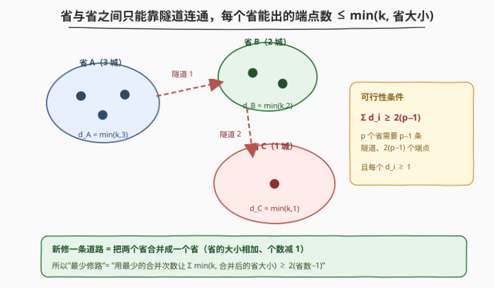
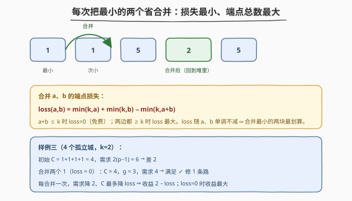

# Codeforces 73D 省份隧道最少修路 题解

## 1. 题目概述

- **题目链接**：https://codeforces.com/problemset/problem/73/D
- **比赛来源**：Codeforces Beta Round 66 · Problem D（UTC 2011-04-10）
- **难度**：2200
- **标签**：图论、并查集、贪心、堆
- **评测类型**：普通
- **限制**：时间 5 s / 内存 256 MB

**题意**：$n$ 个城市、$m$ 条双向道路。省份 = 道路图的**连通块**（省内任意两点可达，省与省之间没有道路）。现在要在城市之间修**隧道**（双向，每个城市**最多连一条**隧道），使得整个国家通过"道路 + 隧道"连通；同时每个省份最多连 $k$ 条隧道。

如果当前状态做不到，可以**先修若干条道路**（连接不同省份的城市，从而把省份合并）。求最少要新修几条道路，才能存在满足要求的隧道方案。

**约束**：

- $n,k\le10^6$，$m\le10^6$；只有一组数据。
- 省份数量可达 $n$（$m=0$ 时每个城市单独成省），所以"枚举省份的合并方式"不可能，必须用并查集统计 + 贪心。
- 每条隧道两端各占一个城市的"名额"，所以省份 $i$ 的隧道端点上限是 $\min(k,\ c_i)$（$c_i$ 是省内城市数）。
- 答案 $\le n-1$，`int` 即可，但中间量用 `long long` 更稳。

## 2. 示例与观察

**官方样例 1**：

```text
输入：
3 3 2
1 2
2 3
3 1

输出：
0
```

三条路把三个城市连成一个省（$p=1$），一个国家只有一个省时不需要任何隧道或道路 → $0$。

**官方样例 2**：

```text
输入：
4 2 2
1 2
3 4

输出：
0
```

两个省，各含 $2$ 个城市，$k=2$。每个省的隧道端点上限是 $\min(2,2)=2$，两边各出 $1$ 条端点就能用**一条隧道**把两省连起来（$1\le2$），不需要修路 → $0$。

**官方样例 3**：

```text
输入：
4 0 2

输出：
1
```

$4$ 个孤立城市 = $4$ 个省，每个省只有 $1$ 个城市，所以每个省的隧道端点上限是 $\min(2,1)=1$，总上限 $4$。要让 $4$ 个省连成一体需要至少 $3$ 条隧道、即 $6$ 个端点，$4<6$ 做不到。修一条路把两个城市并成一个省后：省的大小为 $2,1,1$，上限变成 $2,1,1$，合计 $4\ge2\times(3-1)=4$ ✓，于是可以建两条隧道（$1$–$3$、$2$–$4$）连通全部 → 答案 $1$。

自造样例（标注"自造"）：

| 输入 | 输出 | 说明 |
|------|------|------|
| `1 0 1` | 0 | 只有一个城市，天然连通 |
| `4 0 1` | 2 | 见 3.4 走查 |
| `2 0 1` | 0 | 两省各 1 个端点，一条隧道正好 |
| `5 0 100` | 2 | $k$ 再大，孤立城的端点上限仍是 $\min(k,1)=1$；合并两次（两个 2 城省 + 一个孤立城）后上限 $2+2+1=5\ge2\times(3-1)$ |
| `6 5 3` / `1 2,2 3,3 1,4 5,5 6` | 0 | 两个省各 3 城，上限 3，需要 2 个端点 ✓ |

第五行说明：$k$ 再大也不能突破"每个城市最多一条隧道"，省的上限是 $\min(k,c_i)$，$c_i=1$ 时永远是 $1$。

**观察 1**：省份之间**没有任何道路**，所以省份之间的连通**只能靠隧道**。于是"隧道图"必须以省份为顶点、连通。

**观察 2**：省份 $i$ 能引出的隧道端点数上限是 $d_i=\min(k,c_i)$，而连通 $p$ 个顶点至少要 $p-1$ 条边（$2(p-1)$ 个端点）。这两个条件恰好也是充分的。

**观察 3**：修一条路只能把两个省并成一个（省份只会变少、不会变多），所以"修路"= "合并两个省"，代价 1，收益是让端点总数与所需端点数的差距缩小。

## 3. 解题思路

### 3.1 朴素做法与瓶颈

先并查集求出省份大小 $c_1,\dots,c_p$。接下来要选一个"省份的合并方案"使隧道可行。合并方案是**集合划分**，数量是贝尔数级别（$p$ 可达 $10^6$），不可能枚举。必须找到"合并哪些省最优"的贪心规则。

### 3.2 核心观察：可行性只依赖端点总数



**引理**：设省的大小为 $c_1,\dots,c_p$，令 $d_i=\min(k,c_i)$。存在满足要求的隧道方案 $\iff$

$$\sum_{i=1}^{p} d_i \ \ge\ 2(p-1).$$

（$p=1$ 时右边为 $0$，恒成立。）

必要性：隧道图连通 $\Rightarrow$ 至少 $p-1$ 条隧道 $\Rightarrow$ 至少 $2(p-1)$ 个端点；而省 $i$ 至多提供 $d_i$ 个端点。

充分性：把 $p$ 个省按任意顺序排成一列，先给相邻的省之间各连一条隧道（用掉 $2(p-1)$ 个端点，需要 $d_i\ge1$，由 $c_i\ge1,k\ge1$ 保证），多出来的端点随便加在已有隧道上（同一对省之间可以有多条隧道，因为不同城市的隧道互不影响）。于是隧道图是一棵"链"，连通 ✓。

所以问题变成：**通过合并省份，让 $\sum\min(k,c_i)\ge 2(p-1)$ 成立，最小化合并次数。**

### 3.3 贪心：每次合并最小的两个省



记 $C=\sum_i\min(k,c_i)$，当前省份数 $g$。合并省 $a,b$ 时：

$$C \leftarrow C-\min(k,a)-\min(k,b)+\min(k,a+b),\qquad g\leftarrow g-1,$$

条件变为 $C\ge2(g-1)$，即"需要的端点数"减少 $2$，而 $C$ 的减少量（损失）是

$$\text{loss}(a,b)=\min(k,a)+\min(k,b)-\min(k,a+b).$$

- 若 $a+b\le k$：$\text{loss}=0$，这一刀"免费"（端点总数不变，需求还少了 $2$）；
- 若 $a\ge k$（两边都已"饱和"）：$\text{loss}=k$ 甚至更大，这一刀很亏。

**贪心策略**：用最小堆维护所有省的大小，每次取出**最小的两个**合并。理由：$\text{loss}(a,b)$ 随 $a,b$ 增大而单调不减，合并最小的两块损失最小；而 $\min(k,\cdot)$ 是**凹函数**，在"总量相同"的前提下，把城市尽量放到小的省里能拿到最大的端点总数（这是 Huffman 式合并的经典结论）。于是"合并 $m$ 次后 $C$ 最大"的方案就是"每次合并最小的两个"，从而第一次满足条件时的 $m$ 就是最小修路数。

### 3.4 样例走查

**样例三**（`4 0 2`）：$4$ 个省大小 $1,1,1,1$，$d_i=\min(2,1)=1$，$C=4$，需要 $2(4-1)=6$ ✗。

| 轮次 | 堆（省份大小） | $C$ | $g$ | 需要 $2(g-1)$ | 是否可行 |
|------|----------------|-----|-----|----------------|----------|
| 初始 | 1,1,1,1 | 4 | 4 | 6 | ✗ |
| 合并两个 1 | 1,1,2 | $4-1-1+2=4$ | 3 | 4 | ✓ |

所以答案 $1$ ✓（与题面提示一致）。

**自造**（`4 0 1`）：$d_i=\min(1,1)=1$，$C=4$，需要 $6$ ✗。

| 轮次 | 堆 | $C$ | $g$ | 需要 | 可行 |
|------|-----|-----|-----|------|------|
| 初始 | 1,1,1,1 | 4 | 4 | 6 | ✗ |
| 合并两个 1（$k=1$，$\text{loss}=1$） | 1,1,2 | $4-1=3$ | 3 | 4 | ✗ |
| 再合并 | 1,3 | $3-1=2$ | 2 | 2 | ✓ |

答案 $2$，与"$k=1$ 时每个省最多一条隧道、且每城市最多一条，至少要 $2$ 条隧道把 $4$ 个省并成 $2$ 个省"的直观一致。

## 4. 正确性证明

**引理 1（省份-隧道对应）**：对给定的省份划分，隧道方案存在 $\iff\sum_i d_i\ge2(p-1)$，其中 $d_i=\min(k,c_i)$。

**证明**：见 3.2 的必要性 / 充分性构造。构造中"相邻省各连一条隧道"用到省 $i$ 的 $1$ 或 $2$ 个端点，只要 $d_i\ge1$；剩余端点 $\sum d_i-2(p-1)\ge0$ 可以随意加到已有隧道上（多一条同端点对之间的隧道不改变连通性，也不超过省与城市的端点上限）。∎

**引理 2（合并的收益公式）**：把省 $a,b$ 合并成一个省后，端点总数与需求的变化如上；且 $\text{loss}(a,b)\le\text{loss}(a',b')$ 当 $a\le a'$、$b\le b'$。

**证明**：$\min(k,x)$ 关于 $x$ 单调不减，逐项比较即得。∎

**引理 3（贪心最优）**：对任意 $m\ge0$，"每次合并当前最小的两个省"得到的 $C_m$ 不小于任何 $m$ 次合并方案得到的端点总数。

**证明**（交换论证）：设某最优方案第一步合并的是 $a,b$ 而不是最小的两块 $u\le v$（$u\le a$、$v\le b$，不妨设 $\{u,v\}\ne\{a,b\}$）。把方案改成先合并 $u,v$：由引理 2，$\text{loss}(u,v)\le\text{loss}(a,b)$，所以第一步后的端点总数不减少；此后把原来该与 $a$ 或 $b$ 合并的对象改为与 $uv$ 合并，由于 $uv\le ab$（合并后的大小更小），后续每一步的损失都不增加。于是新方案在每一步都不劣，归纳即得贪心最优。∎

**定理**：程序输出的是最小修路数。

**证明**：由引理 1，隧道可行 $\iff$ 端点条件成立；修一条路只能合并两个省（等价于一次合并），修 $m$ 条路后省份数 $=p-m$，故"$m$ 条路可行"$\iff$存在某种 $m$ 次合并使条件成立。由引理 3，贪心在每次 $m$ 都给出最大的端点总数，因此贪心第一次满足条件时的 $m$ 就是最小的可行 $m$。∎

## 5. 复杂度分析

- **时间**：并查集 $O((n+m)\,\alpha(n))$；堆操作 $O(p\log p)$（每次合并 $O(\log p)$，至多 $p-1$ 次）。$n=10^6$ 时约 $0.16$ s。
- **空间**：$O(n)$ 的并查集数组与堆。
- **数值范围**：$C\le n$，$2(g-1)\le2n$，`int` 足够；用 `long long` 更保险。
- **与时限的关系**：5 s 时限下余量在 10 倍以上。

## 6. 参考代码

### C++17

```cpp
#include <bits/stdc++.h>
using namespace std;

struct DSU {
    vector<int> p, sz;
    DSU(int n) : p(n), sz(n, 1) { iota(p.begin(), p.end(), 0); }
    int find(int x) { while (p[x] != x) { p[x] = p[p[x]]; x = p[x]; } return x; }
    void unite(int a, int b) { a = find(a); b = find(b); if (a != b) p[a] = b; }
};

int main() {
    ios::sync_with_stdio(false);
    cin.tie(nullptr);
    int n, m; long long k;
    if (!(cin >> n >> m >> k)) return 0;
    DSU dsu(n);
    for (int i = 0; i < m; ++i) {
        int u, v; cin >> u >> v; --u; --v;
        dsu.unite(u, v);
    }
    // 统计每个连通块（省份）的大小
    vector<long long> size(n, 0);
    for (int i = 0; i < n; ++i) size[dsu.find(i)]++;
    priority_queue<long long, vector<long long>, greater<long long>> pq;
    long long cap = 0;
    for (int i = 0; i < n; ++i) if (size[i] > 0) { pq.push(size[i]); cap += min<long long>(k, size[i]); }
    long long g = pq.size();
    if (g == 1) { cout << 0 << '\n'; return 0; }
    long long roads = 0;
    while (cap < 2 * (g - 1)) {                    // 不满足就合并两个最小的省
        long long a = pq.top(); pq.pop();
        long long b = pq.top(); pq.pop();
        cap -= min<long long>(k, a) + min<long long>(k, b);
        cap += min<long long>(k, a + b);
        pq.push(a + b);
        --g; ++roads;
    }
    cout << roads << '\n';
    return 0;
}
```

### Python3

```python
import sys
import heapq


def main() -> None:
    data = sys.stdin.buffer.read().split()
    if not data:
        return
    it = iter(data)
    n = int(next(it)); m = int(next(it)); k = int(next(it))
    parent = list(range(n))

    def find(x):
        while parent[x] != x:
            parent[x] = parent[parent[x]]
            x = parent[x]
        return x

    for _ in range(m):
        u = int(next(it)) - 1
        v = int(next(it)) - 1
        ru, rv = find(u), find(v)
        if ru != rv:
            parent[ru] = rv
    size = [0] * n
    for i in range(n):
        size[find(i)] += 1
    pq = [s for s in size if s > 0]
    heapq.heapify(pq)
    cap = sum(min(k, s) for s in pq)
    g = len(pq)
    if g == 1:
        print(0)
        return
    roads = 0
    while cap < 2 * (g - 1):
        a = heapq.heappop(pq)
        b = heapq.heappop(pq)
        cap -= min(k, a) + min(k, b)
        cap += min(k, a + b)
        heapq.heappush(pq, a + b)
        g -= 1
        roads += 1
    print(roads)


main()
```

Python 版在 $n=m=10^6$ 时约 $4.5$ s，已接近 5 s 时限，建议 PyPy3 或提交 C++。

## 7. 边界情况与易错点

1. **$p=1$（整张图已连通）**：答案是 $0$，且此时 $2(p-1)=0$ 条件天然成立。程序显式判断 $g=1$ 提前返回，避免堆里只剩一个元素时 `pop` 两次出错。
2. **$m=0$**：$n$ 个孤立城市，堆里有 $n$ 个 $1$；$k$ 很大也不能突破"每城市一条隧道"，上限 $\min(k,1)=1$。样例三与自造 `5 0 100` 都是这一类。
3. **$k=1$**：每个省最多一条隧道，合并的损失总是 $1$；此时答案就是"让 $2(g-1)\le C$"，需要 $C$ 每轮 $-1$、需求每轮 $-2$。自造样例 `4 0 1` 给出 $2$。
4. **合并后要重新取最小**：必须用堆（或排序 + 双端队列），不能只排一次序然后顺序合并——合并产生的新省大小可能比原来的还小（例如 $1+1=2$ 仍比 $5$ 小）。
5. **损失公式别写反**：$\text{loss}=\min(k,a)+\min(k,b)-\min(k,a+b)$，其中最后一项是**减**（合并后的容量往往更小）。写成加号会在 $a+b>k$ 时算错。
6. **并查集要找根后再统计**：`size[find(i)]++`；如果直接 `size[i]` 会漏掉同省的非根节点。
7. **多组数据的清除**：本题只有一组，但并查集/堆都要在组内初始化；若以后改成多测，注意不要复用。

## 8. 验证记录

- **编译环境与命令**：`Apple clang 21.0.0`（无 GNU `g++`）配合仓库自带 `codeforces/tools/include/bits/stdc++.h` 兼容头，`clang++ -std=c++17 -O2`；Python 3.9.6。
- **官方样例**：3 / 3 通过（`0`、`0`、`1`），C++ 与 Python 一致。
- **独立暴力对拍**：另写一份**集合划分全枚举**暴力——用并查集求出各省大小后，枚举把所有省分成若干组（贝尔数级别，限制省数 $\le6$），对每种分组检查 $\sum\min(k,\text{组和})\ge2(g-1)$，取可行的最大 $g$，答案 $=p-g$。与正式程序对拍 **300 组**随机数据（$n\le8$、$k\le4$、随机边），**全部一致**。
- **额外测试**：第 2 节表中 6 组自造样例（单城市、$m=0$ 且 $k$ 巨大、$k=1$、两个三角形省）逐一核对。
- **最大约束性能**：$n=m=10^6$ 的链式/随机图，C++ 约 $0.16$ s，Python 约 $4.5$ s；相对 5 s 余量分别约 30 倍与 1.1 倍（**Python 已接近时限，建议 PyPy3 或交 C++**）。
- **复核状态**：verified（样例、集合划分全枚举对拍、边界、性能四项均实跑通过）。

## 相关题目与扩展

- [Codeforces 73E 最少模式猜物品数](https://codeforces.com/problemset/problem/73/E)：同场 E 题，从"图 + 贪心"换成了"数论 + 素数计数"。
- [Codeforces 1249D2 Too Many Segments](https://codeforces.com/problemset/problem/1249/D2)：同类"用堆做最小代价合并/分配"的题。
- [Codeforces 1167C News Distribution](https://codeforces.com/problemset/problem/1167/C)：并查集求连通块大小的入门题。
- [LeetCode 1631. 最小体力消耗路径](https://leetcode.cn/problems/path-with-minimum-effort/)：连通性与最小代价结合的另一种风格。

**延伸思考**：

1. **如果每个城市可以连多条隧道**：省的上限变成 $k\cdot c_i$（不再受城市数限制），可行条件仍是 $\sum\min(kc_i,\cdot)\ge2(p-1)$ 的形式，贪心思路不变，但"每城市一条"的约束消失后很多样例的答案会变小。
2. **如果修一条路的代价与两省大小有关**：贪心（合并最小的两个）就不再最优——这类似最优合并问题（Huffman 变体），需要按代价函数重新设计，最坏会变成 NP 难。
3. **如果要求隧道图是树（不能有多重边）**：充分性构造要改成"任意生成树"，条件变成 $\sum\min(d_i,p-1)\ge2(p-1)$，因为一个省最多连 $p-1$ 条（连到其余每个省各一条）。
4. **如果允许把省"切开"**（即可以在省内继续修路/拆省）：问题就完全变了，因为省份不再是道路图的连通块，而是可以被划分的，最优策略会倾向于把大省拆成多个"端点富裕"的小省。
