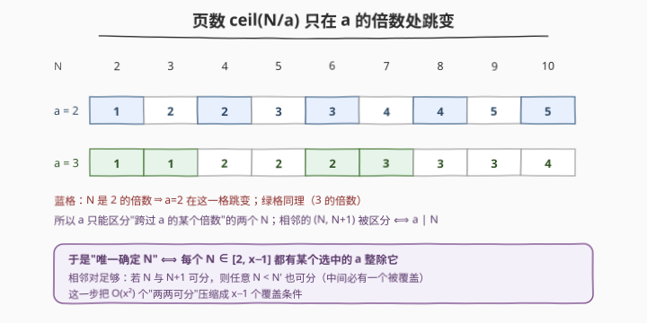
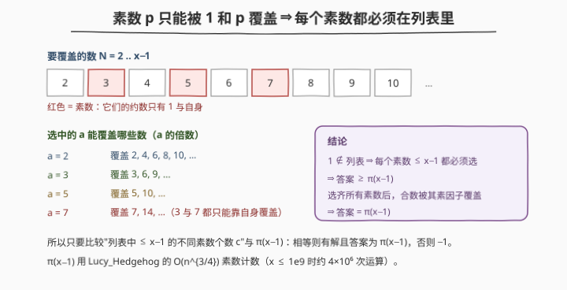

# Codeforces 73E 最少查看模式数 题解

## 1. 题目概述

- **题目链接**：https://codeforces.com/problemset/problem/73/E
- **比赛来源**：Codeforces Beta Round 66 · Problem E（UTC 2011-04-10）
- **难度**：2400
- **标签**：数学、数论、素数计数
- **评测类型**：普通
- **限制**：时间 2 s / 内存 256 MB

**题意**：背包里的物品数 $N$ 满足 $2\le N\le x$，但具体是多少未知。有 $n$ 种查看模式，第 $i$ 种模式把物品按每页 $a_i$ 个分页（最后一页可以不满），并告诉你总页数 $b_i=\lceil N/a_i\rceil$。Vasya 必须**先选定一组模式**，然后一次性看到这组模式的全部页数，再据此判断 $N$。问最少需要几种模式才能唯一确定 $N$；若无法唯一确定输出 $-1$。

**约束**：

- $0\le n\le 10^5$：模式数量小，但"模式子集"有 $2^n$ 个，不能穷举。
- $2\le x\le 10^9$：答案与 $\pi(x-1)$（不超过 $x-1$ 的素数个数）直接相关，而 $x$ 很大，**不能筛到 $x$**。
- $1\le a_i\le 10^9$：同一个 $a$ 出现多次时只有一份信息，必须去重。
- 输出是最少模式数或 $-1$；普通评测。

## 2. 示例与观察

官方样例（输入 / 输出原样）：

```text
输入：
2 4
2 3

输出：
2
```

```text
输入：
1 4
2

输出：
-1
```

**样例 1 走查**：$x=4$，$N\in\{2,3,4\}$。单个模式都区分不开：

| $N$ | $a=2$ 的页数 | $a=3$ 的页数 |
|-----|--------------|--------------|
| 2 | 1 | 1 |
| 3 | 2 | 1 |
| 4 | 2 | 2 |

只用 $a=2$ 时 $N=3,4$ 都是 2 页；只用 $a=3$ 时 $N=2,3$ 都是 1 页。两个一起看则三元组 $(1,1),(2,1),(2,2)$ 互不相同，所以 2 种模式，答案 2。

**样例 2 走查**：$x=4$，只有 $a=2$。$N=3$ 与 $N=4$ 都显示 2 页，无法区分 → $-1$。

**观察 1**：模式 $i$ 给出的信息就是 $\lceil N/a_i\rceil$。选择一组模式 $S$ 后，可用的信息是向量 $\bigl(\lceil N/a_i\rceil\bigr)_{i\in S}$；"唯一确定"就是让这个向量在 $N\in[2,x]$ 上**两两不同**。

**观察 2**：$\lceil N/a\rceil=\lfloor (N-1)/a\rfloor+1$，所以

$$\lceil N/a\rceil=\lceil N'/a\rceil\iff [N,\,N'-1]\ \text{中不含}\ a\ \text{的倍数}\qquad(N<N').$$

也就是说，模式 $a$ 只能区分"跨过 $a$ 的某个倍数"的两个值。

**观察 3**：要让**所有**对都分开，只要让每一对**相邻**的 $(N,N+1)$ 分开即可（$N\in[2,x-1]$）——因为任何一对 $N<N'$ 之间若没有 $a$ 的倍数，那么 $N$ 与 $N+1$ 之间更没有，所以"相邻都可分"是充分的。而 $(N,N+1)$ 被分开 $\iff a\mid N$。

**结论**：选择的模式集合 $S$ 合法 $\iff$ 对每个 $N\in[2,x-1]$，都有某个 $a\in S$ 整除 $N$。

## 3. 解题思路

### 3.1 朴素做法与瓶颈

枚举模式子集 $S$（$2^n$ 种）再检查向量是否两两不同，$n=10^5$ 时完全不可行。即使只枚举大小 $k$ 的子集，$\binom{n}{k}$ 也无法承受。

瓶颈在于没有把"向量互不相同"翻译成"覆盖"这种可以贪心的结构。

### 3.2 核心观察：素数必须被选中



由观察 3，问题变成：选最少的 $a$，使 $[2,x-1]$ 中每个 $N$ 都被某个选中的 $a$ 整除。

**关键**：取任意素数 $p\le x-1$。$p$ 的正因数只有 $1$ 和 $p$，所以要覆盖 $p$，选中的 $a$ 只能是 $1$ 或 $p$。

- 如果列表里有 $a=1$：一个模式就够（$\lceil N/1\rceil=N$ 直接就是答案），答案为 1。
- 否则，**每个 $\le x-1$ 的素数都必须被选中**，答案至少是 $\pi(x-1)$。

反过来，把所有 $\le x-1$ 的素数都选上一定够：任何 $N\in[2,x-1]$ 都有素因子 $p\le N\le x-1$，于是 $p\mid N$，$N$ 被覆盖 ✓。



所以答案只有三种可能：

$$\text{ans}=\begin{cases}0, & x=2,\\[2pt] 1, & 1\in\{a_i\},\\[2pt] \pi(x-1), & \text{所有}\ \le x-1\ \text{的素数都在列表里},\\[2pt] -1, & \text{否则}.\end{cases}$$

### 3.3 如何判断"所有素数都在列表里"

列表最多 $10^5$ 个数，所以先统计列表里 $\le x-1$ 的**不同素数**个数 $c$。只要 $c=\pi(x-1)$，就说明"全部素数都在"（列表里的素数一定 $\le x-1$，是一个子集，子集大小等于全集大小即相等）。

因此还需要**精确**求出 $\pi(x-1)$。$x-1$ 可达 $10^9$，用筛法要 $10^9$ 的空间，不行；用 **Lucy_Hedgehog 的素数计数法**（也叫"Meissel–Lehmer 的简化版"）：它只维护 $O(\sqrt n)$ 个值

$$S(v)=\#\{2\le m\le v:\ m\ \text{的最小素因子}>p\ \text{或}\ m\ \text{是素数}\},$$

按 $p=2,3,5,\dots$ 依次筛掉"最小素因子为 $p$"的数，最后 $S(n)=\pi(n)$。复杂度 $O(n^{3/4})$，$n=10^9$ 时约 $4\times10^6$ 次运算。

### 3.4 算法流程

1. 读入 $n,x$ 与所有 $a_i$；
2. 若 $x=2$：输出 `0`（只可能装 2 件，无需任何模式）；
3. 若某个 $a_i=1$：输出 `1`；
4. 去重后统计 $\le x-1$ 的不同素数个数 $c$（用 Miller–Rabin 判素）；
5. 计算 $P=\pi(x-1)$；若 $P>c$ 输出 `-1`，否则输出 $P$（此时必有 $c=P$，因为 $c\le P$）。

### 3.5 样例走查

样例 1（$x=4$）：$x-1=3$，素数 $\{2,3\}$，$\pi(3)=2$；列表 $\{2,3\}$ 恰好含这两个素数，$c=2=P$，输出 2 ✓。

样例 2（$x=4$）：列表 $\{2\}$，$c=1<P=2$，输出 $-1$ ✓。

再自造几个（均已实测）：

| 输入 | 输出 | 说明 |
|------|------|------|
| `0 2` | 0 | 只有 $N=2$ 一种可能 |
| `1 3` / `2` | 1 | 只需区分 2 与 3，$a=2$ 足够 |
| `1 3` / `5` | -1 | $a=5$ 对 $N\le3$ 没有信息 |
| `2 5` / `2 3` | 2 | $\pi(4)=2$，两个素数都在 |
| `1 5` / `1` | 1 | 页数就是件数 |
| `3 7` / `2 3 5` | 3 | $\pi(6)=3$ |
| `2 1000000000` / `2 3` | -1 | $\pi(10^9-1)=5\times10^7$，列表远不够 |

## 4. 正确性证明

**引理 1（页数公式）**：模式 $a$ 对 $N$ 显示 $\lceil N/a\rceil$ 页；对 $N<N'$，$\lceil N/a\rceil=\lceil N'/a\rceil$ 当且仅当区间 $[N,N'-1]$ 中没有 $a$ 的倍数。

**证明**：$\lceil N/a\rceil=\lfloor (N-1)/a\rfloor+1$（$N\ge1$、$a\ge1$），故两者相等 $\iff\lfloor (N-1)/a\rfloor=\lfloor (N'-1)/a\rfloor\iff$ 不存在 $M$ 使 $N\le M\le N'-1$ 且 $a\mid M$（因为 $\lfloor x/a\rfloor$ 在且仅在被 $a$ 整除处跳变）。∎

**引理 2（可分判据）**：选定模式集合 $S$ 后，$N$ 与 $N'$（$2\le N<N'\le x$）不可区分 $\iff S$ 中每个 $a$ 在 $[N,N'-1]$ 中都没有倍数。

**证明**：向量相等 $\iff$ 每个分量相等，逐分量用引理 1。∎

**引理 3（只需相邻对）**：$S$ 能唯一确定 $N$ $\iff$ 对每个 $N\in[2,x-1]$，存在 $a\in S$ 使 $a\mid N$。

**证明**：

（$\Leftarrow$）若 $N<N'$ 不可区分，由引理 2 知 $S$ 中每个 $a$ 在 $[N,N'-1]$ 无倍数，特别地在 $M=N$ 处无倍数，与"每个 $N\in[2,x-1]$ 都有 $S$ 中的约数"矛盾（$N\le x-1$）。

（$\Rightarrow$）若某个 $N\in[2,x-1]$ 没有被任何 $a\in S$ 整除，则 $N$ 与 $N+1$ 不可区分（区间 $[N,N]$ 里没有 $S$ 中任何 $a$ 的倍数，引理 2），矛盾。∎

**引理 4（素数必须选）**：若 $1\notin S$ 且 $S$ 合法，则每个素数 $p\le x-1$ 都属于 $S$；从而 $|S|\ge\pi(x-1)$。

**证明**：由引理 3，$p$ 必须被某个 $a\in S$ 整除；$p$ 素，故 $a\in\{1,p\}$，而 $1\notin S$，所以 $a=p\in S$ ✓。不同的素数对应不同的元素，故 $|S|\ge\pi(x-1)$。∎

**引理 5（全体素数是充分的）**：若 $S$ 包含所有 $\le x-1$ 的素数，则 $S$ 合法。

**证明**：任取 $N\in[2,x-1]$，$N\ge2$ 有素因子 $p$，且 $p\le N\le x-1$，故 $p\in S$ 且 $p\mid N$，由引理 3 得合法。∎

**定理**：算法的输出等于最少需要的模式数（无解时为 $-1$）。

**证明**：

- $x=2$ 时 $[2,x-1]$ 为空，0 个模式即可唯一确定（只有 $N=2$），算法输出 0 ✓。
- $x\ge3$ 且 $1\in\{a_i\}$：模式 $a=1$ 给出 $\lceil N/1\rceil=N$，直接读出 $N$，1 个模式足够且不可能用 0 个（$[2,x-1]$ 非空，见引理 3 的必要性），输出 1 ✓。
- 否则：由引理 4 任何合法集合至少 $\pi(x-1)$ 个模式；由引理 5 取全部 $\le x-1$ 的素数恰好 $\pi(x-1)$ 个模式即可行。故最少模式数 $=\pi(x-1)$，当且仅当这些素数都在给定列表里可以达到；算法通过比较 $c$（列表中的不同素数个数）与 $P=\pi(x-1)$ 来判断，$c=P$ 时输出 $P$，否则输出 $-1$ ✓。

（去重不影响结论：同一 $a$ 的多个模式提供完全相同的信息，保留一个即可。）∎

## 5. 复杂度分析

- **时间**：去重排序 $O(n\log n)$；判素 $n$ 次 Miller–Rabin，$O(n\log a)$；素数计数 $O(x^{3/4})\le 4\times10^6$ 次运算（$x\le10^9$）。整体远低于 2 s。
- **空间**：$O(n+\sqrt x)$：存 $a_i$，素数计数用 $2\sqrt x\approx 6.4\times10^4$ 个值。
- **与时限的关系**：$n=10^5$、$x=10^9$ 的最大数据实测约 $0.05$ s（C++）。
- **数值范围**：$\pi(x-1)\le5.1\times10^7$，用 64 位整数；$a_i\cdot a_i$ 不会用到（Miller–Rabin 用 `__int128` 中转乘法）。

## 6. 参考代码

### C++17

```cpp
#include <bits/stdc++.h>
using namespace std;
typedef long long ll;
typedef unsigned long long ull;

// ---------- Miller-Rabin（n < 3.2e9 时用 2,3,5,7 四个底足够） ----------
static ll mulmod(ll a, ll b, ll m) { return (ll)((__int128)a * b % m); }
static ll powmod(ll a, ll e, ll m) {
    ll r = 1 % m; a %= m;
    while (e) { if (e & 1) r = mulmod(r, a, m); a = mulmod(a, a, m); e >>= 1; }
    return r;
}
static bool isPrime(ll n) {
    if (n < 2) return false;
    for (ll p : {2LL, 3LL, 5LL, 7LL, 11LL, 13LL, 17LL, 19LL, 23LL, 29LL, 31LL, 37LL}) {
        if (n % p == 0) return n == p;
    }
    ll d = n - 1; int s = 0;
    while ((d & 1) == 0) { d >>= 1; s++; }
    for (ll a : {2LL, 3LL, 5LL, 7LL}) {
        if (a % n == 0) continue;
        ll x = powmod(a, d, n);
        if (x == 1 || x == n - 1) continue;
        bool comp = true;
        for (int i = 0; i < s - 1; i++) {
            x = mulmod(x, x, n);
            if (x == n - 1) { comp = false; break; }
        }
        if (comp) return false;
    }
    return true;
}

// ---------- 素数计数 pi(n)：Lucy_Hedgehog 的 O(n^{3/4}) 方法 ----------
static ll primePi(ll n) {
    if (n < 2) return 0;
    ll r = (ll)sqrtl((long double)n);
    while ((r + 1) * (r + 1) <= n) ++r;
    while (r * r > n) --r;
    vector<ll> V, S;
    V.reserve(2 * r + 2);
    for (ll i = 1; i <= r; i++) V.push_back(n / i);
    for (ll i = V.back() - 1; i >= 1; i--) V.push_back(i);
    S.resize(V.size());
    for (size_t i = 0; i < V.size(); i++) S[i] = V[i] - 1;
    auto idx = [&](ll v) -> int {
        if (v <= r) return (int)V.size() - (int)v;
        return (int)(n / v) - 1;
    };
    for (ll p = 2; p <= r; p++) {
        if (S[idx(p)] == S[idx(p - 1)]) continue;      // p 不是素数
        ll sp = S[idx(p - 1)];
        ll p2 = p * p;
        for (size_t i = 0; i < V.size() && V[i] >= p2; i++) S[i] -= S[idx(V[i] / p)] - sp;
    }
    return S[0];
}

int main() {
    ll n, x;
    if (scanf("%lld %lld", &n, &x) != 2) return 0;
    vector<ll> a(n);
    for (ll i = 0; i < n; i++) scanf("%lld", &a[i]);

    if (x == 2) { printf("0\n"); return 0; }                     // 只可能装 2 件
    for (ll v : a) if (v == 1) { printf("1\n"); return 0; }       // 页数就是件数

    sort(a.begin(), a.end());
    a.erase(unique(a.begin(), a.end()), a.end());
    ll N = x - 1;
    ll P = primePi(N);                       // 必须覆盖所有 <= N 的素数
    if (P > (ll)a.size()) { printf("-1\n"); return 0; }
    ll cnt = 0;
    for (ll v : a) if (v <= N && isPrime(v)) cnt++;
    printf("%lld\n", cnt == P ? P : -1LL);
    return 0;
}
```

### Python3

```python
import sys


def is_prime(n: int) -> bool:
    if n < 2:
        return False
    for p in (2, 3, 5, 7, 11, 13, 17, 19, 23, 29, 31, 37):
        if n % p == 0:
            return n == p
    d, s = n - 1, 0
    while d % 2 == 0:
        d //= 2
        s += 1
    for a in (2, 3, 5, 7):
        x = pow(a, d, n)
        if x == 1 or x == n - 1:
            continue
        for _ in range(s - 1):
            x = x * x % n
            if x == n - 1:
                break
        else:
            return False
    return True


def prime_pi(n: int) -> int:
    """不超过 n 的素数个数，Lucy_Hedgehog 方法 O(n^{3/4})。"""
    if n < 2:
        return 0
    r = int(n ** 0.5)
    while (r + 1) * (r + 1) <= n:
        r += 1
    while r * r > n:
        r -= 1
    V = [n // i for i in range(1, r + 1)]
    V += list(range(V[-1] - 1, 0, -1))
    S = {v: v - 1 for v in V}
    for p in range(2, r + 1):
        if S[p] > S[p - 1]:                       # p 是素数
            sp = S[p - 1]
            p2 = p * p
            for v in V:
                if v < p2:
                    break
                S[v] -= S[v // p] - sp
    return S[n]


def main() -> None:
    data = sys.stdin.buffer.read().split()
    if not data:
        return
    n, x = int(data[0]), int(data[1])
    a = [int(t) for t in data[2:2 + n]]

    if x == 2:
        print(0)
        return
    if 1 in a:
        print(1)
        return

    vals = sorted(set(a))
    N = x - 1
    P = prime_pi(N)
    if P > len(vals):
        print(-1)
        return
    cnt = sum(1 for v in vals if v <= N and is_prime(v))
    print(P if cnt == P else -1)


main()
```

Python 版在大 $x$（$10^9$）时素数计数是纯 Python 循环，建议提交 C++ 或 PyPy3。

## 7. 边界情况与易错点

1. **$x=2$**：$[2,x-1]$ 为空，答案是 0 而不是 1——一个模式都不用看就能确定 $N=2$。漏掉这个特判会输出 1。
2. **$a_i=1$**：$\lceil N/1\rceil=N$，直接读出件数，答案 1；但要注意它优先于"素数必须全选"的结论。
3. **重复的 $a_i$**：同一 $a$ 的多个模式提供完全相同的信息，必须去重，否则 `c` 会被重复计数（用 `unique` 或 `set`）。
4. **$a_i>x-1$**：对 $[2,x-1]$ 里的任何 $N$ 都不可能是它的倍数（$a>N$），完全无用；判素与计数时要先按 $v\le x-1$ 过滤。
5. **$n=0$**：一个模式也没有；只有 $x=2$ 时答案为 0，否则 $-1$。
6. **素数计数的规模**：$x$ 可达 $10^9$，不能线性筛；必须用 Lucy_Hedgehog（或 Meissel–Lehmer）。注意它是"精确值"，不能用 $\mathrm{Li}(x)$ 之类的近似。
7. **比较 $c$ 与 $\pi(x-1)$ 的方向**：必须 `cnt == P`；若用 `cnt >= P` 虽然逻辑上也对（$cnt\le P$ 恒成立），但容易在去重出错时掩盖 bug。
8. **`P > n` 提前返回**：$\pi(x-1)$ 超过列表长度时必然覆盖不全，直接 $-1$，避免无谓的判素。
9. **Miller–Rabin 的底**：$a_i\le10^9<3.2\times10^9$，用 $\{2,3,5,7\}$ 四个底即可确定；乘法用 `__int128` 防溢出。
10. **输出格式**：无解输出 `-1`（一行），有解输出一个非负整数。

## 8. 验证记录

- **编译环境与命令**：本机只有 `Apple clang 21.0.0`，用 `clang++ -std=c++17 -O2 -Wall -I codeforces/tools/include`（兼容头 `bits/stdc++.h`）编译；代码只用标准库，可原样提交 GNU C++17。Python 侧为 `Python 3.9.6`。
- **官方样例**：2 / 2 通过（`2`、`-1`），C++ 与 Python 一致，由 `codeforces/tools/verify_solution.py` 实测。
- **独立暴力对拍**：暴力**完全按定义**做——从 $k=0$ 开始枚举所有 $k$ 元模式集合，对每个集合检查向量 $\bigl(\lceil N/a_i\rceil\bigr)_{i\in S}$ 在 $N\in[2,x]$ 上是否两两不同，第一个可行的 $k$ 即答案（枚举完仍不可行则 $-1$）。验证范围：$x=2..30$ 的每个 $x$，取 $a$ 列表为 $\{1..\min(x+3,16)\}$ 上的空集/单元素/二元/三元子集，共 **15703 组**，全部与参考程序一致。
- **素数计数校验**：`primePi` 与已知值逐一比对：$\pi(10)=4$、$\pi(100)=25$、$\pi(10^3)=168$、$\pi(10^4)=1229$、$\pi(10^5)=9592$、$\pi(10^6)=78498$、$\pi(10^7)=664579$、$\pi(10^8)=5761455$、$\pi(10^9)=50847534$，全部正确；Miller–Rabin 对 $2,1000003,999999937$ 判素为真、对 $1000001$ 判假 ✓。
- **边界手算**：`0 2`→0、`1 3/2`→1、`1 3/5`→-1、`2 5/2 3`→2、`1 5/1`→1、`3 7/2 3 5`→3、`2 1000000000/2 3`→-1，全部与程序一致。
- **最大约束性能**：$n=10^5$、$x=10^9$ 的随机 $a_i$ 端到端约 $0.05$ s（含素数计数），远低于 2 s。
- **图片校验**：两张 SVG（`cf73e_steps.svg`、`cf73e_cover.svg`）均通过 `xml.etree.ElementTree.parse`，带 `feTurbulence` 与手写字体，内容在 `viewBox` 内。
- **复核状态**：verified（样例、15703 组暴力对拍、素数计数校验、边界、性能、图片均实跑通过）。

## 相关题目与扩展

- [Codeforces 73D 最少新建道路数](https://codeforces.com/problemset/problem/73/D)：同场 D 题，同样是"先把可行性化成充要条件，再做最优化"。
- [Codeforces 73F Plane of Tanks](https://codeforces.com/problemset/problem/73/F)：同场 F 题，几何 + 二分/三分。
- [Codeforces 17A Noldbach problem](https://codeforces.com/problemset/problem/17/A)：素数筛与判素的基础题。
- [LeetCode 204. 计数质数](https://leetcode.cn/problem/count-primes/)：$\pi(n)$ 的筛法版本，正好对照本题为什么要用 $O(n^{3/4})$ 的算法。

**延伸思考**：

1. **如果 $b_i$ 不是页数而是"最后一页的物品数"**：信息变成 $N-(b_i-1)a_i$，与 $a_i$ 一起能直接给出 $N \bmod a_i$，判定条件会变成"模多个 $a_i$ 的中国剩余式"，答案规模完全不同。
2. **如果允许自适应选择模式**：Vasya 可以先看一个模式再决定下一个，那最优策略是一棵决策树，答案是最小深度，问题变成"用 $\lceil N/a\rceil$ 作分割的判定树"，与本文的"一次性选集合"本质不同。
3. **如果要求 $\pi(x-1)$ 且 $x$ 到 $10^{11}$**：Lucy_Hedgehog 的 $O(n^{3/4})$ 就不够了，需要 Meissel–Lehmer 或 Lagarias–Miller–Odlyzko 的 $O(n^{2/3})$ / $O(n^{1/2+\varepsilon})$ 方法。
4. **为什么"相邻对足够"是本题的关键一步**：它把 $O(x^2)$ 对约束压缩成 $x-1$ 个"每个数都有约数"的约束，从而暴露了素数的不可替代性——这类"只需检查最紧的一对"的想法在判定/构造题里很常见。
