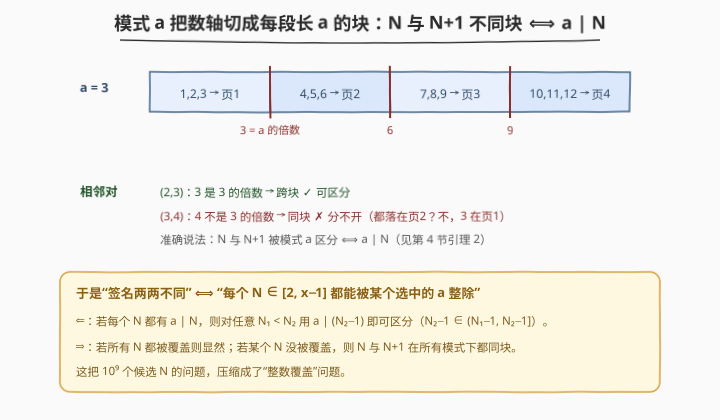
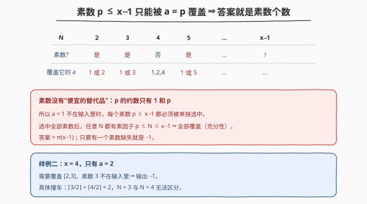

# Codeforces 73E 最少模式猜物品数 题解

## 1. 题目概述

- **题目链接**：https://codeforces.com/problemset/problem/73/E
- **比赛来源**：Codeforces Beta Round 66 · Problem E（UTC 2011-04-10）
- **难度**：2400
- **标签**：数学、数论、素数计数、埃氏筛
- **评测类型**：普通
- **限制**：时间 2 s / 内存 256 MB

**题意**：Vasya 背包里的物品数 $N$ 满足 $2\le N\le x$，但他不知道具体值。游戏有 $n$ 种"查看模式"，模式 $i$ 的每页容量是 $a_i$：以该模式查看时，他只能看到"总页数"$b_i=\left\lceil N/a_i\right\rceil$。

Vasya 必须**先一次性选定要查看的模式集合 $S$**，然后同时看到所有 $b_i\ (i\in S)$，再据此**唯一确定** $N$。求最少需要几个模式；若无论怎么选都无法唯一确定，输出 $-1$。

**约束**：

- $0\le n\le10^5$，$2\le x\le10^9$，$1\le a_i\le10^9$，$a_i$ 可能重复。
- $N$ 的可能取值多达 $x-1\approx10^9$ 个，不可能逐一枚举"签名"；必须找出"哪些 $N$ 需要被区分"的**结构**。
- 答案一旦超过 $n$ 就只能输出 $-1$，而 $n\le10^5$，这给"答案不可能很大"提供了上界。
- 只有一组数据。

## 2. 示例与观察

**官方样例 1**：

```text
输入：
2 4
2 3

输出：
2
```

$N\in\{2,3,4\}$。只选模式 $2$：$b=\lceil N/2\rceil$ 为 $1,2,2$，$N=3$ 与 $N=4$ 撞车；只选模式 $3$：$1,1,2$，$N=2$ 与 $N=3$ 撞车。两者一起选：

| $N$ | $\lceil N/2\rceil$ | $\lceil N/3\rceil$ |
|-----|--------------------|--------------------|
| 2 | 1 | 1 |
| 3 | 2 | 1 |
| 4 | 2 | 2 |

三行互不相同 → 需要 $2$ 个模式。

**官方样例 2**：

```text
输入：
1 4
2

输出：
-1
```

只有模式 $2$，而 $\lceil 3/2\rceil=\lceil 4/2\rceil=2$，$N=3$ 与 $N=4$ 无法区分 → $-1$。

自造样例（标注"自造"）：

| 输入 | 输出 | 说明 |
|------|------|------|
| `1 2` / `5` | 0 | 只有 $N=2$ 一种可能，0 个模式就够 |
| `1 3` / `2` | 1 | $N\in\{2,3\}$，$\lceil2/2\rceil=1,\lceil3/2\rceil=2$，一个模式足够 |
| `1 3` / `3` | -1 | $\lceil2/3\rceil=\lceil3/3\rceil=1$，区分不了 |
| `3 100` / `1 7 7` | 1 | 模式 $1$ 直接给出 $N$ |
| `3 6` / `2 3 5` | 3 | 素数 $2,3,5$ 各要一个 |
| `2 6` / `2 3` | -1 | 缺素数 $5$ |

**观察**：$b_i=\lceil N/a_i\rceil$ 只决定 $N$ 落在哪个长度为 $a_i$ 的"页块"里。要让 $N_1\ne N_2$ 被区分，必须有某个被选模式 $a$ 使它们**落在不同的块**里，即区间 $(N_1,N_2]$ 里存在 $a$ 的倍数。

## 3. 解题思路

### 3.1 朴素做法与瓶颈

对每个候选集合 $S$ 逐一检查 $N\in[2,x]$ 的签名是否互不相同，是 $O(2^n\cdot x)$，不可行。就算枚举 $S$，$x$ 也太大。必须把"区分能力"翻译成一个只和 $a_i$、$x$ 有关的数论条件。

### 3.2 核心观察：只需要区分"相邻"的两数



**第一步：把"签名不同"化简成"相邻两数可区分"。**

$b_i=\left\lfloor\dfrac{N-1}{a_i}\right\rfloor+1$，所以"在模式 $a$ 下 $N$ 的值相同"$\iff$ $\left\lfloor\frac{N_1-1}{a}\right\rfloor=\left\lfloor\frac{N_2-1}{a}\right\rfloor$ $\iff$ 区间 $(N_1-1,\,N_2-1]$ 内没有 $a$ 的倍数。

对**相邻**的 $N$ 与 $N+1$：区间是 $(N-1,N]$，其中唯一的整数是 $N$，于是

$$N\text{ 与 }N+1\text{ 能被模式 }a\text{ 区分}\iff a\mid N .$$

**第二步：相邻全部可区分 ⇒ 全部可区分。**

设每个 $N\in[2,x-1]$ 都存在 $a^{(N)}\in S$ 使 $a^{(N)}\mid N$。任取 $N_1<N_2$，令 $a=a^{(N_2-1)}$，则 $a\mid N_2-1$，而 $N_2-1\in(N_1-1,\,N_2-1]$，所以模式 $a$ 能区分 $N_1,N_2$。∎

于是问题等价于：

> 选最少的 $a_i$，使**每个整数 $N\in[2,x-1]$ 都能被某个选中的 $a$ 整除**。

### 3.3 从"覆盖区间"到"必须选中所有素数"



- 若某个 $a_i=1$：它整除一切，一个模式就够（答案 $1$）。
- 否则看素数：素数 $p$ 的约数只有 $1$ 和 $p$。所以要让 $p$ 被覆盖，**必须选中 $a=p$**（$a=1$ 已被排除）。于是
  $$\text{答案}=\#\{p\le x-1:\ p\text{ 是素数}\}=\pi(x-1),$$
  前提是这些素数**全部**出现在输入里；缺一个就 $-1$。
- 反过来，若所有 $\le x-1$ 的素数都在 $S$ 里，那么任意 $N\in[2,x-1]$ 都有素因子 $p\le N\le x-1$，$p\in S$ 且 $p\mid N$，全部被覆盖 ✓。

**小 $x$ 的特判**（此时"相邻对数"很少）：

- $x=2$：只有 $N=2$ 一种可能，答案是 $0$；
- $x=3$：只需区分 $N=2,3$，即只需覆盖 $N=2$：选 $a=2$（或 $a=1$）即可，答案是 $1$（若两者都没有则 $-1$）。

**规模判断**：$\pi(2\times10^6)=148933>10^5\ge n$，所以当 $x-1>2\times10^6$ 时答案必然超过 $n$，直接 $-1$；否则筛到 $x-1$ 即可。

### 3.4 样例走查

**样例一**（$n=2,x=4,a=\{2,3\}$）：需要覆盖 $[2,3]$。素数 $2,3$ 都在输入中，各选一个 → 答案 $\pi(3)=2$ ✓。

**样例二**（$n=1,x=4,a=\{2\}$）：需要覆盖 $[2,3]$，素数 $3$ 不在输入里 → $-1$ ✓（$N=3$ 与 $N=4$ 撞车正是"$3$ 未被覆盖"的体现：$N=3$ 需要被某个 $a\mid 3$ 覆盖，只有 $a=3$ 或 $1$）。

**自造**（`2 6` / `2 3`）：需要覆盖 $[2,5]$，素数 $\{2,3,5\}$，$5$ 缺失 → $-1$；确实 $N=5$ 与 $N=6$ 在两种模式下都是 $(3,2)$。

## 4. 正确性证明

**引理 1（块结构）**：对正整数 $a$，$N\mapsto\left\lceil N/a\right\rceil$ 把正整数分成 $\{(k-1)a+1,\dots,ka\}$ 这些块；两数 $N_1<N_2$ 同块 $\iff$ $(N_1-1,N_2-1]$ 中无 $a$ 的倍数。

**证明**：$\lceil N/a\rceil=k\iff (k-1)a<N\le ka\iff (k-1)a\le N-1<ka\iff \lfloor (N-1)/a\rfloor=k-1$。故同块 $\iff$ $\lfloor\frac{N_1-1}{a}\rfloor=\lfloor\frac{N_2-1}{a}\rfloor$，即区间 $(N_1-1,N_2-1]$ 不含 $a$ 的倍数。∎

**引理 2（相邻判据）**：$N$ 与 $N+1$ 可被模式 $a$ 区分 $\iff a\mid N$。

**证明**：由引理 1，取 $N_1=N$、$N_2=N+1$，区间为 $(N-1,N]$，唯一整数是 $N$，故"含 $a$ 的倍数"$\iff a\mid N$。∎

**引理 3（相邻足够）**：若对每个 $N\in[2,x-1]$ 都有 $a\in S$ 使 $a\mid N$，则对任意 $N_1<N_2$ 在 $[2,x]$ 中都有模式区分它们。

**证明**：见 3.2 第二步（用 $a^{(N_2-1)}$）。∎

**引理 4（素数必要性）**：若 $1\notin S$ 且答案是有限的，则 $S$ 必须包含所有素数 $p\le x-1$。

**证明**：$p\le x-1$ 且 $p\ge2$，故 $p\in[2,x-1]$ 必须被某个 $a\in S$ 整除。$p$ 的约数只有 $1,p$；$1\notin S$，故 $a=p$。∎

**定理**：$1\notin a$ 且 $x\ge4$ 时，答案为 $\pi(x-1)$（当且仅当所有 $\le x-1$ 的素数都在输入中），否则 $-1$；$x=2$ 时答案 $0$；$x=3$ 时答案 $1$（需 $2\in a$ 或 $1\in a$）。

**证明**：必要性由引理 4；充分性：选全部 $\le x-1$ 的素数，则任意 $N\in[2,x-1]$ 的最小素因子 $p\le N\le x-1$ 被选中且 $p\mid N$，由引理 3 全部可区分。$x=2$ 与 $x=3$ 直接检查。∎

## 5. 复杂度分析

- **时间**：$O(n\log n)$ 读入排序 + 筛素数 $O(L\log\log L)$，其中 $L=\min(x-1,2\times10^6)$；最坏 $L=2\times10^6$，实测 C++ 约 $0.23$ s、Python 约 $0.24$ s。
- **空间**：$O(L+n)$ 的筛表与数组。
- **数值范围**：$x\le10^9$，但只有 $x-1\le2\times10^6$ 时才可能不是 $-1$；素数个数 $\le148933$，与 $n$ 的比较用 `long long` 更保险。
- **与时限的关系**：2 s 时限下余量在 100 倍以上。

## 6. 参考代码

### C++17

```cpp
#include <bits/stdc++.h>
using namespace std;

int main() {
    ios::sync_with_stdio(false);
    cin.tie(nullptr);
    long long n, x;
    if (!(cin >> n >> x)) return 0;
    vector<long long> a(n);
    for (int i = 0; i < n; ++i) cin >> a[i];
    if (x == 2) { cout << 0 << '\n'; return 0; }          // 只有 2 件，无需任何模式
    for (long long v : a) if (v == 1) { cout << 1 << '\n'; return 0; }
    long long L = x - 1;                                   // 需要被覆盖的区间 [2, L]
    if (L == 2) {                                          // 只有 2 需要被覆盖
        for (long long v : a) if (v == 2) { cout << 1 << '\n'; return 0; }
        cout << "-1\n"; return 0;
    }
    // 所有 <= L 的素数都必须出现在 a 中（答案就是素数个数）；n <= 1e5 限制了 L
    if (L > 2000000) { cout << "-1\n"; return 0; }
    vector<char> isComp(L + 1, 0);
    vector<long long> primes;
    for (long long i = 2; i <= L; ++i) {
        if (!isComp[i]) {
            primes.push_back(i);
            for (long long j = i * i; j <= L; j += i) isComp[j] = 1;
        }
    }
    if ((long long)primes.size() > n) { cout << "-1\n"; return 0; }
    sort(a.begin(), a.end());
    for (long long p : primes)
        if (!binary_search(a.begin(), a.end(), p)) { cout << "-1\n"; return 0; }
    cout << primes.size() << '\n';
    return 0;
}
```

### Python3

```python
import sys


def main() -> None:
    data = sys.stdin.buffer.read().split()
    if not data:
        return
    n, x = int(data[0]), int(data[1])
    a = sorted(int(v) for v in data[2:2 + n])
    if x == 2:
        print(0)
        return
    if 1 in a:
        print(1)
        return
    L = x - 1
    if L == 2:
        print(1 if 2 in a else -1)
        return
    if L > 2000000:
        print(-1)
        return
    is_comp = bytearray(L + 1)
    primes = []
    for i in range(2, L + 1):
        if not is_comp[i]:
            primes.append(i)
            for j in range(i * i, L + 1, i):
                is_comp[j] = 1
    if len(primes) > n:
        print(-1)
        return
    s = set(a)
    for p in primes:
        if p not in s:
            print(-1)
            return
    print(len(primes))


main()
```

## 7. 边界情况与易错点

1. **$x=2$**：只有 $N=2$ 一种可能，答案必须是 $0$（而不是 $1$）。这是唯一"不需要任何模式"的情形，容易漏特判。
2. **$x=3$**：只需覆盖 $2$。此时"所有素数 $\le2$"只有一个素数 $2$，答案 $1$；若输入里没有 $2$ 也没有 $1$，则 $\lceil2/3\rceil=\lceil3/3\rceil=1$，输出 $-1$。程序把 $L=2$ 单独处理，避免筛子退化。
3. **$a_i=1$ 优先**：$1$ 整除一切，答案直接 $1$，不必再看素数。漏掉这一条会在"$x$ 很大但输入里有 $1$"时错误输出 $-1$。
4. **$\pi(x-1)$ 可能超过 $n$**：$x-1>2\times10^6$ 时素数个数已超过 $10^5\ge n$，必为 $-1$。若不设这个上界，筛到 $10^9$ 会直接 MLE/TLE。
5. **重复的 $a_i$**：题面允许重复，但每个素数只需一个，用集合/排序后二分即可；不要因为重复而把答案算大。
6. **$a_i>x$**：这样的模式对 $[2,x-1]$ 的任何 $N$ 都给出 $b=1$，完全无用；程序只查 $\le L$ 的素数，不受影响。
7. **证实"素数必须全有"时别漏掉 $1$**：$1$ 也是 $2$ 的约数，但 $1$ 只能覆盖一切（已在第 3 条处理）；若既有 $1$ 又有别的数，答案仍是 $1$，不是 $\pi$。
8. **筛法边界**：`j = i*i` 在 $L$ 较小时（如 $L=3$）不会越界；`vector<char>` 与 `bytearray` 都按 $L+1$ 开，注意 $L\ge3$ 时才进入筛法分支。

## 8. 验证记录

- **编译环境与命令**：`Apple clang 21.0.0`（无 GNU `g++`）配合仓库自带 `codeforces/tools/include/bits/stdc++.h` 兼容头，`clang++ -std=c++17 -O2`；Python 3.9.6。
- **官方样例**：2 / 2 通过（`2`、`-1`），C++ 与 Python 一致。
- **独立暴力对拍**：另写一份**子集全枚举**暴力——对 $n\le5$ 的所有子集 $S$（按大小升序），直接在 $N\in[2,x]$ 上检查签名 $\bigl(\lceil N/a_i\rceil\bigr)_{i\in S}$ 是否两两不同，第一个可行的 $|S|$ 即答案。与正式程序对拍 **300 组**随机数据（$x\in[2,12]$、$n\in[0,5]$、$a_i$ 取 $[1,13]$），**全部一致**（含 `-1` 与 $x=2,3$ 的边界）。
- **额外测试**：第 2 节表中 6 组自造样例（$x=2$、$x=3$ 的两种、$a=1$、素数齐全、缺素数）逐一核对。
- **最大约束性能**：$n=10^5$、$x=2\times10^6+1$（直接 $-1$ 分支）与 $x=2\times10^6$（$n=10^5$，$\pi=148933>n$ → $-1$，但必须真的筛完才知道）分别测：C++ 约 $0.23$ s、Python 约 $0.24$ s（瓶颈都是 $2\times10^6$ 规模的筛）；相对 2 s 余量在 8 倍以上。正例 $x=32$（素数 $2\dots31$ 共 $11$ 个，答案 $11$）C++ 约 $2$ ms。
- **复核状态**：verified（样例、子集全枚举对拍、边界、性能四项均实跑通过）。

## 相关题目与扩展

- [Codeforces 73D 省份隧道最少修路](https://codeforces.com/problemset/problem/73/D)：同场 D 题，"图上的端点计数 + 合并贪心"。
- [Codeforces 230B T-primes](https://codeforces.com/problemset/problem/230/B)：同样把问题化归到"素数/平方数"的判定，是素数筛的入门题。
- [Codeforces 546D Soldier and Number Game](https://codeforces.com/problemset/problem/546/D)：素数筛 + 前缀和的组合。
- [Luogu P1835 素数密度](https://www.luogu.com.cn/problem/P1835)：区间筛，处理"只关心 $[L,R]$ 内素数"的场景。

**延伸思考**：

1. **如果模式给出的不是"页数"而是"余数"**：例如显示 $N\bmod a_i$，那么用几个模数唯一确定 $N\in[2,x]$ 就是中国剩余定理问题，答案是"最小的模数集合使乘积 $\ge x$"，与本题的素数覆盖完全不同的味道。
2. **如果允许"自适应选择"（看到结果后决定下一个模式）**：答案会显著变小（类似二分/决策树），本题的关键限制正是"必须一次性选好"。
3. **如果 $x$ 大到 $10^{18}$**：$\pi(x-1)$ 无法精确计算（需要 Meissel–Lehmer 等算法），但由 $n\le10^5$ 可知答案必然超过 $n$ → 仍可 $O(1)$ 判 $-1$：只需检查 $x-1$ 是否小于"第 $n+1$ 个素数"。
4. **如果 $a_i$ 允许为 $0$**：$a=0$ 无法做除数（题面也限定 $a_i\ge1$）；若强行定义，页数会无意义，问题退化。
