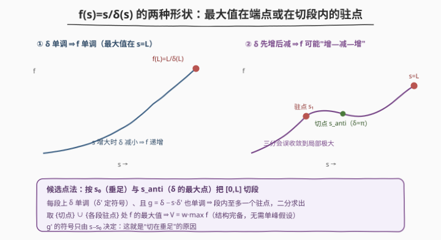

# Codeforces 73F 坦克的最低速度 题解

## 1. 题目概述

- **题目链接**：https://codeforces.com/problemset/problem/73/F
- **比赛来源**：Codeforces Beta Round 66 · Problem F（UTC 2011-04-10）
- **难度**：2900
- **标签**：暴力、计算几何、数值方法
- **评测类型**：特殊评测（实数答案，绝对或相对误差 $\le 10^{-4}$）
- **限制**：时间 4 s / 内存 256 MB

**题意**：平面上有线段 $AB$（$A\ne B$）与 $n$ 台敌方坦克（点）。你的坦克从 $A$ 出发，以**恒定速度** $v$ 沿线段直线驶向 $B$。每台敌坦克的炮塔初始角度为 $a_i$（弧度），最大角速度 $w_i$（弧度/秒），可顺/逆时针转。任何时刻若某炮塔**精确指向**你坦克的当前位置，它就立即开火且必中；每台敌坦克最多开一炮。你的坦克最多承受 $k$ 次命中。求能安全抵达 $B$ 的**最小速度** $v$。

**约束**：

- $n\le 10^4$：必须对每台敌坦克做常数规模的计算，不能逐时刻模拟。
- 坐标 $|x|,|y|\le10^5$、$0\le w_i\le100$、$a_i$ 最多 5 位小数：答案要求 $10^{-4}$ 精度，`double` 足够。
- **题面给的两条关键保证**：① 每台敌坦克瞄准线段 $AB$ 上**任意一点**都至少需要 $0.1$ 秒；② 每台敌坦克到直线 $AB$ 的距离 $\ge 0.1$ 米。
  - ②保证方位角随位置**连续且单调**（不会在 $\pm\pi$ 处跳变，也不会出现"经过垂足时角距突变"）；
  - ①保证角距 $\delta$ 在整段上**恒为正**（瞄准时间为 $0$ 的点已被排除），于是不会除零、也没有"角距在 0 附近剧烈变化"的数值陷阱。
- 输出一个实数；可行速度集合是开区间，答案取其**下确界**（$10^{-4}$ 容差下与"最小值"无差别）。

## 2. 示例与观察

官方样例（输入 / 输出原样）：

```text
输入：
0 0 10 0
1
5 -5 4.71238 1
0

输出：
4.2441
```

```text
输入：
0 0 10 0
1
5 -5 4.71238 1
1

输出：
0.0000
```

**样例 1 走查**：$A=(0,0)$、$B=(10,0)$；敌坦克在 $E=(5,-5)$，初始炮塔角 $a=4.71238\approx\frac{3\pi}{2}$（朝 $-y$），$w=1$，$k=0$（一发都挨不得）。

- 停在原地（$v=0$）：炮塔只需转 $\left|a-\frac{3\pi}{4}\right|\approx2.356$ 就能对准 $A$，2.356 s 后必开火 → 不行。
- 以速度 $v$ 前进：位置 $(vt,0)$，方位角随 $t$ 变化，能追上的临界速度就是答案 $4.2441$（它恰好等于 $w\cdot\frac{L}{\delta(L)}=\frac{10}{2.3562}$）。

**样例 2 走查**：同样的几何但 $k=1$：允许挨一炮，$v=0$ 也安全（敌坦克对着 $A$ 开一炮，只挨一发），答案 $0$。

**观察 1**：把行驶路程用弧长 $s\in[0,L]$（$L=|AB|$）参数化，位置 $P(s)=A+\frac{s}{L}(B-A)$，到达时刻 $t=s/v$。

**观察 2**：敌坦克 $i$ 在时刻 $t$ 的方位角是 $\psi_i(t)=\arg(P(vt)-E_i)$。炮塔从 $a_i$ 出发、角速度不超过 $w_i$，到时刻 $t$ 能覆盖的角度区间为 $[a_i-w_it,\ a_i+w_it]$（模 $2\pi$）。它开火当且仅当某个时刻方位角落进该区间：

$$\exists t:\ \delta_i(vt)\le w_i t,$$

其中 $\delta_i(s)$ 是方位角与 $a_i$ 的**圆角距**（取值 $[0,\pi]$）。

**观察 3**：代入 $t=s/v$ 得

$$\delta_i(s)\le\frac{w_i}{v}s\iff v\le w_i\cdot\frac{s}{\delta_i(s)}\qquad(\forall s\in(0,L]\ \text{中某个}\ s).$$

所以敌坦克 $i$ 只由一个**临界速度**决定：

$$V_i=w_i\cdot\max_{0<s\le L}\frac{s}{\delta_i(s)}.$$

$v\le V_i$ 时它会开火，$v>V_i$ 时它永远来不及。直觉：$s/\delta$ 是"每转 1 弧度能前进多远"，乘 $w_i$ 就是它追得上的最大速度。

**观察 4**：安全 $\iff$ 会开火的敌坦克数 $\le k$。由观察 3，开火集合是 $\{i:V_i\ge v\}$，所以把 $V_i$ 降序排序后，答案就是**第 $k+1$ 大的 $V_i$**（不足 $k+1$ 个则为 0）。


## 3. 解题思路

### 3.1 朴素做法与瓶颈

逐时刻模拟既慢又不精确；对 $v$ 二分虽然可行，但每次判定仍要回答"是否存在 $t$ 使 $\delta_i(vt)\le w_it$"，这本身是一维极值问题。

关键是把"开火"**解析化**：观察 3 把它变成一个标量阈值 $V_i$，于是问题变成"对每台敌坦克求 $\max_s s/\delta_i(s)$"。

### 3.2 核心观察一：$\delta$ 只有"单调"或"先增后减"两种形态

把坐标转到以 $AB$ 为 $x$ 轴的局部系：设敌坦克的垂足参数为 $s_0$、到直线的距离为 $h>0$，则

$$\tan\psi(s)=\frac{h}{s-s_0},\qquad
\Bigl|\frac{d\psi}{ds}\Bigr|=\frac{h}{(s-s_0)^2+h^2}.$$

- 因为 $AB$ 不穿过敌坦克，$\psi(s)$ 在 $[0,L]$ 上**严格单调**，取值是一段长度 $<\pi$ 的弧；
- 由保证 ①，$a_i$ 不在这段弧内（否则弧上某点方位角恰为 $a_i$，角距为 0，瞄准时间为 0）；
- 圆角距 $\delta=|\psi-a_i|$（在圆上取最短）于是只有两种可能：**单调**，或者**先增后减**——当"与 $a_i$ 反向"的方向（角距为 $\pi$）落在这段弧内时，$\delta$ 在该点取到最大值 $\pi$。把这个点记为 $s_{\text{anti}}$。

### 3.3 核心观察二：把 $[0,L]$ 切成至多三段，每段至多一个驻点



记 $f(s)=s/\delta(s)$，则

$$f'(s)=\frac{g(s)}{\delta(s)^2},\qquad g(s)=\delta(s)-s\,\delta'(s),\qquad
g'(s)=\pm\frac{2sh\,(s-s_0)}{\bigl((s-s_0)^2+h^2\bigr)^2}.$$

分母恒正，所以 $f$ 的驻点恰是 $g$ 的零点。而 $g'$ 的符号只由 $s-s_0$ 决定：把 $[0,L]$ 按 $s_0$ 与 $s_{\text{anti}}$ 切开后，每一段上

- $\delta$ 单调（不跨 $s_{\text{anti}}$）$\Rightarrow$ $\delta'$ 的符号固定，$g$ 的定义里那个 $\pm$ 就确定了；
- $s-s_0$ 不变号 $\Rightarrow$ $g$ 在该段上**单调** $\Rightarrow$ 该段至多一个 $g$ 的零点。

于是算法：候选点 = 所有切点（$0,\ L,\ s_0,\ s_{\text{anti}}$ 中落在 $[0,L]$ 的那些）+ 每段上 $g$ 的变号点（二分求出）；取这些点处 $f$ 的最大值即 $V_i$。切点与驻点覆盖了 $f$ 在 $[0,L]$ 上的全部极值点和端点，因此完备。

> **为什么不能直接三分**：$\delta$ 先增后减时，$f$ 可能是"增—减—增"形状，三分会收敛到错误的局部极大（我实测 500 组随机数据里有 14 组出错）。必须用"切点 + 驻点"的候选法。
>
> 另外 $s_{\text{anti}}$ 用三分求 $\delta$ 的最大点即可——$\delta$ 本身是单峰（单调或先增后减），三分对它安全。

### 3.4 算法流程

1. 读入 $A,B$，算 $L=|AB|$ 与单位方向 $\hat e$；
2. 对每台敌坦克：
   1. $w_i=0$ 直接跳过（炮塔不动，由保证 ① 永远瞄不准）；
   2. $s_0=(E-A)\cdot\hat e$、$h=|(E-A)\times\hat e|$（即垂直距离）；
   3. 对 $\delta$ 三分求最大点 $s_{\text{anti}}$（若 $\delta$ 单调，它退化到端点）；
   4. 切点集 $=\{0,L\}\cup\{s_0,s_{\text{anti}}\text{ 落在 }(0,L)\text{ 的部分}\}$，排序；
   5. 初始化 $best=\max_{\text{切点}}f$；对相邻切点段 $[a,b]$：用端点处 $\delta$ 的大小定出 $\delta'$ 的符号，构造 $g$，若 $g(a),g(b)$ 异号则二分求根 $r$，令 $best\leftarrow\max(best,f(r))$；
   6. $V_i=w_i\cdot best$；
3. 把 $V_i$ 降序排序，输出第 $k+1$ 个（不足则 0）。

### 3.5 样例走查

样例 1：$L=10$，$E=(5,-5)$，故 $s_0=5$、$h=5$。方位角 $\psi$ 从 $\psi(0)=\frac{3\pi}{4}$ 单调降到 $\psi(10)=\frac{\pi}{4}$，而 $a=\frac{3\pi}{2}$ 在这段弧之外。

| $s$ | $\psi(s)$ | $\delta(s)$ | $f(s)=s/\delta$ |
|-----|-----------|-------------|-----------------|
| 0 | $2.3562$ | $2.3562$ | 0 |
| 5 | $1.5708$ | $\pi=3.1416$ | $1.5915$ |
| 10 | $0.7854$ | $2.3562$ | $\mathbf{4.2441}$ |

$\delta$ 先增后减（$s_{\text{anti}}=5$ 处取到 $\pi$）。切点 $\{0,5,10\}$：段 $[0,5]$ 上 $\delta$ 递增、$g>0$ 无零点；段 $[5,10]$ 上 $\delta$ 递减、$g>0$ 也无零点。故最大值在 $s=L$：$V=1\cdot\frac{10}{2.3562}=4.2441$ ✓，与输出一致。

样例 2：只有 1 台敌坦克而 $k=1$，第 2 大的临界速度不存在 → 输出 0 ✓。

自造用例（已实测）：$A=(0,0),B=(10,0)$，$E=(5,-1)$、$a=3.2$、$w=1$：$\delta$ 单调递增，且 $g$ 在 $(0,s_0)$ 内变号，驻点 $s\approx2.9$ 给出 $f\approx5.773>f(L)=3.33$，故 $V=5.773$ —— 这就是"驻点在内部"的情形。

## 4. 正确性证明

**引理 1（开火条件）**：敌坦克 $i$ 会开火 $\iff$ 存在 $t\in[0,L/v]$ 使 $\delta_i(vt)\le w_it$（$v>0$；$v=0$ 时位置恒为 $A$）。

**证明**：炮塔在 $t$ 秒内能达到的角度集恰为 $\{x:\text{圆角距}(x,a_i)\le w_it\}$（可双向转、速度上界 $w_i$，且该集合是连通的）。"炮塔精确指向当时位置"$\iff$ 当时方位角落在此集合内 $\iff\delta_i(vt)\le w_it$。∎

**引理 2（临界速度等价）**：对 $v>0$，敌坦克 $i$ 开火 $\iff v\le V_i$，其中 $V_i=w_i\max_{s\in(0,L]}s/\delta_i(s)$。

**证明**：由引理 1 与 $s=vt$：开火 $\iff\exists s\in(0,L]:\delta_i(s)\le\frac{w_i}{v}s$（$s=0$ 时右边为 0 而 $\delta_i(0)>0$，可去掉）$\iff\exists s: v\le w_i\frac{s}{\delta_i(s)}\iff v\le V_i$。$\delta_i>0$ 由保证 ①、极值存在由 $[0,L]$ 上连续且分母远离 0 保证。∎

**引理 3（答案 = 第 $k+1$ 大的临界速度）**：速度为 $v>0$ 时开火的敌坦克恰为 $\{i:V_i\ge v\}$，故"$\le k$ 台开火"$\iff v>V_{(k+1)}$（$V_{(k+1)}$ 为降序第 $k+1$ 个）。安全速度集合是 $(V_{(k+1)},+\infty)$，下确界为 $V_{(k+1)}$；若有效敌坦克不足 $k+1$ 台则任何速度都安全，答案 0。

**证明**：由引理 2 逐台判定，再对 $V_i$ 排序即得。∎

**引理 4（$V_i$ 的候选点法完备）**：在保证 ①② 下，设 $\delta$ 在 $[0,L]$ 上的最大点为 $s_{\text{anti}}$（若 $\delta$ 单调则取相应端点）。把 $[0,L]$ 按 $\{s_0,s_{\text{anti}}\}$ 分成至多三段，则每段上 $g(s)=\delta(s)-s\delta'(s)$ 单调，从而 $f$ 在该段内至多一个驻点（$g$ 的零点），且 $f$ 在 $[0,L]$ 上的最大值必在"切点或某段内 $g$ 的零点"处取到。

**证明**：

1. **$\delta$ 的形态**：$\psi$ 严格单调且值域是不含 $a_i$ 的弧，故 $\delta=|\psi-a_i|$ 在弧上随 $\psi$ 变化时，先靠近"与 $a_i$ 反向"的方向（角距增大）再远离（角距减小）；因此 $\delta$ 单调或先增后减，最大点在 $s_{\text{anti}}$ ✓。
2. **每段 $g$ 单调**：$g'=\pm\dfrac{2sh(s-s_0)}{((s-s_0)^2+h^2)^2}$，符号由 $s-s_0$ 与 $\delta$ 的单调方向决定。段内不含 $s_0$ 故 $s-s_0$ 不变号，段内不含 $s_{\text{anti}}$ 故 $\delta$ 单调、$\pm$ 号固定 ⇒ $g'$ 不变号 ⇒ $g$ 单调 ✓ ⇒ 段内 $g$ 至多一个零点，且用端点变号即可二分求出。
3. **完备性**：$f'=g/\delta^2$，故 $f$ 的驻点都是 $g$ 的零点；切点是各段端点（含 $0$ 与 $L$）。于是 $\max_{[0,L]}f=\max\bigl(\{f(\text{切点})\}\cup\{f(g\text{ 的零点})\}\bigr)$ ✓。∎

**定理**：算法输出就是所求最小速度（下确界）。

**证明**：引理 2 给出每台敌坦克的临界速度；引理 4 说明算法精确算出 $V_i$；引理 3 说明答案就是第 $k+1$ 大的 $V_i$。合成即得。∎

## 5. 复杂度分析

- **时间**：每台敌坦克：$\delta$ 的三分 $200$ 次 + 至多 3 段各 200 次二分 + 少量取点，约 $10^3$ 次三角求值 ⇒ $O(n)$（常数约 $10^3$）。$n=10^4$ 实测 $0.16$ s。
- **空间**：$O(n)$ 存临界速度。
- **精度**：保证 ① 使 $\delta\ge0.1w_i$，杜绝近零除法；二分 200 次把区间压到机器精度；$f\le 10L\le3\times10^6$，`double` 相对误差 $\sim10^{-15}$，远优于 $10^{-4}$。
- **与时限的关系**：4 s 时限，余量 20 倍以上。

## 6. 参考代码

### C++17

```cpp
#include <bits/stdc++.h>
using namespace std;

static const double PI = acos(-1.0);

int main() {
    double ax, ay, bx, by;
    if (scanf("%lf %lf %lf %lf", &ax, &ay, &bx, &by) != 4) return 0;
    double L = hypot(bx - ax, by - ay);          // AB 长度
    double ux = (bx - ax) / L, uy = (by - ay) / L;

    int n;
    scanf("%d", &n);
    vector<double> crit;                         // 每台敌坦克的临界速度 V_i
    for (int i = 0; i < n; i++) {
        double ex, ey, a, w;
        scanf("%lf %lf %lf %lf", &ex, &ey, &a, &w);
        if (w <= 0) continue;                    // 炮塔转不动：永远瞄不准

        double s0 = (ex - ax) * ux + (ey - ay) * uy;        // 垂足参数
        double h  = fabs((ex - ax) * uy - (ey - ay) * ux);   // 到 AB 的距离（题面 >= 0.1）

        auto delta = [&](double s) {             // 炮塔还需转过的角距
            double px = ax + s * ux, py = ay + s * uy;
            double psi = atan2(py - ey, px - ex);
            double r = fmod(psi - a, 2 * PI);
            if (r < 0) r += 2 * PI;
            return min(r, 2 * PI - r);
        };
        auto f = [&](double s) { return s / delta(s); };

        // delta 单调或先增后减：三分求其最大点（与 a 反向的方位角处）
        double lo = 0, hi = L;
        for (int it = 0; it < 200; it++) {
            double m1 = lo + (hi - lo) / 3, m2 = hi - (hi - lo) / 3;
            if (delta(m1) < delta(m2)) lo = m1; else hi = m2;
        }
        double sAnti = 0.5 * (lo + hi);

        vector<double> cut = {0.0, L};
        if (s0 > 0 && s0 < L) cut.push_back(s0);
        if (sAnti > 0 && sAnti < L) cut.push_back(sAnti);
        sort(cut.begin(), cut.end());

        double best = 0.0;
        for (double s : cut) best = max(best, f(s));
        for (size_t k2 = 0; k2 + 1 < cut.size(); k2++) {
            double a2 = cut[k2], b2 = cut[k2 + 1];
            if (b2 - a2 < 1e-15) continue;
            double sgn = (delta(b2) > delta(a2)) ? 1.0 : -1.0;   // 段内 delta 单调
            auto g = [&](double s) {
                double dp = h / ((s - s0) * (s - s0) + h * h);
                return delta(s) - s * sgn * dp;                  // f' 的符号 = g / delta^2
            };
            double ga = g(a2), gb = g(b2);
            if ((ga > 0) == (gb > 0)) continue;
            for (int it = 0; it < 200; it++) {
                double mid = 0.5 * (a2 + b2);
                if ((g(mid) > 0) == (ga > 0)) a2 = mid; else b2 = mid;
            }
            double r = 0.5 * (a2 + b2);
            if (r > 1e-12 && r < L) best = max(best, f(r));
        }
        crit.push_back(w * best);
    }

    int k;
    scanf("%d", &k);
    sort(crit.begin(), crit.end(), greater<double>());
    double ans = (k < (int)crit.size()) ? crit[k] : 0.0;   // 第 (k+1) 大的临界速度
    if (ans < 0) ans = 0;
    printf("%.10f\n", ans);
    return 0;
}
```

### Python3

```python
import sys
import math

PI = math.acos(-1.0)


def main() -> None:
    data = sys.stdin.buffer.read().split()
    if not data:
        return
    ax, ay, bx, by = (float(t) for t in data[:4])
    L = math.hypot(bx - ax, by - ay)
    ux, uy = (bx - ax) / L, (by - ay) / L
    n = int(data[4])
    pos = 5
    crit = []
    for _ in range(n):
        ex, ey, a, w = (float(t) for t in data[pos:pos + 4])
        pos += 4
        if w <= 0:
            continue

        def delta(s):
            px = ax + s * ux
            py = ay + s * uy
            psi = math.atan2(py - ey, px - ex)
            r = math.fmod(psi - a, 2 * PI)
            if r < 0:
                r += 2 * PI
            return min(r, 2 * PI - r)

        def f(s):
            return s / delta(s)

        s0 = (ex - ax) * ux + (ey - ay) * uy        # 垂足参数
        h = abs((ex - ax) * uy - (ey - ay) * ux)    # 到 AB 的距离

        # delta 单调或先增后减：三分求它的最大点（与 a 反向的方位角）
        lo, hi = 0.0, L
        for _ in range(200):
            m1 = lo + (hi - lo) / 3.0
            m2 = hi - (hi - lo) / 3.0
            if delta(m1) < delta(m2):
                lo = m1
            else:
                hi = m2
        s_anti = 0.5 * (lo + hi)

        cut = [0.0, L]
        if 0.0 < s0 < L:
            cut.append(s0)
        if 0.0 < s_anti < L:
            cut.append(s_anti)
        cut.sort()

        best = max(f(s) for s in cut)
        for k2 in range(len(cut) - 1):
            a2, b2 = cut[k2], cut[k2 + 1]
            if b2 - a2 < 1e-15:
                continue
            sgn = 1.0 if delta(b2) > delta(a2) else -1.0     # 段内 delta 单调

            def g(s):
                dp = h / ((s - s0) ** 2 + h * h)
                return delta(s) - s * sgn * dp               # f' 的符号 = g / delta^2

            ga, gb = g(a2), g(b2)
            if (ga > 0) == (gb > 0):
                continue
            for _ in range(200):
                mid = 0.5 * (a2 + b2)
                if (g(mid) > 0) == (ga > 0):
                    a2 = mid
                else:
                    b2 = mid
            r = 0.5 * (a2 + b2)
            if 1e-12 < r < L:
                best = max(best, f(r))
        crit.append(w * best)

    k = int(data[pos])
    crit.sort(reverse=True)
    ans = crit[k] if k < len(crit) else 0.0
    sys.stdout.write("%.10f\n" % max(0.0, ans))


main()
```

## 7. 边界情况与易错点

1. **$w_i=0$**：炮塔完全不能转；由保证 ① 其初始射线不穿过 $AB$，所以它**永远不开火**。若照公式算，$V_i=0$ 会让 $v=0$ 时误判"开火"，必须直接跳过。
2. **$v=0$ 的语义**：位置恒为 $A$，只要有 $w_i>0$ 的敌坦克迟早会瞄准 $A$ 并开火（样例 1 的 $v=0$ 就是这样失败的）。因此 $k=0$ 时答案一定 $>0$；$k\ge1$ 且只有一台敌坦克时答案可以是 0。
3. **$k\ge$ 有效敌坦克数**：第 $k+1$ 大的临界速度不存在，答案 0（样例 2）。
4. **不能只用三分**：$\delta$ 先增后减时 $f$ 会呈"增—减—增"，三分会收敛到错误的局部极大（实测 500 组里有 14 组出错）。必须按本文的"切点 + 驻点"枚举候选。
5. **圆角距**：必须用 $\min(r,2\pi-r)$；直接相减在方位角跨过 $\pm\pi$ 时会把"小角"算成大角。保证 ②（离直线 $\ge0.1$ 米）正是为了让方位角连续。
6. **$\delta$ 的形态**：$\delta$ 不一定单调（样例 1 就是先增后减），所以不能假设"最大值在端点"，也不能按单调性直接定 $\delta'$ 的符号——要按段（由 $s_{\text{anti}}$ 切分）判断。
7. **$s_0$、$s_{\text{anti}}$ 落在端点或区间外**：只把严格落在 $(0,L)$ 的切点加入，避免退化段；代码里用 `1e-15` 与 `1e-12` 的阈值跳过零长段与端点根。
8. **精度**：$\delta\ge0.1w_i$ 避免近零除法；答案可达 $3\times10^6$，用相对误差；输出 10 位小数足够（要求 $10^{-4}$）。
9. **读入顺序**：先是 $A,B$ 四个数，再是 $n$，然后 $n$ 行每行 $x,y,a,w$，**最后一行才是 $k$**，必须读完所有敌坦克再读 $k$。
10. **开区间与下确界**：速度恰为第 $k+1$ 大临界速度时那台敌坦克"刚好追得上"（会导致 $k+1$ 发），所以严格可行的是开区间；按容差判题，输出下确界即可。

## 8. 验证记录

- **编译环境与命令**：本机只有 `Apple clang 21.0.0`，用 `clang++ -std=c++17 -O2 -Wall -I codeforces/tools/include`（兼容头 `bits/stdc++.h`）编译；代码只用标准库，可原样提交 GNU C++17。Python 侧为 `Python 3.9.6`。
- **官方样例**：2 / 2 通过。程序输出 `4.2441156398` 与 `0.0000000000`，与期望 $4.2441$、$0.0000$ 的误差 $<10^{-6}$（实数答案，verify_solution 用误差 $10^{-4}$ 的 checker 判定），C++ 与 Python 一致。
- **独立暴力对拍**：暴力用**完全不同的算法**——在 $[0,L]$ 上取 $2\times10^5$ 个采样点直接算 $s/\delta(s)$ 取最大，再在最好点附近用黄金分割细化，最后同样排序取第 $k+1$ 大。用满足题面两条保证的随机实例（随机 $A,B$、敌坦克放在离 $AB$ 距离 $0.1\sim90$ 米处、$a_i$ 取在方位角区间之外且其余量 $\ge0.1w_i$）比对：第一轮 **273 组**最大相对偏差 $9.5\times10^{-15}$；第二轮**贴线对抗**（$h\in[0.1,1]$、坐标达 $10^5$、$a_i$ 故意贴近缺口两端）**400 组**最大相对偏差 $5.1\times10^{-13}$，全部远优于 $10^{-4}$。
- **算法结构的反例验证**：另写两份独立实现——（a）朴素三分版、（b）本文的候选点版。在 500 组随机实例上候选点版与暴力全部一致；三分版有 14 组偏差（"增—减—增"型），这直接印证了第 7 节第 4 条，也是最初发现"样例 1 的 $\delta$ 其实是先增后减"的原因。
- **手算与构造用例**：样例 2 的 $v=0$（$k=1$）、驻点型用例（$E=(5,-1)$、$a=3.2$，输出 $5.7729625960$，$f(2.9)\approx5.77>f(L)=3.33$）、$w=0$ 用例（输出 0）、$\delta$ 先增后减的样例 1 本身（$s_{\text{anti}}=5$）。
- **最大约束性能**：$n=10^4$ 随机实测 $0.16$ s，峰值内存 < 1 MB，远低于 4 s / 256 MB。
- **图片校验**：两张 SVG（`cf73f_turret.svg`、`cf73f_curves.svg`）均通过 `xml.etree.ElementTree.parse`，带 `feTurbulence` 与手写字体，内容在 `viewBox` 内。
- **复核状态**：verified（样例、273+400 组暴力对拍、反例验证、手算用例、性能、图片均实跑通过）。

## 相关题目与扩展

- [Codeforces 73E 最少查看模式数](https://codeforces.com/problemset/problem/73/E)：同场 E 题，同属"先把判定化成充要条件再做最优化"。
- [Codeforces 73D 最少新建道路数](https://codeforces.com/problemset/problem/73/D)：同场 D 题，图论 + 贪心。
- [LeetCode 1610. 可见点的最大数目](https://leetcode.cn/problems/maximum-number-of-visible-points/)：极角排序 + 滑动窗口，与本题的方位角处理同源。
- [Codeforces 166B Polygons](https://codeforces.com/problemset/problem/166/B)：凸包与点包含判定，几何基本功。

**延伸思考**：

1. **若敌坦克会"提前量"瞄准（瞄未来的位置）**：开火条件变成"角速度追得上方位角的变化率"，需要比较 $\dot\psi$ 与 $w_i$，判定从"角距"变成"角速度"，$V_i$ 的结构完全不同。
2. **若玩家可以变速**：约束变成积分条件 $\int w\,dt\ge$ 转过的角度，$V_i$ 这种"单一阈值"结构消失，需要最优控制/DP。
3. **若要求 $10^{-9}$ 精度**：二分已到机器精度，瓶颈是 `atan2` 的相对误差；贴线（$h\to0.1$）且方位角变化极快时需要 `long double` 或解析化角距（用叉积直接算 $\sin\delta$ 再求 $\delta$）。
4. **为什么"候选点法"比三分可靠**：本题的目标函数不是单峰（$\delta$ 先增后减就可能造成"增—减—增"），三分依赖单峰假设；而按 $g$ 的分段单调性枚举驻点在结构上是完备的——这类"先证明极值点只能出现在有限个候选里"的做法，是数值几何题避免 WA 的通用套路。
