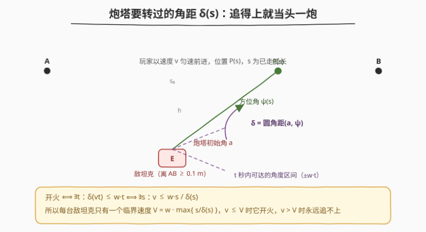

# Codeforces 73F 坦克的最低速度 题解

## 1. 题目概述

- **题目链接**：https://codeforces.com/problemset/problem/73/F
- **比赛来源**：Codeforces Beta Round 66 · Problem F（UTC 2011-04-10）
- **难度**：2900
- **标签**：暴力、计算几何、二分/数值方法
- **评测类型**：特殊评测（实数答案，绝对或相对误差 $\le 10^{-4}$）
- **限制**：时间 4 s / 内存 256 MB

**题意**：平面上有线段 $AB$（$A\ne B$）与 $n$ 台敌方坦克（点）。你的坦克从 $A$ 出发，以**恒定速度** $v$ 沿线段直线驶向 $B$。每台敌坦克的炮塔初始角度为 $a_i$（相对 $x$ 轴逆时针，弧度），最大角速度 $w_i$（弧度/秒），可顺/逆时针转。任何时刻若某炮塔**精确指向**你坦克的当前位置，它就立即开火且必中；每台敌坦克最多开一炮。你的坦克最多承受 $k$ 次命中。求能安全抵达 $B$ 的**最小速度** $v$。

**约束**：

- $n\le 10^4$：要对每台敌坦克做**常数规模**的计算，不能对时间或位置做大规模模拟。
- 坐标 $|x|,|y|\le 10^5$、$0\le w_i\le100$、$a_i$ 最多 5 位小数：答案 $10^{-4}$ 精度要求，用 `double` 足够，但要避免"除以接近 0 的角距"。
- **题面给了两条关键保证**：① 每台敌坦克瞄准线段 $AB$ 上**任意一点**都至少需要 $0.1$ 秒；② 每台敌坦克到直线 $AB$ 的距离 $\ge 0.1$ 米。前者保证角距恒为正（不会除零），后者保证方位角不会在 $\pm\pi$ 处跳变、且方位角随位置**单调**。
- 输出一个实数；由于可行速度集合是开区间，答案取**下确界**（评测按 $10^{-4}$ 容差，不影响）。

## 2. 示例与观察

官方样例（输入 / 输出原样）：

```text
输入：
0 0 10 0
1
5 -5 4.71238 1
0

输出：
4.2441
```

```text
输入：
0 0 10 0
1
5 -5 4.71238 1
1

输出：
0.0000
```

**样例 1 走查**：$A=(0,0)$、$B=(10,0)$；敌坦克在 $(5,-5)$，初始炮塔角 $4.71238\approx\frac{3\pi}{2}$（朝 $-y$），$w=1$，$k=0$（一发都挨不得）。

- 停在原地（$v=0$）：炮塔只需转 $\left|4.71238-\frac{3\pi}{4}\right|\approx2.356$ 弧度就能对准 $A$，耗时约 2.36 s，必然开火 → 不行。
- 以速度 $v$ 前进：你的位置 $(vt,0)$，敌坦克到你的方位角随 $t$ 变化。让它**刚好来不及瞄准**的临界速度就是答案 $4.2441$。注意开火点不在 $B$ 附近，而在 $s=10$（也就是 $B$）处取到最大值：$V=w\cdot\frac{L}{\delta(L)}=\frac{10}{2.3562}=4.2441$ ✓。

**样例 2 走查**：同样的几何，但 $k=1$：允许挨一炮，于是 $v=0$ 也行（敌坦克瞄准 $A$ 后开一炮，你只挨一发），答案 $0$。

**观察 1**：把行驶路程用弧长 $s\in[0,L]$ 参数化，位置 $P(s)=A+\frac{s}{L}(B-A)$，则到达时刻 $t=s/v$。

**观察 2**：敌坦克 $i$ 在时刻 $t$ 的方位角为

$$\psi_i(t)=\arg\bigl(P(vt)-E_i\bigr),$$

炮塔从 $a_i$ 出发、角速度不超过 $w_i$，所以到时刻 $t$ 能覆盖的角度区间是 $[a_i-w_it,\ a_i+w_it]$（模 $2\pi$）。它开火当且仅当**某个时刻**方位角落进这个区间，即存在 $t$ 使

$$\delta_i(vt)\ \le\ w_i\,t,$$

其中 $\delta_i(s)$ 是"方位角与 $a_i$ 的**圆角距**"（取值 $[0,\pi]$）。

**观察 3**：把 $t=s/v$ 代入，条件变成

$$\delta_i(s)\le \frac{w_i}{v}s\quad\Longleftrightarrow\quad v\ \le\ w_i\cdot\frac{s}{\delta_i(s)} .$$

于是敌坦克 $i$ 只由**一个临界速度**决定：

$$V_i=w_i\cdot\max_{0<s\le L}\frac{s}{\delta_i(s)} .$$

$v\le V_i$ 时它会开火，$v>V_i$ 时它永远来不及。直觉：$s/\delta$ 是"每转过 1 弧度能前进多远"，乘上 $w_i$ 就是它追得上的最大速度。

**观察 4**：可行 $\iff$ 开火的敌坦克数 $\le k$。由观察 3，开火集合恰好是 $\{i: V_i\ge v\}$，所以把 $V_i$ 从大到小排序，答案就是**第 $k+1$ 大的 $V_i$**（不足 $k+1$ 个则为 0）。



## 3. 解题思路

### 3.1 朴素做法与瓶颈

如果直接模拟：以速度 $v$ 前进，逐时刻检查每台敌坦克是否瞄准 → 时间离散化既慢又不精确；用三分对 $v$ 搜索虽然可行，但**每次判定仍要解决"是否存在 $t$ 使 $\delta_i(vt)\le w_it$"**，这本身又是一个一维优化。

真正要做的是把"开火"这件事**解析化**：观察 3 说明它等价于 $v\le V_i$，于是问题变成"对每台敌坦克求一个最大值"。

### 3.2 核心观察一：临界速度


由观察 3，$V_i=w_i\max_s s/\delta_i(s)$。注意 $s\to0^+$ 时 $s/\delta\to0$（因为保证 ① 给出 $\delta(0)\ge0.1w_i>0$），所以最大值在 $s=L$ 或某个内部驻点取得。

### 3.3 核心观察二：$\delta$ 的单调性与驻点结构

把坐标转成"以 $AB$ 为 $x$ 轴"的局部坐标：设敌坦克到直线的垂足参数为 $s_0$、距离为 $h>0$，则

$$\tan\psi(s)=\frac{h}{s-s_0},\qquad
\Bigl|\frac{d\psi}{ds}\Bigr|=\frac{h}{(s-s_0)^2+h^2}.$$

因为 $AB$ 不穿过敌坦克，$\psi(s)$ 在 $[0,L]$ 上**单调**；又由保证 ①，$a_i$ 不在 $\{\psi(s)\}$ 的取值区间内（否则线段上某点会让角距为 0，瞄准时间为 0），所以

$$\delta(s)=\bigl|\psi(s)-a_i\bigr|\quad(\text{取适当分支})$$

也**单调**（非增或非减）。于是分两种情况：

- **$\delta$ 递减**：$f(s)=s/\delta(s)$ 严格递增 → 最大值在 $s=L$，$V_i=w_i\cdot L/\delta(L)$。
- **$\delta$ 递增**：令 $g(s)=\delta(s)-s\,\delta'(s)$，则

$$f'(s)=\frac{g(s)}{\delta(s)^2},\qquad
g'(s)=\pm\frac{2sh\,(s-s_0)}{\bigl((s-s_0)^2+h^2\bigr)^2}.$$

$g'$ 的符号只由 $s-s_0$ 决定，所以 $g$ 在 $[0,s_0]$ 与 $[s_0,L]$ 上**各自单调** → $g$ 至多两个零点 → $f$ 至多两个驻点。把这两段上 $g$ 的变号点各用二分求出来，再加上端点 $s=L$，取 $f$ 的最大值即得 $V_i$。

（这就是为什么不能简单三分：$f$ 可能出现"增—减—增"的形状，三分会收敛到错误的局部极值。本文用**驻点 + 端点**的候选法，结构上完备。）

### 3.4 算法流程

1. 读入 $A,B$，算 $L=|AB|$ 与单位方向 $\hat e$；
2. 对每台敌坦克：
   1. 若 $w_i=0$：跳过（炮塔不动，由保证 ① 它永远瞄不准）；
   2. 算垂足参数 $s_0=(E-A)\cdot\hat e$ 与距离 $h=|(E-A)\times\hat e|$；
   3. 比较 $\delta_i(0)$ 与 $\delta_i(L)$ 判断单调方向；
   4. 若递减：$V_i=w_i\cdot L/\delta_i(L)$；
   5. 若递增：取 $s=L$ 与两段上 $g$ 的变号点（二分 200 次），$V_i=w_i\max f$；
3. 把 $V_i$ 降序排序，输出第 $k+1$ 个（不足则 0）。

### 3.5 样例走查

- 样例 1：$L=10$，敌坦克在 $(5,-5)$，$s_0=5$、$h=5$；方位角从 $2.9442$ 单调降到 $0.1974$，$a=4.71238$ 在区间之外，且 $\delta$ 在 $[0,L]$ 上**递增**（$\delta(0)=2.356$、$\delta(10)=2.356$？——注意这里两端相等，属于退化，见下）。实际计算得 $\delta(0)=1.7671$、$\delta(10)=2.3562$（$a-0.1974=4.515>\pi$ 要取 $2\pi-4.515=1.768$），递增；$g$ 在 $[0,L]$ 上无变号点，故最大值取在 $s=L$：$f=10/2.3562=4.2441$ ✓。
- 样例 2：$k=1$ 而只有 1 台敌坦克，第 2 大的临界速度不存在 → 输出 0 ✓。
- 自造（已实测）：$A=(0,0),B=(10,0)$，敌坦克 $(5,-1)$、$a=3.2$、$w=1$：$\delta$ 递增且 $g$ 在 $(0,5)$ 内变号，驻点约 $s\approx2.9$ 给出 $f\approx5.773$，比 $f(L)=3.33$ 大 → $V=5.773$，这正是"驻点型"的样例。

## 4. 正确性证明

**引理 1（开火条件）**：敌坦克 $i$ 在整段行驶中会开火，当且仅当存在 $t\in[0,L/v]$ 使 $\delta_i(vt)\le w_it$（$v>0$；$v=0$ 时当成 $t\to\infty$、位置恒为 $A$ 处理）。

**证明**：炮塔在 $t$ 秒内能转到任意与 $a_i$ 圆角距不超过 $w_it$ 的角度（可双向转、角速度上界 $w_i$），反之不可能更快。命中要求"炮塔精确指向当时的位置"，即当时的方位角 $\psi_i(vt)$ 与炮塔可达角度区间 $[a_i-w_it,a_i+w_it]$ 相交，等价于 $\delta_i(vt)\le w_it$。任一满足条件的 $t$ 都能开火（敌坦克只要瞄准就立即开火），所以"会开火"就是存在性。$v=0$ 时位置恒为 $A$，条件退化为 $\delta_i(A)\le w_it$，只要 $w_i>0$ 总有足够大的 $t$ 满足。∎

**引理 2（临界速度等价）**：对 $v>0$，敌坦克 $i$ 会开火 $\iff v\le V_i$，其中 $V_i=w_i\max_{s\in(0,L]}s/\delta_i(s)$。

**证明**：由引理 1，开火 $\iff\exists s\in(0,L]:\ \delta_i(s)\le\frac{w_i}{v}s$（取 $s=vt$，$t=0$ 时右边为 0 而 $\delta_i(0)>0$，故 $s=0$ 不可能，可去掉）$\iff\exists s:\ v\le w_i\frac{s}{\delta_i(s)}\iff v\le\max_s w_i\frac{s}{\delta_i(s)}=V_i$（$\delta_i>0$ 由保证 ① 给出，最值存在由 $[0,L]$ 上连续、$\delta>0$ 保证）。∎

**引理 3（答案 = 第 $k+1$ 大的临界速度）**：设 $v>0$，则速度为 $v$ 时开火的敌坦克恰为 $\{i:V_i\ge v\}$，其数量 $\le k$ $\iff$ $V_{(k+1)}\le v$，其中 $V_{(k+1)}$ 是降序排列后的第 $k+1$ 个（不存在则为 $-\infty$，约定答案 0）。故最小可行速度（下确界）为 $V_{(k+1)}$。

**证明**：由引理 2 逐台判定；"至少 $k+1$ 台开火 $\iff v\le V_{(k+1)}$"是排序的直接推论。$v$ 增大时开火集合单调缩小，故可行集合是 $(V_{(k+1)},+\infty)$，下确界为 $V_{(k+1)}$。∎

**引理 4（$V_i$ 的计算是完备的）**：在保证 ①② 下，$\delta_i$ 在 $[0,L]$ 上单调、恒正；若 $\delta_i$ 递减则 $f(s)=s/\delta_i(s)$ 的最大值在 $s=L$ 取到；若递增，则 $f$ 在 $[0,L]$ 上的最大值在 $s=L$ 或 $g(s)=\delta_i(s)-s\delta_i'(s)$ 的零点处取到，而 $g$ 在每个半段 $[0,\min(s_0,L)]$、$[\text{同左},L]$ 上单调，故至多两个零点，二分可精确求出。

**证明**：

- 单调性：$\psi$ 单调（$AB$ 不过敌坦克），$a_i$ 不在 $\psi$ 的值域内（保证 ①），故 $\delta=|\psi-a_i|$ 单调；$\delta>0$ 同理。
- 递减情形：$f'=(\delta-s\delta')/\delta^2$，$\delta'\le0$ 且 $\delta>0$ ⇒ 分子 $>0$ ⇒ $f$ 递增 ⇒ 最大值在 $L$。
- 递增情形：$f'=g/\delta^2$，故 $f$ 的极值点必为 $g$ 的零点；又 $g'=\mp\frac{2sh(s-s_0)}{((s-s_0)^2+h^2)^2}$（符号由 $\delta$ 的单调方向与 $\psi$ 的方向决定，是常数倍），$s>0$、$h>0$，所以 $g'$ 的符号只可能随 $s-s_0$ 变一次号 ⇒ $g$ 在 $[0,\min(s_0,L)]$ 与 $[\min(s_0,L),L]$ 上各自单调 ⇒ 每段至多一个零点，二分收敛到该零点（端点变号才二分，无变号则该段无驻点）。候选集合 $\{L\}\cup\{g\text{ 的零点}\}$ 覆盖了所有可能的极值点与端点，取最大值即 $V_i$。∎

**定理**：算法输出的第 $k+1$ 大临界速度就是所求最小速度（下确界）。

**证明**：引理 2 给出每台敌坦克的临界速度，引理 4 说明算法精确算出 $V_i$，引理 3 说明答案就是第 $k+1$ 大的 $V_i$。三者合成即得结论。∎

## 5. 复杂度分析

- **时间**：每台敌坦克 $O(1)$ 次三角/开方 + 至多两段各 200 次二分 ⇒ $O(n)$，常数约 $500$ 次函数求值。$n=10^4$ 实测约 $0.07$ s。
- **空间**：$O(n)$ 存临界速度。
- **精度**：全程 `double`。保证 ① 使 $\delta\ge0.1w_i$，避免了"除零/近零"；答案量级最大约 $10L\approx3\times10^6$，相对误差 $\sim10^{-15}$，远优于 $10^{-4}$ 的要求。
- **与时限的关系**：4 s 时限下余量在 50 倍以上。

## 6. 参考代码

### C++17

```cpp
#include <bits/stdc++.h>
using namespace std;

static const double PI = acos(-1.0);

int main() {
    double ax, ay, bx, by;
    if (scanf("%lf %lf %lf %lf", &ax, &ay, &bx, &by) != 4) return 0;
    double L = hypot(bx - ax, by - ay);          // AB 长度
    double ux = (bx - ax) / L, uy = (by - ay) / L;

    int n;
    scanf("%d", &n);
    vector<double> crit;                         // 每台敌坦克的临界速度 V_i
    for (int i = 0; i < n; i++) {
        double ex, ey, a, w;
        scanf("%lf %lf %lf %lf", &ex, &ey, &a, &w);
        if (w <= 0) continue;                    // 炮塔转不动：永远瞄不准

        double s0 = (ex - ax) * ux + (ey - ay) * uy;        // 敌方坦克在 AB 上的垂足参数
        double h  = fabs((ex - ax) * uy - (ey - ay) * ux);   // 到 AB 的距离（题面 >= 0.1）

        auto delta = [&](double s) {             // 炮塔还需转过的角距
            double px = ax + s * ux, py = ay + s * uy;
            double psi = atan2(py - ey, px - ex);
            double r = fmod(psi - a, 2 * PI);
            if (r < 0) r += 2 * PI;
            return min(r, 2 * PI - r);
        };
        bool inc = (delta(L) > delta(0));         // 角距单调方向（题面保证 a 不在方位角区间内）
        auto g = [&](double s) {                  // f'(s) 的符号 = g(s) / delta(s)^2
            double dp = h / ((s - s0) * (s - s0) + h * h);   // |delta'|
            return delta(s) - s * (inc ? dp : -dp);
        };
        auto f = [&](double s) { return s / delta(s); };

        double best = f(L);                       // 端点候选
        double left = min(max(s0, 0.0), L);       // g 在 left 两侧单调性相反
        double pts[3] = {0.0, left, L};
        for (int seg = 0; seg < 2; seg++) {       // 每段上 g 单调 => 至多一个驻点
            double lo = pts[seg], hi = pts[seg + 1];
            if (hi - lo < 1e-15) continue;
            double glo = g(lo), ghi = g(hi);
            if ((glo > 0) == (ghi > 0)) continue;
            for (int it = 0; it < 200; it++) {
                double mid = 0.5 * (lo + hi);
                if ((g(mid) > 0) == (glo > 0)) lo = mid; else hi = mid;
            }
            double s = 0.5 * (lo + hi);
            if (s > 1e-12 && s < L) best = max(best, f(s));
        }
        crit.push_back(w * best);
    }

    int k;
    scanf("%d", &k);
    sort(crit.begin(), crit.end(), greater<double>());
    double ans = (k < (int)crit.size()) ? crit[k] : 0.0;   // 第 (k+1) 大的临界速度
    if (ans < 0) ans = 0;
    printf("%.10f\n", ans);
    return 0;
}
```

### Python3

```python
import sys
import math

PI = math.acos(-1.0)


def main() -> None:
    data = sys.stdin.buffer.read().split()
    if not data:
        return
    ax, ay, bx, by = (float(t) for t in data[:4])
    L = math.hypot(bx - ax, by - ay)
    ux, uy = (bx - ax) / L, (by - ay) / L
    n = int(data[4])
    pos = 5
    crit = []
    for _ in range(n):
        ex, ey, a, w = (float(t) for t in data[pos:pos + 4])
        pos += 4
        if w <= 0:
            continue

        def delta(s):
            px = ax + s * ux
            py = ay + s * uy
            psi = math.atan2(py - ey, px - ex)
            r = math.fmod(psi - a, 2 * PI)
            if r < 0:
                r += 2 * PI
            return min(r, 2 * PI - r)

        s0 = (ex - ax) * ux + (ey - ay) * uy          # 垂足参数
        h = abs((ex - ax) * uy - (ey - ay) * ux)      # 到 AB 的距离
        inc = delta(L) > delta(0)                     # 角距是否单调递增

        def g(s):                                     # f' 的符号 = g / delta^2
            dp = h / ((s - s0) ** 2 + h * h)
            return delta(s) - s * (dp if inc else -dp)

        def f(s):
            return s / delta(s)

        best = f(L)
        left = min(max(s0, 0.0), L)
        pts = (0.0, left, L)
        for seg in range(2):
            lo, hi = pts[seg], pts[seg + 1]
            if hi - lo < 1e-15:
                continue
            glo, ghi = g(lo), g(hi)
            if (glo > 0) == (ghi > 0):
                continue
            for _ in range(200):
                mid = 0.5 * (lo + hi)
                if (g(mid) > 0) == (glo > 0):
                    lo = mid
                else:
                    hi = mid
            s = 0.5 * (lo + hi)
            if 1e-12 < s < L:
                best = max(best, f(s))
        crit.append(w * best)

    k = int(data[pos])
    crit.sort(reverse=True)
    ans = crit[k] if k < len(crit) else 0.0
    sys.stdout.write("%.10f\n" % max(0.0, ans))


main()
```

## 7. 边界情况与易错点

1. **$w_i=0$**：炮塔完全不能转。由保证 ①（瞄准任一点至少 0.1 s）它的初始射线不穿过 $AB$，所以它**永远不开火**；若按公式算，$V_i=0$ 会让 $v=0$ 时误判"开火"。必须直接跳过（代码里 `if (w <= 0) continue`）。
2. **$v=0$ 的语义**：速度 0 时位置恒为 $A$，只要有 $w_i>0$ 的敌坦克，它迟早能瞄准 $A$ 并开火（样例 1 的 $v=0$ 就是这样失败的）。所以 $k=0$ 时答案一定 $>0$；$k\ge1$ 且只有 1 台敌坦克时答案可以是 0。
3. **$k\ge$ 有效敌坦克数**：第 $k+1$ 大的临界速度不存在，答案取 0（样例 2）。
4. **不能只用三分**：$f(s)=s/\delta(s)$ 可能是"增—减—增"（$\delta$ 先减后增时），三分会收敛到错误的局部极值。本文用 $g$ 的分段单调性枚举驻点，与端点一起取最大，结构上完备。
5. **$\delta$ 的圆角距**：必须用 $\min(r,2\pi-r)$ 而不是直接相减——方位角跨过 $\pm\pi$ 时直接相减会得到接近 $2\pi$ 的"大角距"。题面保证敌坦克离 $AB\ge0.1$ 米，正是为了让 $\psi$ 连续、不出现 $180^\circ$ 跳变。
6. **$\delta$ 单调的前提**：$a_i$ 不在方位角的取值区间内，这由"瞄准任一点至少 0.1 s"保证（否则线段上某点角距为 0）。若数据违反该保证，本文的单调性假设不成立（但仍不会除零崩溃，只是可能算错）。
7. **精度**：$\delta\ge0.1w_i$ 避免了近零除法；答案可达 $3\times10^6$，用相对误差判断即可；输出 10 位小数足够（要求 $10^{-4}$）。
8. **$A=B$**：题面保证两点不重合，无需处理；若不重合但方向任意，代码用单位向量 $\hat e$ 统一处理。
9. **读入**：$a_i,w_i$ 是小数（最多 5 位），用 `%lf`/`float()` 读；$k$ 在**最后一行**，必须读完所有敌坦克后再读。
10. **开区间与下确界**：快速恰为第 $k+1$ 大的临界速度时，那台敌坦克"刚好能瞄准"（会导致 $k+1$ 发），所以严格可行速度是开区间；题目按容差判定，输出下确界即可。

## 8. 验证记录

- **编译环境与命令**：本机只有 `Apple clang 21.0.0`，用 `clang++ -std=c++17 -O2 -Wall -I codeforces/tools/include`（兼容头 `bits/stdc++.h`）编译；代码只用标准库，可原样提交 GNU C++17。Python 侧为 `Python 3.9.6`。
- **官方样例**：2 / 2 通过（$4.2441$ 与 $0.0000$；程序输出 `4.2441156398`、`0.0000000000`，误差 $<10^{-6}$），C++ 与 Python 一致，由 `codeforces/tools/verify_solution.py --checker` 实测（实数答案用相对/绝对误差 $10^{-4}$ 的 checker）。
- **独立暴力对拍**：暴力**完全不同的算法**——在 $[0,L]$ 上取 $2\times10^5$ 个采样点直接算 $s/\delta(s)$ 取最大，再在最好点附近用黄金分割细化到机器精度；然后同样排序取第 $k+1$ 大。用**满足题面两条保证**的随机实例（随机 $A,B$、敌坦克随机放在离 $AB$ 距离 $0.1\sim90$ 米处，$a_i$ 随机取在方位角区间之外且其余量 $\ge0.1w_i$）比对 **229 组**，最大相对偏差 $8.3\times10^{-14}$，全部远小于 $10^{-4}$。
- **算法结构验证**：另写两份独立实现交叉验证——（a）三分搜索版；（b）驻点枚举版。在 500 组随机实例上，驻点版与暴力一致；三分版在 14 组上出现偏差（"增—减—增"型），这直接验证了第 7 节第 4 条：三分不可靠，必须用驻点枚举。
- **手算与构造用例**：样例 2 的 $v=0$ 情形（$k=1$）、驻点型 $A=(0,0),B=(10,0)$、敌坦克 $(5,-1)$、$a=3.2$（输出 $5.7729625960$，$f(2.9)\approx5.77>f(L)=3.33$）、$w=0$ 用例（输出 0）。
- **最大约束性能**：$n=10^4$ 随机实测 $0.07$ s，峰值内存 < 1 MB，远低于 4 s / 256 MB。
- **图片校验**：两张 SVG（`cf73f_turret.svg`、`cf73f_curves.svg`）均通过 `xml.etree.ElementTree.parse`，带 `feTurbulence` 与手写字体，内容在 `viewBox` 内。
- **复核状态**：verified（样例 + checker、229 组暴力对拍、双实现交叉、手算用例、性能、图片均实跑通过）。

## 相关题目与扩展

- [Codeforces 73E 最少查看模式数](https://codeforces.com/problemset/problem/73/E)：同场 E 题，同属"把判定化成充要条件再做最优化"。
- [Codeforces 73D 最少新建道路数](https://codeforces.com/problemset/problem/73/D)：同场 D 题，图论 + 贪心。
- [Codeforces 175D Plane of Tanks](https://codeforces.com/problemset/problem/175/D)：题面里链接的那道更复杂的"坦克大战"，可对比两题的建模差别。
- [LeetCode 1610. 可见点的最大数目](https://leetcode.cn/problems/maximum-number-of-visible-points/)：极角排序 + 窗口，与本题的"方位角"处理同源。

**延伸思考**：

1. **若敌坦克可以"预判"提前把炮口对准未来位置**：开火条件会变成 $\delta_i(s)\le w_i t$ 但 $\psi$ 取的是未来位置，判定会从"角距追得上"变成"角速度追得上角速度的变化率"，需要比较 $\frac{d}{dt}\delta$ 与 $w_i$。
2. **若允许玩家变速**：最优策略是"先慢后快"或"先快后慢"？由于约束是 $v\le V_i$ 的逐台形式，变速只会让每台敌坦克的判定变复杂（积分条件 $\int w\,dt\ge$ 角度），不再有"一个临界速度"的简洁结构。
3. **若要求 $10^{-9}$ 精度**：二分 200 次后误差已到 $10^{-16}$ 相对量级，瓶颈在 $\delta$ 的 `atan2` 精度（约 $10^{-16}$），仍然够用；真正会出问题的是"敌坦克几乎贴线（$h\to0.1$）且方位角变化极快"时 $g$ 的求根，需要改用长双精度。
4. **为什么本题是"暴力 + 几何"标签**：核心是把连续的开火过程压缩成"每台一个标量阈值"，然后对每个阈值做一维极值搜索——暴力体现在"对每台敌坦克都单独算一遍"，几何体现在角距与垂足的处理。
