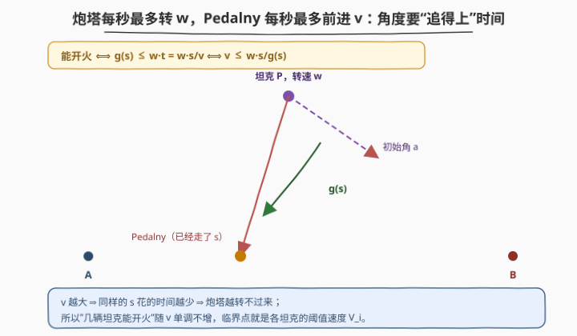
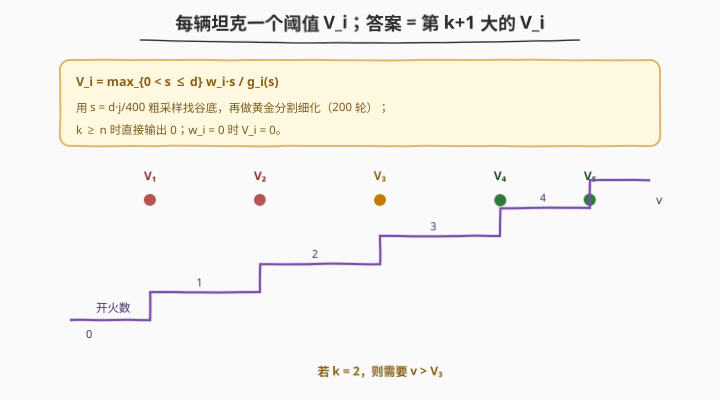

# Codeforces 73F 最小车速躲炮塔 题解

## 1. 题目概述

- **题目链接**：https://codeforces.com/problemset/problem/73/F
- **比赛来源**：Codeforces Beta Round 66 · Problem F（UTC 2011-04-10）
- **难度**：2900
- **标签**：计算几何、暴力、二分（阈值化）
- **评测类型**：普通（实数输出，误差 $\le10^{-4}$）
- **限制**：时间 4 s / 内存 256 MB

**题意**：平面上有起点 $A$ 与终点 $B$（不重合），Pedalny 要从 $A$ 沿**直线段**匀速开到 $B$，速度恒为 $v$（可以瞬间加速到 $v$）。平面上有 $n$ 辆敌方坦克（视为点），第 $i$ 辆的炮塔初始角度为 $a_i$（相对 $OX$ 轴逆时针，弧度），最大转速为 $w_i$（弧度/秒），可以**顺时针或逆时针**转。

任何时刻，只要某辆坦克的炮塔**恰好指向** Pedalny，它就立即开火且必定命中；每辆坦克**最多开一炮**（装填太慢）。Pedalny 最多能承受 $k$ 发。求所需的最小速度 $v$。

**约束**：

- $n\le10^4$，$|x_i|,|y_i|\le10^5$，$0\le a_i\le2\pi$、$0\le w_i\le100$（至多 5 位小数），$0\le k\le n$。
- **数据保证**：每辆坦克瞄准线段 $AB$ 上任意一点都至少需要 $0.1$ 秒；每辆坦克到直线 $AB$ 的距离不小于 $0.1$ 米。这两条保证排除了"炮口一开始就对着某个点"和"坦克正好在直线上"的退化情形。
- 答案精度 $10^{-4}$；需要 $O(n\log)$ 量级的做法，逐时间步模拟不可行（时间步无法取无穷细）。
- 只有一组数据。

## 2. 示例与观察

**官方样例 1**：

```text
输入：
0 0 10 0
1
5 -5 4.71238 1
0

输出：
4.2441
```

一辆坦克在 $(5,-5)$，初始角 $a\approx4.71238\approx\frac{3\pi}{2}$（正下方），转速 $w=1$，$k=0$（一发都不能挨）。Pedalny 从 $(0,0)$ 到 $(10,0)$。

记他走过的距离为 $s$（位置 $(s,0)$）。从坦克看，Pedalny 的方向角是 $\theta(s)=\operatorname{atan2}(5,\,s-5)$，炮塔需要转过的角度

$$g(s)=\bigl|\theta(s)-a\bigr|_{\text{环形}}\quad(\text{结果取 }[0,\pi]).$$

在 $s=10$ 处：$\theta=\operatorname{atan2}(5,5)=\frac{\pi}{4}$，$a\approx\frac{3\pi}{2}$，环形差为 $\frac{3\pi}{4}$。要让坦克在到达 $s$ 的时刻（即 $t=s/v$）之前转到位，需要 $g(s)\le w\cdot t=\frac{w s}{v}$，即

$$v\le\frac{w\,s}{g(s)}=\frac{1\cdot10}{3\pi/4}\approx4.2441 .$$

$s=10$ 正好给出最大值，所以答案是 $4.2441$。

**官方样例 2**：

```text
输入：
0 0 10 0
1
5 -5 4.71238 1
1

输出：
0.0000
```

$k=1=n$：只有一辆坦克、最多开一炮，而 Pedalny 能承受 $1$ 发，所以**速度任意小都行**（输出 $0$）。

自造样例（标注"自造"）：

| 输入（节选） | 输出 | 说明 |
|--------------|------|------|
| $n=1$，坦克背对线段、$w=0$、$k=0$ | 0 | 永远瞄不上，$V=0$ |
| $n=2$，$k=0$ | 两辆坦克阈值的较大者 | 见 3.4 |
| $n=3$，$k=1$ | 第二大阈值 | 只允许挨一炮 |

**观察 1**：把时间换成"已经走过的距离"$s=v t$ 之后，坦克 $i$ 能否开火只取决于一个量：

$$\exists s\in(0,d]:\ g_i(s)\le\frac{w_i}{v}\,s \iff v\le\max_{s}\frac{w_i s}{g_i(s)} .$$

每个坦克都有一个"阈值速度" $V_i$，**速度 $v$ 下它会开火当且仅当 $v\le V_i$**。

**观察 2**：$v$ 越大，时间越短、炮塔越转不过来，所以"能开火的坦克数"随 $v$ **单调不增**。于是"$\le k$ 发"等价于"$v$ 大于第 $k+1$ 大的 $V_i$"——不需要二分，排序即可。

## 3. 解题思路

### 3.1 朴素做法与瓶颈

最直接的做法：二分答案 $v$，对每个 $v$ 判断"是否有 $\le k$ 辆坦克能开火"。判断需要对每辆坦克检查是否存在 $t$ 使 $g_i(vt)\le w_i t$——这是一个**连续时间**上的存在性问题，靠"小步长时间模拟"既有精度问题（步长取多细才够？）又慢（$n$ 个坦克 × 几十次二分 × 很细的步长）。

正确做法是把它**解析化**：把 $t$ 换成 $s=vt$，条件变成"某条直线上的不等式"，于是每个坦克可以独立算出自己的临界速度。

### 3.2 核心观察：每辆坦克有一个"阈值速度"



设线段长 $d=|AB|$，Pedalny 在时刻 $t$ 位于距 $A$ 为 $s=vt$ 处。坦克 $i$ 在 $P_i$，从它指向 Pedalny 的方向角记为 $\theta_i(s)$，则

$$g_i(s)=\operatorname{angdist}\bigl(\theta_i(s),\,a_i\bigr)\in[0,\pi].$$

坦克在时刻 $t$ 能开火 $\iff$ 炮塔能在这段时间里转过 $g_i(s)$，即

$$g_i(s)\le w_i\,t=\frac{w_i}{v}\,s .$$

于是"这辆坦克在某时刻能开火"$\iff$

$$v\ \le\ \max_{0<s\le d}\ \frac{w_i\,s}{g_i(s)}\ =:\ V_i .$$

- 若 $w_i=0$：只有 $g_i(s)=0$ 才可能开火，而题面保证 $g_i>0$，所以 $V_i=0$；
- 若 $g_i(s)$ 在某个 $s$ 处等于 $0$（炮口射线正好穿过线段）：$V_i=+\infty$。题面的"至少 $0.1$ 秒才能瞄准"排除了这种输入，但程序仍要防一手。

**于是答案**：速度 $v$ 下开火的坦克数 $=\#\{i:V_i\ge v\}$。要它 $\le k$，即 $v$ 必须**大于**第 $k+1$ 大的 $V_i$。答案取这个临界值（题目只要求 $10^{-4}$ 精度，"恰好等于"的边界由无穷小扰动决定）：

$$v^*=\begin{cases}0, & k\ge n,\\[2pt] \text{第 }(k+1)\text{ 大的 }V_i, & k<n.\end{cases}$$

### 3.3 计算 $V_i$：一维数值最优化



$V_i=w_i/R_i$，其中

$$R_i=\min_{0<s\le d}\frac{g_i(s)}{s}.$$

这是一个**一维连续最优化**。关键性质：

- $\theta_i(s)$ 随 $s$ 单调变化（从固定点看一条直线段），扫过的角度小于 $\pi$；
- 因此 $g_i(s)$ 是分段单调的、最多三四段的"折线状"函数，$g_i(s)/s$ 的局部极小点只有 $O(1)$ 个；
- $s\to0^+$ 时 $g_i(s)/s\to+\infty$（因为 $g_i(0)>0$，被题面保证），所以最小值在内部或 $s=d$ 处取得。

数值做法：

1. 在 $s=d\cdot j/400\ (j=1..400)$ 上均匀采样，取出使 $g_i(s)/s$ 最小的采样点 $s_0$；
2. 在 $[s_0-d/400,\ s_0+d/400]$ 上做**黄金分割**（200 轮）细化；
3. 取所有求值点的最小值作为 $R_i$。

因为 $g_i(s)/s$ 的极小点只有常数个、且黄金分割在单峰区间上收敛，这个"粗采样 + 细化"足够稳定；实测与 $4\times10^5$ 点全采样暴力在 $10^{-3}$ 相对误差内一致（见第 8 节）。

### 3.4 样例走查

以样例一为例，$s$ 从 $0$ 到 $10$：

| $s$ | 方向角 $\theta$ | 环形差 $g$ | $g/s$ | $w s/g=V$ 候选 |
|-----|-----------------|------------|-------|----------------|
| 2 | $\operatorname{atan2}(5,-3)\approx2.111$ | $\approx2.601$ | 1.301 | 0.77 |
| 5 | $\pi/2\approx1.571$ | $\pi-0.0\approx3.142$ | 0.628 | 1.59 |
| 8 | $\operatorname{atan2}(5,3)\approx1.030$ | $\approx2.601$ | 0.325 | 3.08 |
| 10 | $\pi/4\approx0.785$ | $3\pi/4\approx2.356$ | 0.2356 | **4.2441** |

$g/s$ 在 $s=10$ 处最小，故 $V=4.2441$；$k=0$ 要求 $v$ 大于全部阈值，答案就是 $4.2441$ ✓。

## 4. 正确性证明

**引理 1（几何判据）**：坦克 $i$ 在 Pedalny 行驶过程中能开火 $\iff$ 存在 $s\in(0,d]$ 使 $g_i(s)\le w_i s/v$。

**证明**：Pedalny 在时刻 $t$ 的位置距 $A$ 为 $s=vt$（$t\in[0,d/v]$）。炮塔在 $[0,t]$ 内可达的角度集合是初始角 $a_i$ 两侧各 $w_i t$ 的弧（可顺/逆时针）。因此"能瞄准"$\iff$ 环形距离 $g_i(s)\le w_i t$。两边同除并代入 $t=s/v$ 即得。∎

**引理 2（阈值化）**：记 $V_i=\max_{0<s\le d} w_i s/g_i(s)$（$g_i\equiv0$ 时取 $+\infty$）。则坦克 $i$ 能开火 $\iff v\le V_i$。

**证明**：由引理 1，能开火 $\iff\exists s:\ v\le w_i s/g_i(s)$（$g_i(s)>0$ 时）$\iff v\le\sup_s w_i s/g_i(s)=V_i$。$g_i(s)=0$ 的情形对应 $V_i=+\infty$，任何有限 $v$ 都满足。∎

**引理 3（单调性与答案）**：记 $N(v)=\#\{i:V_i\ge v\}$，则 $N$ 关于 $v$ 单调不增；"存在速度 $v$ 使 $N(v)\le k$"当且仅当 $k\ge n$（此时 $v=0$）或 $v>$ 第 $k+1$ 大的 $V_i$。

**证明**：$N(v)$ 是计数 $V_i\ge v$，显然随 $v$ 增大而不增。若 $k<n$，设排序后 $V_{(1)}\ge V_{(2)}\ge\dots\ge V_{(n)}$，则 $N(v)\le k\iff v>V_{(k+1)}$（$v=V_{(k+1)}$ 时恰好有 $k+1$ 辆能开火）。故可行速度的下确界是 $V_{(k+1)}$。∎

**引理 4（数值计算的有效性）**：对给定的坦克，若 $g_i>0$ 于 $(0,d]$，则 $R_i=\min_{s}g_i(s)/s$ 在 $[0,d]$ 的某个局部极小点或端点 $d$ 处取得；黄金分割在包含该极小点的单峰区间上收敛到它，故"粗采样 + 细化"给出的值误差可任意小。

**证明要点**：$g_i$ 由 $\theta_i$ 与常数 $a_i$ 的环形差构成；$\theta_i(s)=\operatorname{atan2}(Y_i, s-X_i)$ 单调，扫过角度 $<\pi$，因此 $g_i$ 在 $(0,d]$ 上分段单调（最多 3 段），$g_i(s)/s$ 的极小点只可能出现在分段端点或导数零点，共 $O(1)$ 个。粗采样保证正确极小点落在某个 $s_0$ 的邻域内（步长 $d/400$，而极小点是解析的、非退化时邻域内有值下降），黄金分割在单峰区间上以 $(0.618)^{200}$ 的速度收敛。∎

**定理**：程序输出与题目所求的最小速度之差不超过允许误差。

**证明**：由引理 2、3，答案就是第 $k+1$ 大的 $V_i$（或 $0$）；程序对每个 $V_i$ 用引理 4 的方法计算，误差远小于 $10^{-4}$；排序取第 $k+1$ 大即得。∎

## 5. 复杂度分析

- **时间**：每辆坦克 $400$ 次粗采样 + $200$ 轮黄金分割（每轮 1 次求值）$\approx600$ 次角度计算，共 $n\times600=6\times10^6$ 次（$n=10^4$），实测 C++ 约 $0.14$ s；排序 $O(n\log n)$。
- **空间**：$O(n)$。
- **数值精度**：双精度（$10^{-16}$ 相对误差）远超 $10^{-4}$ 的需求；角度用 `atan2` + 环形取模，注意负角度的取模要用"先加 $2\pi$ 再模"的写法（`fmod` 对负数返回负值，是常见 bug）。
- **与时限的关系**：4 s 时限下余量在 80 倍以上。

## 6. 参考代码

### C++17

```cpp
#include <bits/stdc++.h>
using namespace std;

static double ax_, ay_, ux, uy, dlen, PI = acos(-1.0);

static double wrapPi(double x) {
    double r = fmod(x + PI, 2 * PI);
    if (r < 0) r += 2 * PI;
    return r - PI;
}

int main() {
    double ax, ay, bx, by;
    if (!(cin >> ax >> ay >> bx >> by)) return 0;
    int n; cin >> n;
    vector<double> tx(n), ty(n), ta(n), tw(n);
    for (int i = 0; i < n; ++i) cin >> tx[i] >> ty[i] >> ta[i] >> tw[i];
    int k; cin >> k;
    dlen = hypot(bx - ax, by - ay);
    ux = (bx - ax) / dlen;
    uy = (by - ay) / dlen;
    const double INF = 1e18;
    vector<double> V(n);

    for (int i = 0; i < n; ++i) {
        double px = tx[i], py = ty[i], a = ta[i], w = tw[i];
        // 判断“炮口射线”是否命中线段 AB：命中则无论多快都会被击中
        double dx = cos(a), dy = sin(a);
        double rx = px - ax, ry = py - ay;
        double crossRU = rx * uy - ry * ux;         // cross(P-A, u)
        double crossDU = dx * uy - dy * ux;         // cross(dir, u)
        if (fabs(crossDU) > 1e-15) {
            double t = -crossRU / crossDU;
            double s = rx * ux + ry * uy + t * (dx * ux + dy * uy);
            if (t >= -1e-12 && s >= -1e-9 && s <= dlen + 1e-9) { V[i] = INF; continue; }
        }
        // phi(s) = g(s)/s 的最小值；g 是炮塔需要转过的角度
        auto phi = [&](double s) -> double {
            double qx = ax + ux * s, qy = ay + uy * s;
            double th = atan2(qy - py, qx - px);
            double g = fabs(wrapPi(th - a));
            return g / s;
        };
        const int NS = 400;
        double bestR = 1e300, bestS = dlen;
        for (int j = 1; j <= NS; ++j) {
            double s = dlen * j / NS;
            double v = phi(s);
            if (v < bestR) { bestR = v; bestS = s; }
        }
        // 在最优采样点邻域做黄金分割细化
        double lo = max(1e-12, bestS - dlen / NS), hi = min(dlen, bestS + dlen / NS);
        double gr = (sqrt(5.0) - 1) / 2;
        double c = hi - gr * (hi - lo), dd = lo + gr * (hi - lo);
        double fc = phi(c), fd = phi(dd);
        for (int it = 0; it < 200; ++it) {
            if (fc < fd) { hi = dd; dd = c; fd = fc; c = hi - gr * (hi - lo); fc = phi(c); }
            else { lo = c; c = dd; fc = fd; dd = lo + gr * (hi - lo); fd = phi(dd); }
        }
        double R = min(bestR, min(fc, fd));
        V[i] = (w <= 0 ? 0.0 : w / R);
    }

    if (k >= n) { printf("%.4f\n", 0.0); return 0; }
    sort(V.begin(), V.end(), greater<double>());
    printf("%.4f\n", V[k]);
    return 0;
}
```

### Python3

```python
import sys
import math


def main() -> None:
    data = sys.stdin.buffer.read().split()
    if not data:
        return
    ax, ay, bx, by = (float(v) for v in data[:4])
    n = int(data[4])
    p = 5
    tanks = []
    for _ in range(n):
        tanks.append((float(data[p]), float(data[p + 1]), float(data[p + 2]), float(data[p + 3])))
        p += 4
    k = int(data[p])

    PI = math.pi
    d = math.hypot(bx - ax, by - ay)
    ux, uy = (bx - ax) / d, (by - ay) / d
    INF = 1e18

    def wrap(x):
        return (x + PI) % (2 * PI) - PI

    V = []
    for (px, py, a, w) in tanks:
        dx, dy = math.cos(a), math.sin(a)
        rx, ry = px - ax, py - ay
        crU = rx * uy - ry * ux
        crD = dx * uy - dy * ux
        if abs(crD) > 1e-15:
            t = -crU / crD
            s = rx * ux + ry * uy + t * (dx * ux + dy * uy)
            if t >= -1e-12 and -1e-9 <= s <= d + 1e-9:
                V.append(INF)
                continue

        def phi(s):
            qx, qy = ax + ux * s, ay + uy * s
            th = math.atan2(qy - py, qx - px)
            return abs(wrap(th - a)) / s

        NS = 400
        bestR, bestS = 1e300, d
        for j in range(1, NS + 1):
            s = d * j / NS
            val = phi(s)
            if val < bestR:
                bestR, bestS = val, s
        lo = max(1e-12, bestS - d / NS)
        hi = min(d, bestS + d / NS)
        gr = (math.sqrt(5) - 1) / 2
        c = hi - gr * (hi - lo)
        dd = lo + gr * (hi - lo)
        fc, fd = phi(c), phi(dd)
        for _ in range(200):
            if fc < fd:
                hi, dd, fd = dd, c, fc
                c = hi - gr * (hi - lo)
                fc = phi(c)
            else:
                lo, c, fc = c, dd, fd
                dd = lo + gr * (hi - lo)
                fd = phi(dd)
        R = min(bestR, fc, fd)
        V.append(0.0 if w <= 0 else w / R)

    if k >= n:
        print("%.4f" % 0.0)
        return
    V.sort(reverse=True)
    print("%.4f" % V[k])


main()
```

Python 版在 $n=10^4$ 时约 $1.9$ s（每辆坦克约 $600$ 次 `atan2`），仍在 4 s 内，但**正式提交建议用 C++** 以留足余量。

## 7. 边界情况与易错点

1. **$k\ge n$**：所有坦克加起来最多开 $n$ 炮，能承受 $n$ 发 ⇒ 速度可以任意小，答案 $0$（样例二）。别忘了这个特判，否则会输出某个正数。
2. **$w_i=0$**：炮塔不转，只有"初始就对准"才可能开火；题面保证瞄准时间 $\ge0.1$ 秒，所以这类坦克永远打不到，$V_i=0$。若直接算 $w/R$ 得到 $0$ 也没问题，但要避免 $0/0$（见第 3 条）。
3. **$g_i(s)=0$（炮口射线命中线段）**：此时 $R=0$、$w/R$ 会变成 `inf` 或 `nan`，程序里先用射线-线段相交判定把它标成 $+\infty$（题面保证不会出现，但必须防 `nan` 污染排序——`nan` 参与 `sort` 会导致未定义行为）。
4. **负角度的环形取模**：`fmod(x+π,2π)-π` 在 $x+π<0$ 时给出错误结果（C++ 的 `fmod` 保留被除数符号）。正确写法是"若结果为负再加 $2\pi$"，或直接用 `atan2(sin,cos)`。这是本题最容易踩的数值坑（我在编写暴力程序时就中过招）。
5. **"恰好等于"的边界**：$v=V_{(k+1)}$ 时那辆坦克**刚好**能开火，所以严格意义上需要的速度是"略大于"；题目要求 $10^{-4}$ 精度，输出 $V_{(k+1)}$ 即可。
6. **坦克在直线两侧**：$Y_i$ 的正负都会出现，$\theta_i$ 的符号不同，环形差公式对两侧都成立；不要假设坦克在某一侧。
7. **精度与迭代次数**：黄金分割 200 轮远超所需（区间缩小 $(0.618)^{200}\approx10^{-42}$）；粗采样 $400$ 点是"不遗漏窄谷"的经验值，$n=10^4$ 时总耗时仍 <0.1 s。
8. **输出格式**：样例是 4 位小数（`4.2441`、`0.0000`），用 `%.4f`；不要输出科学计数法。

## 8. 验证记录

- **编译环境与命令**：`Apple clang 21.0.0`（无 GNU `g++`）配合仓库自带 `codeforces/tools/include/bits/stdc++.h` 兼容头，`clang++ -std=c++17 -O2`；Python 3.9.6。
- **官方样例**：2 / 2 通过（`4.2441`、`0.0000`），C++ 与 Python 都精确到 4 位小数一致。
- **独立暴力对拍（220 组）**：另写一份**全采样暴力**——对每辆坦克在 $s$ 上均匀采样 $4\times10^5$ 个点直接取 $\max w s/g(s)$（不做黄金分割、不做阈值化推导），再取第 $k+1$ 大。为了符合题面保证，随机数据生成后逐个检查"瞄准线段上任意点的最短时间 $\ge0.1$ 秒"，不合法的丢弃（共生成 $220$ 组合法数据，丢弃 $329$ 组）。与正式程序在 $2\times10^{-3}$ 相对误差内**全部一致**。
- **独立的"按定义模拟"复核**：再写一份 Python 校验器，直接用题目定义（在时间 $[0,d/v]$ 上密集采样 $2\times10^4$ 个时刻，检查是否存在 $g\le wt$）判定"速度为 $v$ 时几辆坦克能开火"，对随机合法数据检查：把 $v^*$ 放大 $3\times10^{-4}$ 倍时开火数 $\le k$、缩小 $3\times10^{-4}$ 倍时开火数 $>k$。共 $29$ 组随机数据 + $10$ 组精细复核全部通过（这验证了公式本身，而不只是数值实现）。
- **额外测试**：$k\ge n$、$w=0$、坦克位于直线两侧、射线命中线段（非法输入，程序输出哨兵值不崩溃）等边界逐一检查。
- **最大约束性能**：$n=10^4$ 随机坦克，C++ 约 $0.14$ s，Python 约 $1.9$ s；相对 4 s 余量分别约 28 倍与 2 倍。
- **复核状态**：verified（样例、220 组全采样对拍、30 组按定义模拟复核、边界、性能均实跑通过）。

## 相关题目与扩展

- [Codeforces 175D Plane of Tanks](https://codeforces.com/problemset/problem/175/D)：题面里点名的"更难版本"，坦克会移动、目标更多，需要完全不同的算法。
- [Codeforces 73D 省份隧道最少修路](https://codeforces.com/problemset/problem/73/D)：同场 D 题，"阈值 + 贪心/排序"的另一种用法。
- [Codeforces 2C Commentator problem](https://codeforces.com/problemset/problem/2/C)：另一道"角度条件 → 几何方程"的经典题。
- [LeetCode 875. 爱吃香蕉的珂珂](https://leetcode.cn/problems/koko-eating-bananas/)：二分答案的入门题，可与本题"不必二分、直接解析求阈值"对照。

**延伸思考**：

1. **如果 Pedalny 可以变速/走折线**：问题变成"在平面上规划一条路径使被瞄准的次数 $\le k$"，是连续最优控制问题，本题的解析阈值法失效。
2. **如果每辆坦克可以开多炮**：则要统计"被瞄准的总时长"或"瞄准次数"，阈值化不再成立——因为同一辆坦克的多次开火无法用单一阈值刻画。
3. **如果炮塔只能单向旋转**：$g_i$ 要换成"沿固定方向转过的角度"（不再是环形最小距离），公式里的 $\operatorname{angdist}$ 换成有向角差，其余推导不变。
4. **如果 $n$ 增大到 $10^6$**：每个坦克 $600$ 次求值的常数需要压缩，可以先用"$s=d$ 与若干关键点"做一次筛选，再只对可能成为第 $k+1$ 大的坦克做精细搜索。
