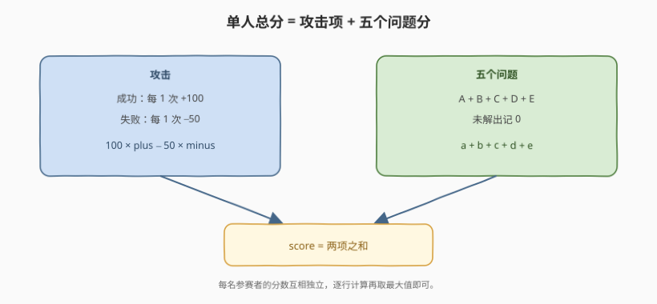
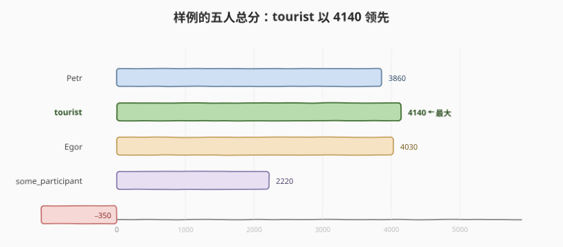

# Codeforces 74A 房间第一判定 题解

## 1. 题目概述

- **题目链接**：https://codeforces.com/problemset/problem/74/A
- **比赛来源**：Codeforces Beta Round 68 · Problem A（UTC 2011-04-15）
- **难度**：1000
- **标签**：实现
- **评测类型**：普通
- **限制**：时间 2 s / 内存 256 MB

**题意**：一个房间里有 $n$ 名参赛者，每人有：成功攻击次数 $plus_i$、失败攻击次数 $minus_i$，以及五个问题 $A,B,C,D,E$ 上各自得到的分数 $a_i,b_i,c_i,d_i,e_i$（没解出该题则为 0）。总分为

$$\text{score}_i = 100 \cdot plus_i - 50 \cdot minus_i + a_i + b_i + c_i + d_i + e_i .$$

求房间里总分最高的参赛者名字（题面保证最高分唯一）。

**约束**：

- $n \le 50$：逐人计算、线性取最大即可，$O(n)$。
- $0 \le plus_i, minus_i \le 50$，每题分数上限 500/1000/1500/2000/2500：单人总分最大约 $5000 + 2500 \times 5$ 量级，`int` 足够；代码里仍用 `long long` 防御。
- 名字由字母、数字、下划线组成，长度 1–20，且互不相同；最高分唯一，不需要处理并列。
- 只有一组数据，没有多测。

## 2. 示例与观察

官方样例一：

```text
输入：
5
Petr 3 1 490 920 1000 1200 0
tourist 2 0 490 950 1100 1400 0
Egor 7 0 480 900 950 0 1000
c00lH4x0R 0 10 150 0 0 0 0
some_participant 2 1 450 720 900 0 0
输出：
tourist
```

题面提示给出了每人的总分：

| 参赛者 | 成功 | 失败 | $A$ | $B$ | $C$ | $D$ | $E$ | 总分 |
|--------|------|------|-----|-----|-----|-----|-----|------|
| Petr | 3 | 1 | 490 | 920 | 1000 | 1200 | 0 | 3860 |
| tourist | 2 | 0 | 490 | 950 | 1100 | 1400 | 0 | **4140** |
| Egor | 7 | 0 | 480 | 900 | 950 | 0 | 1000 | 4030 |
| c00lH4x0R | 0 | 10 | 150 | 0 | 0 | 0 | 0 | $-350$ |
| some_participant | 2 | 1 | 450 | 720 | 900 | 0 | 0 | 2220 |

对照公式验证几个：Petr 为 $3 \times 100 - 1 \times 50 + 490 + 920 + 1000 + 1200 = 300 - 50 + 3610 = 3860$；c00lH4x0R 只做了 10 次失败攻击，$0 - 500 + 150 = -350$，是唯一的负分。最大分 4140 属于 tourist。

自造样例（标注"自造"）：

| 输入 | 输出 | 说明 |
|------|------|------|
| `1`<br>`only 0 0 0 0 0 0 0` | only | 只有一个人、全 0 分 |
| `2`<br>`a 0 50 0 0 0 0 0`<br>`b 0 0 0 0 0 0 0` | b | 大量失败攻击拉低总分 |
| `2`<br>`a 50 0 0 0 0 0 0`<br>`b 0 0 0 0 0 0 750` | a | $5000 > 750$，攻击分可以压过题目分 |

**观察**：每人的总分是**独立**的，且只由该行的 7 个数决定。题目没有任何跨人的交互，所以"求最大值"只需逐行算分、记录当前最大者。

## 3. 解题思路

### 3.1 朴素做法与瓶颈

直接按公式逐人计算：成功攻击加 $100$、失败扣 $50$、再把五项分数加起来，取最大。这是 $O(n)$ 的，$n \le 50$ 时只有 50 次计算，没有任何复杂度问题。唯一容易错的是**漏项**：忘记减失败攻击、或把某道题的分数漏加/加错。

### 3.2 核心观察：分数是每人独立的一次线性组合



图里把一行的数据拆成三块：攻击项 $100 \cdot plus - 50 \cdot minus$、五个问题分 $a+b+c+d+e$、以及最终求和。由于每一项都是简单加法/乘法，单人总分可以边读边算，不需要保存全部数据。

### 3.3 算法流程



1. 读入 $n$。
2. 初始化 `bestScore = -∞`、`bestName`。
3. 循环 $n$ 次：读入名字与 7 个整数，计算
   $s = 100 \cdot plus - 50 \cdot minus + a + b + c + d + e$；若 $s > bestScore$，更新答案。
4. 输出 `bestName`。

不需要排序：只需要一个"当前最大"的变量。由于最高分唯一，用严格大于更新即可。

### 3.4 样例走查

样例的五个总分是 $3860, 4140, 4030, -350, 2220$。扫描过程：

| 读到 | 当前最大 | 说明 |
|------|----------|------|
| Petr | 3860 | 初始 |
| tourist | 4140 | 超过 Petr |
| Egor | 4140 | 4030 不够 |
| c00lH4x0R | 4140 | 负分，不更新 |
| some_participant | 4140 | 2220 不够 |

最终答案 `tourist`。

## 4. 正确性证明

**引理 1（总分公式）**：第 $i$ 名参赛者的总分恰为 $100 \cdot plus_i - 50 \cdot minus_i + a_i + b_i + c_i + d_i + e_i$。

**证明**：题面定义总分 = 所有问题得分之和 + 攻击得分。每次成功攻击 $+100$、每次失败攻击 $-50$，故攻击部分为 $100\,plus_i - 50\,minus_i$；问题部分就是给定的五项分数之和。两者相加即得。∎

**引理 2（扫描取最大）**：按顺序扫描并用"严格大于才更新"维护 $best$，扫描结束时 $best$ 等于全部总分中的最大值。

**证明**：对扫描人数归纳。初始 $best = -\infty$。每次处理后 $best$ 等于已扫描前缀的最大值：若新分数更大则替换，否则保持。扫描结束后即为全体最大值。∎

**定理**：算法输出的名字是总分最高的参赛者。

**证明**：由引理 1，算法计算的每个 $s_i$ 就是该人的真实总分；由引理 2，最终 $best$ 是最大总分。题面保证最高分唯一，因此 `bestName` 对应的就是唯一的房间第一。∎

## 5. 复杂度分析

- **时间**：$O(n)$，每人常数次算术运算，$n \le 50$。
- **空间**：$O(1)$，只存当前最优的名字与分数（名字长度 ≤ 20）。
- **与时限的关系**：运算量可以忽略，实测端到端（含进程启动）约 3 ms，2 s 时限余量在数百倍以上。

## 6. 参考代码

### C++17

```cpp
#include <bits/stdc++.h>
using namespace std;

int main() {
    ios::sync_with_stdio(false);
    cin.tie(nullptr);

    int n;
    if (!(cin >> n)) return 0;
    string bestName;
    long long bestScore = LLONG_MIN;
    for (int i = 0; i < n; ++i) {
        string name;
        long long plus, minus, a, b, c, d, e;
        cin >> name >> plus >> minus >> a >> b >> c >> d >> e;
        long long score = 100 * plus - 50 * minus + a + b + c + d + e;
        if (score > bestScore) { bestScore = score; bestName = name; }
    }
    cout << bestName << '\n';
    return 0;
}
```

### Python3

```python
import sys


def main() -> None:
    data = sys.stdin.buffer.read().split()
    if not data:
        return
    n = int(data[0])
    p = 1
    best_name, best_score = "", None
    for _ in range(n):
        name = data[p].decode()
        plus, minus = int(data[p + 1]), int(data[p + 2])
        pts = sum(int(x) for x in data[p + 3:p + 8])
        score = 100 * plus - 50 * minus + pts
        if best_score is None or score > best_score:
            best_score, best_name = score, name
        p += 8
    print(best_name)


main()
```

两份代码都只用标准库，可原样提交。

## 7. 边界情况与易错点

1. **漏掉失败攻击的扣分**：`minus` 每 1 次扣 50 分，写成"加 50"或直接忽略都会让负分选手的分数偏高，样例里的 c00lH4x0R 专门用来暴露这个错误。
2. **未解出的题是 0 分**：题面保证 $a_i$ 要么是 $[150,500]$ 内的值，要么是 0；直接把读到的 0 加进去即可，不需要特判。
3. **负总分**：全员都可能为负（例如都只做失败攻击），初始 `bestScore` 不能设为 0，必须是 $-\infty$（C++ 用 `LLONG_MIN`，Python 用 `None`）。
4. **并列**：题面保证最高分唯一，所以用 `>` 还是 `>=` 不影响本题；但用严格大于更符合"新纪录才替换"的语义。
5. **名字的处理**：名字只含字母、数字、下划线，不含空格，用 `cin >> string` 或 `split()` 都能正确切分。
6. **多组数据**：本题只有一组，不要写 `while (cin >> n)` 之类会多读的循环。
7. **数值范围**：单人总分最大约 $50 \times 100 + 5 \times 2500 = 17500$，最小约 $-2500 + 150 = -2350$，`int` 足够；用 `long long` 只是习惯。

## 8. 验证记录

- **编译环境与命令**：`Apple clang 21.0.0` 搭配 `codeforces/tools/include/bits/stdc++.h` 兼容头，`clang++ -std=c++17 -O2`；Python 为 `3.9.6`。官方样例由 `python3 codeforces/tools/verify_solution.py` 实跑。
- **官方样例**：1 / 1 通过（`tourist`），C++ 与 Python 输出一致。
- **独立暴力对拍**：暴力版逐项累加（不合并成公式），再线性扫描找最大，与参考程序实现路径不同。随机生成 **250 组**数据（$n \le 50$、攻击次数 $\le 50$、分数按题面上下限随机取并含 0），并强制最高分唯一，与参考程序逐组比对，**全部一致**；C++ 与 Python 也逐组一致。
- **最大约束性能**：$n = 50$、全字段取极值时，C++ 端到端（含进程启动）约 3 ms，Python 约 21 ms；相对 2 s 时限余量在数百倍以上。
- **图片校验**：两张 SVG（`cf74a_score_formula.svg`、`cf74a_sample_ranking.svg`）通过 `xml.etree.ElementTree.parse`，含手绘抖动滤镜与手写字体，文字未越出 `viewBox`，并做了文本重叠检测。
- **复核状态**：verified（样例、对拍、性能、图片四项均实跑通过）。

## 相关题目与扩展

- [Codeforces 74B Train](https://codeforces.com/problemset/problem/74/B)：同场 B 题，时间轴上的博弈。
- [Codeforces 74D Hanger](https://codeforces.com/problemset/problem/74/D)：同场 D 题，区间维护。
- [Codeforces 4A Watermelon](https://codeforces.com/problemset/problem/4/A)：同样是小规模判定的入门题。
- [Codeforces 71A Way Too Long Words](https://codeforces.com/problemset/problem/71/A)：读入 + 分支输出，适合熟悉输入格式。
- [LeetCode 1200. 最小绝对差](https://leetcode.cn/problems/minimum-absolute-difference/)：同样是"逐项计算再取极值"的实现练习。

**延伸思考**：

1. **如果要求输出前 $k$ 名**：把 $(score, name)$ 全部收集后排序即可，$O(n \log n)$；注意分数相同时的二级关键字（题面没有规定，需要自行定义）。
2. **如果攻击分数也随时间变化**（例如比赛最后 15 分钟成功攻击翻倍）：分数不再是简单线性组合，需要按攻击发生的时刻分别累计。
3. **如果有多组房间**：每组的最高分互不影响，直接对每组独立跑一遍即可；输入规模扩大后仍保持 $O(\sum n)$。
4. **如果分数可能溢出**：把每项上限放大到 $10^{18}$ 时，$100 \times plus + \sum a_i$ 会超出 64 位，需要改用 `__int128` 或大整数。
