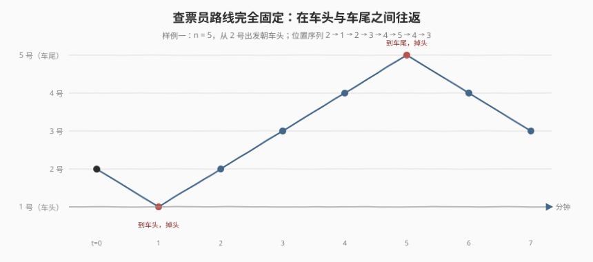
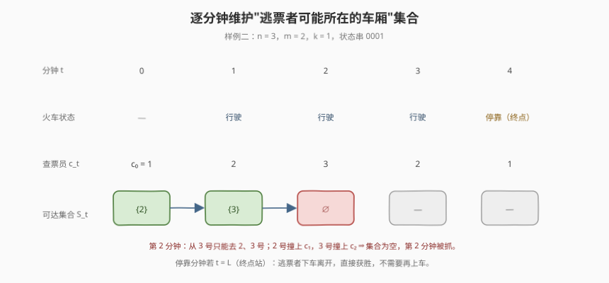

# Codeforces 74B 火车逃票博弈 题解

## 1. 题目概述

- **题目链接**：https://codeforces.com/problemset/problem/74/B
- **比赛来源**：Codeforces Beta Round 68 · Problem B（UTC 2011-04-15）
- **难度**：1500
- **标签**：动态规划、博弈、贪心
- **评测类型**：普通
- **限制**：时间 2 s / 内存 256 MB

**题意**：火车有 $n$ 节车厢（1 号车头、$n$ 号车尾）。逃票者在 $m$ 号车厢，查票员在 $k$ 号车厢（$m \ne k$）。查票员始终朝一个方向走，每步移动一节车厢，走到 1 号或 $n$ 号后立刻掉头，路线完全固定。

每一分钟给出火车状态：`0` 表示行驶，`1` 表示停靠。

- 行驶的一分钟：逃票者先动，可以走到相邻车厢或原地不动；然后查票员移动。若任意时刻两人在同一车厢，逃票者被抓住（记在这一分钟）。
- 停靠的一分钟：逃票者先下车（不在任何车厢），查票员移动，然后逃票者重新上车，可以上任意一节车厢——但若上的正是查票员所在车厢，同样被抓住。若这一分钟是终点站（输入串的最后一分钟，保证是 `1`），逃票者下车后直接离开、永远不再回来，即获胜。

逃票者若能活到终点站则获胜；否则他要在必败的前提下尽量晚被抓。求赢家；若查票员获胜，还要输出他被抓的分钟。

**约束**：

- $2 \le n \le 50$，$|s| \le 200$：时间轴长度最多 200，每分钟逃票者最多 3 种走法，直接模拟"可达位置集合"是 $O(n \cdot |s|)$，非常小。
- 查票员的移动方向第一次给定，之后完全由规则决定，**没有任何选择**。
- 输入串最后一个字符一定是 `1`（终点站）。

## 2. 示例与观察

官方样例一：

```text
输入：
5 3 2
to head
0001001
输出：
Stowaway
```

官方样例二：

```text
输入：
3 2 1
to tail
0001
输出：
Controller 2
```

逐步演算样例二（这是理解规则的关键）：$n=3$，逃票者在 2 号，查票员在 1 号、朝车尾（编号增大）走。状态串是 `0001`：前三分钟行驶，第四分钟停靠（终点站）。

查票员路线：$1 \to 2 \to 3 \to 2 \to 1$（第 2 分钟到 3 号后掉头）。

- 第 1 分钟（行驶）：逃票者从 2 号出发，可以到 1、2、3 号。但查票员此刻在 1 号，走到 1 号会当场撞上；查票员随后移动到 2 号，所以留在 2 号也会被抓。只有走到 **3 号** 安全。
- 第 2 分钟（行驶）：逃票者在 3 号，查票员在 2 号。逃票者能去 2、3 号，去 2 号会撞上当前查票员；留在 3 号则查票员随后移动到 3 号，又撞上。**无路可走**，第 2 分钟被抓。

输出 `Controller 2`，与样例一致。

样例一：$n=5$，逃票者在 3 号，查票员在 2 号朝车头走，路线是 $2 \to 1 \to 2 \to 3 \to 4 \to 5 \to 4 \to 3$。状态串 `0001001` 表示第 4、7 分钟停靠，第 7 分钟是终点站。逃票者可以一路躲到第 4 分钟停靠时重新选车厢（避开查票员所在的 4 号），再撑过第 5、6 分钟，最后在第 7 分钟终点站下车获胜。

**观察**：查票员的路线是**预先确定**的，与逃票者怎么走毫无关系。因此整个游戏可以看成一张"时间 × 车厢"的图：第 $t$ 分钟逃票者能否站在某节车厢，只取决于他一分钟前能在哪里、以及查票员在第 $t-1$、$t$ 分钟的位置。

## 3. 解题思路

### 3.1 朴素做法与瓶颈

最直接的想法是展开整棵博弈树：每分钟逃票者最多 3 种选择，$200$ 分钟就是 $3^{200}$ 条路径，完全不可行。

但注意到一个关键事实：**逃票者的选择不会影响查票员的路线**。于是"逃票者能否活到第 $t$ 分钟"可以按时间递推：维护第 $t$ 分钟结束时他可能所在的车厢集合，逐分钟更新。这样状态数只有 $O(n)$，总复杂度 $O(n \cdot |s|)$。

### 3.2 核心观察：查票员路线固定，只需跟踪可达车厢集合



令 $c_t$ 表示第 $t$ 分钟查票员**移动之后**所在的车厢，$c_0 = k$。查票员的移动规则是：

$$c_t = c_{t-1} + d_{t-1},\qquad \text{若 } c_t \in \{1, n\} \text{ 则 } d_t = -d_{t-1}.$$

这条路线可以提前全部算出来。

再看逃票者。设 $S_t$ 为"第 $t$ 分钟结束后仍然活着时，他可能所在的车厢集合"，$S_0 = \{m\}$。分两种情况递推：

- **第 $t$ 分钟行驶**：他从 $w \in S_{t-1}$ 出发，可以走 $w-1, w, w+1$（越界的不行），得到 $w'$。
  - 逃票者先动：若 $w' = c_{t-1}$，两人在他移动后就同处一节车厢，当场被抓，这条走法作废；
  - 查票员再动：若 $w' = c_t$，查票员走进他所在的车厢，也被抓。
  - 只有同时避开 $c_{t-1}$ 与 $c_t$ 的 $w'$ 才能进入 $S_t$。
- **第 $t$ 分钟停靠**：他先下车，查票员移动到他处，之后他可以上任意车厢，只要不是查票员所在的 $c_t$，即 $S_t = \{1,\dots,n\} \setminus \{c_t\}$（$n \ge 2$，非空）。特别地，若 $t$ 是最后一分钟（终点站），他下车后直接获胜，不需要再上车。

如果某个时刻 $S_t$ 变成空集，说明无论他怎么走都会在第 $t$ 分钟被抓——由于他尽量拖延，这正是他要被抓的**最晚**分钟。如果一路走到终点站 $S$ 都非空，他就能获胜。

### 3.3 算法流程



1. 读入 $n, m, k$；读入方向单词（`to head` / `to tail`），记初始方向 $d = -1$ 或 $+1$。
2. 读入状态串 $s$，长度 $L$。
3. 令 $c = k$，$S = \{m\}$。
4. 对 $t = 1 \dots L$：
   - 记录 `cbefore = c`，然后 $c \leftarrow c + d$；若 $c \in \{1, n\}$ 则 $d \leftarrow -d$。
   - 若 $s_t = 1$：如果 $t = L$，逃票者获胜，结束；否则 $S \leftarrow \{1,\dots,n\} \setminus \{c\}$。
   - 否则（行驶）：用上面的规则从 $S$ 生成新集合；若为空，输出 `Controller t` 并结束。
5. 若循环中没有提前结束，就是逃票者获胜（实际上只有 $t = L$ 的分支会跳出循环）。

### 3.4 样例走查：样例二

$n=3, m=2, k=1$，方向朝车尾（$d=+1$），$s = $ `0001`。

查票员位置：$c_0=1$，$c_1=2$，$c_2=3$（到车尾，掉头），$c_3=2$，$c_4=1$（停靠的终点站）。

| $t$ | 状态 | $c_{t-1}$ | $c_t$ | 更新后的 $S_t$ |
|-----|------|-----------|-------|----------------|
| 1 | 行驶 | 1 | 2 | $\{3\}$（2 撞 $c_0$，1 撞 $c_0$，2 撞 $c_1$，只剩 3） |
| 2 | 行驶 | 2 | 3 | $\varnothing$ → 第 2 分钟被抓 |

第 2 分钟 $S_2$ 为空，输出 `Controller 2` ✓。

样例一里第 4、7 分钟是停靠：第 4 分钟 $S$ 被重置成除 $c_4=4$ 外的全部车厢，第 7 分钟是终点站，直接获胜。

## 4. 正确性证明

**引理 1（查票员路线固定）**：序列 $c_1, c_2, \dots$ 只由 $n, k$ 与初始方向决定，与逃票者的行为无关。

**证明**：查票员每分钟只有一种移动方式（沿当前方向走一格），是否掉头只取决于他是否走到了 1 或 $n$，而这又只由他自己的位置决定。对分钟数归纳即得。∎

**引理 2（$S_t$ 的含义）**：对每个 $t$，$S_t$ 恰好是"逃票者存在某种走法，能活过前 $t$ 分钟并停在第 $t$ 分钟结束时的车厢 $w$"的所有 $w$。

**证明**：对 $t$ 归纳。$t=0$ 时 $S_0 = \{m\}$。
- 行驶分钟：由规则，逃票者从 $w \in S_{t-1}$ 只能走到 $w' \in \{w-1,w,w+1\} \cap [1,n]$，且必须 $w' \ne c_{t-1}$（他移动后不与查票员同厢）、$w' \ne c_t$（查票员移动后不同厢）。归纳假设给出"能活到第 $t-1$ 分钟并位于 $w$"，于是所有能活过第 $t$ 分钟的 $w'$ 恰为递推得到的新集合。
- 停靠分钟：他先离车，查票员移动与他无关；重新上车时可任选 $w' \ne c_t$，故集合为全集去掉 $c_t$。若 $t=L$，他下车即获胜，不会再有状态。
∎

**引理 3（最晚被抓时间）**：若 $S_1, \dots, S_{t-1}$ 非空而 $S_t = \varnothing$，则逃票者最多只能活到第 $t$ 分钟，且能在第 $t$ 分钟之前不被抓；他无法把被抓时间推迟到 $t$ 之后。

**证明**：由引理 2，$S_{t-1} \ne \varnothing$ 说明存在活过 $t-1$ 分钟的走法；$S_t = \varnothing$ 说明任何这样的走法在第 $t$ 分钟都会被抓。因此"活到第 $t$ 分钟之后"不可能，而"活到第 $t$ 分钟"是可能的（至多在第 $t$ 分钟被抓），故最晚被抓时间就是 $t$。∎

**定理**：算法输出的赢家与最晚被抓分钟都是正确的。

**证明**：若循环走到 $t=L$ 的停靠分钟，由引理 2 的停靠情形，逃票者在终点站下车即获胜，且此前从未被抓，故输出 `Stowaway` 正确。否则第一次出现 $S_t = \varnothing$ 时，由引理 3 输出 `Controller t` 正确；若从未出现空集，则逃票者一路存活到终点站，同样获胜。∎

## 5. 复杂度分析

- **时间**：$O(n \cdot L)$。每分钟最多遍历 $n$ 个位置、每个位置 3 种走法；$n \le 50, L \le 200$，约 $3 \times 10^4$ 次操作。
- **空间**：$O(n)$ 存集合与几个变量。
- **与时限的关系**：运算量可以忽略，实测端到端（含进程启动）约 2.3 ms，2 s 时限余量在数百倍以上。

## 6. 参考代码

### C++17

```cpp
#include <bits/stdc++.h>
using namespace std;

int main() {
    ios::sync_with_stdio(false);
    cin.tie(nullptr);

    int n, m, k;
    if (!(cin >> n >> m >> k)) return 0;
    string w1, w2;
    cin >> w1 >> w2;
    int dir = (w2 == "head") ? -1 : +1;
    string s;
    cin >> s;
    int L = (int)s.size();

    vector<char> can(n + 1, 0);
    can[m] = 1;
    int c = k;
    bool win = false;
    int caughtAt = -1;

    for (int t = 1; t <= L; ++t) {
        int cbefore = c;
        c += dir;
        if (c == 1 || c == n) dir = -dir;

        if (s[t - 1] == '1') {
            if (t == L) { win = true; break; }  // 终点站：下车即胜利
            vector<char> nxt(n + 1, 1);
            nxt[c] = 0;                          // 可以上任意车厢，除了查票员所在的
            can = nxt;
        } else {
            vector<char> nxt(n + 1, 0);
            bool any = false;
            for (int w = 1; w <= n; ++w) {
                if (!can[w]) continue;
                for (int d = -1; d <= 1; ++d) {
                    int w2 = w + d;
                    if (w2 < 1 || w2 > n) continue;
                    if (w2 == cbefore) continue;  // 逃票者移动时撞上
                    if (w2 == c) continue;        // 查票员移动后撞上
                    nxt[w2] = 1;
                    any = true;
                }
            }
            can = nxt;
            if (!any) { caughtAt = t; break; }
        }
    }

    if (win) cout << "Stowaway\n";
    else cout << "Controller " << caughtAt << '\n';
    return 0;
}
```

### Python3

```python
import sys


def main() -> None:
    data = sys.stdin.buffer.read().split()
    if not data:
        return
    n, m, k = int(data[0]), int(data[1]), int(data[2])
    w2 = data[4].decode()          # data[3] == b"to"
    direction = -1 if w2 == "head" else 1
    s = data[5].decode()
    L = len(s)

    can = [False] * (n + 1)
    can[m] = True
    c = k
    win = False
    caught_at = -1

    for t in range(1, L + 1):
        cbefore = c
        c += direction
        if c == 1 or c == n:
            direction = -direction

        if s[t - 1] == "1":
            if t == L:
                win = True
                break
            nxt = [True] * (n + 1)
            nxt[c] = False
            can = nxt
        else:
            nxt = [False] * (n + 1)
            any_move = False
            for w in range(1, n + 1):
                if not can[w]:
                    continue
                for d in (-1, 0, 1):
                    w2 = w + d
                    if w2 < 1 or w2 > n:
                        continue
                    if w2 == cbefore or w2 == c:
                        continue
                    nxt[w2] = True
                    any_move = True
            can = nxt
            if not any_move:
                caught_at = t
                break

    if win:
        print("Stowaway")
    else:
        print("Controller", caught_at)


main()
```

两份代码逐句对应，只用标准库，可原样提交。

## 7. 边界情况与易错点

1. **两个碰撞时刻都要检查**：行驶分钟里，逃票者移动后可能撞上查票员的**旧**位置 $c_{t-1}$，查票员移动后可能撞上**新**位置 $c_t$。只检查一个会漏判；样例二第 1 分钟若只检查 $c_t$，就会误以为 2 号可以停留。
2. **终点站那一分钟直接获胜**：最后一分钟是停靠，逃票者下车即走，不需要再上车，所以只要活着到达第 $L$ 分钟就赢。代码里用 `t == L` 特判。
3. **停靠分钟的重新上车**：非终点站的停靠分钟里，他必须重新上车，且不能上查票员所在车厢；$n \ge 2$ 保证至少有一节别的车厢可上，集合永远非空。
4. **查票员到端点要掉头**：掉头发生在"进入 1 号或 $n$ 号之后"，代码里先移动再判断 $c \in \{1, n\}$ 并翻转方向。
5. **初始方向与位置**：题面保证初始方向前方至少有一节车厢（朝车头则 $k > 1$，朝车尾则 $k < n$），不会出现第一步就掉头的情况；方向单词要读两个 token（`to` 与 `head`/`tail`）。
6. **被抓分钟的定义**：撞车发生在第 $t$ 分钟之内，输出 $t$；不要输出 $t+1$ 或从 0 开始的编号。
7. **$n = 2$**：行驶分钟里逃票者只有两个位置可躲，容易两边都被堵死；代码按集合递推自然处理。
8. **状态串长度为 1**：唯一的一分钟就是终点站，逃票者下车即获胜；代码在 $t=L=1$ 的分支正确输出 `Stowaway`。

## 8. 验证记录

- **编译环境与命令**：`Apple clang 21.0.0` + `codeforces/tools/include/bits/stdc++.h` 兼容头，`clang++ -std=c++17 -O2`；Python 为 `3.9.6`。官方样例由 `python3 codeforces/tools/verify_solution.py` 实跑。
- **官方样例**：2 / 2 通过（`Stowaway`、`Controller 2`），C++ 与 Python 输出一致。
- **独立暴力对拍**：暴力版使用**自后向前的记忆化博弈 DP**（状态为"第 $t$ 分钟结束时的位置"，直接求最晚被抓的分钟，$\infty$ 表示获胜），与参考程序的"正向可达集合"是两种不同写法。随机生成 **250 组**数据（$n \le 8$、状态串长度 $\le 12$、方向随机合法、最后一位强制为 `1`），与参考程序逐组比对，**全部一致**；C++ 与 Python 也逐组一致。
- **最大约束性能**：$n = 50$、状态串长度 200 时，C++ 端到端（含进程启动）约 2.3 ms，Python 约 22 ms；相对 2 s 时限余量在数百倍以上。
- **图片校验**：两张 SVG（`cf74b_controller_path.svg`、`cf74b_reach_sets.svg`）通过 `xml.etree.ElementTree.parse`，含手绘抖动滤镜与手写字体，文字未越出 `viewBox`，并做了文本重叠检测。
- **复核状态**：verified（样例、对拍、性能、图片四项均实跑通过）。

## 相关题目与扩展

- [Codeforces 74A Room Leader](https://codeforces.com/problemset/problem/74/A)：同场 A 题，线性扫描取最大。
- [Codeforces 74D Hanger](https://codeforces.com/problemset/problem/74/D)：同场 D 题，区间维护。
- [Codeforces 74C Chessboard Billiard](https://codeforces.com/problemset/problem/74/C)：同场 C 题，轨迹与可达性分析。
- [LeetCode 55. 跳跃游戏](https://leetcode.cn/problems/jump-game/)：同样是"维护可达集合、逐时刻推进"的思路。
- [LeetCode 134. 加油站](https://leetcode.cn/problems/gas-station/)：单人沿固定环形路线的可达性判定，可与本题的"时间轴可达集合"对照。

**延伸思考**：

1. **如果查票员也能选择方向**：双方都有选择后，局面不再是"单方可达集合"，而要变成真正的极小极大博弈；由于 $n, L$ 都很小，仍可用 $(t, \text{查票员位置}, \text{逃票者位置}, \text{方向})$ 的记忆化搜索解决。
2. **如果逃票者也能在停靠时使用多个连续停靠分钟**：题面允许，但连续停靠的每一分钟都只是"全体车厢除查票员外"重置，效果等价于最后一次停靠；我们的递推自动处理。
3. **如果要求输出逃票者的最优策略**：在递推时记录每个状态的"能活下来"前驱，最后从终点回溯，即可得到每一步应该站哪节车厢。
4. **如果把分钟数放大到 $10^9$**：状态会周期化（查票员路线周期约 $2(n-1)$，状态串若也周期），可以用周期检测 + 快进，把 $O(L)$ 降为 $O(n)$ 加周期处理。
