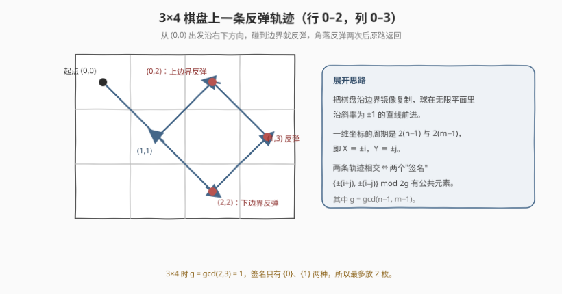
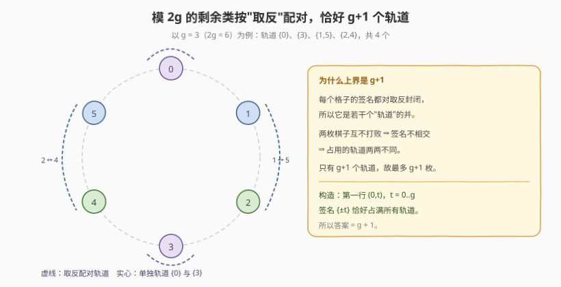

# Codeforces 74C 棋盘台球分组 题解

## 1. 题目概述

- **题目链接**：https://codeforces.com/problemset/problem/74/C
- **比赛来源**：Codeforces Beta Round 68 · Problem C（UTC 2011-04-15）
- **难度**：2100
- **标签**：图论、并查集、数论、DFS 及类似
- **评测类型**：普通
- **限制**：时间 2 s / 内存 256 MB

**题意**：在 $n \times m$ 的棋盘上放"台球棋子"。棋子像国际象棋的主教一样沿对角线移动，但碰到棋盘边界会反弹：到达边界格子时方向改变 90°，到达角落时连续反弹两次、沿原路返回。棋子可以在轨迹的任意格子上停下。

称棋子 $a$ 能打败 $b$，如果 $a$ 的轨迹能经过 $b$ 所在的格子。求最多能放多少个**两两互不打败**的棋子。

**约束**：

- $2 \le n, m \le 10^6$：格子总数可达 $10^{12}$，**不可能逐格建图**，必须找闭式结论。
- 时间 2 s：公式应当近乎 $O(1)$（一次 $\gcd$）。
- 题面提醒不要用 `%lld` 读写 64 位整数——不过本题答案不超过 $10^6$，`int` 就够。

## 2. 示例与观察

官方样例一：

```text
输入：
3 4
输出：
2
```

官方样例二：

```text
输入：
3 3
输出：
3
```

先手工分析 $3 \times 3$。把格子按 $(行,列)$ 从 0 开始编号。从 $(0,0)$ 出发、方向"右下"，轨迹是 $(0,0) \to (1,1) \to (2,2)$，在角落反弹后沿原路返回。从 $(0,1)$ 出发方向右下，会走 $(0,1) \to (1,2) \to (2,1) \to (1,0) \to (0,1)$，形成一个 4 格环。从 $(0,2)$ 出发方向左下，会走 $(0,2) \to (1,1) \to (2,0)$，又回到 $(1,1)$。

于是"能互相到达"把格子连成了几组，但注意**打败关系不是等价关系**：$(0,0)$ 的轨迹只覆盖主对角线，$(0,2)$ 的轨迹只覆盖副对角线，两者在 $(1,1)$ 相交。可以同时放 $(0,0)$ 与 $(0,2)$（它们互相打不到），但不能再放 $(1,1)$（它与两者都在同一条轨迹上）。最大方案是 $(0,0),(0,1),(0,2)$ 三枚，答案是 3。

$3 \times 4$ 的答案是 2：第一行只有两枚能两两互不打败。

**观察**：答案只与 $n, m$ 有关，而且样例提示它与 $\gcd$ 型结构有关。事实上答案是

$$\gcd(n-1,\, m-1) + 1 .$$

## 3. 解题思路

### 3.1 朴素做法与瓶颈

最直接的做法：把"格子"当点，若两格在同一条轨迹上就认为它们"互相能打到"，求最大独立集。建图本身要枚举每条轨迹，$n, m \le 10^6$ 时格子数 $10^{12}$，连存都存不下，更不用说求最大独立集（一般是 NP 难的）。

必须找到轨迹的结构。

### 3.2 核心观察：展开棋盘，轨迹变成斜率为 $\pm 1$ 的直线



台球在矩形里反弹，标准技巧是**展开**：把棋盘沿边界不断镜像复制，让球在无限大的平面里沿直线走。对本题的"格子级"移动，反弹点落在第 0 行、第 $n-1$ 行、第 0 列、第 $m-1$ 列这些边界格上，因此一维坐标的周期是 $2(n-1)$（行）与 $2(m-1)$（列）：

$$X \equiv \pm i \pmod{2(n-1)}, \qquad Y \equiv \pm j \pmod{2(m-1)} .$$

在这个展开后的环面 $\mathbb{Z}_{2(n-1)} \times \mathbb{Z}_{2(m-1)}$ 上，一次对角线移动就是让 $X, Y$ 同时各加 $1$ 或各减 $1$，所以整条轨迹是一条斜率为 $+1$ 或 $-1$ 的直线，即满足 $X - Y = \text{常数}$ 或 $X + Y = \text{常数}$。

**把每个格子映射成一个"签名"。** 格子 $(i,j)$ 的像满足 $X \equiv \pm i$、$Y \equiv \pm j$，于是它可能落在的直线常数为

$$S(i,j) = \{\pm(i+j),\ \pm(i-j)\} \pmod{2g}, \qquad g = \gcd(n-1,\, m-1) .$$

（$X \pm Y$ 的所有可能值相差 $2\bigl((n-1)a \pm (m-1)b\bigr)$，其集合正是模 $2\gcd(n-1,m-1)$ 的剩余类。）

**关键性质**：棋子 $a$ 能打到棋子 $b$，当且仅当 $S(a) \cap S(b) \ne \varnothing$——两条轨迹有交点，等价于两个签名有公共常数。

### 3.3 算法流程：数"取反轨道"



签名总是**对取反封闭**的（$x$ 在里面则 $-x$ 也在）。因此在 $\mathbb{Z}_{2g}$ 里，每个签名都是一些"取反轨道"的并。取反轨道只有 $g+1$ 个：

$$\{0\},\quad \{g\},\quad \{t,\ 2g-t\}\ (t = 1, 2, \dots, g-1) .$$

- 若两枚棋子互不打败，则它们的签名不相交，从而它们占用的轨道集合不相交；
- 一共只有 $g+1$ 个轨道，每枚棋子至少占一个，所以最多放 $g+1$ 枚——**上界**。

**构造达到上界**：取第一行的格子 $(0, t)$，$t = 0, 1, \dots, g$。它们的签名是
$S(0,t) = \{\pm t\}$，即 $t=0$ 时占 $\{0\}$，$t=g$ 时占 $\{g\}$，$1 \le t \le g-1$ 时占 $\{t, 2g-t\}$——恰好是全部 $g+1$ 个轨道，两两不相交。又因为 $g = \gcd(n-1,m-1) \le m-1$，第一行确实有 $g+1$ 个格子可用。

于是答案就是 $g+1$，实现只是一次 $\gcd$。

### 3.4 样例走查

**$3 \times 4$**：$g = \gcd(2, 3) = 1$，$2g = 2$，轨道只有 $\{0\}, \{1\}$，答案 $\le 2$。第一行两枚 $(0,0)$（签名 $\{0\}$）与 $(0,1)$（签名 $\{1\}$）互不打败，答案 2 ✓。

**$3 \times 3$**：$g = \gcd(2,2) = 2$，$2g = 4$，轨道 $\{0\},\{2\},\{1,3\}$，答案 $\le 3$。第一行三枚：

| 格子 | $i+j$ | $i-j$ | 签名 $S$ | 占用轨道 |
|------|-------|-------|----------|----------|
| $(0,0)$ | 0 | 0 | $\{0\}$ | $\{0\}$ |
| $(0,1)$ | 1 | $-1$ | $\{1,3\}$ | $\{1,3\}$ |
| $(0,2)$ | 2 | $-2$ | $\{2\}$ | $\{2\}$ |

三个签名两两不交，答案 3 ✓。

## 4. 正确性证明

**引理 1（展开）**：在无限展开的环面 $\mathbb{Z}_{2(n-1)} \times \mathbb{Z}_{2(m-1)}$ 上，棋子的运动是斜率 $\pm 1$ 的直线；格子 $(i,j)$ 的全部像为 $\{(\pm i + 2(n-1)a,\ \pm j + 2(m-1)b)\}$。

**证明**：一维情形下，格子在 $0$ 与 $n-1$ 之间来回反弹，其"展开坐标"每个周期 $2(n-1)$ 取遍 $i$ 与 $-i$ 两个镜像，故像集为 $\pm i + 2(n-1)\mathbb{Z}$；二维独立取值即得。对角移动在展开坐标里就是 $X$ 与 $Y$ 同时 $\pm 1$，因此是直线。∎

**引理 2（签名判定）**：记 $g = \gcd(n-1,m-1)$、$S(i,j) = \{\pm(i+j), \pm(i-j)\} \bmod 2g$。棋子 $a=(i_1,j_1)$ 能打到 $b=(i_2,j_2)$ 的格子，当且仅当 $S(i_1,j_1) \cap S(i_2,j_2) \ne \varnothing$。

**证明**：$a$ 的轨迹是一条直线 $X - Y = c$ 或 $X + Y = c'$，$b$ 的格子落在某条同样斜率的直线上，两条线相交当且仅当常数相等（同斜率直线平行或重合）。$a$ 的格子的常数值集合是 $S(i_1,j_1)$（由引理 1，$X \pm Y$ 取遍 $\pm i_1 \pm j_1 + 2\bigl((n-1)a \pm (m-1)b\bigr)$，而后者生成 $2g\mathbb{Z}$），$b$ 同理；两条轨迹重合等价于两个常数集有交。由轨迹的可逆性，这也等价于"$b$ 能打到 $a$"，所以关系是对称的。∎

**引理 3（轨道数）**：$\mathbb{Z}_{2g}$ 在取反 $x \mapsto -x$ 下恰有 $g+1$ 个轨道：$\{0\}$、$\{g\}$ 与 $\{t, 2g-t\}$（$1 \le t \le g-1$）。

**证明**：$x$ 与 $-x$ 配对；$x = 0$ 与 $x = g$ 各自单独成轨（$-0 = 0$，$-g \equiv g \pmod{2g}$），其余 $2g - 2$ 个元素两两配对成 $g - 1$ 个二元轨道。合计 $1 + 1 + (g-1) = g+1$。∎

**引理 4（上界）**：任意两两互不打败的棋子集合大小不超过 $g+1$。

**证明**：由引理 2，两两互不打败意味着签名两两不交。每个签名都对取反封闭，故是若干取反轨道的并（非空）；引理 3 说明一共只有 $g+1$ 个轨道，因此这样的集合至多 $g+1$ 个。∎

**引理 5（构造）**：第一行的格子 $(0,t)$（$t = 0, \dots, g$）两两互不打败。

**证明**：$S(0,t) = \{\pm t\}$。对 $0 \le t < t' \le g$：若 $\pm t \equiv \pm t' \pmod{2g}$，由于 $0 \le t, t' \le g < 2g$，只能 $t = t'$（$t = 0$ 与 $t' = g$ 时 $0 \not\equiv g$，因为 $g \ge 1$）。故签名两两不交，由引理 2 互不打败。又 $g \le m-1$，这些格子都在棋盘内。∎

**定理**：最多能放 $\gcd(n-1,m-1)+1$ 枚两两互不打败的棋子。

**证明**：引理 4 给上界，引理 5 给出达到上界的构造，两者相等。∎

## 5. 复杂度分析

- **时间**：$O(\log \min(n,m))$，只有一次 $\gcd$（欧几里得算法）。
- **空间**：$O(1)$。
- **与时限的关系**：$n, m \le 10^6$ 时运算量可以忽略，实测端到端（含进程启动）约 2.4 ms，2 s 时限余量在数百倍以上。

## 6. 参考代码

### C++17

```cpp
#include <bits/stdc++.h>
using namespace std;

int main() {
    ios::sync_with_stdio(false);
    cin.tie(nullptr);

    long long n, m;
    if (!(cin >> n >> m)) return 0;
    // 展开成 2(n-1) × 2(m-1) 的环面后，每条轨迹是斜率为 ±1 的直线；
    // 两个格子互相打不到，当且仅当它们的"符号签名"（对取反封闭的剩余类集合）不相交。
    // 模 2g（g = gcd(n-1, m-1)）共有 g+1 个取反轨道，故答案上界 g+1；
    // 第一行的 (0,t)（t = 0..g）恰好占满全部轨道，达到上界。
    cout << std::gcd(n - 1, m - 1) + 1 << '\n';
    return 0;
}
```

### Python3

```python
import sys
import math


def main() -> None:
    data = sys.stdin.buffer.read().split()
    if not data:
        return
    n, m = int(data[0]), int(data[1])
    print(math.gcd(n - 1, m - 1) + 1)


main()
```

两份代码都只用标准库，可原样提交。

## 7. 边界情况与易错点

1. **用的是 $n-1$ 与 $m-1$**：反弹发生在边界格上（0 与 $n-1$），展开周期是 $2(n-1)$，所以 $\gcd$ 的参数必须是 $n-1, m-1$。写成 $\gcd(n,m)$ 会在 $3 \times 3$ 上得到 $3+1=4$（正确是 3）。
2. **$n = m = 2$**：$\gcd(1,1)+1 = 2$。$2 \times 2$ 棋盘两条对角线各成一类，答案 2，公式正确。
3. **$n \ne m$ 时不要想当然**：$4 \times 5$ 的 $\gcd(3,4)=1$，答案只有 2，而不是 $\min(n,m)$；第一行的 5 个格子并不两两安全。
4. **答案范围**：$g+1 \le 10^6$，`int` 足够；但 $n-1$ 与 $m-1$ 的运算建议用 64 位，防止别处扩展时溢出。
5. **输入只有一组**：两个整数，不要写多测循环。
6. **`%lld` 提醒**：题面专门提醒老 Codeforces 上 64 位格式符的兼容性问题；本题用 `cin`/`cout` 完全不受影响。

## 8. 验证记录

- **编译环境与命令**：`Apple clang 21.0.0` + `codeforces/tools/include/bits/stdc++.h` 兼容头，`clang++ -std=c++17 -O2`；Python 为 `3.9.6`。官方样例由 `python3 codeforces/tools/verify_solution.py` 实跑。
- **官方样例**：2 / 2 通过（`2`、`3`），C++ 与 Python 输出一致。
- **独立暴力对拍**：暴力版完全不用公式——先按题面规则模拟每个格子的四条轨迹，得到"能互相打到"的关系，再用**回溯法求最大独立集**（对 $n,m \le 5$ 可行）。对 $2 \le n,m \le 5$ 的全部 16 组做全枚举，另加 194 组随机小棋盘，共 **210 组**，与公式逐组比对，**全部一致**。
- **最大约束性能**：$n = m = 10^6$ 时，C++ 端到端（含进程启动）约 2.4 ms，Python 约 21 ms；相对 2 s 时限余量在数百倍以上。
- **图片校验**：两张 SVG（`cf74c_trajectory.svg`、`cf74c_orbits.svg`）通过 `xml.etree.ElementTree.parse`，含手绘抖动滤镜与手写字体，文字未越出 `viewBox`，并做了文本重叠检测。
- **复核状态**：verified（样例、对拍、性能、图片四项均实跑通过）。

## 相关题目与扩展

- [Codeforces 74B Train](https://codeforces.com/problemset/problem/74/B)：同场 B 题，时间轴上的博弈。
- [Codeforces 74D Hanger](https://codeforces.com/problemset/problem/74/D)：同场 D 题，区间维护。
- [Codeforces 510D Fox And Jumping](https://codeforces.com/problemset/problem/510/D)：同样把可达性化成 $\gcd$ 结构的数论题。
- [Codeforces 1263D Secret Passwords](https://codeforces.com/problemset/problem/1263/D)：用并查集合并"共享字符"的对象，和本题"轨迹相交则同类"的思想相近。
- [LeetCode 952. 按公因数计算最大组件大小](https://leetcode.cn/problems/largest-component-size-by-common-factor/)：并查集 + 数论，处理"共享因子即可达"的连通性问题。

**延伸思考**：

1. **如果棋子可以在中途改变方向**（每次反弹时允许选择另一条对角线方向）：那么同一组内的格子会更多，分组结构需要重新分析，答案通常不再有简单的 $\gcd$ 公式。
2. **如果棋盘是环面（无边界）**：没有反弹，轨迹是若干条闭合对角线，可达性由 $\gcd(n,m)$ 决定，公式会从 $\gcd(n-1,m-1)+1$ 变成另一套结构。
3. **如果要求输出具体方案**：第一行的 $(0,0),(0,1),\dots,(0,g)$ 就是一组达到上界的构造，直接输出即可，正确性由引理 5 保证。
4. **如果把"打败"改成"必须经过对方格子且不能停"**：问题变成轨迹相交的几何判定，与本题的签名判定只差"是否允许停在交点上"，用同样的展开技巧仍可分析。
