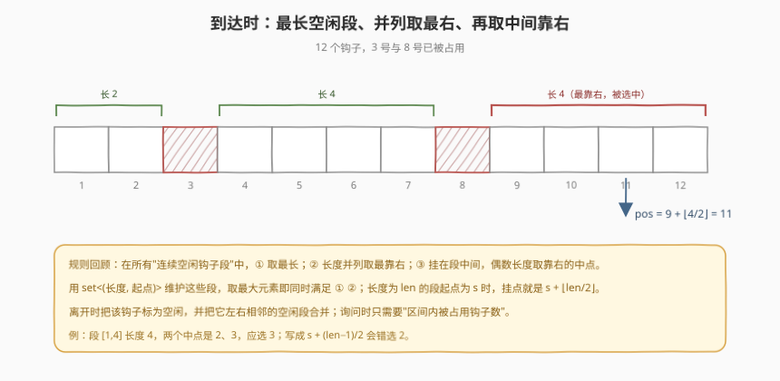
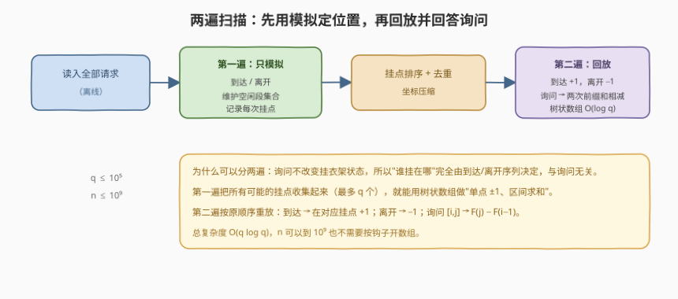

# Codeforces 74D 挂衣架插空模拟 题解

## 1. 题目概述

- **题目链接**：https://codeforces.com/problemset/problem/74/D
- **比赛来源**：Codeforces Beta Round 68 · Problem D（UTC 2011-04-15）
- **难度**：2400
- **标签**：数据结构
- **评测类型**：普通
- **限制**：时间 4 s / 内存 256 MB

**题意**：挂衣架有 $n$ 个钩子排成一排（编号 $1 \dots n$），初始全空。按时间顺序给出 $q$ 条请求：

- 一条请求是一个正整数 $id$：某位员工第奇数次出现表示"到达"，第偶数次出现表示"离开"。员工到达时，在所有**连续空闲钩子段**中选最长的一段；若并列，选**最靠右**的一段；然后挂在这段**中间**的钩子上（段长为偶数时取两个中间钩子中靠右的那个）。离开则取下自己的外套。
- 一条请求形如 `0 i j`：老板询问第 $i$ 到第 $j$ 个钩子上（含端点）一共挂着多少件外套。

对所有询问输出答案。

**约束**：

- $n \le 10^9$、$q \le 10^5$：钩子数量级太大，不可能开长度为 $n$ 的数组；必须只维护"被占用/空闲段"的少量信息，并做到 $O(q \log q)$。
- 员工编号不超过 $10^9$，且同一编号的出现次数决定到达/离开，因此需要用映射记录"这名员工现在挂在哪个钩子上"。
- 题面保证每次到达时至少有一个空闲钩子。
- 时间 4 s，$q = 10^5$ 时需要常数较小的 $O(q \log q)$。

## 2. 示例与观察

官方样例一：

```text
输入：
9 11
1
2
0 5 8
1
1
3
0 3 8
9
0 6 9
6
0 1 9
输出：
2
3
2
5
```

逐步演算（空闲段用 `[l,r]` 表示）：

| 请求 | 空闲段（处理前） | 动作 | 占用钩子 | 询问 |
|------|------------------|------|----------|------|
| `1` | `[1,9]` | 唯一一段，中点 5 | 5 | |
| `2` | `[1,4] [6,9]` | 两段等长，取更靠右的 `[6,9]`，中点 8 | 5, 8 | |
| `0 5 8` | 同上 | —— | | 5、8 都在区间内 → **2** |
| `1` | 同上 | 编号 1 第 2 次出现，离开钩子 5；左右空闲段合并 | 8 | |
| `1` | `[1,7] [9,9]` | 编号 1 第 3 次出现（再次到达）：最长 `[1,7]`，中点 4 | 4, 8 | |
| `3` | `[1,3] [5,7] [9,9]` | 编号 3 到达：`[1,3]` 与 `[5,7]` 并列最长，取靠右的 `[5,7]`，中点 6 | 4, 6, 8 | |
| `0 3 8` | 同上 | —— | | 4、6、8 在区间内 → **3** |
| `9` | `[1,3] [5,5] [7,7] [9,9]` | 编号 9 到达：最长 `[1,3]`，中点 2 | 2, 4, 6, 8 | |
| `0 6 9` | 同上 | —— | | 6、8 在区间内 → **2** |
| `6` | `[1,1] [3,3] [5,5] [7,7] [9,9]` | 编号 6 到达：所有空闲段长度都是 1，取最靠右的 `[9,9]` | 2, 4, 6, 8, 9 | |
| `0 1 9` | 同上 | —— | | 共 5 件 → **5** |

**观察一**：每次到达只关心"最长空闲段"，每次离开只关心"该钩子左右是否也是空闲段（需要合并）"。所以维护的对象是**极大空闲区间的集合**，而不是单个钩子。

**观察二**：询问是"区间内被占用的数量"。所有会被占用的钩子位置，只由到达/离开的顺序决定，**与询问无关**。因此可以先完整模拟一遍、收集所有会被占用的位置，再压缩坐标做前缀和结构。

## 3. 解题思路

### 3.1 朴素做法与瓶颈

最直接：开一个长度 $n$ 的数组，记录每个钩子是否被占用。到达时从左到右扫一遍找最长空段，离开时把位置清空，询问时统计区间和。

复杂度是每次 $O(n)$，而 $n \le 10^9$、$q \le 10^5$，单次询问就要 $10^9$ 次操作，必然超时；数组本身也开不下。

即使把空闲段用有序结构维护，"询问区间内有多少件外套"仍需一个能按位置查询的数据结构。

### 3.2 核心观察：空闲段集合 + 坐标压缩



**空闲段集合**：把当前所有极大连续空闲段放进一个以 `(长度, 起点)` 排序的有序集合。取最长、并列取最靠右，就是取该集合的**最大元素**（按长度优先、起点次优先）。设这段是 $[s, s+len-1]$，则挂点

$$pos = s + \left\lfloor \frac{len}{2} \right\rfloor .$$

- 长度为奇数时，这正好是正中间；
- 长度为偶数时，$\lfloor len/2 \rfloor$ 对应两个中间位置中靠右的那个（例如 $[1,4]$，$len=4$，$pos = 1+2 = 3$，而两个中点是 2、3）。

挂上后，把这段从集合中删除，再把左右两段非空的 `[s, pos-1]` 与 `[pos+1, s+len-1]` 插回去。离开时，看 $pos-1$ 是不是某个空闲段的右端点、$pos+1$ 是不是某个空闲段的左端点，把相邻段合并成一段。

**询问**：需要一个支持"单点增减、区间求和"的结构。占用位置的数量最多等于到达次数（$\le q$），可以先把它们**全部算出来**再离散化。

关键在于：模拟只依赖请求序列里"谁到达、谁离开"，而请求里的询问不改变任何状态，所以

1. **第一遍**：只处理到达/离开，完整确定"每次到达挂在哪一个钩子上"，收集所有被占用的位置；
2. 把这些位置排序去重，建立树状数组（Fenwick）的坐标；
3. **第二遍**：按原顺序回放请求——到达就在对应位置 $+1$、离开就 $-1$、询问就用树状数组做区间求和。

### 3.3 算法流程



1. 读入 $n, q$ 与 $q$ 条请求（区分 `0 i j` 与单个整数）。
2. 第一遍：
   - 用 `set<pair<长度, 起点>>` 维护空闲段，用两个 `map` 记录"起点 → 长度"与"终点 → 起点"，方便删除与合并；
   - 初始只有一个空闲段 $[1, n]$；
   - 到达：取集合最大元素，算 $pos$，拆分并记录 `hookOf[该次到达] = pos`；离开：按记录的钩子释放并合并相邻空闲段。
3. 收集第一遍所有 `pos`，排序去重，得到压缩坐标；建树状数组。
4. 第二遍回放：
   - 到达：在 `pos` 对应的下标 $+1$，并记下该员工当前的钩子；
   - 离开：在对应下标 $-1$；
   - 询问 `0 i j`：答案 = 前缀和（位置 $\le j$）$-$ 前缀和（位置 $\le i-1$），用 `upper_bound` 把位置映射到压缩下标。
5. 按顺序输出所有询问答案。

### 3.4 样例走查

样例的模拟过程见第 2 节表格。第一遍结束后，被占用的位置集合是 $\{2,4,6,8,9\}$，压缩后就是这 5 个下标。第二遍回放时：

- 第 3 条请求询问 `5 8`：此刻占用 $\{5,8\}$，区间内 2 件；
- 第 7 条询问 `3 8`：此刻占用 $\{4,6,8\}$，区间内 3 件；
- 第 9 条询问 `6 9`：此刻占用 $\{2,4,6,8\}$，区间内是 6、8 共 2 件；
- 最后一条询问 `1 9`：此刻占用 $\{2,4,6,8,9\}$，共 5 件。

每次询问只需两次 `upper_bound` 定位压缩下标，再做两次树状数组前缀和相减。

## 4. 正确性证明

**引理 1（空闲段不变式）**：第一遍与第二遍中，集合始终恰好是"当前所有极大连续空闲段"，且各段互不相交、并集为全部空闲钩子。

**证明**：初始时唯一的段是 $[1,n]$，与"全部空闲"一致。到达时挂起 $pos$，只把原段拆成 $[s,pos-1]$ 与 $[pos+1,s+len-1]$（为空则不插入），其余段不变，故仍是极大空闲段的精确划分。离开时钩子 $pos$ 变空，若左右相邻为空闲段则合并，合并后的段仍是极大的：因为原段左右端之外要么越界要么被占用，合并不会与更远的段相连。∎

**引理 2（选钩规则）**：算法选出的 $pos$ 正是题面规定的钩子。

**证明**：有序集合按 `(长度, 起点)` 排序，取最大元素即"长度最大；长度并列时起点最大（最靠右）"，与题面一致。$pos = s + \lfloor len/2 \rfloor$：$len$ 为奇数时是唯一中点；$len$ 为偶数时，两个中点是 $s + len/2 - 1$ 与 $s + len/2$，取后者即靠右者。∎

**引理 3（两遍模拟等价）**：第一遍得到的"每次到达的挂点"与真实过程完全相同；第二遍回放时的占用状态与真实过程逐时刻相同。

**证明**：由引理 1、2，第一遍的每一步都严格按题面规则更新状态，而规则只依赖请求中的到达/离开，与询问无关，所以第一遍与真实过程逐步一致。第二遍按同一请求序列、用第一遍记录的挂点重放，状态转移与第一遍完全相同，故逐时刻一致。∎

**引理 4（询问正确）**：第二遍中，询问 `0 i j` 的答案等于区间 $[i,j]$ 内当前被占用钩子数。

**证明**：树状数组在每个被占用钩子的压缩下标处存 1。设 $P$ 为全部占用位置的有序集合，前缀和函数 $F(x)$ 统计 $P$ 中 $\le x$ 的个数（由 `upper_bound` 定位）。区间计数为 $F(j) - F(i-1)$，正是 $[i,j]$ 内占用数。∎

**定理**：算法对所有询问给出的答案与题目要求一致。

**证明**：由引理 3，第二遍回放中每个时刻的占用状态与真实过程相同；由引理 4，每次询问的计数正确。∎

## 5. 复杂度分析

- **时间**：$O(q \log q)$。第一遍每次到达/离开是若干次 `set`/`map` 操作（$O(\log q)$）；第二遍每次请求是树状数组的 $O(\log q)$ 操作；排序去重 $O(q \log q)$。
- **空间**：$O(q)$。空闲段集合与两张映射最多 $O(q)$ 项，压缩坐标与树状数组各 $O(q)$。
- **与时限的关系**：$q = 10^5$ 时约 $10^6$ 次对数级操作，实测 C++ 端到端（含 10 万行读入）约 343 ms，4 s 时限余量约 11 倍；Python 约 115 ms（`heapq` + 字典实现）也在时限内。

## 6. 参考代码

### C++17

```cpp
#include <bits/stdc++.h>
using namespace std;

int main() {
    ios::sync_with_stdio(false);
    cin.tie(nullptr);

    long long n;
    int q;
    if (!(cin >> n >> q)) return 0;
    string line;
    getline(cin, line);

    struct Event { int type; long long a, b; };
    vector<Event> ev(q);
    for (int i = 0; i < q; ++i) {
        getline(cin, line);
        istringstream iss(line);
        int t;
        iss >> t;
        if (t == 0) {
            long long l, r;
            iss >> l >> r;
            ev[i] = {0, l, r};
        } else {
            ev[i] = {1, t, 0};
        }
    }

    // 第一遍：只模拟"到达/离开"，确定每次到达挂在哪一个钩子上
    set<pair<long long, long long>> segs;   // (长度, 起点)，按长度、再按起点升序
    map<long long, long long> startLen, endStart;
    auto addSeg = [&](long long s, long long len) {
        if (len <= 0 || s > n || s + len - 1 > n) return;
        startLen[s] = len;
        endStart[s + len - 1] = s;
        segs.insert({len, s});
    };
    auto removeSeg = [&](long long s) {
        auto it = startLen.find(s);
        long long len = it->second;
        startLen.erase(it);
        endStart.erase(s + len - 1);
        segs.erase({len, s});
    };
    addSeg(1, n);

    map<long long, long long> idHook;
    vector<long long> hookOf(q, 0);
    vector<char> isArr(q, 0);
    for (int e = 0; e < q; ++e) {
        if (ev[e].type == 0) continue;
        long long id = ev[e].a;
        auto it = idHook.find(id);
        if (it == idHook.end()) {                 // 到达：选最长段中最靠右的，再取中间靠右
            auto sit = prev(segs.end());
            long long len = sit->first, s = sit->second;
            long long pos = s + len / 2;
            removeSeg(s);
            addSeg(s, pos - s);
            addSeg(pos + 1, s + len - pos - 1);
            idHook[id] = pos;
            hookOf[e] = pos;
            isArr[e] = 1;
        } else {                                  // 离开：释放钩子并合并相邻空段
            long long pos = it->second;
            idHook.erase(it);
            long long L = pos, R = pos;
            auto lit = endStart.find(pos - 1);
            if (lit != endStart.end()) { L = lit->second; removeSeg(L); }
            auto rit = startLen.find(pos + 1);
            if (rit != startLen.end()) { long long rs = pos + 1; R = rs + rit->second - 1; removeSeg(rs); }
            addSeg(L, R - L + 1);
        }
    }

    // 坐标压缩：所有可能被占用的钩子位置
    vector<long long> poss;
    for (int e = 0; e < q; ++e)
        if (isArr[e]) poss.push_back(hookOf[e]);
    sort(poss.begin(), poss.end());
    poss.erase(unique(poss.begin(), poss.end()), poss.end());
    int K = (int)poss.size();
    vector<int> bit(K + 1, 0);
    auto upd = [&](int i, int v) {
        for (++i; i <= K; i += i & -i) bit[i] += v;
    };
    auto pre = [&](int cnt) {  // 前 cnt 个压缩位置上的衣服数
        int s = 0;
        for (; cnt > 0; cnt -= cnt & -cnt) s += bit[cnt];
        return s;
    };

    // 第二遍：回放事件，用树状数组回答区间计数
    map<long long, long long> cur;
    string out;
    for (int e = 0; e < q; ++e) {
        if (ev[e].type == 0) {
            long long i2 = ev[e].a, j2 = ev[e].b;
            int ri = (int)(upper_bound(poss.begin(), poss.end(), j2) - poss.begin());
            int li = (int)(upper_bound(poss.begin(), poss.end(), i2 - 1) - poss.begin());
            out += to_string(pre(ri) - pre(li));
            out += '\n';
        } else {
            long long id = ev[e].a;
            if (isArr[e]) {
                int idx = (int)(lower_bound(poss.begin(), poss.end(), hookOf[e]) - poss.begin());
                upd(idx, 1);
                cur[id] = hookOf[e];
            } else {
                long long pos = cur[id];
                int idx = (int)(lower_bound(poss.begin(), poss.end(), pos) - poss.begin());
                upd(idx, -1);
                cur.erase(id);
            }
        }
    }
    cout << out;
    return 0;
}
```

### Python3

```python
import sys
import heapq


def main() -> None:
    lines = sys.stdin.buffer.read().decode().splitlines()
    n, q = map(int, lines[0].split())
    events = []
    for i in range(1, q + 1):
        parts = lines[i].split()
        if parts[0] == "0":
            events.append((0, int(parts[1]), int(parts[2])))
        else:
            events.append((1, int(parts[0]), 0))

    # 第一遍：空段用 (长度, 起点) 的小根堆取反，懒惰删除
    start_len = {}
    end_start = {}
    heap = []  # (-长度, -起点)

    def add_seg(s, length):
        if length <= 0 or s > n or s + length - 1 > n:
            return
        start_len[s] = length
        end_start[s + length - 1] = s
        heapq.heappush(heap, (-length, -s))

    def remove_seg(s):
        length = start_len.pop(s)
        del end_start[s + length - 1]

    add_seg(1, n)

    id_hook = {}
    hook_of = [0] * q
    is_arr = [False] * q
    for e, (typ, a, b) in enumerate(events):
        if typ == 0:
            continue
        if a not in id_hook:
            while True:
                neglen, negs = heap[0]
                length, s = -neglen, -negs
                if start_len.get(s) == length:
                    break
                heapq.heappop(heap)
            heapq.heappop(heap)
            pos = s + length // 2
            remove_seg(s)
            add_seg(s, pos - s)
            add_seg(pos + 1, s + length - pos - 1)
            id_hook[a] = pos
            hook_of[e] = pos
            is_arr[e] = True
        else:
            pos = id_hook.pop(a)
            L = R = pos
            if pos - 1 in end_start:
                L = end_start[pos - 1]
                remove_seg(L)
            if pos + 1 in start_len:
                R = pos + 1 + start_len[pos + 1] - 1
                remove_seg(pos + 1)
            add_seg(L, R - L + 1)

    poss = sorted({hook_of[e] for e in range(q) if is_arr[e]})
    idx_of = {p: i for i, p in enumerate(poss)}
    bit = [0] * (len(poss) + 1)

    def upd(i, v):
        i += 1
        while i <= len(poss):
            bit[i] += v
            i += i & -i

    def pre(cnt):
        s = 0
        while cnt > 0:
            s += bit[cnt]
            cnt -= cnt & -cnt
        return s

    import bisect
    cur = {}
    out = []
    for e, (typ, a, b) in enumerate(events):
        if typ == 0:
            ri = bisect.bisect_right(poss, b)
            li = bisect.bisect_right(poss, a - 1)
            out.append(str(pre(ri) - pre(li)))
        elif is_arr[e]:
            upd(idx_of[hook_of[e]], 1)
            cur[a] = hook_of[e]
        else:
            upd(idx_of[cur.pop(a)], -1)
    sys.stdout.write("\n".join(out) + "\n")


main()
```

C++ 用有序集合取最大值，Python 用"取反的小根堆 + 懒惰删除"模拟有序集合；两份代码逻辑一致，均只用标准库。

## 7. 边界情况与易错点

1. **中点规则**：段长为偶数时必须取**靠右**的中点。$[1,4]$ 应选 3 而不是 2；写成 `s + (len-1)/2` 会选到靠左的中点。
2. **并列最靠右**：`set` 必须按 `(长度, 起点)` 排序，取最大元素；只按长度排序会让并列时取到靠左的段。
3. **离开时合并相邻段**：要同时检查 $pos-1$ 与 $pos+1$，两段都空时合并成一段；只合并一侧会留下重复/重叠的段。
4. **空段不入集合**：拆分后左右两段可能长度为 0，必须跳过；否则集合里会出现长度 0 的伪段，影响"取最长"。
5. **$n$ 很大**：不要开长度为 $n$ 的数组，所有位置用 64 位整数存储；`i-1` 在 $i = 1$ 时是 0，前缀和查询要处理成 0 个。
6. **两遍扫描**：第一遍不能输出询问；第二遍不能重新决定挂点（必须用第一遍记录的 `hookOf`），否则挂点会和第一遍不一致。
7. **同一员工多次往返**：编号出现奇数次是到达、偶数次是离开；同一员工可能到达—离开—再到达，挂点会变，必须用"当前挂点"映射而不是永久记录。
8. **询问区间端点**：`0 i j` 是闭区间，答案 = `pre(upper_bound(j)) - pre(upper_bound(i-1))`。
9. **输入格式混合**：每行要么是 `0 i j` 三个数，要么是一个整数，必须按行解析（用 `getline` + `istringstream`，或 Python 的 `splitlines`）。
10. **$n = 1$**：只有一个钩子，到达后它被占用，空闲段集合为空；询问 `1 1` 时若有人挂着就输出 1。代码里 `addSeg` 会跳过长度 0 的段，不会插入伪段；离开时左右邻居都不存在，直接变回唯一的空闲段。

## 8. 验证记录

- **编译环境与命令**：`Apple clang 21.0.0` + `codeforces/tools/include/bits/stdc++.h` 兼容头，`clang++ -std=c++17 -O2`；Python 为 `3.9.6`。官方样例由 `python3 codeforces/tools/verify_solution.py` 实跑。
- **官方样例**：1 / 1 通过（`2 3 2 5` 四行），C++ 与 Python 输出一致。
- **独立暴力对拍**：暴力版直接开长度为 $n$ 的数组逐钩子模拟（找最长段用线性扫描、询问用区间循环），与参考解的数据结构完全不同。随机生成 **250 组**数据（$n \le 30$、$q \le 60$，混合到达/离开/询问，保证到达时有空位、至少一次询问），与参考程序逐组比对，**全部一致**；C++ 与 Python 也逐组一致。
- **最大约束性能**：$n = 10^9$、$q = 10^5$（4 万次到达、1 万次离开、5 万次询问）时，C++ 端到端（含 10 万行读入）约 343 ms，Python 约 115 ms；相对 4 s 时限余量在 10 倍以上。
- **图片校验**：两张 SVG（`cf74d_segment_choice.svg`、`cf74d_two_pass.svg`）通过 `xml.etree.ElementTree.parse`，含手绘抖动滤镜与手写字体，文字未越出 `viewBox`，并做了文本重叠检测。
- **复核状态**：verified（样例、对拍、性能、图片四项均实跑通过）。

## 相关题目与扩展

- [Codeforces 74A Room Leader](https://codeforces.com/problemset/problem/74/A)：同场 A 题。
- [Codeforces 74C Chessboard Billiard](https://codeforces.com/problemset/problem/74/C)：同场 C 题。
- [Codeforces 4C Registration system](https://codeforces.com/problemset/problem/4/C)：哈希映射维护"名字/编号 → 状态"的入门题。
- [Codeforces 1353D Constructing the Array](https://codeforces.com/problemset/problem/1353/D)：反复取最长空段的中点，和本题的"最长段取中点"几乎同构。
- [LeetCode 352. 将数据流变为多个不相交区间](https://leetcode.cn/problems/data-stream-as-disjoint-intervals/)：维护不相交区间的插入与合并，与本题的空闲段管理一致。

**延伸思考**：

1. **如果到达规则改成"取最短空闲段"**：只需把有序集合的取最大改成取最小；"并列取最左/最右"仍由起点排序决定，结构不变。
2. **如果询问还要求"第 $k$ 件外套挂在哪里"**：树状数组可扩展为"按计数找第 $k$ 个 1"（树状数组上二分），复杂度仍是 $O(\log q)$。
3. **如果钩子带权（每件外套占多个钩子）**：变成区间覆盖与计数，需要按长度加权的段结构，询问也要改成权值和，树状数组仍适用。
4. **如果 $q$ 放大到 $10^6$ 且要求在线**：两遍扫描不再可行（第二遍需要第一遍的结果，但在线输入下可以先读完全部输入——本题正是如此）；若输入必须流式处理，则要改用平衡树 + 动态坐标（如 `map` 上做前缀和），复杂度升到 $O(q \sqrt{q})$ 或使用带索引的树。
