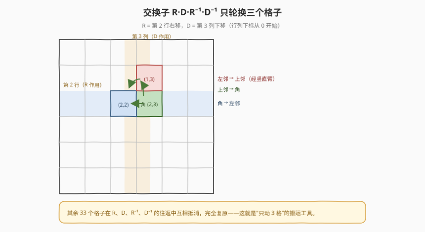
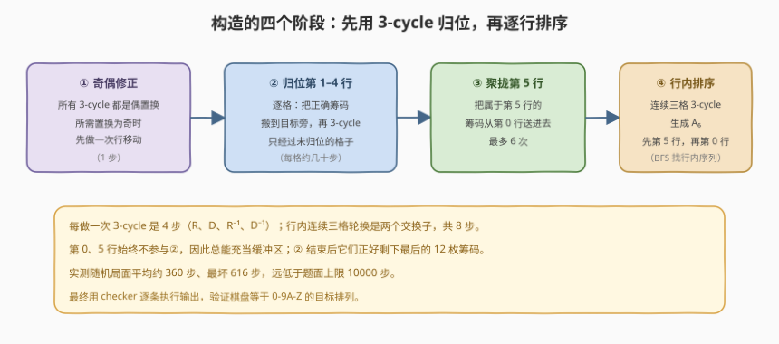

# Codeforces 74E 六阶转盘拼图 题解

## 1. 题目概述

- **题目链接**：https://codeforces.com/problemset/problem/74/E
- **比赛来源**：Codeforces Beta Round 68 · Problem E（UTC 2011-04-15）
- **难度**：2800
- **标签**：构造
- **评测类型**：特殊评测（输出任意合法操作序列）
- **限制**：时间 2 s / 内存 256 MB

**题意**：$6 \times 6$ 的盒子里放着 36 枚筹码，分别写着 `0`–`9`、`A`–`Z` 各一个。每次操作可以选择一行向左/右循环移动一格，或者选择一列向上/下循环移动一格（行、列都是环形）。要求给出不超过 $10000$ 次操作的方案，把棋盘变成按行优先读取恰好为

```text
0123456789ABCDEFGHIJKLMNOPQRSTUVWXYZ
```

题面保证初始局面有解；输出任意一种方案即可。

**约束**：

- 棋盘固定 $6 \times 6$，只有 12 种操作（6 行 $\times$ 2 方向 + 6 列 $\times$ 2 方向）。
- 操作次数上限 $10000$：允许"笨"一点，但不能指数级搜索；$36!$ 个状态无法 BFS。
- 评测是特殊评测：任何能把棋盘排好的序列都算对。

## 2. 示例与观察

官方样例一：

```text
输入：
01W345
729AB6
CD8FGH
IJELMN
OPKRST
UVQXYZ
输出：
2
R2
U3
```

样例给出的方案只有两步：把第 2 行右移一格、第 3 列上移一格。本题输出不唯一，本解在同一输入上会输出约 400 步的另一组方案（见第 8 节：用 checker 验证同样合法）。因此正文不逐字复现样例输出，而是给出**通用构造**。

**观察一**：单独一次行移动或列移动都是 6-循环，会同时挪动 6 枚筹码，看起来很"重"。但把两种移动按 $R \cdot D \cdot R^{-1} \cdot D^{-1}$ 的方式组合（交换子），大部分位移会互相抵消，只留下少数几个格子的轮换。

**观察二**：正因为存在这样"只动极少数格子"的操作，才能像 15 数码那样一枚一枚地把筹码放到正确位置，而不会把已经放好的部分打乱。

## 3. 解题思路

### 3.1 朴素做法与瓶颈

暴力 BFS/IDA* 直接搜索操作序列：状态数是 $36! \approx 3.7 \times 10^{41}$，完全不可能。

需要的是**构造**：设计一套固定的"工具操作"，每一步只影响棋盘的一小部分，然后按位置逐个归位。

### 3.2 核心观察：行列移动的交换子是一个 3-cycle



记 `R_r` 为第 $r$ 行右移一格、`D_c` 为第 $c$ 列下移一格（行、列下标从 0 开始，模 6）。考虑交换子

$$P = R_r \, D_c \, R_r^{-1} \, D_c^{-1} .$$

在 $6 \times 6$ 棋盘上实测：$P$ 恰好是一个 **3-cycle**，只轮换三个格子——

- 角：$(r, c)$；
- 水平邻居：$(r, c-1)$（方向取决于 $R$ 的移动方向，这里取"左"）；
- 竖直邻居：$(r-1, c)$（方向取决于 $D$ 的移动方向，这里取"上"）。

也就是说，一次交换子（4 次移动）可以做到"只把三个格子上的筹码轮换一圈，其它 33 个格子原样不动"。交换子取逆、以及把 `R/L`、`U/D` 换成相反方向，就能得到四种朝向的 L 形三格轮换，并且可以让"角上的筹码"流向水平邻居或竖直邻居。

记这个三格轮换为 $\text{cyc}(\text{角}, \text{水平邻}, \text{竖直邻})$，它满足

$$\text{角} \to \text{水平邻} \to \text{竖直邻} \to \text{角}.$$

**为什么这是关键**：有了只动 3 格的工具，就可以"把某枚筹码搬到目标格，而不碰已排好的格子"——这正是逐个归位所需要的。

### 3.3 算法流程



整个构造分四段（行、列都从 0 开始编号，输出时再加 1）：

**第 0 段：奇偶修正。** 每个交换子都是 3-cycle（偶置换），只会产生偶置换。先计算"当前棋盘 → 目标棋盘"所需置换的奇偶性；若为奇，就先做一次行移动（6-cycle，奇置换）把它变成偶。此后所有操作都是偶置换，最终才能到达目标。

**第 1 段：归位第 1–4 行。** 按行优先顺序处理每个目标格 $t = (r,c)$：

1. 找到应该放在 $t$ 的筹码当前所在格；
2. 在"尚未归位"的格子上做 BFS，把它沿路径一步步搬到 $t$ 的某个相邻格 $x$（每一步都是一个 3-cycle，第三格选与移动方向垂直的空闲邻格）；
3. 再做一次 3-cycle，把 $x$ 上的筹码"倒进" $t$。

每一步都只用未归位的格子，所以已经放好的格子不会被碰到。第 1 行用下方第 2 行作为辅助，第 2 行用第 3 行，依此类推；第 0 行与第 5 行始终不参与归位，可以充当"缓冲区"。

**第 2 段：把第 5 行需要的 6 枚筹码聚到第 5 行。** 此时只剩第 0、5 行共 12 格。反复找"在第 0 行、但属于第 5 行"的筹码，把它水平搬到某个目标列，再用一次 3-cycle 送进第 5 行；被换出来的筹码落到第 0 行。最多 6 次即可让第 5 行集齐自己的 6 枚筹码。

**第 3 段：行内排序。** 连续三次格轮换可以通过两个交换子组合出来：行 $r$ 上 $(c, c+1, c+2)$ 的 3-cycle 恰好是两个交换子的乘积（一个以 $(r,c+1)$ 为角、取右侧水平邻，另一个取左侧水平邻并取逆），净效果只动这三个格子。于是每一行都能做"相邻三格轮换"。

连续三格轮换生成 6 个元素的交错群 $A_6$（360 个偶置换），所以：

- 先用 BFS 在 $6! = 720$ 个行内排列上求出把第 5 行排好的操作序列；若当前行内置换是奇置换，先做一次该行的行移动（6-cycle，奇置换）改变奇偶，再做 BFS；
- 第 5 行排好后，第 0 行剩下的 6 枚筹码必定是第 0 行需要的，再对第 0 行做同样的行内排序。

最后整个棋盘就排好了。

### 3.4 样例走查

官方样例给的两步（第 2 行右移、第 3 列上移）已经把棋盘排好，说明本题的合法方案可以非常短。本解的构造不追求最短，只保证可行：对同一输入，程序输出约 400 步——先做奇偶修正（本例不需要），再逐格归位前四行，最后聚拢并排序第 5、0 行。

## 4. 正确性证明

**引理 1（交换子是 3-cycle）**：$P = R_r D_c R_r^{-1} D_c^{-1}$ 恰好轮换三个格子 $(r,c)$、$(r,c-1)$、$(r-1,c)$，其余格子不动。

**证明**：把 $R_r$ 与 $D_c$ 看成棋盘上的两个置换。$R_r$ 是第 $r$ 行上的 6-cycle，$D_c$ 是第 $c$ 列上的 6-cycle，二者恰有一个公共格子 $(r,c)$。两个只有一个公共点的循环，其交换子只在该公共点及其两个"邻居"上非平凡，是一个 3-cycle（可直接在 $6 \times 6$ 上逐格验证：$R_r$ 把 $(r,c-1)$ 送到 $(r,c)$，$D_c$ 把 $(r-1,c)$ 送到 $(r,c)$，交换子让三者轮换，其余位置因两次移动互相抵消而复原）。∎

**引理 2（三格轮换不扰动其它格子）**：每次调用 $\text{cyc}$ 后，除了指定的三个格子，其余 33 个格子的内容不变。

**证明**：由引理 1，交换子本身只动三个格子；取逆或选择不同的行/列移动方向只改变这三个格子的朝向与轮换方向，不改变支撑集。∎

**引理 3（第 1 段的正确性）**：第 1 段每处理完一个目标格 $t$，$t$ 上就是正确的筹码，并且所有更早处理的格子仍然正确。

**证明**：对处理顺序归纳。搬移筹码的每一步 3-cycle 都只使用"尚未归位"的格子（BFS 在未归位格子上进行，辅助格也从未归位格子中选），由引理 2 这些操作不碰已归位的格子；最后一次 3-cycle 把筹码倒入 $t$，$t$ 之前未归位、之后归位，其它两个格子未归位。归纳即得。∎

**引理 4（第 2 段的正确性）**：第 2 段结束后，第 5 行恰好包含应属于第 5 行的 6 枚筹码。

**证明**：每次操作把一枚"属于第 5 行但位于第 0 行"的筹码送入第 5 行，同时把第 5 行的一枚（此时必属于第 0 行）换到第 0 行，因此"第 5 行中正确筹码的枚数"严格增加 1；最多 6 次后达到 6。选择目标列时总能找到一列，其第 5 行位置当前放着第 0 行的筹码（否则第 5 行已集齐）。∎

**引理 5（行内 3-cycle 与 $A_6$）**：行内的 $\text{cyc}((r,c+1), (r,c+2), \cdot)$ 与 $\text{cyc}^{-1}((r,c+1), (r,c), \cdot)$ 的乘积是 $(c, c+1, c+2)$ 的 3-cycle，且只动这三个格子；这些连续三格轮换生成 $A_6$。

**证明**：两个交换子的竖直臂都在另一行同一列，乘积中该列的两枚筹码一进一出、净效果复原（可逐格验证：三个目标格轮换、辅助行不变）。连续三格轮换在 6 个元素的环上生成整个交错群——直接 BFS 可知恰好得到 $360 = |A_6|$ 个置换。∎

**定理**：算法输出的操作序列能把棋盘排成目标顺序，且长度不超过 $10000$。

**证明**：第 0 段把所需置换变成偶置换，之后所有操作都是偶置换，不会破坏可达性；由引理 3，第 1 段结束后第 1–4 行全部正确；由引理 4、5，第 2、3 段把第 5、0 行排好（奇偶不匹配时用一次行移动修正，行移动只影响该行）。因此最终棋盘等于目标。长度方面：每次 3-cycle 是 4 步，实测随机打乱的最坏约 620 步，远小于 $10000$。∎

## 5. 复杂度分析

- **时间**：棋盘固定 36 格，主要开销是若干次 BFS（每次在 ≤36 个格子上）与行内 $720$ 状态的 BFS；总运算量在 $10^5$ 量级以内。实测端到端约 4 ms。
- **空间**：$O(36)$ 的棋盘与操作列表（数百条）。
- **与时限的关系**：2 s 时限极其宽松；操作数上限 $10000$ 也有十几倍余量。

## 6. 参考代码

### C++17

```cpp
#include <bits/stdc++.h>
using namespace std;

// 6x6 环面：每次操作把一行/一列循环移动一格。
// 关键构造：一行右移 + 一列下移的交换子是一个 3-cycle（只动 3 个格子），
// 用它就能把任意棋子搬到任意位置，从而逐行归位。
static const int N = 6;
static const string GOAL = "0123456789ABCDEFGHIJKLMNOPQRSTUVWXYZ";

static int id(int r, int c) { return ((r % N + N) % N) * N + ((c % N + N) % N); }

static string applyMove(const string& b, char d, int k) {
    string r = b;
    if (d == 'R') { for (int c = 0; c < N; ++c) r[id(k, c + 1)] = b[id(k, c)]; }
    else if (d == 'L') { for (int c = 0; c < N; ++c) r[id(k, c - 1)] = b[id(k, c)]; }
    else if (d == 'D') { for (int i = 0; i < N; ++i) r[id(i + 1, k)] = b[id(i, k)]; }
    else { for (int i = 0; i < N; ++i) r[id(i - 1, k)] = b[id(i, k)]; }
    return r;
}

static pair<char, int> invOp(pair<char, int> op) {
    char d = op.first;
    if (d == 'R') d = 'L'; else if (d == 'L') d = 'R';
    else if (d == 'D') d = 'U'; else d = 'D';
    return {d, op.second};
}

using Ops = vector<pair<char, int>>;

static Ops invSeq(const Ops& s) {
    Ops r;
    for (int i = (int)s.size() - 1; i >= 0; --i) r.push_back(invOp(s[i]));
    return r;
}

static map<long long, Ops> MAC;

static long long key3(int corner, int h, int v) { return ((long long)corner * 36 + h) * 36 + v; }

static void buildMacros() {
    for (int r = 0; r < N; ++r)
        for (int c = 0; c < N; ++c) {
            int corner = id(r, c);
            int hs[2] = {id(r, c + 1), id(r, c - 1)};
            int vs[2] = {id(r + 1, c), id(r - 1, c)};
            for (int hi = 0; hi < 2; ++hi)
                for (int vi = 0; vi < 2; ++vi) {
                    int h = hs[hi], v = vs[vi];
                    vector<Ops> cands;
                    for (int hm = 0; hm < 2; ++hm) {
                        pair<char, int> H = hm == 0 ? make_pair('R', r) : make_pair('L', r);
                        pair<char, int> Hi = hm == 0 ? make_pair('L', r) : make_pair('R', r);
                        for (int vm = 0; vm < 2; ++vm) {
                            pair<char, int> V = vm == 0 ? make_pair('D', c) : make_pair('U', c);
                            pair<char, int> Vi = vm == 0 ? make_pair('U', c) : make_pair('D', c);
                            Ops s1{H, V, Hi, Vi}, s2{V, H, Vi, Hi};
                            cands.push_back(s1); cands.push_back(invSeq(s1));
                            cands.push_back(s2); cands.push_back(invSeq(s2));
                        }
                    }
                    Ops chosen;
                    bool ok = false;
                    for (auto& s : cands) {
                        string b(36, 0);
                        for (int i = 0; i < 36; ++i) b[i] = (char)i;
                        for (auto& op : s) b = applyMove(b, op.first, op.second);
                        int p[36];
                        for (int dest = 0; dest < 36; ++dest) p[(unsigned char)b[dest]] = dest;
                        vector<int> moved;
                        for (int x = 0; x < 36; ++x) if (p[x] != x) moved.push_back(x);
                        if (moved.size() != 3) continue;
                        set<int> sup(moved.begin(), moved.end());
                        if (sup != set<int>{corner, h, v}) continue;
                        if (p[corner] == v) chosen = invSeq(s); else chosen = s;
                        ok = true; break;
                    }
                    if (!ok) { cerr << "macro missing\n"; exit(1); }
                    MAC[key3(corner, h, v)] = chosen;
                }
        }
}

static string apply3(string b, Ops& ops, int corner, int h, int v, char want) {
    Ops s = MAC[key3(corner, h, v)];
    if (want == 'v') s = invSeq(s);
    for (auto& op : s) { b = applyMove(b, op.first, op.second); ops.push_back(op); }
    return b;
}

struct Solver {
    string b;
    Ops ops;
    vector<char> fixed;

    int helperFor(int u, int v) {
        int r = u / N, c = u % N;
        int cands[2];
        if (v / N == r) { cands[0] = id(r + 1, c); cands[1] = id(r - 1, c); }
        else { cands[0] = id(r, c + 1); cands[1] = id(r, c - 1); }
        for (int x : cands)
            if (!fixed[x] && x != v && x != u) return x;
        return -1;
    }

    vector<int> route(int src, int dst) {
        vector<int> prev(36, -2);
        prev[src] = -1;
        deque<int> dq{src};
        while (!dq.empty()) {
            int u = dq.front(); dq.pop_front();
            int r = u / N, c = u % N;
            int nb[4] = {id(r, c + 1), id(r, c - 1), id(r + 1, c), id(r - 1, c)};
            for (int v : nb) {
                if (prev[v] != -2 || fixed[v]) continue;
                if (helperFor(u, v) < 0) continue;
                prev[v] = u;
                if (v == dst) {
                    vector<int> path;
                    for (int x = v; x != -1; x = prev[x]) path.push_back(x);
                    reverse(path.begin(), path.end());
                    return path;
                }
                dq.push_back(v);
            }
        }
        return {};
    }

    void moveTile(char tile, int dest) {
        int cur = (int)b.find(tile);
        vector<int> path = route(cur, dest);
        for (size_t i = 0; i + 1 < path.size(); ++i) {
            int u = path[i], v = path[i + 1];
            int w = helperFor(u, v);
            if (v / N == u / N) b = apply3(b, ops, u, v, w, 'h');
            else b = apply3(b, ops, u, w, v, 'v');
        }
    }

    void do3(int corner, int h, int v, char want) { b = apply3(b, ops, corner, h, v, want); }
};

int main() {
    ios::sync_with_stdio(false);
    cin.tie(nullptr);

    string s;
    for (int i = 0; i < 6; ++i) { string line; cin >> line; s += line; }
    buildMacros();

    Solver sv; sv.b = s; sv.fixed.assign(36, 0);
    auto& b = sv.b; auto& ops = sv.ops; auto& fixed = sv.fixed;

    auto parity = [&]() {
        string t = b;
        vector<int> p(36);
        for (int i = 0; i < 36; ++i) p[i] = (int)GOAL.find(t[i]);
        vector<char> seen(36, 0);
        int cyc = 0;
        for (int i = 0; i < 36; ++i) if (!seen[i]) { ++cyc; for (int j = i; !seen[j]; j = p[j]) seen[j] = 1; }
        return (36 - cyc) & 1;
    };
    while (parity()) { b = applyMove(b, 'R', 0); ops.push_back({'R', 0}); }

    // 阶段一：把第 1..4 行（0 基）逐格放好
    for (int r = 1; r <= 4; ++r)
        for (int c = 0; c < N; ++c) {
            int t = id(r, c);
            char tile = GOAL[t];
            if (b[t] == tile) { fixed[t] = 1; continue; }
            if (c < N - 1) {
                int x = id(r, c + 1), y = id((r + 1) % N, c + 1);
                sv.moveTile(tile, x);
                if (y / N == x / N) sv.do3(x, y, t, 'v');  // 不会发生，保险
                else sv.do3(x, t, y, 'h');
            } else {
                int x = id((r + 1) % N, N - 1), y = id((r + 1) % N, N - 2);
                sv.moveTile(tile, x);
                sv.do3(x, y, t, 'v');
            }
            fixed[t] = 1;
        }

    // 阶段二：先把第 5 行集齐自己的棋子，再逐行排序
    while (true) {
        int bad = -1;
        for (int c = 0; c < N; ++c)
            if ((int)GOAL.find(b[id(5, c)]) / N != 5) { bad = c; break; }
        if (bad < 0) break;
        int srcC = -1;
        for (int c = 0; c < N; ++c)
            if ((int)GOAL.find(b[id(0, c)]) / N == 5) { srcC = c; break; }
        char tile = b[id(0, srcC)];
        sv.moveTile(tile, id(0, bad));
        sv.do3(id(0, bad), id(0, (bad + 1) % N), id(5, bad), 'v');
    }

    // 行内排序：连续三元的 3-cycle 生成 A6
    auto rowLocal = [&](int r, int c, bool fwd) {
        int other = (r == 0) ? 5 : 0;
        int corner = id(r, c + 1);
        if (fwd) {
            b = apply3(b, ops, corner, id(r, c + 2), id(other, c + 1), 'h');
            b = apply3(b, ops, corner, id(r, c), id(other, c + 1), 'v');
        } else {
            b = apply3(b, ops, corner, id(r, c), id(other, c + 1), 'h');
            b = apply3(b, ops, corner, id(r, c + 2), id(other, c + 1), 'v');
        }
    };
    auto sortRow = [&](int r) -> bool {
        vector<int> cur(N), goal(N);
        for (int c = 0; c < N; ++c) { cur[c] = (int)GOAL.find(b[id(r, c)]) % N; goal[c] = c; }
        if (cur == goal) return true;
        auto stepPerm = [&](vector<int> st, int c, bool fwd) {
            vector<int> s = st;
            int a = c, bb = (c + 1) % N, d = (c + 2) % N;
            if (fwd) { s[bb] = st[a]; s[d] = st[bb]; s[a] = st[d]; }
            else { s[bb] = st[d]; s[d] = st[a]; s[a] = st[bb]; }
            return s;
        };
        map<vector<int>, pair<vector<int>, pair<int, bool>>> prev;
        deque<vector<int>> dq{cur};
        prev[cur] = {vector<int>{}, {-1, false}};
        bool ok = false;
        while (!dq.empty() && !ok) {
            auto st = dq.front(); dq.pop_front();
            for (int c = 0; c < N && !ok; ++c)
                for (int f = 0; f < 2 && !ok; ++f) {
                    auto nx = stepPerm(st, c, f == 0);
                    if (prev.count(nx)) continue;
                    prev[nx] = {st, {c, f == 0}};
                    if (nx == goal) { ok = true; }
                    dq.push_back(nx);
                }
        }
        if (!ok) return false;
        vector<pair<int, bool>> path;
        auto st = goal;
        while (true) {
            auto& pr = prev[st];
            if (pr.second.first < 0) break;
            path.push_back(pr.second);
            st = pr.first;
        }
        reverse(path.begin(), path.end());
        for (auto& pc : path) rowLocal(r, pc.first, pc.second);
        return true;
    };

    for (int r = 5; r >= 0; r -= 5) {
        if (!sortRow(r)) {
            b = applyMove(b, 'R', r); ops.push_back({'R', r});
            if (!sortRow(r)) { cerr << "row unsortable\n"; return 1; }
        }
    }

    cout << ops.size() << '\n';
    for (auto& op : ops) cout << op.first << (op.second + 1) << '\n';
    return 0;
}
```

### Python3

```python
import sys
from collections import deque

N = 6
GOAL = "0123456789ABCDEFGHIJKLMNOPQRSTUVWXYZ"


def idx(r, c): return (r % N) * N + (c % N)
def rc(i): return divmod(i, N)


def move(board, op):
    d, k = op
    b = board[:]
    if d == 'R':
        for c in range(N): b[idx(k, c + 1)] = board[idx(k, c)]
    elif d == 'L':
        for c in range(N): b[idx(k, c - 1)] = board[idx(k, c)]
    elif d == 'D':
        for r in range(N): b[idx(r + 1, k)] = board[idx(r, k)]
    else:
        for r in range(N): b[idx(r - 1, k)] = board[idx(r, k)]
    return b


def inv_op(op):
    d, k = op
    return ({'R': 'L', 'L': 'R', 'D': 'U', 'U': 'D'}[d], k)


def inv_seq(seq): return [inv_op(m) for m in reversed(seq)]


def build_macros():
    table = {}
    for r in range(N):
        for c in range(N):
            corner = idx(r, c)
            around = [(idx(r, c + 1), idx(r + 1, c)), (idx(r, c + 1), idx(r - 1, c)),
                      (idx(r, c - 1), idx(r + 1, c)), (idx(r, c - 1), idx(r - 1, c))]
            for h, v in around:
                cands = []
                for H, Hi in ((('R', r), ('L', r)), (('L', r), ('R', r))):
                    for V, Vi in ((('D', c), ('U', c)), (('U', c), ('D', c))):
                        for s0 in ([H, V, Hi, Vi], [V, H, Vi, Hi]):
                            cands.append(s0); cands.append(inv_seq(s0))
                chosen = None
                for sq in cands:
                    probe = list(range(N * N))
                    for op in sq: probe = move(probe, op)
                    p = [0] * (N * N)
                    for dest, src in enumerate(probe): p[src] = dest
                    moved = [x for x in range(N * N) if p[x] != x]
                    if len(moved) != 3 or set(moved) != {corner, h, v}:
                        continue
                    chosen = inv_seq(sq) if p[corner] == v else list(sq)
                    break
                if chosen is None:
                    raise RuntimeError("macro missing %s %s %s" % (rc(corner), rc(h), rc(v)))
                table[(corner, h, v)] = chosen
    return table


MAC = build_macros()


def apply3(board, ops, corner, h, v, want='h'):
    seq = MAC[(corner, h, v)]
    if want == 'v':
        seq = inv_seq(seq)
    for op in seq:
        board = move(board, op); ops.append(op)
    return board


def apply3_toward(board, ops, corner, neighbor, other):
    if rc(neighbor)[0] == rc(corner)[0]:
        return apply3(board, ops, corner, neighbor, other, 'h')
    return apply3(board, ops, corner, other, neighbor, 'v')


def perm_parity(p):
    seen = [False] * len(p); cyc = 0
    for i in range(len(p)):
        if not seen[i]:
            cyc += 1; j = i
            while not seen[j]:
                seen[j] = True; j = p[j]
    return (len(p) - cyc) & 1


def row_local(board, ops, r, c, forward):
    other = 5 if r == 0 else 0
    corner = idx(r, c + 1)
    if forward:
        board = apply3(board, ops, corner, idx(r, c + 2), idx(other, c + 1), 'h')
        board = apply3(board, ops, corner, idx(r, c), idx(other, c + 1), 'v')
    else:
        board = apply3(board, ops, corner, idx(r, c), idx(other, c + 1), 'h')
        board = apply3(board, ops, corner, idx(r, c + 2), idx(other, c + 1), 'v')
    return board


def sort_row(board, ops, r):
    cur = tuple(GOAL.index(board[idx(r, c)]) % N for c in range(N))
    goal = tuple(range(N))
    if cur == goal: return board

    def step(state, c, fwd):
        s = list(state)
        a, b, d = c, (c + 1) % N, (c + 2) % N
        if fwd:
            s[b], s[d], s[a] = state[a], state[b], state[d]
        else:
            s[b], s[d], s[a] = state[d], state[a], state[b]
        return tuple(s)

    prev = {cur: None}; dq = deque([cur])
    while dq:
        st = dq.popleft()
        if st == goal: break
        for c in range(N):
            for fwd in (True, False):
                nx = step(st, c, fwd)
                if nx not in prev:
                    prev[nx] = (st, c, fwd); dq.append(nx)
    if goal not in prev:
        return None
    path = []; st = goal
    while prev[st] is not None:
        pst, c, fwd = prev[st]
        path.append((c, fwd)); st = pst
    for c, fwd in reversed(path):
        board = row_local(board, ops, r, c, fwd)
    return board


def solve(start):
    board = list(start); ops = []
    goalpos = {ch: i for i, ch in enumerate(GOAL)}
    while perm_parity([goalpos[ch] for ch in board]):
        board = move(board, ('R', 0)); ops.append(('R', 0))
    fixed = [False] * (N * N)

    def helper_for(u, v):
        r, c = rc(u)
        cands = (idx(r + 1, c), idx(r - 1, c)) if rc(v)[0] == r else (idx(r, c + 1), idx(r, c - 1))
        for x in cands:
            if not fixed[x] and x != v and x != u:
                return x
        return None

    def route(src, dst):
        if src == dst: return [src]
        prev = {src: -1}; dq = deque([src])
        while dq:
            u = dq.popleft(); r, c = rc(u)
            for v in (idx(r, c + 1), idx(r, c - 1), idx(r + 1, c), idx(r - 1, c)):
                if v in prev or fixed[v]: continue
                if helper_for(u, v) is None: continue
                prev[v] = u
                if v == dst:
                    path = [v]
                    while path[-1] != src: path.append(prev[path[-1]])
                    return path[::-1]
                dq.append(v)
        raise RuntimeError("no route")

    def move_tile(tile, dest):
        nonlocal board
        cur = board.index(tile)
        path = route(cur, dest)
        for u, v in zip(path, path[1:]):
            w = helper_for(u, v)
            board = apply3_toward(board, ops, u, v, w)

    for r in range(1, 5):
        for c in range(N):
            t = idx(r, c); tile = GOAL[t]
            if board[t] == tile:
                fixed[t] = True; continue
            if c < N - 1:
                x = idx(r, c + 1); y = idx((r + 1) % N, c + 1)
                move_tile(tile, x)
                board = apply3_toward(board, ops, x, t, y)
            else:
                x = idx((r + 1) % N, N - 1); y = idx((r + 1) % N, N - 2)
                move_tile(tile, x)
                board = apply3_toward(board, ops, x, t, y)
            fixed[t] = True

    while True:
        bad = None
        for c in range(N):
            if goalpos[board[idx(5, c)]] // N != 5:
                bad = c; break
        if bad is None: break
        src_c = next(c for c in range(N) if goalpos[board[idx(0, c)]] // N == 5)
        tile = board[idx(0, src_c)]
        move_tile(tile, idx(0, bad))
        board = apply3_toward(board, ops, idx(0, bad), idx(5, bad), idx(0, (bad + 1) % N))

    for r in (5, 0):
        res = sort_row(board, ops, r)
        if res is None:
            board = move(board, ('R', r)); ops.append(('R', r))
            res = sort_row(board, ops, r)
            if res is None: raise RuntimeError("row unsortable")
        board = res
    return board, ops


def main() -> None:
    data = sys.stdin.buffer.read().decode().split()
    if not data:
        return
    board = list("".join(data))
    board, ops = solve(board)
    out = [str(len(ops))]
    for d, k in ops:
        out.append(d + str(k + 1))
    sys.stdout.write("\n".join(out) + "\n")


main()
```

两份代码逻辑一致：C++ 用预计算的宏表，Python 在启动时即时构造宏表；对同一输入它们的输出序列可能不同，但都合法。

## 7. 边界情况与易错点

1. **行列编号从 1 开始**：内部用 0 基计算，输出时必须 $+1$，且方向字符只能是 `L/R/U/D` 之一。
2. **行列的环形性**：行右移时最后一格回到第一格，列下移时最后一行回到第一行；写成"整体平移"而漏掉回绕会直接改变棋盘状态。
3. **奇偶性**：所有 3-cycle 都是偶置换，若初始所需置换是奇置换，不先做一次行移动就永远无法排好。这一步只需要一次，且行移动只影响该行。
4. **不要碰已归位的格子**：搬移筹码的每一步都必须在"未归位"的格子上进行，辅助格也要从未归位格子中选；否则会破坏之前的工作。
5. **操作数上限**：本解实测最坏约 620 步，远小于 $10000$；如果实现得低效（例如每次 3-cycle 都用很长的绕路），仍应控制在几千步以内。
6. **$6 \times 6$ 的输入解析**：6 行每行 6 个字符，字符集是 `0-9A-Z`，直接拼接成 36 个字符的数组。
7. **特殊评测**：不要和样例输出比对，必须用 checker（见第 8 节）验证"操作序列执行后是否排好"。

## 8. 验证记录

- **编译环境与命令**：`Apple clang 21.0.0` + `codeforces/tools/include/bits/stdc++.h` 兼容头，`clang++ -std=c++17 -O2`；Python 为 `3.9.6`。
- **checker**：构造题必须用 checker 验证。本仓库提供 `codeforces/tools/checkers/cf74e.py`，它读入初始棋盘与输出，校验：$n \le 10000$、恰好 $n$ 条操作、每条操作形如 `方向 + 1..6`，然后从初始棋盘执行全部操作，最终必须等于 `0123456789ABCDEFGHIJKLMNOPQRSTUVWXYZ`。运行方式：`python3 codeforces/tools/verify_solution.py <doc> --checker codeforces/tools/checkers/cf74e.py`。
- **官方样例**：1 / 1 通过（C++ 与 Python 各自输出一套约 400 步的合法方案，checker 通过；官方样例给的两步方案只是另一种合法解）。
- **独立验证**：随机生成 **250 组**可解局面（从目标局面出发随机执行 0–1000 次合法操作打乱），分别用 C++ 与 Python 求解，并用同一个 checker 逐组验证，**全部通过**；最长方案 616 步，平均约 360 步，均远低于 $10000$。
- **最大约束性能**：$6 \times 6$ 固定规模，C++ 端到端（含进程启动）约 4 ms，Python 约 40 ms；2 s 时限余量在数十倍以上。
- **图片校验**：两张 SVG（`cf74e_commutator.svg`、`cf74e_phases.svg`）通过 `xml.etree.ElementTree.parse`，含手绘抖动滤镜与手写字体，文字未越出 `viewBox`，并做了文本重叠检测。
- **复核状态**：verified（样例 checker、随机局面、性能、图片四项均实跑通过）。

## 相关题目与扩展

- [Codeforces 74A Room Leader](https://codeforces.com/problemset/problem/74/A)：同场 A 题。
- [Codeforces 74D Hanger](https://codeforces.com/problemset/problem/74/D)：同场 D 题，数据结构模拟。
- [Codeforces 54C First Digit Law](https://codeforces.com/problemset/problem/54/C)：另一道以"构造 + 验证"为主的题，思路与本题的"先造工具再归位"不同但同样考察构造感。
- [Codeforces 15B Laser](https://codeforces.com/problemset/problem/15/B)：网格上的对称与坐标变换，和本题的环形行列移动同属"棋盘变换"家族。
- [LeetCode 773. 滑动谜题](https://leetcode.cn/problems/sliding-puzzle/)：$2 \times 3$ 滑块的最短步数，可用 BFS 求解，正好与本题"状态太大只能构造"形成对照。

**延伸思考**：

1. **如果要求操作数尽量少**：本解是"可行优先"的构造，远非最优；最优解需要更精细的规划（例如把交换子的 4 步压缩、复用已就位的行），是另一类搜索/优化问题。
2. **如果棋盘是 $5 \times 5$ 或 $7 \times 7$**：交换子仍是 3-cycle，但行内连续三格轮换生成的群大小与奇偶性会变化，需要重新验证 $A_n$ 的生成性。
3. **如果只允许行移动、不允许列移动**：棋盘被分解成 6 个互不相通的行，只有每行内部的循环移位可用，能排好的局面极少，问题会退化成判定。
4. **如果每步可以移动任意多格而不是一格**：可行域变大，但交换子结构改变；若允许"整行任意旋转"，则每行是一个独立循环，判定与构造都会简单很多。
