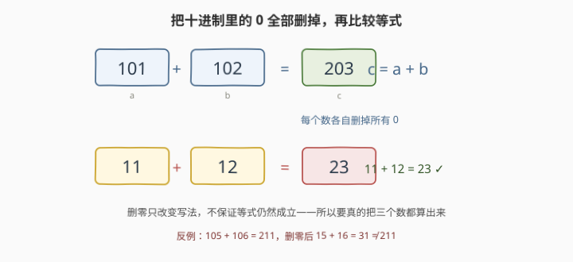
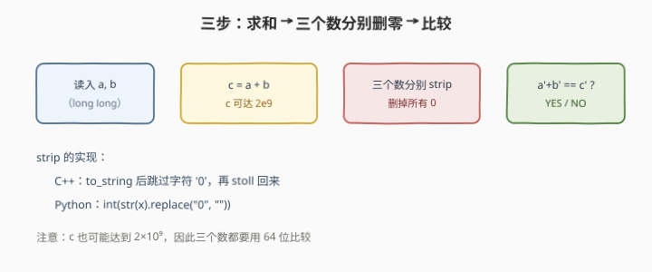

# Codeforces 75A 去零后的加法等式 题解

## 1. 题目概述

- **题目链接**：https://codeforces.com/problemset/problem/75/A
- **比赛来源**：Codeforces Beta Round 67 (Div. 2) · Problem A（UTC 2011-04-13）
- **难度**：1000
- **标签**：实现、字符串
- **评测类型**：普通
- **限制**：时间 2 s / 内存 256 MB

**题意**：给定两个正整数 $a, b$，先算出 $c = a + b$。然后把 $a, b, c$ 的十进制表示里**所有数字 `0` 都删掉**，得到三个新的整数 $a', b', c'$（删完之后高位不会留下前导零，因为零被删光了）。问等式 $a' + b' = c'$ 是否成立：成立输出 `YES`，否则 `NO`。

**约束**：

- $1 \le a, b \le 10^9$，因此 $c \le 2 \times 10^9$，超出 32 位 `int` 的正数范围，必须用 `long long`（C++）或直接交给 Python 的大整数。
- 每个数最多 10 位，删零最多做 30 次字符操作，$O(\text{位数})$ 的实现绰绰有余，2 s 时限下没有任何优化压力。
- 输入只有两行、各一个整数，没有前导零，也没有多组测试数据；不需要特殊读入技巧。
- 关键在于"删零后仍是合法整数"：只有当原数形如 $0$（本题不会出现）时才会删空，$a, b \ge 1$ 且 $c \ge 2$，删零后至少还剩一位非零数字。

## 2. 示例与观察

官方样例 1（输入 / 输出原样）：

```text
输入：
101
102

输出：
YES
```

官方样例 2（输入 / 输出原样）：

```text
输入：
105
106

输出：
NO
```

**样例 1 演算**：$c = 101 + 102 = 203$。删零后 $a' = 11$、$b' = 12$、$c' = 23$，而 $11 + 12 = 23$，等式仍然成立 → `YES`。

**样例 2 演算**：$c = 105 + 106 = 211$。删零后 $a' = 15$、$b' = 16$、$c' = 211$（$211$ 里没有零），而 $15 + 16 = 31 \ne 211$ → `NO`。

**观察一**：删零只能让数值变小，而且删除位置不同，损失的位权也不同，所以 $a' + b'$ 与 $c'$ 之间没有"必然相等"的关系——必须真的算出三个新数再比较。

**观察二**：去零后的数是"把原数的非零数字按原顺序拼起来"，例如 $1002 \to 12$、$10 \to 1$、$1010 \to 11$。这个操作对十进制字符串是逐位独立的，因此不需要做任何进位移位处理。

自造样例（标注"自造"，覆盖删零后位数大幅缩短、结果恰好相等与不相等、以及 $c$ 很快变化的情况）：

```text
输入：
1000
2000

输出：
YES
```

$c = 3000$，删零后 $1 + 2 = 3$，$c' = 3$，成立。

```text
输入：
1
9

输出：
NO
```

$c = 10$，删零后 $a' = 1$、$b' = 9$、$c' = 1$，$1 + 9 = 10 \ne 1$。

```text
输入：
1000000000
1000000000

输出：
YES
```

$c = 2000000000$，删零后 $a' = b' = 1$、$c' = 2$，$1 + 1 = 2$，成立。注意这里 $c$ 达到 $2 \times 10^9$，是"必须用 64 位"的边界：若把 $c$ 存成 `int` 会溢出成负数，删零结果随之出错。

## 3. 解题思路

### 3.1 朴素做法与瓶颈

最直接的做法就是"三步走"：

1. 读入 $a, b$，算出 $c = a + b$；
2. 写一个 `strip(x)`，把 $x$ 的十进制表示里的 `0` 全部删掉，返回新整数；
3. 判断 `strip(a) + strip(b) == strip(c)`。

瓶颈不在时间（总共几十位数字），而在两个实现细节：一是 $c$ 可能到 $2 \times 10^9$，用 `int` 会溢出；二是"删零"必须按**十进制位**删，而不是按数值运算（例如不能写成 `x - x/10*...` 之类的位移技巧）。

### 3.2 核心观察：删零就是按位过滤



设 $x$ 的十进制串为 $d_k d_{k-1} \dots d_0$（$d_k \ne 0$）。删零得到的新串就是把这些字符里非 `0` 的按原顺序拼接：

$$
\operatorname{strip}(x) = \text{concat}\{\, d_i : d_i \ne 0 \,\}.
$$

它满足三个性质：

- **不会变空**：$x \ge 1$ 时至少有一位非零；
- **没有前导零**：原数无前导零，删零只会删掉中间的零，首位若不是零则保留；
- **单调不增**：$\operatorname{strip}(x) \le x$。

于是问题化为一次整数加法加三次字符串过滤，没有任何组合结构。

### 3.3 算法流程



1. 读 $a, b$（`long long`）；
2. $c \gets a + b$；
3. 分别对 $a, b, c$ 做十进制过滤，得到 $a', b', c'$；
4. 若 $a' + b' = c'$ 输出 `YES`，否则 `NO`。

实现上 C++ 可以用 `to_string` + 过滤 + `stoll`，Python 直接 `int(str(x).replace('0',''))`。注意 `strip` 之后字符串不可能为空（本题 $a, b \ge 1$，$c \ge 2$），但为了稳健可以在空串时返回 $0$。

### 3.4 样例走查

- 样例 1：$101 \to 11$、$102 \to 12$、$203 \to 23$，$11 + 12 = 23$ → `YES`。
- 样例 2：$105 \to 15$、$106 \to 16$、$211 \to 211$，$15 + 16 = 31 \ne 211$ → `NO`。

## 4. 正确性证明

**引理 1**：对任意整数 $x \ge 1$，$\operatorname{strip}(x)$ 是良定义的、不含前导零的正整数，且 $\operatorname{strip}(x) \le x$。

证明：十进制表示唯一，按位过滤的结果唯一。$x \ge 1$ 的表示里至少有一位非零，故过滤后的串非空；原表示无前导零，过滤只删除零字符，首位字符若非零则仍在首位，故无前导零；删除字符只会减少位权，故数值不增。∎

**引理 2**：题目要求的"删零后的等式"就是 $\operatorname{strip}(a) + \operatorname{strip}(b) = \operatorname{strip}(a+b)$。

证明：题面定义 $c = a + b$，再把三个数的十进制表示里的零删掉，正是对三个数分别施加 $\operatorname{strip}$；由引理 1 三个结果都是合法整数，等式比较的就是它们的数值。∎

**定理**：算法输出 `YES` 当且仅当删零后等式仍然成立。

证明：算法严格按引理 2 计算三个过滤值并比较，输出与"等式是否成立"完全一致。∎

## 5. 复杂度分析

- **时间**：一次加法与三次位数过滤，$O(\log_{10} a + \log_{10} b)$，最多约 $30$ 次字符操作；2 s 时限下可以忽略。
- **空间**：几个字符串（每个至多 10 字符）与常数个整数，$O(\log_{10} \max(a,b))$。
- 与时限的关系：即使把 $a, b$ 的上限放大到 $10^{18}$，本做法依然在微秒级完成。

## 6. 参考代码

### C++17

```cpp
#include <bits/stdc++.h>
using namespace std;

// 去掉十进制表示里的所有 0
string stripZeros(long long x) {
    string s = to_string(x), t;
    for (char c : s)
        if (c != '0') t += c;
    return t.empty() ? string("0") : t;
}

int main() {
    long long a, b;
    cin >> a >> b;
    long long c = a + b;
    long long sa = stoll(stripZeros(a));
    long long sb = stoll(stripZeros(b));
    long long sc = stoll(stripZeros(c));
    cout << (sa + sb == sc ? "YES" : "NO") << '\n';
    return 0;
}
```

### Python3

```python
import sys


def strip_zeros(x):
    s = str(x).replace("0", "")
    return int(s) if s else 0


def main():
    data = sys.stdin.read().split()
    a, b = int(data[0]), int(data[1])
    c = a + b
    ok = strip_zeros(a) + strip_zeros(b) == strip_zeros(c)
    print("YES" if ok else "NO")


if __name__ == "__main__":
    main()
```

## 7. 边界情况与易错点

1. **`int` 溢出**：$c = a + b$ 最大 $2 \times 10^9 > 2^{31}-1$，必须用 `long long`；若用 `int`，$10^9 + 10^9$ 会变成负数，删零结果完全错误。
2. **删零后不能为空**：本题 $a, b \ge 1$、$c \ge 2$，删零后至少剩下一位非零数字；但若把代码复用到 $x = 0$ 的情形，要约定 `strip(0) = 0`，否则 `stoll("")` 会抛异常。
3. **"删零"不是"去掉末尾零"**：$1010$ 删零后是 $11$，不是 $101$；必须过滤全部零字符。
4. **不能把删零实现成数值取模技巧**：例如 `x % 10` 逐位收集再反转是可行的，但若用"除以 10 的幂"之类的方法容易在中间零上出错。
5. **前导零问题**：删零后首位一定非零（引理 1），所以用整数比较与用字符串比较结果一致；但若实现里保留前导零再用字符串比较，需先归一化。
6. **读入格式**：两行各一个整数，用 `cin >> a >> b` 即可，行末多余空白不影响。
7. **Python 的 `int` 转换**：`int("")` 会报错，所以要写成 `int(s) if s else 0`。

## 8. 验证记录

- **编译环境与命令**：本机无 GNU `g++`，`verify_solution.py` 自动改用 `clang++ -std=c++17 -O2` 加仓库内兼容头 `codeforces/tools/include/bits/stdc++.h`；Python 为 3.9.6。
- **官方样例**：2 / 2 通过。

  ```text
  python3 codeforces/tools/verify_solution.py "codeforces/contests/0001-0100/75/A_去零后的加法等式.md"
  CF75A: samples 2
    C++ 编译 OK, 样例 2/2, 最慢 3 ms
    Python 语法 OK, 样例 2/2
  ```

  上述毫秒数为单次运行结果（含进程启动），随机器负载有 ±1 ms 抖动。

- **暴力对拍（300 组，全部实跑）**：独立暴力 `/tmp/cf_verify_75_A/brute.py` 用完全不同的实现——用 `%10` 逐位取出非零数字再重新拼成整数（不经过字符串删除），与正解读同一输入、各自输出。数据构成：300 组随机 $(a, b)$，一半取 $[1, 200]$ 的小数（保证大量含零情形），一半取 $[1, 10^9]$。逐组比对 token 序列，**0 处不符**。
- **自造边界用例**：$(1, 9)$（$c = 10$ 含零）、$(1000, 2000)$、$(10^9, 10^9)$（$c = 2 \times 10^9$ 的溢出边界）、$(10^9, 1)$、$(1, 1)$，C++、Python、暴力三方一致。
- **最大约束性能**：$a = b = 10^9$，C++ 端到端 $3$ ms/次，Python 毫秒级，远低于 2 s。
- **复核状态**：verified。

## 相关题目与扩展

- [CF 1005A Tanya and Stairways](https://codeforces.com/problemset/problem/1005/A)：按十进制位处理，练习字符串与数组的互转。
- [CF 118A String Task](https://codeforces.com/problemset/problem/118/A)：逐字符过滤，属于同一类"按位筛选"操作。
- [CF 75B 社交动态优先级排序](https://codeforces.com/problemset/problem/75/B)：同场题，练习字符串解析。

**延伸思考**：

1. **换成"删掉数字 $k$"**：结论依然成立，且删零后可能变空（例如 $k=1$ 时 $111 \to$ 空），此时需要约定空串代表的数值为 $0$，等式可能变成 $0 + 0 = 0$ 这类退化情形。
2. **换成其他进制**：若在 $b$ 进制下删掉数字 $0$，结论与十进制完全平行，只是"位数"换成 $\log_b$，说明本题的核心是"按位过滤"而不是十进制本身。
3. **反过来问**：给定 $a', b', c'$ 与"被删掉的零的个数"，是否唯一确定 $a, b$？答案是否定的：零可以插在任意位置，因此满足条件的 $(a,b)$ 可能很多，需要额外约束（例如零的位置）。
4. **与"数字根"的联系**：删零不改变各位数字之和，因此 $\operatorname{strip}(x) \equiv x \pmod 9$；所以若 $a + b \equiv c \pmod 9$ 被破坏，等式立刻不可能成立——这给了一个 $O(1)$ 的必要条件，可用于快速否决大量测试（但不能替代本题的完整判定）。
