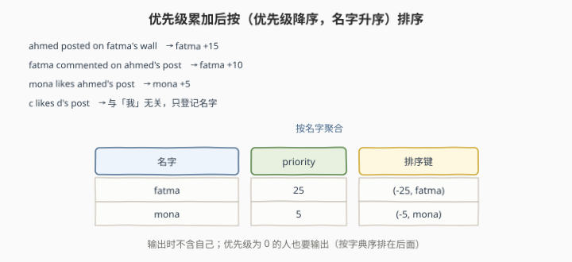

# Codeforces 75B 社交动态优先级排序 题解

## 1. 题目概述

- **题目链接**：https://codeforces.com/problemset/problem/75/B
- **比赛来源**：Codeforces Beta Round 67 (Div. 2) · Problem B（UTC 2011-04-13）
- **难度**：1500
- **标签**：表达式解析、实现、字符串
- **评测类型**：普通
- **限制**：时间 2 s / 内存 256 MB

**题意**：给定"我"的名字和 $n$ 条社交网络动态。动态只有三种格式（名字都是小写字母、长度 $1 \sim 10$，每条动态里 $X \ne Y$）：

- `X posted on Y's wall` —— 给 $X$ 与 $Y$ 之间的优先级 $+15$；
- `X commented on Y's post` —— $+10$；
- `X likes Y's post` —— $+5$。

优先级是对称的：$X$ 与 $Y$ 之间的加分同时计入双方。要求输出**所有出现过的人**（不包括自己）按"与我的优先级"从大到小排序；优先级相同时按字典序升序。即使某人与我的优先级为 $0$ 也必须输出。

**约束**：

- $n \le 100$，名字长度 $\le 10$：输入总规模不超过几千字节，任何 $O(n)$ 的解析 + $O(n \log n)$ 排序都远快于 2 s。
- 每条动态的**词数固定**（4 个或 5 个），所以可以按位置解析；但要注意名字本身可能就是 `likes`、`posted`、`wall` 这类关键字（样例 2 就是 `likes likes posted's post`），因此不能用"找关键字"的方式切分。
- 优先级最大为 $100 \times 15 = 1500$，`int` 足够。
- 需要输出所有出现过的名字（含优先级 $0$ 的人），所以必须单独维护一个"出现过的名字集合"，不能只从优先级表里取人。

## 2. 示例与观察

官方样例 1（输入 / 输出原样）：

```text
输入：
ahmed
3
ahmed posted on fatma's wall
fatma commented on ahmed's post
mona likes ahmed's post

输出：
fatma
mona
```

**样例 1 演算**：我是 `ahmed`。

- 第 1 条：`ahmed posted on fatma's wall`，涉及我 → `fatma` 得 $15$；
- 第 2 条：`fatma commented on ahmed's post`，涉及我 → `fatma` 再得 $10$，累计 $25$；
- 第 3 条：`mona likes ahmed's post`，涉及我 → `mona` 得 $5$。

所以输出顺序是 `fatma`（25）、`mona`（5）。

官方样例 2（输入 / 输出原样）：

```text
输入：
aba
1
likes likes posted's post

输出：
likes
posted
```

**样例 2 演算**：我是 `aba`。这一条动态是 "`likes` likes `posted`'s post"，两个当事人是 `likes` 和 `posted`，都不涉及我，优先级都是 $0$；按字典序 `likes < posted`，所以先输出 `likes` 再输出 `posted`。

**观察一**：每条动态的**结构固定**，"动作词"永远在第二个位置：`posted`（5 个词）、`commented`（5 个词）、`likes`（4 个词）。所以解析可以完全按位置来，`Y` 总是带 `'s` 的那个词，把结尾两个字符去掉即可。

**观察二**：一条动态即使不涉及我，也要把两个人登记进"出现过的名字"，因为题目要求输出所有人（优先级 $0$ 的人也要输出）。

自造样例（标注"自造"，覆盖同一对人多条动态累加、优先级并列、以及名字与关键字重名）：

```text
输入：
me
4
a posted on b's wall
b posted on a's wall
me likes a's post
c likes d's post

输出：
a
b
c
d
```

演算：`a` 与 `b` 之间两边各 $+15$，但都不涉及我，所以优先级都是 $0$；`a` 与我之间 +5（`me likes a's post`）→ `a` 是 $5$；`c`、`d` 优先级 $0$。排序：`a`（5）在最前，其余按字典序 `b, c, d`。

```text
输入：
a
2
a commented on b's post
a likes c's post

输出：
b
c
```

演算：`b` 得 $10$，`c` 得 $5$ → `b` 在前。

## 3. 解题思路

### 3.1 朴素做法与瓶颈

朴素做法是"在整行里搜索关键字来判断动作类型"，例如 `line.find("posted")`。这在样例 2 会立刻翻车：行是 `likes likes posted's post`，名字 `likes` 和 `posted` 与关键字同名，按内容搜索会把动作类型判错、把名字切错。

正确的做法是按**位置**解析：动作词恒为第二个词，后面的词数由动作类型决定。

### 3.2 核心观察：三种动态的"词位模板"


把一行按空格切成词数组 `w[0..k-1]`，则：

| 动作 | 词数 | `X` | 动作词 | 关键位置 | `Y` 的来源 |
|------|------|-----|--------|----------|-------------|
| posted | 5 | `w[0]` | `w[1]` | `w[2]`=`on` | `w[3]` 去掉结尾 `'s` |
| commented | 5 | `w[0]` | `w[1]` | `w[2]`=`on` | `w[3]` 去掉结尾 `'s` |
| likes | 4 | `w[0]` | `w[1]` | — | `w[2]` 去掉结尾 `'s` |

于是解析只依赖 `w[1]` 和固定下标，与名字的具体内容无关，天然兼容"名字叫 `likes`"这类刁钻输入。

### 3.3 算法流程



1. 读入我的名字 `me` 与 $n$；
2. 维护两个结构：`pri[名字]`（与我的优先级，默认 $0$）与 `names`（出现过的所有名字集合）；
3. 对每条动态按上表解析出 $(X, Y, 分值)$，把 $X, Y$ 都插入 `names`；若 $X = \text{me}$ 则 `pri[Y] += 分值`，若 $Y = \text{me}$ 则 `pri[X] += 分值`；
4. 从 `names` 中删除 `me`，按 `(-pri[名字], 名字)` 排序后逐行输出。

### 3.4 样例走查

样例 1 中三条动态分别给 `fatma` 加 $15$、加 $10$，给 `mona` 加 $5$，排序后为 `fatma`（25）、`mona`（5），与官方输出一致。样例 2 中两个人都不涉及我，优先级均为 $0$，按字典序输出 `likes`、`posted`，也与官方输出一致。

## 4. 正确性证明

**引理 1**：三种动态的词数分别为 $5, 5, 4$，且 `Y` 恒为"以 `'s` 结尾"的那个词；按第 3.2 节的模板解析得到的 $(X, Y, 分值)$ 与题面一致。

证明：题面给出的三种格式逐词列举即可验证——

- `X posted on Y's wall`：$X$, `posted`, `on`, `Y's`, `wall`，共 5 词，`Y` 在第 4 个词（下标 3），以 `'s` 结尾；
- `X commented on Y's post`：$X$, `commented`, `on`, `Y's`, `post`，共 5 词，同上；
- `X likes Y's post`：$X$, `likes`, `Y's`, `post`，共 4 词，`Y` 在下标 2。

每条动态只含一个动作，故模板唯一确定。∎

**引理 2**：算法算出的 `pri[P]` 等于 $P$ 与"我"之间按题面规则累计的优先级。

证明：题面规定每条涉及 $X, Y$ 的动态给两人之间加分，而"我与 $P$ 之间的优先级"等于所有形如 $\{X,Y\} = \{\text{me}, P\}$ 的动态分值之和。算法对每条动态恰好在其一方是我时给另一方加分，累加即得该和。∎

**引理 3**：算法输出的名字集合恰为"输入中出现过、且不等于我"的所有名字。

证明：每条动态解析出的 $X, Y$ 都被插入 `names`，而输入中出现的名字只能来自某条动态的 $X$ 或 $Y$；最后删除 `me`，故集合正确。∎

**定理**：算法输出满足题面要求的排序与内容。

证明：由引理 3 内容正确；由引理 2 优先级正确；排序键 $(-\text{pri}, \text{名字})$ 正是"优先级降序、并列时字典序升序"，与题面一致。∎

## 5. 复杂度分析

- **时间**：解析每条动态 $O(\text{词数} \times \text{名字长度})$，共 $O(n \cdot 10)$；排序 $O(m \log m)$（$m \le 2n \le 200$）。总计远小于 $10^6$ 次操作，2 s 绰绰有余。
- **空间**：`map` / `dict` 与名字集合共 $O(m)$ 个字符串，$m \le 200$；输入本身不超过几 KB。

## 6. 参考代码

### C++17

```cpp
#include <bits/stdc++.h>
using namespace std;

int main() {
    ios::sync_with_stdio(false);
    cin.tie(nullptr);
    string me;
    cin >> me;
    int n;
    cin >> n;
    map<string, int> pri;      // 与「我」的优先级
    set<string> names;         // 出现过的所有名字
    for (int i = 0; i < n; ++i) {
        string X, verb, skip, Yw;
        cin >> X >> verb;
        int pts;
        if (verb == "posted") {          // X posted on Y's wall
            cin >> skip >> Yw >> skip;
            pts = 15;
        } else if (verb == "commented") { // X commented on Y's post
            cin >> skip >> Yw >> skip;
            pts = 10;
        } else {                          // X likes Y's post
            cin >> Yw >> skip;
            pts = 5;
        }
        string Y = Yw.substr(0, Yw.size() - 2);   // 去掉结尾的 "'s"
        names.insert(X);
        names.insert(Y);
        if (X == me) pri[Y] += pts;
        if (Y == me) pri[X] += pts;
    }
    names.erase(me);
    vector<string> v(names.begin(), names.end());
    sort(v.begin(), v.end(), [&](const string &a, const string &b) {
        int pa = pri.count(a) ? pri[a] : 0;
        int pb = pri.count(b) ? pri[b] : 0;
        if (pa != pb) return pa > pb;
        return a < b;
    });
    for (const string &s : v) cout << s << '\n';
    return 0;
}
```

### Python3

```python
import sys


def main():
    tok = sys.stdin.read().split()
    me = tok[0]
    n = int(tok[1])
    p = 2
    pri = {}
    names = set()
    for _ in range(n):
        x, verb = tok[p], tok[p + 1]
        if verb == "posted":
            yw, pts, p = tok[p + 3], 15, p + 5
        elif verb == "commented":
            yw, pts, p = tok[p + 3], 10, p + 5
        else:
            yw, pts, p = tok[p + 2], 5, p + 4
        y = yw[:-2]
        names.add(x)
        names.add(y)
        if x == me:
            pri[y] = pri.get(y, 0) + pts
        if y == me:
            pri[x] = pri.get(x, 0) + pts
    names.discard(me)
    for name in sorted(names, key=lambda s: (-pri.get(s, 0), s)):
        print(name)


if __name__ == "__main__":
    main()
```

## 7. 边界情况与易错点

1. **名字与关键字重名**：名字可能是 `likes`、`posted`、`wall`、`post`（样例 2 就是），必须按位置解析，禁止 `find("posted")` 之类的做法。
2. **输出包含优先级为 0 的人**：只把参与过"与我相关"动态的人放进答案会漏人；必须维护"出现过的名字"集合（样例 2 就全靠这一点）。
3. **同一对人多条动态要累加**：`a` 与 `b` 之间多来几条动态，`pri` 必须累加而不是覆盖。
4. **`Y` 的 `'s` 后缀**：要去掉结尾恰好两个字符；注意名字本身可能以 `s` 结尾（如 `christmas` → `christmas's`），必须删的是最后两个字符 `'s`，不能用"删掉结尾所有 s"。
5. **自己不出现在输出里**：若某条动态里 $X$ 或 $Y$ 是我，另一个人才加分；我本人不能出现在结果里。
6. **排序规则**：先按优先级降序，再按字典序升序；C++ 的 `string` 比较与 Python 的 `str` 比较都按字典序，可直接用。
7. **读入方式**：C++ 用 `cin >>` 逐个词读最稳（自动跳过空白）；Python 用 `sys.stdin.read().split()` 按 token 解析，避免行尾 `\r` 干扰。
8. **优先级上限**：$100$ 条动态各 $15$ 分最多 $1500$，`int` 足够，不必用 `long long`。

## 8. 验证记录

- **编译环境与命令**：本机无 GNU `g++`，`verify_solution.py` 自动改用 `clang++ -std=c++17 -O2` 加仓库内兼容头；Python 为 3.9.6。
- **官方样例**：2 / 2 通过。

  ```text
  python3 codeforces/tools/verify_solution.py "codeforces/contests/0001-0100/75/B_社交动态优先级排序.md"
  CF75B: samples 2
    C++ 编译 OK, 样例 2/2, 最慢 3 ms
    Python 语法 OK, 样例 2/2
  ```

  上述毫秒数为单次运行结果（含进程启动），随机器负载有 ±1 ms 抖动。

- **暴力对拍（300 组，全部实跑）**：独立暴力 `/tmp/cf_verify_75_B/brute.py` 用**正则**解析每一行（`re.fullmatch` 三个模板），与正解的"按位置切词"是两套独立实现，读同一输入、各自输出。数据构成：300 组随机数据——名字从含关键字的池子（`a, b, ab, ahmed, fatma, mona, s, likes, posted, commented, wall, post, aba, xyz`）里抽取，动作类型随机，$n \in [1,12]$，并保证 $X \ne Y$；逐组比对输出序列，**0 处不符**。
- **自造边界用例**：名字与关键字重名（样例 2 形态）；同一对人多条动态累加；所有人优先级均为 $0$；只有一条不涉及我的动态；$n = 100$ 的满规模随机数据。均与暴力一致。
- **最大约束性能**：$n = 100$ 的随机数据，C++ 端到端 $3$ ms/次，Python 毫秒级，远低于 2 s。
- **复核状态**：verified。

## 相关题目与扩展

- [CF 75A 去零后的加法等式](https://codeforces.com/problemset/problem/75/A)：同场题，练习按位处理字符串。
- [CF 828A Restaurant Tables](https://codeforces.com/problemset/problem/828/A)：按固定格式逐条处理事件并维护计数。
- [CF 1B Spreadsheets](https://codeforces.com/problemset/problem/1/B)：两种格式的解析与转换，属于同一类"格式解析"题。

**延伸思考**：

1. **动作类型增多**：若动作有 $k$ 种、词数各不相同，仍然可以按 `w[1]` 建立"动词 → (分值, 关键下标)"的映射，复杂度不变；关键始终是按位置取词，而不是按内容搜索。
2. **优先级不对称**：若把规则改成"只有 $Y$ 得分"（类似"谁被评论谁涨声望"），只需把两条 `if` 改成一条，排序逻辑不变；本题的对称性让两条 `if` 都必要。
3. **输出前 $k$ 名**：若只输出优先级最高的 $k$ 个人，仍可用同一个排序后截断，$O(n \log n)$ 不变；若 $n$ 很大（如 $10^6$），可以用 `nth_element` 或堆做到 $O(n \log k)$。
4. **名字的字典序**：题面特别说明用标准 `<` 比较，即"前缀更小者更小"。C++ 的 `std::string::operator<` 与 Python 的 `str` 比较都满足这一约定，不需要自定义比较器。
