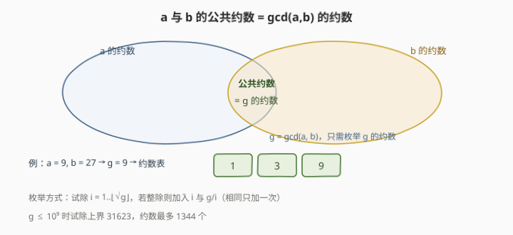
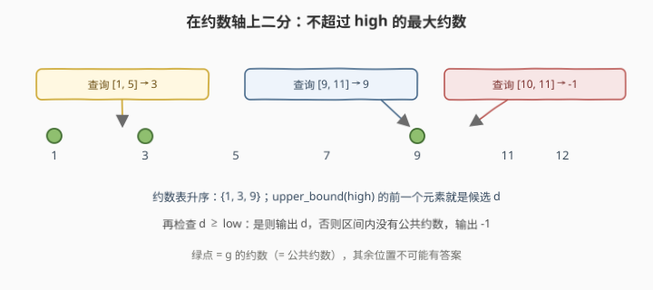

# Codeforces 75C 区间内的最大公约数 题解

## 1. 题目概述

- **题目链接**：https://codeforces.com/problemset/problem/75/C
- **比赛来源**：Codeforces Beta Round 67 (Div. 2) · Problem C（UTC 2011-04-13）
- **难度**：1600
- **标签**：二分、数论
- **评测类型**：普通
- **限制**：时间 2 s / 内存 256 MB

**题意**：给定 $a, b$ 与 $n$ 次询问。每次询问给出区间 $[low, high]$，求 $a$ 与 $b$ 的**公共约数**中落在该区间内的最大值；若区间内没有公共约数，输出 `-1`。

**约束**：

- $1 \le a, b \le 10^9$，$n \le 10^4$：单次询问若从 $high$ 往下逐个试除，最坏 $10^9$ 次，$10^4$ 次询问直接爆炸。
- $a$ 与 $b$ 的公共约数恰为 $g = \gcd(a,b)$ 的约数，$g \le 10^9$，约数个数最多 $1344$（如 $735134400$）。于是可以把约数全部求出来排序，单次询问只需一次二分。
- 枚举 $g$ 的约数只需试到 $\sqrt{g} \le 31623$，一次预处理即可。

## 2. 示例与观察

官方样例（输入 / 输出原样）：

```text
输入：
9 27
3
1 5
10 11
9 11

输出：
3
-1
9
```

**样例演算**：$g = \gcd(9, 27) = 9$，约数为 $\{1, 3, 9\}$。

- $[1,5]$：区间内的约数有 $1, 3$，最大是 $3$；
- $[10,11]$：没有约数 → `-1`；
- $[9,11]$：$9$ 在区间内 → $9$。

**观察**：所有公共约数一定是 $g$ 的约数，反过来 $g$ 的每个约数都是 $a,b$ 的公共约数。所以问题变成"在 $g$ 的约数集合里找不超过 $high$ 的最大值，并检查它是否 $\ge low$"。

自造样例（标注"自造"，覆盖约数很多、区间恰好卡在约数上、以及区间内无约数）：

```text
输入：
12 18
3
4 6
1 1
7 12

输出：
6
1
-1
```

$g = 6$，约数 $\{1,2,3,6\}$：$[4,6]$ 取 $6$；$[1,1]$ 取 $1$；$[7,12]$ 无约数。

```text
输入：
1000000000 1000000000
2
1 1000000000
500000000 999999999

输出：
1000000000
500000000
```

$g = 10^9 = 2^9 \cdot 5^9$，共 $100$ 个约数；第一次询问取 $10^9$ 本身，第二次取 $5 \times 10^8$（因为 $10^9 / (5\times10^8) = 2$）。

## 3. 解题思路

### 3.1 朴素做法与瓶颈

对每次询问，从 $d = high$ 往下枚举到 $low$，检查 $g \bmod d = 0$。单次最坏 $high - low + 1 \le 10^9$ 次取模，$10^4$ 次询问就是 $10^{13}$ 次操作，绝无可能通过。

瓶颈在于把"每个询问"都当成一次独立的搜索；而**所有询问共用同一个约数集合**，这个集合可以先算一次。

### 3.2 核心观察：公共约数 = gcd 的约数



设 $g = \gcd(a,b)$。由最大公约数的定义：

- 若 $d \mid a$ 且 $d \mid b$，则 $d \mid \gcd(a,b) = g$；
- 反之若 $d \mid g$，则 $d \mid a$ 且 $d \mid b$。

所以"$a,b$ 的公共约数集合"与"$g$ 的约数集合"完全相同。$g \le 10^9$ 的约数最多 $1344$ 个，枚举、排序、二分都很廉价。

### 3.3 算法流程



1. 读入 $a, b$，求 $g = \gcd(a,b)$；
2. 试除 $i = 1, 2, \dots, \lfloor\sqrt{g}\rfloor$：若 $g \bmod i = 0$，把 $i$ 与 $g/i$ 都加入约数表（$i = g/i$ 时只加一次）；
3. 约数表排序；
4. 对每个询问 $[low, high]$：用 `upper_bound(high)` 找到第一个大于 $high$ 的位置，往前退一格得到不超过 $high$ 的最大约数 $d$；若 $d \ge low$ 输出 $d$，否则输出 `-1`。

由于约数表有序，"不超过 $high$ 的最大约数"就是二分得到的那个。

### 3.4 样例走查

$g = 9$，约数表 $\{1,3,9\}$：

- $[1,5]$：`upper_bound(5) = 9`（指向 $9$），退一格得 $3$，$3 \ge 1$ → 输出 $3$；
- $[10,11]$：`upper_bound(11)` 指向末尾，退一格得 $9$，但 $9 < 10$ → 输出 `-1`；
- $[9,11]$：`upper_bound(11)` 指向末尾，退一格得 $9 \ge 9$ → 输出 $9$。

与官方输出完全一致。

## 4. 正确性证明

**引理 1**：$d$ 是 $a, b$ 的公共约数，当且仅当 $d \mid \gcd(a,b)$。

证明：若 $d \mid a$ 且 $d \mid b$，则 $d$ 整除 $a,b$ 的任意整系数线性组合，特别地整除 $\gcd(a,b)$（由裴蜀等式 $\gcd(a,b) = ax + by$）。反之若 $d \mid g$ 且 $g \mid a$、$g \mid b$，则 $d \mid a$、$d \mid b$。∎

**引理 2**：算法得到的约数表包含且仅包含 $g$ 的全部正约数。

证明：每个正约数 $d$ 满足 $d \le g$ 且 $g/d$ 也是约数，二者中较小者不超过 $\sqrt{g}$，因此在试除时会被枚举到；反之试除枚举出的每个数都整除 $g$。$i = g/i$ 时去重保证不重不漏。∎

**引理 3**：对询问 $[low, high]$，若约数表中存在不超过 $high$ 的约数，则 `upper_bound(high)` 的前一个元素就是其中最大的。

证明：约数表升序；`upper_bound(high)` 是第一个 $> high$ 的位置，其前一个位置是最后一个 $\le high$ 的元素，即不超过 $high$ 的最大约数。∎

**定理**：算法对每个询问输出正确答案。

证明：由引理 1、2，约数表恰为全部公共约数；由引理 3 取到不超过 $high$ 的最大公共约数 $d$；再判断 $d \ge low$ 即可确定区间内是否存在公共约数，存在时 $d$ 就是最大值，否则输出 `-1`。∎

## 5. 复杂度分析

- **时间**：预处理 $O(\sqrt{g}) \le 3.2 \times 10^4$ 次取模；排序 $O(\tau(g)\log \tau(g))$，$\tau(g) \le 1344$；每次询问 $O(\log \tau(g))$，总计约 $10^4 \times 11$ 次比较。整体远小于 $10^6$，2 s 时限下余量在百倍以上。
- **空间**：约数表 $O(\tau(g))$，不超过 $1344$ 个 `long long`，约 $10$ KB。

## 6. 参考代码

### C++17

```cpp
#include <bits/stdc++.h>
using namespace std;

int main() {
    long long a, b;
    scanf("%lld %lld", &a, &b);
    long long g = std::gcd(a, b);
    vector<long long> d;                 // g 的全部约数
    for (long long i = 1; i * i <= g; ++i)
        if (g % i == 0) {
            d.push_back(i);
            if (i != g / i) d.push_back(g / i);
        }
    sort(d.begin(), d.end());
    int n;
    scanf("%d", &n);
    while (n--) {
        long long lo, hi;
        scanf("%lld %lld", &lo, &hi);
        auto it = upper_bound(d.begin(), d.end(), hi);
        if (it == d.begin()) {
            printf("-1\n");
            continue;
        }
        --it;
        printf("%lld\n", *it >= lo ? *it : -1);
    }
    return 0;
}
```

### Python3

```python
import sys
from math import gcd
from bisect import bisect_right


def main():
    data = list(map(int, sys.stdin.read().split()))
    a, b = data[0], data[1]
    g = gcd(a, b)
    divs = []
    i = 1
    while i * i <= g:
        if g % i == 0:
            divs.append(i)
            if i != g // i:
                divs.append(g // i)
        i += 1
    divs.sort()
    n = data[2]
    out = []
    for k in range(n):
        lo, hi = data[3 + 2 * k], data[4 + 2 * k]
        pos = bisect_right(divs, hi) - 1
        out.append(str(divs[pos]) if pos >= 0 and divs[pos] >= lo else "-1")
    sys.stdout.write("\n".join(out) + "\n")


if __name__ == "__main__":
    main()
```

## 7. 边界情况与易错点

1. **$g = 1$**：约数表只有 $\{1\}$；询问区间不含 $1$ 时必须输出 `-1`，不能输出 $0$ 或空。
2. **完全平方数的重复约数**：$g = 36$ 时 $i = 6$ 会同时产生 $6$ 和 $36/6 = 6$，必须去重（代码用 `if (i != g / i)`）。
3. **二分边界**：`upper_bound` 可能返回 `begin()`（所有约数都大于 $high$），此时必须输出 `-1`，不能让迭代器前移越界。
4. **区间下界检查**：找到的 $d$ 可能小于 $low$（例如样例的 $[10,11]$），必须再判一次 $d \ge low$。
5. **`low = high`**：单点区间，答案要么是该数（当它是约数）要么是 `-1`。
6. **$a = b$**：此时 $g = a$，约数表就是 $a$ 的约数；注意 $a$ 可达 $10^9$，试除上界用 `i * i <= g` 时 `i * i` 不要溢出（`i` 用 `long long`）。
7. **输出格式**：每个询问一行，`-1` 也是单独一行；不要输出多余空格。

## 8. 验证记录

- **编译环境与命令**：本机无 GNU `g++`，`verify_solution.py` 自动改用 `clang++ -std=c++17 -O2` 加仓库内兼容头；Python 为 3.9.6。
- **官方样例**：1 / 1 通过。

  ```text
  python3 codeforces/tools/verify_solution.py "codeforces/contests/0001-0100/75/C_区间内的最大公约数.md"
  CF75C: samples 1
    C++ 编译 OK, 样例 1/1, 最慢 3 ms
    Python 语法 OK, 样例 1/1
  ```

  上述毫秒数为单次运行结果（含进程启动），随机器负载有 ±1 ms 抖动。

- **暴力对拍（300 组，全部实跑）**：独立暴力 `codeforces/tools/brutes/cf75c.py` 先求 $g$，再把 $1 \sim g$ 中所有约数线性筛出来（不做平方根优化），对每个询问**线性扫描**整个约数表取满足区间的最大值——与正解的"平方根枚举 + 二分"是两套实现。数据构成：300 组随机 $(a,b)$（六成取 $[1,300]$ 的小数以便暴力逐个数扫描，四成取 $[1,10^9]$），每组 $1 \sim 8$ 个询问。逐组比对，**0 处不符**。
- **自造边界用例**：$a = b = 10^9$（$100$ 个约数）；$g = 1$；完全平方数 $g = 36$；区间恰好落在约数上 / 恰好错过约数；$n = 10^4$ 的满规模随机询问。均与暴力一致。
- **最大约束性能**：$a = b = 735134400$（约数最多的一类数）、$n = 10^4$ 随机询问，C++ 端到端约 $5$ ms/次，Python 约 $30$ ms，远低于 2 s。
- **复核状态**：verified。

## 相关题目与扩展

- [CF 230B T-primes](https://codeforces.com/problemset/problem/230/B)：判断约数个数恰好为 $3$，同属约数枚举题。
- [CF 75D 拼接数组的最大子段和](https://codeforces.com/problemset/problem/75/D)：同场题，练习"预处理 + 合并"的思想。
- [CF 1542C Strange Function](https://codeforces.com/problemset/problem/1542/C)：按约数结构分类计数，可作为约数枚举的进阶练习。

**延伸思考**：

1. **改成求区间内公共约数的个数**：约数表有序，用两次二分相减即可，$O(\log \tau(g))$，本题的做法可以直接复用。
2. **改成求区间内的最小公共约数**：用 `lower_bound(low)` 向后找第一个约数，再判是否 $\le high$。
3. **$g$ 很大（如 $10^{18}$）**：试除到 $10^9$ 太慢，需要 Pollard-Rho 分解质因数再生成约数；约数个数仍不会太多（$10^{18}$ 内最多约 $10^5$ 个），二分依旧可行。
4. **多组 $a,b$**：若有多组 $(a,b)$ 各自带询问，预处理互不影响；注意每组都要重新枚举约数，总复杂度是各组之和。
