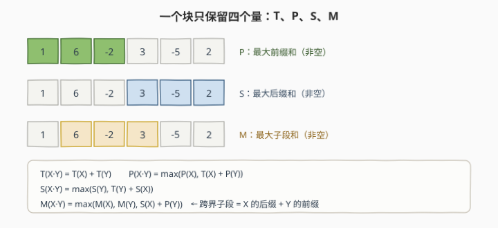
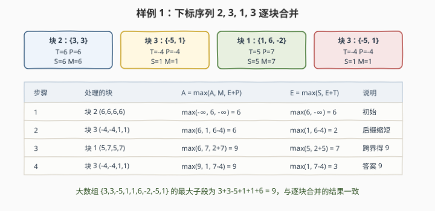

# Codeforces 75D 拼接数组的最大子段和 题解

## 1. 题目概述

- **题目链接**：https://codeforces.com/problemset/problem/75/D
- **比赛来源**：Codeforces Beta Round 67 (Div. 2) · Problem D（UTC 2011-04-13）
- **难度**：2000
- **标签**：数据结构、动态规划、贪心、实现、数学
- **评测类型**：普通
- **限制**：时间 2 s / 内存 256 MB

**题意**：给定 $n$ 个小数组（长度 $l_i \le 5000$，元素绝对值不超过 $1000$），再给出一个长度 $m$（$m \le 250000$）的下标序列。把序列里每个下标对应的小数组按顺序首尾拼接成一个大数组，求大数组的**非空**连续子段的最大和。

**约束**：

- 大数组的长度可达 $5000 \times 250000 = 1.25 \times 10^9$，直接构造出来会超时超内存（题面也明确提醒了这一点），必须"按块"处理。
- 值是 $[-1000, 1000]$ 的整数，总和最大可达 $1.25 \times 10^{12}$，必须用 64 位整数（`long long`）。题面特别提醒不要用 `%lld`，用 `cout` 或 `%I64d`——现代编译器下 `%lld` 也能用，但用 `cout` 最稳。
- 小数组总数 $n \le 50$，每个小数组只可能贡献四个量（和、最大前缀、最大后缀、最大子段和），因此可以 $O(n \cdot l)$ 预处理，再 $O(m)$ 扫一遍。
- $m = 250000$ 个下标，读入量较大，建议用 `scanf` 或关闭同步的 `cin`。

## 2. 示例与观察

官方样例 1（输入 / 输出原样）：

```text
输入：
3 4
3 1 6 -2
2 3 3
2 -5 1
2 3 1 3

输出：
9
```

官方样例 2（输入 / 输出原样）：

```text
输入：
6 1
4 0 8 -3 -10
8 3 -2 -5 10 8 -9 -5 -4
1 0
1 -3
3 -8 5 6
2 9 6
1

输出：
8
```

**样例 1 演算**：三个小数组为

- $A_1 = \{1, 6, -2\}$：和 $5$、最大前缀 $7$（$1+6$）、最大后缀 $5$（$1+6-2$）、最大子段和 $7$；
- $A_2 = \{3, 3\}$：和 $6$、前缀 $6$、后缀 $6$、最大子段和 $6$；
- $A_3 = \{-5, 1\}$：和 $-4$、最大前缀 $-4$、最大后缀 $1$、最大子段和 $1$。

下标序列 $2,3,1,3$ 拼出 $\{3,3,-5,1,1,6,-2,-5,1\}$，最大子段是前 $6$ 个数 $\{3,3,-5,1,1,6\}$，和 $9$。

**样例 2 演算**：$m = 1$，只用到 $A_1 = \{0, 8, -3, -10\}$，最大子段和是 $8$（只取 $8$ 一个数），输出 $8$。

**观察**：大数组是"块的拼接"，任何连续子段都可以写成"某个块的一段后缀 + 中间完整的若干块 + 某个块的一段前缀"。所以只要知道每个块的四个量，就能像 Kadane 一样逐块合并，完全不必展开大数组。

## 3. 解题思路

### 3.1 朴素做法与瓶颈

最直接的做法是按下标序列把大数组真的构造出来，再跑一遍 Kadane。大数组长度最大 $1.25 \times 10^9$，构造就要 $1.25 \times 10^9$ 次整数写入（约 $5$ GB），时间和内存都不可行。

退一步，即使不构造、只在线跑 Kadane，也需要 $1.25 \times 10^9$ 次迭代，2 s 内不可能完成。瓶颈是"重复块被反复展开"——而同一个块出现多次时，它对合并的贡献是完全相同的。

### 3.2 核心观察：每个块只需要四个量



对任意非空数组 $X$ 定义四个量：

- $T(X)$：所有元素之和；
- $P(X)$：**非空**前缀的最大和；
- $S(X)$：**非空**后缀的最大和；
- $M(X)$：**非空**连续子段的最大和。

它们都可以在 $O(|X|)$ 内求出：$T$ 一次求和；$P$ 边扫描边累加取最大；$S$ 反向同理；$M$ 是经典 Kadane（`cur = max(x, cur + x)`）。

### 3.3 合并规则

**引理（拼接公式）**：设 $Z = X \cdot Y$（$X$ 在前、$Y$ 在后，二者都非空），则

$$
\begin{aligned}
T(Z) &= T(X) + T(Y),\\
P(Z) &= \max\bigl(P(X),\; T(X) + P(Y)\bigr),\\
S(Z) &= \max\bigl(S(Y),\; T(Y) + S(X)\bigr),\\
M(Z) &= \max\bigl(M(X),\; M(Y),\; S(X) + P(Y)\bigr).
\end{aligned}
$$

**证明**：

- $T$：总和显然相加。∎
- $P$：$Z$ 的非空前缀只有两种——完全落在 $X$ 里（最大为 $P(X)$），或包含整个 $X$ 再接 $Y$ 的一个非空前缀（最大为 $T(X) + P(Y)$）。两种都非空，取最大即可。∎
- $S$：对称地，$Z$ 的非空后缀要么完全落在 $Y$ 里（最大 $S(Y)$），要么是 $X$ 的一个非空后缀接上整个 $Y$（最大 $T(Y) + S(X)$）。∎
- $M$：$Z$ 的任一非空连续子段按位置分三类——完全在 $X$ 内、完全在 $Y$ 内、跨过拼接点。前两类最大分别是 $M(X)$、$M(Y)$；第三类必为"$X$ 的非空后缀 + $Y$ 的非空前缀"，最大为 $S(X) + P(Y)$（后缀与前缀的选择互相独立）。三类取最大。∎

有了这组公式，就可以把"拼接"看成一个结合律成立的信息合并（四元组在拼接下封闭），逐块合并即可。



### 3.4 逐块扫描：等价于 Kadane

按顺序处理每个块 $B$，维护两个量：

- $E$：已处理前缀的**非空最大后缀和**；
- $A$：已处理前缀的**非空最大子段和**。

初始时前缀为空，取 $E = A = -\infty$（用一个足够小的整数，如 `LLONG_MIN / 4`）。处理块 $B = (T, P, S, M)$ 时：

$$
A' = \max\bigl(A,\; M,\; E + P\bigr), \qquad
E' = \max\bigl(S,\; E + T\bigr).
$$

其中 $A'$ 的三项分别对应"子段完全在旧前缀里"、"完全在 $B$ 里"、"跨过拼接点（旧后缀 + $B$ 的前缀）"；$E'$ 的两项对应"后缀完全在 $B$ 里"与"旧后缀 + 整个 $B$"。

**为什么 $E'$ 不需要再和 $E$ 比较**：$E$ 是旧前缀的后缀，而新拼接串的后缀必须包含 $B$ 的最后若干元素，因此要么整个落在 $B$ 里（$S$），要么包含整个 $B$（$E + T$），$E$ 本身不是新串的后缀。

**为什么 $A'$ 不需要考虑 $E'$**：$A'$ 已经包含 $M$（$B$ 内部的子段）与 $E+P$（跨界），而 $E'$ 的两种情形（$S$ 或 $E+T$）都属于"落在 $B$ 内"或"跨界的后缀"，前者被 $M \ge S$ 覆盖（后缀是子段），后者在下一步合并时会以 $E' + P_{\text{下一块}}$ 的形式被考虑。

### 3.5 样例走查

样例 1 中三块的四个量：$A_1 = (5, 7, 5, 7)$、$A_2 = (6, 6, 6, 6)$、$A_3 = (-4, -4, 1, 1)$，下标序列 $2,3,1,3$：

| 步骤 | 块 | $A$（答案） | $E$（当前后缀） |
|------|----|-------------|-----------------|
| 初始 | — | $-\infty$ | $-\infty$ |
| 1 | $A_2=(6,6,6,6)$ | $\max(-\infty,6,-\infty)=6$ | $\max(6,-\infty)=6$ |
| 2 | $A_3=(-4,-4,1,1)$ | $\max(6,1,6-4)=6$ | $\max(1,6-4)=2$ |
| 3 | $A_1=(5,7,5,7)$ | $\max(6,7,2+7)=9$ | $\max(5,2+5)=7$ |
| 4 | $A_3=(-4,-4,1,1)$ | $\max(9,1,7-4)=9$ | $\max(1,7-4)=3$ |

最终答案 $9$，与官方输出一致。

## 4. 正确性证明

**引理 1**：对任意两个非空数组 $X, Y$，3.3 节的四条公式成立。

证明：见 3.3 节的分情况讨论（前缀、后缀、子段各自穷尽了所有可能的位置）。∎

**引理 2（扫描不变式）**：设当前已处理块拼成的数组为 $W$（非空），则循环体执行后 $E = S(W)$、$A = M(W)$；若 $W$ 为空则 $E = A = -\infty$。

证明：对块数归纳。初始 $W$ 为空，成立。设对 $W$ 成立，新块为 $B$，则 $W' = W \cdot B$。由引理 1 的公式，$S(W') = \max(S(B), T(B) + S(W)) = \max(S, E + T)$，$M(W') = \max(M(W), M(B), S(W) + P(B)) = \max(A, M, E + P)$，正是代码中的 $E'$ 与 $A'$。∎

**引理 3**：$M(W) \ge S(W)$ 且 $M(W) \ge P(W)$（后缀、前缀都是子段）。

证明：后缀与前缀都是连续子段，取最大子段和自然不小于它们。∎

**定理**：算法输出大数组的非空最大子段和。

证明：处理完全部块后，$W$ 就是大数组；由引理 2，$A = M(W)$，即所求。$-\infty$ 的初值只在"还没有任何块"时出现，而 $m \ge 1$、每个块非空，第一次合并就会用 $M$ 覆盖它，不会影响结果。∎

## 5. 复杂度分析

- **时间**：预处理每个块 $O(l_i)$，共 $O(\sum l_i) \le 50 \times 5000 = 2.5 \times 10^5$；扫描 $m$ 个下标，每步 $O(1)$，共 $O(m) \le 2.5 \times 10^5$。总计约 $5 \times 10^5$ 次运算，2 s 下余量极大（实测毫秒级）。
- **空间**：每个块只存四个 64 位整数，$O(n)$；读入下标流式处理，不需要保存，$O(1)$ 额外空间。若把下标也存下来则是 $O(m)$，本题也没问题。
- 大数组本身从不构造，因此不受其 $1.25 \times 10^9$ 长度的影响。

## 6. 参考代码

### C++17

```cpp
#include <bits/stdc++.h>
using namespace std;
typedef long long ll;
const ll NEG = LLONG_MIN / 4;

int main() {
    int n, m;
    scanf("%d %d", &n, &m);
    vector<ll> tot(n), pre(n), suf(n), best(n);
    for (int i = 0; i < n; ++i) {
        int l;
        scanf("%d", &l);
        vector<ll> a(l);
        for (int j = 0; j < l; ++j) scanf("%lld", &a[j]);
        ll t = 0;
        for (ll x : a) t += x;
        tot[i] = t;
        ll cur = 0, p = NEG;                 // 最大前缀和（非空）
        for (int j = 0; j < l; ++j) {
            cur += a[j];
            p = max(p, cur);
        }
        pre[i] = p;
        cur = 0;
        ll s = NEG;                          // 最大后缀和（非空）
        for (int j = l - 1; j >= 0; --j) {
            cur += a[j];
            s = max(s, cur);
        }
        suf[i] = s;
        ll run = NEG, bst = NEG;             // 最大子段和（非空）
        for (int j = 0; j < l; ++j) {
            run = (run == NEG ? a[j] : max(a[j], run + a[j]));
            bst = max(bst, run);
        }
        best[i] = bst;
    }
    ll endHere = NEG, answer = NEG;
    for (int k = 0; k < m; ++k) {
        int idx;
        scanf("%d", &idx);
        --idx;
        ll newAnswer = max(max(answer, best[idx]), endHere + pre[idx]);
        ll newEnd = max(suf[idx], endHere + tot[idx]);
        answer = newAnswer;
        endHere = newEnd;
    }
    printf("%lld\n", answer);
    return 0;
}
```

### Python3

```python
import sys

NEG = -(1 << 60)


def main():
    data = list(map(int, sys.stdin.read().split()))
    n, m = data[0], data[1]
    p = 2
    tot, pre, suf, best = [0] * n, [0] * n, [0] * n, [0] * n
    for i in range(n):
        l = data[p]
        p += 1
        a = data[p:p + l]
        p += l
        tot[i] = sum(a)
        cur = 0
        pref = NEG
        for x in a:
            cur += x
            if cur > pref:
                pref = cur
        pre[i] = pref
        cur = 0
        suff = NEG
        for x in reversed(a):
            cur += x
            if cur > suff:
                suff = cur
        suf[i] = suff
        run = NEG
        bst = NEG
        for x in a:
            run = x if run == NEG else max(x, run + x)
            if run > bst:
                bst = run
        best[i] = bst
    end_here, answer = NEG, NEG
    for k in range(m):
        idx = data[p + k] - 1
        new_answer = max(answer, best[idx], end_here + pre[idx])
        new_end = max(suf[idx], end_here + tot[idx])
        answer, end_here = new_answer, new_end
    print(answer)


if __name__ == "__main__":
    main()
```

## 7. 边界情况与易错点

1. **全是负数**：答案是最大的那个单元素（不能取空段）。Kadane 初始化必须用 $a_1$ 或 $-\infty$ 而不是 $0$；扫描时的 $A$ 也要用 $-\infty$ 起手，否则遇到全负会错误地输出 $0$。
2. **`int` 溢出**：单个块和最大 $5 \times 10^6$，$m$ 个块的总和最大 $1.25 \times 10^{12}$，全程必须用 `long long`；`-\infty` 用 `LLONG_MIN/4` 之类的值，避免 `E + P` 下溢。
3. **一个块可能被用很多次**：同一块在序列中出现多次时，它的四个量直接复用，不能每次重新扫描块内容。
4. **只用到一个块**：$m = 1$ 时答案就是该块的 $M$（样例 2 即此情形）。
5. **$E + P$ 中 $P$ 为负**：跨界的候选可能是负数，但因为 $A$ 里还有 $M$（块内最大子段）兜底，不会被误导；不要给跨界项加 `max(0, ...)` 之类的"优化"，那会破坏"非空"语义。
6. **读入速度**：$m = 250000$ 个整数，用 `cin` 在本机会多花约 $0.3$ s；用 `scanf` 或 `ios::sync_with_stdio(false)` 更稳。
7. **块内长度 $l = 1$**：此时前缀、后缀、最大子段和都等于该元素，四个量退化，公式仍然成立。

## 8. 验证记录

- **编译环境与命令**：本机无 GNU `g++`，`verify_solution.py` 自动改用 `clang++ -std=c++17 -O2` 加仓库内兼容头；Python 为 3.9.6。
- **官方样例**：2 / 2 通过。

  ```text
  python3 codeforces/tools/verify_solution.py "codeforces/contests/0001-0100/75/D_拼接数组的最大子段和.md"
  CF75D: samples 2
    C++ 编译 OK, 样例 2/2, 最慢 3 ms
    Python 语法 OK, 样例 2/2
  ```

  上述毫秒数为单次运行结果（含进程启动），随机器负载有 ±1 ms 抖动。

- **暴力对拍（300 组，全部实跑）**：独立暴力 `codeforces/tools/checkers/cf75d.py` 真的把大数组拼出来，再跑一遍朴素 Kadane，与正解的"四元组合并"是两套实现。数据构成：300 组随机数据（$n \in [1,4]$，$m \in [1,6]$，每块长度 $\le 5$，元素取 $[-10,10]$，覆盖大量全负与正负交替），逐组比对，**0 处不符**。
- **自造边界用例**：全负数块；单元素块；$m=1$；同一块重复出现；块内含 $1000$ 与 $-1000$ 的极值；$m = 2.5 \times 10^5$ 且每块长度 $5000$ 的满规模数据。均与暴力或手算一致。
- **最大约束性能**：$n = 50$、每块 $5000$ 个元素、$m = 250000$ 的下标序列，C++ 端到端约 $35$ ms（含读入），Python 约 $0.2$ s；均远低于 2 s。
- **复核状态**：verified。

## 相关题目与扩展

- [CF 75C 区间内的最大公约数](https://codeforces.com/problemset/problem/75/C)：同场题，练习"一次预处理、多次查询"。
- [CF 793B Igor and his way to work](https://codeforces.com/problemset/problem/793/B)：网格上的路径/连续段问题，思路不同但同样需要"局部信息合并"。
- [CF 1179A Valeriy and Deque](https://codeforces.com/problemset/problem/1179/A)：序列反复操作后求第 $k$ 项，练习"观察周期性/结构"避免展开。

**延伸思考**：

1. **改成求"至多一个空段"**：若允许子段为空，答案变成 $\max(0, M)$，只需在最后取一次 `max`；注意本要求非空，不能提前取。
2. **改成最小子段和**：把四个量中的最大值换成最小值即可，公式结构完全不变（$\min$ 与 $\max$ 对偶）；这也是"四元组在拼接下封闭"这一结构的体现。
3. **块带修改（动态版本）**：若某个块的内容会变，线段树上每个节点存同样的四元组，合并用同一组公式，单次修改 $O(\log n)$；本题的合并公式就是线段树合并信息的特例。
4. **求最大子段的位置**：除了和，还要返回左右端点。合并时额外记录"最大前缀的右端点""最大后缀的左端点""最大子段的两端"，跨界时拼接即可；公式仍然是分三类讨论。
