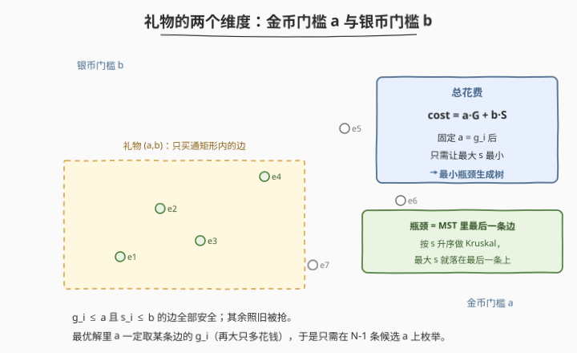
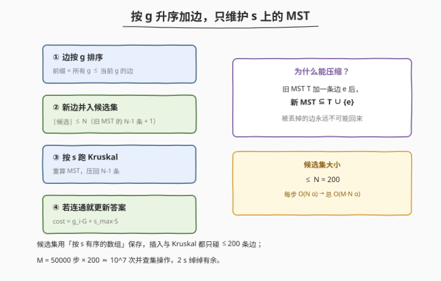
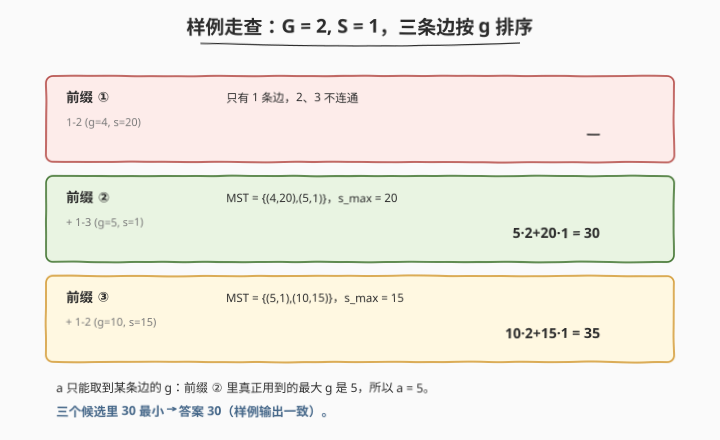

# Codeforces 76A 金币银币的礼物 题解

## 1. 题目概述

- **题目链接**：https://codeforces.com/problemset/problem/76/A
- **比赛来源**：All-Ukrainian School Olympiad in Informatics · Problem A（UTC 2011-04-12）
- **难度**：2200
- **标签**：图论、最小生成树、最小瓶颈生成树、按权值枚举
- **评测类型**：普通
- **限制**：时间 2 s / 内存 256 MB

**题意**：奥林匹亚王国由 $N$ 座城市、$M$ 条双向道路连通（允许重边与自环）。第 $i$ 条道路有两个门槛：$g_i$（金币）与 $s_i$（银币）。国王送出的礼物是二元组 $(a,b)$，表示 $a$ 枚金币与 $b$ 枚银币；凡是满足 $g_i \le a$ 且 $s_i \le b$ 的道路都会停止被劫掠，变成安全道路，其余道路照旧不安全。一枚金币值 $G$ 图格里克，一枚银币值 $S$ 图格里克，礼物总价是 $aG + bS$。求让**任意两座城市之间存在安全通路**（即安全道路把 $N$ 座城市连成一个连通块）的最小总价；若怎么送都做不到，输出 `-1`。

**约束**：

- $2 \le N \le 200$，$1 \le M \le 50000$：城市数很小、边数很大。这提示我们**可以在每条边上枚举 $a$**，但每次枚举后的处理必须做到 $O(N)$ 量级——$O(M \cdot N) = 10^7$ 可行，$O(M^2)$ 约 $2.5 \times 10^9$ 不可行。
- $1 \le G, S, g_i, s_i \le 10^9$：单次代价可达 $10^9 \times 10^9 = 10^{18}$，两个维度相加接近 $2 \times 10^{18}$，必须用 `long long`（`int` 上限约 $2.1 \times 10^9$，中间乘积直接溢出）。
- 重边与自环都可能出现：自环永远不会帮助连通，但不能让它们破坏并查集/排序逻辑；重边按正常边处理即可。
- 输入只有一组数据，没有测试组数，也没有多组读到 EOF 的格式。

## 2. 示例与观察

官方样例（输入 / 输出原样）：

```text
输入：
3 3
2 1
1 2 10 15
1 2 4 20
1 3 5 1

输出：
30
```

**样例解释**：三条边分别是 $1\text{-}2$ 要求 $(10,15)$、$1\text{-}2$ 要求 $(4,20)$、$1\text{-}3$ 要求 $(5,1)$，金币单价 $G=2$、银币单价 $S=1$。

| 礼物 $(a,b)$ | 被买通的边 | 图是否连通 | 总价 $2a+b$ |
|---|---|---|---|
| $(4,20)$ | 只有 $1\text{-}2$ | 否 | — |
| $(5,20)$ | 前两条 | 是 | 30 |
| $(10,20)$ | 全部三条 | 是 | 40 |
| $(5,1)$ | 只有 $1\text{-}3$ | 否 | — |
| $(10,15)$ | 第 1、3 条 | 是 | 35 |

最小可行总价是 $2 \times 5 + 1 \times 20 = 30$。

**观察一（只用考虑某些 $a$）**：如果某个 $(a,b)$ 可行，把 $a$ 降到「实际用到的边的最大 $g$」，可行性不变、价格只会变小。所以最优的 $a$ 一定等于某条边的 $g_i$，候选只有 $M$ 个。

**观察二（固定 $a$ 后 $b$ 的最优值）**：固定 $a$ 后能用的是集合 $E_a = \{i : g_i \le a\}$。要让图连通，$b$ 至少要大到「$E_a$ 中 $s_i \le b$ 的边连通」，也就是 $E_a$ 上的**最小瓶颈生成树**的最大边权。它恰好等于 $E_a$ 按 $s$ 做 Kruskal 时**最后一条被选中的边的 $s$**。

自造样例（标注「自造」，覆盖不连通、自环、重边、单价为 1 等情形）：

| 输入 | 输出 | 说明 |
|------|------|------|
| `2 1` / `1 1` / `1 2 7 9` | `16` | 只有一条边：$a=7, b=9$，$7+9=16$ |
| `2 1` / `3 5` / `1 1 1 1` | `-1` | 只有自环，永远不连通 |
| `3 3` / `1 1` / `1 2 100 1` / `2 3 1 100` / `1 3 50 50` | `200` | 两条贵边里选一条：$100+100=200$ |
| `4 3` / `1 1` / `1 2 1 1` / `2 3 1 1` / `3 4 1 1` | `3` | 链：$a=b=1$，总价 3 |

## 3. 解题思路

### 3.1 朴素做法与瓶颈

最直接的做法是枚举所有候选 $(a,b)$：$a$ 取某个 $g_i$、$b$ 取某个 $s_i$，共 $M^2$ 组，每组做一次 $O(M\alpha)$ 的连通性检查，总复杂度

$$O(M^3 \alpha) \approx (5 \times 10^4)^3 = 1.25 \times 10^{14},$$

2 s 内绝无可能。即使只枚举 $a$（$M$ 个）再每次重新排序求瓶颈（$O(M \log M)$），也有 $5 \times 10^4 \times 5 \times 10^4 \log \approx 4 \times 10^{10}$，同样不行。

真正的瓶颈在于：**固定 $a$ 之后，我们还要在 $E_a$ 上重新算一遍生成树**。必须让「$a$ 增大一条边」这个变化只花 $O(N)$ 而不是 $O(M \log M)$。

### 3.2 核心观察：最小瓶颈生成树 + 增量 MST



固定 $a$ 时，代价 $aG + bS$ 中 $aG$ 已经是常数，只需最小化 $b$。而

$$b_{\min}(a) = \min_{\text{生成树 } T \subseteq E_a} \max_{e \in T} s_e,$$

这正是 $E_a$ 上**最小瓶颈生成树**的瓶颈值。它的经典结论是：**按 $s$ 升序做 Kruskal，最后一条被加入的边的 $s$ 就是 $b_{\min}(a)$**；换句话说，$b_{\min}(a)$ 是最小的 $b$ 使得「$g \le a$ 且 $s \le b$」的边已经连通。这个结论也说明：**按 $s$ 的最小生成树就是最小瓶颈生成树**，两者的最大边权相同。

于是答案可以写成

$$\text{ans} = \min_{i} \Bigl( g_i \cdot G + b_{\min}(g_i) \cdot S \Bigr),$$

其中 $g_i$ 遍历按 $g$ 升序排好后的每个前缀（第 $i$ 个前缀 = 前 $i+1$ 条边）。

接下来解决「前缀扩张时如何维护 $b_{\min}$」。关键引理（第 4 节证明）：

> 若 $T$ 是图 $G$ 的一棵 MST，往 $G$ 中加入一条边 $e$，则 $G + e$ 存在一棵 MST 包含在 $T \cup \{e\}$ 中。

也就是说，**旧 MST 之外被淘汰的边永远不可能重新变有用**。所以每一步只需保留「旧 MST 的至多 $N-1$ 条边 + 新边」这至多 $N$ 条边，在它们上面重跑 Kruskal，就能得到新前缀的 MST。候选集从 $5 \times 10^4$ 缩到 $200$。



### 3.3 算法流程

1. 读入 $N, M, G, S$ 与全部边；按 $(g, s)$ 升序排序（$g$ 相同则 $s$ 小的在前，保证每个 $g$ 值的「完整前缀」都会被枚举到）。
2. 维护一个**按 $s$ 升序**的数组 `mst`，表示当前前缀的 $s$-最小生成树（至多 $N-1$ 条边）。
3. 依次处理每条边 $e_i$：
   - 若 $u_i \ne v_i$，把 $e_i$ 按 $s$ 有序插入 `mst`（自环直接跳过，它不影响连通性也不会进入生成树）；
   - 用 `mst` 里的边跑一次 Kruskal（并查集，最多 $N$ 条边），把选中的边按 $s$ 升序写回 `mst`，条数至多 $N-1$；
   - 若 `mst` 恰好有 $N-1$ 条边（连通），用 `g_i * G + mst.back().s * S` 更新答案（因为 `mst` 按 $s$ 升序，最后一条的 $s$ 就是瓶颈）。
4. 若从未连通，输出 `-1`。

复杂度：排序 $O(M \log M)$；每条边一次有序插入 $O(N)$、一次 Kruskal $O(N\alpha)$，总计 $O(M N \alpha) \approx 10^7$ 次并查集操作。

### 3.4 样例走查



三条边按 $g$ 升序是 $(4,20)$ 连 $1\text{-}2$、$(5,1)$ 连 $1\text{-}3$、$(10,15)$ 连 $1\text{-}2$：

| 前缀 | 候选边 | Kruskal 选出的 MST | 瓶颈 $s_{\max}$ | 候选代价 |
|---|---|---|---|---|
| ① | $(4,20)$ | $\{(4,20)\}$，只有 1 条边 | 图不连通 | 不计 |
| ② | $(4,20),(5,1)$ | $\{(5,1),(4,20)\}$ | 20 | $5 \times 2 + 20 \times 1 = 30$ |
| ③ | 三条全在 | $\{(5,1),(10,15)\}$（$s$ 序：1, 15, 20） | 15 | $10 \times 2 + 15 \times 1 = 35$ |

前缀 ② 里真正用到的最大 $g$ 是 $5$，所以 $a = 5$、$b = 20$，总价 $30$；前缀 ③ 的 $a$ 已经涨到 $10$，虽然瓶颈降到 $15$，总价反而更高。三者取最小得 $30$，与样例输出一致。

注意前缀 ③ 的 MST 选的是 $(10,15)$ 而不是 $(4,20)$：按 $s$ 排序后 $15 < 20$，Kruskal 先吃掉 $s=15$ 的边，凑够 $N-1=2$ 条就停了。这正是「MST 让最大边权最小」的体现。

## 4. 正确性证明

**引理 1（固定 $a$ 时的最优 $b$）**：设 $E_a = \{i : g_i \le a\} \ne \varnothing$，定义

$$b^* = \min\{\, b : \text{仅用 } \{i \in E_a,\ s_i \le b\} \text{ 的边就能连通所有城市} \,\},$$

若不存在这样的 $b$ 则记 $b^* = +\infty$。则对任意 $b$，$(a,b)$ 可行当且仅当 $b \ge b^*$。

**证明**：$(a,b)$ 可行的定义就是「$g_i \le a$ 且 $s_i \le b$ 的边连通所有城市」，这恰好是集合 $\{i \in E_a : s_i \le b\}$ 连通。由 $b^*$ 的定义，$b < b^*$ 时该集合不连通、$(a,b)$ 不可行；$b \ge b^*$ 时集合包含了 $b = b^*$ 时已经连通的那些边，仍连通。∎

**引理 2（Kruskal 的最后一跳就是瓶颈）**：对 $E_a$ 按 $s$ 升序做 Kruskal 得到的生成树 $T_a$，其最大边权恰为引理 1 中的 $b^*$；从而 $\min_{T \subseteq E_a} \max_{e \in T} s_e = b^*$。

**证明**：Kruskal 是一条条按 $s$ 升序加边的：处理完所有权值 $\le s$ 的边后，它已经建好了这些边构成的生成森林。因此「图利用 $s_e \le s$ 的边变连通」这件事恰好第一次发生在 $s = b^*$ 处（$s < b^*$ 时按定义不连通），此时 Kruskal 加入的最后一条边权值就是 $b^*$，此后它已经选满 $N-1$ 条、不会再加入更大的边。所以 $\max_{e \in T_a} s_e = b^*$。另一方面，任何生成树 $T \subseteq E_a$ 都必须用到至少一条 $s \ge b^*$ 的边：否则 $T$ 全部由 $s < b^*$ 的边组成，与 $b^*$ 的最小性矛盾。故所有生成树的最大边权都 $\ge b^*$，而 $T_a$ 取到了 $b^*$。∎

**引理 3（增量 MST 不丢边）**：设 $T$ 是图 $G = (V, E)$ 的一棵最小生成树，$e \notin E$ 是一条新边。则 $G' = (V, E \cup \{e\})$ 存在一棵最小生成树 $T'$ 满足 $T' \subseteq T \cup \{e\}$。

**证明**：$T$ 是生成树，所以 $T \cup \{e\}$ 中含唯一一个环 $C$。令 $e'$ 为 $C \setminus \{e\}$ 中权值最大的一条边。

- 若 $w(e) \ge w(e')$：取 $T' = T$。反设存在 $G'$ 的生成树 $S$ 满足 $w(S) < w(T)$：若 $e \notin S$，则 $S$ 也是 $G$ 的生成树，与 $T$ 的最优性矛盾；若 $e \in S$，把 $S$ 中的 $e$ 换成 $e'$ 得到 $G$ 的生成树，权值为 $w(S) - w(e) + w(e') \le w(S) < w(T)$，同样矛盾。故 $T$ 仍是 $G'$ 的 MST。
- 若 $w(e) < w(e')$：取 $T' = T \cup \{e\} \setminus \{e'\}$，它是生成树且 $w(T') = w(T) - w(e') + w(e) < w(T)$。任取 $G'$ 的生成树 $S$：若 $e \notin S$，则 $S$ 是 $G$ 的生成树，$w(S) \ge w(T) > w(T')$；若 $e \in S$，则 $S \setminus \{e\}$ 把点集分成两个连通块，而 $e'$ 在环 $C$ 上跨越这条割，故 $S \setminus \{e\} \cup \{e'\}$ 是 $G$ 的生成树，于是 $w(S) - w(e) + w(e') \ge w(T)$，即 $w(S) \ge w(T) - w(e') + w(e) = w(T')$。两种情况都有 $w(S) \ge w(T')$，故 $T'$ 是 $G'$ 的 MST。

两种情形都给出了包含在 $T \cup \{e\}$ 中的 MST。∎

**定理（算法输出最优解）**：记算法输出的最小候选代价为 $\text{ans}$，真实最优代价为 $\text{OPT}$，则 $\text{ans} = \text{OPT}$。

**证明**：先证 $\text{ans} \ge \text{OPT}$：每个候选 $(g_i, b_{\min}(g_i))$ 都是可行礼物（引理 1、2），其代价不小于最优，故 $\text{ans} \ge \text{OPT}$。

再证 $\text{ans} \le \text{OPT}$：设最优礼物为 $(a^\star, b^\star)$。$a$ 变大只会让可用边集变大、价格变高，所以可以假设 $a^\star$ 恰好等于某条边的 $g_j$（否则把 $a^\star$ 降到「可行边集里最大的 $g$」，可行性不变而价格更低，与最优性矛盾）。设排序后最后一个满足 $g_k \le a^\star$ 的下标为 $k$，则 $g_k = a^\star$ 且 $E_{g_k} = E_{a^\star}$。$(a^\star, b^\star)$ 可行说明 $E_{g_k}$ 中 $s_i \le b^\star$ 的边已经连通，由引理 1 得 $b_{\min}(g_k) \le b^\star$；引理 3 保证算法在第 $k$ 步手中的候选集正是 $E_{g_k}$ 的一棵 MST，于是第 $k$ 步给出的候选代价

$$g_k G + b_{\min}(g_k) S \le a^\star G + b^\star S = \text{OPT},$$

故 $\text{ans} \le \text{OPT}$。两边夹住，$\text{ans} = \text{OPT}$。∎

引理 3 保证算法在第 $k$ 步手中的 `mst` 就是前缀 $\{1,\dots,k\}$ 的一棵 MST，因此第 $k$ 步算出的瓶颈正是 $b_{\min}(g_k)$——这是「每一步的候选都是对的」的依据。

## 5. 复杂度分析

- **时间**：排序 $O(M \log M)$；对每条边做一次有序插入 $O(N)$ 与一次 Kruskal $O(N \alpha(N))$，共 $O(M N \alpha(N))$。取 $M = 5 \times 10^4$、$N = 200$，约 $10^7$ 次并查集操作，实测端到端约 $40$ ms（含进程启动），相对 2 s 时限余量 50 倍以上。
- **空间**：$O(M + N)$，主要是 $M$ 条边的结构体（约 $50000 \times 24$ 字节 $\approx 1.2$ MB）与长度 $\le N$ 的候选数组；远小于 256 MB。
- **数值范围**：$g_i G \le 10^{18}$、$b S \le 10^{18}$，两者相加 $\le 2 \times 10^{18} < 2^{63}-1 \approx 9.22 \times 10^{18}$，`long long` 安全；`int` 在乘法处必然溢出。

## 6. 参考代码

### C++17

```cpp
#include <bits/stdc++.h>
using namespace std;

struct Edge {
    int u, v;
    long long g, s;
};

int main() {
    int N, M;
    if (scanf("%d %d", &N, &M) != 2) return 0;
    long long G, S;
    scanf("%lld %lld", &G, &S);
    vector<Edge> e(M);
    for (int i = 0; i < M; i++) {
        scanf("%d %d %lld %lld", &e[i].u, &e[i].v, &e[i].g, &e[i].s);
    }
    sort(e.begin(), e.end(), [](const Edge &a, const Edge &b) {
        if (a.g != b.g) return a.g < b.g;
        return a.s < b.s;
    });

    vector<Edge> mst;          // 当前前缀的 s 最小瓶颈生成树，按 s 升序
    mst.reserve(N);
    vector<int> par(N + 1);
    const long long INF = LLONG_MAX;

    auto findroot = [&](int x) {
        while (par[x] != x) {
            par[x] = par[par[x]];
            x = par[x];
        }
        return x;
    };

    long long ans = INF;
    for (int i = 0; i < M; i++) {
        Edge cur = e[i];
        if (cur.u != cur.v) {
            // 按 s 有序插入（最多 N 条）
            auto it = upper_bound(mst.begin(), mst.end(), cur,
                                  [](const Edge &a, const Edge &b) { return a.s < b.s; });
            mst.insert(it, cur);
        }
        // 对当前候选边集跑一次 Kruskal，压缩成新的 MST
        for (int k = 1; k <= N; k++) par[k] = k;
        vector<Edge> keep;
        keep.reserve(N);
        for (const Edge &x : mst) {
            int ru = findroot(x.u), rv = findroot(x.v);
            if (ru != rv) {
                par[ru] = rv;
                keep.push_back(x);
                if ((int)keep.size() == N - 1) break;
            }
        }
        mst.swap(keep);
        if ((int)mst.size() == N - 1) {
            long long cost = cur.g * G + mst.back().s * S;
            if (cost < ans) ans = cost;
        }
    }
    if (ans == INF) puts("-1");
    else printf("%lld\n", ans);
    return 0;
}
```

### Python3

```python
import sys


def main() -> None:
    data = sys.stdin.buffer.read().split()
    if not data:
        return
    it = iter(data)
    n = int(next(it))
    m = int(next(it))
    g_price = int(next(it))
    s_price = int(next(it))
    edges = []
    for _ in range(m):
        x = int(next(it)); y = int(next(it)); g = int(next(it)); s = int(next(it))
        edges.append((g, s, x, y))
    edges.sort()

    mst = []                     # 按 s 升序保存的前缀最小瓶颈生成树
    ans = None
    for g, s, x, y in edges:
        if x != y:
            # 二分插入，保持按 s 升序
            lo, hi = 0, len(mst)
            key = (s, x, y)
            while lo < hi:
                mid = (lo + hi) // 2
                if mst[mid][:3] < key:
                    lo = mid + 1
                else:
                    hi = mid
            mst.insert(lo, (s, x, y))
        parent = list(range(n + 1))

        def find(v):
            while parent[v] != v:
                parent[v] = parent[parent[v]]
                v = parent[v]
            return v

        keep = []
        for es, ex, ey in mst:
            a, b = find(ex), find(ey)
            if a != b:
                parent[a] = b
                keep.append((es, ex, ey))
                if len(keep) == n - 1:
                    break
        mst = keep
        if len(mst) == n - 1:
            cost = g * g_price + mst[-1][0] * s_price
            if ans is None or cost < ans:
                ans = cost
    sys.stdout.write(str(ans if ans is not None else -1) + "\n")


main()
```

Python 版与 C++ 版算法完全相同，$M = 5 \times 10^4$ 时纯 Python 约需数秒；若用 Python 提交建议 PyPy3，否则提交 C++。

## 7. 边界情况与易错点

1. **永远不连通要输出 `-1`**：自环、或者「只有 1 条边但 N=3」这类数据都会让所有前缀都不连通。用「是否从未达到 $N-1$ 条 MST 边」判断，不要用「答案仍是 INF 就输出 0」之类的手滑。
2. **自环必须跳过但前缀位置要保留**：自环不进 MST，但它仍然占据一个 $g_i$，处理它时 `cur.g` 仍应参与候选（虽然不会更优）。更稳妥的写法是像参考代码那样「跳过插入、照常评估」，这样不会因为跳过而漏掉某个 $g$ 值。
3. **`int` 乘法溢出**：$g_i \cdot G$ 可达 $10^{18}$。读入、存储、乘法全程用 `long long`；把 `G, S` 声明成 `int` 再乘 `long long` 也容易在别处出错。
4. **瓶颈必须取 MST 最后一条边的 $s$**：这依赖候选数组按 $s$ 升序。Kruskal 写回 `keep` 时是按遍历顺序（即 $s$ 序）追加的，天然有序；如果改成乱序写回，`mst.back().s` 就不再是瓶颈，会静默算错。
5. **同一 $g$ 的多条边**：按 $(g,s)$ 排序后逐个评估即可；同一个 $g$ 的「完整前缀」出现在该 $g$ 的最后一条边上，候选代价关于前缀单调不增，所以逐个评估不会漏掉最优值，但**不能**只评估每个 $g$ 的第一次出现。
6. **$N = 2$ 的退化图**：只需要 1 条边，`mst.size() == N-1 == 1`，逻辑与一般情况一致；注意 `keep` 的提前 `break` 条件在 $N-1=1$ 时也正确。
7. **重边**：同一个 $(u,v)$ 可能有多条不同 $(g,s)$ 的边，Kruskal 会自然挑 $s$ 最小的那条；不要去重。
8. **`upper_bound` 的比较器**：参考代码用「只比较 $s$」的比较器插入，相等时插在前面，这对 MST 的正确性没有影响（同 $s$ 的边谁先谁后都行），但比较器必须严格弱序，不能写成 `<=`。

## 8. 验证记录

- **编译环境与命令**：本机只有 `Apple clang 21.0.0`，用 `clang++ -std=c++17 -O2 -Wall` 搭配仓库自带的 `codeforces/tools/include/bits/stdc++.h` 兼容头编译（代码只用标准库，可原样提交 GNU C++17）；Python 为 `Python 3.9.6`。文档级验证命令：
  `python3 codeforces/tools/verify_solution.py codeforces/contests/0001-0100/76/A_金币银币的礼物.md`
- **官方样例**：1 / 1 通过（C++ 与 Python 均输出 `30`）。
- **额外测试**：4 组自造边界（单边、只有自环、两条贵边二选一、链），C++ 与 Python 全部一致。
- **独立暴力对拍**：另写一份**完全不使用 MST/瓶颈结论**的暴力：枚举 $a \in \{g_i\}$、$b \in \{s_i\}$ 的全部组合（$M^2$ 组），每组用并查集判连通。对 $N \in [2,5]$、$M \in [1,7]$ 的 **260 组**随机数据（含重边、自环、不连通图、$G,S$ 随机）与参考程序逐组比对，**260 / 260 一致**；再加 **250 组** $N \le 6$、$M \le 9$ 的更大随机数据（共 **510 组**），同样全部一致。
- **最大约束性能**：$N = 200$、$M = 50000$、$G = S = 10^9$、随机 $10^9$ 级门槛，C++ 端到端 3 次均为 **0.04 s**（含进程启动），远低于 2 s；峰值内存 **2.9 MB**（`/usr/bin/time -l` 的 maximum resident set size）。
- **复核状态**：verified（样例、对拍、性能均实跑通过；本机无 GNU g++，已用 clang++ 等价编译验证）。

## 相关题目与扩展

- [Codeforces 76B Mice](https://codeforces.com/problemset/problem/76/B)：同场 B 题，最近点指派 + 平局决策，见另一篇题解。
- [Codeforces 160D Edges in MST](https://codeforces.com/problemset/problem/160/D)：判断每条边是否一定在、可能在、一定不在某棵 MST 上，同为 MST 结构性质题。
- [Codeforces 1108F MST Unification](https://codeforces.com/problemset/problem/1108/F)：把 MST 变成唯一，核心是数「同权边造成的环」。
- [Codeforces 609E Minimum spanning tree for each edge](https://codeforces.com/problemset/problem/609/E)：对每条边求「强制包含它」的 MST 权值，用到 MST + 树上倍增。
- [Codeforces 125E MST Company](https://codeforces.com/problemset/problem/125/E)：限制与某点相连的边数的 MST，是 MST 上再叠一层参数化枚举的经典题。
- [LeetCode 1584. 连接所有点的最小费用](https://leetcode.cn/problems/min-cost-to-connect-all-points/)：稠密图 MST 的入门题，适合先热手。

**延伸思考**：

1. **如果金币/银币的单价也随数量变化**（例如阶梯定价），那么「固定 $a$ 后最小化 $b$」就不再是常数权问题，代价函数不再是 $aG + bS$ 的线性形式，本题的枚举框架会失效——此时需要按 (a,b) 平面上的下凸包去做，属于另一类问题。
2. **如果要求恰好用 $k$ 条金币路（$g_i$ 超过某阈值的边最多 $k$ 条）**，问题立刻变成「带基数约束的 MST」，一般做法是 WQS 二分（拉格朗日松弛）+ MST，复杂度多一个 $\log$。
3. **如果门槛是三维的** $(g_i, s_i, c_i)$、礼物是 $(a,b,c)$，则「最小瓶颈生成树」的阈值面变成三维阶梯，答案是三维偏序下的最小代价，$O(M^2)$ 枚举加每步 $O(M\log M)$ 已经不可行，需要更复杂的结构（或直接接受 $O(M^2 \log M)$）。
4. **本题与「最小生成树 = 最小瓶颈生成树」的关系**：很多题只需要瓶颈值，却习惯性去求 MST；理解「MST 让最大边权最小」这一条，可以省掉一半实现。
5. **把「连通」换成「$2$-边连通」**：固定的 $a$ 下要最小化瓶颈银币，就变成最小瓶颈的边双连通生成子图，Kruskal 不再适用（要用增量桥/并查集缩点），难度显著上升。
