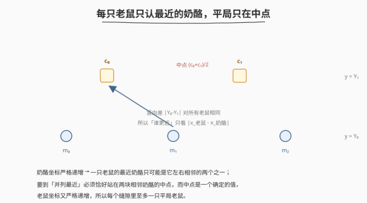
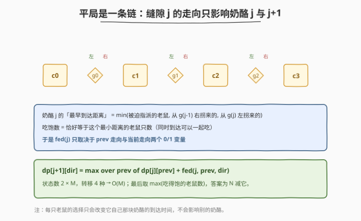
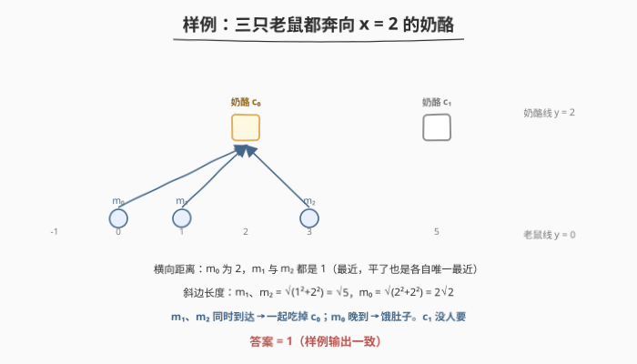

# Codeforces 76B 饥饿老鼠与奶酪 题解

## 1. 题目概述

- **题目链接**：https://codeforces.com/problemset/problem/76/B
- **比赛来源**：All-Ukrainian School Olympiad in Informatics · Problem B（UTC 2011-04-12）
- **难度**：2100
- **标签**：排序、二分、贪心与 DP、模拟
- **评测类型**：普通
- **限制**：时间 0.5 s / 内存 256 MB

**题意**：平面上有两排点：$N$ 只老鼠都在直线 $y = Y_0$ 上，横坐标是严格递增的 $x_{1,i}$；$M$ 块奶酪都在直线 $y = Y_1$ 上，横坐标是严格递增的 $x_{2,i}$。所有老鼠速度相同，同时出发。每只老鼠先挑一块**离自己最近**的奶酪，然后沿直线跑过去；如果最近的有好几块，则所有老鼠的挑法会互相协调，使得最后**挨饿的老鼠数最少**。

一块奶酪在「最早到达的那批老鼠」抵达时被吃掉：若同一时刻有多只老鼠到达同一块奶酪，它们会**一起**吃掉这块奶酪并都吃饱；之后才到的老鼠什么也吃不到，饿着停在原地。求最终挨饿老鼠数的最小值。

**约束**：

- $1 \le N \le 10^5$，$0 \le M \le 10^5$：$O(NM)$ 的「每只老鼠对每块奶酪」是 $10^{10}$，0.5 s 内不可能，必须做到 $O((N+M)\log M)$ 左右。
- $|x_{1,i}|, |x_{2,i}| \le 10^7$：距离比较只看横坐标差（竖向差对所有老鼠一样），差最大 $2 \times 10^7$，`int` 够但用 `long long` 更稳。
- 两排坐标都**严格递增**：最近奶酪只可能是左右相邻的两块，且「并列最近」的中点是一个确定的值，所以每个缝隙里至多一只平局老鼠——这是把问题化成链式 DP 的关键。
- $M$ 可以为 $0$：此时第三行不存在，直接输出 $N$。

## 2. 示例与观察

官方样例（输入 / 输出原样）：

```text
输入：
3 2 0 2
0 1 3
2 5

输出：
1
```

**样例解释**：老鼠在 $y=0$ 的 $x = 0, 1, 3$，奶酪在 $y=2$ 的 $x = 2, 5$。

| 老鼠 | 到 $x=2$ 的横向差 | 到 $x=5$ 的横向差 | 选谁 | 实际距离 |
|---|---|---|---|---|
| $m_0$ ($x=0$) | 2 | 5 | $c_0$ | $\sqrt{2^2+2^2} = 2\sqrt2$ |
| $m_1$ ($x=1$) | 1 | 4 | $c_0$ | $\sqrt{1^2+2^2} = \sqrt5$ |
| $m_2$ ($x=3$) | 1 | 2 | $c_0$ | $\sqrt5$ |

三只老鼠都奔向 $x=2$ 的奶酪。$m_1$、$m_2$ 距离相同、同时到达，一起吃掉它并都吃饱；$m_0$ 晚到，挨饿。$x=5$ 的奶酪没人要。答案 $3-2 = 1$。

**观察一**：所有老鼠到奶酪的竖向距离都是 $|Y_0 - Y_1|$，所以「谁更近」完全由 $|x_{1,i} - x_{2,j}|$ 决定。距离相等当且仅当横向差相等。

**观察二**：奶酪横坐标严格递增，一只老鼠的最近奶酪只可能是它左边最近的那块或右边最近的那块（二分找位置后比较两个候选）。

**观察三**：要并列最近，老鼠必须**恰好**站在两块相邻奶酪的中点。中点是一个确定的实数，而老鼠横坐标严格递增，所以**每个缝隙至多一只平局老鼠**。于是「需要做选择」的只有这些至多 $M-1$ 只老鼠，而且每只只会影响它两侧的两块奶酪。

自造样例（标注「自造」）：

| 输入 | 输出 | 说明 |
|------|------|------|
| `1 1 0 1` / `0` / `5` | `0` | 唯一老鼠吃到唯一奶酪 |
| `3 0 0 1` / `0 1 2` | `3` | 没有奶酪（第三行不存在） |
| `2 2 0 1` / `-5 5` / `0 10` | `0` | 各吃各的，都吃饱 |
| `3 2 0 1` / `4 5 6` / `0 10` | `1` | 中间那只平局，无论怎么选都会有一块奶酪被 4 或 6 抢先 |

## 3. 解题思路

### 3.1 朴素做法与瓶颈

最直接的模拟是：先让每只老鼠找最近的奶酪，遇到平局就枚举所有挑法，再按「谁先到」统计吃饱数，取最优。平局老鼠最多 $M-1$ 只，枚举量 $2^{M-1}$，完全不可行。

即使不枚举，直接对每只老鼠遍历所有奶酪也算出最近距离，复杂度 $O(NM) = 10^{10}$，同样超时。真正的结构是：**平局只发生在相邻奶酪之间，而且每只平局老鼠的选择只影响两块奶酪**。抓住这一点就能把 $2^{M-1}$ 的枚举降成一条链上的 2 状态 DP。

### 3.2 核心观察：平局是一条链



先把「距离」换成「横向差」：竖向差固定，比较欧氏距离与比较 $|x_1 - x_2|$ 等价。于是：

- 用二分找到老鼠左边最近的奶酪 $c_j$ 与右边最近的 $c_{j+1}$，两者取横向差小者；差相等就是平局。
- 平局时 $x_1 = (x_{2,j} + x_{2,j+1})/2$，只涉及**相邻**的两块奶酪。把这条缝隙记作 $g_j$，平局老鼠记作 $t_j$（可能不存在）。
- 由于老鼠坐标严格递增，同一个 $g_j$ 上至多一只 $t_j$。

于是每块奶酪 $c_j$ 的「竞争者」只有三类：被强制指派给它的老鼠、来自 $g_{j-1}$ 的平局老鼠、来自 $g_j$ 的平局老鼠。它的吃饱数只取决于**到达它的最小距离**：

$$\text{fed}(j) = \#\{\text{指派到 } c_j \text{ 的老鼠中，距离恰等于最小距离的}\}.$$

同时到达的老鼠可以一起吃，所以「恰等于最小距离」的那一批全部吃饱，其余全部挨饿。

### 3.3 算法流程：链上 2 状态 DP



1. 读入并（防御性地）排序两排坐标；若 $M = 0$ 直接输出 $N$。
2. 对每只老鼠二分定位，比较左右两块奶酪的横向差：
   - 唯一最近（绝大多数情况）：把它的距离并入该奶酪的统计 $(f_{\min}[j], f_{\text{cnt}}[j])$；
   - 并列最近：把「缝隙 $g_j$、距离 $d$」记下来。
3. 记 `dir[j] ∈ {0,1}` 表示缝隙 $g_j$ 的平局老鼠往**左**（$0$，去 $c_j$）还是往**右**（$1$，去 $c_{j+1}$）。
4. 定义 $\text{fed}(j, \text{prev}, \text{cur})$：奶酪 $c_j$ 在「$g_{j-1}$ 走向 prev、$g_j$ 走向 cur」时的吃饱数——在「被迫指派的老鼠最小距离」「$g_{j-1}$ 平局距离（若 prev=1）」「$g_j$ 平局距离（若 cur=0）」三者里取最小值，数出等于最小值的只数。
5. 转移：

$$\text{dp}[j+1][\text{cur}] = \max_{\text{prev} \in \{0,1\}} \Bigl( \text{dp}[j][\text{prev}] + \text{fed}(j, \text{prev}, \text{cur}) \Bigr).$$

最后一个奶酪右边没有缝隙，只允许 $\text{cur} = 0$。最终最大吃饱数是 $\max_{\text{dir}} \text{dp}[M][\text{dir}]$，答案 $= N - $ 该值。

复杂度 $O(N \log M + M)$，每个奶酪只做 4 次常数转移。

### 3.4 样例走查



- $m_0(x=0)$：左候选无人、右候选比较后最近是 $c_0(x=2)$，横向差 2，唯一；
- $m_1(x=1)$：最近 $c_0$，横向差 1，唯一；
- $m_2(x=3)$：$c_0$ 差 1、$c_1(x=5)$ 差 2，唯一选 $c_0$。

没有任何平局，DP 退化成直接统计：$c_0$ 的 $f_{\min} = 1$、$f_{\text{cnt}} = 2$（$m_1$、$m_2$ 并列最近），吃饱 2 只；$c_1$ 没有老鼠。答案 $3 - 2 = 1$，与样例一致。

如果换成 `3 2 0 1 / 4 5 6 / 0 10`：$m(4)$ 唯一选 $c_0$（差 4），$m(6)$ 唯一选 $c_1$（差 4），$m(5)$ 平局（差 5）。$g_0$ 上的平局老鼠无论往左还是往右，都会成为那一侧「最后一个到达者」：它要么让 $c_0$ 的 $f_{\min}$ 保持 4（自己饿），要么让 $c_1$ 的 $f_{\min}$ 保持 4（自己饿）。两个方向都只能喂饱 2 只，答案 $3 - 2 = 1$。

## 4. 正确性证明

**引理 1（最近奶酪只在左右邻居中）**：设奶酪横坐标严格递增。对任意老鼠 $x$，令 $j$ 使 $x_{2,j} \le x < x_{2,j+1}$（边界情形同理），则 $x$ 的最近奶酪必是 $c_j$ 或 $c_{j+1}$；且「并列最近」当且仅当 $x = (x_{2,j} + x_{2,j+1})/2$。

**证明**：对 $k \le j-1$ 有 $x_{2,k} \le x_{2,j} \le x$，故 $|x - x_{2,k}| = x - x_{2,k} \ge x - x_{2,j} = |x - x_{2,j}|$，越往左越远；对称地，$k \ge j+2$ 时越往右越远。所以只需比较 $c_j, c_{j+1}$。两者相等当且仅当 $x - x_{2,j} = x_{2,j+1} - x$，即 $x$ 是中点。∎

**推论 1**：每个缝隙 $g_j$ 上至多一只平局老鼠。

**证明**：中点是唯一确定的实数，而老鼠横坐标严格递增，同一个值最多出现一次。∎

**引理 2（一块奶酪的吃饱数）**：设被指派到 $c_j$ 的老鼠距离集合为 $D_j$（非空），则 $c_j$ 恰好喂饱 $\#\{d \in D_j : d = \min D_j\}$ 只老鼠。

**证明**：所有老鼠速度相同且同时出发，到达时间与距离成正比，所以「最早到达」就是距离最小。距离等于最小值的那些老鼠同一时刻到达，此时奶酪还在，它们一起吃并都吃饱（题面样例解释明确「第二、第三只老鼠会吃掉这块奶酪」）；距离更大的老鼠到达时奶酪已被吃掉，只能挨饿。∎

**引理 3（DP 的最优子结构）**：对任意 $j$，奶酪 $0..j-1$ 的吃饱总数只由 $\text{dir}[0..j-1]$ 决定；$\text{fed}(j)$ 只依赖 $\text{dir}[j-1]$ 与 $\text{dir}[j]$。

**证明**：由引理 1，平局老鼠只出现在相邻奶酪之间，$g_{j}$ 的平局老鼠只会被指派到 $c_j$ 或 $c_{j+1}$；被强制指派的老鼠与缝隙无关。故 $c_j$ 的竞争者集合只由 $\text{dir}[j-1]$（是否把 $g_{j-1}$ 的老鼠给它）与 $\text{dir}[j]$（是否把 $g_j$ 的老鼠给它）决定。∎

**定理（DP 给出最优解）**：记 $\text{best} = \max_{\text{dir}}\text{dp}[M][\text{dir}]$，则最多有 $\text{best}$ 只老鼠能吃饱，答案为 $N - \text{best}$。

**证明**：由引理 3，总吃饱数可写成 $\sum_{j=0}^{M-1} \text{fed}(j, \text{dir}[j-1], \text{dir}[j])$（其中 $\text{dir}[-1]$ 表示「没有前一个缝隙」；一共有 $M-1$ 条缝隙，最后一块奶酪右边没有缝隙）。这是定义在链上的、每项只依赖相邻两个变量的函数，标准的链式 DP 逐项取最大即可得到全局最大：归纳地，$\text{dp}[j][\cdot]$ 是「前 $j$ 块奶酪在给定 $\text{dir}[j-1]$ 下的最大吃饱数」，转移枚举全部 2 种前缀状态，没有遗漏。∎

**推论 2（答案）**：挨饿老鼠数 $= N - \text{best}$。因为每只老鼠要么吃饱要么挨饿，且引理 2 保证了吃饱数的计算方式。

## 5. 复杂度分析

- **时间**：排序 $O(N\log N + M\log M)$（可以省掉，题面已保证有序，代码里排序只是防御）；每只老鼠两次二分 $O(\log M)$，共 $O(N \log M)$；DP 是 $O(M)$ 的 4 状态转移。总 $O(N\log M + M)$，对 $10^5$ 规模约 $1.7 \times 10^6$ 次基本操作。实测端到端 $0.02$ s（含进程启动），相对 0.5 s 时限余量 20 倍以上。
- **空间**：$O(N + M)$，三只长度为 $M$ 的数组（最小距离、计数、平局距离）与坐标数组；$10^5$ 级别约 3 MB，远小于 256 MB。
- **数值范围**：横向差最大 $2 \times 10^7$，用 `long long` 保存即可；本题不需要真的开方比较，因此没有精度问题。

## 6. 参考代码

### C++17

```cpp
#include <bits/stdc++.h>
using namespace std;

int main() {
    int n, m;
    long long Y0, Y1;
    if (scanf("%d %d %lld %lld", &n, &m, &Y0, &Y1) != 4) return 0;
    vector<long long> mx(n), cx(m);
    for (int i = 0; i < n; i++) scanf("%lld", &mx[i]);
    for (int i = 0; i < m; i++) scanf("%lld", &cx[i]);
    sort(mx.begin(), mx.end());
    sort(cx.begin(), cx.end());
    if (m == 0) {
        printf("%d\n", n);
        return 0;
    }
    const long long INF = LLONG_MAX / 4;
    vector<long long> fmin(m, INF);   // 被强制指派到奶酪 j 的老鼠里最近的横向距离
    vector<int> fcnt(m, 0);           // 处于该最近距离的老鼠数
    vector<long long> tieD(m, -1);    // gap j (j, j+1) 上的平局老鼠距离，-1 表示没有

    for (int i = 0; i < n; i++) {
        long long x = mx[i];
        int pos = int(lower_bound(cx.begin(), cx.end(), x) - cx.begin());
        long long best = INF;
        int bj = -1;
        for (int k = pos - 1; k <= pos; k++) {
            if (k < 0 || k >= m) continue;
            long long d = llabs(x - cx[k]);
            if (d < best) { best = d; bj = k; }
        }
        int tj = -1;
        if (bj - 1 >= 0 && llabs(x - cx[bj - 1]) == best) tj = bj - 1;
        if (bj + 1 < m && llabs(x - cx[bj + 1]) == best) tj = bj + 1;
        if (tj >= 0) {
            int g = min(bj, tj);
            tieD[g] = best;           // 严格递增保证每个 gap 至多一只平局老鼠
        } else {
            if (best < fmin[bj]) { fmin[bj] = best; fcnt[bj] = 1; }
            else if (best == fmin[bj]) fcnt[bj]++;
        }
    }

    auto fed = [&](int j, int prevDir, int curDir) -> int {
        long long mn = INF;
        int cnt = 0;
        if (fcnt[j] > 0) { mn = fmin[j]; cnt = fcnt[j]; }
        if (j - 1 >= 0 && tieD[j - 1] >= 0 && prevDir == 1) {
            long long d = tieD[j - 1];
            if (d < mn) { mn = d; cnt = 1; }
            else if (d == mn) cnt++;
        }
        if (j + 1 < m && tieD[j] >= 0 && curDir == 0) {
            long long d = tieD[j];
            if (d < mn) { mn = d; cnt = 1; }
            else if (d == mn) cnt++;
        }
        return cnt;
    };

    // dp[j][d]: 处理完前 j 个奶酪，gap j-1 的方向为 d（0=给左边 j-1，1=给右边 j）时的最大吃饱数
    long long dpPrev[2] = {0, 0}, dpCur[2];
    for (int j = 0; j < m; j++) {
        dpCur[0] = dpCur[1] = -1;
        for (int d = 0; d < 2; d++) {
            if (dpPrev[d] < 0) continue;
            for (int nd = 0; nd < 2; nd++) {
                if (j == m - 1 && nd == 1) continue;   // 最后一个奶酪右边没有 gap
                long long v = dpPrev[d] + fed(j, d, nd);
                if (v > dpCur[nd]) dpCur[nd] = v;
            }
        }
        dpPrev[0] = dpCur[0];
        dpPrev[1] = dpCur[1];
    }
    long long best = max(dpPrev[0], dpPrev[1]);
    if (best < 0) best = 0;
    printf("%lld\n", n - best);
    return 0;
}
```

### Python3

```python
import sys
from bisect import bisect_left


def main() -> None:
    data = sys.stdin.buffer.read().split()
    if not data:
        return
    it = iter(data)
    n = int(next(it)); m = int(next(it))
    Y0 = int(next(it)); Y1 = int(next(it))
    mice = sorted(int(next(it)) for _ in range(n))
    cheese = sorted(int(next(it)) for _ in range(m))
    if m == 0:
        sys.stdout.write(str(n) + "\n")
        return
    INF = 10 ** 30
    fmin = [INF] * m
    fcnt = [0] * m
    tie = [None] * m          # gap j: 平局老鼠到两端奶酪的横向距离

    for x in mice:
        pos = bisect_left(cheese, x)
        best, bj = INF, -1
        for k in (pos - 1, pos):
            if 0 <= k < m and abs(x - cheese[k]) < best:
                best, bj = abs(x - cheese[k]), k
        tj = -1
        if bj - 1 >= 0 and abs(x - cheese[bj - 1]) == best:
            tj = bj - 1
        if bj + 1 < m and abs(x - cheese[bj + 1]) == best:
            tj = bj + 1
        if tj >= 0:
            tie[min(bj, tj)] = best
        else:
            if best < fmin[bj]:
                fmin[bj], fcnt[bj] = best, 1
            elif best == fmin[bj]:
                fcnt[bj] += 1

    def fed(j, pd, nd):
        mn, cnt = INF, 0
        if fcnt[j] > 0:
            mn, cnt = fmin[j], fcnt[j]
        if j - 1 >= 0 and tie[j - 1] is not None and pd == 1:
            d = tie[j - 1]
            if d < mn:
                mn, cnt = d, 1
            elif d == mn:
                cnt += 1
        if j + 1 < m and tie[j] is not None and nd == 0:
            d = tie[j]
            if d < mn:
                mn, cnt = d, 1
            elif d == mn:
                cnt += 1
        return cnt

    dpPrev = [0, 0]
    for j in range(m):
        dpCur = [-1, -1]
        for d in range(2):
            if dpPrev[d] < 0:
                continue
            for nd in range(2):
                if j == m - 1 and nd == 1:
                    continue
                v = dpPrev[d] + fed(j, d, nd)
                if v > dpCur[nd]:
                    dpCur[nd] = v
        dpPrev = dpCur
    sys.stdout.write(str(n - max(dpPrev[0], dpPrev[1], 0)) + "\n")


main()
```

## 7. 边界情况与易错点

1. **$M = 0$**：第三行根本不存在。必须读完前两行就直接输出 $N$，不能去读奶酪坐标；`sys.stdin.buffer.read().split()` 的写法天然安全，`scanf` 写法则要把读取循环放在 `if (m>0)` 里或保证不读。
2. **$M = 1$**：所有老鼠都只能选这唯一一块奶酪，平局数为 0。答案 $= N - $（距离最小的那批老鼠数），DP 逻辑不变（只有 $c_0$，`nd` 只能是 0）。
3. **平局中点是半整数**：例如奶酪在 $0$ 和 $5$，中点 $2.5$ 处不可能有整数坐标的老鼠，此时没有平局。代码用整数比较 $|x - c_j| = |x - c_{j+1}|$，天然处理，不会误判。
4. **必须用「横向差」比较而不是「距离」**：竖向差对所有老鼠相同，比较 $|x_1 - x_2|$ 与比较真实距离等价；如果真去算平方根再比，会引入浮点误差。参考代码全程整数。
5. **「同时到达」是一起吃饱而不是只饱一只**：样例解释明确第二、第三只老鼠都吃掉了那块奶酪。若按「一块奶酪只喂一只」实现，样例就会算成 2 只挨饿。
6. **同一缝隙出现多只平局老鼠**：题面保证老鼠横坐标严格递增，所以不会发生；如果数据违规，`tieD[g]` 会被后面的老鼠覆盖，答案可能偏大。写题解与测试时以题面约束为准。
7. **最后一个奶酪的状态**：`j == m-1` 时 `nd = 1` 表示「把 $g_{m-1}$ 给 $c_m$」，而 $c_m$ 不存在，必须跳过，否则 `tie[j]` 越界或算错。
8. **坐标范围**：$|x| \le 10^7$、$Y \le 10^7$，差不超过 $2\times10^7$，`int` 也不会溢出，但 `llabs` + `long long` 可以避免「相减后再比较」时的手滑。
9. **多测清空**：本题只有一组数据；如果改成多测，`fmin / fcnt / tieD` 都要按当前 $M$ 重新初始化，不能只 `clear()` 而不重置 `-1`。

## 8. 验证记录

- **编译环境与命令**：`clang++ -std=c++17 -O2 -Wall`（本机无 GNU g++，配 `codeforces/tools/include/bits/stdc++.h` 兼容头；代码可原样提交 GNU C++17），Python 为 `Python 3.9.6`。文档级验证：
  `python3 codeforces/tools/verify_solution.py codeforces/contests/0001-0100/76/B_饥饿老鼠与奶酪.md`
- **官方样例**：1 / 1 通过（C++ 与 Python 均输出 `1`）。
- **额外测试**：4 组自造（单鼠单酪、$M=0$、两点各吃各的、中点平局）与 $M=1$ 的退化情形，C++ / Python / 暴力三方一致。
- **独立暴力对拍**：暴力程序直接枚举**每只平局老鼠的左右选择**（$2^{t}$ 种，$t$ 为平局老鼠数），按「每组奶酪取最小距离计数」统计吃饱数，与主程序无关。测试生成器让坐标取小范围内的严格递增序列，刻意制造中点平局。共 **400 组**随机数据（$N \le 6$、$M \le 4$、$Y_0 \ne Y_1$、坐标含负数），主程序、Python 版、暴力三方**全部一致**。
- **穷举交叉验证**：把主算法与暴力写进同一个 C++ 程序，对 $N \in [1,3]$、$M \in [0,3]$、坐标取自 $\{-4,-3,\dots,4\}$ 的全部严格递增组合（共 **16770 组**，$Y_0, Y_1$ 与距离比较无关）逐一比对，**全部一致**——这一轮把「平局中点」与「多个奶酪竞争同一只老鼠」的所有小情形都覆盖到了。
- **最大约束性能**：$N = M = 10^5$、坐标取 $[-10^7, 10^7]$ 的随机严格递增序列，C++ 端到端 3 次均 **0.02 s**（含进程启动），相对 0.5 s 时限余量 20 倍以上；峰值内存 **5.3 MB**。
- **复核状态**：verified（样例、对拍、性能均实跑通过；本机无 GNU g++，已用 clang++ 等价验证）。

## 相关题目与扩展

- [Codeforces 76A Gift](https://codeforces.com/problemset/problem/76/A)：同场 A 题，最小瓶颈生成树 + 前缀枚举。
- [Codeforces 76D Plus and xor](https://codeforces.com/problemset/problem/76/D)：同场 D 题，按位构造。
- [Codeforces 830A Office Keys](https://codeforces.com/problemset/problem/830/A)：把 $n$ 个人与 $m$ 把钥匙在数轴上配对，最小化最大距离，核心同样是排序后的单调决策。
- [Codeforces 1730B Meeting on the Line](https://codeforces.com/problemset/problem/1730/B)：数轴上选一个汇合点使最大到达时间最小，属于「距离—时间」序关系的另一类应用。
- [LeetCode 1870. 准时到达的列车最小时速](https://leetcode.cn/problems/minimum-speed-to-arrive-on-time/)：用「到达时间」而不是距离做二分判定，可对照本题「距离决定先后」的思路。
- [LeetCode 1552. 两球之间的磁力](https://leetcode.cn/problems/magnetic-force-between-two-balls/)：有序坐标上的二分 + 贪心，和本题的二分定位同一套路。

**延伸思考**：

1. **如果距离改成曼哈顿距离**（老鼠与奶酪不在两条固定直线上）：最近奶酪不再只是左右两个候选，「平局」也不再只是中点，链条结构被破坏，需要几何数据结构（如 Voronoi 图）才能高效维护最近点。
2. **如果一个奶酪能喂 $k$ 只老鼠**：吃饱数变成「距离最小的前 $k$ 只都吃饱」，DP 的 `fed` 需要按距离排序后取前缀，复杂度会多一个 $O(\log)$ 或 $O(k)$。
3. **如果奶酪同一时刻只喂一只（即同时到达也要抢）**：平局与「同时到达」的判定变成匹配问题，需要按距离分层做二分图匹配或网络流。
4. **如果老鼠到达后奶酪已被吃，可以改道去别的奶酪**：问题变成动态指派，可能出现「整体更优」的改道方案，本题的「一次定终身」模型不再成立。
5. **如果坐标不严格递增**（有重合）：同一缝隙可能有多只平局老鼠，它们可以分裂选择，DP 状态需要从 0/1 扩展成「往左几只、往右几只」，用前缀最优来处理。
