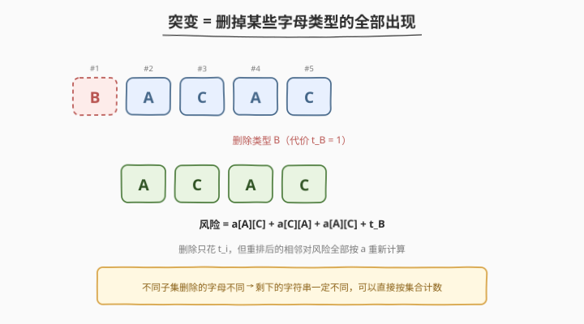
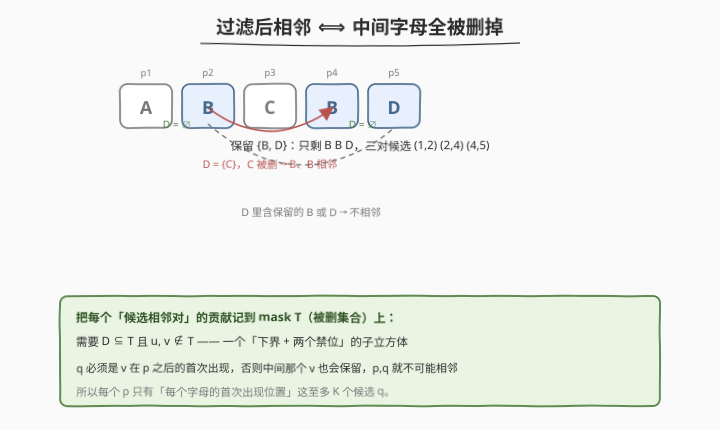
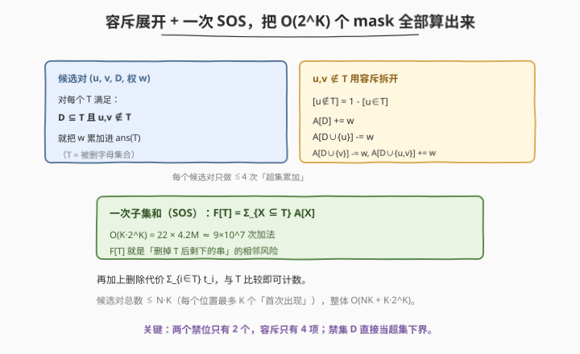

# Codeforces 76C 基因突变的风险 题解

## 1. 题目概述

- **题目链接**：https://codeforces.com/problemset/problem/76/C
- **比赛来源**：All-Ukrainian School Olympiad in Informatics · Problem C（UTC 2011-04-12）
- **难度**：2700
- **标签**：状压 DP、子集和变换（SOS）、字符串、计数
- **评测类型**：普通
- **限制**：时间 1 s / 内存 256 MB

**题意**：基因组是一个由前 $K$ 个大写字母组成的串，长度 $N$。相邻两个基因 $(i,j)$ 会带来风险 $a_{i,j}$（矩阵不一定对称），整条基因组的风险是所有相邻对风险之和。一次「突变」可以选定若干基因类型，把该类型的**所有**基因从串里删掉；删除类型 $i$ 会额外增加风险 $t_i$。可以删任意子集（包括不删），但基因组至少要剩一个基因。问能得到多少种**不同**的基因组（按最终字符串区分），其总风险不超过 $T$。

**约束**：

- $N \le 2 \times 10^5$，$K \le 22$：$K$ 很小、$N$ 很大。$2^K = 4.19 \times 10^6$ 个删除方案可以枚举，但对每个方案扫一遍串是 $8.4 \times 10^{11}$，1 s 内绝无可能；必须把「算风险」摊到 $O(NK + K\,2^K)$。
- $T \le 2 \times 10^9$，其余数 $\le 10^9$：风险最大可达 $2^{31}$ 附近，删除代价之和可达 $22 \times 10^9 = 2.2 \times 10^{10}$，都要用 `long long`。
- 题面保证「任意可得生物的最大风险严格小于 $2^{31}$」，说明最终风险值用 32 位有符号也放得下，但中间量仍需 64 位。
- 输入只有一组数据。

## 2. 示例与观察

官方样例（输入 / 输出原样）：

```text
输入：
5 3 13
BACAC
4 1 2
1 2 3
2 3 4
3 4 10

输出：
5
```

**样例解释**：字母编号 A=1、B=2、C=3，$t_A = 4$、$t_B = 1$、$t_C = 2$；风险矩阵为

$$a = \begin{pmatrix} 1 & 2 & 3 \\ 2 & 3 & 4 \\ 3 & 4 & 10 \end{pmatrix}.$$

把 7 个非空保留集合都算一遍（串本身的风险 + 被删字母的 $t$ 之和）：

| 保留 | 删掉 | 过滤后的串 | 串的风险 | 删除代价 | 总风险 |
|---|---|---|---|---|---|
| A,B,C | 无 | `BACAC` | $2+3+3+3 = 11$ | 0 | **11** |
| A,B | C | `BAA` | $2+1 = 3$ | 2 | **5** |
| A,C | B | `ACAC` | $3+3+3 = 9$ | 1 | **10** |
| B,C | A | `BCC` | $4+10 = 14$ | 4 | 18 |
| A | B,C | `AA` | $1$ | $1+2 = 3$ | **4** |
| B | A,C | `B` | $0$ | $4+2 = 6$ | **6** |
| C | A,B | `CC` | $10$ | $4+1 = 5$ | 15 |

不超过 $T = 13$ 的有 5 个，与样例输出一致（题面 hint 列出的正是 `BACAC(11), ACAC(10), BAA(5), B(6), AA(4)`）。

自造样例（标注「自造」）：

| 输入 | 输出 | 说明 |
|------|------|------|
| `1 1 5` / `A` / `3` / `7` | `1` | 只有一个基因，唯一生物是 `A`（不能把自己删空） |
| `2 2 10` / `AA` / `5 5` / `1 2` / `3 4` | `1` | `B` 没出现过：`{A}` 与 `{A,B}` 得到同一个串 `AA`，只算一次 |
| `3 3 100` / `ABA` / `0 0 0` / `0 0 0` / `0 0 0` / `0 0 0` | `3` | 三种非空子集得到 `AA`、`B`、`ABA` |

第三个自造样例提醒我们：**统计的是不同的字符串，不是删除方案**。删除一个从未出现过的类型不改变字符串，却要额外付 $t_i \ge 0$，所以最优做法永远是不删它；真正需要枚举的只有「出现过的字母」的子集。

## 3. 解题思路

### 3.1 朴素做法与瓶颈

枚举全部 $2^K$ 个删除集合，对每个集合扫一遍长度为 $N$ 的字符串、重新累加相邻风险：

$$2^{22} \times 2 \times 10^5 \approx 8.4 \times 10^{11},$$

完全不可行。另一方面，如果只枚举「出现过的字母」的子集、再对每个子集用一次 $O(N)$ 过滤，当所有 22 个字母都出现时仍是同样的量级。

瓶颈在于：**每个集合的过滤串都要从头扫**。必须找到一个 $O(1)$ 或均摊 $O(K)$ 的「批量计算所有集合风险」的办法。

### 3.2 核心观察一：只剩「保留集合」一个自由度



设 $P$ 为字符串中真正出现过的字母种数（$P \le K$），把它们的下标重映射到 $0..P-1$。

- **没出现过的字母永远不删**：删了字符串不变，只会多付 $t_i \ge 0$，不可能让某个生物从「超预算」变「可预算」。
- **不同保留集合给出不同串**：设两个不同的非空保留集合 $S_1 \ne S_2$ 都只由出现过的字母组成，取 $z \in S_1 \setminus S_2$。$z$ 在原串里出现过，保留 $S_1$ 时这些 $z$ 都还在；保留 $S_2$ 时 $z$ 被整个删掉。于是两个串一个含 $z$、一个不含 $z$，必然不同。

所以问题等价于：**对出现过的字母的每个非空子集 $S$，算出过滤串的风险 $R(S)$，再数 $R(S) + \sum_{i \notin S} t_i \le T$ 的个数**。规模从 $2^K$ 降到 $2^P$，且没有重复计数。

### 3.3 核心观察二：过滤后相邻的对可以被完全刻画



关键重写：

$$R(S) = \sum_{\substack{p < q \\ c_p, c_q \in S \\ D(p,q) \cap S = \varnothing}} a_{c_p, c_q}, \qquad D(p,q) = \{c_{p+1}, \dots, c_{q-1}\} \text{ 中出现的字母集合}.$$

**为什么**：$p,q$ 在过滤串中相邻 $\iff$ 二者都保留、且中间没有任何被保留的字母 $\iff c_p,c_q \in S$ 且 $D(p,q) \cap S = \varnothing$。每个相邻对恰好对应一个 $(p,q)$，不重不漏。

**进一步剪枝**：若 $q$ 不是字母 $c_q$ 在 $p$ 之后的**首次出现**，那么中间那个 $c_q$ 也会被保留，$p,q$ 就不可能相邻。所以每个 $p$ 只有至多 $P$ 个候选 $q$——正好是「$p$ 之后每个字母第一次出现的位置」。总候选对 $\le NP \le 4.4 \times 10^6$。

于是每个候选对变成一次「子立方体赋值」：设 $T = \overline{S}$ 为被删集合，则

$$\text{把 } a_{c_p,c_q} \text{ 加到所有满足 } D(p,q) \subseteq T \text{ 且 } c_p, c_q \notin T \text{ 的 } T \text{ 上。}$$

### 3.4 核心观察三：容斥 4 项 + 一次 SOS



「$u \notin T$」可以写成 $1 - [u \in T]$，于是

$$[u \notin T][v \notin T] = 1 - [u \in T] - [v \in T] + [u,v \in T].$$

对每个候选对，把带符号的权值打到四个位置：

$$A[D] \mathrel{+}= w,\quad A[D \cup \{u\}] \mathrel{-}= w,\quad A[D \cup \{v\}] \mathrel{-}= w,\quad A[D \cup \{u,v\}] \mathrel{+}= w.$$

其中 $w = a_{u,v}$；$u = v$ 时退化成两项 $A[D] \mathrel{+}= w,\ A[D \cup \{u\}] \mathrel{-}= w$。

之后做一次**子集和（SOS）**：

$$F[T] = \sum_{X \subseteq T} A[X].$$

因为「$D \subseteq T$」正是 $A[D]$（以及 $A[D\cup\{u\}]$ 等）能贡献给 $F[T]$ 的条件，容斥符号又把 $u,v \in T$ 的情况精确抵消，所以 $F[T]$ 恰好 $= R(\overline{T})$。

整个流程：候选对枚举 $O(NP)$，每次至多 4 次数组累加；一次 SOS 是 $O(P 2^P) \approx 22 \times 4.19 \times 10^6 \approx 9.2 \times 10^7$ 次加法。1 s 完全够。

### 3.5 样例走查

用上面的表再走一遍机制。以保留 $S = \{A\}$（即 $T = \{B,C\}$）为例：过滤串是 `AA`，风险 $R = a_{A,A} = 1$；删除代价 $t_B + t_C = 3$；总风险 $4 \le 13$。算法侧：候选对里只有 $(p,q) = (2,4)$ 满足 $D = \{C\} \subseteq T$、$u = v = A \notin T$，贡献 $a_{A,A} = 1$ 打到 $F[\{B,C\}]$；其余候选对要么 $D$ 含 $A$（被 $T$ 排掉），要么 $u \in T$（如 $p$ 是 B 的那些对，B 被删）。SOS 之后 $F[\{B,C\}] = 1$，与手算一致。

再看 $S = \{B\}$（$T = \{A,C\}$）：过滤串是 `B`，没有相邻对，$R = 0$；删除代价 $4 + 2 = 6$，总风险 6。算法侧：唯一可能相邻的候选对被 $u \in T$ 或 $v \in T$ 全部排除，$F[\{A,C\}] = 0$。✓

## 4. 正确性证明

**引理 1（未出现的字母不应删除）**：设字母 $z$ 不在原串中出现。若某个删除方案删除了 $z$，改为不删 $z$，得到的字符串不变、删除代价减少 $t_z \ge 0$，总风险不增。

**证明**：过滤只影响「串中出现过的字母」，删除一个没出现过的字母不改变过滤后的字符串，相邻对风险不变；总风险里少了一项 $t_z \ge 0$。∎

**推论 1**：只需枚举「出现过的字母」的子集；每个非空基因组恰好对应一个非空子集。

**引理 2（不同保留集合给出不同串）**：设 $S_1 \ne S_2$ 都是出现过的字母的非空子集，则过滤串 $F(S_1) \ne F(S_2)$。

**证明**：取 $z \in S_1 \setminus S_2$。$z$ 在原文中出现过，故 $F(S_1)$ 含 $z$（$z$ 未被删除）；而 $F(S_2)$ 把 $z$ 全部删除，故不含 $z$。两者不同。∎

**引理 3（相邻对的刻画）**：对任意保留集合 $S$ 与位置 $p<q$，$p,q$ 在过滤串中相邻当且仅当 $c_p, c_q \in S$ 且 $D(p,q) \cap S = \varnothing$。

**证明**：过滤串就是原串保留下标集合 $\{i : c_i \in S\}$ 的子序列。$p,q$ 是其中相邻的两个位置，等价于二者之间没有保留的位置，即所有 $j \in (p,q)$ 都满足 $c_j \notin S$，也就是 $D(p,q) \cap S = \varnothing$。∎

**推论 2**：过滤串的风险 $R(S) = \sum a_{c_p,c_q}$，求和遍历所有满足引理 3 的 $(p,q)$。

**引理 4（只需首次出现）**：若 $p,q$ 满足引理 3 的条件，则 $q$ 必是字母 $c_q$ 在 $p$ 之后的首次出现。

**证明**：若存在 $r \in (p,q)$ 使 $c_r = c_q$，则 $c_r \in S$，与 $D(p,q) \cap S = \varnothing$ 矛盾。∎

**引理 5（容斥 + SOS 正确）**：设 $A$ 按 $(D, u, v, w)$ 的规则累加，$F[T] = \sum_{X \subseteq T} A[X]$，则对每个 $T$，

$$F[T] = \sum_{\substack{(p,q) \text{ 候选对} \\ D(p,q) \subseteq T,\ c_p,c_q \notin T}} a_{c_p,c_q} = R(\overline{T}).$$

**证明**：固定候选对 $(u,v,D,w)$。它对 $F[T]$ 的贡献是 $w$ 乘以「$D \subseteq T$」的指示再乘以容斥和 $1 - [u\in T] - [v\in T] + [u,v\in T]$（当 $u=v$ 时为 $1 - [u\in T]$），后者恰为 $[u \notin T][v \notin T]$。条件 $D \subseteq T$ 与 $u,v \notin T$ 正好是引理 3 的条件（$T = \overline{S}$），于是由推论 2，所有候选对的贡献之和就是 $R(\overline{T})$。

最后还要说明「候选对」与「全部 $(p,q)$」等价：候选集合是「每个 $p$ 的至多 $P$ 个首次出现」，而引理 3 的求和遍历的是**全部** $(p,q)$。由引理 4，所有对 $R(S)$ 有贡献的 $(p,q)$ 都在候选集合里；反过来，候选集合里的对若不满足引理 3 的条件，容斥因子给 0。所以两种求和的结果相同。∎

**定理（算法正确）**：对每个非空 $S \subseteq \{0,\dots,P-1\}$，算法算出的 $\text{total}(S) = F[\overline{S}] + \sum_{i \notin S} t_i$ 恰为该基因组的最小总风险，计数 $\#\{S : \text{total}(S) \le T\}$ 即为所求。

**证明**：由引理 1、推论 1，只需考虑出现过的字母的子集，且每个子集对应一个基因组；由引理 2 不同子集给出不同基因组，不会重复计数；由引理 5，$F[\overline{S}] = R(S)$ 正是过滤串的风险，加上删除代价就是该基因组在「不删未出现字母」这一最优方案下的总风险。$S = \varnothing$ 对应空串（不允许），代码中从 1 开始枚举，正好排除。∎

## 5. 复杂度分析

- **时间**：读入与建表 $O(N + K^2)$；候选对枚举 $O(NP)$（每个 $p$ 至多 $P$ 次，每次至多 4 次累加）；SOS 变换 $O(P 2^P)$；最后统计 $O(2^P)$。取 $N = 2\times10^5$、$P = 22$：$NP \approx 4.4\times 10^6$、$P2^P \approx 9.2\times 10^7$。实测端到端 **0.06 s**（含进程启动），相对 1 s 时限余量 15 倍以上。
- **空间**：$A$ 与 $t_{\text{sum}}$ 各 $2^P$ 个 `long long`，$P = 22$ 时约 $2 \times 33.5$ MB $= 67$ MB，加上字符串与矩阵约 70 MB，低于 256 MB。
- **数值范围**：$A$ 的中间值可能为负（容斥），最终 $F[T] = R(S) \ge 0$；用有符号 64 位，别用无符号。删除代价和最大 $22 \times 10^9 = 2.2\times 10^{10}$，也在 64 位内。

## 6. 参考代码

### C++17

```cpp
#include <bits/stdc++.h>
using namespace std;

int main() {
    int N, K;
    long long T;
    if (scanf("%d %d %lld", &N, &K, &T) != 3) return 0;
    static char buf[200005];
    scanf("%s", buf);
    vector<long long> t(K);
    for (int i = 0; i < K; i++) scanf("%lld", &t[i]);
    vector<vector<long long>> a(K, vector<long long>(K));
    for (int i = 0; i < K; i++)
        for (int j = 0; j < K; j++) scanf("%lld", &a[i][j]);

    // 只保留基因组里真正出现过的字母类型（去掉没出现的字母只会白白增加风险）
    int mp[26];
    memset(mp, -1, sizeof(mp));
    int P = 0;
    vector<int> c(N);
    for (int i = 0; i < N; i++) {
        int ch = buf[i] - 'A';
        if (mp[ch] < 0) mp[ch] = P++;
        c[i] = mp[ch];
    }
    vector<long long> tt(P);
    vector<vector<long long>> w(P, vector<long long>(P));
    for (int i = 0; i < K; i++) if (mp[i] >= 0) tt[mp[i]] = t[i];
    for (int i = 0; i < K; i++) for (int j = 0; j < K; j++)
        if (mp[i] >= 0 && mp[j] >= 0) w[mp[i]][mp[j]] = a[i][j];

    int FULL = (1 << P) - 1;
    vector<long long> A((size_t)FULL + 1, 0);

    // 枚举所有「相邻保留基因对」(p,q)：q 必须是 p 之后字母 c_q 的首次出现
    vector<int> ord;                      // 按首次出现位置升序排列的字母
    ord.reserve(P);
    for (int p = N - 1; p >= 0; p--) {
        int u = c[p];
        int D = 0;                        // p,q 之间出现过的字母集合
        for (size_t idx = 0; idx < ord.size(); idx++) {
            int v = ord[idx];
            long long val = w[u][v];
            if (val != 0) {
                // 把 val 加到所有 T ⊇ D 且 u,v ∉ T 的 mask 上（容斥成 4 次超集累加）
                A[D] += val;
                if (u == v) {
                    A[D | (1 << u)] -= val;
                } else {
                    A[D | (1 << u)] -= val;
                    A[D | (1 << v)] -= val;
                    A[D | (1 << u) | (1 << v)] += val;
                }
            }
            D |= 1 << v;
            if (v == u) break;            // 之后所有对的 D 都含 u，贡献必为 0
        }
        // 更新 c[p] 的首次出现位置（它成为 p-1 视角下最靠前的那个）
        int z = u;
        for (size_t idx = 0; idx < ord.size(); idx++)
            if (ord[idx] == z) { ord.erase(ord.begin() + idx); break; }
        ord.insert(ord.begin(), z);
    }

    // 子集和（SOS）：A[T] <- sum_{X ⊆ T} A[X]
    for (int b = 0; b < P; b++) {
        int step = 1 << b;
        for (int base = 0; base <= FULL; base += step << 1)
            for (int off = 0; off < step; off++)
                A[base + step + off] += A[base + off];
    }

    // 被删字母的额外风险
    vector<long long> tsum((size_t)FULL + 1, 0);
    for (int mask = 1; mask <= FULL; mask++) {
        int lb = __builtin_ctz((unsigned)mask);
        tsum[mask] = tsum[mask & (mask - 1)] + tt[lb];
    }

    long long ans = 0;
    for (int S = 1; S <= FULL; S++) {     // S = 保留下来的字母集合（非空）
        int T2 = FULL ^ S;                // 被删掉的字母集合
        if (A[T2] + tsum[T2] <= T) ans++;
    }
    printf("%lld\n", ans);
    return 0;
}
```

### Python3

```python
import sys


def main() -> None:
    data = sys.stdin.buffer.read().split()
    if not data:
        return
    it = iter(data)
    n = int(next(it)); k = int(next(it)); T = int(next(it))
    s = next(it).decode()
    t = [int(next(it)) for _ in range(k)]
    a = [[int(next(it)) for _ in range(k)] for _ in range(k)]

    mp = [-1] * 26
    p = 0
    c = []
    for ch in s:
        z = ord(ch) - 65
        if mp[z] < 0:
            mp[z] = p
            p += 1
        c.append(mp[z])
    tt = [0] * p
    w = [[0] * p for _ in range(p)]
    for i in range(k):
        if mp[i] >= 0:
            tt[mp[i]] = t[i]
    for i in range(k):
        for j in range(k):
            if mp[i] >= 0 and mp[j] >= 0:
                w[mp[i]][mp[j]] = a[i][j]

    full = (1 << p) - 1
    A = [0] * (full + 1)
    ord_list = []                     # 按首次出现位置升序
    for pos in range(n - 1, -1, -1):
        u = c[pos]
        D = 0
        for v in ord_list:
            val = w[u][v]
            if val:
                A[D] += val
                if u == v:
                    A[D | (1 << u)] -= val
                else:
                    A[D | (1 << u)] -= val
                    A[D | (1 << v)] -= val
                    A[D | (1 << u) | (1 << v)] += val
            D |= 1 << v
            if v == u:
                break
        z = u
        if z in ord_list:
            ord_list.remove(z)
        ord_list.insert(0, z)

    # 子集和（SOS）
    for b in range(p):
        step = 1 << b
        for base in range(0, full + 1, step << 1):
            for off in range(step):
                A[base + step + off] += A[base + off]

    tsum = [0] * (full + 1)
    for mask in range(1, full + 1):
        lb = (mask & -mask).bit_length() - 1
        tsum[mask] = tsum[mask & (mask - 1)] + tt[lb]

    ans = 0
    for S in range(1, full + 1):
        T2 = full ^ S
        if A[T2] + tsum[T2] <= T:
            ans += 1
    sys.stdout.write(str(ans) + "\n")


main()
```

Python 版算法与 C++ 完全一致，但 $P = 22$ 时 SOS 要跑约 $9 \times 10^7$ 次循环、$A$ 数组是 400 万个 Python int，时间与内存都吃不消；**满分请提交 C++**，Python 只适合理解与小数据自测（建议 PyPy3）。

## 7. 边界情况与易错点

1. **$K > P$（有字母从未出现）**：必须用「出现过的字母」建 mask，不能直接用 $K$ 位。否则未出现字母的删除与否会制造出同一个串的多种表示，答案偏大；而且 $2^K$ 还可能白白大一圈。
2. **空基因组必须排除**：$S = \varnothing$ 对应把所有基因都删光，题面不允许。代码里循环从 $S = 1$ 开始，这一条别写成 0 开始。
3. **`long long` 与符号**：$A$ 的中间累加值可能为负（容斥），最终才回到非负的风险值；用 `unsigned` 会出现巨大的下溢。删除代价之和可达 $2.2\times 10^{10}$，也不能用 `int`。
4. **$u = v$ 的相邻对**：同一个字母相邻（如 `AA`）要算 $a_{u,u}$，容斥只有 $1 - [u\in T]$ 两项；把 $u=v$ 也按四项写会重复加减，答案会错。
5. **候选对的位置枚举**：$q$ 必须是 $c_q$ 在 $p$ 之后的首次出现；实现时从右往左维护「每个字母下一次出现的位置」，遇到当前字母 $u$ 就要**先处理再 break**（那一对的 $u \notin D$，是合法贡献），之后的对才被 $u$ 污染。
6. **$N = 1$**：没有任何相邻对，所有非空 $S$ 的风险都是 0；答案就是「删除其余字母的代价和 $\le T$」的集合数（只有 1 个字母时答案恒为 1，因为 $T \ge 1$）。
7. **$t_i$ 或 $a_{i,j}$ 为 0**：代码用 `if (val != 0)` 跳过零权累加，但 $D$ 的更新与 `break` 必须在 `if` 之外，否则候选对的结构会被破坏。
8. **数组下标**：$P = 22$ 时 $2^P = 4194304$，`int` 下标安全；`(1 << P) - 1` 也在 `int` 范围内（$P \le 30$ 才危险），但 `FULL + 1` 作为 `size_t` 分配更稳妥。
9. **读串**：$N$ 可达 $2\times10^5$，`scanf("%s")` 的缓冲区至少要 $N+1$；Python 用 `split()` 时注意串是一个独立的 token。
10. **多测**：本题只有一组数据；如果扩展成多测，$A$、$t_{\text{sum}}$、`mp`、`ord` 全部要按当前 $P$ 重建。

## 8. 验证记录

- **编译环境与命令**：`clang++ -std=c++17 -O2 -Wall`（本机无 GNU g++，配 `codeforces/tools/include/bits/stdc++.h` 兼容头；代码可原样提交 GNU C++17），Python `3.9.6`。文档级验证：
  `python3 codeforces/tools/verify_solution.py codeforces/contests/0001-0100/76/C_基因突变的风险.md`
- **官方样例**：1 / 1 通过（C++ 与 Python 均输出 `5`）。
- **额外测试**：3 组自造（$N=1$、有未出现字母的 `AA`、零权矩阵）全部与手算一致。
- **独立暴力对拍 A（小规模，全枚举）**：暴力枚举**全部 $2^K$ 个删除集合**（包括删掉未出现字母的方案），真的构造过滤串、算相邻风险 + 删除代价，再用 `dict` 按字符串去重取最小风险，最后数 $\le T$ 的字符串个数。对 $K \in [1,5]$、$N \in [1,9]$、随机 $t$ 与风险矩阵（含 0），共 **320 组**，主程序、Python 版、暴力三方**全部一致**。
- **独立暴力对拍 B（中等规模，逐 mask 过滤）**：另写一个**不使用任何 SOS/容斥**的慢速程序：对每个出现的字母子集 $S$，线性扫一遍串构造过滤串并累加风险。取 $K \in [8,12]$、$N \in [1,1500]$、$T$ 与权值随机，共 **40 组**，与主程序**全部一致**——这一步专门验证「候选对 + 容斥 + SOS」在大 $P$ 下没有漏项或符号错误。
- **最大约束性能**：$N = 2\times 10^5$、$K = 22$（串为 22 字母循环，制造每个位置 $u$ 的排名都很大、候选对接近 $NK$ 的最坏情况），C++ 端到端 3 次为 **0.06 s / 0.06 s / 0.07 s**，峰值内存 **69.8 MB**（`/usr/bin/time -l` 的 maximum resident set size），均在 1 s / 256 MB 内且余量充足。
- **复核状态**：verified（样例、两套独立对拍、最坏性能均实跑通过；本机无 GNU g++，已用 clang++ 等价验证）。

## 相关题目与扩展

- [Codeforces 76A Gift](https://codeforces.com/problemset/problem/76/A)、[76B Mice](https://codeforces.com/problemset/problem/76/B)、[76F Tourist](https://codeforces.com/problemset/problem/76/F)：同场题目。
- [Codeforces 1208F Bits And Pieces](https://codeforces.com/problemset/problem/1208/F)：SOS DP 求「两两或」的最大值，是子集和变换的经典应用。
- [Codeforces 449D Jzzhu and Numbers](https://codeforces.com/problemset/problem/449/D)：用子集容斥数「按位与为 0」的子集个数，和本题的容斥套路同源。
- [Codeforces 383E Vowels](https://codeforces.com/problemset/problem/383/E)：统计每个 mask 覆盖多少个单词，标准的 SOS 计数。
- [Codeforces 165E Compatible Numbers](https://codeforces.com/problemset/problem/165/E)：对每个数找「与它按位与为 0」的子集，子集存在性 DP。
- [LeetCode 982. 按位与为零的三元组](https://leetcode.cn/problems/triples-with-bitwise-and-equal-to-zero/)：容斥 + 计数的小规模版本。

**延伸思考**：

1. **如果 $t_i$ 可以为负**（删除反而降低风险），那么删除没出现过的字母也可能划算，同一个基因组要取 $2^{K-P}$ 种「未出现字母删除方案」里的最小代价。做法是对未出现字母做一次「子集最小值和」的 SOS，再与出现字母的枚举合并，复杂度不变。
2. **如果风险不只依赖相邻对，还依赖距离**（例如相隔 $d$ 的两基因也有风险），本题「相邻对 ⟺ 中间全删」的刻画立刻失效：删掉一个字母会改变 $O(N)$ 个距离，需要完全不同的数据结构。
3. **如果要求输出每一个可行基因组（而不是计数）**，输出规模本身是指数级的（最多 $2^{22}$ 个串、每个长度 $O(N)$），任何算法都不可能更快，只能改成带字典序/前缀枚举的输出方式。
4. **内存收紧到 32 MB 时**：$2^{22}$ 个 64 位整数已经放不下。可以把 $A$ 换成「按高位分块、逐块 SOS」的滚动实现，或者把风险值压成 32 位（题面保证 $<2^{31}$），这样 $A$ 只要 16 MB。
5. **如果 $K$ 放大到 26**：$2^{26} = 6.7\times10^7$，$O(K2^K)$ 已经接近 $2\times10^9$，需要换算法（例如按字母分成两半做 meet-in-the-middle，或利用字符串结构做分治）。
