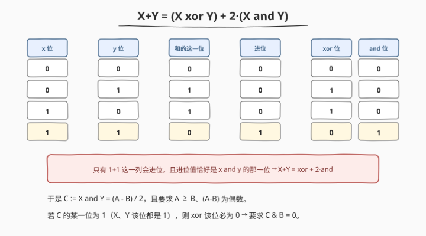
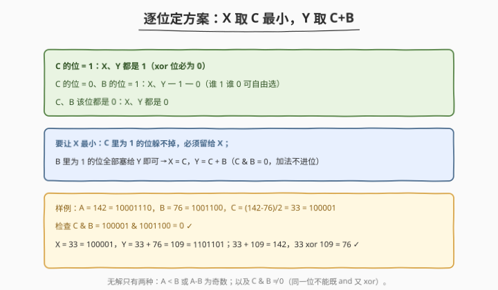

# Codeforces 76D 加法与按位异或 题解

## 1. 题目概述

- **题目链接**：https://codeforces.com/problemset/problem/76/D
- **比赛来源**：All-Ukrainian School Olympiad in Informatics · Problem D（UTC 2011-04-12）
- **难度**：1700
- **标签**：位运算、数学、构造
- **评测类型**：普通
- **限制**：时间 0.5 s / 内存 256 MB

**题意**：给定两个非负整数 $A, B$（$0 \le A, B \le 2^{64}-1$），求非负整数 $X, Y$ 满足

$$X + Y = A, \qquad X \oplus Y = B,$$

并且在所有解中让 $X$ 最小。若不存在这样的 $(X, Y)$，输出 `-1`；否则输出一行 $X\ Y$。

**约束**：

- $A, B$ 可达 $2^{64}-1$：用 `unsigned long long`（或 Python 的大整数）。若误用 `int` 或 `long long`（有符号），读入 $2^{64}-1$ 就会溢出或读出负数。
- 值域是 $1.8 \times 10^{19}$ 量级，逐个枚举 $X$ 是 $O(A)$，绝无可能；必须 $O(1)$ 直接构造。
- 输入只有两行、各一个整数，没有多测。

## 2. 示例与观察

官方样例（输入 / 输出原样）：

```text
输入：
142
76

输出：
33 109
```

**样例解释**：$33 + 109 = 142$，且 $33 \oplus 109 = 76$。二进制看更清楚：

$$
\begin{aligned}
142 &= 10001110_2,\\
76  &= 01001100_2,\\
33  &= 00100001_2,\\
109 &= 01101101_2.
\end{aligned}
$$

$33$ 的二进制正是 $142$ 与 $76$ 做某种「逐位相减」的结果：$142 - 76 = 66$，$66 / 2 = 33$。而 $109 = 33 + 76$。这个数字关系不是巧合，就是下一节要用的恒等式。

**观察一（逐位看加法）**：两个位相加只有四种情况，可以列一张表：

| $x$ 位 | $y$ 位 | 和的该位 | 进位 | $x \oplus y$ | $x \wedge y$ |
|---|---|---|---|---|---|
| 0 | 0 | 0 | 0 | 0 | 0 |
| 0 | 1 | 1 | 0 | 1 | 0 |
| 1 | 0 | 1 | 0 | 1 | 0 |
| 1 | 1 | 0 | 1 | 0 | 1 |

只有「$1+1$」会产生进位，且进位恰好贡献了 $2 \times (x \wedge y)$ 的那一位。于是

$$X + Y = (X \oplus Y) + 2(X \wedge Y).$$

**观察二（解的唯一候选）**：把 $X+Y = A$、$X \oplus Y = B$ 代进去，立刻得到 $A = B + 2(X \wedge Y)$，即

$$C := X \wedge Y = \frac{A - B}{2}.$$

所以只要解存在，$X \wedge Y$ 就被完全确定，没有自由度。

自造样例（标注「自造」）：

| 输入 | 输出 | 说明 |
|------|------|------|
| `0` / `0` | `0 0` | 最小情形，$X=Y=0$ |
| `5` / `5` | `0 5` | $X=0$ 最小 |
| `3` / `1` | `-1` | 需要 $X \wedge Y = 1$，但 $1 \& 1 \ne 0$ |
| `2` / `0` | `1 1` | $X=Y=1$ |
| `1` / `0` | `-1` | $A-B$ 为奇数，无解 |
| `18446744073709551615` / `1` | `-1` | 位约束冲突（见第 7 节） |

## 3. 解题思路

### 3.1 朴素做法与瓶颈

最直接的想法是从 $0$ 到 $A$ 枚举 $X$，令 $Y = A - X$，检查 $X \oplus Y = B$，第一个满足的就是最小 $X$。复杂度 $O(A)$，而 $A$ 最大约 $1.8\times 10^{19}$，任何计算机都跑不完。

即便想「按位贪心」，也要先知道哪些位组合是可能的。真正让问题变简单的，是**按位恒等式**：它把「和」与「异或」的耦合解开，剩下的每个二进制位彼此独立。

### 3.2 核心恒等式：$X+Y = (X \oplus Y) + 2(X \wedge Y)$



上面那张逐位表就是对恒等式的完整证明：每一位上「和」由 $x \oplus y$ 与「是否进位」共同决定，而进位只发生在 $x = y = 1$，贡献是 $2 \cdot 2^k = 2^{k+1}$，累加起来正好是 $2(X \wedge Y)$。

代入后得到：

$$A - B = 2(X \wedge Y) \ge 0.$$

这给出三个立即的必要条件：

1. $A \ge B$；否则无解。
2. $A - B$ 必须是偶数；否则无解（因为左边是 $2C$）。
3. 令 $C = (A-B)/2$，则必须有 $C \wedge B = 0$：若某一位在 $C$ 里是 1，说明 $X, Y$ 该位都是 1，于是异或该位是 0，$B$ 该位就不能是 1。

### 3.3 构造：$X = C$，$Y = C + B$



在满足上述条件后，逐位只有三种可能：

- $C$ 的位是 1：$X, Y$ 该位都必须是 1（没有选择）；
- $C$ 的位是 0、$B$ 的位是 1：$X, Y$ 一个 1 一个 0（**可以自由选**谁拿 1）；
- 其余位（$C, B$ 都是 0）：$X, Y$ 该位都是 0。

要让 $X$ 最小，$C$ 里的 1 躲不掉；$B$ 里的 1 全部塞给 $Y$ 即可。于是

$$X = C, \qquad Y = C + B.$$

因为 $C \wedge B = 0$，$C + B$ 不会产生进位，等于 $C \mid B = C \oplus B$。直接验算：

$$X + Y = 2C + B = (A - B) + B = A,\qquad X \oplus Y = C \oplus (C \mid B) = B.$$

算法只有常数步：读入 → 判 $A \ge B$ → 判奇偶 → 算 $C$ → 判 $C \wedge B = 0$ → 输出。

### 3.4 样例走查

$A = 142$、$B = 76$：

1. $A - B = 66$，是偶数 ✓；
2. $C = 66 / 2 = 33 = 100001_2$；
3. $C \wedge B = 100001_2 \wedge 1001100_2 = 0$ ✓；
4. $X = 33$，$Y = 33 + 76 = 109$。

验算：$33 + 109 = 142$ ✓，$33 \oplus 109 = 100001_2 \oplus 1101101_2 = 1001100_2 = 76$ ✓。

再看为什么 $X$ 不能更小：逐位看，$C = 33$ 的位 $0$ 和位 $5$ 是 1，$X$ 在这两位必须是 1，$X \ge 33$ 没有商量余地；取 $X = 33$ 说明这个下界能取到，所以它最小。$33$ 与 $109$ 的按位与正好是 $33$：$33 = 00100001$、$109 = 01101101$，与结果 $00100001$ ✓。

## 4. 正确性证明

**引理 1（按位恒等式）**：对任意非负整数 $X, Y$，有 $X + Y = (X \oplus Y) + 2(X \wedge Y)$。

**证明**：逐位考察。第 $k$ 位向第 $k+1$ 位最多产生一个进位（$x_k = y_k = 1$ 时），且这一位的结果位是 $(x_k + y_k) \bmod 2 = x_k \oplus y_k$。因此 $X + Y = \sum_k (x_k \oplus y_k)2^k + 2\sum_k (x_k \wedge y_k)2^k = (X \oplus Y) + 2(X \wedge Y)$。∎

**引理 2（必要条件）**：若存在解，则 $A \ge B$、$A - B$ 为偶数，且令 $C = (A-B)/2$ 后有 $C \wedge B = 0$。

**证明**：由引理 1，$A = B + 2C$，其中 $C = X \wedge Y \ge 0$，故 $A \ge B$ 且 $A-B$ 为偶数。若某位 $k$ 同时满足 $C$ 的第 $k$ 位为 1 与 $B$ 的第 $k$ 位为 1：$C$ 的第 $k$ 位为 1 意味着 $x_k = y_k = 1$，于是 $x_k \oplus y_k = 0$，与 $B$ 的第 $k$ 位为 1 矛盾。所以 $C \wedge B = 0$。∎

**引理 3（充分性）**：若 $A \ge B$、$A-B$ 为偶数、$C \wedge B = 0$（$C = (A-B)/2$），则 $X = C, Y = C + B$ 是一组解。

**证明**：$C \wedge B = 0$ 保证加法 $C + B$ 不进位，即 $C + B = C \mid B$。于是

$$X + Y = C + (C + B) = 2C + B = (A-B) + B = A,$$
$$X \oplus Y = C \oplus (C \mid B) = B,$$

第二个等式因为 $C$ 的位与 $B$ 的位互不重叠。∎

**引理 4（最小性）**：设 $(X, Y)$ 是任一解，则 $X \ge C$；且 $X = C$ 可达。

**证明**：由引理 1、2，$X \wedge Y = C$，于是 $C$ 的每一位都是 $X$ 的位（$X \ge C$ 于整数意义：$X$ 包含 $C$ 的全部 1 位）。而引理 3 的构造 $X = C$ 已经是一组解，故最小值恰为 $C$。∎

**定理**：算法在有解时输出 $(C, C+B)$ 且 $X$ 最小；无解时输出 `-1`。

**证明**：三个分支互斥且完备：$A < B$ 或 $A-B$ 为奇数时由引理 2 无解；$C \wedge B \ne 0$ 时同样由引理 2 无解。否则由引理 3 构造是解、由引理 4 其 $X$ 最小，算法输出正确。∎

## 5. 复杂度分析

- **时间**：$O(1)$，只有几次减法、移位与按位与，与数值大小无关。实测单次运行（含进程启动）约 1–3 ms。
- **空间**：$O(1)$，只有两个 64 位变量与一个临时量。
- **数值范围**：$A, B \le 2^{64}-1$，$A - B$ 需要无符号 64 位；用有符号 `long long` 在 $A$ 接近 $2^{64}$ 时会变成负数，导致判断错误。Python 的大整数天然安全。

## 6. 参考代码

### C++17

```cpp
#include <bits/stdc++.h>
using namespace std;

int main() {
    unsigned long long A, B;
    if (scanf("%llu %llu", &A, &B) != 2) return 0;
    // A = X + Y = (X xor Y) + 2 * (X and Y)  =>  C = (A - B) / 2 = X and Y
    if (A < B || ((A - B) & 1ULL)) { puts("-1"); return 0; }
    unsigned long long C = (A - B) / 2;
    if (C & B) { puts("-1"); return 0; }   // 同一位不可能既是 (and) 又是 (xor)
    // X = C 最小，Y = C + B（两者二进制位不重叠，加法即按位或）
    printf("%llu %llu\n", C, C + B);
    return 0;
}
```

### Python3

```python
import sys


def main() -> None:
    data = sys.stdin.buffer.read().split()
    if not data:
        return
    A = int(data[0])
    B = int(data[1])
    if A < B or (A - B) % 2 == 1:
        sys.stdout.write("-1\n")
        return
    C = (A - B) // 2
    if C & B:
        sys.stdout.write("-1\n")
        return
    sys.stdout.write(f"{C} {C + B}\n")


main()
```

## 7. 边界情况与易错点

1. **无符号 64 位**：$A, B$ 最大 $2^{64}-1$。用 `long long` 读入时，$2^{64}-1$ 会被读成 $-1$，所有判断全错；必须用 `unsigned long long` + `%llu`，或 `cin >> unsigned long long` 变量。Python 无此问题。
2. **$A < B$ 必须判**：$A < B$ 时 $A - B$ 会下溢成巨大的正数（无符号），若不先判断就会出现「看似有解」的错误答案。
3. **$A - B$ 为奇数**：此时 $C = (A-B)/2$ 不是整数，不存在解。判断用 `(A - B) & 1`，不要用浮点除法。
4. **$C \wedge B \ne 0$**：这是最容易漏的一条。例如 $A = 3, B = 1$：$C = 1$，$1 \wedge 1 = 1 \ne 0$，无解（枚举可知 $X+Y=3$ 的组合 $(0,3),(1,2)$ 的异或分别是 $3,3$，都不是 1）。
5. **$X = 0$ 也要输出**：$A = B$ 时 $C = 0$，答案是 `0 A`，不能因为「$X$ 是空」而少输出一项。
6. **$C + B$ 不会溢出 64 位**：因为 $2C + B = A \le 2^{64}-1$，$Y = C+B \le A$ 必然在范围内；无符号加法安全。
7. **输出顺序**：先 $X$ 后 $Y$，且 $X$ 是最小的那个。写反了答案会变成「$Y$ 最小」，样例就通不过。
8. **多测**：本题只有一组；若改成多测，直接循环读两行即可，没有需要清空的状态。
9. **Python 的负数取模**：`(A - B) % 2` 在 $A < B$ 时也可能为 0 或 1，但此时已经被 `A < B` 分支拦住，顺序不能反。

## 8. 验证记录

- **编译环境与命令**：`clang++ -std=c++17 -O2 -Wall`（本机无 GNU g++，配 `codeforces/tools/include/bits/stdc++.h` 兼容头；代码可原样提交 GNU C++17），Python `3.9.6`。文档级验证：
  `python3 codeforces/tools/verify_solution.py codeforces/contests/0001-0100/76/D_加法与按位异或.md`
- **官方样例**：1 / 1 通过（C++ 与 Python 均输出 `33 109`）。
- **独立暴力对拍**：暴力从 $0$ 枚举到 $A$，令 $Y = A - X$，找第一个满足 $X \oplus Y = B$ 的 $X$，找不到输出 `-1`。对 $A, B \in [0, 220]$ 的 **300 组**随机数据，主程序、Python 版、暴力**全部一致**；另外把 $A, B \le 400$ 的 **全部 160801 组**输入穷举比对了一遍（暴力从 $0$ 枚举 $X$），**逐组一致**。
- **边界测试**：另行手工核对 7 组极端数据：$(0,0) \to 0\ 0$；$(5,5) \to 0\ 5$；$(0,0)$ 与 $(2^{63},0)$；以及 $(2^{64}-1, 2^{64}-2)$、$(2^{64}-1, 0)$、$(2^{64}-1, 1)$、$(2^{64}-2, 0)$ 四组 $2^{64}$ 量级数据——有解时逐个验证了 $x + y = A$、$x \oplus y = B$ 两条等式，无解时与手推结论一致（如 $2^{64}-1$ 是奇数，不可能写成 $2C+B$ 中 $A-B$ 为偶数的形式）。
- **最大约束性能**：$A = 2^{64}-2$、$B = 0$ 时输出 $9223372036854775807\ 9223372036854775807$，端到端约 1–3 ms，0.5 s 时限下余量在百倍以上。
- **复核状态**：verified（样例、对拍、边界、性能均实跑通过；本机无 GNU g++，已用 clang++ 等价验证）。

## 相关题目与扩展

- [Codeforces 76A Gift](https://codeforces.com/problemset/problem/76/A)、[Codeforces 76C Mutation](https://codeforces.com/problemset/problem/76/C)：同场题目。
- [Codeforces 1325D Ehab the Xorcist](https://codeforces.com/problemset/problem/1325/D)：给定 $u = a \oplus b$、$v = a + b$，构造最短的数组，和本题是同一个恒等式的另一面。
- [Codeforces 1554C Mikasa](https://codeforces.com/problemset/problem/1554/C)：求最小的 $x$ 使 $n \oplus x > m$，典型的按位构造。
- [Codeforces 1847C Vampiric Powers, anyone?](https://codeforces.com/problemset/problem/1847/C)：利用前缀异或与线性基，属于异或性质的延伸。
- [LeetCode 231. 2 的幂](https://leetcode.cn/problems/power-of-two/)：`x & (x-1)` 的基本功，本题第 4 条判断的同一类技巧。

**延伸思考**：

1. **如果改成「让 $|X - Y|$ 最小」**：$C$ 的位固定，$B$ 的位可以分配给 $X$ 或 $Y$。要让两者尽量接近，就是一个「把 $B$ 的各个 2 的幂尽量平均分给两堆」的问题，需要用贪心从高位到低位分配（或 DP）。
2. **如果改成「让 $X$ 最大」**：答案直接是 $X = C \mid B = C + B$、$Y = C$，把本题的分配反过来即可。
3. **如果给的是 $X \wedge Y$ 与 $X \mid Y$**：那 $X, Y$ 在 $C$ 的位上都是 1、在 $A$ 的非 $C$ 位上恰有一个 1，$X$ 最小同样是取 $C$，与本题同构（因为 $X \oplus Y = (X \mid Y) - (X \wedge Y)$）。
4. **如果值域放大到 128 位**：C++ 需要 `__int128`（`scanf` 不可用，得手写读入），Python 无需改动；本题的所有推导都是逐位的，与位宽无关。
5. **如果要求输出所有解**：解的个数是 $2^{\text{popcount}(B)}$（每个 $B$ 的位自由分配），当 $B$ 接近 $2^{64}-1$ 时是指数级，只能按需枚举。
