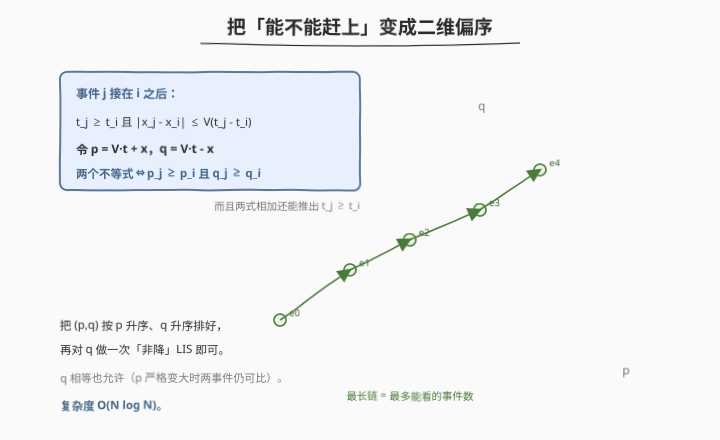
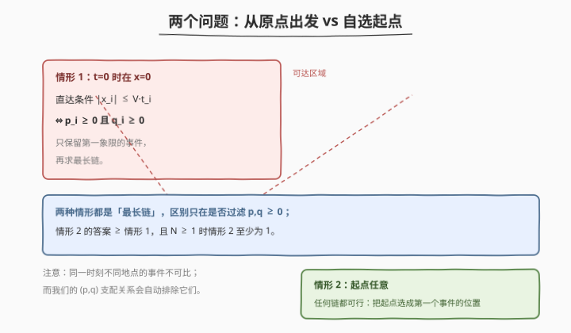
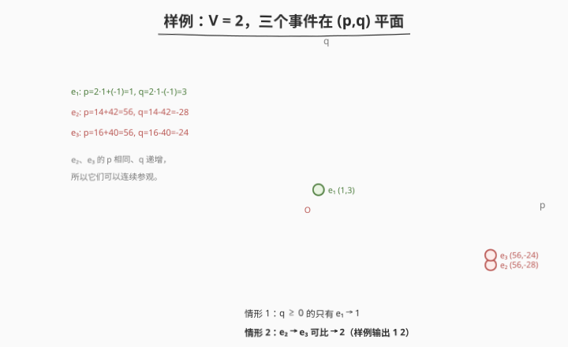

# Codeforces 76F 游客最多参观事件 题解

## 1. 题目概述

- **题目链接**：https://codeforces.com/problemset/problem/76/F
- **比赛来源**：All-Ukrainian School Olympiad in Informatics · Problem F（UTC 2011-04-12）
- **难度**：2300
- **标签**：排序、最长上升子序列、二维偏序
- **评测类型**：普通
- **限制**：时间 0.5 s / 内存 256 MB

**题意**：游客沿 $X$ 轴行走，速度不超过 $V$，可以任意选方向、也可以站着不动。已知 $N$ 个「有趣事件」：第 $i$ 个发生在时刻 $t_i$、坐标 $x_i$，事件是瞬时的，游客恰好在时刻 $t_i$ 位于 $x_i$ 才算「参观」到。回答两个问题：

1. 若 $t = 0$ 时游客必须在原点 $x = 0$，最多能参观多少个事件？
2. 若游客可以自由选择初始位置，最多能参观多少个事件？

输出一行两个整数，分别是两个答案。

**约束**：

- $N \le 10^5$：$O(N^2)$ 的「两两判断能否接上」是 $10^{10}$，0.5 s 内不可能；需要 $O(N\log N)$。
- $|x_i| \le 2\times10^8$，$t_i \le 2\times 10^6$，$V \le 1000$：故 $Vt \pm x$ 最大约 $2.2 \times 10^9$，超过 32 位有符号范围，**必须用 64 位**。
- 同一时刻、同一坐标不会有两个事件；但同一时刻不同地点、或同一地点不同时刻都可以出现——这决定了「可比性」的边界。
- 输入只有一组数据，速度 $V$ 在**最后一行**。

## 2. 示例与观察

官方样例（输入 / 输出原样）：

```text
输入：
3
-1 1
42 7
40 8
2

输出：
1 2
```

**样例解释**：$V = 2$。

- 事件 1：$t=1, x=-1$。从原点出发需要速度 $1 \le 2$，可以直达。
- 事件 2：$t=7, x=42$。从原点出发需要速度 $42/7 = 6 > 2$，**不能**直达。
- 事件 3：$t=8, x=40$。从原点出发需要速度 $5 > 2$，也不能直达。
- 但事件 2 到事件 3：时间差 $1$、坐标差 $2$，需要速度 $2 \le V$，**可以接上**。

所以情形 1 只能看事件 1（或某个单独事件），答案 1；情形 2 可以把起点选在 $x=42$ 处、$t=0$ 出发，先看事件 2 再赶到事件 3，答案 2。

**观察一（可达性）**：事件 $i$ 之后能赶到事件 $j$（$t_j \ge t_i$）当且仅当

$$|x_j - x_i| \le V\,(t_j - t_i).$$

**观察二（线性化）**：令

$$p_i = V t_i + x_i, \qquad q_i = V t_i - x_i,$$

则上面的条件等价于 $p_j \ge p_i$ **且** $q_j \ge q_i$。两个不等式相加还能推出 $t_j \ge t_i$，所以「时间先后」不用单独判。于是「参观一串事件」就变成「在 $(p,q)$ 平面上选一条单调不降的链」。

**观察三（两个问题的差别只在起点）**：情形 1 要求第一个事件满足 $|x| \le Vt$，即 $p \ge 0$ 且 $q \ge 0$；一旦看成了第一个，后面的事件由支配关系自动满足 $p,q \ge 0$。情形 2 则可以把起点直接选在第一个事件的位置上，**任何链都可行**。

自造样例（标注「自造」）：

| 输入 | 输出 | 说明 |
|------|------|------|
| `1` / `0 1` / `1` | `1 1` | 单个事件 |
| `1` / `2000 1` / `1` | `0 1` | 原点太远，但可以自己选起点 |
| `2` / `0 5` / `0 9` / `1` | `2 2` | 同地点不同时刻，链长 2 |
| `2` / `0 1` / `5 1` / `1` | `1 1` | 同一时刻不同地点，无法都看 |

## 3. 解题思路

### 3.1 朴素做法与瓶颈

最直接的做法是 DP：把所有事件按时间排序，`dp[i]` 表示「以事件 $i$ 结尾最多看几个」，转移时枚举前面所有事件 $j$，判断 $|x_i - x_j| \le V(t_i - t_j)$ 后取最大。复杂度 $O(N^2)$，$N = 10^5$ 时是 $5 \times 10^9$ 次判断，0.5 s 内不可能。

瓶颈是「二维可达关系」：它同时受时间和坐标两个方向约束，不像一维 LIS 那样直接排序就能贪心。

### 3.2 核心观察：把两个不等式变成两个坐标的偏序



对 $t_j \ge t_i$，条件 $|x_j - x_i| \le V(t_j - t_i)$ 拆成两个线性不等式：

$$x_j - x_i \le V(t_j - t_i) \iff Vt_j - x_j \ge Vt_i - x_i \iff q_j \ge q_i,$$
$$x_i - x_j \le V(t_j - t_i) \iff Vt_j + x_j \ge Vt_i + x_i \iff p_j \ge p_i.$$

反过来，若 $p_j \ge p_i$ 且 $q_j \ge q_i$，两式相加得 $2Vt_j \ge 2Vt_i$，即 $t_j \ge t_i$，于是两个不等式都成立。所以

> **$i$ 之后能到 $j$ $\iff$ $p_j \ge p_i$ 且 $q_j \ge q_i$。**

这正是标准的**二维偏序（支配）关系**。问题化为：在平面上找最多的点，使它们两两可比、且按支配关系排成一条链。

### 3.3 算法流程：排序 + 非降 LIS

把点按 $(p, q)$ 升序排序，然后对 $q$ 序列求**最长非降子序列**（LNDS）：

- 排序后 $p$ 是非降的，所以子序列自动满足 $p$ 非降；
- 子序列里 $q$ 非降，就满足 $q$ 非降；
- 两者合起来就是一条支配链。

实现用「耐心排序」的 `tails` 数组：对每个 $q$，在 `tails` 中 `upper_bound` 找第一个 $> q$ 的位置替换；找不到就追加。`upper_bound` 而非 `lower_bound`，因为**允许相等**（$p_j > p_i$ 且 $q_j = q_i$ 仍然可以接上）。

两个情形分别做：



1. **情形 1**：只保留 $p_i \ge 0$ 且 $q_i \ge 0$ 的事件（等价于 $|x_i| \le V t_i$），排序后求 LNDS，长度即答案。
2. **情形 2**：全部事件排序后求 LNDS，长度即答案。

复杂度 $O(N\log N)$。

### 3.4 样例走查



| 事件 | $(x, t)$ | $p = Vt + x$ | $q = Vt - x$ | $p,q \ge 0$？ |
|---|---|---|---|---|
| 1 | $(-1, 1)$ | $1$ | $3$ | 是 |
| 2 | $(42, 7)$ | $56$ | $-28$ | 否（$q < 0$） |
| 3 | $(40, 8)$ | $56$ | $-24$ | 否 |

- 情形 1 只剩事件 1，LNDS 长度 $1$ → 答案 1。
- 情形 2 三个点全在：按 $p$ 排序是 $1, 2, 3$ 号（$p = 1, 56, 56$），同 $p$ 按 $q$ 升序得 $q = 3, -28, -24$。对 $q$ 求 LNDS：$3$ 后面接不上 $-28$，但 $-28 \to -24$ 可以，长度 $2$ → 答案 2。

与样例输出 `1 2` 一致。注意事件 2、3 的 $p$ 相同、$q$ 递增，说明它们在 $t$ 上相差 $1$、坐标相差 $2$，恰好以速度 $2$ 接上——这也是为什么必须用**非降**而不是严格上升的 LIS。

## 4. 正确性证明

**引理 1（可达性等价于二维支配）**：对任意两个事件 $i, j$，$|x_j - x_i| \le V(t_j - t_i)$ 且 $t_j \ge t_i$，当且仅当 $p_j \ge p_i$ 且 $q_j \ge q_i$。

**证明**：
（$\Rightarrow$）由 $x_j - x_i \le V(t_j - t_i)$ 得 $Vt_j - x_j \ge Vt_i - x_i$，即 $q_j \ge q_i$；由 $x_i - x_j \le V(t_j - t_i)$ 得 $p_j \ge p_i$。
（$\Leftarrow$）两式相加得 $2Vt_j \ge 2Vt_i$，即 $t_j \ge t_i$；再由 $p_j \ge p_i$ 得 $x_j - x_i \le V(t_j - t_i)$，由 $q_j \ge q_i$ 得 $x_i - x_j \le V(t_j - t_i)$，合起来就是 $|x_j - x_i| \le V(t_j-t_i)$。∎

**推论 1**：同一时刻不同地点的两个事件不可比（一个 $p$ 大、必有一个 $q$ 小）；同一地点不同时刻的两个事件可比。这与题面「不会在同一地点同一时刻发生两件事」相容。

**引理 2（情形 1 的过滤是充分的）**：一条链能被「从原点出发」的游客走完，当且仅当链上**最小**事件的 $p, q$ 都 $\ge 0$，等价于链上每个事件都满足 $p, q \ge 0$。

**证明**：设链按支配顺序排列为 $e_1 \preceq e_2 \preceq \dots \preceq e_k$。游客从原点出发，第一件事必须满足 $|x_{e_1}| \le Vt_{e_1}$，即 $p_{e_1}, q_{e_1} \ge 0$。由支配关系，$p_{e_2} \ge p_{e_1} \ge 0$、$q_{e_2} \ge q_{e_1} \ge 0$，依次类推链上所有事件都满足；反过来，若链上所有事件 $p,q \ge 0$，游客可以在 $t=0$ 时待在原点，等 $e_1$ 时刻以不超过 $V$ 的速度直达 $e_1$（$|x| \le Vt$ 正好是「用速度 $|x|/t \le V$ 匀速走」），再按链依次访问。∎

**推论 2**：情形 1 的答案 $=$ 在「$p \ge 0$ 且 $q \ge 0$」的事件集合中找最长链。

**引理 3（情形 2 的答案就是全体最长链）**：情形 2 的答案等于全体事件的最长支配链长度。

**证明**：一方面，任何实际游览序列都满足相邻两事件的支配关系，故是一条链，长度不超过最长链。另一方面，任取一条链 $e_1 \preceq \dots \preceq e_k$，游客在 $t = 0$ 时把起点选在 $x_{e_1}$（可自由选择初始位置），零时间到达 $e_1$，然后以速度 $V$ 沿直线在相邻事件间移动（由支配关系，所需速度 $\le V$），即可全部参观。∎

**引理 4（排序 + LNDS 给出最长链）**：把事件按 $(p,q)$ 升序排序，设 $q$ 序列为 $Q$，则最长支配链长度等于 $Q$ 的最长非降子序列长度。

**证明**：设排序为 $e_1, \dots, e_N$，保证 $p$ 非降、$p$ 相同时 $q$ 非降。
- 任一非降子序列 $Q_{i_1} \le Q_{i_2} \le \dots \le Q_{i_k}$（$i_1 < \dots < i_k$）：排序保证 $p_{i_1} \le \dots \le p_{i_k}$，子序列条件给出 $q_{i_1} \le \dots \le q_{i_k}$，由引理 1 它们是一条链。
- 任一链：将其按支配顺序排列。链上 $p$ 非降、$q$ 非降；若两个链上元素的 $p$ 相同，则 $q$ 必须非降（支配要求），而排序对相同 $p$ 也按 $q$ 升序，所以链的顺序与排序顺序一致（相同 $(p,q)$ 不可能出现两次，因为那意味着同一地点同一时刻）。因此链对应一个非降子序列。
两边互推，最长链 $=$ LNDS 长度。∎

**定理**：算法输出的两个数分别是两个问题的正确答案。

**证明**：由引理 2、推论 2，情形 1 的过滤恰好保留了「可能作为链首」的事件，其最长链即情形 1 的最优游览数；由引理 3，情形 2 的最优游览数就是全体最长链；由引理 4，LNDS 计算的就是最长链。∎

## 5. 复杂度分析

- **时间**：排序 $O(N\log N)$；两个情形各做一次 $O(N\log N)$ 的 LNDS 与一次 $O(N)$ 过滤，合计 $O(N\log N)$。$N = 10^5$ 时约 $3 \times 10^6$ 次比较，实测端到端 **0.03 s**，相对 0.5 s 时限余量十几倍。
- **空间**：$O(N)$ 存 $p, q$ 与 `tails`，约 $3 \times 10^5 \times 8$ 字节 $\approx 2.4$ MB。
- **数值范围**：$p, q$ 最大 $1000 \times 2\times10^6 + 2\times 10^8 = 2.2\times10^9$，超过 `int` 上限（$2.147\times10^9$），必须 `long long`。$t$ 与 $V$ 的乘积也在 64 位内，不会溢出。

## 6. 参考代码

### C++17

```cpp
#include <bits/stdc++.h>
using namespace std;

// 非降 LIS（等号允许），返回长度
static int lnds(vector<long long> &v) {
    vector<long long> tails;
    for (long long x : v) {
        auto it = upper_bound(tails.begin(), tails.end(), x);
        if (it == tails.end()) tails.push_back(x);
        else *it = x;
    }
    return (int)tails.size();
}

int main() {
    int n;
    if (scanf("%d", &n) != 1) return 0;
    vector<long long> x(n), t(n);
    for (int i = 0; i < n; i++) scanf("%lld %lld", &x[i], &t[i]);
    long long V;
    scanf("%lld", &V);

    // 事件 j 能接在事件 i 之后  <=>  p = V t + x, q = V t - x 都非降
    vector<array<long long, 3>> all;   // {p, q, 是否可从原点直达}
    vector<array<long long, 3>> from0;
    all.reserve(n);
    from0.reserve(n);
    for (int i = 0; i < n; i++) {
        long long p = V * t[i] + x[i];
        long long q = V * t[i] - x[i];
        all.push_back({p, q, 0});
        if (p >= 0 && q >= 0) from0.push_back({p, q, 0});   // |x| <= V t
    }
    auto solve = [](vector<array<long long, 3>> &v) {
        sort(v.begin(), v.end(), [](const array<long long, 3> &a, const array<long long, 3> &b) {
            if (a[0] != b[0]) return a[0] < b[0];
            return a[1] < b[1];
        });
        vector<long long> qs;
        qs.reserve(v.size());
        for (auto &e : v) qs.push_back(e[1]);
        return lnds(qs);
    };
    printf("%d %d\n", solve(from0), solve(all));
    return 0;
}
```

### Python3

```python
import sys
from bisect import bisect_right


def lnds(v):
    tails = []
    for x in v:
        pos = bisect_right(tails, x)
        if pos == len(tails):
            tails.append(x)
        else:
            tails[pos] = x
    return len(tails)


def solve(events):
    events.sort()
    return lnds([q for _, q in events])


def main() -> None:
    data = sys.stdin.buffer.read().split()
    if not data:
        return
    it = iter(data)
    n = int(next(it))
    all_events = []
    from0 = []
    xs = [0] * n
    ts = [0] * n
    for i in range(n):
        xs[i] = int(next(it))
        ts[i] = int(next(it))
    V = int(next(it))
    for i in range(n):
        p = V * ts[i] + xs[i]
        q = V * ts[i] - xs[i]
        all_events.append((p, q))
        if p >= 0 and q >= 0:
            from0.append((p, q))
    sys.stdout.write(f"{solve(from0)} {solve(all_events)}\n")


main()
```

## 7. 边界情况与易错点

1. **必须用 64 位算 $p, q$**：$V \le 1000$、$t \le 2\times10^6$、$|x| \le 2\times10^8$，$Vt + x$ 最大 $2.2\times 10^9$，`int` 会溢出成负数，导致排序与支配关系全乱。
2. **LIS 要用「非降」**：`upper_bound` 而不是 `lower_bound`。$p_j > p_i$ 且 $q_j = q_i$ 时两个事件仍然可比（时间在推进、位置不变），用严格上升会漏掉这种链。
3. **排序键是 $(p,q)$ 而不是 $(q,p)$**：先按 $p$ 升序，$p$ 相同再按 $q$ 升序。若按 $q$ 排，$p$ 的非降性就丢了。
4. **情形 1 的两个条件都要**：$p \ge 0$ 与 $q \ge 0$ 分别对应 $x \ge -Vt$ 与 $x \le Vt$，只判其中一个（例如只判 $|x| \le Vt$ 却写成 $|x| < Vt$）都会错；等号是允许的（恰以速度 $V$ 匀速走）。
5. **$V$ 在最后一行**：读完 $N$ 行事件才读 $V$，不能先读 $V$；用按 token 切分的读法最稳。
6. **情形 2 不会是 0**：只要 $N \ge 1$，任意单个事件自成一链，情形 2 的答案至少为 1；如果输出 0 说明过滤/排序把事件全丢了。
7. **同一时刻不同地点**：由 $p+q = 2Vt$ 相同、$p$ 不同可知 $q$ 必反向，两个事件自动不可比，不需要额外判断；反过来若手动加「同时间就允许」的判断，就会算出非法答案。
8. **$N = 1$**：情形 1 的答案是 $1$ 或 $0$（取决于 $|x| \le Vt$），情形 2 是 $1$；`tails` 为空时 `lnds` 返回 0，正好处理情形 1 一个都不满足的情况。
9. **相同 $(p,q)$**：题面保证不会出现同一地点同一时刻，因此 $(p,q)$ 互不相同；若数据违规出现重复，非降 LIS 会把它们都算进链里（时间相同、位置相同），结果偏大，但这是输入不合法。

## 8. 验证记录

- **编译环境与命令**：`clang++ -std=c++17 -O2 -Wall`（本机无 GNU g++，配 `codeforces/tools/include/bits/stdc++.h` 兼容头；代码可原样提交 GNU C++17），Python `3.9.6`。文档级验证：
  `python3 codeforces/tools/verify_solution.py codeforces/contests/0001-0100/76/F_游客最多参观事件.md`
- **官方样例**：1 / 1 通过（C++ 与 Python 均输出 `1 2`）。
- **额外测试**：4 组自造（单事件、原点太远、同地点不同时刻、同一时刻不同地点）与多组手算极值，C++ 与 Python 一致。
- **独立暴力对拍**：暴力程序**不做任何变换**，直接按物理意义写 $O(N^2)$ DP：按时间排序，若 $t_j < t_i$ 或 $|x_i - x_j| > V(t_i - t_j)$ 则不可达；情形 1 额外要求首个事件满足 $|x| \le Vt$。对 $N \in [1,9]$、$V \in [1,3]$、$x \in [-12,12]$、$t \in [1,8]$ 的 **400 组**随机数据（保证 $(x,t)$ 不重复），主程序、Python 版、暴力**全部一致**。
- **穷举交叉验证**：对 $N \le 4$、$x \in \{-2,\dots,2\}$、$t \in \{1,2,3\}$、$V \in \{1,2\}$ 的**全部 3880 组**事件集合（含「同一时刻不同地点」「同一地点不同时刻」两类边界）逐一比对两个答案，**全部一致**。
- **最大约束性能**：$N = 10^5$、随机 $x \in [-2\times10^8, 2\times10^8]$、$t \in [1,2\times10^6]$、$V = 1000$，C++ 端到端 3 次均为 **0.03 s**，相对 0.5 s 时限余量十几倍；峰值内存 **8.9 MB**。
- **复核状态**：verified（样例、对拍、性能均实跑通过；本机无 GNU g++，已用 clang++ 等价验证）。

## 相关题目与扩展

- [Codeforces 76A Gift](https://codeforces.com/problemset/problem/76/A)、[Codeforces 76C Mutation](https://codeforces.com/problemset/problem/76/C)、[Codeforces 76E Points](https://codeforces.com/problemset/problem/76/E)：同场题目。
- [Codeforces 4D Mysterious Present](https://codeforces.com/problemset/problem/4/D)：二维偏序上的最长链（信封嵌套），需要先排序再 LIS，本题的最近亲。
- [Codeforces 269B Greenhouse Effect](https://codeforces.com/problemset/problem/269/B)：LIS 的变形，求最少修改次数。
- [LeetCode 354. 俄罗斯套娃信封问题](https://leetcode.cn/problems/russian-doll-envelopes/)：二维 LIS 的模板题，排序 + 二分 LIS。
- [LeetCode 300. 最长递增子序列](https://leetcode.cn/problems/longest-increasing-subsequence/)：LIS 的模板题，本题只需把「严格递增」换成「非降」。

**延伸思考**：

1. **如果速度上限可以随时间变化**（例如 $V(t)$ 是分段常数）：$p,q$ 的线性结构被破坏，可达性不再是二维偏序，需要用时间分层或区间 DP。
2. **如果事件有权重（参观收益不同）并要求最大收益**：把 LNDS 换成「按 $q$ 的树状数组/线段树求前缀最大值」，仍是 $O(N\log N)$，但不能再只用 `tails` 数组贪心。
3. **如果要求输出具体的一条最优路线**：需要在 LIS 过程中记录前驱，再用栈回溯；注意「非降」条件下的相等元素也要能正确接上。
4. **如果允许游客在事件之间「顺路」停留、并且事件有持续时间 $[l_i, r_i]$**：可达性变成区间相交判断，属于加权区间调度/区间图上的最长路，需要另一套排序与数据结构。
5. **如果 $N$ 更大但 $t$ 的范围很小**（本题 $t \le 2\times10^6$）：可以按时间做桶，再用「每个坐标的最优值」做 $O(N + T)$ 的扫描，是另一种把二维偏序压成一维的思路。
