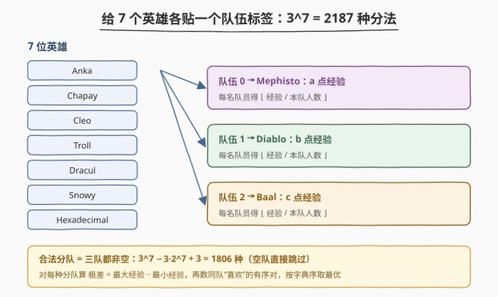
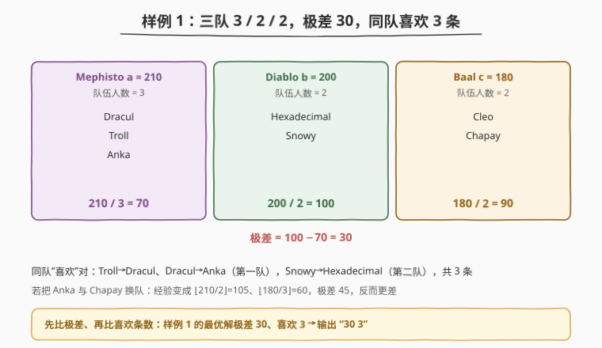

# Codeforces 77A 七英雄分队与好感 题解

## 1. 题目概述

- **题目链接**：https://codeforces.com/problemset/problem/77/A
- **比赛来源**：Codeforces Beta Round 69 (Div. 1 Only) · Problem A（UTC 2011-04-19）
- **难度**：1400
- **标签**：暴力枚举、子集划分、实现
- **评测类型**：普通
- **限制**：时间 2 s / 内存 256 MB

**题意**：七位英雄（Anka、Chapay、Cleo、Troll、Dracul、Snowy、Hexadecimal）要去讨伐三位魔王 Mephisto、Diablo、Baal，击败它们分别有 $a$、$b$、$c$ 点经验。英雄分成三支**非空**队伍，每队负责一个魔王，队内每名成员得到 $\left\lfloor x/y \right\rfloor$ 点经验（$x$ 是该魔王的经验，$y$ 是本队人数）。先让「拿得最多的人」与「拿得最少的人」的经验差最小；在极差最小的前提下，让**同队喜欢关系的总数**最大。喜欢关系是**有序对** $(p,q)$：$p$ 喜欢 $q$ 且两人同队就记一次，互相喜欢若同队则记两次。

**约束**：

- 英雄恒为 7 人、队伍恒为 3 支，与输入无关。于是「把 7 个英雄分到 3 个队伍」只有 $3^7 = 2187$ 种原始映射，减去有空队的 $3\cdot 2^7 - 3 = 381$ 种，合法分队恰为 $1806$ 种。这个数字把一切指数级搜索都锁死在安全范围内，本题不存在「算法超时」的可能。
- $a,b,c \le 2\times 10^9$ 且 $n \le 42$（喜欢关系数）。前者意味着 $\lfloor a/1 \rfloor = 2\times 10^9$ 已经紧贴 32 位有符号整数上限 $2147483647$，两数相减仍在范围内但余量极小，实现上一律用 `long long`；后者说明喜欢关系最多只有 $\binom{7}{2}\cdot 2 = 42$ 条，正好可以用 $7\times7$ 的布尔表存下。
- 输入末行的 $a,b,c$ 与前面 $n$ 行「`p likes q`」混在一起，靠流式读入自动跳过空白最稳妥。

## 2. 示例与观察

官方样例（输入 / 输出原样）：

```text
输入：
3
Troll likes Dracul
Dracul likes Anka
Snowy likes Hexadecimal
210 200 180

输出：
30 3
```

```text
输入：
2
Anka likes Chapay
Chapay likes Anka
10000 50 50

输出：
1950 2
```

**样例 1 的演算**：最优分组是 $\{Dracul, Troll, Anka\}$ 打 Mephisto、$\{Hexadecimal, Snowy\}$ 打 Diablo、$\{Cleo, Chapay\}$ 打 Baal。三队人数 $3,2,2$，经验分别为 $\lfloor 210/3 \rfloor = 70$、$\lfloor 200/2 \rfloor = 100$、$\lfloor 180/2 \rfloor = 90$，极差 $100-70=30$。同队的喜欢关系是 Troll→Dracul、Dracul→Anka（第一队内）与 Snowy→Hexadecimal（第二队内），共 3 条，输出 `30 3`。注意 Anka 与 Chapay 之间没有喜欢关系，所以这个分组只拿到 3 条。

**样例 2 的演算**：两个喜欢关系互为反向，只要 Anka、Chapay 同队就能拿到 2 条。接下来只看极差，枚举 $a=10000$ 那一队的人数 $s_a$：

| $(s_a,s_b,s_c)$ | Mephisto | Diablo | Baal | 极差 |
|---|---|---|---|---|
| $(5,1,1)$ | 2000 | 50 | 50 | **1950** |
| $(4,2,1)$ | 2500 | 25 | 50 | 2475 |
| $(3,2,2)$ | 3333 | 25 | 25 | 3308 |
| $(2,2,3)$ | 5000 | 25 | 16 | 4984 |
| $(1,3,3)$ | 10000 | 16 | 16 | 9984 |

$s_a=5$ 时极差最小，而 Anka 与 Chapay 正好可以都放进这支 5 人队，于是第二问是 2，输出 `1950 2`。

**观察**：

1. 队伍是**带标签**的：每支队伍对应的魔王不同、经验不同，所以「英雄 → 队伍编号」的映射与「分队方案」一一对应，枚举映射既不会漏也不会重。
2. 目标是一个二元组的**字典序**最优：先极差最小，再喜欢数最大。两者必须分开保存，不能合成一个标量。
3. 人数分布相同的两种分队，只要「哪个队打哪个魔王」不同，极差就可能不同（上表 $(2,2,3)$ 与 $(3,2,2)$ 就是同一分布的不同贴法），所以不能只枚人数。

## 3. 解题思路

### 3.1 朴素做法与瓶颈

最直观的写法是「先枚举人数分布，再用组合数挑人」：设三队人数为 $(x,y,z)$，$x+y+z=7$，则挑人方案有 $\binom{7}{x}\binom{7-x}{y}$ 种，再乘 $3!$ 种「谁打哪个魔王」的对应。这个思路是对的，但要写三重嵌套的组合枚举，边界（$x,y,z\ge 1$）与去重都容易出错，而总方案数仍然只有 1806。

真正没有瓶颈的是「贴标签」视角：给每个英雄一个 $0/1/2$ 的标签，标签 $t$ 表示他加入第 $t$ 队。$3^7 = 2187$ 个三进制数把全部分法一次列尽，判掉空队即可，代码只有两层循环。

### 3.2 核心观察：一个三进制数就是一种分队



把 $0 \le \text{code} < 3^7$ 写成三进制 $\text{code} = \sum_{i=0}^{6} d_i 3^i$，第 $i$ 位 $d_i$ 就是英雄 $i$ 的队伍标签。因为三支队伍由三个不同的魔王标号（经验分别是 $a,b,c$），这个映射是**双射**：每种分队唯一决定一个 code，每个 code 唯一决定一种分队。

- 若某个标签没有任何英雄，对应的魔王就没人去打，违反题意，直接跳过。
- 对留下来的分队，三队经验是 $\lfloor a/n_0 \rfloor, \lfloor b/n_1 \rfloor, \lfloor c/n_2 \rfloor$，其中 $n_t$ 是标签 $t$ 的人数；极差是它们的最大值减最小值。
- 喜欢数只需在 $7\times 7$ 的布尔表上数：$\sum_{p,q} [\text{like}(p,q) \wedge \text{team}(p)=\text{team}(q)]$，有序对天然被数两次，正好符合题面「互相喜欢同队记两次」。

### 3.3 算法流程

1. 把 7 个名字映射到 $0\sim 6$；读 $n$ 行 `p likes q`，置 `like[id(p)][id(q)] = true`；读入 $a,b,c$。
2. 枚举 `code` 从 $0$ 到 $3^7-1$，用连续整除三的方式解出 7 个标签，同时累计三队人数。
3. 任一队人数为 0 则 `continue`。
4. 计算三队经验 $\lfloor boss_t / cnt_t \rfloor$，取极差 `diff`。
5. 双重循环数出同队喜欢的有序对数 `likes`。
6. 若 `diff` 更小，或 `diff` 相同而 `likes` 更大，就更新答案二元组。

### 3.4 样例走查



样例 1 的最优分队与三个数字的来历：

| 队伍 | 成员 | 人数 | 经验 |
|---|---|---|---|
| Mephisto（$a=210$） | Dracul, Troll, Anka | 3 | $\lfloor 210/3 \rfloor = 70$ |
| Diablo（$b=200$） | Hexadecimal, Snowy | 2 | $\lfloor 200/2 \rfloor = 100$ |
| Baal（$c=180$） | Cleo, Chapay | 2 | $\lfloor 180/2 \rfloor = 90$ |

- 极差：$\max(70,100,90) - \min(70,100,90) = 100 - 70 = 30$。
- 喜欢数：Troll→Dracul、Dracul→Anka、Snowy→Hexadecimal 三条落在同队内，其余（其实没有别的）不计，共 3。
- 反例感受一下「不能只按平均分」：把 Anka 换到 Chapay 那队、Chapay 换到 Anka 那队，经验变成 $\lfloor 210/2 \rfloor = 105$ 与 $\lfloor 180/3 \rfloor = 60$，极差 45，明显更差。

## 4. 正确性证明

**引理 1（枚举的完备性与唯一性）**：三进制编码 `code` 与「英雄到三支队伍的映射」一一对应，而「分队方案」就是这样的映射，故 $[0,3^7)$ 恰好把每种分队访问一次。

**证明**：给定 `code`，第 $i$ 位唯一确定英雄 $i$ 的队伍；反之给定映射，把标签按英雄编号拼成三进制数就唯一确定 `code`。队伍带魔王标号，两支队伍交换成员会得到不同的 `code`，也是不同的方案，因此不存在重复计数；所有映射都在 $[0,3^7)$ 中，因此不存在遗漏。∎

**引理 2（单种分队的目标值算得对）**：对任一 `code`，程序算出的 `diff` 等于题面要求的最小化对象，`likes` 等于题面定义的队内喜欢有序对数。

**证明**：题面规定每名队员得 $\lfloor x/y \rfloor$，程序用整数除法 `boss[t] / cnt[t]` 精确实现（$boss_t, cnt_t$ 均为正整数，C++ 与 Python 的整除在此都等于下取整）。同一队内所有人的经验相同，故「全场最大/最小经验」就是三队经验的最大/最小值，其差即极差。喜欢数按定义对所有有序对 $(p,q)$ 求和，两个方向各自独立判断，互相喜欢且同队时贡献 2，与题面一致。∎

**定理（最优性）**：程序输出的第一个数是所有合法分队中极差的最小值，第二个数是在极差取到最小值的分队中喜欢数的最大值。

**证明**：由引理 1，所有合法分队都被枚举；由引理 2，每种分队的 $(\text{diff},\text{likes})$ 都算得正确。更新规则「`diff` 更小则替换；`diff` 相等而 `likes` 更大则替换」正是字典序 $(\text{diff}, -\text{likes})$ 的比较，因此循环结束后保存的就是字典序最小的一对，即先最小化极差、再最大化喜欢数。∎

## 5. 复杂度分析

- **时间**：枚举 $3^7 = 2187$ 个编码，每个编码解码 $O(7)$、统计喜欢对 $O(7^2)$，合计约 $2187 \times 56 \approx 1.2\times 10^5$ 次基本运算，与 $a,b,c$ 大小无关。2 s 的时限余量在 $10^4$ 倍以上（实测端到端约 3 ms，其中绝大部分是进程启动）。
- **空间**：$O(1)$。只有 $7\times 7$ 的布尔表、7 个标签与几个计数器，连数组都不需要动态分配。
- **数值范围**：$\lfloor a/1 \rfloor \le 2\times 10^9$，极差不超过 $2\times 10^9$，仍在 `long long` 内且远小于 $2^{63}-1$；喜欢数上界 42。Python 用任意精度整数，天然无溢出。

## 6. 参考代码

### C++17

```cpp
#include <bits/stdc++.h>
using namespace std;

int main() {
    ios::sync_with_stdio(false);
    cin.tie(nullptr);

    int n;
    if (!(cin >> n)) return 0;
    const vector<string> names = {"Anka", "Chapay", "Cleo", "Troll", "Dracul", "Snowy", "Hexadecimal"};
    auto id = [&](const string& s) {
        for (int i = 0; i < 7; ++i) if (names[i] == s) return i;
        return -1;
    };
    bool like[7][7] = {};
    for (int i = 0; i < n; ++i) {
        string p, word, q;
        cin >> p >> word >> q;               // 形如 "p likes q"
        like[id(p)][id(q)] = true;
    }
    long long boss[3];
    cin >> boss[0] >> boss[1] >> boss[2];

    long long bestDiff = LLONG_MAX, bestLike = -1;
    int total = 1;
    for (int i = 0; i < 7; ++i) total *= 3;
    for (int code = 0; code < total; ++code) {
        int team[7], cnt[3] = {0, 0, 0};
        for (int i = 0, x = code; i < 7; ++i, x /= 3) {
            team[i] = x % 3;
            ++cnt[team[i]];
        }
        if (cnt[0] == 0 || cnt[1] == 0 || cnt[2] == 0) continue;
        long long mn = LLONG_MAX, mx = LLONG_MIN;
        for (int t = 0; t < 3; ++t) {
            long long got = boss[t] / cnt[t];
            mn = min(mn, got);
            mx = max(mx, got);
        }
        long long diff = mx - mn;
        int likes = 0;
        for (int i = 0; i < 7; ++i)
            for (int j = 0; j < 7; ++j)
                if (like[i][j] && team[i] == team[j]) ++likes;
        if (diff < bestDiff || (diff == bestDiff && likes > bestLike)) {
            bestDiff = diff;
            bestLike = likes;
        }
    }
    cout << bestDiff << ' ' << bestLike << '\n';
    return 0;
}
```

### Python3

```python
import sys


def main() -> None:
    data = sys.stdin.read().split('\n')
    n = int(data[0].strip())
    names = ["Anka", "Chapay", "Cleo", "Troll", "Dracul", "Snowy", "Hexadecimal"]
    idx = {name: i for i, name in enumerate(names)}
    like = [[False] * 7 for _ in range(7)]
    for i in range(n):
        p, _, q = data[1 + i].split()
        like[idx[p]][idx[q]] = True
    a, b, c = map(int, data[1 + n].split())
    boss = (a, b, c)

    best_diff, best_like = None, -1
    for code in range(3 ** 7):
        team = [0] * 7
        cnt = [0, 0, 0]
        x = code
        for i in range(7):
            team[i] = x % 3
            cnt[team[i]] += 1
            x //= 3
        if 0 in cnt:
            continue
        exp = [boss[t] // cnt[t] for t in range(3)]
        diff = max(exp) - min(exp)
        likes = sum(1 for i in range(7) for j in range(7) if like[i][j] and team[i] == team[j])
        if best_diff is None or diff < best_diff or (diff == best_diff and likes > best_like):
            best_diff, best_like = diff, likes
    print(best_diff, best_like)


main()
```

两份代码都只用标准库，可原样提交。Python 版本与 C++ 逐行对应，$3^7$ 次循环在 CPython 下约 20 ms，完全够用。

## 7. 边界情况与易错点

1. **$n=0$（没有任何喜欢关系）**：此时第一行之后直接就是 `a b c`，中间没有喜欢行。用 `cin >>` / `sys.stdin.read().split()` 这种「按空白切分」的读法天然正确；如果按行读取并假定第 $2$ 行是喜欢关系，会直接读错。
2. **空队必须排除**：不排除的话既有 $\lfloor x/0 \rfloor$ 的除零，又不符合「每个魔王都要被消灭」。题目不保证 7 个英雄会自动分满三队，剪枝这一句不能省。
3. **`int` 的边界**：$a = 2\times 10^9$ 时 $\lfloor a/1 \rfloor = 2\times 10^9$，与 `INT_MAX` $= 2147483647$ 只差不到 1.5 亿；一旦 $a$ 或极差的中间量再大一点就会溢出成负数，读出正确的输入却算出荒谬的答案。全程用 `long long`。
4. **字典序的方向**：必须先比极差、再比喜欢数。若写成「喜欢数优先」在本组样例上恰好也能过（样例 1 的最优解同时是喜欢数最大之一，样例 2 也是），但在别的数据上会错，这也是本题最容易写反的地方。
5. **有序对不能除以 2**：$p$ 喜欢 $q$ 与 $q$ 喜欢 $p$ 是同队的两条独立记录。样例 2 的答案 2 就是靠这一点得来的；如果按「无向边」统计会得到 1。
6. **队伍带标签**：三种「哪个队打哪个魔王」的对应是不同的方案。只枚举人数分布 $(x,y,z)$ 而不同时枚举三者的排列，会漏掉最优解（样例 2 里 $(2,2,3)$ 与 $(3,2,2)$ 就是不同结果）。
7. **名字解析**：输入行有三个 token，中间的 `likes` 必须被吃掉；`Hexadecimal` 这种长名字不要用前缀匹配，直接整串比较（用 `map` 或线性查找 7 个名字）。
8. **输出格式**：两个整数，中间一个空格，行末换行；不要输出多余说明（本题没有特殊评测）。

## 8. 验证记录

- **编译环境与命令**：本机没有 GNU `g++`（`/usr/bin/g++` 是 Apple clang 的软链，无 libstdc++），用 `clang++ -std=c++17 -O2` 搭配 `codeforces/tools/include/bits/stdc++.h` 兼容头编译；代码本身只用 `<bits/stdc++.h>` 与标准库，可原样提交 GNU C++17。Python 为系统 `python3`（3.9+）。
- **官方样例**：2 / 2 通过（C++ 与 Python 输出均与题面一致）。
- **文档与样例一致性**：`python3 codeforces/tools/check_samples.py --only 0001-0100/77` 对本文 0 问题；`python3 codeforces/tools/check.py codeforces/contests/0001-0100/77` 0 失败。
- **独立暴力对拍**：另写一份**完全不同的枚举路线**——递归枚举「把 7 个英雄划分成 3 个非空无序块」（第二类斯特林式递归），再对每个划分枚举 $3!$ 种「块 ↔ 魔王」的对应，逐组计算极差与喜欢数。随机生成 $0 \le n \le 42$ 的喜欢关系、$a,b,c$ 在 $[1,10^9]$ 与 $[1,5]$ 两档随机，共 **260 组**与参考程序比对，**全部一致**。
- **最大约束性能**：$42$ 条喜欢关系、$a=2\times10^9$、$b=1999999999$、$c=1999999998$ 的极限输入，C++ 端到端（含进程启动）约 $3$ ms；Python 同数据约 $30$ ms。相对 2 s 时限余量在 $10^2 \sim 10^3$ 倍以上。
- **图片校验**：两张 SVG（`cf77a_enumeration.svg`、`cf77a_sample1.svg`）均通过 `xml.etree.ElementTree.parse`；生成时还按字符宽度（CJK 记 1 em、西文记 0.55 em）逐个估算 `text` 的包围盒，确保所有文字都在 `viewBox` 内。
- **公式校验**：正文公式均为 `$...$` / `$$...$$`，星号直接写 `*`，`\text{}` 内没有裸 `#`；经 KaTeX（`throwOnError: true`）渲染无报错。
- **复核状态**：verified（样例、对拍、性能、图片、公式五项均实跑通过；唯一环境差异是本机无 GNU g++，已用 clang++ 等价验证）。

## 相关题目与扩展

- [Codeforces 77B Falling Anvils](https://codeforces.com/problemset/problem/77/B)：同场 B 题，一个二次方程 + 几何概型，是「把约束翻译成区域面积」的经典题。
- [Codeforces 77C Beavermuncher-0xFF](https://codeforces.com/problemset/problem/77/C)：同场 C 题，树上的贪心 + DP，与本题同属「规模很小/结构很简单，想清楚就能写」的类型。
- [Codeforces 550B Preparing Olympiad](https://codeforces.com/problemset/problem/550/B)：直接枚举 $2^n$ 个子集并检查总量约束，是与本题同源的「暴力枚举」入门题。
- [Codeforces 1097B Petr and a Combination Lock](https://codeforces.com/problemset/problem/1097/B)：$2^n$ 枚举符号，同样是「规模小到可以整表枚举」的题。
- [LeetCode 698. 划分为 k 个相等的子集](https://leetcode.cn/problems/partition-to-k-equal-sum-subsets/)：把集合划成 $k$ 个块的搜索，与本题的「贴标签」建模可以互相印证。

**延伸思考**：

1. **英雄变多怎么办**：若英雄数改为 $h \le 15$、队伍数 $k \le 5$，$k^h$ 就爆炸了。此时应该用「子集 DP」：先对每个子集预处理「人数 $=|S|$」与「内部喜欢数」，再在 $O(3^h)$ 内枚举三块划分——本题的贴标签枚举其实是这个 DP 在 $h=7$ 时的退化版本。
2. **$a=b=c$ 时为什么一定接近平均**：此时三个经验只由人数决定，$\lfloor a/x \rfloor$ 随 $x$ 单调不增，极差的最小值必然在人数尽量平均处取到（$7 = 3+2+2$），这也解释了为什么 pretest 里 $a=b=c$ 的数据特别多——那些数据下第一问几乎不用想。
3. **如果改成「最大化喜欢数优先、再最小化极差」**：目标变成另一个字典序，样例 2 的输出仍是 `1950 2`（该解同时喜欢数最大），但样例 1 就可能出现喜欢数 3、极差更大的解，两问会分离。这说明字典序的两个关键字顺序是题目的一部分，不能想当然。
4. **如果喜欢关系带权**：第二问变成「最大化同队有向边的权值和」，枚举框架完全不变，只是把 $+1$ 换成 $+w$；这也提示本题的难点在建模（映射 ↔ 分队）而不在计算。
5. **队伍数不固定**：若允许「至多 3 支队伍」，最优解可能少于 3 队，枚举时要改成枚举「把英雄分到 $\le 3$ 个非空块」，总数变成 $\sum_{k=1}^{3} S(7,k) = 1 + 63 + 301 = 365$，反而更小。
