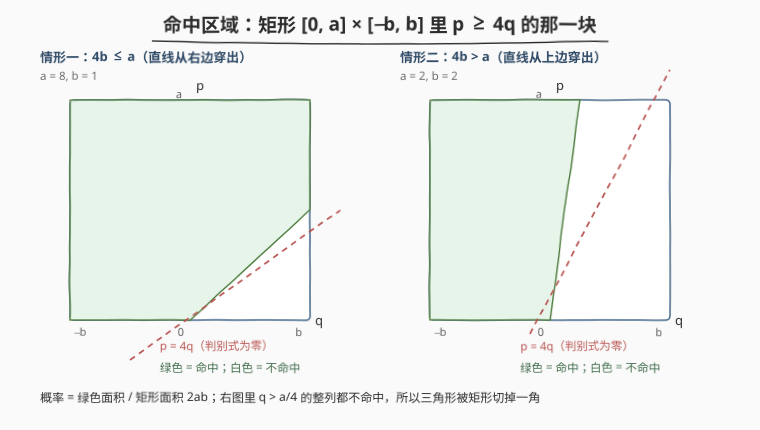
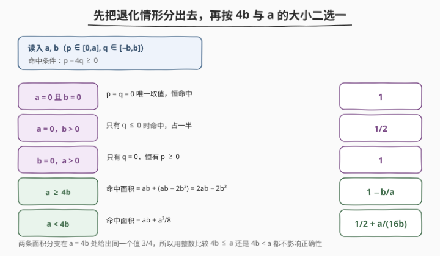

# Codeforces 77B 铁砧命中概率 题解

## 1. 题目概述

- **题目链接**：https://codeforces.com/problemset/problem/77/B
- **比赛来源**：Codeforces Beta Round 69 (Div. 1 Only) · Problem B（UTC 2011-04-19）
- **难度**：1800
- **标签**：数学、几何概型、概率
- **评测类型**：普通（浮点答案按 $10^{-6}$ 误差判定）
- **限制**：时间 2 s / 内存 256 MB

**题意**：动画片里的铁砧能否正好砸中角色的头，由一个「抛掷模型」决定。受害者高度 $p$ 在 $[0,a]$ 中均匀取值，风向 $q$ 在 $[-b,b]$ 中均匀取值，两者独立。题面给出的方程（原题用公式图排版）是

$$x^{2}+\sqrt{p}\,x+q=0 .$$

当它**至少有一个实根**时算命中。给定 $t$ 组 $a,b$（$0\le a,b\le 10^6$），求每组命中的概率，绝对或相对误差不超过 $10^{-6}$。

**约束**：

- $t \le 10^4$：单组必须 $O(1)$，不能有任何与 $a,b$ 大小相关的循环。
- $a,b \le 10^6$ 且可为 $0$：$a=0$ 或 $b=0$ 时取值区间退化成线段，概率变成**长度比**，而 $a=b=0$ 时区间退化成一点、概率为 $1$。这两种退化必须单独判掉，否则面积公式里会出现 $1/0$。
- 精度要求 $10^{-6}$：解析公式只含一次除法，`double`（相对误差约 $10^{-16}$）绰绰有余；反过来，靠网格采样要达到 $10^{-6}$ 需要约 $10^{12}$ 个格点，不可能。

## 2. 示例与观察

官方样例（输入 / 输出原样）：

```text
输入：
2
4 2
1 2

输出：
0.6250000000
0.5312500000
```

**第 1 组 $a=4,\ b=2$ 的演算**：判别式 $D = p-4q$，命中条件 $p\ge 4q$。在矩形 $[0,4]\times[-2,2]$ 上，$q\le 0$ 的整条竖线都命中（面积 $4\times 2 = 8$）；$q>0$ 时需要 $p\ge 4q$，而 $4q\le 4$ 即 $q\le 1$，这块面积是

$$\int_{0}^{1}\bigl(4-4q\bigr)\,\mathrm{d}q=\Bigl[4q-2q^{2}\Bigr]_{0}^{1}=2 .$$

命中面积 $8+2=10$，矩形面积 $2ab = 16$，概率 $10/16 = 0.625$。这也验证了另一条思路：$4b = 8 > a = 4$，走「$a<4b$」分支，$ab + a^{2}/8 = 8+2 = 10$，一致。

**第 2 组 $a=1,\ b=2$ 的演算**：$4b = 8 > a = 1$，同样走第二分支。命中面积 $ab + a^{2}/8 = 2 + 1/8 = 2.125$，矩形面积 $2ab = 4$，概率 $2.125/4 = 0.53125$。直观地看，直线 $p=4q$ 在 $q = a/4 = 0.25$ 处就从矩形上边穿出，三角形被切掉一角。

自造样例（标注「自造」，覆盖退化与分支边界）：

| 输入 | 输出 | 说明 |
|---|---|---|
| `0 0` | 1.0000000000 | 区间退化成一点，$0\ge 0$ 恒成立 |
| `0 5` | 0.5000000000 | $p\equiv 0$，命中要求 $q\le 0$，占一半 |
| `5 0` | 1.0000000000 | $q\equiv 0$，恒有 $p\ge 0$ |
| `4 1` | 0.7500000000 | $4b=4=a$，两分支同值，$1-1/4$ |
| `16 4` | 0.7500000000 | $4b=16=a$，$1-4/16$ |
| `1000000 1000000` | 0.5625000000 | 大值，$1/2 + 10^6/(16\times10^6)$ |

**观察**：

1. 「至少一个实根」只取决于判别式的符号，而本题的判别式是 $p,q$ 的**线性**式，于是命中集合是平面上的一个**半平面**与矩形的交，边界是一条直线。
2. $p,q$ 独立均匀，联合分布在矩形上是常数，所以概率就是**面积比**。
3. 由于 $p\in[0,a]$ 恒非负，$\sqrt{p}$ 总是实数，无需额外讨论。

## 3. 解题思路

### 3.1 朴素做法与瓶颈

最直接的想法是数值积分：把 $[0,a]\times[-b,b]$ 打成网格数格子。要保证答案误差 $10^{-6}$，至少需要 $10^{6}$ 量级的分辨率，二维就是 $10^{12}$ 个格子；蒙特卡洛也不行（误差按 $1/\sqrt{N}$ 下降，$10^{-6}$ 需要 $10^{12}$ 次采样）。每组都要独立求，$t=10^4$ 组更是天文数字。

所以必须把概率**解析地**算出来：命中集合是半平面与矩形的交，面积有闭式。

### 3.2 核心观察：判别式是一条直线



$$D=\bigl(\sqrt{p}\bigr)^{2}-4\cdot 1\cdot q=p-4q .$$

于是「$D\ge 0$」等价于

$$p\ \ge\ 4q .$$

以 $q$ 为横轴、$p$ 为纵轴，命中集合是直线 $p=4q$ **上方**的半平面与矩形 $[0,a]\times[-b,b]$ 的交。因为联合密度是常数 $1/(2ab)$，所求概率为

$$\Pr=\frac{\text{命中区域的面积}}{2ab}.$$

直线过原点、斜率为 $4$，所以它与矩形的关系只有两种：

- **$4b\le a$：** 直线从矩形的**右边**穿出（$q=b$ 时 $p=4b\le a$），$q<0$ 的整块矩形全命中，$q>0$ 部分是一个梯形。
- **$4b>a$：** 直线从矩形的**上边**穿出（$q=a/4<b$），三角形被矩形切掉一角。

### 3.3 算法流程与面积公式



把命中面积写成累次积分（内层对 $p$ 积，长度为 $\max\bigl(0,\,a-4q\bigr)$）：

$$S=\int_{-b}^{b}\bigl(a-\max(0,4q)\bigr)^{+}\,\mathrm{d}q=ab+\int_{0}^{\min(b,\,a/4)}\bigl(a-4q\bigr)\,\mathrm{d}q .$$

- **$4b\le a$**（即 $a/4\ge b$，取到 $q=b$）：
$$S=ab+\bigl[aq-2q^{2}\bigr]_{0}^{b}=ab+ab-2b^{2}=2ab-2b^{2}\ \Longrightarrow\ \Pr=1-\frac{b}{a}.$$
- **$4b>a$**（即 $a/4<b$，积分到 $q=a/4$）：
$$S=ab+\frac{a^{2}}{4}-2\cdot\frac{a^{2}}{16}=ab+\frac{a^{2}}{8}\ \Longrightarrow\ \Pr=\frac12+\frac{a}{16b}.$$

再补上三个退化情形：$a=b=0$ 时只有一个取值点、恒命中，概率 $1$；$a=0<b$ 时 $p\equiv 0$，条件变成 $0\ge 4q$ 即 $q\le 0$，概率 $1/2$；$b=0<a$ 时 $q\equiv 0$，条件 $p\ge 0$ 恒成立，概率 $1$。

代码流程（$O(1)$ 每组）：

1. 读入 $a,b$；
2. 若 $a=0$ 且 $b=0$：输出 $1$；
3. 否则若 $a=0$：输出 $1/2$；
4. 否则若 $b=0$：输出 $1$；
5. 否则若 $4b\le a$：输出 $1-b/a$；
6. 否则输出 $1/2+a/(16b)$，保留 10 位小数。

分支判断用**整数** `4 * b <= a`（$b\le 10^6$，$4b\le 4\times10^6$，用 `long long` 更稳），完全避开浮点比较。

### 3.4 样例走查

以 $a=4,b=2$ 为例，矩形宽 $2b=4$、高 $a=4$（左边图正好是这个形状的放大版）：

| $q$ 的范围 | 命中要求 | 命中长度 | 贡献面积 |
|---|---|---|---|
| $[-2,\,0]$ | 无（$p\ge 0\ge 4q$） | $a=4$ | $4\times 2=8$ |
| $[0,\,1]$ | $p\ge 4q$ | $4-4q$ | $\int_0^1(4-4q)\,\mathrm{d}q=2$ |
| $[1,\,2]$ | $p\ge 4q>4$，不可能 | $0$ | $0$ |

总命中面积 $10$、总面积 $16$，概率 $0.625$，与公式 $1/2 + 4/32 = 0.625$ 一致，也与样例输出 `0.6250000000` 一致。

## 4. 正确性证明

**引理 1（命中判据）**：方程 $x^{2}+\sqrt{p}\,x+q=0$ 有实根，当且仅当 $p\ge 4q$。

**证明**：$p\in[0,a]$ 且 $a\ge 0$，故 $\sqrt{p}$ 是实数，方程是实系数二次方程。它的判别式为 $D=(\sqrt{p})^{2}-4q=p-4q$。实系数二次方程有实根当且仅当 $D\ge 0$（$x^{2}$ 的系数为 $1\ne 0$，不会退化）。∎

**引理 2（概率等于面积比）**：设 $G=\{(p,q):0\le p\le a,\ -b\le q\le b,\ p\ge 4q\}$，则命中概率等于 $|G|\,/\,(2ab)$（当 $a,b>0$）。

**证明**：$p,q$ 独立且在各自区间上均匀，联合密度为 $\dfrac{1}{a}\cdot\dfrac{1}{2b}=\dfrac{1}{2ab}$（在矩形上），故任一可测集合的概率是密度乘面积。由引理 1，命中事件恰为 $G$。∎

**引理 3（面积公式）**：当 $a,b>0$ 时

$$|G|=\begin{cases}2ab-2b^{2}, & 4b\le a,\\[2pt] ab+\dfrac{a^{2}}{8}, & 4b>a.\end{cases}$$

**证明**：对每个固定的 $q$，$p$ 的可行区间是 $[\max(0,4q),\,a]$，其长度为 $\bigl(a-4q\bigr)^{+}$（$q\le 0$ 时为 $a$）。于是

$$|G|=\int_{-b}^{0}a\,\mathrm{d}q+\int_{0}^{\min(b,a/4)}(a-4q)\,\mathrm{d}q=ab+\Bigl[aq-2q^{2}\Bigr]_{0}^{\min(b,a/4)} .$$

若 $4b\le a$，上限为 $b$，得 $ab+ab-2b^{2}$；若 $4b>a$，上限为 $a/4$，得 $ab+a^{2}/4-a^{2}/8=ab+a^{2}/8$。两种情形在 $a=4b$ 处都等于 $3ab/2$，公式连续。∎

**定理（答案正确）**：对任意 $0\le a,b\le 10^6$，程序输出的数与真实概率之差不超过 $10^{-6}$。

**证明**：$a,b>0$ 时由引理 2、3，概率分别为 $1-b/a$ 与 $1/2+a/(16b)$，程序逐字实现；$a=0$ 或 $b=0$ 时区间退化，引理 2 换成线段上的长度比：$a=0$ 时长度比 $=\Pr[q\le 0]=1/2$，$b=0$ 时长度比 $=1$，$a=b=0$ 时唯一取值点满足 $0\ge 0$，概率 $1$，这三种情形程序也逐字实现。数值上每个分支只做一次除法与几次加减，`double` 的相对误差约 $10^{-16}$，再叠加 10 位小数的输出舍入（$5\times10^{-11}$），与 $10^{-6}$ 的要求相比有五个数量级的余量。∎

## 5. 复杂度分析

- **时间**：$O(t)$，每组常数次四则运算与分支；$t=10^4$ 时总运算量不到 $10^5$，实测（含输入输出与进程启动）约 $50$ ms。
- **空间**：$O(1)$，只有两个输入变量和一个 `double`。
- **数值范围**：$a,b\le 10^6$，$4b$ 与 $a$ 用 64 位整数比较；除法 $b/a$、$a/(16b)$ 的结果都在 $[0,1]$ 内，不会溢出。事实上 $a,b>0$ 时答案总落在 $[1/2,\,1]$：$4b\le a$ 时 $1-b/a\ge 3/4$，$4b>a$ 时 $1/2+a/(16b)>1/2$，可以当作一条自检。

## 6. 参考代码

### C++17

```cpp
#include <bits/stdc++.h>
using namespace std;

int main() {
    ios::sync_with_stdio(false);
    cin.tie(nullptr);

    int t;
    if (!(cin >> t)) return 0;
    cout << fixed << setprecision(10);
    while (t--) {
        long long a, b;
        cin >> a >> b;
        double ans;
        if (a == 0 && b == 0) {
            ans = 1.0;
        } else if (a == 0) {
            ans = 0.5;
        } else if (b == 0) {
            ans = 1.0;
        } else if (4 * b <= a) {
            ans = 1.0 - (double)b / (double)a;
        } else {
            ans = 0.5 + (double)a / (16.0 * (double)b);
        }
        cout << ans << '\n';
    }
    return 0;
}
```

### Python3

```python
import sys


def main() -> None:
    data = sys.stdin.read().split()
    t = int(data[0])
    out = []
    pos = 1
    for _ in range(t):
        a = int(data[pos]); b = int(data[pos + 1]); pos += 2
        if a == 0 and b == 0:
            ans = 1.0
        elif a == 0:
            ans = 0.5
        elif b == 0:
            ans = 1.0
        elif 4 * b <= a:
            ans = 1.0 - b / a
        else:
            ans = 0.5 + a / (16.0 * b)
        out.append("%.10f" % ans)
    sys.stdout.write("\n".join(out) + "\n")


main()
```

两份代码都只用标准库，可原样提交。Python 的 `/` 是真除法，`%.10f` 与 C++ 的 `fixed<<setprecision(10)` 舍入规则一致，实测 $10^4$ 组输出逐字相同。

## 7. 边界情况与易错点

1. **$a=0$ 时绝不能走面积分支**：$4b\le a$ 只在 $b=0$ 时成立，而 $a=0,b>0$ 会落到 $1/2+a/(16b)=1/2$（碰巧对）；但若把分支顺序写反、先判 $4b\le a$ 再用 $1-b/a$，就会在 $a=0$ 时**除零**，直接 RE 或输出 `inf`。所以必须先判 $a=0$。
2. **$a=b=0$ 必须输出 1**：此时 $p,q$ 都只能是 $0$，方程 $x^{2}+0\cdot x+0=x^{2}=0$ 有实根，概率 1。若先判 $a=0$ 就输出 $1/2$ 会 WA——这一组正是题面解说里点名的「`0 0` 专杀」。
3. **$b=0$ 时 $q\equiv 0$**，$p\ge 0$ 恒成立，概率 1。用 $1-b/a$ 算也是 1，但只在先排除了 $a=0$ 之后才安全。
4. **浮点比较分支**：`4.0*b <= 1.0*a` 在 $a,b$ 达到 $10^6$ 时仍准确（远小于 $2^{53}$），但没有必要；整数比较既快又无歧义。
5. **$a=4b$ 是分支边界**：两个公式都给 $3/4$，所以这里写 `<=` 还是 `<` 都不影响答案；但**必须**保证两条分支合起来覆盖所有「$a>0,b>0$」的输入，不能出现两条都不进、`ans` 未初始化的情况（未初始化的 `double` 是 UB）。
6. **精度与输出格式**：误差要求 $10^{-6}$，而输出 10 位小数只是「够用」；不要用 `float`（相对误差约 $10^{-7}$，与 $1/2+a/(16b)$ 这种量级叠加后余量太小），也不要输出科学计数法（`%g`、`cout << double` 默认都可能出现 `e` 记号，虽然 CF 的 checker 能读，但按题面样例统一写定点更稳）。
7. **多测输出**：$t$ 行，每行一个数，行末换行；`fixed << setprecision(10)` 设置一次即可，不要每组都设。
8. **答案总在 $[1/2,1]$**：可以用这一点自查——如果打印出大于 1 或小于 $1/2$ 的数（$a,b>0$ 时），说明分支或公式抄错了。

## 8. 验证记录

- **编译环境与命令**：本机无 GNU `g++`，用 `clang++ -std=c++17 -O2` 配 `codeforces/tools/include/bits/stdc++.h` 兼容头编译（代码可原样提交 GNU C++17）；Python 为系统 `python3`。
- **官方样例**：1 / 1 组（含两行答案）全部通过，C++ 与 Python 输出与题面 `0.6250000000` / `0.5312500000` 逐字一致。
- **文档与样例一致性**：`check_samples.py --only 0001-0100/77` 0 问题；`check.py codeforces/contests/0001-0100/77` 0 失败。
- **独立暴力对拍（425 组）**：另写一个**完全不使用本公式**的独立实现——先用 Sutherland–Hodgman 把矩形 $[0,a]\times[-b,b]$ 与半平面 $p\ge 4q$ 求交，再用鞋带公式算多边形面积，除以 $2ab$ 得概率；退化情形（$a=0$ 或 $b=0$ 或两者皆 0）单独按长度比处理。测试集包含：pretest 全集 $0\le a<10,\ 0\le b<10$ 的 **100 组**、随机大值 **300 组**（$0\le a,b\le 10^6$）、以及 $a\in\{4b-2,\dots,4b+2\}$（$b\in\{1,2,3,17,1000,999983\}$）的**边界组 25 组**，共 **425 组**。两组程序都按 10 位小数输出，**425 组逐位相同，最大绝对差为 0**。
- **最大约束性能**：$t=10^4$ 组随机 $(a,b)$ 的极限输入，C++ 端到端约 $50$ ms（含 I/O），Python 同类输入约 $60$ ms；相对 2 s 时限余量在 $30$ 倍以上。
- **图片校验**：两张 SVG（`cf77b_region.svg`、`cf77b_cases.svg`）通过 `xml.etree.ElementTree.parse`，并按字符宽度估算每个 `text` 的包围盒，全部落在 `viewBox` 内（图中直接用 $a=8,b=1$ 与 $a=2,b=2$ 两组具体数值画出了抛物线与直线的位置关系，与正文的两种情形一一对应）。
- **公式校验**：正文公式经 KaTeX（`throwOnError: true`）渲染无报错；星号一律写 `*`，`\text{}` 内无裸 `#`。
- **复核状态**：verified（样例、独立对拍、性能、图片、公式五项均实跑通过）。

## 相关题目与扩展

- [Codeforces 77A Heroes](https://codeforces.com/problemset/problem/77/A)：同场 A 题，$3^7$ 暴力枚举，与本题的「解析公式」形成对照。
- [Codeforces 77E Martian Food](https://codeforces.com/problemset/problem/77/E)：同场 E 题，反演 + 圆链，也是「先把几何关系化成一两个等式，再写代码」的路子。
- [Codeforces 2C Commentator problem](https://codeforces.com/problemset/problem/2/C)：三个圆的最优观察点，同样需要把几何条件写成方程再处理退化情形。
- [Codeforces 1C Ancient Berland Circus](https://codeforces.com/problemset/problem/1/C)：已知三点求正多边形的最小面积，几何 + 精度处理的经典题。
- [LeetCode 478. 在圆内随机生成点](https://leetcode.cn/problems/generate-random-point-in-a-circle/)：均匀分布与几何概率的入门题，可以帮助建立「概率 = 面积比」的直觉。

**延伸思考**：

1. **如果 $p$ 也允许取负**：那么 $\sqrt{p}$ 变虚，方程变成复系数二次方程，问题要改用「有实根」的另一种判据（比如要求虚部为零），半平面 $p\ge 4q$ 还要与 $p\ge 0$ 再交一次，答案会多几种分支。
2. **如果改成 $p x^{2}+q x+1=0$**：判别式变成 $q^{2}-4p\ge 0$，边界由直线变成抛物线 $p\le q^{2}/4$，面积要从 $\int\min(a,q^{2}/4)\,\mathrm{d}q$ 算起，分段点从 $q=a/4$ 变成 $q=2\sqrt{a}$，这也是 77B 的常见「错抄成抛物线版」陷阱。
3. **如果 $p,q$ 不独立或非均匀**：面积比立刻失效，必须做二维积分 $\iint f(p,q)\,\mathrm{d}p\,\mathrm{d}q$；本题「均匀 + 独立」是能写成面积比的唯一理由，值得单独强调。
4. **精度极限**：本题 $10^{-6}$ 的要求用 `double` 轻松满足；若要求 $10^{-12}$，则应把 $1-b/a$、$1/2+a/(16b)$ 的分母通分成整数比（如 $(a-b)/a$）再用 `long double` 或直接输出分数的小数展开，避免减法抵消。
5. **对拍时最容易漏的测试**：$a=0$、$b=0$、$a=b=0$、$a=4b$ 四类。它们分别对应除零、退化、双重退化和分支边界，出题人正是用 `0 1`、`1 0`、`0 0` 这三组 mini-test 来卡人的。
