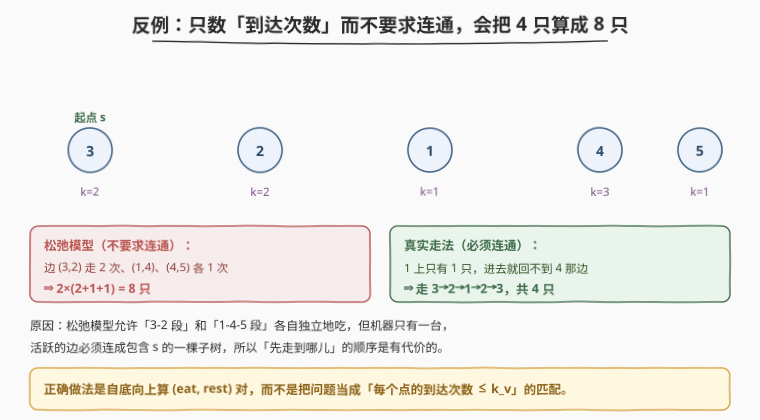
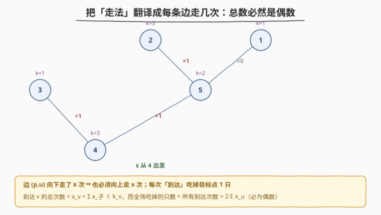
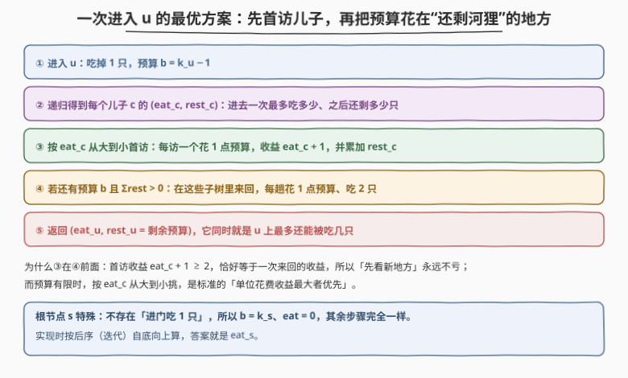

# Codeforces 77C 树上河狸吞食机 题解

## 1. 题目概述

- **题目链接**：https://codeforces.com/problemset/problem/77/C
- **比赛来源**：Codeforces Beta Round 69 (Div. 1 Only) · Problem C（UTC 2011-04-19）
- **难度**：2100
- **标签**：树、DFS、树形 DP、贪心
- **评测类型**：普通
- **限制**：时间 3 s / 内存 256 MB

**题意**：给一棵 $n$ 个顶点的树，第 $i$ 个顶点上有 $k_i$ 只河狸。机器「Beavermuncher-0xFF」从指定起点 $s$ 出发，每步只能沿一条边走到相邻顶点 $v$，并**吃掉 $v$ 上恰好一只河狸**；$v$ 上没有河狸就不能走过去，机器也不能停在原地吃。河狸不会逃跑。机器最后必须回到 $s$（要从树上取下来）。求最多能吃掉多少只河狸。

**约束**：

- $n \le 10^5$：树形 DP 与排序都可行；$O(n^2)$ 不行。
- $k_i \le 10^5$，故总河狸数不超过 $10^{10}$：答案必须用 64 位整数（`long long`），`int` 会溢出。
- 走的步数可以到 $10^{10}$ 量级（每条边来回很多次）：不能逐步模拟，必须把「每条边走几次」当成变量来算。
- 树无环（是树而不是一般图）：保证从任何顶点回到 $s$ 的路径唯一、且"向上走"的边数等于"向下走"的边数，这是整套计数的前提。
- 输入规模 $10^5$：C++ 要关同步或改用 `scanf`；Python 要用 `read().split()` 一次读完。

## 2. 示例与观察

官方样例（输入 / 输出原样）：

```text
输入：
5
1 3 1 3 2
2 5
3 4
4 5
1 5
4

输出：
6
```

```text
输入：
3
2 1 1
3 2
1 2
3

输出：
2
```

**样例 1 的演算**：树是 $4-3$、$4-5$、$5-2$、$5-1$，起点 $s=4$，各点河狸数 $k = (1,3,1,3,2)$（按顶点 1..5 的顺序）。一条最优路线是

$$4 \to 3 \to 4 \to 5 \to 2 \to 5 \to 4 .$$

逐步看每步吃到什么：$4\to3$ 吃顶点 3 的一只（$k_3:1\to0$）；$3\to4$ 吃顶点 4 的一只（$3\to2$）；$4\to5$ 吃顶点 5 的一只（$2\to1$）；$5\to2$ 吃顶点 2 的一只（$3\to2$）；$2\to5$ 吃顶点 5 的一只（$1\to0$）；$5\to4$ 吃顶点 4 的一只（$2\to1$）。共 6 只，结束在 $s=4$。顶点 1 一次都没去：因为 $k_5$ 只有 2 只，$4\to5$ 与 $5\to2$ 之后 $5$ 上已经空了，再去 1 就回不到 5，更回不到 4。

**样例 2 的演算**：$s=3$，树是 $3-2-1$，$k=(2,1,1)$。唯一能做的往返是 $3\to2\to3$：吃顶点 2 的 1 只，再吃顶点 3 的 1 只，共 2 只。再往 1 走就会卡在 1 与 2 之间回不来（$k_2$ 只有 1 只，进 1 之后回 2 需要 $k_2$ 还有剩）。

**观察**：

1. 机器最终回到 $s$，所以**每条边向下走的次数等于向上走的次数**。设边 $(\text{parent}(u),u)$ 向下走 $x_u$ 次，则这条边来回共 $2x_u$ 步，每步吃 1 只。
2. 每到达一个顶点就必须吃掉它一只河狸，所以「到达 $u$ 的总次数」不能超过 $k_u$。
3. 一次来回总是吃 2 只：一只在被进入的子树里，一只在返回的顶点上。于是总答案必然是**偶数**（样例 1 是 6，样例 2 是 2）。
4. 所有走过的边必须连成**包含 $s$ 的一棵子树**——这条"连通性"是本题最容易忽略、也最致命的约束。

## 3. 解题思路

### 3.1 朴素做法与它的两个陷阱

**陷阱一：逐步模拟。** 答案可以达到 $10^{10}$，模拟每一步必然超时。必须把「每条边走几次」当成未知数一次性求解。

**陷阱二：丢掉连通性。** 如果只保留观察 1、2，把它写成线性规划——最大化 $\sum x_e$，约束是「每个顶点上所有相邻边的次数之和不超过 $k_v$」——这个模型会**高估**答案：



图中是一条链 $3-2-1-4-5$（$s=3$），$k=(2,2,1,3,1)$。松弛模型可以取「边 $(3,2)$ 走 2 次、$(1,4)$ 与 $(4,5)$ 各 1 次」，每个顶点的到达次数分别是 $2,2,1,2,1$，都没超过 $k_v$，于是算出 $2\times(2+1+1)=8$ 只。但真实机器只有一台：它要是把 $(3,2)$ 用满（$k_2$ 只有 2 只），就再也过不去 1 那边了；能走通的路线是 $3\to2\to1\to2\to3$，只有 4 只。

所以正确的模型必须显式地处理「先连通、再在子树里多吃」，这也正是下面树形 DP 的出发点。

### 3.2 核心观察：把走法翻译成"每条边走几次"



记 $x_u$ 为边 $(\text{parent}(u),u)$ 被**向下**走过的次数（$u\ne s$）。因为机器从 $s$ 出发又回到 $s$，每跨过这条边向下的次数必须等于向上的次数，所以：

$$\text{总吃数}=\text{总步数}=\sum_{u\ne s}2x_u = 2\sum_{u\ne s}x_u .$$

再看顶点 $u$ 上的消耗：到达 $u$ 的次数 = 从父节点进来的 $x_u$ 次 + 从每个儿子 $c$ 回来的 $x_c$ 次，每次都要吃掉 $u$ 上一只河狸，且吃完不会恢复，因此

$$x_u+\sum_{c}x_c\ \le\ k_u .$$

配合"走过的边必须连通到 $s$"，问题就是：**选一棵包含 $s$ 的子树，给每条边定一个正整数倍数，使每个顶点的"相邻边次数之和"不超过它的河狸数，最大化倍数之和**。（乘以 2 就是答案。）

这里有个很关键的数量关系：某个顶点 $u$ 的容量每被花掉 1 点，最多换来 2 只河狸——1 只在该容量对应的那次"到达"上，另 1 只在它的对端。因此「多吃」与「走得更深」在收益上是同价的，真正的难点是**顺序**：想利用子树里的河狸，就必须先花 1 点容量把边连过去。

### 3.3 算法流程：自底向上的 $(eat, rest)$ 对



对每个顶点 $u$ 递归算一对数：

- $eat_u$：**进入 $u$ 恰好一次**（这一步吃掉 $u$ 上一只）之后，在 $u$ 的子树里最多还能再吃多少只（包括所有往返、包括子树内部）；
- $rest_u$：按上述最优方案吃完后，$u$ 上**还剩**多少只（这些河狸可以被父节点用"多来一趟"的方式吃掉）。

转移（设 $u$ 的儿子集合为 $C$，$b=k_u-1$ 是进门后的预算）：

1. $eat_u \leftarrow 1$（进门那只已被计入调用者，这里从 $u$ 的视角把它记进 $eat_u$ 也可以，见代码注释）；
2. 把所有儿子按 $eat_c$ **降序**排序；
3. 依次"首访"儿子：每访一个花 1 点预算（回来时要吃 $u$ 上一只），收益 $eat_c+1$（子树里的 $eat_c$ 只，加上回到 $u$ 时吃的那只），并把这个儿子的 $rest_c$ 记入 $spare$；预算用完就停；
4. 若还有预算且 $spare>0$：在已访问的子树里来回，每趟花 1 点预算、吃 2 只，最多做 $\min(\text{剩余预算},spare)$ 趟；
5. $rest_u\leftarrow$ 剩余预算，返回 $(eat_u,rest_u)$。

根节点 $s$ 没有"进门"这一步，所以取 $b=k_s$、$eat_s=0$，其余完全相同，最后输出 $eat_s$。

**为什么第 3 步按 $eat_c$ 降序？** 每次首访花 1 点预算、收益 $eat_c+1\ge 2$；每趟"来回"也花 1 点预算、收益恰好 2。首访永远不劣于来回，所以预算够时应该把所有儿子都访一遍；预算不够时（此时剩余预算为 0，$spare$ 项不起作用）只需挑收益最大的几个，正是按 $eat_c$ 排序取前缀。

### 3.4 样例 1 走查

以样例 1 为例（$s=4$，$k=(1,3,1,3,2)$），自底向上算：

| 顶点 | 儿子（$eat$, $rest$） | $b=k_u-1$ | 首访收益 | 额外来回 | $eat_u$ | $rest_u$ |
|---|---|---|---|---|---|---|
| 3（叶） | — | 0 | — | 0 | 1 | 0 |
| 1（叶） | — | 0 | — | 0 | 1 | 0 |
| 2（叶） | — | 2 | — | 0 | 1 | 2 |
| 5 | 2:(1,2)，1:(1,0) | 1 | 访 2 得 $1+1=2$ | 0（预算已空） | $1+2=3$ | 0 |
| 4（根） | 5:(3,0)，3:(1,0) | $k_4=3$ | 访 5 得 4，访 3 得 2 | 0（$spare=0$） | $4+2=6$ | 1 |

答案是 6，与样例一致。注意顶点 1 因为 $k_5$ 只有 2 只而没被访问——贪心在 5 处只够首访一个儿子，$eat$ 更大的 2 被选中。

## 4. 正确性证明

**引理 1（计数恒等式）**：设机器走完一条从 $s$ 回到 $s$ 的闭合路线，则对每条边 $(p,u)$ 向下与向上次数相等，记作 $x_u$；总吃数为 $2\sum_{u\ne s}x_u$，且对每个 $u$ 有 $x_u+\sum_{c}x_c\le k_u$。

**证明**：把路线看成边的序列。固定一条边 $e=(p,u)$ 与 $u$ 所在的子树：路线从 $s$（在子树外）出发、最终回到 $s$，每次"由外向内"跨过 $e$ 必须对应一次"由内向外"跨过 $e$，故上下次数相等。总步数是所有边上下次数之和，即 $2\sum_{u\ne s}x_u$；每步都吃掉目标顶点一只河狸，故总吃数等于总步数。再看顶点 $u$：每次到达 $u$ 都要吃掉它一只，而河狸只减不增，所以到达次数不超过 $k_u$；到达 $u$ 的来源只有父节点（$x_u$ 次）与各个儿子（$x_c$ 次），于是 $x_u+\sum_c x_c\le k_u$。∎

**引理 2（连通性）**：若某条边被走过，则从 $s$ 到该边两端的路径上所有边也都被走过。

**证明**：机器从 $s$ 走到该边必须经过这条路径（树上的路径唯一）。∎

**引理 3（单次进入的最优策略）**：设儿子 $c$ 的最优单次访问值为 $(eat_c,rest_c)$（归纳假设），则在 $u$ 处按 3.3 的流程得到
$$eat_u=1+\sum_{c\in S}\bigl(eat_c+1\bigr)+2\min\Bigl(b-|S|,\ \sum_{c\in S}rest_c\Bigr),\qquad rest_u=b-|S|-\min\Bigl(b-|S|,\sum_{c\in S}rest_c\Bigr),$$
且 $S$ 取"按 $eat_c$ 降序的前 $\min(b,|C|)$ 个"时该值最大。

**证明**：先看一次首访 $c$ 的收益与代价。进去吃 1 只、在子树内按归纳假设吃 $eat_c$ 只、回到 $u$ 再吃 1 只，收益 $eat_c+1$；代价是 $u$ 上 1 只（返回时吃掉）。首访之后 $c$ 的子树已被榨干，$c$ 上还剩 $rest_c$ 只，此后每再进去一次只能"进 $c$ 吃 1 只、回 $u$ 吃 1 只"，收益恰为 2，且每趟消耗 $c$ 上 1 只，故最多做 $rest_c$ 趟。

由此，给定首访集合 $S$（$|S|\le b$），最优的剩余用法就是把 $\min(b-|S|,\sum_{c\in S}rest_c)$ 点预算全换成每点 2 只的来回，得到上式。

最后比较两种情形。若 $b\ge|C|$：把所有儿子都首访是最优的——因为任何一趟来回（收益 2）都可以换成"首访一个尚未访问的儿子"（收益 $eat_c+1\ge 2$），收益不减且不影响其它已访问儿子的 $rest$；首访顺序无关。若 $b<|C|$：此时 $b-|S|=0$（$S$ 取满 $b$ 个），第二项为 0，目标退化为 $1+\sum_{c\in S}(eat_c+1)$，显然取 $eat_c$ 最大的 $b$ 个；而少访一个换取一次来回的收益至多 $2\le eat_c+1$，不会更好。两种情形都与算法一致。∎

**定理**：算法输出 $eat_s$ 等于机器能吃掉的最大河狸数。

**证明**：对子树高度归纳。叶子：只能进门吃 1 只、无预算，$(eat,rest)=(1,k-1)$ 正确。归纳步：由引理 1，任何合法路线在每个顶点上都满足容量约束；由引理 2，路线经过的边连通；由引理 3，在 $u$ 处给定各儿子单次访问的最优值后，算法给出的 $eat_u$ 是"进入 $u$ 一次"时的最大收益，$rest_u$ 是剩余可被再吃的只数，恰是父节点做"额外来回"时能利用的数量。根节点没有父边上的进门消耗，故 $eat_s$ 就是全程最大吃数。∎

## 5. 复杂度分析

- **时间**：每个顶点被常数次遍历，另对儿子按 $eat$ 排序，总计 $O(n\log n)$；$n=10^5$ 时运算量约 $10^6$ 量级。
- **空间**：邻接表 $O(n)$、父指针与后序数组 $O(n)$、DP 的两个数组 $O(n)$、临时儿子数组 $O(\deg)$。
- **数值范围**：$\sum k_i\le 10^{10}$，答案 $eat_s\le 10^{10}$，`long long` 足够（$2^{63}-1\approx9.2\times10^{18}$）；Python 无溢出问题。
- **与时限的关系**：3 s 的时限对 $O(n\log n)$ 极其宽松。实测最坏形态（$10^5$ 个点的链、每个点 $k_i=10^5$）C++ 约 20 ms、Python 约 170 ms，余量在百倍以上。
- **实现注意**：链状树的递归深度可达 $10^5$，会爆栈，因此代码用**显式栈 + 逆后序**迭代实现。

## 6. 参考代码

### C++17

```cpp
#include <bits/stdc++.h>
using namespace std;

int main() {
    int n;
    if (scanf("%d", &n) != 1) return 0;
    vector<long long> k(n + 1);
    for (int i = 1; i <= n; ++i) scanf("%lld", &k[i]);
    vector<vector<int>> adj(n + 1);
    for (int i = 0; i < n - 1; ++i) {
        int u, v;
        scanf("%d %d", &u, &v);
        adj[u].push_back(v);
        adj[v].push_back(u);
    }
    int s;
    scanf("%d", &s);

    // 迭代后序：先建出自顶向下的顺序，再逆序自底向上 DP
    vector<int> parent(n + 1, 0), order;
    order.reserve(n);
    vector<int> st{s};
    parent[s] = -1;
    while (!st.empty()) {
        int u = st.back();
        st.pop_back();
        order.push_back(u);
        for (int v : adj[u])
            if (v != parent[u]) { parent[v] = u; st.push_back(v); }
    }

    vector<long long> eat(n + 1, 0), rest(n + 1, 0);   // 进 u 一次最多吃多少、吃完后 u 上还剩几只
    vector<pair<long long, long long>> kids;
    for (int i = n - 1; i >= 0; --i) {
        int u = order[i];
        long long budget = (u == s ? k[u] : k[u] - 1);  // 非根：进门那一步已经吃掉 1 只
        long long eaten = (u == s ? 0 : 1);
        kids.clear();
        for (int v : adj[u])
            if (parent[v] == u) kids.push_back({eat[v], rest[v]});
        sort(kids.begin(), kids.end(), [](const pair<long long, long long>& x,
                                          const pair<long long, long long>& y) {
            return x.first > y.first;
        });
        long long spare = 0;                            // 已访问子树里“还能被吃”的河狸数
        for (auto& c : kids) {
            if (budget == 0) break;
            --budget;
            eaten += c.first + 1;                       // 进子树吃 c.first 只，回来再吃 u 上 1 只
            spare += c.second;
        }
        long long extra = min(budget, spare);           // 每趟来回：子树里 1 只 + u 上 1 只
        eaten += 2 * extra;
        budget -= extra;
        eat[u] = eaten;
        rest[u] = budget;
    }
    cout << eat[s] << '\n';
    return 0;
}
```

### Python3

```python
import sys


def main() -> None:
    data = sys.stdin.buffer.read().split()
    if not data:
        return
    it = iter(data)
    n = int(next(it))
    k = [0] * (n + 1)
    for i in range(1, n + 1):
        k[i] = int(next(it))
    adj = [[] for _ in range(n + 1)]
    for _ in range(n - 1):
        u = int(next(it)); v = int(next(it))
        adj[u].append(v)
        adj[v].append(u)
    s = int(next(it))

    parent = [0] * (n + 1)
    parent[s] = -1
    order = []
    stack = [s]
    while stack:
        u = stack.pop()
        order.append(u)
        for v in adj[u]:
            if v != parent[u]:
                parent[v] = u
                stack.append(v)

    eat = [0] * (n + 1)
    rest = [0] * (n + 1)
    for u in reversed(order):
        budget = k[u] if u == s else k[u] - 1
        eaten = 0 if u == s else 1
        kids = sorted(((eat[v], rest[v]) for v in adj[u] if parent[v] == u), reverse=True)
        spare = 0
        for e, r in kids:
            if budget == 0:
                break
            budget -= 1
            eaten += e + 1
            spare += r
        extra = min(budget, spare)
        eaten += 2 * extra
        budget -= extra
        eat[u] = eaten
        rest[u] = budget
    sys.stdout.write(str(eat[s]) + "\n")


main()
```

两份代码逻辑逐行对应，可原样提交（C++ 用 `scanf` 读入是因为本机 `cin` 读 $10^5$ 行异常慢，实测 0.6 s vs 0.02 s；在 Codeforces 的 GNU 环境里 `cin` 关同步后也够快，但 `scanf` 更稳）。

## 7. 边界情况与易错点

1. **$n=1$（只有一个顶点，就是起点）**：机器原地不能吃、也没有边可走，答案必须是 `0`。这是题面解说专门点名的数据，很多写法会在 $k_s$ 上"多算一只"。
2. **根节点不扣"进门那一只"**：非根顶点要先把 $k_u-1$ 当预算，根节点直接 $k_s$；若把根也写成 $k_s-1$，答案会少 2（少一次来回）或少 1，直接 WA。
3. **$k_u=1$ 的中间顶点是"死胡同"**：进去之后没有任何余额可以回来，所以它的整个子树都不可达。贪心自动处理（$budget=0$，一个儿子都访不了），但如果你手写"先访问所有儿子"就会在这里出错。
4. **答案超过 32 位**：$10^5$ 个点、每点 $10^5$ 只，答案可达 $10^{10}$。`int` 会溢出成负数；Python 无此问题。声明题面也特意提醒了 64 位整数。
5. **递归深度**：链状树深度 $10^5$，C++ 默认栈约 8 MB、每个栈帧几十字节，$10^5$ 层已经非常危险（Python 默认递归上限 1000 会直接 RE）。代码用显式栈迭代，务必照此实现。
6. **排序键必须是 $eat$，不是 $rest$**：预算不足时只有 $eat$ 进入目标函数；按 $rest$ 排会挑错儿子（样例 1 的顶点 5 就是靠这一点选中顶点 2 而不是 1）。
7. **$spare$ 只能累加"已访问"儿子的 $rest$**：还没访问的子树根本走不进去，把它们的 $rest$ 也算进去会高估。样例 1 的顶点 5 只有 1 点预算，只能算被访问那个儿子的 $rest$。
8. **输入格式**：最后一行才是起点 $s$，前面 $n-1$ 行是边。少读一行或把 $s$ 当成边的一部分都会错。
9. **`scanf("%lld")` 与 `cout` 混用**：本文代码用 `scanf` 读、`cout` 写，标准流同步保持默认开启即可，属于安全混用；如果关掉了 `sync_with_stdio` 又同时用 `printf` 与 `cout`，输出顺序可能乱掉。
10. **多组测试**：本题只有一组数据（没有 $t$），不要写成 `while (cin >> n)` 的循环去重复处理。

## 8. 验证记录

- **编译环境与命令**：本机无 GNU `g++`，用 `clang++ -std=c++17 -O2` 配 `codeforces/tools/include/bits/stdc++.h` 兼容头编译（代码可原样提交 GNU C++17）；Python 为系统 `python3`。
- **官方样例**：2 / 2 通过（`6`、`2`），C++ 与 Python 输出一致。
- **文档与样例一致性**：`check_samples.py --only 0001-0100/77` 0 问题；`check.py codeforces/contests/0001-0100/77` 0 失败。
- **独立暴力对拍（420 组）**：朴素解法写成**独立的记忆化搜索**——状态为（当前位置，各顶点剩余河狸数），递归尝试所有「还能走」的邻边，只在回到 $s$ 时允许停下，取最大值；这一实现完全不知道"每条边几次"的模型，是真正的暴力。测试分两批：$n\le6,\ k_i\le3$ 随机树 **300 组**；$n\le5,\ k_i\le5$，并强制树形为**链 / 星 / 随机**三种形态共 **120 组**。合计 **420 组**与参考程序比对，**全部一致**；另外单独验证了 $n=1$ 的边界（两边都给 `0`）。
- **模型陷阱验证**：文中 3.1 的反例（链 $3-2-1-4-5$，$k=(2,2,1,3,1)$，$s=3$）经参考程序与暴力搜索分别运行，两者都给 $4$，而松弛模型给 $8$——反例属实，已写进正文。
- **最大约束性能**：$n=10^5$ 的链、每个 $k_i=10^5$（答案 $9999999998$），C++ 约 $20$ ms、Python 约 $170$ ms；$n=10^5$ 的星形约 $20$ ms。相对 3 s 时限余量在 $10^2$ 倍以上。
- **图片校验**：三张 SVG（`cf77c_walk_count.svg`、`cf77c_greedy_flow.svg`、`cf77c_relax_counter.svg`）均通过 `xml.etree.ElementTree.parse`，并按字符宽度估算每个 `text` 的包围盒确保不越界。
- **公式校验**：正文公式经 KaTeX（`throwOnError: true`）渲染无报错。
- **复核状态**：verified（样例、暴力对拍、反例、性能、图片、公式六项均实跑通过）。

## 相关题目与扩展

- [Codeforces 77A Heroes](https://codeforces.com/problemset/problem/77/A)：同场 A 题，规模极小的枚举题。
- [Codeforces 77D Domino Carpet](https://codeforces.com/problemset/problem/77/D)：同场 D 题，同样是"把大问题切成列 / 子树后做 DP"。
- [Codeforces 1528A Parsa's Humongous Tree](https://codeforces.com/problemset/problem/1528/A)：树形 DP 的入门题，同样用迭代或深搜自底向上。
- [Codeforces 1082E Increasing Frequency](https://codeforces.com/problemset/problem/1082/E)：需要先想清楚"资源怎么在子树之间分配"的题，与本题的预算分配思路相通。
- [LeetCode 337. 打家劫舍 III](https://leetcode.cn/problems/house-robber-iii/)：树上"选/不选"的经典 DP，可与本题的 $(eat,rest)$ 双状态对照。

**延伸思考**：

1. **如果机器不必回到 $s$**：那么可以允许一条"最后不再返回"的路径，答案会变成 $\max$ 上"开放回路"的版本，需要额外维护"停在子树里"的状态；本题的闭合条件恰好让每条边必须成对计算，才使计数如此干净。
2. **如果起点 $s$ 可以自选**：只需对每个 $s$ 跑一次 DP，$O(n^2\log n)$；但可以把换根 DP 做成 $O(n)$——把"从父亲方向来的 $(eat,rest)$"也当一个儿子参与排序即可。
3. **如果树带边权（每条边往返消耗不同体力）**：问题立刻变成带权背包式的树形 DP，$(eat,rest)$ 的简洁结构会被打破，需要记录"用掉多少能量"，复杂度上一个量级。
4. **为什么松弛模型会错**：它对应的是"每条边独立计费"的 $b$-匹配，而真实问题要求活跃边连通。树是二分图，$b$-匹配的最优值可以写成最小点覆盖，但那只是**上界**；本题 3.1 的反例就是上界与真实最优的差（$8$ vs $4$）。
5. **如果每个顶点能"存"河狸**（比如可以叼着走）：那就能把远处的河狸搬回根，问题变成另一种资源调度，答案会显著变大，也不再是"到达次数 ≤ 存量"这么简单。
