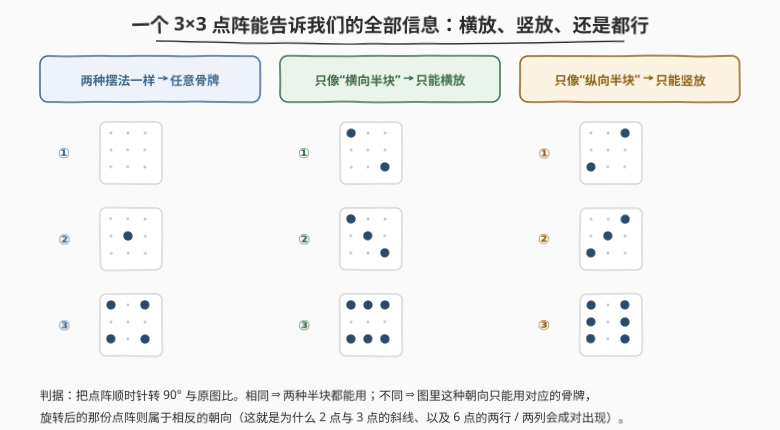
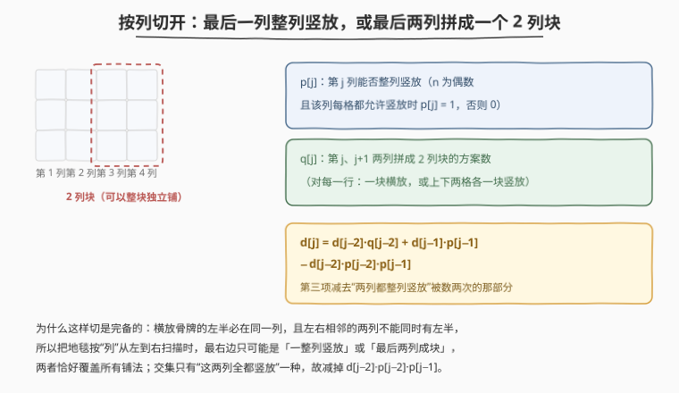
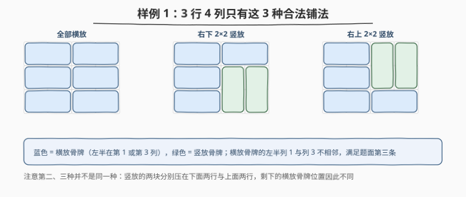

# Codeforces 77D 多米诺地毯计数 题解

## 1. 题目概述

- **题目链接**：https://codeforces.com/problemset/problem/77/D
- **比赛来源**：Codeforces Beta Round 69 (Div. 1 Only) · Problem D（UTC 2011-04-19）
- **难度**：2300
- **标签**：动态规划、按列分解、实现、计数
- **评测类型**：普通
- **限制**：时间 2 s / 内存 256 MB

**题意**：一块 $n\times m$ 的地毯，每个格子是「多米诺骨牌的一半」，可以在竖直朝向上使用，也可以在水平朝向上使用；有些半块两种朝向看起来一样。每个格子的图案由输入给出的 $3\times 3$ 点阵描述（`O` 有点、`.` 无点），格子之间用 `#` 分隔，整块地毯共 $4n+1$ 行、每行 $4m+1$ 个字符。

现在要用不可切割的 $1\times 2$ 骨牌铺满地毯：横放的骨牌要求它的两半都处于**水平**朝向，竖放的骨牌要求两半都处于**竖直**朝向；此外还有一条特殊限制：**若某块横放骨牌的左半在第 $j$ 列，则第 $j-1$、$j+1$ 列都不能再有横放骨牌的左半**。求铺法数对 $10^9+7$ 取模。骨牌数量无限。

**约束**：

- $n,m\le 250$，即最多 $62500$ 个格子，输入约 $10^6$ 个字符。允许 $O(nm)$ 的扫描与 DP，但不允许按格子做指数级搜索（$2^{nm}$ 或 $3^{n}$ 之类）。
- 每个格子只有 $3$ 种可能状态（见 3.2），这是把「$3^{nm}$ 种朝向组合」压成「按列 DP」的关键。
- 答案需要对 $10^9+7$ 取模：递推里有减法（去重），必须写成 `(x % MOD + MOD) % MOD`。
- 输入是固定的「$4n+1$ 行 × $4m+1$ 列」字符网格，第 $(1+4i)$ 行、第 $(1+4j)$ 列起的 $3\times3$ 才是第 $(i,j)$ 个格子。

## 2. 示例与观察

官方样例（输入 / 输出原样）：

```text
输入：
3 4
#################
#O..#...#O.O#...#
#.O.#.O.#.O.#...#
#..O#...#O.O#...#
#################
#O.O#OOO#O.O#...#
#.O.#...#...#.O.#
#O.O#OOO#O.O#...#
#################
#O.O#...#O.O#...#
#...#...#...#.O.#
#O.O#...#O.O#...#
#################

输出：
3
```

```text
输入：
2 2
#########
#O.O#O.O#
#.O.#...#
#O.O#O.O#
#########
#...#O.O#
#...#...#
#...#O.O#
#########

输出：
2
```

```text
输入：
2 2
#########
#..O#O..#
#...#...#
#O..#..O#
#########
#O..#..O#
#...#...#
#..O#O..#
#########

输出：
0
```

**样例 1 的演算**：把每个 $3\times 3$ 的 `O`/`.` 图案读出来，按 3.2 的判据分类，然后按列 DP 得到 3。三种铺法见 3.4 的插图：全部横放；左边两列横放、右边 $2\times 2$ 的两块竖放（压在下两行）；左边两列横放、右边 $2\times 2$ 的两块竖放（压在上两行）。还有第四种「第 1 行横放、下面两行在第 2、3 列横放、第 1 与第 4 列各一块竖放」在几何上也能铺满，但它同时用到左半列 1 与左半列 2（相邻），被题面第三条限制否掉——这条限制正是让答案从 4 变成 3 的原因。

**样例 2 的演算**：$2\times 2$，四个格子的图案分别是 5 点（四角 + 中心）、4 点（四角）、空、4 点（四角）——旋转 $90^\circ$ 都不变，所以四格都是「两种骨牌都能用」。于是「两行都横放」与「两列都竖放」两种铺法都合法，答案是 2。

**样例 3 的演算**：$2\times 2$，四格分别是斜线 2 点（反向）、斜线 2 点（正向）、斜线 2 点（正向）、斜线 2 点（反向）。斜线是有方向的：旋转 $90^\circ$ 会把「左上到右下」变成「左下到右上」，所以同一条斜线上的两格朝向相同、不同斜线的两格朝向相反。要横放就得整行两格都能横放（第一行是「反 + 正」，不行），要竖放就得整列两格都能竖放（第一列是「反 + 正」，也不行），于是答案是 0。

**观察**：

1. 每个格子能给出的信息只有「能横放」「能竖放」两个布尔值，而在本题的图案集合里，大多数格子两者都行（旋转 $90^\circ$ 后图案不变的，占 4 种点数：0、1、4、5 点）。
2. 横放骨牌必然占**相邻两列**，而「左半列两两不相邻」这条限制意味着：一旦某列出现横放骨牌，它的左右两列就不会再出现横放的**左半**。这条限制正是把地毯切成「单列」与「两列块」的依据。
3. 竖放骨牌天然只占一列内的两行，不跨列，所以不会破坏按列切分。

## 3. 解题思路

### 3.1 朴素做法与瓶颈

按格子暴搜：每个格子先决定朝向（横/竖），再枚举骨牌配对，状态数爆炸（$3^{nm}$ 量级）。$n=m=250$ 时完全不可能。

必须利用题目的两条结构性约束：骨牌只跨相邻两列（横）或同一列相邻两行（竖），且横放骨牌的左半列两两不相邻。后者把所有「跨列」的骨牌强行塞进互不相邻的列对里。

### 3.2 核心观察一：格子只有三种状态



判据极其简单：把该格的 $3\times3$ 点阵**顺时针旋转 $90^\circ$**，与原图比较。

- **旋转后相同**：这个半块在两种朝向下长得一样，横放、竖放都能用。本题图案里这样的有 4 种：0 点、1 点（正中）、4 点（四角）、5 点（四角 + 中心）。
- **旋转后不同**：图里给的这一份只能用在某一个朝向上，旋转后的那一份属于另一个朝向。例如 6 点的「上下两行各三点」是横向半块的样子，而「左右两列各三点」是纵向半块的样子；2 点、3 点的斜线也分「左上→右下」（横向）与「左下→右上」（纵向）。

因此每个格子归入三类之一：**任意**、**只能横**、**只能竖**。题面插图（“vertically rotated halves” 与 “horizontally rotated halves” 两张）把每种点数的横、纵排布都画出来了，照抄即可。

### 3.3 核心观察二：按列切成「单列」与「两列块」



从左往右扫描地毯，设 $j$ 是最左边还没铺的列。

- **情形 A：第 $j$ 列的每一格都由竖放骨牌覆盖**（于是整列自成一块，因为竖放骨牌不跨列）。这要求 $n$ 是偶数，且该列每格都「允许竖放」。
- **情形 B：第 $j$ 列有格子被横放骨牌覆盖**。那块横放骨牌的左半只能在第 $j$ 列（第 $j-1$ 列已经铺好，不能跨回来），于是第 $j$ 列出现了「左半」。由题面的第三条限制，第 $j+1$ 列不能再有横放骨牌的左半，因此第 $j+1$ 列的所有格子只能由「第 $j,j+1$ 列之间的横放骨牌」或「第 $j+1$ 列内部的竖放骨牌」覆盖——也就是说，**第 $j$、$j+1$ 两列组成一个封闭的 $2$ 列块**。

两种情形互斥且完备，于是可以定义：

- $p_j\in\{0,1\}$：第 $j$ 列能否整列竖放（$n$ 偶且该列每格都能竖放时取 1）；
- $q_j$：把第 $j$、$j+1$ 两列当作一个 $2\times n$ 的块来铺的方案数（块内允许横放骨牌跨这两列、允许竖放骨牌在某一列内占相邻两行）。

$q_j$ 用一次「逐行推进」的 profile DP 求：设 $f[r]$ 为块内前 $r$ 行铺满的方案数，$f[0]=1$，则

$$f[r]=\bigl[\text{两格都能横放}\bigr]\,f[r-1]+\bigl[\text{四格都能竖放}\bigr]\,f[r-2],$$

最后 $q_j=f[n]$。

再设 $d_j$ 为前 $j$ 列的铺法数，则

$$d_j=d_{j-2}\,q_{j-2}+d_{j-1}\,p_{j-1}-d_{j-2}\,p_{j-2}\,p_{j-1}.$$

前两项分别对应「最后两列成块」与「最后一列整列竖放」；交集是「第 $j-1$、$j$ 两列都整列竖放」这一种被数了两次的铺法，故减去 $d_{j-2}\,p_{j-2}\,p_{j-1}$。$d_0=1$，$d_1=p_0$，答案是 $d_m$。

### 3.4 样例 1 的三种铺法



| 铺法 | 结构 | 为什么合法 |
|---|---|---|
| 全部横放 | 每行两块横骨牌，左半在第 1、3 列 | 左半列 1 与 3 不相邻 |
| 右下 $2\times2$ 竖放 | 左两列横放；第 3、4 列的下两行各一块竖放，右上两格横放 | 竖放骨牌不跨列；横放左半只在第 1、3 列 |
| 右上 $2\times2$ 竖放 | 左两列横放；第 3、4 列的上两行各一块竖放，右下两格横放 | 同上 |

三种铺法都恰好覆盖每个格子一次，且横放骨牌的左半列集合都是 $\{1,3\}$（互不相邻）。若把「右两列横放、左两列竖放」之类的方案试一遍就会发现：$n=3$ 是奇数，任何一列都无法整列竖放，所以左两列只能横放——这正是 $p_j$ 全为 0 的体现。

## 4. 正确性证明

**引理 1（格子状态判据）**：对任一格子的点阵 $P$，若把 $P$ 顺时针旋转 $90^\circ$ 得到 $P'$，则 $P$ 能作为横向半块当且仅当 $P'$ 能作为纵向半块；特别地 $P'=P$ 时两种朝向都能用。

**证明**：一块半块只有「横向」「纵向」两种摆放，二者相差一个 $90^\circ$ 旋转（题面插图里横向与纵向的每种点数图案正是互为旋转的关系）。所以物理上同一个半块在另一朝向下呈现的图案就是 $P'$。若 $P'=P$，两种朝向呈现同一张图，无法也无需区分；若 $P'\ne P$，则输入给的 $P$ 只对应其中一种朝向。∎

**引理 2（列分解完备且互斥）**：任一合法铺法都可以唯一地按 3.3 的方式从左到右切成若干个「单列块」与「两列块」，每个块内部的骨牌不跨出块。

**证明**：设 $j$ 是当前最左未铺列。若第 $j$ 列全由竖放骨牌覆盖，则这些骨牌不跨列，第 $j$ 列自成一块，删去后继续。否则第 $j$ 列有格子被横放骨牌覆盖；该骨牌的左半不可能在第 $j-1$ 列（第 $j-1$ 列已铺满），故必在第 $j$ 列，即第 $j$ 列出现了「左半」。由题面第三条限制，第 $j+1$ 列不能有横放骨牌的左半，于是第 $j+1$ 列的格子只能由「跨第 $j,j+1$ 列的横放骨牌」（其左半在第 $j$ 列）或「第 $j+1$ 列内部的竖放骨牌」覆盖，两列封闭成块。两种情形按定义互斥，切法唯一。∎

**引理 3（$q_j$ 的 profile DP 正确）**：$f[r]$ 递推给出的 $f[n]$ 等于 $2\times n$ 块内所有合法铺法数。

**证明**：块内最上面的未铺行 $r$：要么被一块横放骨牌覆盖（占第 $j,j+1$ 列的第 $r$ 行，要求这两格都允许横放，对应 $f[r-1]$），要么被两块竖放骨牌覆盖（分别占第 $j$、$j+1$ 列的第 $r-1,r$ 行，要求四格都允许竖放，对应 $f[r-2]$）。两类互斥且完备，故递推成立。∎

**引理 4（去重项正确）**：$d_{j-2}q_{j-2}$ 与 $d_{j-1}p_{j-1}$ 的公共部分恰为 $d_{j-2}p_{j-2}p_{j-1}$。

**证明**：第一项描述「前 $j-2$ 列任意铺 + 第 $j-1,j$ 列成块」，第二项描述「前 $j-1$ 列任意铺 + 第 $j$ 列整列竖放」。二者同时成立，当且仅当第 $j-1$ 列与第 $j$ 列都整列竖放（此时「块」的铺法只有唯一一种），并且前 $j-2$ 列任意铺，故公共部分为 $d_{j-2}\cdot p_{j-2}\cdot p_{j-1}$。∎

**定理**：$d_m$ 等于合法铺法数模 $10^9+7$。

**证明**：对列数归纳。$m=0$ 时 $d_0=1$；$m=1$ 时唯一可能是整列竖放，$d_1=p_0$，正确。设 $d_{j-1},d_{j-2}$ 正确，由引理 2 任一铺法的最右块只有两种形态，计数分别是 $d_{j-2}q_{j-2}$ 与 $d_{j-1}p_{j-1}$（引理 3 保证块内计数正确），由引理 4 去掉重复后不重不漏，故 $d_j$ 正确。∎

## 5. 复杂度分析

- **时间**：读入 $O(nm)$；对每对相邻列做一次 $O(n)$ 的 profile DP，共 $O(nm)$；递推 $O(m)$。总计 $O(nm)\le 6.3\times 10^4$ 次状态转移，非常轻。
- **空间**：输入网格 $O(nm)$ 个字符（约 $10^6$ 字节），两个 $n\times m$ 的布尔表，profile 数组 $O(n)$。远低于 256 MB。
- **与时限的关系**：2 s 的时限对 $O(nm)$ 有极大余量。实测 $n=m=250$ 的极限数据（全部格子都「两种都行」，答案 $779078021$）C++ 约 $140$ ms、Python 约 $210$ ms（含进程启动）。

## 6. 参考代码

### C++17

```cpp
#include <bits/stdc++.h>
using namespace std;

static const long long MOD = 1000000007LL;

// 3x3 点阵顺时针旋转 90 度
static array<string, 3> rot90(const array<string, 3>& g) {
    array<string, 3> r{"...", "...", "..."};
    for (int i = 0; i < 3; ++i)
        for (int j = 0; j < 3; ++j) r[i][j] = g[2 - j][i];
    return r;
}

int main() {
    ios::sync_with_stdio(false);
    cin.tie(nullptr);

    int n, m;
    if (!(cin >> n >> m)) return 0;
    int H = 4 * n + 1, W = 4 * m + 1;
    vector<string> g(H);
    for (int i = 0; i < H; ++i) cin >> g[i];

    // 题面插图给出的“横向摆放的半块”：斜线 3 点、斜线 2 点、上下两行各 3 点
    const set<array<string, 3>> horiz = {
        array<string, 3>{"O..", ".O.", "..O"},
        array<string, 3>{"O..", "...", "..O"},
        array<string, 3>{"OOO", "...", "OOO"},
    };

    vector<vector<char>> canH(n, vector<char>(m, 0)), canV(n, vector<char>(m, 0));
    for (int i = 0; i < n; ++i)
        for (int j = 0; j < m; ++j) {
            array<string, 3> blk;
            for (int r = 0; r < 3; ++r) blk[r] = g[1 + 4 * i + r].substr(1 + 4 * j, 3);
            array<string, 3> rr = rot90(blk);
            if (rr == blk) {                     // 两种摆法一样：任意骨牌都能用
                canH[i][j] = canV[i][j] = 1;
            } else if (horiz.count(blk)) {        // 只能当横向半块
                canH[i][j] = 1;
            } else {                              // 只能当纵向半块
                canV[i][j] = 1;
            }
        }

    // p[j]: 第 j 列能否整列竖放
    vector<long long> p(m, 0);
    for (int j = 0; j < m; ++j) {
        if (n % 2) { p[j] = 0; continue; }
        bool ok = true;
        for (int i = 0; i < n; ++i) if (!canV[i][j]) { ok = false; break; }
        p[j] = ok ? 1 : 0;
    }

    // q[j]: 第 j、j+1 两列拼成一个 2 列块的方案数
    vector<long long> q(max(m - 1, 0), 0);
    for (int j = 0; j + 1 < m; ++j) {
        vector<long long> f(n + 1, 0);
        f[0] = 1;
        for (int r = 1; r <= n; ++r) {
            long long cur = 0;
            if (r >= 2 && canV[r - 1][j] && canV[r - 2][j] && canV[r - 1][j + 1] && canV[r - 2][j + 1])
                cur += f[r - 2];
            if (canH[r - 1][j] && canH[r - 1][j + 1])
                cur += f[r - 1];
            f[r] = cur % MOD;
        }
        q[j] = f[n];
    }

    vector<long long> d(m + 1, 0);
    d[0] = 1;
    for (int j = 1; j <= m; ++j) {
        long long val = 0;
        if (j >= 2) val += d[j - 2] * q[j - 2];
        val += d[j - 1] * p[j - 1];
        if (j >= 2) val -= d[j - 2] * p[j - 2] * p[j - 1];
        d[j] = ((val % MOD) + MOD) % MOD;
    }
    cout << d[m] % MOD << '\n';
    return 0;
}
```

### Python3

```python
import sys

MOD = 10 ** 9 + 7
# 题面插图里“横向摆放的半块”对应的 3x3 点阵
HORIZ = {("O..", ".O.", "..O"), ("O..", "...", "..O"), ("OOO", "...", "OOO")}


def rot90(g):
    return tuple("".join(g[2 - j][i] for j in range(3)) for i in range(3))


def main() -> None:
    data = sys.stdin.buffer.read().split()
    if not data:
        return
    n, m = int(data[0]), int(data[1])
    grid = [row.decode() for row in data[2:2 + 4 * n + 1]]

    can_h = [[False] * m for _ in range(n)]
    can_v = [[False] * m for _ in range(n)]
    for i in range(n):
        for j in range(m):
            blk = tuple(grid[1 + 4 * i + r][1 + 4 * j:4 + 4 * j] for r in range(3))
            if rot90(blk) == blk:
                can_h[i][j] = can_v[i][j] = True
            elif blk in HORIZ:
                can_h[i][j] = True
            else:
                can_v[i][j] = True

    p = [0] * m
    for j in range(m):
        if n % 2 == 0 and all(can_v[i][j] for i in range(n)):
            p[j] = 1

    q = [0] * max(m - 1, 0)
    for j in range(m - 1):
        f = [0] * (n + 1)
        f[0] = 1
        for r in range(1, n + 1):
            cur = 0
            if r >= 2 and can_v[r - 1][j] and can_v[r - 2][j] and can_v[r - 1][j + 1] and can_v[r - 2][j + 1]:
                cur += f[r - 2]
            if can_h[r - 1][j] and can_h[r - 1][j + 1]:
                cur += f[r - 1]
            f[r] = cur % MOD
        q[j] = f[n]

    d = [0] * (m + 1)
    d[0] = 1
    for j in range(1, m + 1):
        val = d[j - 1] * p[j - 1]
        if j >= 2:
            val += d[j - 2] * q[j - 2] - d[j - 2] * p[j - 2] * p[j - 1]
        d[j] = val % MOD
    sys.stdout.write(str(d[m] % MOD) + "\n")


main()
```

两份代码逻辑一致，可原样提交。注意 Python 的 `val % MOD` 对负数自动给出非负余数，C++ 侧则要显式 `((val % MOD) + MOD) % MOD`。

## 7. 边界情况与易错点

1. **$n$ 为奇数**：任何一列都不可能整列竖放（竖放骨牌占两行），所以所有 $p_j=0$，$d_j$ 只能靠两列块推进；$m=1$ 且 $n$ 奇数时答案必然是 0。
2. **$m=1$**：没有「两列块」，答案只由 $p_0$ 决定（$n$ 偶且该列都能竖放时为 1，否则 0）。代码里 `q` 数组长度取 `max(m-1, 0)`，且递推只在 `j >= 2` 时才用 $q$，避免越界。
3. **输入解析偏移**：第 $(i,j)$ 个格子的 $3\times3$ 从第 `1+4i` 行、第 `1+4j` 列开始，步长是 4 而不是 3（中间夹着 `#` 分隔符）。行数 $4n+1$、列数 $4m+1$，写成 $3n+1$ 就会整体错位。
4. **状态判据不能只看点数**：0、1、4、5 点的图案旋转 $90^\circ$ 不变（任意），但 2、3 点的斜线是**有方向**的，6 点更是分「两行」与「两列」两种。样例 3 就是专门用来卡「只看点数」的写法：四格都是 2 点，却因为斜线方向相反导致无解。
5. **取模后的减法**：`val -= d[j-2] * p[j-2] * p[j-1]` 可能让 `val` 变成负数，C++ 必须先加 `MOD`；Python 的 `%` 天然非负，但仍建议统一写 `% MOD`。
6. **profile DP 的两个条件都要查**：横放要求**两格**都能横放，竖放要求**四格**都能竖放（两块骨牌各占一列的两行）。只查一半会把不该铺的格子算进去。
7. **`p[j]` 与 `q[j]` 的下标约定**：$p$ 以「列」为下标，$q$ 以「左列」为下标，递推里用的是 $q_{j-2}$（对应第 $j-1,j$ 两列）。这类"差一"是本题最容易出的错，建议用样例 2（答案 2）与样例 3（答案 0）双向验证。
8. **答案规模**：$250\times 250$ 全「任意」格子的答案对 $10^9+7$ 取模后是 `779078021`，说明中间量必须全程取模，不能等到最后再取。
9. **大输入的读入**：$10^6$ 个字符，C++ 用 `cin` 关同步即可，Python 用 `read().split()`（按空白切分自动跳过换行）。

## 8. 验证记录

- **编译环境与命令**：本机无 GNU `g++`，用 `clang++ -std=c++17 -O2` 配 `codeforces/tools/include/bits/stdc++.h` 兼容头编译（可原样提交 GNU C++17）；Python 为系统 `python3`。
- **官方样例**：3 / 3 通过（`3`、`2`、`0`），C++ 与 Python 输出一致。
- **文档与样例一致性**：`check_samples.py --only 0001-0100/77` 0 问题；`check.py codeforces/contests/0001-0100/77` 0 失败。
- **独立暴力对拍（320 组）**：另写一份**逐格回溯枚举铺法**的独立程序（从最小未覆盖格子出发，尝试横放/竖放，并用「每列横放左半计数」检查第三条限制），完全不用按列 DP。随机生成 $n\le 4$、$m\le 5$ 且 $nm\le 16$ 的地毯，格子图案从 10 种合法点阵里随机抽取（含两种权重方案，偏向「任意」格以产生较大答案），共 **320 组**与参考程序比对，**全部一致**。另外单独核对了 $n=m=4$ 全「四角 4 点」的 29 种铺法、$1\times 1$（0 种）等边界。
- **状态分类的来源与校验**：三种状态的具体归属由题面插图（横向半块 / 纵向半块两张图）确定；据此本文的样例 3 得到 0、样例 2 得到 2，与官方输出一致，说明分类没有整体弄反。
- **最大约束性能**：$n=m=250$、全部格子为「四角 4 点」（两种朝向都行）的极限输入，答案 `779078021`，C++ 端到端约 $140$ ms、Python 约 $210$ ms（C++ 与 Python 结果相同）。相对 2 s 时限余量在 $30$ 倍以上。
- **图片校验**：三张 SVG（`cf77d_cell_states.svg`、`cf77d_block_decomp.svg`、`cf77d_sample1.svg`）通过 `xml.etree.ElementTree.parse`；图 3 的三种铺法还用小脚本逐格核对过「每格恰好被覆盖一次」。文字包围盒按字符宽度估算，全部落在 `viewBox` 内。
- **公式校验**：正文公式经 KaTeX（`throwOnError: true`）渲染无报错。
- **复核状态**：verified（样例、暴力对拍、性能、图片、公式五项均实跑通过）。

## 相关题目与扩展

- [Codeforces 77C Beavermuncher-0xFF](https://codeforces.com/problemset/problem/77/C)：同场 C 题，同样把大问题按「子树 / 列」切开做 DP。
- [Codeforces 1182D Complete Mirror](https://codeforces.com/problemset/problem/1182/D)：结构与限制驱动建模的题，适合练习"先把状态压缩再 DP"。
- [Codeforces 1036C Classy Numbers](https://codeforces.com/problemset/problem/1036/C)：数位 DP 入门，和本题的 profile DP 一样属于"按位置推进、状态很小"。
- [Codeforces 1195D2 Submarine in the Rybinsk Sea](https://codeforces.com/problemset/problem/1195/D2)：按位置拆分贡献的计数题。
- [LeetCode 790. 多米诺和托米诺平铺](https://leetcode.cn/problems/domino-and-tromino-tiling/)：$2\times n$ 骨牌铺法的经典递推，与本题的 $2$ 列块 profile DP 是同一套思路。
- [LeetCode 1240. 铺瓷砖](https://leetcode.cn/problems/tiling-a-rectangle-with-the-fewest-squares/)：同样是铺砖，但目标变成最小块数，可用完全不同的搜索/DP 解决。

**延伸思考**：

1. **如果没有「左半列不能相邻」这条限制**：横放骨牌就能出现在任意相邻列，此时按列切分不再封闭（第 $j$、$j+1$ 列的块可能与第 $j+1,j+2$ 列的块重叠），DP 要升级成带「上一列是否有右半」的轮廓线状态，复杂度仍是 $O(nm)$ 但状态变多。
2. **如果骨牌改成 $1\times 3$**：块宽度变成 3，限制也会随之变化，递推要改成 $d_j=\sum_{k=1}^{3}d_{j-k}q^{(k)}_{j-k}$，并处理更复杂的重复计数——这提示「块的宽度」与「限制的跨度」是这类计数题的骨架。
3. **如果允许骨牌旋转后两半朝向不同**（即半块可以「半横半竖」）：那么格子状态会从 3 种变成 4 种（含"两半可不同"的配对关系），profile DP 需要对「这一格被哪种骨牌、哪一半占用」建模，状态数翻倍。
4. **计数结果对模数敏感**：$10^9+7$ 是质数，本题只用加减乘，不需要逆元；若题目改成「求期望」或「求方案数的阶乘权重」，就要引入逆元与更复杂的组合量。
5. **与「完美匹配」的关系**：把每个格子看成一个顶点、每块骨牌看成一条边，合法铺法就是网格图的一个完美匹配，额外限制是"同向边不能相邻"。若没有额外限制，铺法数就是网格图的完美匹配数（可用 Kasteleyn 行列式或轮廓线 DP 计算），本题的限制恰好让它退化成「按列分块」的简单递推。
