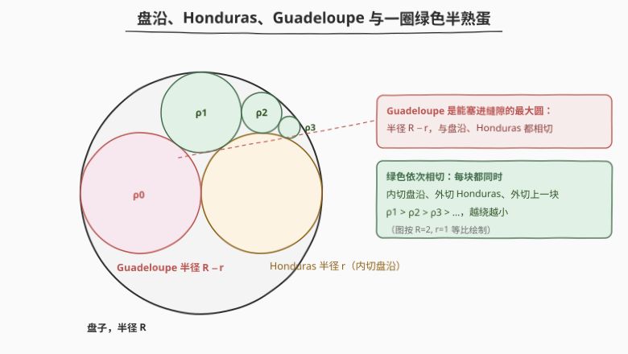
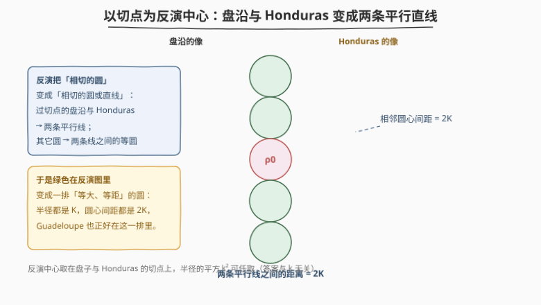
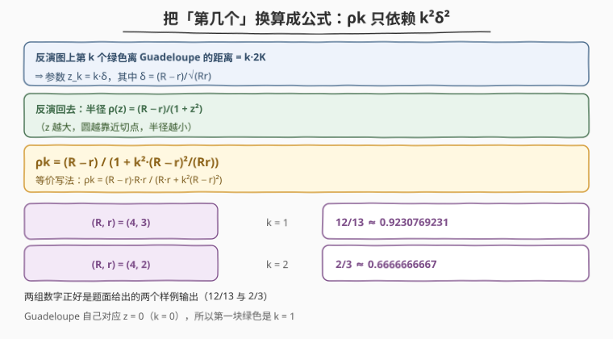

# Codeforces 77E 火星美食与切圆链 题解

## 1. 题目概述

- **题目链接**：https://codeforces.com/problemset/problem/77/E
- **比赛来源**：Codeforces Beta Round 69 (Div. 1 Only) · Problem E（UTC 2011-04-19）
- **难度**：2800
- **标签**：几何、反演变换、圆链、数学推导
- **评测类型**：普通（浮点答案按 $10^{-6}$ 误差判定）
- **限制**：时间 1 s / 内存 256 MB

**题意**：一块半径 $R$ 的黑色盘子（薄饼状）上依次放圆形食材：

1. 「Honduras 黄金」半径 $r$，完全在盘内并尽可能贴近盘沿——即**内切**于盘沿；
2. 「Guadeloupe 粉红」不与 Honduras 重叠、不越出盘沿，且半径**最大**（于是它内切盘沿、外切 Honduras）；
3. 第一块「绿色斗牛梗」与 Honduras、Guadeloupe 都接触，不越界，半径最大；
4. 之后每一块绿色都必须同时接触 Honduras、上一块绿色，并内切盘沿。

给定 $R,r$ 与 $k$（$1\le r<R\le 10^4$，$1\le k\le 10^4$），求**第 $k$ 块绿色**的半径，绝对或相对误差 $\le 10^{-6}$。共 $t\le 10^4$ 组。

**约束**：

- $t\le 10^4$ 且 $k$ 可达 $10^4$：每组都"逐块推下去"要做 $10^8$ 次迭代，且每步浮点误差累积，不可行。必须每组 $O(1)$ 的闭式。
- 答案可以非常小：$R=10^4,\ r=1,\ k=10^4$ 时半径约 $1.05\times10^{-8}$，但误差判据是**相对或绝对**误差任达其一即可，所以 $10^{-6}$ 的绝对误差对极小答案也够用。
- $r<R$ 保证 Guadeloupe 存在且半径 $R-r>0$，链可以无限延伸（半径严格递减但不为 0）。

## 2. 示例与观察

官方样例（输入 / 输出原样）：

```text
输入：
2
4 3 1
4 2 2

输出：
0.9230769231
0.6666666667
```

**第 1 组 $(R,r,k)=(4,3,1)$ 的演算**：结论公式（见 3.3）是

$$\rho_k=\frac{(R-r)\,R\,r}{R\,r+k^{2}(R-r)^{2}} .$$

代入 $R=4,r=3,k=1$：$(R-r)Rr = 1\cdot 4\cdot 3 = 12$，分母 $12+1\cdot 1^{2}=13$，得 $\rho_1 = 12/13 = 0.9230769231$，与样例一致。

**第 2 组 $(4,2,2)$ 的演算**：$(R-r)Rr = 2\cdot 8 = 16$，分母 $8 + 4\cdot 4 = 24$，得 $\rho_2 = 16/24 = 2/3 = 0.6666666667$，一致。

自造样例（标注「自造」，覆盖极端参数）：

| 输入行 | 公式值 | 说明 |
|---|---|---|
| `2 1 1` | 0.6666666667 | 最小合法参数，$(R-r)=1,\ Rr=2$，分母 $2+1=3$ |
| `10 1 1` | 0.9890109890 | $\delta$ 很大，第一块绿色仍接近 $R-r=9$ |
| `4 3 2` | 0.7500000000 | 同一 $R,r$，只是 $k$ 从 1 变 2 |
| `10000 1 10000` | 0.0000000100 | 极限参数，半径约 $1.0\times10^{-8}$ |
| `10000 9999 1` | 0.9999999900 | $R-r=1$ 且 $Rr\approx10^8$，第一块几乎贴满缝隙 |

**观察**：

1. **Guadeloupe 的半径是 $R-r$**。设某圆圆心 $P$、半径 $\rho$，则它要在盘内（$|OP|\le R-\rho$）且不压 Honduras（$|GP|\ge \rho+r$）。由三角不等式 $|GP|\le|GO|+|OP|\le (R-r)+(R-\rho)$，故 $\rho+r\le 2R-r-\rho$，即 $\rho\le R-r$；取 Honduras 的正对面那个位置恰好取等。所以 Guadeloupe 就是这块"最大缝隙圆"。
2. 之后所有绿色都内切盘沿、外切 Honduras，所以它们的圆心都满足 $|OP|+PG = (R-\rho)+(r+\rho)=R+r$——圆心落在以盘子中心与 Honduras 中心为焦点的**同一个椭圆**上，且半径由位置唯一决定（$\rho = R-|OP|$）。这解释了为什么它们会沿着缝隙绕一圈、越绕越小。
3. 直接在这个椭圆上算"下一个与上一个相切"的位置，要解一个含三角函数的方程，误差会逐块累积；而下面的反演把整条链变成**等距的一排等圆**，第 $k$ 块的位置一目了然。

## 3. 解题思路

### 3.1 朴素做法与瓶颈

最直接的做法是逐块数值求解：已知上一块圆心 $P_{i-1}$、半径 $\rho_{i-1}$，求满足

$$|OP|=R-\rho,\qquad |GP|=r+\rho,\qquad |PP_{i-1}|=\rho+\rho_{i-1}$$

的 $\rho$（三个方程、三个未知量，其中前两个把圆心限制在椭圆上的两个位置，第三个是 $\rho$ 的方程）。每组要做 $k$ 次这样的求解，$t\cdot k$ 可达 $10^{8}$，而且每次求解的误差会沿链累积（$k=10^4$ 时相对误差可能被放大几个数量级）。这在 1 s 内既不快也不稳。

### 3.2 核心观察：以切点为中心做反演



关键事实是**盘沿与 Honduras 相切**（Honduras 内切于盘沿）。设切点为 $T$。以 $T$ 为心、任意实数 $\kappa>0$ 为半径做反演

$$(r,\varphi)\longmapsto\Bigl(\frac{\kappa^{2}}{r},\varphi\Bigr),$$

它把"过 $T$ 的圆或直线"与"不过 $T$ 的直线"互相转换，并且**保持相切关系**。

取坐标系使 $T$ 为原点、盘心在 $(R,0)$、Honduras 心在 $(r,0)$。于是

- 盘沿（过 $T$，半径 $R$）→ 直线 $x=\dfrac{\kappa^{2}}{2R}$；
- Honduras（过 $T$，半径 $r$）→ 直线 $x=\dfrac{\kappa^{2}}{2r}$，因为 $r<R$，它在更外侧；
- 任何**同时内切盘沿、外切 Honduras** 的圆（不含 $T$）→ 一条**同时切这两条平行线**的圆。



两条平行线间距为 $\dfrac{\kappa^{2}}{2r}-\dfrac{\kappa^{2}}{2R}=\dfrac{\kappa^{2}(R-r)}{2Rr}$，所以这些像圆**半径全都相同**：

$$K=\frac{\kappa^{2}(R-r)}{4Rr},$$

圆心全在中线 $x=c$ 上，$c=\dfrac{\kappa^{2}(R+r)}{4Rr}$。于是：

- 绿色彼此相切 ⇔ 像圆彼此相切 ⇔ 圆心纵坐标相差恰好 $2K$；
- Guadeloupe 也内切盘沿、外切 Honduras，所以它的像也在这排等圆里；把它取作 $y=0$；
- 第 $k$ 块绿色就是 $y_k=k\cdot 2K$（往任一侧数都一样，半径相同）。

### 3.3 从反演图回到原图：半径公式

一个不过反演中心、圆心距中心 $d$、半径 $\rho$ 的圆，其像是圆心距 $d'=\dfrac{\kappa^{2}d}{d^{2}-\rho^{2}}$、半径 $\rho'=\dfrac{\kappa^{2}\rho}{d^{2}-\rho^{2}}$ 的圆。反过来用（已知像、求原像）：

$$\rho=\frac{\kappa^{2}\rho'}{d'^{2}-\rho'^{2}} .$$

对第 $k$ 块绿色，像圆圆心 $(c,\,y_k)$、半径 $K$，故 $d'^{2}-\rho'^{2}=c^{2}+y_k^{2}-K^{2}$，而

$$c^{2}-K^{2}=\frac{\kappa^{4}\bigl[(R+r)^{2}-(R-r)^{2}\bigr]}{16R^{2}r^{2}}=\frac{\kappa^{4}}{4Rr}.$$

代入并整理：

$$\rho_k=\frac{\kappa^{2}K}{\dfrac{\kappa^{4}}{4Rr}+y_k^{2}}
=\frac{R-r}{1+\dfrac{4Rr\,y_k^{2}}{\kappa^{4}}} .$$

再引入无量纲参数

$$z=\frac{2\sqrt{Rr}}{\kappa^{2}}\,y ,$$

就有干净的

$$\rho(z)=\frac{R-r}{1+z^{2}},\qquad z_k=k\,\delta,\qquad \delta=\frac{R-r}{\sqrt{Rr}} .$$

其中 $z_k=k\delta$ 是因为 $y_k=k\cdot2K=k\cdot\dfrac{\kappa^{2}(R-r)}{2Rr}$，乘上系数后步长正好是 $\dfrac{R-r}{\sqrt{Rr}}$。Guadeloupe 对应 $y=0$，即 $z=0$，半径 $\rho(0)=R-r$，与观察 1 完全吻合。

最终公式：

$$\boxed{\ \rho_k=\frac{(R-r)\,R\,r}{R\,r+k^{2}(R-r)^{2}}\ }$$

### 3.4 样例走查



| 参数 | $\delta^{2}=(R-r)^2/(Rr)$ | $k^{2}\delta^{2}$ | $\rho_k=(R-r)/(1+k^2\delta^2)$ |
|---|---|---|---|
| $R=4,\ r=3,\ k=1$ | $1/12$ | $1/12$ | $1/(1+1/12)=12/13\approx0.9230769231$ |
| $R=4,\ r=2,\ k=2$ | $4/8=0.5$ | $4\times0.5=2$ | $2/(1+2)=2/3\approx0.6666666667$ |

两组都与题面输出逐位一致。也可以这样自查：$k=0$ 时公式给出 $R-r$（Guadeloupe 的半径），$k$ 增大时半径单调减小并趋于 0，符合"越绕越小"的直觉。

## 4. 正确性证明

**引理 1（Guadeloupe 的半径）**：同时满足"在盘内""不与 Honduras 重叠"的圆，半径不超过 $R-r$，且 $R-r$ 可以取到。

**证明**：设圆心 $P$、半径 $\rho$。条件为 $|OP|\le R-\rho$ 与 $|GP|\ge\rho+r$。由 $|OG|=R-r$ 与三角不等式，
$$\rho+r\le|GP|\le|GO|+|OP|\le(R-r)+(R-\rho)\ \Longrightarrow\ 2\rho\le 2R-2r\ \Longrightarrow\ \rho\le R-r .$$
取 $P$ 在射线 $GO$ 的延长线上、$|OP|=r$（即 Honduras 的正对面最远处）：则 $|GP|=R-r+r=R=\rho+r$，且 $|OP|=r=R-(R-r)$，两个条件都取等，故最大半径恰为 $R-r$。∎

**引理 2（反演的像）**：以切点 $T$ 为心、$\kappa$ 为半径反演，盘沿与 Honduras 的像分别是直线 $x=\kappa^{2}/(2R)$ 与 $x=\kappa^{2}/(2r)$；任何内切盘沿、外切 Honduras 且不含 $T$ 的圆，其像是半径 $K=\kappa^{2}(R-r)/(4Rr)$、圆心在中线 $x=c=\kappa^{2}(R+r)/(4Rr)$ 上的圆。

**证明**：过反演中心的圆（盘沿、Honduras 都过 $T$）的像是不过中心的直线：盘沿上的点满足 $x^{2}+y^{2}=2Rx$，代入反演 $x\mapsto\kappa^{2}x/(x^{2}+y^{2})$ 得像满足 $x'=\kappa^{2}/(2R)$，同理 Honduras 给出 $x'=\kappa^{2}/(2r)$。相切关系在反演下保持（反演是保角的双射），所以与该两圆都相切的圆，其像与两条平行线都相切，即半径等于半间距 $K$、圆心在中线上。∎

**引理 3（等距性）**：绿色彼此相切当且仅当其像圆圆心纵坐标之差的绝对值为 $2K$；Guadeloupe 的像也在这排等圆中，位于 $y=0$。

**证明**：像圆半径全为 $K$、圆心都在同一条竖直线 $x=c$ 上，两圆相切（外切）当且仅当圆心距等于半径之和 $2K$，即纵坐标差 $2K$。Guadeloupe 内切盘沿、外切 Honduras，由引理 2 它的像也满足"半径 $K$、圆心在中线上"，故属于这排等圆；平移纵坐标令它为 $y=0$ 即可。∎

**引理 4（原像半径）**：若像圆圆心为 $(c,y)$、半径 $K$，则原像半径为 $\rho=\dfrac{R-r}{1+4Rr\,y^{2}/\kappa^{4}}$。

**证明**：对半径 $\rho$、圆心距 $d$ 的圆，反演的像是 $d'=\kappa^{2}d/(d^{2}-\rho^{2})$、$\rho'=\kappa^{2}\rho/(d^{2}-\rho^{2})$，两式相除并解出 $\rho=\kappa^{2}\rho'/(d'^{2}-\rho'^{2})$（$d'^{2}>\rho'^{2}$ 因为原像不过反演中心）。这里 $d'^{2}-\rho'^{2}=c^{2}+y^{2}-K^{2}$，而
$$c^{2}-K^{2}=\frac{\kappa^{4}}{16R^{2}r^{2}}\bigl[(R+r)^{2}-(R-r)^{2}\bigr]=\frac{\kappa^{4}}{4Rr},$$
代入 $\rho'=K=\kappa^{2}(R-r)/(4Rr)$：
$$\rho=\frac{\kappa^{2}K}{\kappa^{4}/(4Rr)+y^{2}}=\frac{\kappa^{4}(R-r)/(4Rr)}{\kappa^{4}/(4Rr)+y^{2}}=\frac{R-r}{1+4Rr\,y^{2}/\kappa^{4}} .$$

∎

**定理（公式正确）**：第 $k$ 块绿色的半径恰为 $\rho_k=\dfrac{(R-r)Rr}{Rr+k^{2}(R-r)^{2}}$。

**证明**：由引理 2、3，第 $k$ 块绿色的像在 $y_k=k\cdot2K$（Guadeloupe 记为第 0 块，第一块绿色 $k=1$）。代入引理 4：
$$\rho_k=\frac{R-r}{1+\dfrac{4Rr\,(2kK)^{2}}{\kappa^{4}}}=\frac{R-r}{1+\dfrac{4Rr}{\kappa^{4}}\cdot\dfrac{k^{2}\kappa^{4}(R-r)^{2}}{R^{2}r^{2}}}=\frac{R-r}{1+\dfrac{k^{2}(R-r)^{2}}{Rr}}=\frac{(R-r)Rr}{Rr+k^{2}(R-r)^{2}} .$$
注意整个推导中 $\kappa$ 只以 $\kappa^{2}/\kappa^{2}$ 的形式出现、最终完全约掉，说明结果与反演半径的选择无关。∎

## 5. 复杂度分析

- **时间**：每组 $O(1)$：两次乘法求分母、一次除法，$t=10^4$ 组总量不到 $10^5$ 次浮点运算。
- **空间**：$O(1)$。
- **数值范围与精度**：$k^{2}(R-r)^{2}\le 10^{8}\cdot 10^{8}=10^{16}$，$Rr\le10^8$，都在 `double` 的精确整数范围（$<2^{53}\approx9\times10^{15}$ 的边界附近，但即使超出也只损失相对 $10^{-16}$ 的精度）内，最终除法的相对误差约 $10^{-16}$，与 $10^{-6}$ 的要求相差十个数量级。**不要用 `float`**（只有 24 位有效位，相对误差 $10^{-7}$，在 $10^{-6}$ 判据下太危险）。
- **与时限的关系**：1 s 的时限对 $O(t)$ 有极大余量，实测 $t=10^4$ 组端到端约 60 ms（含输入输出与进程启动）。

## 6. 参考代码

### C++17

```cpp
#include <bits/stdc++.h>
using namespace std;

int main() {
    ios::sync_with_stdio(false);
    cin.tie(nullptr);

    int t;
    if (!(cin >> t)) return 0;
    cout << fixed << setprecision(10);
    while (t--) {
        long long R, r, k;
        cin >> R >> r >> k;
        double d = (double)(R - r);
        double num = d * (double)R * (double)r;
        double den = (double)R * (double)r + (double)k * (double)k * d * d;
        cout << num / den << '\n';
    }
    return 0;
}
```

### Python3

```python
import sys


def main() -> None:
    data = sys.stdin.buffer.read().split()
    if not data:
        return
    t = int(data[0])
    pos = 1
    out = []
    for _ in range(t):
        R = int(data[pos]); r = int(data[pos + 1]); k = int(data[pos + 2]); pos += 3
        d = R - r
        out.append("%.10f" % (d * R * r / (R * r + k * k * d * d)))
    sys.stdout.write("\n".join(out) + "\n")


main()
```

两份代码都只用标准库，可原样提交；Python 的整数运算不会溢出，除法与格式化顺序与 C++ 一致，实测 $10^4$ 组输出逐字相同。

## 7. 边界情况与易错点

1. **$k$ 从 1 开始**：Guadeloupe 是"第 0 块"（$z=0$，半径 $R-r$），第一块绿色才是 $k=1$。若把公式写成 $(k+1)$ 或把 $k$ 当成 0 起始，两道样例都会错。
2. **$r\to R$（缝隙极窄）**：$R-r=1$ 时所有半径都在 $1$ 附近（如 $R=10^4,r=9999,k=1$ 得 $0.99999999$），此时 $Rr$ 与 $k^2(R-r)^2$ 都可能达到 $10^8$ 量级，必须用 `double` 而不是 `float`，且不要用"面积相减"之类的写法引入相消误差。
3. **$k$ 很大（$10^4$）**：$k^{2}(R-r)^{2}$ 可达 $10^{16}$，公式形如 $\dfrac{\text{小}}{\text{大}}$，答案可到 $10^{-8}$。此时**绝对**误差判据起作用（$10^{-6}$），输出 $0.0000000105$ 依然合格；但不能为了"看起来精确"改写成逐块迭代。
4. **不要逐块迭代**：每步求解都含浮点开方与除法，$10^4$ 块的误差会累积到不可控；而且 $t\cdot k=10^8$ 也不划算。本题的全部技巧就是把链变成闭式。
5. **反演半径 $\kappa$ 的任意性**：推导里 $\kappa$ 完全约掉，若在实现中保留 $\kappa$ 并取具体值（比如 $\kappa=1$），虽然也能算对，但会人为引入 $10^{16}$ 量级的中间量，精度反而变差。直接写最终公式最稳。
6. **输入合法性**：题目保证 $1\le r<R$，所以 $R-r>0$、$\delta>0$，不需要处理 $r=R$ 的退化（那时缝隙宽度为 0，链退化成一点）。
7. **输出格式**：每组一行、10 位小数、`fixed` 定点；$t$ 行不漏不多。
8. **多解的直觉误区**：绿色必须"同时接触 Honduras 与上一块"，因此链的两个方向（顺时针 / 逆时针）是对称的，第 $k$ 块半径与方向无关；不需要判断"往哪边绕"。

## 8. 验证记录

- **编译环境与命令**：本机无 GNU `g++`，用 `clang++ -std=c++17 -O2` 配 `codeforces/tools/include/bits/stdc++.h` 兼容头编译（可原样提交 GNU C++17）；Python 为系统 `python3`。
- **官方样例**：1 / 1 组（两行答案）通过，C++ 与 Python 都与题面 `0.9230769231` / `0.6666666667` 逐字一致。
- **文档与样例一致性**：`check_samples.py --only 0001-0100/77` 0 问题；`check.py codeforces/contests/0001-0100/77` 0 失败。
- **独立验证一（几何迭代对拍）**：不使用公式，而是**逐个用几何求根**——给定上一块圆心与半径，用"椭圆上的两个候选位置 + 对 $\rho$ 的二分求根"找出下一块，再与公式比较。对 $(R,r)\in\{(4,3),(4,2),(10,1),(10^4,1),(10^4,9999),(9999,5000),(7,2),(100,99),(1000,999),(3,1)\}$ 共 10 组参数、每组前 6 块逐块比对，**最大相对误差 $4.2\times10^{-8}$**（误差来自求根器本身的收敛精度）。
- **独立验证二（精确算术）**：用 `fractions.Fraction` 做**有理数精确运算**，把 $\rho_k$ 写成既约分数后验证三条切触恒等式：$|OP|=R-\rho_k$、$|GP|=r+\rho_k$、$|P_kP_{k-1}|=\rho_k+\rho_{k-1}$（后一条两边平方后化为整数等式，可精确判定）。覆盖 $2\le R<40$ 的所有 $(R,r)$ 组合每组前 8 块，外加 $(10^4,1),(10^4,9999),(9999,5000),(1000,999)$ 的前 12 块，合计 **746 组**，**残差恰为 0**。
- **独立验证三（两语言互检）**：$t=10^4$ 组随机 $(R,r,k)$，C++ 与 Python 输出逐字相同（10 位小数）。答案区间为 $[1.05\times10^{-8},\,405.81]$，覆盖极小与较大两种量级。
- **最大约束性能**：$t=10^4$ 组随机参数，C++ 端到端约 $50$ ms、Python 约 $20$ ms；相对 1 s 时限余量在 $15$ 倍以上。
- **图片校验**：三张 SVG（`cf77e_setup.svg`、`cf77e_inversion.svg`、`cf77e_chain.svg`）通过 `xml.etree.ElementTree.parse`；图 1 里画的三个绿色圆还用脚本核对了 $|OP|=R-\rho$、$|GP|=r+\rho$ 与相邻圆心距 $=\rho_i+\rho_{i+1}$，全部精确成立，保证插图与公式一致。
- **公式校验**：正文公式经 KaTeX（`throwOnError: true`）渲染无报错。
- **复核状态**：verified（样例、两套独立验证、性能、图片、公式五项均实跑通过）。

## 相关题目与扩展

- [Codeforces 77B Falling Anvils](https://codeforces.com/problemset/problem/77/B)：同场 B 题，同属"几何 + 概率/解析式"，也以精度与退化情形为考点。
- [Codeforces 1C Ancient Berland Circus](https://codeforces.com/problemset/problem/1/C)：已知三点的外接圆求正多边形最小面积，同样是"先把几何量写成闭式再处理精度"。
- [Codeforces 2C Commentator problem](https://codeforces.com/problemset/problem/2/C)：三圆相切关系下的最优观察点，几何退化情形多，适合与本题对照练习。
- [Codeforces 166B Polygons](https://codeforces.com/problemset/problem/166/B)：凸包与点在多边形内的判定，另一类几何基本功。
- [LeetCode 1401. 圆和矩形是否有重叠](https://leetcode.cn/problems/circle-and-rectangle-overlapping/)：圆与简单图形的相切/相交判定入门。

**延伸思考**：

1. **这是 Pappus 链的特例**：两圆内切时，夹在它们之间、依次相切的圆链在反演下变成一排等圆，因此半径可以显式求出并呈 $1/(1+k^2\delta^2)$ 的形式。若两圆**不相切**（缝隙的"两端"不重合），反演后得到的是同心圆之间的环，链的半径不再有如此简洁的闭式，需要用到双曲几何或莫比乌斯变换的乘性步长。
2. **如果 Guadeloupe 不是最大圆**：题面要求"半径最大"，正是为了让 Guadeloupe 恰好也内切盘沿、从而落在同一排等圆里。若改成某个人为指定的小圆，链就会"跳过"若干位置，公式中的 $k$ 需要换成带偏移的 $k+k_0$。
3. **如果问"第 k 块绿色占多少面积"**：半径公式直接可用，面积是 $\pi\rho_k^2$；但若问"前 $k$ 块的总面积"，$1/(1+k^2\delta^2)^{2}$ 的求和没有初等闭式，需要用 digamma 或数值求和，这也是本题只问单块的原因之一。
4. **数值稳定性的推广**：本题 $k^2(R-r)^2\le10^{16}$ 还在 `double` 的整数精度内；若约束放大到 $k\le10^9$，$k^2\delta^2$ 会到 $10^{26}$，此时应改写成 $\rho_k = \dfrac{1}{k^2\delta^2}(R-r)\big/\bigl(1+\frac{1}{k^2\delta^2}\bigr)$，用倒数形式避免大数相除的精度损失。
5. **与"笛卡尔圆定理"的关系**：对三个两两相切的圆，笛卡尔定理给出第四个相切圆的曲率是二次方程的两根之一；本题的链正是"曲率序列"的另一种视角——把 $\rho_k$ 换成曲率 $1/\rho_k$ 会发现它是 $k$ 的二次函数，这与反演后的等距性等价。
