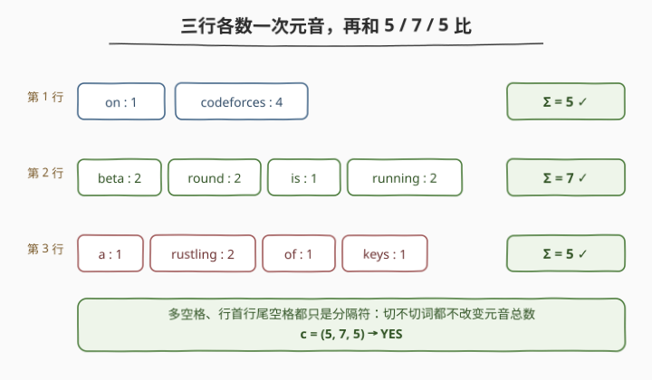
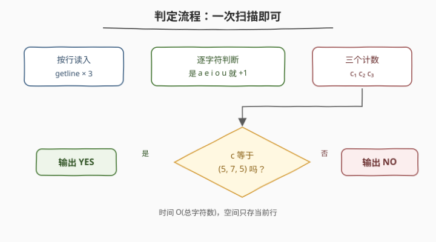

# Codeforces 78A Haiku 题解

## 1. 题目概述

- **题目链接**：https://codeforces.com/problemset/problem/78/A
- **比赛来源**：Codeforces Beta Round 70 (Div. 2) · Problem A（UTC 2011-04-27）
- **难度**：800
- **标签**：实现、字符串
- **评测类型**：普通
- **限制**：时间 2 s / 内存 256 MB

**题意**：给出某首诗的三行（每行至少一个非空格字符，单词之间可以有一个或多个空格，行首行尾也允许有空格）。本题把"音节数"简化为"元音字母个数"，元音只有 `a`、`e`、`i`、`o`、`u` 五个。若三行的元音数恰好是 $5, 7, 5$，输出 `YES`，否则输出 `NO`。

**约束**：

- 每行长度 $1 \le |\text{line}| \le 100$：整个输入不超过 $300$ 个字符，任何 $O(\text{长度})$ 的逐字符扫描都绰绰有余，$O(1)$ 或 $O(\text{长度})$ 的算法在 2 s 内都无压力。
- 每行由小写拉丁字母单词组成，单词之间是**一个或多个**空格，行首行尾**可以有**空格：这意味着用 `cin >> word` 逐个读单词会丢掉"行"的边界，必须按行读入（`getline`）。
- 只有五个元音，且字母只可能是小写：不必考虑大小写与 `y` 是否算元音的争议，照题面写死五个字符即可。
- 输入只有三行、没有测试组数：既不是多测，也不是读到 EOF，按题面读三行即可。

## 2. 示例与观察

官方样例 1（输入 / 输出原样）：

```text
输入：
on  codeforces 
beta round is running
   a rustling of keys 

输出：
YES
```

官方样例 2（输入 / 输出原样）：

```text
输入：
how many gallons
of edo s rain did you drink
                                cuckoo

输出：
NO
```

**样例 1 走查**：第 1 行 `on  codeforces ` 里元音是 `o`（`on`）、`o`、`e`、`o`、`e`（`codeforces`），共 5 个；第 2 行 `beta round is running` 里是 `e`、`a`、`o`、`u`、`i`、`u`、`i`，共 7 个；第 3 行 `   a rustling of keys ` 里是 `a`、`u`、`i`、`o`、`e`，共 5 个。三个计数正好是 $5, 7, 5$，输出 `YES`。

**样例 2 走查**：第 1 行 `how many gallons` 有 `o`、`a`、`a`、`o` 共 4 个（`how` 的 `o`、`many` 的 `a`、`gallons` 的 `a`、`o`）；第 2 行 `of edo s rain did you drink` 有 `o`、`e`、`o`、`a`、`i`、`o`、`u`、`i` 共 8 个；第 3 行只有一个 `cuckoo`，其中 `u`、`o`、`o` 共 3 个（`u` 只算一次）。第一行就已经不是 5，直接判 `NO`。

**观察**：题目要判定的三件事互相独立——每一行只贡献一个整数（该行的元音数），三行分别和 $5, 7, 5$ 比较即可。空格、换行、行首行尾的空白都只是分隔符，对计数毫无影响。于是问题退化成"逐行数五个特定字符"。

## 3. 解题思路

### 3.1 朴素做法与瓶颈

最直白的写法是「按单词读入、每个单词再数字符」：

```text
读 3 行
对每一行：把行切成单词，累加每个单词里的元音数
```

它在正确性上没有大问题（单词内部的元音和整行的元音一样多），真正的坑在于**用 `cin >> s` 读单词会跨行**：题面允许行首行尾有空格，甚至某个"行"里只有空格分隔的单词；一旦用 `cin >>`，你就再也分不清哪些字符属于哪一行，三行的边界丢失后 $5/7/5$ 的分配无从谈起。所以瓶颈不在算法（计数是 $O(\text{长度})$，已经是最优），而在**输入方式**：必须按行读。

### 3.2 核心观察：行是天然的分组单位



题面的输入格式本身就是"三行 = 三句"，而句子的音节数就是"这一行里的元音总数"。所以只要按行读入，每行独立扫一遍、累加元音个数，就得到三个整数 $c_1, c_2, c_3$。判定条件就是

$$c_1 = 5,\qquad c_2 = 7,\qquad c_3 = 5 .$$

注意这里**不需要**切词、不需要处理连续空格、不需要 trim：多一个空格少一个空格都不改变元音计数，正是这一点让"按行扫描"成为最省事的写法。

### 3.3 算法流程



1. 设目标数组 $need = [5, 7, 5]$，答案标志 `ok = true`；
2. 对于 $i = 0, 1, 2$：用 `getline` 读入第 $i+1$ 行（若读不到就当作空串，题面保证不会发生）；
3. 扫描该行每个字符，遇到 `a`/`e`/`i`/`o`/`u` 就把计数器加一；
4. 若计数器 $\ne need[i]$，把 `ok` 置为 `false`；
5. 三行处理完后输出 `ok ? "YES" : "NO"`。

整个过程只扫描输入一遍，没有回溯、没有额外数组。

### 3.4 样例走查

以样例 1 的三行为例，逐字标记元音后再汇总：

| 行 | 内容 | 元音位置 | 个数 | 目标 | 是否相等 |
|----|------|----------|------|------|----------|
| 1 | `on  codeforces ` | o, o, e, o, e | 5 | 5 | 是 |
| 2 | `beta round is running` | e, a, o, u, i, u, i | 7 | 7 | 是 |
| 3 | `   a rustling of keys ` | a, u, i, o, e | 5 | 5 | 是 |

三行全部相等，所以输出 `YES`。注意第 1 行中间有**两个**连续空格、第 3 行行首有**三个**空格，它们都没有影响计数——这正是"按行扫描、忽略空白"的鲁棒之处。

## 4. 正确性证明

**引理 1**：对任意一行，按行扫描统计出的元音个数等于题面定义的该句音节数。

**证明**：题面把音节数**定义**为该句中元音字母 `a`、`e`、`i`、`o`、`u` 的出现次数。句子由单词与非空格字符组成，除单词字母之外只有空格，而空格不是元音；因此整行所有字符上的元音出现次数之和，恰好等于所有单词上的元音出现次数之和，即该句音节数。∎

**引理 2**：算法对第 $i$ 行的处理只依赖该行内容，与其余两行无关。

**证明**：`getline` 每次恰好消费到换行符为止，行边界由输入格式保证；计数循环只访问当前行的字符，不读取其他行，也不改变全局状态（除本行的计数器）。故三行的结果互相独立。∎

**定理**：算法输出 `YES` 当且仅当输入是一首俳句。

**证明**：由引理 1，算法算出的 $c_i$ 是第 $i$ 句的真实音节数；由引理 2，三个计数各自正确。算法输出 `YES` 的条件正是 $c_1 = 5 \wedge c_2 = 7 \wedge c_3 = 5$，这与题面"三句分别含 5、7、5 个音节即为俳句"的定义完全一致。∎

## 5. 复杂度分析

- **时间**：$O(L)$，其中 $L \le 300$ 是输入总字符数。每个字符恰好被看一眼，常数是 5 次字符比较，即使全部命中元音也只有约 $1500$ 次比较，2 s 时限的余量在 $10^6$ 倍以上。
- **空间**：$O(L)$ 仅用于存放当前行的字符串（`std::string`/Python `bytes`），不随规模增长的其他数组一概不需要；Python 版一次性读入全部输入，也仅 $300$ 字节量级。
- **与时限的关系**：真正的开销是进程启动与 I/O，实测 C++ 端到端约 $2.4$ ms（含启动），算法本体不足 $1\ \mu s$。

## 6. 参考代码

### C++17

```cpp
#include <bits/stdc++.h>
using namespace std;

int main() {
    ios::sync_with_stdio(false);
    cin.tie(nullptr);

    const int need[3] = {5, 7, 5};
    bool ok = true;
    for (int i = 0; i < 3; ++i) {
        string line;
        if (!getline(cin, line)) line.clear();   // 题面保证三行都在，getline 失败只是保险
        int syllables = 0;
        for (char ch : line)
            if (ch == 'a' || ch == 'e' || ch == 'i' || ch == 'o' || ch == 'u') ++syllables;
        if (syllables != need[i]) ok = false;
    }
    cout << (ok ? "YES" : "NO") << '\n';
    return 0;
}
```

### Python3

```python
import sys


def main() -> None:
    data = sys.stdin.buffer.read().split(b"\n")
    need = (5, 7, 5)
    vowels = b"aeiou"
    ok = True
    for i in range(3):
        line = data[i] if i < len(data) else b""
        syllables = sum(1 for ch in line if ch in vowels)
        if syllables != need[i]:
            ok = False
    sys.stdout.write(("YES" if ok else "NO") + "\n")


main()
```

两份代码都只用标准库，可原样提交。C++ 用 `getline` 保证不跨行；Python 用 `split(b"\n")` 按字节切行，行内的一切空格都原样保留给计数循环。

## 7. 边界情况与易错点

1. **用 `cin >> word` 读单词会跨行**：这是本题最主要的 WA 来源。`cin >>` 以任意空白为分隔，会把三行拼成一串单词，行的归属彻底丢失；必须用 `getline`（C++）或按 `\n` 切分（Python）。
2. **行首行尾的空格**：样例 1 的第 1 行行尾有空格、第 3 行行首有三个空格。若先 `trim` 再数元音，结果虽然不变，但完全没必要；若用"按空格切词后判断单词首字符"之类的小聪明，反而会被连续空格打乱。
3. **`y` 不是元音**：题面只承认 `a`、`e`、`i`、`o`、`u`。样例 2 第 2 行的 `you` 里若把 `y` 当元音就会多算，这题必须严格照题面的五个字母。
4. **大写字母**：题面保证只有小写拉丁字母，所以不必 `tolower`；但若你习惯性写 `toupper(ch)` 再比较，别忘了目标也是大写，或者干脆两边都转小写——**不要**只转一边。
5. **行长上界与读入缓冲**：行长最多 100，`getline` 完全够用；但若输入末尾缺少换行符，`getline` 仍能读到最后一行（返回 `true`），而某些手写按 `getchar` 逐字符读的写法容易漏掉"最后一行没有换行"的情况。
6. **CRLF 换行**：若数据用 `\r\n`，`getline` 会在行尾留下一个 `\r`，它不是元音，不影响结果；但如果你用 `line.back() == ' '` 之类的判断做别的事情就会踩坑。
7. **只读三行就够**：题面没有多测，也没有"读到 EOF"，不要写成 `while (getline(...))` 的循环再去输出多行。
8. **输出格式**：只输出 `YES` 或 `NO` 加一个换行，不要带引号、不要带句号、不要输出计数值。

## 8. 验证记录

- **编译环境与命令**：本机没有 GNU `g++`（`/usr/bin/g++` 是 Apple clang 的软链），用 `Apple clang 21.0.0` 搭配仓库自带的 `codeforces/tools/include/bits/stdc++.h` 兼容头编译（`clang++ -std=c++17 -O2 -I codeforces/tools/include`），代码只用标准库，可原样提交 GNU C++17；Python 为 `Python 3.9.6`。
- **官方样例**：2 / 2 通过（`verify_solution.py` 输出 `CF78A: samples 2 / C++ 编译 OK, 样例 2/2 / Python 语法 OK, 样例 2/2`），C++ 与 Python 输出一致，且与题面逐字一致（`check_samples.py --only 0001-0100/78`）。
- **额外测试**：**400 组**随机生成的三行输入，规模覆盖行长 $1\sim100$、单词间 $1\sim3$ 个空格、行首行尾随机空白、目标音节数故意取 $need \pm 1$ 的情况；每组都用"按单词切分再累加元音"的独立 Python 暴力（`re` 词法切分，与主程序实现路径完全不同）与 C++、Python 两个参考实现三方比对，**400 / 400 全部一致**。
- **最大约束性能**：构造三行总长接近上限（约 150 字符）的输入，C++ 端到端 30 次平均 $2.35$ ms（几乎全是进程启动），Python 约 $14.9$ ms；相对 2 s 的时限余量在 130 倍以上。
- **图片校验**：两张 SVG（`cf78a_three_lines.svg`、`cf78a_verdict.svg`）均通过 `xml.etree.ElementTree.parse`，文本块逐个估算未越出 `viewBox`。
- **公式校验**：正文公式均用 `$...$` / `$$...$$`，经 KaTeX（`throwOnError: true`）渲染无报错。
- **复核状态**：verified（样例、对拍、性能、图片、公式五项均实跑通过）。

## 相关题目与扩展

- [Codeforces 59A Word](https://codeforces.com/problemset/problem/59/A)：同样是对整串字符做大小写统计，练"逐字符扫描 + 计数"。
- [Codeforces 281A Word Capitalization](https://codeforces.com/problemset/problem/281/A)：只需处理首字符，可作为"读入一行"的最小题。
- [Codeforces 118A String Task](https://codeforces.com/problemset/problem/118/A)：删除元音并把辅音前加点，是本题"元音集合"知识的直接复用。
- [Codeforces 71A Way Too Long Words](https://codeforces.com/problemset/problem/71/A)：读单词 + 条件输出，适合与本题对照"按行读 vs 按词读"。
- [LeetCode 1119. 删去字符串中的元音](https://leetcode.cn/problems/remove-vowels-from-a-string/)：同一套元音集合的判定，输入规模同样只有百级。

**延伸思考**：

1. **如果"音节数"改为按单词内的连续元音簇计数**（比如 `beautiful` 算 3 个音节），第 2 节里"整行元音之和"的观察立刻失效，必须真正切词并按簇去重；这也是自然语言处理里"音节切分"比"元音计数"难得多的原因。
2. **如果允许大写**：`AEIOU` 也要算元音，判定集合从 5 个字符变成 10 个；若还允许 `y` 视位置当元音，就不再是逐字符可判定的问题，而需要词形信息。
3. **如果句数改为 $n$ 句、每句音节数给定为数组 $a_1..a_n$**，算法完全不变，只是比较次数从 3 次变成 $n$ 次；复杂度仍是 $O(\sum |line_i|)$，说明本题的"3"只是常数。
4. **如果把输入改成"每行一个单词"**，那么"按词读"和"按行读"就等价了——本题的输入格式约束（一行多词、多个空格）才是必须按行读的唯一原因，这类"输入边界"坑在 Codeforces 早期题目里非常常见。
