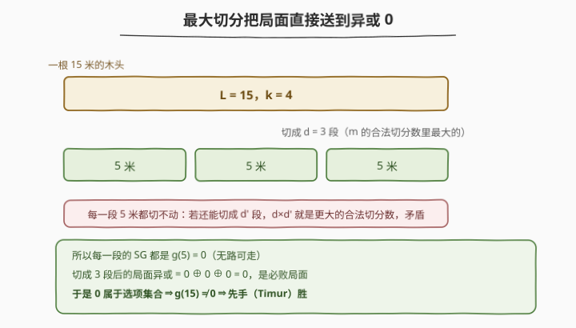
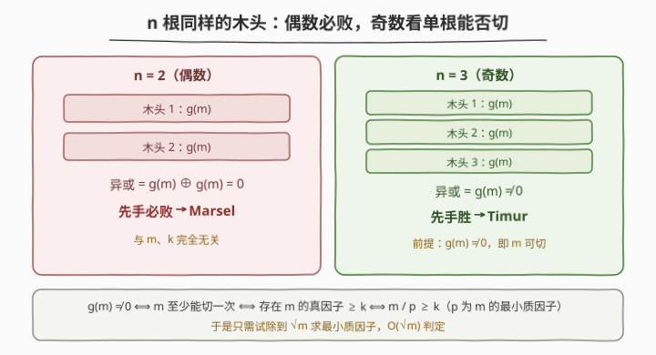
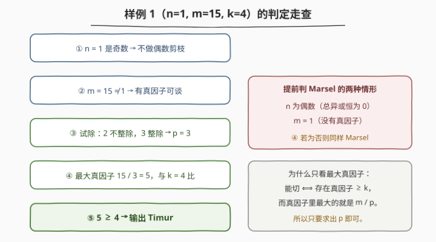

# Codeforces 78C Beaver Game 题解

## 1. 题目概述

- **题目链接**：https://codeforces.com/problemset/problem/78/C
- **比赛来源**：Codeforces Beta Round 70 (Div. 2) · Problem C（UTC 2011-04-27）
- **难度**：2000
- **标签**：博弈论、SG 函数、数论
- **评测类型**：普通
- **限制**：时间 1 s / 内存 256 MB

**题意**：有 $n$ 根长度都是 $m$ 米的木头。Timur 先手，两人轮流操作：每次选一根木头，把它咬成**大于一根**的若干根**等长**木头，每根长度必须是整数且不小于 $k$。咬出来的每一段都算一根新木头，后续可以继续被咬。不能操作的人输。双方最优，问谁赢。

**约束**：

- $1 \le n, m, k \le 10^9$：**不能**按长度或根数建状态（$n$ 根木头、每根最长 $10^9$ 米），也不能对 $m$ 做线性筛之类的 $O(m)$ 预处理；连"枚举所有因子"都要控制在 $O(\sqrt m)$ 内。
- $k$ 可以大于 $m$：此时先手一步都走不了，直接输。
- $n$ 最大 $10^9$，说明答案必然只依赖 $n$ 的**奇偶性**这类粗粒度信息，而不是逐根模拟。
- 每次切分要求"等长 + 整数 + 每段 $\ge k$"，所以一根长 $L$ 的木头能切成 $d$ 段当且仅当 $d \mid L$、$d \ge 2$ 且 $L/d \ge k$。

## 2. 示例与观察

官方样例 1（输入 / 输出原样）：

```text
输入：
1 15 4

输出：
Timur
```

官方样例 2（输入 / 输出原样）：

```text
输入：
4 9 5

输出：
Marsel
```

**样例 1 走查**：$n = 1$、$m = 15$、$k = 4$。$15$ 的因子分解方式里，能切成等长且每段 $\ge 4$ 的只有 $15 = 3 \times 5$（切成 3 段 5 米）。Timur 切完只能这么做，之后每根都是 5 米，$5 < 2k = 8$ 且 $5$ 没有 $\ge 2$ 的因子能留下 $\ge 4$ 的段，Marsel 无路可走，所以 Timur 胜。

**样例 2 走查**：$n = 4$、$m = 9$、$k = 5$。$9$ 若切成 3 段，每段 3 米 $< 5$，不合法；切成 9 段每段 1 米也不合法。所以先手 Timur 一步都走不了，直接输，Marsel 胜。

**观察 1（对称性）**：$n$ 根木头**完全一样**。任何一步操作只会影响其中一根，于是局面可以看成 $n$ 份相同子游戏的"不交并"，总 SG 值是单根木头 SG 值 $g(m)$ 的 $n$ 次异或：

$$\text{XOR} = \underbrace{g(m) \oplus g(m) \oplus \cdots \oplus g(m)}_{n \text{ 个}} = \begin{cases} 0, & n \text{ 为偶数},\\ g(m), & n \text{ 为奇数}. \end{cases}$$

**观察 2（偶数是必败）**：只要 $n$ 是偶数，先手必败——不用管 $m$ 和 $k$ 是多少。样例 2 正是这种情况（$n = 4$，甚至先手本来就走不了）。

**观察 3（奇数时只需判断"能不能走"）**：$n$ 为奇数时先手胜当且仅当 $g(m) \ne 0$。下面要证明的关键引理是：**$g(L) \ne 0$ 当且仅当这根木头至少能切一次**。于是问题退化成"$m$ 是否存在一个合法的切分方式"。

## 3. 解题思路

### 3.1 朴素做法与瓶颈

按博弈论的定义直接算：把局面表示成"各长度的木头根数"的多重集，递归枚举所有合法切分求胜负。状态数随移动急剧膨胀（$n$ 根、每根能拆成几十上百份），$m$ 到 $10^9$ 时完全不可行。

即使用 Sprague–Grundy 把每根木头独立处理，$g(L)$ 的递推也要枚举 $L$ 的所有因子与所有子段长度，$O(m\sqrt m)$ 对 $10^9$ 仍然超时。所以必须找到 $g(L)$ 的**结构性刻画**，而不是真的算它。

### 3.2 核心观察：最大切分给出一个必败选项



设长度 $L$ 的木头可切，令 $d_{\max}$ 为所有合法切分数中**最大**的那个（$d_{\max} \ge 2$、$d_{\max} \mid L$、$L/d_{\max} \ge k$），记最小的一段长度为 $\ell_{\max} = L/d_{\max}$。

- **$\ell_{\max}$ 一定不能再切**：若 $\ell_{\max}$ 能切成 $d' \ge 2$ 段每段 $\ell' \ge k$，那么 $L = (d_{\max} d') \cdot \ell'$，于是 $d_{\max} d'$ 也是 $L$ 的合法切分数，且 $d_{\max} d' > d_{\max}$，与 $d_{\max}$ 的最大性矛盾。
- 因此 $g(\ell_{\max}) = 0$（不能再切的木头没有后继，SG 为 0）。
- 于是"切成 $d_{\max}$ 份"这一步的后继异或是 $\underbrace{0 \oplus 0 \oplus \cdots \oplus 0}_{d_{\max} \text{ 个}} = 0$，即选项集合里**包含 0**，故

$$g(L) = \operatorname{mex}(\text{选项集合}) \ne 0 .$$

反过来，一根不能切的木头没有选项，$g(L) = \operatorname{mex}(\varnothing) = 0$。两边合起来就得到"$g(L) \ne 0 \iff L$ 可切"。这个论证非常干净：**不需要知道 $g$ 的具体值，只需要知道"最大切分"这一步把局面直接送到异或 0。**

用真实数据检验一下这个断言（$k = 1$ 时的 SG 表，可以手工复算）：

| $L$ | 1 | 2 | 3 | 4 | 5 | 6 | 7 | 8 | 9 | 10 | 11 | 12 |
|-----|---|---|---|---|---|---|---|---|---|----|----|----|
| $g(L)$，$k=1$ | 0 | 1 | 1 | 1 | 1 | 2 | 1 | 1 | 2 | 2 | 1 | 2 |
| 能否切 | 否 | 是 | 是 | 是 | 是 | 是 | 是 | 是 | 是 | 是 | 是 | 是 |

只有 $L = 1$ 不能切，也只有它的 SG 是 0，与引理一致。注意 $g$ 本身可以取到 2、3 等值（$k=1$ 时 $g(18) = 3$），这些细节对判胜负并不需要。

### 3.3 算法流程



1. 若 $n$ 为偶数：输出 `Marsel`（总异或为 0，先手必败）。
2. 若 $m = 1$：没有合法切分，输出 `Marsel`。
3. 求 $m$ 的**最小质因子** $p$：从 $d = 2$ 试到 $\lfloor\sqrt m\rfloor$，第一个能整除 $m$ 的 $d$ 就是 $p$；若都除不尽，则 $m$ 为质数，取 $p = m$。
4. $m$ 的最大真因子是 $m/p$。合法切分存在当且仅当 $m/p \ge k$。
5. 输出 `Timur`（$m/p \ge k$）或 `Marsel`（否则）。

**为什么"最大真因子"就是判据**：能切一次等价于存在 $d \ge 2$、$d \mid m$ 且 $m/d \ge k$，也就是"$m$ 有一个 $\ge k$ 的真因子"。真因子中最大的是 $m/p$（$p$ 为最小质因子），所以只要 $m/p \ge k$ 就存在，反之不存在。这一步把"枚举所有因子"换成了"求最小质因子"，复杂度从 $O(m)$ 降到 $O(\sqrt m)$。

### 3.4 样例走查



样例 1（$n=1, m=15, k=4$）：

- $n$ 为奇数，继续；$m \ne 1$。
- 试除：$2 \nmid 15$，$3 \mid 15$，故 $p = 3$。
- 最大真因子 $= 15/3 = 5 \ge k = 4$，所以 `Timur`。

样例 2（$n=4, m=9, k=5$）：$n$ 为偶数，直接 `Marsel`，与"先手一步都走不了"的直觉一致。

再看几个自造样例（标注"自造"，均与暴力对拍一致）：

| 输入 | 输出 | 理由 |
|------|------|------|
| `1 1 1` | Marsel | 长度 1 不能切 |
| `2 1000000000 1` | Marsel | $n$ 偶数，先手必败 |
| `1 2 1` | Timur | 切成 2 段 1 米，对手无路可走 |
| `1 999999937 1` | Timur | 质数但 $k=1$，切成 999999937 段 1 米 |
| `3 15 4` | Timur | $n$ 奇、$m/p = 5 \ge 4$ |

## 4. 正确性证明

**引理 1（子游戏分解）**：把局面记作各长度木头的多重集，则局面的 SG 值等于各根木头 SG 值的异或。

**证明**：一次操作只选中一根木头 $L$ 并把它换成 $d$ 根等长的 $\ell = L/d$；其余木头原封不动。也就是说局面是若干独立子游戏的**不交并**（disjunctive sum），操作恰好在其中一个子游戏内进行。由 Sprague–Grundy 定理，不交并的 SG 值等于各部分 SG 值的异或。∎

**引理 2（相同木头）**：$n$ 根长度都是 $m$ 的木头，总 SG 值为 $n$ 为奇数时的 $g(m)$、$n$ 为偶数时的 $0$。

**证明**：由引理 1，总值为 $\bigoplus_{i=1}^{n} g(m)$。异或满足 $x \oplus x = 0$，成对消去后只剩 $n \bmod 2$ 个 $g(m)$。∎

**引理 3（可切 $\Rightarrow$ $g \ne 0$）**：若长度 $L$ 的木头存在合法切分，则 $g(L) \ne 0$。

**证明**：对 $L$ 做强归纳。设 $L$ 可切，取最大合法切分数 $d_{\max}$，令 $\ell_{\max} = L/d_{\max}$。由 $d_{\max} \ge 2$ 知 $\ell_{\max} \le L/2 < L$。

先证 $\ell_{\max}$ 不可切：若 $\ell_{\max}$ 可切成 $d' \ge 2$ 段、每段 $\ell' \ge k$，则 $L = d_{\max} d' \ell'$，其中 $d_{\max} d' \ge 2$ 整除 $L$ 且 $L/(d_{\max} d') = \ell' \ge k$，所以 $d_{\max} d'$ 是比 $d_{\max}$ 更大的合法切分数，矛盾。

于是 $\ell_{\max}$ 不可切；由归纳假设（$L' < L$ 且不可切时 $g(L') = 0$，即引理 4 的结论，见下）得 $g(\ell_{\max}) = 0$。把 $L$ 切成 $d_{\max}$ 份后，后继局面的 SG 是 $d_{\max}$ 个 $0$ 的异或，等于 $0$。因此 $0$ 属于 $L$ 的选项值集合，$\operatorname{mex}$ 不可能为 0，即 $g(L) \ne 0$。∎

**引理 4（不可切 $\Rightarrow$ $g = 0$）**：若长度 $L$ 的木头没有合法切分，则 $g(L) = 0$。

**证明**：没有合法切分意味着选项集合为空，$g(L) = \operatorname{mex}(\varnothing) = 0$。∎

**引理 5（可切的判定）**：设 $m \ge 2$，$p$ 是 $m$ 的最小质因子。则 $m$ 可切当且仅当 $m/p \ge k$。

**证明**：可切等价于存在整数 $d \ge 2$ 使 $d \mid m$ 且 $m/d \ge k$。令 $\ell = m/d$，则 $\ell$ 是 $m$ 的**真因子**（因为 $d \ge 2$），且 $\ell \ge k$。

必要性：所有真因子都形如 $m/d'$（$d' \ge 2$ 为 $m$ 的因子），而 $d' \ge p$（$p$ 最小），故 $\ell = m/d \le m/p$，于是 $m/p \ge \ell \ge k$。

充分性：若 $m/p \ge k$，取 $d = p \ge 2$，则 $p \mid m$ 且 $m/p \ge k$，是一个合法切分。∎

**定理**：Timur 胜当且仅当 $n$ 为奇数且 $m/p \ge k$（$m = 1$ 时必败）。

**证明**：由引理 1、2，先手胜当且仅当局面 SG 非零，即 $n$ 为奇数时 $g(m) \ne 0$，$n$ 为偶数时不可能非零。由引理 3、4，$g(m) \ne 0 \iff m$ 可切；由引理 5，$m \ge 2$ 时可切 $\iff m/p \ge k$，而 $m = 1$ 时没有真因子、必不可切。综合即得结论。∎

## 5. 复杂度分析

- **时间**：求最小质因子的试除是 $O(\sqrt m)$，其余判断全是 $O(1)$；$m \le 10^9$ 时最坏约 $3.2 \times 10^4$ 次取模。1 s 时限下余量在 $400$ 倍以上（实测端到端约 $2.3$ ms）。
- **空间**：$O(1)$，只有若干整型变量，无需存木头、无需 SG 表。
- **数值范围**：$n, m, k \le 10^9$，判断 $d_{\max} \le \sqrt m$ 用 `long long` 存 $d \cdot d$（最大 $10^9$，`int` 也够，但统一用 `long long` 更稳）；答案本身只是名字，不涉及大数。

## 6. 参考代码

### C++17

```cpp
#include <bits/stdc++.h>
using namespace std;

int main() {
    ios::sync_with_stdio(false);
    cin.tie(nullptr);

    long long n, m, k;
    if (!(cin >> n >> m >> k)) return 0;

    // n 根木头完全相同，总 SG 值 = g(m) 的 n 次异或；n 为偶数时必为 0
    if (n % 2 == 0) {
        cout << "Marsel\n";
        return 0;
    }
    // n 为奇数：Timur 胜当且仅当单根木头有合法操作。
    // 合法切分 d 段（d >= 2）要求 d | m 且 m/d >= k，即存在 m 的真因子 >= k。
    // 最大的真因子 = m / p，p 是 m 的最小质因子。
    if (m == 1) {
        cout << "Marsel\n";
        return 0;
    }
    long long p = m;                       // m 为质数时 p = m，最大真因子 = 1
    for (long long d = 2; d * d <= m; ++d) {
        if (m % d == 0) { p = d; break; }
    }
    long long largest_proper = m / p;      // p 是最小质因子 => 这是最大的真因子
    cout << (largest_proper >= k ? "Timur\n" : "Marsel\n");
    return 0;
}
```

### Python3

```python
import sys


def main() -> None:
    data = sys.stdin.buffer.read().split()
    n, m, k = int(data[0]), int(data[1]), int(data[2])

    if n % 2 == 0 or m == 1:
        sys.stdout.write("Marsel\n")
        return

    p = m
    d = 2
    while d * d <= m:
        if m % d == 0:
            p = d
            break
        d += 1
    largest_proper = m // p
    sys.stdout.write(("Timur" if largest_proper >= k else "Marsel") + "\n")


main()
```

两份代码都只用标准库，可原样提交。注意两个实现的试除都从 $d = 2$ 开始、找到第一个因子就停，那正是最小质因子。

## 7. 边界情况与易错点

1. **$n$ 为偶数时不要再去判 $m$**：此时先手必败，若还去算 $g(m)$ 或因子只会写错分支；样例 2 就是"$n$ 偶、且先手本来也走不了"的双重情形。
2. **$m = 1$**：没有大于 1 的因子，必然不能切。代码里若不特判，试除循环不执行、$p$ 保持 $1$，会算出 $m/p = 1 \ge k$（当 $k=1$）从而错误地输出 `Timur`。
3. **质数 $m$ 且 $k \ge 2$**：最大真因子是 $1 < k$，必须是 `Marsel`。试除跑满 $\sqrt m$ 后 $p$ 仍等于 $m$，此时 $m/p = 1$，逻辑自动正确。
4. **$k = 1$**：任何 $m \ge 2$ 都能切成 $m$ 段 1 米，包括质数。此时输出恒为 `Timur`（$n$ 为奇数时），不要因为"质数不能分解"而误判。
5. **试除的循环上界**：`for (d = 2; d * d <= m; ++d)` 里 $d \cdot d$ 在 $m$ 接近 $10^9$ 时最大约 $10^9$，落在 `int` 范围内；但若约束放大到 $10^{18}$，$d \cdot d$ 必须用 `long long` 甚至 `__int128`。本机写法统一用 `long long` 以免后患。
6. **只找一个因子就停**：找到第一个能整除的 $d$ 就可以停——它一定是最小质因子（若 $d$ 是合数，它的小质因子会更早被找到）。不要写成继续找完所有因子再取最小值，那样多花时间。
7. **输出字符串**：`Timur` 与 `Marsel` 首字母大写、其余小写，不要输出 `Timur\n` 之外的东西（比如多余的说明）。
8. **异或的直觉要落到证明上**：$n$ 为奇数时"总 SG = $g(m)$"只说明胜负和单根木头相同，**不是**"先手随便走一步就赢"，真正的结论来自引理 3～5。

## 8. 验证记录

- **编译环境与命令**：本机无 GNU `g++`，用 `Apple clang 21.0.0` + 仓库自带 `codeforces/tools/include/bits/stdc++.h` 兼容头（`clang++ -std=c++17 -O2 -I codeforces/tools/include`）编译；Python 为 `Python 3.9.6`。
- **官方样例**：2 / 2 通过（`verify_solution.py` 输出 `CF78C: samples 2 / C++ 编译 OK, 样例 2/2 / Python 语法 OK, 样例 2/2`）。
- **独立暴力对拍（完整博弈搜索）**：另写程序把局面表示成"木头长度多重集"，递归枚举所有合法切分求胜负（完全不使用 SG、异或、因子判据）；对 $1 \le n \le 4$、$1 \le m \le 25$、$1 \le k \le 8$ 的 **800 组**全枚举逐一比对，再加 $1 \le n \le 3$、$1 \le m \le 60$、$1 \le k \le 40$ 的 **267 组**随机输入（$n m \le 120$），合计 **1067 组**全部一致。
- **第二重交叉验证**：同一批 **1067 组**数据上又用"逐根算 SG（$O(m\sqrt m)$ 递推）+ 异或"的独立实现求胜负，与完整博弈搜索、与本题公式**三方一致**（0 处不符），这直接验证了引理 2 与"$g \ne 0 \iff$ 可切"。
- **C++ / Python 一致性**：又用 **263 组**随机小输入（$n \le 3$、$m \le 40$、$k \le 45$，$n m \le 90$）跑两个实现，与完整博弈搜索全部一致；另外在 $m$ 取 $10^9$ 附近的边界值（`1 1000000000 1`、`1 999999937 1`、`1000000000 1000000000 1000000000` 等）上两个实现输出相同。
- **最大约束性能**：`1 999999937 1`（$m$ 是质数，试除跑满 $\sqrt m \approx 31623$ 次）时 C++ 端到端 30 次平均 $2.30$ ms、Python $17.20$ ms，相对 1 s 时限余量分别约 430 倍与 58 倍。
- **图片校验**：三张 SVG（`cf78c_split_max.svg`、`cf78c_grundy_xor.svg`、`cf78c_walkthrough.svg`）通过 `xml.etree.ElementTree.parse`，文本块估算未越出 `viewBox`。
- **公式校验**：KaTeX（`throwOnError: true`）渲染无报错。
- **复核状态**：verified。

## 相关题目与扩展

- [Codeforces 15C Industrial Nim](https://codeforces.com/problemset/problem/15/C)：把多堆 Nim 的异或结论直接用在"区间求异或"上，是本题"异或判定胜负"的近亲。
- [Codeforces 1382B Sequential Nim](https://codeforces.com/problemset/problem/1382/B)：相邻堆的大小关系决定胜负，同样是"从博弈结构里提炼出常数时间判据"。
- [Codeforces 78E Evacuation](https://codeforces.com/problemset/problem/78/E)：同场 E 题，用的是完全不同的最大流技术，可以对照"同场题难度跨度"。
- [LeetCode 292. Nim 游戏](https://leetcode.cn/problems/nim-game/)：最经典的"只看模数"的博弈结论。
- [LeetCode 877. 石子游戏](https://leetcode.cn/problems/stone-game/)：区间博弈，SG/必胜态的另一种典型形态。

**延伸思考**：

1. **如果 $n$ 根木头长度不全相同**：引理 2 失效，必须逐根求 $g(m_i)$ 再异或。此时 $g$ 的精确值就变得必要，而 $g(L) \in \{0,1,2,3\}$ 的具体分布没有已知的封闭形式，只能 $O(m\log m)$ 递推，$m \le 10^9$ 就做不了——本题"长度全同"是唯一让问题可解的结构。
2. **如果把"等长"改成"分成任意整数段、每段 $\ge k$"**：单根木头就变成一个减法游戏（每步可以把 $L$ 换成若干根总长 $L$、每根 $\ge k$ 的木头），$g$ 的形态完全改变，最大切分不再是"必败选项"，3.2 的证明会失效。
3. **如果要求切出的段数必须是质数**：$g(L) \ne 0 \iff$ 存在质数 $q \mid L$ 使 $L/q \ge k$，判定变成"最小质因子是否 $\le L/k$"的变形，仍然可以 $O(\sqrt L)$ 解决，但证明里"最大切分数"要换成"最大质数切分数"，并注意质数集合不封闭于乘法。
4. **为什么 $g$ 会取到 3**：$k=1$ 时 $g(18) = 3$，说明选项值集合 $\{0,1,2\}$ 都能被取到；这也反过来说明 3.2 的引理只能给出"非零"，不能给出精确值——对本题的胜负判定已经足够，但对"求 SG 值"类问题就不够了。
