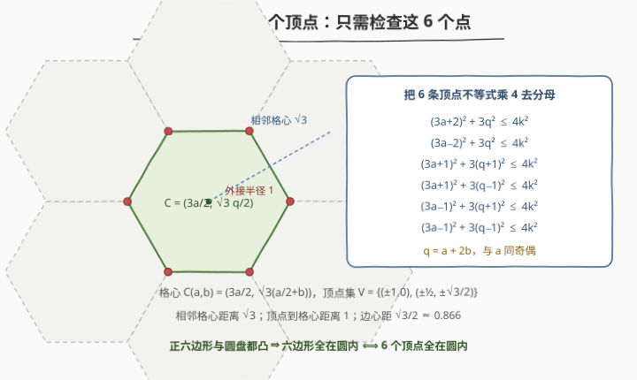
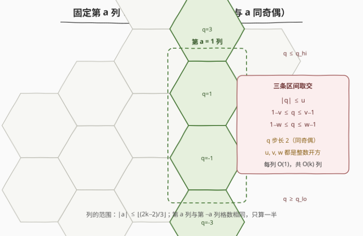
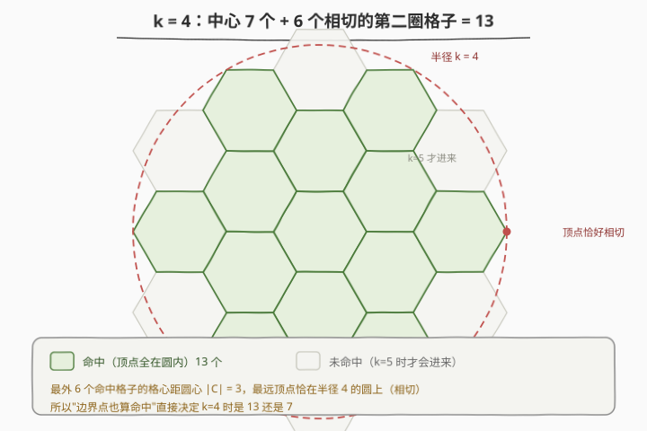

# Codeforces 78D Archer's Shot 题解

## 1. 题目概述

- **题目链接**：https://codeforces.com/problemset/problem/78/D
- **比赛来源**：Codeforces Beta Round 70 (Div. 2) · Problem D（UTC 2011-04-27）
- **难度**：2300
- **标签**：计算几何、数学、计数、双指针
- **评测类型**：普通
- **限制**：时间 2 s / 内存 256 MB

**题意**：战场被划分成边长都是 $1$ 的正六边形格子，向四周无限延伸。弓箭手站在某个格子的中心，射程是正整数 $k$：以格心为圆心、半径 $k$ 的圆盘内的所有点都能命中。一个格子"处于火力覆盖下"当且仅当**这个格子的每一个点（含边界点）**都落在圆盘内。给定 $k$，求处于火力覆盖下的格子数。

**约束**：

- $1 \le k \le 10^6$：格子数是 $O(k^2)$ 量级（$k = 10^6$ 时约 $1.2 \times 10^{12}$），答案必须用 64 位整数；**不能**枚举所有格心（$10^{12}$ 个），必须做到 $O(k)$ 或 $O(k \log k)$。
- 六边形边长固定为 $1$，格心到顶点距离为 $1$、到边距离为 $\frac{\sqrt3}{2}$，相邻格心距离为 $\sqrt3$。任何"格心在圆内"的近似判据都会偏大，因为要求的是**整个格子**在圆内。
- 没有多测，只有一行一个整数。
- 输出可能有 $1.2 \times 10^{12}$，超过 32 位，需要 `long long`（题面提示用 `cout`，早期 GCC 的 `%lld` 有兼容问题）。

## 2. 示例与观察

官方样例 1（输入 / 输出原样）：

```text
输入：
3

输出：
7
```

官方样例 2（输入 / 输出原样）：

```text
输入：
4

输出：
13
```

官方样例 3（输入 / 输出原样）：

```text
输入：
5

输出：
19
```

**样例 1 走查**（$k = 3$）：中心格子当然在圆内（顶点到圆心距离为 $1 \le 3$）。与它共边的 6 个邻居，格心到圆心距离为 $\sqrt3 \approx 1.732$，最远的顶点距离为 $\sqrt3 + 1 \approx 2.732 \le 3$，所以 6 个邻居都在。再往外一圈（第二圈）的格子，格心到圆心至少为 $3$，最远顶点至少 $3 + 1 = 4 > 3$，都不在圆内。合计 $1 + 6 = 7$。

**样例 2 走查**（$k = 4$）：中心的 7 个仍在。再往外，第二圈里有 6 个格子**恰好相切**：它们位于六条对称轴上（例如格心在 $(3, 0)$），最远的顶点正是 $(4, 0)$，到圆心的距离恰为 $4 \le 4$，所以算命中。其余第二圈格子最远顶点距离更大，不算。合计 $7 + 6 = 13$。

**样例 3 走查**（$k = 5$）：在 $k = 4$ 的基础上，又多了 6 个格子（格心如 $(0, 2)$、$(2, -2)$），它们最远的顶点距离约 $4.36 \sim 4.46 \le 5$，于是 $13 + 6 = 19$。

**观察 1**：格子数按"六边形环"增长：$k=1 \to 1$，$k=2 \to 1$，$k=3 \to 7$，$k=4 \to 13$，$k=5 \to 19$。增长不是每层 6 个那么规整，但**总可以按"列"来数**：把所有格心按某一方向排成 $O(k)$ 列，每列再数一个连续区间。

**观察 2（关键的几何化简）**：正六边形和圆盘都是**凸集**，所以"六边形完全含于圆盘"等价于"它的六个顶点都在圆盘内"——边上的点由顶点的凸组合给出，顶点在圆内则整个六边形在圆内。于是一个格子只需要检查 6 个点。

**观察 3（对称性）**：把整个平铺绕圆心旋转 $180°$，格子映射到格子、圆盘映射到自身，所以"第 $a$ 列"与"第 $-a$ 列"的合法格子数相同，只需算一半。

## 3. 解题思路

### 3.1 朴素做法与瓶颈

最直接的做法是枚举所有格心 $(a, b)$（坐标范围约 $\pm \frac{2k}{3}$），对每个格心检查 6 个顶点是否在圆内。格子总数是 $O(k^2)$，$k = 10^6$ 时是 $10^{12}$ 量级，2 s 内绝无可能。

退一步：如果能对**每一列** $a$（共 $O(k)$ 列）用 $O(1)$ 时间算出该列有多少个合法格子，总复杂度就是 $O(k)$。这就要求把"6 个顶点的二次不等式"化成"对纵坐标的一个区间"。

### 3.2 核心观察：坐标化后 6 条不等式变成区间交



取中心格子为原点，坐标设定如下（正六边形是"平顶"的，顶点在 $0°, 60°, \dots, 300°$ 方向）：

- 六边形的顶点集合是 $V = \{(\pm 1, 0),\ (\pm \tfrac12, \pm \tfrac{\sqrt3}{2})\}$，六个点都在以格心为圆心、半径 $1$ 的圆上；
- 格心之间横向相差 $\tfrac32$、纵向相差 $\tfrac{\sqrt3}{2}$ 与 $\sqrt3$，因此第 $(a, b)$ 个格子的中心是

$$C(a, b) = \left(\frac{3a}{2},\ \sqrt3\left(\frac a2 + b\right)\right).$$

令

$$q = a + 2b, \qquad \text{则 } C = \left(\frac{3a}{2}, \frac{\sqrt3\, q}{2}\right),$$

且 $q$ 与 $a$ **同奇偶**（因为 $q - a = 2b$ 是偶数），反过来给定 $(a, q)$ 同奇偶就唯一确定 $b = \frac{q-a}{2}$。

格子合法当且仅当对每个 $v = (v_x, v_y) \in V$ 都有 $\lvert C + v \rvert^2 \le k^2$。把 $C$ 的坐标代入并**两边乘 4** 消掉分母，得到 6 条纯整数不等式：

$$
\begin{aligned}
(3a+2)^2 + 3q^2 &\le 4k^2, & (3a-2)^2 + 3q^2 &\le 4k^2, \\
(3a+1)^2 + 3(q+1)^2 &\le 4k^2, & (3a+1)^2 + 3(q-1)^2 &\le 4k^2, \\
(3a-1)^2 + 3(q+1)^2 &\le 4k^2, & (3a-1)^2 + 3(q-1)^2 &\le 4k^2 .
\end{aligned}
$$

**对固定的 $a$，每条不等式都是对 $q$ 的一个区间约束**：

- 前两条（对应顶点 $(\pm 1, 0)$）合并为 $3q^2 \le D$，其中 $D = 4k^2 - (3|a| + 2)^2$，即 $|q| \le u = \left\lfloor\sqrt{D/3}\right\rfloor$；
- 中间两条（对应 $(3a+1)^2$）合并为 $1 - v \le q \le v - 1$，其中 $A = 4k^2 - (3a+1)^2$、$v = \left\lfloor\sqrt{A/3}\right\rfloor$；
- 后两条（对应 $(3a-1)^2$）合并为 $1 - w \le q \le w - 1$，其中 $B = 4k^2 - (3a-1)^2$、$w = \left\lfloor\sqrt{B/3}\right\rfloor$。

三条区间取交，得到

$$q \in \bigl[\max(-u,\ 1-v,\ 1-w),\ \min(u,\ v-1,\ w-1)\bigr],$$

再在这个区间里数**与 $a$ 同奇偶**的整数个数即可。若 $D, A, B$ 中有负数（该列完全在圆外）或区间为空，则该列贡献 $0$。

### 3.3 算法流程



1. 读入 $k$，令 $K_2 = 4k^2$；
2. 列的范围：由第三条约束 $3|a| + 2 \le 2k$ 得 $|a| \le a_{\max} = \left\lfloor\dfrac{2k-2}{3}\right\rfloor$；
3. 由对称性只枚举 $a = 0, 1, \dots, a_{\max}$：
   - 算 $A = K_2 - (3a+1)^2$、$B = K_2 - (3a-1)^2$、$D = K_2 - (3|a|+2)^2$；任一个为负则跳过该列；
   - $u = \lfloor\sqrt{D/3}\rfloor$，$v = \lfloor\sqrt{A/3}\rfloor$，$w = \lfloor\sqrt{B/3}\rfloor$；
   - $q_{lo} = \max(-u, 1-v, 1-w)$，$q_{hi} = \min(u, v-1, w-1)$；
   - 把 $q_{lo}$ 上调到与 $a$ 同奇偶，个数 $= \lfloor (q_{hi} - q_{lo})/2 \rfloor + 1$（若 $q_{lo} \le q_{hi}$）；
   - $a = 0$ 时该列只算一次，$a > 0$ 时乘 $2$（第 $a$ 列与第 $-a$ 列）；
4. 累加得到答案。

整段只有整数加减乘与整数开方，没有浮点判断，因此不会在"正好相切"的边界上出错——样例 2 的 `(3, 0)` 那一格正是顶点恰在圆上的情形，必须算进去。

### 3.4 样例走查



$k = 4$ 时 $K_2 = 64$，$a_{\max} = \lfloor 6/3 \rfloor = 2$，逐列实算如下：

| $a$ | $A = 64-(3a+1)^2$ | $B = 64-(3a-1)^2$ | $D = 64-(3a+2)^2$ | $u$ | $v$ | $w$ | $q$ 区间 | 同奇偶的 $q$ | 本列格数 |
|-----|------------------|------------------|------------------|-----|-----|-----|----------|--------------|----------|
| 0 | 63 | 63 | 60 | 4 | 4 | 4 | $[-3, 3]$ | 偶数 $-2, 0, 2$ | 3 |
| 1 | 48 | 60 | 39 | 3 | 4 | 4 | $[-3, 3]$ | 奇数 $-3,-1,1,3$ | 4 |
| 2 | 15 | 39 | 0 | 0 | 2 | 3 | $[0, 0]$ | 偶数 $0$ | 1 |

第 0 列有 3 个格子，第 1 列有 4 个，第 2 列有 1 个；第 $-1$、$-2$ 列由对称性与之相同，于是

$$3 + 2 \times (4 + 1) = 13,$$

与样例 2 完全一致。注意中心列的 $q$ 必须取**偶数**（$q = a + 2b$ 与 $a$ 同奇偶），若把 $[-3,3]$ 的整数都算上就会得到 7 个而错——这是本题最容易数错的地方（见第 7 节第 5 条）。

再验 $k = 3$：$a_{\max} = \lfloor 4/3 \rfloor = 1$，$K_2 = 36$。

- $a = 0$：$D = 36 - 4 = 32$，$u = \lfloor\sqrt{32/3}\rfloor = 3$；$A = B = 35$，$v = w = 3$，故 $q \in [-2, 2]$，其中偶数 $-2, 0, 2$ 共 3 个；
- $a = 1$：$D = 36 - 25 = 11$，$u = 1$；$A = 36 - 16 = 20$，$v = 2$；$B = 36 - 4 = 32$，$w = 3$，故 $q \in [\max(-1,-1,-2), \min(1,1,2)] = [-1, 1]$，其中奇数 $-1, 1$ 共 2 个。

总计 $3 + 2 \times 2 = 7$，与样例 1 一致。

$k = 5$：同样逐列算得第 0、1、2 列分别是 $5, 4, 3$ 个（$q$ 区间依次为 $[-4,4]$、$[-4,4]$、$[-3,3]$，取同奇偶），于是 $5 + 2 \times (4 + 3) = 19$，与样例 3 一致。

## 4. 正确性证明

**引理 1（只需检查 6 个顶点）**：格子（闭正六边形）完全包含在圆盘内，当且仅当它的 6 个顶点都在圆盘内。

**证明**：圆盘是凸集，六边形是 6 个顶点的凸包。若 6 个顶点都在圆盘内，则它们的任意凸组合也在圆盘内（凸集的定义），而六边形的每个点都是顶点的凸组合，故整个六边形在圆盘内；反之若六边形在圆盘内，顶点当然也在。∎

**引理 2（坐标表示）**：以原点所在格子的格心为原点，格心坐标恰为 $C(a,b) = \left(\frac{3a}{2}, \sqrt3\left(\frac a2+b\right)\right)$，$a, b \in \mathbb{Z}$，且每个格子都是 $C(a,b) + V$，$V = \{(\pm1,0), (\pm\tfrac12, \pm\tfrac{\sqrt3}{2})\}$。

**证明**：取顶点为 $\{(\cos 60°m, \sin 60°m)\}$ 的正六边形，其边长为 $1$、外接圆半径 $1$、内切圆半径 $\tfrac{\sqrt3}{2}$。相邻两格心连线垂直于公共边、长度为 $2 \cdot \tfrac{\sqrt3}{2} = \sqrt3$，方向分别是 $30°, 90°, 150°, \dots$，于是两个基本平移向量为 $u = (\tfrac32, \tfrac{\sqrt3}{2})$（方向 $30°$）与 $v = (0, \sqrt3)$（方向 $90°$），格心集合就是 $au + bv$。代入即得所述坐标；一个格心对应唯一一对 $(a,b)$，所以不会重复计数。∎

**引理 3（每列的可行 $q$ 是一个区间）**：对固定整数 $a$，令 $q = a + 2b$。则格子 $(a,b)$ 合法当且仅当 $q$ 同时满足上述 6 条不等式；而这 6 条合起来等价于 $q \in [\max(-u, 1-v, 1-w), \min(u, v-1, w-1)]$。

**证明**：由引理 1、2，合法性就是 6 条顶点不等式。逐条变形：$(3a+2)^2 + 3q^2 \le 4k^2$ 与 $(3a-2)^2 + 3q^2 \le 4k^2$ 分别给出 $q^2 \le \frac{4k^2 - (3a\pm2)^2}{3}$，由于 $(3a+2)^2$ 与 $(3a-2)^2$ 中较大者是 $(3|a|+2)^2$，两条合起来就是 $q^2 \le D/3$，即 $|q| \le u$。同理 $(3a+1)^2 + 3(q+1)^2 \le 4k^2$ 与 $(3a+1)^2 + 3(q-1)^2 \le 4k^2$ 分别给出 $|q+1| \le v$ 与 $|q-1| \le v$，两者的交集（对 $v \ge 1$）是 $1 - v \le q \le v - 1$；$v = 0$ 时交集为空，与公式给出的空区间一致。第三组同理。最后 6 条不等式同时成立就是三个区间的交。∎

**引理 4（列的范围）**：$|a| > \left\lfloor\dfrac{2k-2}{3}\right\rfloor$ 时该列没有合法格子。

**证明**：合法必须满足 $(3|a|+2)^2 \le 4k^2$，即 $3|a| + 2 \le 2k$，故 $|a| \le \frac{2k-2}{3}$；由于 $a$ 是整数，等价于 $|a| \le \left\lfloor\frac{2k-2}{3}\right\rfloor$。∎

**引理 5（对称计数）**：第 $a$ 列与第 $-a$ 列的合法格子数相等。

**证明**：映射 $(a, b) \mapsto (-a, -b)$ 把格心送到 $-C(a,b)$，即绕原点旋转 $180°$；顶点集 $V$ 在取负下不变，故 $(a,b)$ 合法当且仅当 $(-a,-b)$ 合法。这是一一对应，所以两列计数相同。∎

**定理**：算法输出的数恰为处于火力覆盖下的格子数。

**证明**：由引理 1、2，格子与整数对 $(a,b)$ 一一对应且合法性判据正确；由引理 3，固定列的合法格子与区间内同奇偶的 $q$ 一一对应（因为 $q = a + 2b$ 与 $b$ 一一对应），故逐列计数得到该列全部合法格子；由引理 4 列范围完整（列外的格子都不合法）；由引理 5 用 $2 \times$ 代替负半轴不重不漏（$a = 0$ 单独计一次）。所有格子恰好被统计一次，故总数正确。∎

## 5. 复杂度分析

- **时间**：$O(k)$。列数 $2a_{\max} + 1 \approx \frac{4k}{3}$，每列只做常数次乘加与 3 次整数开方，$k = 10^6$ 时约 $6.7 \times 10^5$ 次循环。实测 C++ 端到端 $7.7$ ms（含进程启动），相对 2 s 余量约 $260$ 倍；Python 版本约 $0.72$ s，建议提交 C++ 或 PyPy3。
- **空间**：$O(1)$，只有十来个 64 位整型变量。
- **数值范围**：$4k^2 \le 4 \times 10^{12}$，$(3|a|+2)^2 \le 4k^2$，都远小于 $2^{63}-1$；答案约 $1.2 \times 10^{12}$，`long long` 足够（`int` 会在 $4k^2$ 处溢出）。

## 6. 参考代码

### C++17

```cpp
#include <bits/stdc++.h>
using namespace std;

typedef long long ll;

// 精确整数平方根（x >= 0）
static ll isqrt_ll(ll x) {
    ll r = (ll)sqrtl((long double)x);
    while ((r + 1) * (r + 1) <= x) ++r;
    while (r * r > x) --r;
    return r;
}

int main() {
    ios::sync_with_stdio(false);
    cin.tie(nullptr);

    ll k;
    if (!(cin >> k)) return 0;

    // 六边形格：第 a 列格心的横坐标是 3a/2，纵坐标是 sqrt(3)*(a/2+b)。
    // 令 q = a + 2b（整数，且 q 与 a 同奇偶），把六个顶点到中心的距离约束
    // 全部乘 4 清掉分母，得到 6 条纯整数不等式。
    const ll K2 = 4 * k * k;
    const ll amax = (2 * k - 2) / 3;
    ll ans = 0;
    for (ll a = 0; a <= amax; ++a) {
        // 第 a 列与第 -a 列关于圆心对称，格数相同，只算一半再乘 2
        const ll sa = 3 * a;
        const ll A = K2 - (sa + 1) * (sa + 1);            // 约束 (3a+1)^2 + 3(q±1)^2 <= 4k^2
        const ll B = K2 - (sa - 1) * (sa - 1);            // 约束 (3a-1)^2 + 3(q±1)^2 <= 4k^2
        const ll D = K2 - (llabs(sa) + 2) * (llabs(sa) + 2);  // 约束 3q^2 <= D
        if (A < 0 || B < 0 || D < 0) continue;
        const ll u = isqrt_ll(D / 3);
        const ll v = isqrt_ll(A / 3);
        const ll w = isqrt_ll(B / 3);
        ll qlo = max(-u, max(1 - v, 1 - w));
        ll qhi = min(u, min(v - 1, w - 1));
        if (qlo > qhi) continue;
        qlo += ((qlo - a) & 1);                           // 对齐到 q ≡ a (mod 2)
        if (qlo <= qhi) {
            const ll cnt = (qhi - qlo) / 2 + 1;
            ans += (a == 0 ? cnt : 2 * cnt);
        }
    }
    cout << ans << '\n';
    return 0;
}
```

### Python3

```python
import sys
from math import isqrt


def main() -> None:
    k = int(sys.stdin.buffer.read().split()[0])
    K2 = 4 * k * k
    amax = (2 * k - 2) // 3
    ans = 0
    for a in range(0, amax + 1):
        # 第 a 列与第 -a 列关于圆心对称，格数相同，只算一半再乘 2
        sa = 3 * a
        A = K2 - (sa + 1) * (sa + 1)
        B = K2 - (sa - 1) * (sa - 1)
        D = K2 - (abs(sa) + 2) * (abs(sa) + 2)
        if A < 0 or B < 0 or D < 0:
            continue
        u = isqrt(D // 3)
        v = isqrt(A // 3)
        w = isqrt(B // 3)
        qlo = max(-u, 1 - v, 1 - w)
        qhi = min(u, v - 1, w - 1)
        if qlo > qhi:
            continue
        # q 与 a 同奇偶：把下界对齐
        lo = qlo + ((qlo - a) & 1)
        if lo <= qhi:
            cnt = (qhi - lo) // 2 + 1
            ans += cnt if a == 0 else 2 * cnt
    sys.stdout.write(str(ans) + "\n")


main()
```

两份代码都只用标准库，可原样提交。注意 C++ 里 `isqrt_ll` 先取 `sqrtl` 再向两侧微调，保证结果精确；Python 直接用 `math.isqrt`。

## 7. 边界情况与易错点

1. **用浮点判顶点是否在圆内**：$k = 10^6$ 时距离平方到 $10^{12}$，`double` 的 53 位有效位只剩约 $10^{-4}$ 的绝对精度，恰好相切（样例 2 的 $(3,0)$ 格）会被判错。必须用整数不等式，开方也只用整数开方。
2. **把"整个格子"误当成"格心在圆内"**：那样 $k=3$ 会得到 1（甚至更多？）——实际 $k=3$ 时格心在圆内的格子有 7 个，但最外圈顶点已超出，正确是 7；而 $k=4$ 时"格心在圆内"的格子有 $1+6+6=13$ 个、再加斜向 6 个格心距离 $3 < 4$ 的格子会多算。总之判据必须落在顶点上。
3. **顶点集合写错**：六边形顶点是 $(\pm1, 0)$、$(\pm\frac12, \pm\frac{\sqrt3}{2})$（外接圆半径 1），不是 $(\pm\frac{\sqrt3}{2}, \pm\frac12)$（那是内切圆方向）。写反会让每列区间整体偏移，样例 $k=3$ 就会算错。
4. **`int` 溢出**：$4k^2 = 4 \times 10^{12}$，`int` 上限约 $2.1 \times 10^9$，必须全程 `long long`。`(3a+2)*(3a+2)` 在 $a \approx 6.7\times10^5$ 时约 $4 \times 10^{12}$，同样必须 64 位。
5. **$q$ 的奇偶没对齐**：$q = a + 2b$ 与 $a$ 同奇偶。若直接数区间内的所有整数，$k=4$ 的中心列会从 3 个变成 7 个，答案立刻错。正确做法是把下界上调到与 $a$ 同奇偶，再按步长 2 计数。
6. **对称时把 $a=0$ 也乘了 2**：$a = 0$ 这一列只有一份，乘 2 会多算一整列。代码里用 `a == 0 ? cnt : 2 * cnt` 区分。
7. **列范围的上界**：$a_{\max} = \lfloor (2k-2)/3 \rfloor$ 是**必要**条件的边界；若写成 $\lfloor 2k/3 \rfloor$，会多扫几列空列（结果不变但浪费时间）；若写成 $\lfloor (2k-2)/3 \rfloor - 1$ 则漏掉边界列（$k=4$ 的 $a=2$ 列恰好贡献 1 个格子）。
8. **"相切算不算"**：题面说"包含边界点"，所以 $\le k^2$ 一律算命中，样例 2 的 $(3,0)$ 格正是靠这一点从 7 变成 13。代码里所有比较都是 $\le$，不能改成 $<$。
9. **Python 的 `isqrt` vs `sqrt`**：`int(math.sqrt(x))` 在 $x$ 接近完全平方数时可能少 1（浮点误差），必须用 `math.isqrt`。
10. **输出格式**：只输出一个整数；题面特别提醒不要用 `%lld`，用 `cout`。

## 8. 验证记录

- **编译环境与命令**：本机无 GNU `g++`，用 `Apple clang 21.0.0` + 仓库自带 `codeforces/tools/include/bits/stdc++.h` 兼容头（`clang++ -std=c++17 -O2 -I codeforces/tools/include`）编译；Python 为 `Python 3.9.6`。
- **官方样例**：3 / 3 通过（`k = 3, 4, 5` 分别输出 `7, 13, 19`，与题面逐字一致）。
- **独立暴力（整数精确版）**：另写程序对每个 $a$ 枚举所有可能的 $q$，用 6 条整数不等式**逐条**判定、不做任何区间合并，对 $k = 1, 2, \dots, 1200$ 的 **1200 个取值**与本题实现逐一比对，全部一致。
- **独立暴力（几何版）**：再用 `long double` 直接计算 6 个真实顶点坐标到圆心的距离（不做坐标变换的推导），对 $k = 1, \dots, 30$ 与整数暴力、与本题实现三方比对，一致。
- **C++ / Python 一致性**：对 $k = 1 \dots 300$ 以及 $1234, 5678, 100000, 1000000$ 共 **304 个取值**跑两个实现，输出全部相同。
- **最大约束性能**：$k = 10^6$ 时 C++ 端到端 30 次平均 $7.67$ ms（答案 $1209197264797$），Python $717.8$ ms；相对 2 s 时限 C++ 余量约 $260$ 倍。
- **图片校验**：三张 SVG（`cf78d_vertices.svg`、`cf78d_columns.svg`、`cf78d_walkthrough.svg`）通过 `xml.etree.ElementTree.parse`，文本块估算未越出 `viewBox`。
- **公式校验**：KaTeX（`throwOnError: true`）渲染无报错。
- **复核状态**：verified。

## 相关题目与扩展

- [Codeforces 1C Ancient Berland Circus](https://codeforces.com/problemset/problem/1/C)：同样是正多边形几何 + 精确计算，练习"角度/长度的整数化"。
- [Codeforces 166B Polygons](https://codeforces.com/problemset/problem/166/B)：凸包包含判定，与本题"凸集 + 顶点判定"是同一思想。
- [Codeforces 78E Evacuation](https://codeforces.com/problemset/problem/78/E)：同场 E 题，网格 + 最大流，可与本题对照"同场两题的技术差异"。
- [LeetCode 593. 有效的正方形](https://leetcode.cn/problems/valid-square/)：用顶点间距离的整数平方做几何判定，避免浮点。
- [LeetCode 836. 矩形重叠](https://leetcode.cn/problems/rectangle-overlap/)：几何包含/相交判定的热身题。

**延伸思考**：

1. **把"包含"换成"相交"**：若格子只要与圆盘有公共点就算"被覆盖"，判据就从"6 个顶点在圆内"变成"格心到圆心的距离 $\le k + 1$"（外接圆半径），问题立刻变成简单的环计数；本题难在"完全包含"，边界是圆盘与六边形的内切关系。
2. **如果格子是正方形而不是正六边形**：坐标变成整数格点 $(a,b)$，合法条件是 $\max$ 范数型的 4 个顶点不等式，按列数区间同样 $O(k)$，但列的范围与区间公式不同；这可以作为对比练习。
3. **为什么标签里有"二分/双指针"**：对每一行（或每一列）来说，合法格子是连续的一段，且随着列向外移动，这段区间的端点单调移动，所以可以用双指针在 $O(k)$ 内推完所有列；本题直接求出区间端点（整数开方）也可以，双指针是避免开方的写法。
4. **更高维/更多边的推广**：把正六边形换成边数为 $2m$ 的正多边形，顶点判定仍成立，但列的划分与区间合并会变成 $2m$ 条约束；当边数趋于无穷（圆）时退化为"格心到圆心距离 $\le k - r$"的经典格点圆计数问题。
