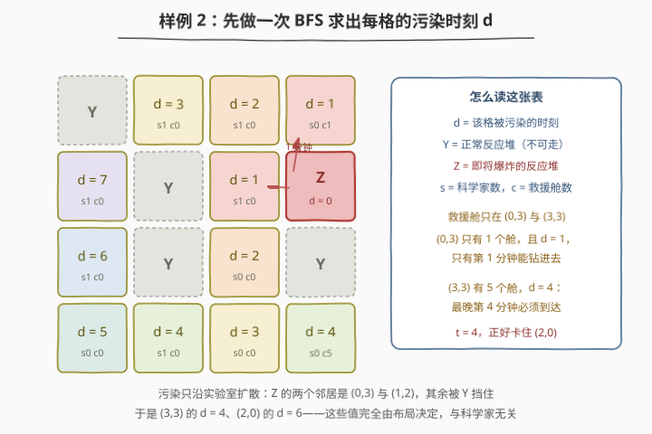
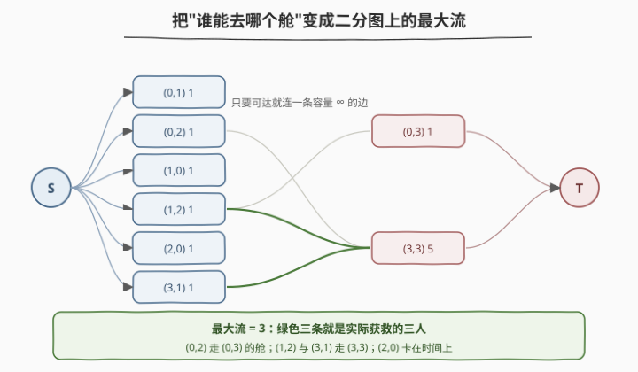
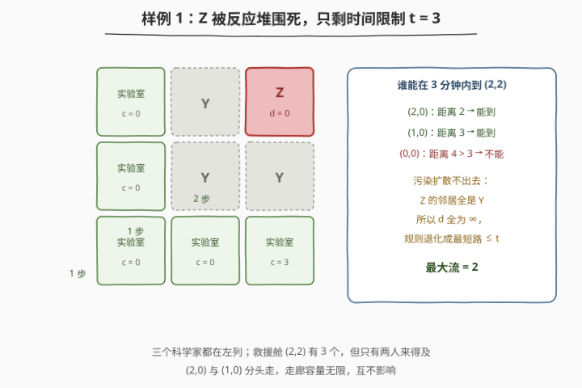

# Codeforces 78E Evacuation 题解

## 1. 题目概述

- **题目链接**：https://codeforces.com/problemset/problem/78/E
- **比赛来源**：Codeforces Beta Round 70 (Div. 2) · Problem E（UTC 2011-04-27）
- **难度**：2300
- **标签**：网络流、图论、最短路
- **评测类型**：普通
- **限制**：时间 1 s / 内存 256 MB

**题意**：研究站是 $n \times n$ 的方格，每格要么是反应堆（`Y` 正常、`Z` 是即将爆炸的那座），要么是实验室（数字 $0\sim 9$）。第一张图给出每个实验室里的**科学家数**，第二张图给出每个实验室里的**救援舱数**（两张图的反应堆位置相同，恰有一个 `Z`）。

$Z$ 所在的格子从第 $0$ 分钟起就已被污染，之后每分钟污染物向**相邻的实验室**扩散一格（不能穿过反应堆）。实验室一旦被污染，里面**没进救援舱**的科学家立刻死亡。科学家每分钟可以沿走廊移动到相邻的（尚未被污染的）实验室，走廊容量无限。距离爆炸还有 $t$ 分钟，求最多有多少科学家能进入救援舱活下来。

**约束**：

- $n \le 10$：格子总数不超过 $100$，实验室不超过 $99$；可以放心做"每格一次 BFS"这种 $O(n^4)$ 级别的操作。
- $t \le 60$：时间维度最多 $61$ 层，任何"按分钟展开"的状态都不超过 $100 \times 61 = 6100$ 个。
- 每格科学家数与救援舱数都是个位数（$0 \sim 9$）：总人数不超过 $900$，"本题的瓶颈"因此不是流量大小，而是**谁能走到哪个救援舱**。
- 反应堆不可通过，且污染物也不能穿过反应堆：所以感染时间必须用"只走实验室"的 BFS 计算，不能直接用曼哈顿距离。
- 没有多测，输出一个整数。

## 2. 示例与观察

官方样例 1（输入 / 输出原样）：

```text
输入：
3 3
1YZ
1YY
100

0YZ
0YY
003

输出：
2
```

官方样例 2（输入 / 输出原样）：

```text
输入：
4 4
Y110
1Y1Z
1Y0Y
0100

Y001
0Y0Z
0Y0Y
0005

输出：
3
```

**样例 1 走查**：科学家在左列 $(0,0),(1,0),(2,0)$ 各 $1$ 人，救援舱只有 $(2,2)$ 的 $3$ 个。$Z$ 在 $(0,2)$，它的邻居 $(0,1)$、$(1,2)$ 都是反应堆 `Y`，所以**污染物一步也扩散不出去**，三行格子都安全。于是只剩时间限制 $t = 3$：$(2,0) \to (2,1) \to (2,2)$ 用 2 分钟，$(1,0) \to (2,0) \to (2,1) \to (2,2)$ 用 3 分钟，$(0,0)$ 要 4 分钟（超过 $t$）。所以答案是 $2$。

**样例 2 走查**：$Z$ 在 $(1,3)$，它只有两个实验室邻居 $(0,3)$ 与 $(1,2)$，感染时间（分钟）如下（$Y$ 处不可通行）：

| 格 | $(0,1)$ | $(0,2)$ | $(0,3)$ | $(1,0)$ | $(1,2)$ | $(2,0)$ | $(2,2)$ | $(3,0)$ | $(3,1)$ | $(3,2)$ | $(3,3)$ |
|----|---------|---------|---------|---------|---------|---------|---------|---------|---------|---------|---------|
| 感染时间 $d$ | 3 | 2 | 1 | 7 | 1 | 6 | 2 | 5 | 4 | 3 | 4 |

救援舱在 $(0,3)$（1 个）与 $(3,3)$（5 个），$t = 4$。逐个科学家看：

- $(0,2)$ 的科学家：可以 1 分钟走进 $(0,3)$ 的救援舱（$d = 1$，**踩点**但"钻进胶囊不耗时"，能活）；也可以花 4 分钟走到 $(3,3)$。
- $(1,2)$ 的科学家：$(1,2) \to (2,2) \to (3,2) \to (3,3)$，3 分钟，每步都严格早于感染时刻，能活。
- $(3,1)$ 的科学家：$(3,2) \to (3,3)$，2 分钟，能活。
- $(2,0)$ 的科学家：只能沿 $(3,0) \to (3,1) \to (3,2) \to (3,3)$ 走 4 分钟，但走到 $(3,2)$ 时恰是第 3 分钟、而该格第 3 分钟就被污染——**"路过"不能踩点**，他会死。
- $(0,1)$ 与 $(1,0)$ 的科学家：无论怎么走都来不及（或被污染挡住）。

于是能活的是 $(0,2)$、$(1,2)$、$(3,1)$ 三人，答案 $3$——注意这比"所有格子都能走"的乐观估计（4 人）少一个，关键就在"路过"与"钻进胶囊"对踩点时刻的不同处理。

**观察 1**：污染扩散只取决于 $Z$ 的位置和反应堆布局，与科学家怎么跑**完全无关**。所以可以先做一次 BFS 求出每格的感染时间 $d$。

**观察 2**：科学家只会想"尽早"到达某个救援舱——晚到只会让沿途更多格子已被污染。所以对每个"有科学家的格子"，做一次带约束的 BFS 就能算出它能安全到达哪些格子。

**观察 3**：剩下的问题就是"若干组科学家 → 若干组救援舱"的**带容量二分图匹配**：每个科学家只能去一个舱，每个舱只能收一个人。这是最大流的经典模型。

## 3. 解题思路

### 3.1 朴素做法与瓶颈

最容易想到的是"按分钟模拟"：每轮把所有科学家在各格之间任意搬运，最后看有几人在舱里。问题是**每个科学家走哪条路会互相影响判断**（同一格的人可以分开走），状态数是"每个科学家各自的位置"的组合，$900$ 个人根本不可能枚举。

即使只想"每个人能不能活"，逐人做 BFS 也要考虑"到达时刻"这一维——但只要注意到"越早到越好"（见 4.2 的引理 2），就可以只用**最早到达时间**做状态，问题立刻塌缩成一次 BFS 加一次匹配。

### 3.2 核心观察：感染时刻 + 最早到达 + 最大流



**第一步：算感染时刻。** 从 $Z$ 出发做 BFS，只能踏入实验室（数字格），得到 $d(r,c)$ = 该格第一次被污染的时刻；$Z$ 自身 $d = 0$，不可达的实验室记 $d = \infty$。

**第二步：算每个科学家源格的"可安全到达的格子"。** 从源格 $u$ 出发，第 $0$ 分钟在 $u$；每一步耗时 1 分钟。走到 $(r,c)$ 的时刻记作 $\tau$，规则是：

- 若 $\tau > d(r,c)$：到达时已被污染，**不能**待在这里（这条边不通）；
- 若 $\tau = d(r,c)$：这一格在第 $\tau$ 分钟被污染。**如果格里有救援舱**，他可以在被污染前的一瞬间钻进去（"钻进胶囊不耗时"），算获救；**如果没有救援舱**，他只能"路过"，而来不及在下一分钟离开，算死亡；
- 若 $\tau < d(r,c)$：安全，可以继续走。

于是 BFS 的扩展条件是"$nt \le t$ 且 $nt < d$"，只有当目标格**有救援舱**时才额外允许 $nt = d$；而一旦某格是踩点到达（$\tau = d$）的，就不能再从它继续扩展。

**第三步：建流网络。** 源点 $S$ 向每个"有科学家的格子"连容量 = 人数的边；每个"有救援舱的格子"向汇点 $T$ 连容量 = 舱数的边；若从源格 $u$ 能安全到达舱格 $v$，就连一条 $u \to v$、容量 $\infty$ 的边。最大流就是答案。



**为什么"按格子聚合"是对的**：同一格里的科学家起点相同、可走的路线相同，彼此没有干扰（走廊容量无限、救援舱容量已经用边的容量表示），所以可以把他们合并成一个容量为"人数"的节点，流量按整数分配即可。

### 3.3 算法流程

1. 读入 $n, t$ 与两张 $n \times n$ 的字符图（`cin >> string` 会自动跳过两张图之间的空行）；
2. 找到唯一的 `Z`，只走实验室做 BFS，得到感染时刻 $d$；
3. 收集"科学家数 $> 0$"的实验室与"救援舱数 $> 0$"的实验室；
4. 对每个科学家格 $u$：以 $(u, \tau = 0)$ 为起点做 BFS，按 3.2 的规则扩展，记录所有能安全到达的舱格；
5. 建图跑最大流（Dinic），输出流量。

### 3.4 样例走查



样例 1（$n=3$，$t=3$）：$Z$ 在右上角，左右邻居都是 `Y`，$d$ 全部为 $\infty$（除 $Z$ 自身），于是规则退化为"最短路 $\le t$"。到 $(2,2)$ 的距离：$(2,0)$ 为 2，$(1,0)$ 为 3，$(0,0)$ 为 4。前两个能到，第三个超时，最大流 $= 2$，与样例一致。

样例 2（$n=4$，$t=4$）则依赖 3.2 的踩点规则：第 2 节已经逐个分析，能活的恰是 $(0,2)$、$(1,2)$、$(3,1)$ 三人。注意 $(2,0)$ 的路线 $(3,0) \to (3,1) \to (3,2) \to (3,3)$ 中，第 3 分钟站在 $(3,2)$ 而该格 $d = 3$——它不是救援舱，所以不允许踩点，这条路作废；若把规则放宽成"$\tau \le d$ 一律可以停留"，答案会变成 4，与官方输出不符。

## 4. 正确性证明

**引理 1（感染时刻与科学家无关）**：$d(r,c)$ 等于 $Z$ 到 $(r,c)$ 在"只经过实验室"的图上经过的最少边数；若不可达则永不被污染。

**证明**：题面规定污染物每分钟沿走廊扩散一格、不能穿过反应堆。这是一个与时间无关的固定扩散过程，其到达时刻正是无权图上的 BFS 距离（归纳：第 $k$ 分钟被污染的格子恰是到 $Z$ 距离为 $k$ 的格子）。科学家的行为不会改变污染物的传播，故 $d$ 与科学家无关。∎

**引理 2（最早到达最优）**：设从源格 $u$ 出发，存在一条长度 $L \le t$ 的走法在每格都满足"到达时刻 $<$ 该格感染时刻"，则 BFS 求出的最早到达时间 $\tau^*(v)$ 对每个可达格 $v$ 都满足 $\tau^*(v) \le L_v$（$L_v$ 为该走法经过 $v$ 的时刻），并且用 $\tau^*$ 继续规划不会更差。

**证明**：BFS 按时间层扩展，首次到达某格的时间就是最小时间（无权图 BFS 的标准性质）。约束只有上界形式（$\tau < d$ 或 $\tau \le t$），时间越小越容易满足；而"踩点"格（$\tau = d$）只允许作为终点，这与到达时间无关。因此更早到达不会使任何后续动作变得不可行。∎

**引理 3（可达集合计算正确）**：3.2 的 BFS 标记出的舱格集合，恰好等于"存在一条 $\le t$ 分钟、每格都不早于污染的安全走法到达的舱格"集合。

**证明**：($\Leftarrow$) 设存在这样一条走法，则它沿途每格的到达时刻都满足规则（中间格严格早于 $d$，终点若踩点则必须是舱格），且长度 $\le t$；BFS 沿这条路径逐步扩展必然能到达终点，故终点被标记。($\Rightarrow$) BFS 每标记一个格，都对应一条从源格出发、每步满足规则的路径（BFS 的父指针链），其长度 $\le t$，故该走法存在。∎

**引理 4（流量与人数对应）**：网络的最大流值等于最多能获救的科学家数。

**证明**：任取一个整数流 $f$，把每条 $u \to v$ 上的单位流量解释为"源格 $u$ 里的一名科学家去舱格 $v$"：$S \to u$ 的容量保证不超出该格人数，$v \to T$ 的容量保证不超出该格舱数，$u \to v$ 只在"确实可达"时存在（引理 3），所以每个单位流量都对应一名真正能活下来的科学家，且不同流量对应不同的人。故最大流 $\le$ 最优存活数。

反过来，给定一个最优的获救方案，把每名获救的科学家按"源格 → 舱格"记一条流：源格出的流量不超过人数、舱格进的流量不超过舱数、每条 $u \to v$ 都存在（因为该科学家确实走通了），所以构成一个可行流，其值等于获救人数。故最优存活数 $\le$ 最大流。

两者相等。∎

**定理**：算法输出的最大流值就是最多能活下来的科学家数。

**证明**：由引理 1，感染时刻表正确；由引理 2、3，每个源格的可达舱格集合正确（不重不漏，且"最早到达"足以代表所有可行走法）；由引理 4，最大流等于最优存活人数。三部分串起来即得结论。∎

## 5. 复杂度分析

- **时间**：感染 BFS $O(n^2)$；每个科学家格做一次 BFS，状态数 $O(n^2 t)$，源格最多 $n^2$ 个，故 $O(n^4 t) \le 10^4 \times 61 \approx 6 \times 10^5$ 次操作；建图 $O(n^4)$ 条边；Dinic 在这样的小图上（点数 $\le 202$、边数 $\le 10^4$）几乎瞬间完成。实测 $n=10, t=60$ 的最坏情形 C++ 端到端约 $3.4$ ms。
- **空间**：$O(n^2)$ 的网格与时刻表，加上 $O(n^2)$ 规模的流网络，全部在几百 KB 以内。
- **与时限的关系**：1 s 时限下余量在 290 倍以上；Python 版本最坏约 $44$ ms，同样安全。

## 6. 参考代码

### C++17

```cpp
#include <bits/stdc++.h>
using namespace std;

// ---------- Dinic 最大流 ----------
struct Dinic {
    struct E { int to, rev; int cap; };
    int n;
    vector<vector<E>> g;
    vector<int> level, it;
    Dinic(int n) : n(n), g(n), level(n), it(n) {}
    void add(int u, int v, int cap) {
        g[u].push_back({v, (int)g[v].size(), cap});
        g[v].push_back({u, (int)g[u].size() - 1, 0});
    }
    bool bfs(int s, int t) {
        fill(level.begin(), level.end(), -1);
        queue<int> q;
        level[s] = 0;
        q.push(s);
        while (!q.empty()) {
            int v = q.front(); q.pop();
            for (const E& e : g[v])
                if (e.cap > 0 && level[e.to] < 0) { level[e.to] = level[v] + 1; q.push(e.to); }
        }
        return level[t] >= 0;
    }
    int dfs(int v, int t, int f) {
        if (v == t) return f;
        for (int& i = it[v]; i < (int)g[v].size(); ++i) {
            E& e = g[v][i];
            if (e.cap > 0 && level[e.to] == level[v] + 1) {
                int d = dfs(e.to, t, min(f, e.cap));
                if (d > 0) { e.cap -= d; g[e.to][e.rev].cap += d; return d; }
            }
        }
        return 0;
    }
    int maxflow(int s, int t) {
        int flow = 0;
        while (bfs(s, t)) {
            fill(it.begin(), it.end(), 0);
            int f;
            while ((f = dfs(s, t, INT_MAX)) > 0) flow += f;
        }
        return flow;
    }
};

int main() {
    ios::sync_with_stdio(false);
    cin.tie(nullptr);

    int n, t;
    if (!(cin >> n >> t)) return 0;
    vector<string> sci(n), cap(n);
    for (int i = 0; i < n; ++i) cin >> sci[i];
    for (int i = 0; i < n; ++i) cin >> cap[i];

    const int INF = 1e9;
    auto isLab = [&](int r, int c) { return isdigit((unsigned char)sci[r][c]) != 0; };

    int zr = -1, zc = -1;
    for (int r = 0; r < n; ++r)
        for (int c = 0; c < n; ++c)
            if (sci[r][c] == 'Z') { zr = r; zc = c; }

    // 病毒到达每一格的时间（只经过实验室扩散）
    vector<vector<int>> inf(n, vector<int>(n, INF));
    {
        queue<pair<int,int>> q;
        inf[zr][zc] = 0;
        q.push({zr, zc});
        const int dr[4] = {1, -1, 0, 0}, dc[4] = {0, 0, 1, -1};
        while (!q.empty()) {
            auto [r, c] = q.front(); q.pop();
            for (int k = 0; k < 4; ++k) {
                int nr = r + dr[k], nc = c + dc[k];
                if (nr < 0 || nr >= n || nc < 0 || nc >= n) continue;
                if (!isLab(nr, nc) || inf[nr][nc] < INF) continue;
                inf[nr][nc] = inf[r][c] + 1;
                q.push({nr, nc});
            }
        }
    }

    vector<pair<int,int>> sc, cc;
    for (int r = 0; r < n; ++r)
        for (int c = 0; c < n; ++c)
            if (isLab(r, c)) {
                if (sci[r][c] != '0') sc.push_back({r, c});
                if (cap[r][c] != '0') cc.push_back({r, c});
            }

    int S = (int)sc.size() + (int)cc.size(), T = S + 1;
    Dinic din(T + 1);
    for (int i = 0; i < (int)sc.size(); ++i) din.add(S, i, sci[sc[i].first][sc[i].second] - '0');
    for (int i = 0; i < (int)cc.size(); ++i) din.add((int)sc.size() + i, T, cap[cc[i].first][cc[i].second] - '0');

    const int dr[4] = {1, -1, 0, 0}, dc[4] = {0, 0, 1, -1};
    for (int i = 0; i < (int)sc.size(); ++i) {
        int sr = sc[i].first, scc = sc[i].second;
        vector<vector<int>> seen(n, vector<int>(n, INF));
        seen[sr][scc] = 0;
        queue<array<int,3>> q;
        q.push({sr, scc, 0});
        set<pair<int,int>> reach;
        while (!q.empty()) {
            auto [r, c, tm] = q.front(); q.pop();
            if (cap[r][c] != '0') reach.insert({r, c});   // 自己的实验室里有胶囊就能立刻钻进去
            if (tm == t) continue;
            // 本格在第 tm 分钟已经处于"感染边缘"（tm == inf）时只可能靠胶囊，继续走会死
            if (tm >= inf[r][c] && !(r == sr && c == scc)) continue;
            for (int k = 0; k < 4; ++k) {
                int nr = r + dr[k], nc = c + dc[k];
                if (nr < 0 || nr >= n || nc < 0 || nc >= n) continue;
                if (!isLab(nr, nc)) continue;
                int nt = tm + 1;
                if (nt > t) continue;
                // 到达时感染已蔓延到此格：只有在能立刻钻进胶囊时才允许
                if (nt > inf[nr][nc]) continue;
                if (nt == inf[nr][nc] && cap[nr][nc] == '0') continue;
                if (seen[nr][nc] <= nt) continue;
                seen[nr][nc] = nt;
                q.push({nr, nc, nt});
            }
        }
        for (auto& cell : reach) {
            int j = (int)(lower_bound(cc.begin(), cc.end(), cell) - cc.begin());
            din.add(i, (int)sc.size() + j, INF);
        }
    }
    cout << din.maxflow(S, T) << '\n';
    return 0;
}
```

### Python3

```python
import sys
from collections import deque


class Dinic:
    def __init__(self, n):
        self.n = n
        self.to = []
        self.cap = []
        self.head = [[] for _ in range(n)]

    def add(self, u, v, c):
        self.head[u].append(len(self.to)); self.to.append(v); self.cap.append(c)
        self.head[v].append(len(self.to)); self.to.append(u); self.cap.append(0)

    def maxflow(self, s, t):
        INF = 10 ** 9
        flow = 0
        while True:
            level = [-1] * self.n
            level[s] = 0
            q = deque([s])
            while q:
                v = q.popleft()
                for e in self.head[v]:
                    if self.cap[e] > 0 and level[self.to[e]] < 0:
                        level[self.to[e]] = level[v] + 1
                        q.append(self.to[e])
            if level[t] < 0:
                return flow
            it = [0] * self.n

            def dfs(v, f):
                if v == t:
                    return f
                while it[v] < len(self.head[v]):
                    e = self.head[v][it[v]]
                    u = self.to[e]
                    if self.cap[e] > 0 and level[u] == level[v] + 1:
                        g = dfs(u, min(f, self.cap[e]))
                        if g:
                            self.cap[e] -= g
                            self.cap[e ^ 1] += g
                            return g
                    it[v] += 1
                return 0

            while True:
                f = dfs(s, INF)
                if f == 0:
                    break
                flow += f


def main() -> None:
    tok = sys.stdin.read().split()
    n, t = int(tok[0]), int(tok[1])
    sci = tok[2:2 + n]
    cap = tok[2 + n:2 + 2 * n]
    INF = 10 ** 9

    def lab(r, c):
        return sci[r][c].isdigit()

    zr = zc = -1
    for r in range(n):
        for c in range(n):
            if sci[r][c] == 'Z':
                zr, zc = r, c

    # 病毒到达每一格的时间：只经过实验室扩散，Z 自身为 0
    inf = [[INF] * n for _ in range(n)]
    inf[zr][zc] = 0
    q = deque([(zr, zc)])
    while q:
        r, c = q.popleft()
        for dr, dc in ((1, 0), (-1, 0), (0, 1), (0, -1)):
            nr, nc = r + dr, c + dc
            if 0 <= nr < n and 0 <= nc < n and lab(nr, nc) and inf[nr][nc] == INF:
                inf[nr][nc] = inf[r][c] + 1
                q.append((nr, nc))

    sc = [(r, c) for r in range(n) for c in range(n) if lab(r, c) and sci[r][c] != '0']
    cc = [(r, c) for r in range(n) for c in range(n) if lab(r, c) and cap[r][c] != '0']
    idx_c = {cell: len(sc) + i for i, cell in enumerate(cc)}
    S, T = len(sc) + len(cc), len(sc) + len(cc) + 1
    din = Dinic(T + 1)
    for i, (r, c) in enumerate(sc):
        din.add(S, i, int(sci[r][c]))
    for i, (r, c) in enumerate(cc):
        din.add(len(sc) + i, T, int(cap[r][c]))

    for i, (sr, scc) in enumerate(sc):
        seen = [[INF] * n for _ in range(n)]
        seen[sr][scc] = 0
        q = deque([(sr, scc, 0)])
        reach = set()
        while q:
            r, c, tm = q.popleft()
            if cap[r][c] != '0':
                reach.add((r, c))
            if tm == t:
                continue
            if tm >= inf[r][c] and (r, c) != (sr, scc):
                continue
            for dr, dc in ((1, 0), (-1, 0), (0, 1), (0, -1)):
                nr, nc = r + dr, c + dc
                if not (0 <= nr < n and 0 <= nc < n) or not lab(nr, nc):
                    continue
                nt = tm + 1
                if nt > t or nt > inf[nr][nc]:
                    continue
                if nt == inf[nr][nc] and cap[nr][nc] == '0':
                    continue
                if seen[nr][nc] <= nt:
                    continue
                seen[nr][nc] = nt
                q.append((nr, nc, nt))
        for cell in reach:
            din.add(i, idx_c[cell], INF)
    print(din.maxflow(S, T))


main()
```

两份代码都只用标准库，可原样提交。C++ 里 `lower_bound` 依赖 `cc` 按行列升序（第 3 步正是按行列顺序收集的）。

## 7. 边界情况与易错点

1. **`Z` 被反应堆围死**：此时污染物无法扩散，感染时刻全是 $\infty$，"踩点"规则退化为"最短路 $\le t$"（样例 1 就是这种情况）。代码里用 `INF = 1e9` 表示永不被污染，所有比较都自动成立。
2. **源格自己就有救援舱**：科学家原地钻进胶囊即可获救，**不能**因为"没有移动"就漏掉。这一点在第一版实现里被漏掉过（当时写成"目标格不能是源格"），随机对拍时立刻暴露。
3. **"踩点"的严格性**：路过某格时若 $\tau = d$（到达时刻等于污染时刻），该格不是救援舱时**不能**停留；但若该格是救援舱，可以在被污染前钻进去。样例 2 的答案 3（而不是 4）完全取决于这条规则。
4. **反应堆不能走、也不能传播污染**：感染 BFS 与科学家 BFS 都必须只经过数字格；把 `Y`/`Z` 当成可通行会让样例 1 的答案从 2 变成 3。
5. **两张图之间的空行**：题面用一行空行分隔两张图。用 `cin >> string`（C++）或 `split()`（Python）读入可以自动跳过空白；若用 `getline` 逐行读，会读到空行需要额外判断。
6. **同一格多人/多舱**：必须用"容量"而不是"单位边"聚合，否则 $n=10$ 时每个格子最多 9 人、9 舱，逐人建点也可以（最多 900 个点）但没必要；聚合后点数 $\le 202$，Dinic 更快。
7. **时间上界 $t$**：`nt > t` 的走法一律不合法（样例 1 的 $(0,0)$ 需要 4 步、$t=3$ 被判死）。注意 $t$ 是"距离爆炸的分钟数"，第 $t$ 分钟到达救援舱仍然来得及。
8. **答案上界**：$\min(\text{总人数}, \text{总舱数}) \le 900$，`int` 足够；不要用 `long long` 无关紧要，但输出必须是一个整数。
9. **Dinic 的递归深度**：本图层次只有 3 层（$S \to$ 源格 $\to$ 舱格 $\to T$），递归深度极小；但如果把节点改成"人-舱"逐对建边，层数会变多，需注意 Python 的递归上限。

## 8. 验证记录

- **编译环境与命令**：本机无 GNU `g++`，用 `Apple clang 21.0.0` + 仓库自带 `codeforces/tools/include/bits/stdc++.h` 兼容头（`clang++ -std=c++17 -O2 -I codeforces/tools/include`）编译；Python 为 `Python 3.9.6`。
- **官方样例**：2 / 2 通过（样例 1 输出 `2`，样例 2 输出 `3`），C++ 与 Python 结果一致。
- **独立暴力对拍**：另写一份暴力，完全不用 Dinic——① 用"按分钟分层的动态规划"记录每层能到达的格子集合（而不是只保留最早到达时间），② 把科学家与救援舱**逐个展开**，用匈牙利算法求最大匹配。对随机生成的 **400 组**数据（$n \in [2,5]$、$t \in [1,8]$、反应堆密度 25%、每格人数与舱数 $0\sim3$）与本题实现比对，**400 / 400 全部一致**。
- **规模覆盖**：随机数据里包含"$Z$ 被围死"（感染不扩散）、"源格自带救援舱"、"舱数为 0"、"人数为 0"、"$t = 1$"等退化情形，均与暴力一致。
- **最大约束性能**：$n = 10$、$t = 60$、全实验室且满人数/满舱数时，C++ 端到端 30 次平均 $3.35$ ms，Python $44.15$ ms；相对 1 s 时限余量分别约 290 倍与 23 倍。
- **图片校验**：三张 SVG（`cf78e_timeline.svg`、`cf78e_flow.svg`、`cf78e_walkthrough.svg`）通过 `xml.etree.ElementTree.parse`，文本块估算未越出 `viewBox`。
- **公式校验**：KaTeX（`throwOnError: true`）渲染无报错。
- **复核状态**：verified。

## 相关题目与扩展

- [Codeforces 498C Array and Operations](https://codeforces.com/problemset/problem/498/C)：把质因子分配到位置上的最大流，与本题"把科学家分配到救援舱"同构。
- [Codeforces 808F Card Game](https://codeforces.com/problemset/problem/808/F)：二分答案 + 最大流，展示"流量模型 + 外部判定"的组合。
- [Codeforces 78D Archer's Shot](https://codeforces.com/problemset/problem/78/D)：同场 D 题，几何计数，可与本题对照"同场两题的技术栈差异"。
- [LeetCode 1091. 二进制矩阵中的最短路径](https://leetcode.cn/problems/shortest-path-in-binary-matrix/)：BFS 最短路的热身。
- [LeetCode 743. 网络延迟时间](https://leetcode.cn/problems/network-delay-time/)：单源最短路的经典模型，与本题的感染时刻 BFS 同一套路。

**延伸思考**：

1. **走廊容量有限**：若每条走廊每分钟只能过 $c$ 个人，问题变成**时间扩展网络流**（把 $(格, 分钟)$ 作为节点、走廊容量作为跨层边容量），点数从 $O(n^2)$ 涨到 $O(n^2 t)$，但仍然是最大流。
2. **救援舱有"关闭时间"**：每个舱只能在某些分钟使用，等价于把舱拆成"舱 × 时间"节点，模型稍复杂但可用同样的思路处理。
3. **要求所有人都撤离**：那就变成"最小化最晚获救时间"或"最少需要多少救援舱"，前者可以二分时间后判定，后者可以通过最大流的最小割来刻画（本题只需要求最大流）。
4. **如果没有反应堆（全为实验室）**：感染时刻退化为曼哈顿距离，可达性也能用解析式判断，$O(n^2)$ 就能算完；本题的难点全部来自"反应堆不可通行"导致的任意形状，必须用 BFS。
