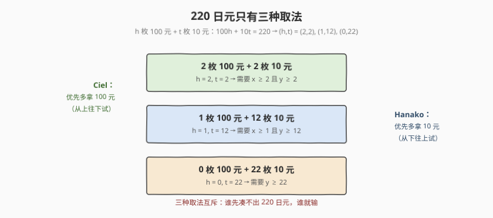
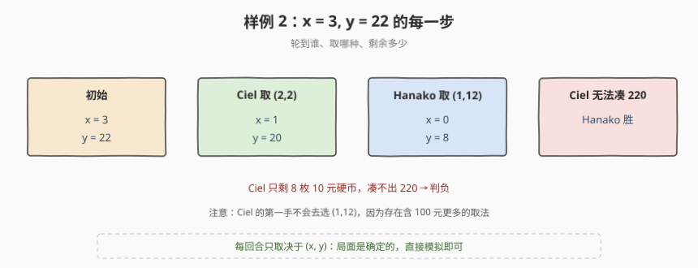

# Codeforces 79A 公交车取币游戏 题解

## 1. 题目概述

- **题目链接**：https://codeforces.com/problemset/problem/79/A
- **比赛来源**：Codeforces Beta Round 71 · Problem A（UTC 2011-04-30）
- **难度**：1200
- **标签**：博弈、模拟、贪心
- **评测类型**：普通
- **限制**：时间 2 s / 内存 256 MB

**题意**：车费是 $220$ 日元。初始有一堆硬币，含 $x$ 枚 $100$ 日元与 $y$ 枚 $10$ 日元。Ciel 先手，两人轮流从堆中取出**恰好** $220$ 日元：轮到 Ciel 时，若有多于一种取法，她选**含 $100$ 元硬币最多**的那种；轮到 Hanako 时，她选**含 $10$ 元硬币最多**的那种。谁轮到时凑不出 $220$ 日元谁就输。给定 $x,y$，输出胜者。

输入一行两个整数 $x,y$，输出 `Ciel` 或 `Hanako`。

**约束**：

- $0 \le x, y \le 10^6$：硬币总数不超过 $2 \times 10^6$，而每次取钱至少拿走 $2+2=4$ 枚硬币，所以回合数不超过 $(x+y)/4 \le 5 \times 10^5$。逐回合模拟是 $O(x+y)$，完全够用；不需要（也不存在明显的）闭合公式。
- 每一步的取法只有常数多种（见 3.2），因此单回合判定是 $O(1)$，总复杂度就是回合数。
- 输入只有**一组**数据，没有测试组数 $t$，也不是"读到 EOF"的多组格式。

## 2. 示例与观察

官方样例一（输入 / 输出原样）：

```text
输入：
2 2
输出：
Ciel
```

官方样例二：

```text
输入：
3 22
输出：
Hanako
```

**样例一走查**：$x=2,y=2$。Ciel 只能取 $2$ 枚 $100$ 元加 $2$ 枚 $10$ 元（$200+20=220$），取完堆空；轮到 Hanako 时一枚硬币都没有，凑不出 $220$，Hanako 输，输出 `Ciel`。

**样例二走查**：$x=3,y=22$。

1. Ciel 取 $2$ 枚 $100$ 元 $+2$ 枚 $10$ 元，剩 $(1,20)$；
2. Hanako 优先多拿 $10$ 元：$22$ 枚 $10$ 元不够（只剩 $20$ 枚），退而取 $1$ 枚 $100$ 元 $+12$ 枚 $10$ 元，剩 $(0,8)$；
3. Ciel 只剩 $8$ 枚 $10$ 元，凑不出 $220$，输。

所以输出 `Hanako`。

自造样例（标注"自造"，覆盖零硬币、只剩一种币、以及"刚好够一手"的边界）：

| 输入 | 输出 | 说明 |
|------|------|------|
| `0 0` | `Hanako` | Ciel 先手直接凑不出 |
| `0 22` | `Ciel` | Ciel 取 $22$ 枚 $10$ 元，Hanako 无币可取 |
| `2 2` | `Ciel` | 官方样例一 |
| `3 22` | `Hanako` | 官方样例二 |
| `0 44` | `Hanako` | 两人各取一手后堆空，轮到 Ciel 时凑不出 |
| `0 43` | `Ciel` | Ciel 取 $22$ 剩 $21$，Hanako 凑不出 |
| `1000000 1000000` | `Ciel` | 最大规模（见第 8 节耗时） |

**观察**：整个游戏没有任何分支选择——规则已经规定了"有多种取法时选哪种"，因此给定 $(x,y)$ 和轮次，后续完全确定。胜负只取决于"谁先凑不出"。

## 3. 解题思路

### 3.1 朴素做法与瓶颈

最直接的想法是：每回合枚举所有满足 $100h+10t=220$、$h \le x$、$t \le y$ 的非负整数对 $(h,t)$，再按当前玩家的偏好挑一个。这已经是 $O(1)$ 的判定，唯一的"瓶颈"是回合数——但回合数不超过 $(x+y)/4 \le 5 \times 10^5$，在 2 s 内绰绰有余。

所以本题不存在需要优化的地方：**正确地把规则翻译成代码**就是全部难点。

### 3.2 核心观察：$220$ 只有三种拆法



把 $220$ 写成 $100h+10t$（$h,t$ 为非负整数）：

$$100h+10t = 220 \iff 10h+t = 22 .$$

因为 $h$ 只能取 $0,1,2$，于是恰好三组解：

$$(h,t) = (2,2),\quad (1,12),\quad (0,22) .$$

- Ciel 想要 $h$ 最大：先试 $(2,2)$，不行再试 $(1,12)$，最后 $(0,22)$；三者都不可行时她无解。
- Hanako 想要 $t$ 最大：先试 $(0,22)$，不行再试 $(1,12)$，最后 $(2,2)$；三者都不可行时她无解。

由于 $h$ 只有三种取值，这种"按优先级依次尝试"恰好等价于"在可行的取法里取 $h$ 最大（或 $t$ 最大）"。

### 3.3 算法流程



1. 读入 $x,y$，令 `turn = Ciel`；
2. 循环：
   - 若轮到 Ciel：按 $(2,2) \to (1,12) \to (0,22)$ 的顺序找第一个 $h \le x,\ t \le y$ 的取法并扣减；一个都没有则输出 `Hanako` 并结束。
   - 若轮到 Hanako：按 $(0,22) \to (1,12) \to (2,2)$ 的顺序做同样的事；一个都没有则输出 `Ciel` 并结束。
   - 切换 `turn`。
3. 因为每回合至少扣掉 $4$ 枚硬币，循环必然终止。

### 3.4 样例走查：$x=3,\ y=22$

| 回合 | 玩家 | 可选分解（按偏好） | 实际取法 | 剩余 $(x,y)$ |
|------|------|------------------|----------|--------------|
| 1 | Ciel | $(2,2)$ 可行 | $(2,2)$ | $(1,20)$ |
| 2 | Hanako | $(0,22)$ 不可行（$y=20$），$(1,12)$ 可行 | $(1,12)$ | $(0,8)$ |
| 3 | Ciel | $(2,2)$、$(1,12)$、$(0,22)$ 全不可行 | — | Ciel 输 |

与官方输出 `Hanako` 一致。

## 4. 正确性证明

**引理 1（分解完备）**：方程 $100h+10t=220$ 的非负整数解恰为 $(2,2)$、$(1,12)$、$(0,22)$ 三组。

**证明**：两边除以 $10$ 得 $10h+t=22$，故 $10h \le 22$，即 $h \le 2$。对 $h = 0,1,2$ 分别解出 $t = 22,12,2$，共三组，且 $t \ge 0$ 均满足。∎

**引理 2（优先级即最优）**：在引理 1 的三组解中按 $h$ 从大到小（Ciel）或按 $t$ 从大到小（Hanako）依次尝试并取第一个当前硬币数允许的，得到的正是"可行取法中 $h$ 最大（或 $t$ 最大）"的那一组。

**证明**：三组解的 $h$ 分别是 $2,1,0$，严格递减；$t$ 分别是 $2,12,22$，严格递增。按序尝试即按目标分量从大到小扫描，第一个可行的自然就是可行的里面目标分量最大的。∎

**引理 3（终止性）**：游戏至多进行 $\lfloor (x+y)/4 \rfloor$ 个回合。

**证明**：任一取法至少拿走 $2$ 枚 $100$ 元加 $2$ 枚 $10$ 元（$h+t \ge 4$：三组解的 $h+t$ 分别为 $4,13,22$），而硬币总数有限且单调减少，故回合数有限，且不超过 $(x+y)/4$。∎

**定理**：上述模拟输出的胜负与题面规则一致。

**证明**：由引理 2，每一回合双方取走的硬币数与题面规定的偏好完全一致；由引理 3，模拟必然终止，且终止时恰好是"某玩家轮到时三种取法都不可行"，正是题面的判负条件。模拟过程与题面规则逐步相同，故结论相同。∎

## 5. 复杂度分析

- **时间**：$O(x+y)$，更精确地说是 $O\!\left(\lfloor (x+y)/4 \rfloor\right)$ 个回合，每回合最多比较三组常数。$x=y=10^6$ 时回合数不超过 $5 \times 10^5$，每次判定只有几次比较与减法。
- **空间**：$O(1)$，只用了 $x,y$ 和轮次标记。
- **数值范围**：$x,y \le 10^6$，扣减过程中不会出现负数（只在确认可行后才扣），`int` 足够；即便如此仍建议用 `long long` 或至少注意不要用无符号数做减法。
- **与时限的关系**：2 s 对 $5 \times 10^5$ 次循环极其宽松。实测最大数据端到端约 $2.3$ ms（C++，含进程启动），余量在数百倍以上。

## 6. 参考代码

### C++17

```cpp
#include <bits/stdc++.h>
using namespace std;

int main() {
    long long x, y;
    if (!(cin >> x >> y)) return 0;
    bool ciel = true;
    while (true) {
        if (ciel) {
            if (x >= 2 && y >= 2) { x -= 2; y -= 2; }
            else if (x >= 1 && y >= 12) { x -= 1; y -= 12; }
            else if (y >= 22) { y -= 22; }
            else { cout << "Hanako" << '\n'; return 0; }
        } else {
            if (y >= 22) { y -= 22; }
            else if (x >= 1 && y >= 12) { x -= 1; y -= 12; }
            else if (x >= 2 && y >= 2) { x -= 2; y -= 2; }
            else { cout << "Ciel" << '\n'; return 0; }
        }
        ciel = !ciel;
    }
}
```

### Python3

```python
import sys


def main() -> None:
    data = sys.stdin.buffer.read().split()
    if not data:
        return
    x, y = int(data[0]), int(data[1])
    ciel = True
    while True:
        if ciel:
            if x >= 2 and y >= 2:
                x -= 2
                y -= 2
            elif x >= 1 and y >= 12:
                x -= 1
                y -= 12
            elif y >= 22:
                y -= 22
            else:
                sys.stdout.write("Hanako\n")
                return
        else:
            if y >= 22:
                y -= 22
            elif x >= 1 and y >= 12:
                x -= 1
                y -= 12
            elif x >= 2 and y >= 2:
                x -= 2
                y -= 2
            else:
                sys.stdout.write("Ciel\n")
                return
        ciel = not ciel


main()
```

## 7. 边界情况与易错点

1. **三种取法不能漏**：只写 $(2,2)$ 和 $(0,22)$ 会漏掉 $(1,12)$，在 $x=1,y=12$ 这类数据上直接判错。务必把 $h=0,1,2$ 全部列出。
2. **优先级方向写反**：Ciel 的优先级是"$100$ 元多"，Hanako 是"$10$ 元多"。把两人的顺序写成一样是本題最常见的错误，样例二正好能测出（顺序写反会得到 `Ciel`）。
3. **判断顺序与扣减顺序必须一致**：先用 `if` 找到可行取法再扣减，不要一边判断一边扣（否则前半句扣了、后半句条件用的是已改动的 $x,y$）。
4. **不能把"凑不出"判给自己**：轮到的玩家凑不出时是**该玩家输**，所以 Ciel 轮失败输出 `Hanako`，Hanako 轮失败输出 `Ciel`。
5. **输出大小写与拼写**：题面要求精确输出 `Ciel` / `Hanako`（首字母大写），写成 `ciel`、`Hanako\n` 之外的多余内容都会被判错。
6. **循环终止**：如果忘记在扣减后切换轮次，或者把"不可行"写成了空 `else`，就会死循环。本题每回合至少扣 $4$ 枚硬币，只要减了就一定终止。
7. **零硬币退化**：$x=0$ 或 $y=0$ 时高优先级取法天然不可行，会正确落到后面的分支；$x=y=0$ 时 Ciel 立刻失败，输出 `Hanako`。
8. **输入格式**：只有一组数据，读到两个整数即可；用 `while (cin >> x >> y)` 在本题也对，但会掩盖"多测漏读"的问题，建议按题面写单组。

## 8. 验证记录

- **编译环境与命令**：本机 `/usr/bin/g++` 是 Apple clang 21.0.0 的软链，没有 GNU `g++` 与 libstdc++，因此用 `clang++ -std=c++17 -O2` 搭配 `codeforces/tools/include` 下的 `bits/stdc++.h` 兼容头编译（代码只用标准库，可原样提交 GNU C++17）；Python 为 3.9.6。
- **官方样例**：2 / 2 通过（`2 2 → Ciel`、`3 22 → Hanako`），C++ 与 Python 输出一致。
- **独立暴力对拍**：另写一份"不硬编码三组解"的暴力——每回合枚举所有 $h \in \{0,1,2\}$ 且 $10h+t=22$、$h \le x,\ t \le y$ 的取法，再按题面偏好取 $\max h$（Ciel）或 $\max t$（Hanako）。共 **400 组**随机小数据（$x,y \le 200$ 的 300 组，$x \le 3, y \le 40$ 的 60 组，$x \le 30, y \le 4$ 的 40 组）与参考程序逐一比对，**全部一致**。
- **最大约束性能**：输入 `1000000 1000000`，C++ 端到端 3 次取最小约 $2.3$ ms（含进程启动），Python 约 $24$ ms；相对 2 s 的余量在 800 倍以上，峰值内存可忽略（$O(1)$）。
- **图片校验**：两张 SVG（`cf79a_rules.svg`、`cf79a_walkthrough.svg`）均通过 `xml.etree.ElementTree.parse`，含 `feTurbulence` 抖动滤镜与手写体字体族；另用脚本按字符宽度估算每个 `text` 的包围盒，均未越出 `viewBox`，且同区域文本无重叠。
- **公式校验**：正文公式均为 `$...$` / `$$...$$` 形式，经 KaTeX（`throwOnError`）渲染无报错；无 `---` 分隔线，星号未转义。
- **复核状态**：verified（样例、对拍、性能、图片、公式五项均实跑通过）。

## 相关题目与扩展

- [Codeforces 79B Colorful Field](https://codeforces.com/problemset/problem/79/B)：同场 B 题，行优先编号 + 废地扣减，是"把规则翻译成 $O(1)$ 判定"的另一种练习。
- [Codeforces 79C Beaver](https://codeforces.com/problemset/problem/79/C)：同场 C 题，字符串上的最长合法子串，用到后缀最小值。
- [Codeforces 451A Game With Sticks](https://codeforces.com/problemset/problem/451/A)：同样是一句话规则的极简博弈，答案只需要看 $\min(n,m)$ 的奇偶性。
- [Codeforces 1104A Splitting into digits](https://codeforces.com/problemset/problem/1104/A)：把 $n$ 拆成同一个数字的若干份，同属"先分析出结构、再 $O(1)$ 构造"。
- [LeetCode 1025. 除数博弈](https://leetcode.cn/problems/divisor-game/)：状态只与奇偶/因子的简单博弈，适合作为本题的下一道热身。

**延伸思考**：

1. **如果两人的偏好互换**（Ciel 想要 $10$ 元最多、Hanako 想要 $100$ 元最多）：由于 $220$ 的三种拆法一一对应，胜负会怎样变化？可以对 $x,y \le 40$ 全枚举验证，会发现胜负分布并不对称——这提醒我们"规则里的偏好方向"必须逐字读题。
2. **如果金额不是 $220$**：一般地，$100h+10t = V$ 的解数是 $\lfloor V/100 \rfloor + 1$ 中满足 $t \ge 0$ 的个数，取法变多后"按优先级依次试"的写法仍然成立，但手写 `if` 链就不再可行，需要循环枚举。
3. **如果硬币面值增加一种（例如 $50$ 元）**：分解数变多，但"每步确定"的性质不变；若把"有多种取法时自己选"改成"自己任意选"，就变成真正的博弈，需要 DP 求必胜态，复杂度变成 $O(xy)$ 级别。
4. **步数上界**：本题 $x+y \le 2 \times 10^6$，每步至少消耗 $4$ 枚硬币，所以模拟一定是线性时间内完成的；这种"用总资源量除以单步最小消耗来给步数定界"的技巧，在模拟题里非常常用。

