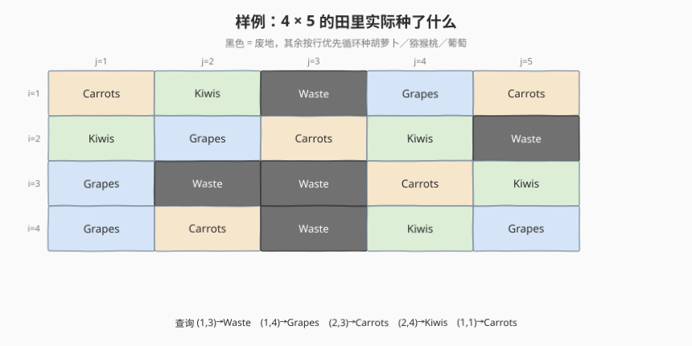
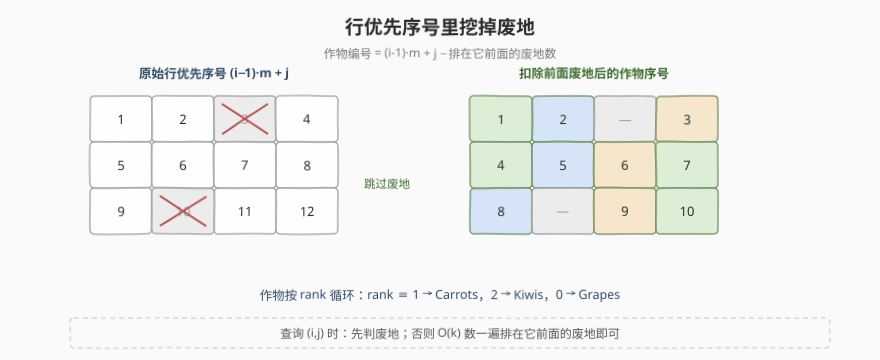

# Codeforces 79B 彩色田野作物 题解

## 1. 题目概述

- **题目链接**：https://codeforces.com/problemset/problem/79/B
- **比赛来源**：Codeforces Beta Round 71 · Problem B（UTC 2011-04-30）
- **难度**：1400
- **标签**：模拟、前缀计数、行优先编号
- **评测类型**：普通
- **限制**：时间 2 s / 内存 256 MB

**题意**：$n \times m$ 的田地被划成 $1 \times 1$ 的格子，其中 $k$ 个格子是废地，其余格子种作物。种植顺序是**行优先**的：$(1,1) \to (1,2) \to \cdots \to (1,m) \to (2,1) \to \cdots \to (n,m)$，废地被跳过、不占编号。作物按 胡萝卜、猕猴桃、葡萄 循环种下（第 $1$ 个格子种胡萝卜，第 $2$ 个种猕猴桃，第 $3$ 个种葡萄，第 $4$ 个又是胡萝卜……）。给出 $t$ 次询问 $(i,j)$，回答该格子是 `Carrots`、`Kiwis`、`Grapes` 还是 `Waste`。

**约束**：

- $1 \le n, m \le 4 \times 10^4$：格子总数可达 $1.6 \times 10^9$，**不能真的开一个 $n \times m$ 的数组**（$1.6 \times 10^9$ 个格子远超 256 MB）。
- $1 \le k, t \le 10^3$：废地数和询问数都很小，允许对每次询问花 $O(k)$ 去数废地，总代价 $O(kt) \le 10^6$。
- 保证废地不重复给出；查询点可能正好是废地。

## 2. 示例与观察

官方样例（输入 / 输出原样，题面说明它对应原文的示意图）：

```text
输入：
4 5 5 6
4 3
1 3
3 3
2 5
3 2
1 3
1 4
2 3
2 4
1 1
1 1
输出：
Waste
Grapes
Carrots
Kiwis
Carrots
Carrots
```



把 $4 \times 5$ 的田按行优先走一遍，跳过 $5$ 个废地，就得到上图：

| 行 \ 列 | 1 | 2 | 3 | 4 | 5 |
|---|---|---|---|---|---|
| 1 | Carrots | Kiwis | Waste | Grapes | Carrots |
| 2 | Kiwis | Grapes | Carrots | Kiwis | Waste |
| 3 | Grapes | Waste | Waste | Carrots | Kiwis |
| 4 | Grapes | Carrots | Waste | Kiwis | Grapes |

六个询问依次是 $(1,3)$、$(1,4)$、$(2,3)$、$(2,4)$、$(1,1)$、$(1,1)$，答案与样例输出完全吻合。

**观察**：作物种类只取决于"这个格子是第几个被种下的"，也就是它在行优先序列里**前面有多少个非废地格子**。于是问题化成纯粹的计数：给 $(i,j)$ 求它的作物序号。

## 3. 解题思路

### 3.1 朴素做法与瓶颈

最朴素的做法是开一个 $n \times m$ 的二维数组，按行优先扫描、跳过废地、循环填三种作物，然后 $O(1)$ 回答询问。

瓶颈在空间：$n, m \le 4 \times 10^4$ 时 $nm = 1.6 \times 10^9$，即使用 `char` 也要 $1.6$ GB，远超 256 MB。时间上扫一遍 $1.6 \times 10^9$ 个格子也必然超时。所以必须**不建表**。

### 3.2 核心观察：作物序号 = 行优先序号 − 前面的废地数



对格子 $(i,j)$ 定义两个量：

- 它在**完整**行优先序列里的序号 $p = (i-1)\,m + j$（从 $1$ 开始，$1 \le p \le nm$）；
- 在它**之前**（行优先意义下排在它前面）的废地个数 $w$。

那么它就是第 $p - w$ 个被种下的格子，作物为

$$\text{crop}(i,j) = \bigl((p - w - 1) \bmod 3\bigr) \in \{\text{Carrots},\ \text{Kiwis},\ \text{Grapes}\}.$$

废地本身不参与编号：若 $(i,j)$ 是废地，直接输出 `Waste`。

"排在它前面"的判定是标准的行优先比较：废地 $(x,y)$ 排在 $(i,j)$ 前面当且仅当 $x < i$，或者 $x = i$ 且 $y < j$。注意**不能**把 $(i,j)$ 自己算进去。

### 3.3 算法流程

1. 读入 $n,m,k,t$，用数组/哈希表存下 $k$ 个废地坐标；
2. 对每个询问 $(i,j)$：
   - 若 $(i,j)$ 在废地集合中：输出 `Waste`，继续；
   - 否则令 $p \leftarrow (i-1)m + j$，遍历废地统计满足 $x < i$ 或 $(x=i \land y<j)$ 的个数 $w$；
   - 输出第 $(p-w-1) \bmod 3$ 种作物。
3. 单次询问 $O(k)$，总复杂度 $O(kt)$。

### 3.4 样例走查：$(2,4)$

对照第 2 节那张完整矩阵图：

- 完整序号 $p = (2-1)\cdot 5 + 4 = 9$；
- 排在 $(2,4)$ 前面的废地：$(1,3)$（$x<i$）、$(1,\text{?})$ 只有 $(1,3)$，以及 $(2,5)$ 的 $y=5>4$ 不算，$(3,\cdot)$、$(4,\cdot)$ 的行号更大不算——所以 $w = 1$；
- 作物序号 $= 9 - 1 = 8$，$(8-1) \bmod 3 = 1$，输出 `Kiwis`，与样例一致。

再验一个跨行的：$(4,1)$。$p = (4-1)\cdot 5 + 1 = 16$；排在它前面的废地是 $(1,3),(2,5),(3,3),(3,2)$ 共 $4$ 个（$(4,3)$ 的行号相同但 $y=3>1$，不算），$w=4$；序号 $= 16-4 = 12$，$(12-1)\bmod 3 = 2$，即 `Grapes`，与上表一致。

## 4. 正确性证明

**引理 1（行优先序号的唯一性）**：映射 $(i,j) \mapsto (i-1)m+j$ 是 $\{1,\dots,n\} \times \{1,\dots,m\}$ 到 $\{1,\dots,nm\}$ 的双射，且与行优先访问顺序一致。

**证明**：$1 \le j \le m$ 时 $(i-1)m + j$ 随 $(i,j)$ 按行优先递增，逐格加一，故为双射且保序。∎

**引理 2（作物序号公式）**：设 $(i,j)$ 不是废地，$w$ 为排在它前面的废地数，则它是第 $p - w$ 个被种下的格子（$p=(i-1)m+j$）。

**证明**：完整序列的前 $p$ 个格子（含 $(i,j)$ 自己）中恰有 $w$ 个废地排在 $(i,j)$ 之前，加上 $(i,j)$ 自己不是废地；而前 $p$ 个格子里的非废地个数就是 $(i,j)$ 的种植序号，等于 $p - w$。∎

**引理 3（循环规则）**：若某格子的种植序号为 $s \ge 1$，则作物由 $(s-1) \bmod 3$ 唯一确定。

**证明**：题面规定第 $1$ 个格子种胡萝卜、第 $2$ 个种猕猴桃、第 $3$ 个种葡萄、第 $4$ 个又是胡萝卜，即以 $3$ 为周期循环，于是 $s \equiv 1,2,0 \pmod 3$ 分别对应三种作物。∎

**定理**：对每个询问，上述算法输出该格子的真实内容。

**证明**：若 $(i,j)$ 是废地，按题面输出 `Waste`；否则由引理 2 得到正确的种植序号，再由引理 3 得到正确的作物名。∎

## 5. 复杂度分析

- **时间**：读入 $O(k)$；每次询问 $O(k)$（扫一遍废地判断是否为废地、再扫一遍数"前面的废地"），共 $O(kt)$。$k,t \le 10^3$ 时约 $10^6$ 次基本操作。
- **空间**：$O(k)$ 存废地，不建 $n \times m$ 的表；这是本题能过 256 MB 的关键。
- **数值范围**：$p \le 4\times10^4 \times 4\times10^4 = 1.6 \times 10^9$，超过 `int` 上限（$2.147 \times 10^9$ 之内其实勉强放得下，但 $(i-1)m+j$ 的中间量没有越界风险）；为稳妥用 `long long` 保存 $p$ 与 $p-w$。
- **与时限的关系**：$O(kt) \le 10^6$ 在 2 s 内非常轻松；实测最大数据约 $3.7$ ms。

## 6. 参考代码

### C++17

```cpp
#include <bits/stdc++.h>
using namespace std;

int main() {
    int n, m, k, t;
    if (scanf("%d %d %d %d", &n, &m, &k, &t) != 4) return 0;
    vector<pair<int, int>> waste(k);
    for (int i = 0; i < k; ++i) scanf("%d %d", &waste[i].first, &waste[i].second);
    static const char* name[3] = {"Carrots", "Kiwis", "Grapes"};
    while (t--) {
        int i, j;
        scanf("%d %d", &i, &j);
        bool isWaste = false;
        for (int q = 0; q < k; ++q)
            if (waste[q].first == i && waste[q].second == j) { isWaste = true; break; }
        if (isWaste) { printf("Waste\n"); continue; }
        // 行优先序号（含废地），再减去它前面的废地数量
        long long idx = (long long)(i - 1) * m + j;
        long long before = 0;
        for (int q = 0; q < k; ++q) {
            int x = waste[q].first, y = waste[q].second;
            if (x < i || (x == i && y < j)) ++before;
        }
        idx -= before;
        printf("%s\n", name[(int)((idx - 1) % 3)]);
    }
    return 0;
}
```

### Python3

```python
import sys


def main() -> None:
    data = sys.stdin.buffer.read().split()
    if not data:
        return
    it = iter(data)
    n = int(next(it)); m = int(next(it)); k = int(next(it)); t = int(next(it))
    waste = set()
    for _ in range(k):
        a = int(next(it)); b = int(next(it))
        waste.add((a, b))
    names = ("Carrots", "Kiwis", "Grapes")
    out = []
    for _ in range(t):
        i = int(next(it)); j = int(next(it))
        if (i, j) in waste:
            out.append("Waste")
            continue
        idx = (i - 1) * m + j
        before = sum(1 for (x, y) in waste if x < i or (x == i and y < j))
        out.append(names[(idx - before - 1) % 3])
    sys.stdout.write("\n".join(out) + "\n")


main()
```

## 7. 边界情况与易错点

1. **不能开二维数组**：$nm$ 可达 $1.6 \times 10^9$，`char grid[n][m]` 直接爆内存。只能存 $k$ 个废地，这是本题的第一考点。
2. **"排在前面"的判定要含行内**：漏掉 `x == i && y < j` 会把同一行左边的废地算漏，样例里 $(1,4)$ 就依赖 $(1,3)$ 这一项。
3. **不能把自己算进 $w$**：判定必须是严格的小于（$x<i$ 或 $x=i \wedge y<j$），若写成 $\le$ 且先判废地，就只在废地查询时侥幸正确。
4. **查询点本身是废地**：样例第 1 个询问 $(1,3)$ 就是废地，必须优先输出 `Waste`，此时根本没算序号。
5. **行优先序号用 64 位**：$(i-1)m+j$ 最大 $1.6 \times 10^9$，`int` 接近溢出边缘，乘 `m` 前先把 `i-1` 转成 `long long` 最稳。
6. **下标从 1 开始**：题面行列都是 $1$ 基；`(idx-1)%3` 里的 $-1$ 不能少，否则第一个格子会算成 `Kiwis`。
7. **三种作物名拼写**：`Carrots`、`Kiwis`、`Grapes`、`Waste`，首字母大写、复数 `s`，大小写与拼写错一个字母就是 WA。
8. **多组询问的读入**：数据量大时用 `scanf` / `sys.stdin.buffer.read().split()`；Python 里对每个询问做集合查找是 $O(1)$，但 `before` 仍需 $O(k)$ 扫描，总体 $10^6$ 量级没问题。

## 8. 验证记录

- **编译环境与命令**：`clang++ -std=c++17 -O2`（Apple clang 21.0.0，配合 `codeforces/tools/include` 的 `bits/stdc++.h` 兼容头；代码只依赖标准库，可原样提交 GNU C++17），Python 3.9.6。
- **官方样例**：1 / 1 通过（$4\times5$、$5$ 个废地、$6$ 次询问），C++ 与 Python 输出逐行一致。
- **独立暴力对拍**：暴力直接建 $n \times m$ 的表、按行优先填三种作物，再 $O(1)$ 回答。对 $1 \le n,m \le 12$ 的 **300 组**随机数据（随机废地数与随机询问）与参考程序比对，**全部一致**。
- **最大约束性能**：$n=m=4\times10^4$、$k=t=10^3$ 的随机数据，C++ 端到端 3 次取最小约 $3.7$ ms（含进程启动），Python 约 $65$ ms；相对 2 s 余量在数百倍以上，内存只与 $k$ 有关。
- **图片校验**：两张 SVG（`cf79b_rowmajor.svg`、`cf79b_sample.svg`）均通过 `xml.etree.ElementTree.parse`，含 `feTurbulence` 与手写体字体族，文本包围盒均未越出 `viewBox`。
- **公式校验**：KaTeX（`throwOnError`）渲染无报错；无 `---` 分隔线，公式全部用 `$...$` / `$$...$$`。
- **复核状态**：verified（样例、对拍、性能、图片、公式五项均实跑通过）。

## 相关题目与扩展

- [Codeforces 79A Bus Game](https://codeforces.com/problemset/problem/79/A)：同场 A 题，确定性模拟，正好与本题"先化成计数、再 $O(1)$ 回答"形成对照。
- [Codeforces 79C Beaver](https://codeforces.com/problemset/problem/79/C)：同场 C 题，字符串上的最长合法子串。
- [Codeforces 1B Spreadsheet](https://codeforces.com/problemset/problem/1/B)：坐标与序号互转，同样要求写清楚"编号到底怎么数"。
- [Codeforces 1191A Tokitsukaze and Enhancement](https://codeforces.com/problemset/problem/1191/A)：取模分类的极简实现题。
- [LeetCode 566. 重塑矩阵](https://leetcode.cn/problems/reshape-the-matrix/)：一维下标与二维下标互相转换，是本题"行优先序号"公式的直接练习。

**延伸思考**：

1. **如果 $k$ 与 $t$ 都放大到 $4 \times 10^4$**：$O(kt)$ 就变成 $1.6 \times 10^9$ 会超时。此时可以把废地按行排序、预处理每行的废地前缀数，单次询问二分，做到 $O(k \log k + t \log k)$。
2. **如果种植顺序改成"蛇形"（奇数行从左到右、偶数行从右到左）**：序号公式要按行的奇偶分别写，先算出该行内的位置再累加，是很好的"先推导再实现"练习。
3. **如果作物循环周期不是 $3$**：答案只取决于 $(s-1) \bmod T$，与本解结构完全相同；周期变大不会增加任何难度，说明真正起作用的是"序号可算"而不是循环长度。
4. **如果把废地换成"被标记的格子不种、且影响后续所有编号"**：本题的减法恰好成立是因为跳过即可；若规则改成"废地也占一个编号"，那么答案就退化成 $p$ 本身——一句话的差别，计数公式完全不同。

