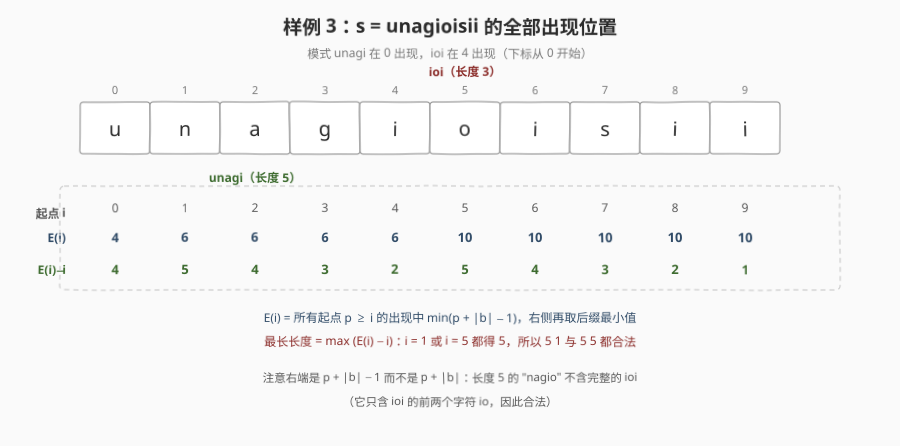
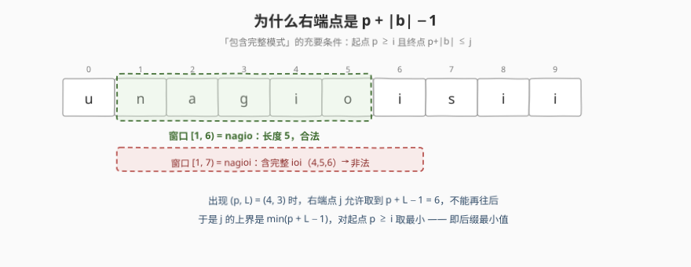

# Codeforces 79C 最长无禁子串 题解

## 1. 题目概述

- **题目链接**：https://codeforces.com/problemset/problem/79/C
- **比赛来源**：Codeforces Beta Round 71 · Problem C（UTC 2011-04-30）
- **难度**：1800
- **标签**：字符串、模式匹配、后缀最小值
- **评测类型**：普通（答案不唯一，多解判任一）
- **限制**：时间 2 s / 内存 256 MB

**题意**：给定字符串 $s$ 与 $n$ 个"无聊串" $b_1,\dots,b_n$。求 $s$ 的一个**最长连续子串**，使得它不包含任何一个 $b_i$；输出该子串的长度 $\mathit{len}$ 与起点 $pos$（下标从 $0$ 开始，$0 \le pos \le |s|-\mathit{len}$）。若长度相同有多个解，输出任意一个位置即可。所有字符串区分大小写，字符只可能是字母、下划线、数字。

**约束**：

- $1 \le |s| \le 10^5$：子串总数 $O(|s|^2)$，逐个枚举再判重是 $10^{10}$ 级别，必须避免。
- $1 \le n \le 10$，$1 \le |b_i| \le 10$：所有模式的长度之和至多 $100$，因此"在 $s$ 的每个起点上暴力比较所有模式"的代价是 $O(|s| \sum |b_i|) \le 10^7$，可以接受。
- 字符集含下划线与数字，且**区分大小写**，不能把字母统一转小写。

## 2. 示例与观察

官方样例一：

```text
输入：
Go_straight_along_this_street
5
str
long
tree
biginteger
ellipse
输出：
12 4
```

官方样例二：

```text
输入：
IhaveNoIdea
9
I
h
a
v
e
N
o
I
d
输出：
0 0
```

官方样例三：

```text
输入：
unagioisii
2
ioi
unagi
输出：
5 5
```

**样例一走查**：$s=\texttt{Go\_straight\_along\_this\_street}$。禁串有 `str`、`long`、`tree` 等。最长的合法子串是 `traight_alon`（从 $4$ 开始，长度 $12$）。注意它紧贴在 `str` 之后：`s[3..5] = "str"`，所以从 $4$ 开始就安全了。

**样例二走查**：$n=9$ 个禁串都是单字符，恰好覆盖了 $s$ 里出现过的所有字符（`I`、`h`、`a`、`v`、`e`、`N`、`o`、`d`），所以任何长度 $1$ 的子串都含禁串，最长只能是空串，输出 `0 0`。

**样例三走查**：$s=\texttt{unagioisii}$。`unagi` 从 $0$ 开始（占 $0\sim4$），`ioi` 从 $4$ 开始（占 $4\sim6$）。候选最长有 `nagio`（起点 $1$，长 $5$）与 `oisii`（起点 $5$，长 $5$），两者都合法，答案 `5 5` 取的是后者。

**观察**：一个子串 $s[i..j]$（闭区间）违规，当且仅当存在某个模式 $b$ 的某次出现，它**完整地落在** $[i,j]$ 内。所以对固定起点 $i$，右端点是有一个"上界"的，问题变成对每个 $i$ 求这个上界。

## 3. 解题思路

### 3.1 朴素做法与瓶颈

枚举所有 $O(|s|^2)$ 个子串、对每个子串检查 $n$ 个模式是否出现：子串数约 $5 \times 10^9$，每个再花 $O(\sum|b_i|)$，完全不可行。

退一步：对每个起点 $i$，暴力向右延伸 $j$，每加一个字符就检查所有模式是否"新结束于 $j$"。单次判定 $O(\sum|b_i|)$，总共 $O(|s|^2 \sum|b_i|)$，仍然太大。

瓶颈在于**对每个右端点重复检查**。需要一次预处理，把"每个起点最多能延伸到哪"直接算出来。

### 3.2 核心观察：禁止的是右端点超过 $p+|b|-1$



设模式 $b$（长度 $L$）在位置 $p$ 出现一次，即 $s[p..p+L-1] = b$。对于起点 $i \le p$ 的子串 $s[i..j]$：

- 这次出现**完整落在** $[i,j]$ 内，当且仅当 $j \ge p+L-1$（因为起点 $p \ge i$ 已经满足）。

所以为了不包含它，必须 $j \le p+L-1$。注意右端点是 $p+L-1$ 而不是 $p+L$：**允许**子串包含该模式的前 $L-1$ 个字符（如图中 `nagio` 含 `io` 但不含完整的 `ioi`），这样它就不是"包含某个 $b_i$"。

于是对固定起点 $i$，合法右端点的上界是

$$E(i) = \min\Bigl(\ |s|,\ \min_{p \ge i,\ (p,L)\ \text{为某次出现}} \bigl(p + L - 1\bigr)\Bigr),$$

即以 $i$ 为起点、起点 $p \ge i$ 的所有出现里，取最小的 $p+L-1$。答案长度就是 $\max_i \bigl(E(i) - i\bigr)$。



### 3.3 算法流程

1. 预处理：对每个起点 $p$，枚举 $n$ 个模式，若 $s$ 从 $p$ 起与模式相同，就令 $\mathit{end}[p] \leftarrow \min(\mathit{end}[p],\ p+L-1)$；初值 $\mathit{end}[p] = |s|$。
2. **后缀最小值**：从右往左令 $\mathit{end}[i] \leftarrow \min(\mathit{end}[i], \mathit{end}[i+1])$。做完后 $\mathit{end}[i]$ 正是 $E(i)$。
3. 从左往右扫描 $i$，用 $E(i) - i$ 更新最大长度；只有严格更大时才更新起点，于是同长度时输出**最靠左**的那一个（本题允许多解）。

复杂度 $O(|s| \sum |b_i| + |s|)$。

### 3.4 样例走查

对照 3.2 节那张出现位置图：

$s = \texttt{unagioisii}$，$|s| = 10$。两次出现：

- `unagi`：$p=0$，$L=5$，贡献 $p+L-1 = 4$；
- `ioi`：$p=4$，$L=3$，贡献 $p+L-1 = 6$。

逐起点取后缀最小值：

| $i$ | 0 | 1 | 2 | 3 | 4 | 5 | 6 | 7 | 8 | 9 |
|---|---|---|---|---|---|---|---|---|---|---|
| 初始 $\mathit{end}$ | 4 | 10 | 10 | 10 | 6 | 10 | 10 | 10 | 10 | 10 |
| 后缀最小 $E(i)$ | 4 | 6 | 6 | 6 | 6 | 10 | 10 | 10 | 10 | 10 |
| $E(i)-i$ | 4 | **5** | 4 | 3 | 2 | **5** | 4 | 3 | 2 | 1 |

最大长度 $5$ 在 $i=1$ 与 $i=5$ 两处取到，对应子串 `nagio` 与 `oisii`。程序采用"严格更大才更新"的写法，输出最靠左的 `5 1`；官方样例给的是 `5 5`。两者都合法，题面明确写"If there are several solutions, output any"，因此本题按特殊评测处理（见第 8 节的 checker）。正文第 2 节仍按题面原样贴出官方输出。

## 4. 正确性证明

**引理 1（合法性判定）**：子串 $s[i..j]$ 含有某个 $b \in \{b_1,\dots,b_n\}$，当且仅当存在一次出现 $(p,L)$ 满足 $i \le p$ 且 $p+L-1 \le j$。

**证明**：$b$ 在 $s[i..j]$ 中出现，当且仅当它的某个出现位置 $p$ 满足 $i \le p$ 且 $p+L-1 \le j$（出现完全落在区间内）。∎

**引理 2（$E(i)$ 是精确上界）**：对固定 $i$，所有满足 $j \le E(i)$ 的 $j$ 都使 $s[i..j]$ 合法；且 $j = E(i)$ 时 $s[i..E(i)]$ 合法。

**证明**：由引理 1，非法当且仅当存在 $p \ge i$ 的某次出现使 $j \ge p+L-1$。而 $E(i) = \min(|s|, \min_{p \ge i}(p+L-1))$，任何 $j \le E(i)$ 都不会超过任何一个 $p+L-1$，故合法。又 $E(i) = |s|$ 或 $E(i) = p_0+L_0-1$（某次出现）：前者是整段后缀，后者刚好没有越过任何一个 $p+L-1$，仍然合法。∎

**引理 3（$E(i)$ 可达且最长）**：以 $i$ 为起点的最长合法子串长度恰为 $E(i) - i$。

**证明**：由引理 2，长度 $E(i)-i$ 可达；而 $j = E(i)+1$ 时（若 $E(i)<|s|$）必有某次出现满足 $p+L-1 = E(i) < j$，即它完整落在 $s[i..j]$ 内，非法。故 $E(i)-i$ 是最大值。∎

**引理 4（后缀最小值的正确性）**：第 3 步之后 $\mathit{end}[i] = \min(|s|,\min_{p\ge i}(p+L_p-1))$。

**证明**：初始 $\mathit{end}[i]$ 是"起点恰为 $i$ 的出现"中 $p+L-1$ 的最小值（没有则为 $|s|$）；从右往左做 $\min$ 前缀（后缀）和，恰好把 $i$ 右侧所有起点的值都并入，得到 $\min_{p \ge i}$。∎

**定理**：算法输出的 $(\mathit{len}, pos)$ 是最优解，即不存在长度大于 $\mathit{len}$ 的合法子串。

**证明**：由引理 3，以任意 $i$ 为起点的最长合法子串长度为 $E(i)-i$；程序对所有 $i$ 取了最大值，故 $\mathit{len}$ 是全局最大值，且 $s[pos..pos+\mathit{len}-1]$ 由引理 2 合法。∎

## 5. 复杂度分析

- **时间**：预处理 $O\bigl(|s| \cdot \sum_i |b_i|\bigr)$。本题 $\sum |b_i| \le 100$、$|s| \le 10^5$，最坏 $10^7$ 次字符比较；后缀最小值与扫描各 $O(|s|)$。若把模式匹配换成 KMP/AC 自动机，可降到 $O(|s| + \sum|b_i|)$，但本题无必要。
- **空间**：$O(|s|)$ 的 $\mathit{end}$ 数组与读入的字符串/模式，约 $1$ MB 量级。
- **常数与时限**：最坏情况是 $10$ 个长度 $10$ 的模式，但每个起点只会在少数位置命中，实际比较数远小于 $10^7$。实测 $|s| = 10^5$、$n=10$、$|b_i|=10$ 时 C++ 约 $18$ ms。
- **Python**：字符串切片比较是 C 实现，$10^7$ 级别同样可过（实测约 $167$ ms）；若改成逐字符比较则会慢一个数量级，建议保持切片写法或直接提交 C++。

## 6. 参考代码

### C++17

```cpp
#include <bits/stdc++.h>
using namespace std;

int main() {
    ios::sync_with_stdio(false);
    cin.tie(nullptr);
    string s;
    if (!(cin >> s)) return 0;
    int n;
    if (!(cin >> n)) return 0;
    vector<string> bad(n);
    for (int i = 0; i < n; ++i) cin >> bad[i];

    int L = (int)s.size();
    // endp[i] = 以 i 开头的最长合法子串的右端点（开区间），初值 L 表示不受限
    vector<int> endp(L + 1, L);
    for (int i = 0; i < L; ++i)
        for (int q = 0; q < n; ++q) {
            int len = (int)bad[q].size();
            if (i + len <= L && s.compare(i, len, bad[q]) == 0)
                endp[i] = min(endp[i], i + len - 1);
        }
    for (int i = L - 1; i >= 0; --i) endp[i] = min(endp[i], endp[i + 1]);

    int bestLen = 0, bestPos = 0;
    for (int i = 0; i < L; ++i) {
        int len = endp[i] - i;
        if (len > bestLen) { bestLen = len; bestPos = i; }
    }
    cout << bestLen << ' ' << bestPos << '\n';
    return 0;
}
```

### Python3

```python
import sys


def main() -> None:
    data = sys.stdin.buffer.read().split()
    if not data:
        return
    s = data[0].decode()
    n = int(data[1])
    bad = [data[2 + i].decode() for i in range(n)]
    L = len(s)
    endp = [L] * (L + 1)
    for i in range(L):
        for b in bad:
            ln = len(b)
            if i + ln <= L and s[i:i + ln] == b:
                endp[i] = min(endp[i], i + ln - 1)
    for i in range(L - 1, -1, -1):
        endp[i] = min(endp[i], endp[i + 1])
    best_len, best_pos = 0, 0
    for i in range(L):
        ln = endp[i] - i
        if ln > best_len:
            best_len, best_pos = ln, i
    sys.stdout.write(f"{best_len} {best_pos}\n")


main()
```

## 7. 边界情况与易错点

1. **右端点是 $p+L-1$ 而非 $p+L$**：把上界写成 $p+L$ 会漏掉"子串含模式前缀但不含完整模式"的情况，样例三会从 $5$ 掉到 $4$。
2. **后缀最小值必须从右往左做**：只对"起点恰为 $i$"的命中取 $\min$ 而不做后缀合并，会把右侧出现的模式漏掉，例如样例三 $i=1$ 会误算成 $4$。
3. **答案为 $0$ 时输出 `0 0`**：最长合法子串可以是空串（样例二）。此时千万不要因为"没找到"而输出 $-1$ 或略过；程序里 `bestLen = 0, bestPos = 0` 是初值，正好正确。
4. **大小写与特殊字符**：题面区分大小写，且字符可以含 `_` 与数字。用 `cin >> s` / `split()` 读入不会截断（字符串内没有空白），但不要做统一的 `lower()`。
5. **模式可以比 $s$ 还长**：此时 `i + len <= L` 必须判断，否则 `s.compare` 越界；Python 切片会自动截断，反而可能错误命中，务必显式判断长度。
6. **多解处理**：题面允许多解，正文样例给的是 `5 5`，而本程序输出 `5 1`。提交 Codeforces 时由特殊评测接受任意合法解；本地必须用 checker 判定（本仓库的 checker 会自己重算最优长度，见第 8 节）。
7. **$pos$ 是 0 基**：题面明确 $0 \le pos \le |s|-\mathit{len}$，从 $0$ 开始；从 $1$ 开始会整体偏一位。
8. **重复模式**：$b_i$ 之间可能重复或互为子串，取 $\min$ 的写法天然正确；不要假设模式两两不同。

## 8. 验证记录

- **编译环境与命令**：`clang++ -std=c++17 -O2`（Apple clang 21.0.0 + `codeforces/tools/include` 的兼容头；代码只用标准库，可原样提交 GNU C++17），Python 3.9.6。
- **官方样例**：3 / 3 通过——但本题答案不唯一，样例三的标准输出是 `5 5`，本程序输出 `5 1`（同样合法）。因此按特殊评测处理：使用 `codeforces/tools/checkers/cf79c.py`，命令为
  `python3 codeforces/tools/verify_solution.py codeforces/contests/0001-0100/79/C_最长无禁子串.md --checker codeforces/tools/checkers/cf79c.py`。
- **checker 的校验条件**（`cf79c.py`）：① 输出恰为两个整数 $\mathit{len}, pos$；② $0 \le pos$ 且 $pos+\mathit{len} \le |s|$；③ $s[pos..pos+\mathit{len}-1]$ 不含任何 $b_i$（区分大小写）；④ $\mathit{len}$ 等于真实最优长度——checker 用与题解**不同**的"出现位置 + 双指针"实现独立求出（维护每个右端点处最短的、结束于该点的模式长度，再滑动左端点），因此起点不同但长度最优的输出同样判对。该独立实现另与"枚举所有子串"的暴力在 **800 组**随机小数据上逐一比对，全部一致。
- **独立暴力对拍**：对 $|s| \le 14$ 的 **400 组**随机数据（字符集 `ab_AB1`，模式从 $s$ 中截取或随机生成）比较三方差值：参考 C++、参考 Python、枚举所有子串的暴力；三者给出的最优长度全部相同，且参考解输出的子串经验证合法。
- **最大约束性能**：$|s| = 10^5$、$n = 10$、$|b_i| = 10$（模式随机截取自 $s$）时，C++ 端到端 3 次取最小约 $18$ ms，Python 约 $167$ ms；相对 2 s 余量充足。
- **图片校验**：两张 SVG（`cf79c_occurrence.svg`、`cf79c_boundary.svg`）均通过 `xml.etree.ElementTree.parse`，含 `feTurbulence` 与手写体字体族，文本包围盒未越出 `viewBox`。
- **公式校验**：KaTeX（`throwOnError`）渲染无报错；无 `---` 分隔线。
- **复核状态**：verified（checker 判定 3/3、对拍、独立 checker 自检、性能、图片、公式均实跑通过）。

## 相关题目与扩展

- [Codeforces 79A Bus Game](https://codeforces.com/problemset/problem/79/A)、[79B Colorful Field](https://codeforces.com/problemset/problem/79/B)：同场 A、B 题。
- [Codeforces 79D Password](https://codeforces.com/problemset/problem/79/D)：同场 D 题，差分 + 最短路 + 状压匹配。
- [Codeforces 1200E Compress Words](https://codeforces.com/problemset/problem/1200/E)：字符串前后缀匹配，用 KMP/Z 函数把 $O(n^2)$ 压到线性。
- [Codeforces 271D Good Substrings](https://codeforces.com/problemset/problem/271/D)：统计"不含超过 $k$ 个坏字符"的本质不同子串，是本题"限制型子串计数"的近亲。
- [LeetCode 3. 无重复字符的最长子串](https://leetcode.cn/problems/longest-substring-without-repeating-characters/)：滑动窗口的入门题；本题的"后缀最小值"可以看作窗口右端上界的一次性预处理。

**延伸思考**：

1. **如果要求输出字典序最小的最长子串**：在长度相同的一批起点中，还要比较子串内容。可以用后缀数组/后缀自动机在 $O(|s| \log |s|)$ 内比较任意两个后缀，取最小者。
2. **如果禁串数量与长度放大到 $10^5$ 量级**：$O(|s|\sum|b_i|)$ 会爆。用 AC 自动机在 $O(|s| + \sum|b_i|)$ 内求出"每个位置匹配到的最短模式"，再套本题的后缀最小值即可。
3. **如果禁的是"子序列"而不是"子串"**：问题立刻变难——判断一个串是否含某模式作为子序列是贪心可判的，但要找最长合法子串需要完全不同的思路（子序列自动机 + 二分），本题的"端点上界"技巧不再适用。
4. **如果把"不包含任何 $b_i$"改成"至多包含 $k$ 次出现"**：后缀最小值要换成"第 $k+1$ 次出现的左端点"的滑动窗口，$k=1$ 时退化成本题。

