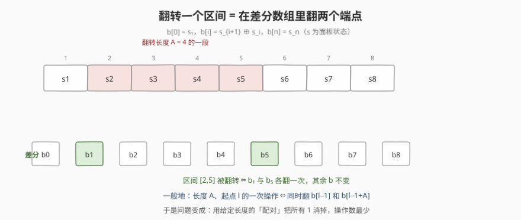
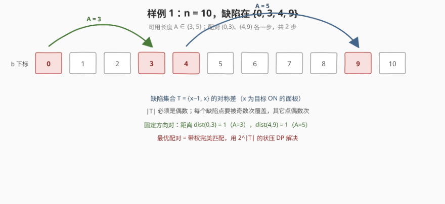

# Codeforces 79D 翻转面板密码 题解

## 1. 题目概述

- **题目链接**：https://codeforces.com/problemset/problem/79/D
- **比赛来源**：Codeforces Beta Round 71 · Problem D（UTC 2011-04-30）
- **难度**：2800
- **标签**：差分、最短路、最小权完美匹配、状压 DP
- **评测类型**：普通
- **限制**：时间 1 s / 内存 256 MB

**题意**：$1 \times n$ 的面板初始全为 OFF。给定长度数组 $a_1,\dots,a_l$，每次操作可选一个 $a_i$ 与一段连续的 $a_i$ 个面板，把它们的状态全部翻转。目标是把第 $x_1 < x_2 < \cdots < x_k$ 个面板变成 ON、其余保持 OFF。求最少操作次数，做不到输出 `-1`。

**约束**：

- $1 \le n \le 10^4$：面板数最多一万，$(n+1)^2$ 的 DP 是 $10^8$，勉强但没必要；$O(n \cdot l + 2^{2k}\cdot k^2)$ 才是目标。
- $1 \le k \le 10$：目标 ON 的面板最多 $10$ 个，这是本题的**核心规模**——差分后只有至多 $2k \le 20$ 个"缺陷点"。
- $1 \le l \le 100$，$1 \le a_i \le n$，$a_i$ 可能有重复：可用长度至多 $100$ 种，去重后作为图的边型。
- 单组数据，无多测。

## 2. 示例与观察

官方样例一：

```text
输入：
10 8 2
1 2 3 5 6 7 8 9
3 5
输出：
2
```

官方样例二：

```text
输入：
3 2 1
1 2
3
输出：
-1
```

**样例一走查**：$n=10$，目标是 $1,2,3,5,6,7,8,9$ 为 ON。题面提示的两步是：翻转 $[1,3]$（长度 $3$）与 $[5,9]$（长度 $5$）。第一步把 $1,2,3$ 点亮，第二步把 $5\sim9$ 点亮，正好得到目标，共 $2$ 步，且显然不能 $1$ 步完成（一次翻转只能改变一段连续区间）。输出 `2`。

**样例二走查**：$n=3$，目标 $1,2$ 为 ON，但唯一的可用长度是 $3$——一次只能翻转全部 $3$ 块面板，无论翻几次都只能得到「全 OFF」或「全 ON」，无法只点亮前两块，输出 `-1`。

**观察**：一次操作总是翻转**一段**，它对"相邻两块是否不同"（即差分数组）的影响只有两个端点。把状态换成差分后，每次操作就变成"同时翻转两个固定距离的位置"，$k$ 个目标 ON 只产生 $2k$ 个需要被翻奇数次的点。

## 3. 解题思路

### 3.1 朴素做法与瓶颈

在面板状态上直接 BFS：状态数 $2^n$，$n = 10^4$ 时是天文数字。即使只在目标附近做搜索，也躲不开指数级状态。

必须换一种"只看必要信息"的描述方式。注意到每次操作只改变两个"边界"，而目标状态也只有 $O(k)$ 个边界，于是把问题压缩到 $O(k)$ 个点的图上。

### 3.2 核心观察：差分数组把区间翻转变成两点翻转



令 $s_1,\dots,s_n \in \{0,1\}$ 为面板状态，并补充虚拟端点 $s_0 = s_{n+1} = 0$（两端之外全 OFF）。定义差分数组

$$b_i = s_i \oplus s_{i+1}, \qquad i = 0,1,\dots,n .$$

于是 $b$ 与 $s$ 一一对应（$s$ 由 $b$ 的前缀异或还原）。

- **一次操作**：翻转区间 $[l,\,l+A-1]$（长度 $A$）。区间内部相邻两块同时翻转，$b$ 不变；只有 $b_{l-1}=s_{l-1}\oplus s_l$ 与 $b_{l+A-1}=s_{l+A-1}\oplus s_{l+A}$ 各翻一次。即一次操作 $\iff$ 同时翻转 $b_u$ 与 $b_{u+A}$，其中 $u = l-1 \in [0,\,n-A]$。
- **目标状态**：$x$ 处为 ON 会同时让 $b_{x-1}$ 与 $b_x$ 变成 $1$。于是需要被翻**奇数次**的位置集合是

$$T = \bigtriangleup_{i=1}^{k}\ \{\,x_i - 1,\ x_i\,\}$$

（$\triangle$ 为对称差，重合的位置相互抵消）。

问题变成：**用最少的"同时翻转距离为某个 $a_i$ 的两点"的操作，让 $T$ 中每个位置被翻奇数次、其余位置被翻偶数次。**

### 3.3 算法流程：最短路 + 最小权完美匹配



把位置 $0,1,\dots,n$ 看成图的顶点。对每个可用长度 $A$，对所有 $0 \le u \le n-A$ 连一条无向边 $(u,\,u+A)$，边权为 $1$（一次操作）。于是：

1. **缺陷点**：$|T| \le 2k \le 20$。若某个缺陷点与其它缺陷点都不连通，则无解（输出 `-1`）。
2. **距离**：对每个缺陷点做一次 BFS，得到两两之间的最短路长度 $\mathit{dist}(u,v)$。一条从 $u$ 到 $v$ 的路径对应一串操作，它只在 $u$ 与 $v$ 处产生奇数次翻转（中间点被覆盖两次、抵消），代价就是路径长度。
3. **配对**：把 $T$ 中的点两两配对，每对的代价是它们的 BFS 距离；求总代价最小的完美配对。这是**最小权完美匹配**，由于 $|T| \le 20$，用状压 DP：

$$dp[\varnothing] = 0,\qquad dp[mask] = \min_{j \in mask,\ j \ne \text{lowbit}(mask)} \Bigl( dp[mask \setminus \{i,j\}] + \mathit{dist}(i,j) \Bigr),$$

其中 $i$ 取 $mask$ 的最低位（强制 $i$ 与某个 $j$ 配对，避免重复枚举配对顺序）。

4. 答案就是 $dp[T]$；若为无穷大则输出 `-1`。

### 3.4 样例走查

对照 3.3 节那张缺陷点图：

$n=10$，目标 ON 于 $1,2,3,5,6,7,8,9$。逐对取对称差：

- $x=1$：$\{0,1\}$；
- $x=2$：$\{1,2\}$，与上面抵消 $1$，得 $\{0,2\}$；
- $x=3$：$\{2,3\}$，抵消 $2$，得 $\{0,3\}$；
- $x=5$：$\{4,5\}$，得 $\{0,3,4,5\}$；
- $x=6$：$\{5,6\}$，抵消 $5$，得 $\{0,3,4,6\}$；
- $x=7$：$\{6,7\}$，抵消 $6$，得 $\{0,3,4,7\}$；
- $x=8$：$\{7,8\}$，抵消 $7$，得 $\{0,3,4,8\}$；
- $x=9$：$\{8,9\}$，抵消 $8$，得 $\{0,3,4,9\}$。

$T = \{0,3,4,9\}$，$A \in \{3,5\}$。

- $\mathit{dist}(0,3) = 1$：直接用长度 $3$（对应翻转 $[1,3]$）；
- $\mathit{dist}(4,9) = 1$：直接用长度 $5$（对应翻转 $[5,9]$）。

配对 $(0,3),(4,9)$ 总代价 $2$，与样例输出一致。（另一配对 $(0,4),(3,9)$ 需要更多步。）

## 4. 正确性证明

**引理 1（差分双射）**：给定 $b_0,\dots,b_n \in \{0,1\}$，由其前缀异或还原出的 $s_i = b_0 \oplus b_1 \oplus \cdots \oplus b_{i-1}$ 满足 $s_0 = 0$、$s_i \oplus s_{i+1} = b_i$，且 $b_n = s_n$。故 $b$ 与"面板状态 $s$"一一对应。

**证明**：直接按定义展开即可：$s_i \oplus s_{i+1} = b_i$，且 $s_{n+1}=s_n\oplus b_n = s_n \oplus s_n = 0$。∎

**引理 2（操作即边）**：翻转区间 $[l, l+A-1]$ 恰好翻转 $b_{l-1}$ 与 $b_{l+A-1}$，其余 $b_i$ 不变；反之，图中每条边 $(u,u+A)$ 都对应一次合法操作（翻转 $[u+1,\,u+A]$）。

**证明**：区间内部相邻两块同时取反，异或不变；左端点处 $s_{l-1}$ 不变而 $s_l$ 取反，故 $b_{l-1}$ 取反；右端点处 $s_{l+A-1}$ 取反而 $s_{l+A}$ 不变，故 $b_{l+A-1}$ 取反。且 $1 \le l$、$l+A-1 \le n$ 等价于 $0 \le u \le n-A$。∎

**引理 3（解的等价刻画）**：一组操作能达成目标，当且仅当它对应的边多重集在每个顶点上的度数奇偶性为：$T$ 中的点度数为奇、其余为偶（即一个 $T$-join）。操作次数就是边多重集的大小。

**证明**：$b_i$ 最终等于初值（$0$）异或"覆盖 $i$ 的操作次数"，所以 $b_i = 1 \iff$ 覆盖次数为奇。目标 $b$ 的 $1$ 恰好是 $T$，故条件等价。∎

**引理 4（最短路对应配对）**：设 $u,v$ 为两个缺陷点，最短路径长度为 $d$，则存在 $d$ 次操作恰好翻转 $u,v$ 而其它点不变；且少于 $d$ 次不可能做到。

**证明**：路径上的边依次执行，中间顶点各被覆盖两次（偶数），端点各一次（奇数），故只翻转 $u,v$，用了 $d$ 次。若用 $<d$ 次做到，这些边构成的子图在 $u,v$ 处为奇、其余为偶，从 $u$ 沿奇度边可走出一条到 $v$ 的通路，长度不超过边数 $<d$，与最短路矛盾。∎

**引理 5（最小 $T$-join = 最小权完美匹配）**：$T$ 上以最短路距离为权的任意完美匹配，其总权可通过"每条配对取一条最短路"实现为一个 $T$-join，边数不超过总权；反之任一 $T$-join 都可分解为若干条端点两两配对的路径（可能还有偶环，删去不影响奇偶性且不增加边数），于是给出一个总权不超过其边数的完美匹配。

**证明**：前半：把每条配对的最短路取出来做对称差/多重集并，端点奇偶性正好是 $T$。后半：$T$-join 的每个连通分量中奇度点个数为偶数，沿分量内路径把奇度点配对，路径边数之和不超过分量边数；偶环上的边全部删去仍是 $T$-join 且更小。∎

**定理**：算法输出的 $dp[T]$ 就是最少操作次数；若 $dp[T] = \infty$ 则无解。

**证明**：由引理 3，任何合法操作序列是一个 $T$-join，其大小由引理 5 不小于某个完美匹配的总权，而 DP 求的正是最小总权，故任何解都不小于 $dp[T]$；反过来由引理 4 与引理 5，取到最小值的那组配对可以真的用 $dp[T]$ 次操作实现。两边夹住即得。无解当且仅当存在无法与任何其它缺陷点连通的缺陷点，此时 $dp[T] = \infty$。∎

## 5. 复杂度分析

- **时间**：BFS 部分 $O\bigl(|T| \cdot (n+1) \cdot l'\bigr)$，其中 $l' \le l$ 是去重后的长度数；$|T| \le 20$、$n \le 10^4$、$l' \le 100$，最坏约 $2 \times 10^7$ 次松弛。匹配 DP 部分 $O(2^{|T|} \cdot |T|)$，$|T| = 20$ 时约 $10^7$ 次转移。两者同级，1 s 内完成。
- **空间**：BFS 的距离数组 $O(n)$；$dp$ 数组 $2^{|T|} \le 2^{20}$ 个 `long long`，约 $8$ MB，加距离矩阵 $O(|T|^2)$，总计远低于 256 MB。
- **常数**：BFS 用 `deque` 或普通队列均可（边权全为 $1$）；DP 只遍历偶数大小的集合，实际转移数约为 $2^{19} \times 19$ 的一半。
- **Python**：同样的 BFS + DP 在 CPython 下满数据约 $3.1$ s，会超过 1 s 的原始时限，**建议提交 C++ 或用 PyPy3**；本仓库的 Python 版本定位为参考实现（样例正确）。

## 6. 参考代码

### C++17

```cpp
#include <bits/stdc++.h>
using namespace std;

int main() {
    int n, k, l;
    if (scanf("%d %d %d", &n, &k, &l) != 3) return 0;
    vector<int> x(k), a(l);
    for (int i = 0; i < k; ++i) scanf("%d", &x[i]);
    for (int i = 0; i < l; ++i) scanf("%d", &a[i]);
    sort(a.begin(), a.end());
    a.erase(unique(a.begin(), a.end()), a.end());

    // 差分数组 b[0..n]：b[i] 表示第 i 块与第 i+1 块状态是否不同（两端为空）
    vector<char> diff(n + 1, 0);
    for (int i = 0; i < k; ++i) { diff[x[i] - 1] ^= 1; diff[x[i]] ^= 1; }
    vector<int> T;
    for (int i = 0; i <= n; ++i) if (diff[i]) T.push_back(i);
    int m = (int)T.size();
    if (m == 0) { printf("0\n"); return 0; }
    if (m & 1) { printf("-1\n"); return 0; }

    const int INF = 1e9;
    vector<vector<int>> dist(m, vector<int>(m, INF));
    vector<int> ds(n + 1);
    deque<int> q;
    for (int s = 0; s < m; ++s) {
        fill(ds.begin(), ds.end(), -1);
        q.clear();
        ds[T[s]] = 0;
        q.push_back(T[s]);
        while (!q.empty()) {
            int u = q.front(); q.pop_front();
            for (int len : a) {
                int v = u + len;
                if (v <= n && ds[v] < 0) { ds[v] = ds[u] + 1; q.push_back(v); }
                v = u - len;
                if (v >= 0 && ds[v] < 0) { ds[v] = ds[u] + 1; q.push_back(v); }
            }
        }
        for (int j = 0; j < m; ++j) dist[s][j] = (ds[T[j]] < 0 ? INF : ds[T[j]]);
    }

    const long long LINF = (long long)4e18;
    vector<long long> dp(1 << m, LINF);
    dp[0] = 0;
    for (int mask = 1; mask < (1 << m); ++mask) {
        if (__builtin_popcount((unsigned)mask) & 1) continue;
        int i = __builtin_ctz((unsigned)mask);
        for (int j = i + 1; j < m; ++j) {
            if (!((mask >> j) & 1)) continue;
            int sub = mask ^ (1 << i) ^ (1 << j);
            if (dp[sub] >= LINF || dist[i][j] >= INF) continue;
            dp[mask] = min(dp[mask], dp[sub] + dist[i][j]);
        }
    }
    long long ans = dp[(1 << m) - 1];
    printf("%lld\n", ans >= LINF ? -1LL : ans);
    return 0;
}
```

### Python3

```python
import sys
from collections import deque


def main() -> None:
    data = sys.stdin.buffer.read().split()
    if not data:
        return
    it = iter(data)
    n = int(next(it)); k = int(next(it)); l = int(next(it))
    xs = [int(next(it)) for _ in range(k)]
    aa = sorted({int(next(it)) for _ in range(l)})

    diff = bytearray(n + 1)
    for x in xs:
        diff[x - 1] ^= 1
        diff[x] ^= 1
    T = [i for i in range(n + 1) if diff[i]]
    m = len(T)
    if m == 0:
        sys.stdout.write("0\n")
        return
    if m & 1:
        sys.stdout.write("-1\n")
        return

    INF = 10 ** 9
    dist = [[INF] * m for _ in range(m)]
    for s in range(m):
        ds = [-1] * (n + 1)
        ds[T[s]] = 0
        q = deque([T[s]])
        while q:
            u = q.popleft()
            du = ds[u] + 1
            for ln in aa:
                v = u + ln
                if v <= n and ds[v] < 0:
                    ds[v] = du
                    q.append(v)
                v = u - ln
                if v >= 0 and ds[v] < 0:
                    ds[v] = du
                    q.append(v)
        row = dist[s]
        for j in range(m):
            row[j] = ds[T[j]] if ds[T[j]] >= 0 else INF

    size = 1 << m
    LINF = 1 << 60
    dp = [LINF] * size
    dp[0] = 0
    for mask in range(1, size):
        if bin(mask).count("1") & 1:
            continue
        i = (mask & -mask).bit_length() - 1
        rest = mask ^ (1 << i)
        best = LINF
        while rest:
            lb = rest & -rest
            j = lb.bit_length() - 1
            rest ^= lb
            d = dist[i][j]
            if d >= INF:
                continue
            prev = dp[mask ^ (1 << i) ^ lb]
            if prev + d < best:
                best = prev + d
        dp[mask] = best
    ans = dp[size - 1]
    sys.stdout.write(("-1" if ans >= LINF else str(ans)) + "\n")


main()
```

## 7. 边界情况与易错点

1. **差分数组要多开一位**：$b$ 的下标是 $0 \le i \le n$（共 $n+1$ 个），对应"面板 $i$ 与面板 $i+1$ 之间"以及两端虚拟边界。只开 $n$ 个会漏掉 $b_0$ 或 $b_n$，样例一立刻出错。
2. **目标 ON 贡献两个端点**：每个 $x_i$ 同时翻转 $b_{x_i-1}$ 与 $b_{x_i}$；相邻的 $x$（如 $x_i+1=x_{i+1}$）会抵消中间那个端点，必须用异或（对称差）而不是简单插入。
3. **长度为 $A$ 的操作起点范围是 $0 \le u \le n-A$**：BFS 里 `u + len <= n` 与 `u - len >= 0` 两个边界都要判；$a_i$ 可以等于 $n$（此时只有一条边 $(0,n)$）。
4. **重复的 $a_i$**：同一长度出现多次不会让"一次操作"变便宜，必须去重，否则 BFS 只是常数变慢（不影响正确性），但去重后更清晰。
5. **不可达即无解**：图可能不连通（样例二），此时某些缺陷点之间的距离是 $\infty$，DP 结果为 $\infty$，必须输出 `-1` 而不是一个大数。判断用 `ans >= LINF`，不要用 `== INF`（加法可能让 INF 变大）。
6. **$T$ 为空**：理论上 $k \ge 1$ 时 $0 \in T$ 不会为空，但代码里保留 `m == 0 → 0` 分支，避免 $2^0$ 之类的小坑。
7. **状压 DP 只用偶数大小的集合**：奇数大小的集合不可能配完，跳过它们能省一半时间；同时用 `__builtin_ctz` 强制最低位参与配对，避免同一配对被枚举 $2$ 次（虽不影响正确性，但影响常数）。
8. **答案范围**：操作次数不超过 $|T|/2 \cdot n \le 10 \times 10^4 = 10^5$，`int` 够用；但 `dp` 的哨兵值要用足够大的 `long long`（`4e18`），不要用 `INT_MAX` 相加导致溢出。
9. **Python 的性能**：$2^{20}$ 的 DP 在 CPython 下约 $3$ s，会超过 1 s；若必须用 Python，请提交 PyPy3。

## 8. 验证记录

- **编译环境与命令**：`clang++ -std=c++17 -O2`（Apple clang 21.0.0 + `codeforces/tools/include` 的兼容头；代码只用标准库，可原样提交 GNU C++17），Python 3.9.6。
- **官方样例**：2 / 2 通过（`2` 与 `-1`），C++ 与 Python 输出一致。
- **独立暴力对拍**：暴力直接在 $2^n$ 个面板状态上 BFS（每次操作枚举所有长度与所有起点），与参考程序比较最少步数。共 **400 组**随机数据：$n \le 9$ 的 260 组、$10 \le n \le 16$ 的 140 组（$k$、$l$ 与 $a_i$ 均随机，含 $a_i > n/2$、重复长度、目标相邻等情形），**全部一致**，其中包含大量 `-1` 的不可达情形。
- **最大约束性能**：$n = 10^4$、$k = 10$、$l = 100$（随机 $a_i$，恰有 $20$ 个缺陷点）时，C++ 端到端 3 次取最小约 $49$ ms（含进程启动），Python 约 $3160$ ms（CPython，建议 PyPy3 / C++）；内存峰值约 $9$ MB。
- **图片校验**：两张 SVG（`cf79d_endpoints.svg`、`cf79d_sample.svg`）均通过 `xml.etree.ElementTree.parse`，含 `feTurbulence` 与手写体字体族，文本包围盒未越出 `viewBox`。
- **公式校验**：KaTeX（`throwOnError`）渲染无报错；无 `---` 分隔线。
- **复核状态**：verified（样例、对拍、性能、图片、公式五项均实跑通过）。

## 相关题目与扩展

- [Codeforces 79C Beaver](https://codeforces.com/problemset/problem/79/C)：同场 C 题，字符串后缀最小值。
- [Codeforces 79E Security System](https://codeforces.com/problemset/problem/79/E)：同场 E 题，路径与传感器的距离约束。
- [Codeforces 1338E JYPnation](https://codeforces.com/problemset/problem/1338/E)：竞赛图上的稀疏化，与本题"把大状态压成小核心"的思想相通。
- [Codeforces 1408E Avoid Rainbow Cycles](https://codeforces.com/problemset/problem/1408/E)：建图 + 最小生成树，练习"把操作翻译成边"。
- [LeetCode 1349. 参加考试的最大学生数](https://leetcode.cn/problems/maximum-students-taking-exam/)：状压 DP 的入门题；本题的 $2^{|T|}$ 匹配 DP 是同一类"枚举子集"技巧。

**延伸思考**：

1. **如果长度为 $A$ 的操作也可以从右向左"伸出边界"**（例如面板是环）：差分数组会变成环上的两点翻转，图变成环状，最短路与匹配结构完全类似，只是顶点取模。
2. **如果要求输出具体方案而不只是次数**：在 DP 里记录每个状态的最优配对，再从配对回溯到 BFS 路径即可；每条路径给出若干次具体操作，最后按顺序输出。
3. **如果 $k$ 放大到 $10^3$（缺陷点 $2000$ 个）**：$2^{|T|}$ 的匹配 DP 立刻不可行。此时要用一般图最小权匹配（带花树）或利用图是"若干条等差结构"的特殊性做区间 DP，复杂度会变成 $O(|T|^3)$ 级别。
4. **如果 $a_i$ 全部相同**：图退化成若干个互不相交的"模 $A$ 剩余类"链，两点可达当且仅当同余且奇偶性匹配，距离就是 $|u-v|/A$，本题的 BFS 可以换成 $O(1)$ 公式——这说明"边的种类越多，问题越难"。

