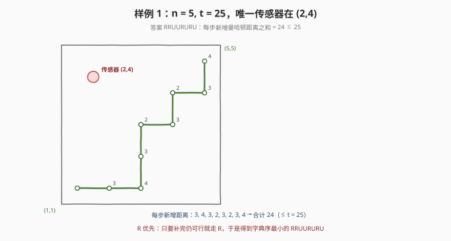
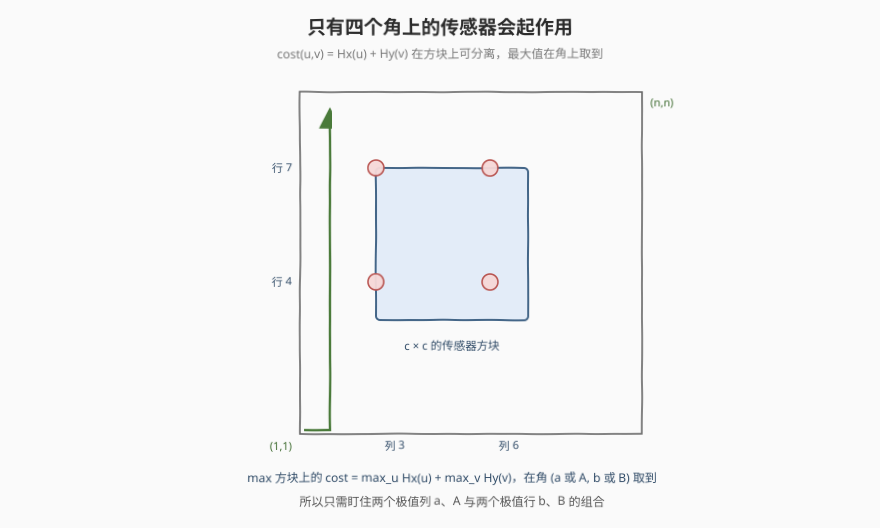
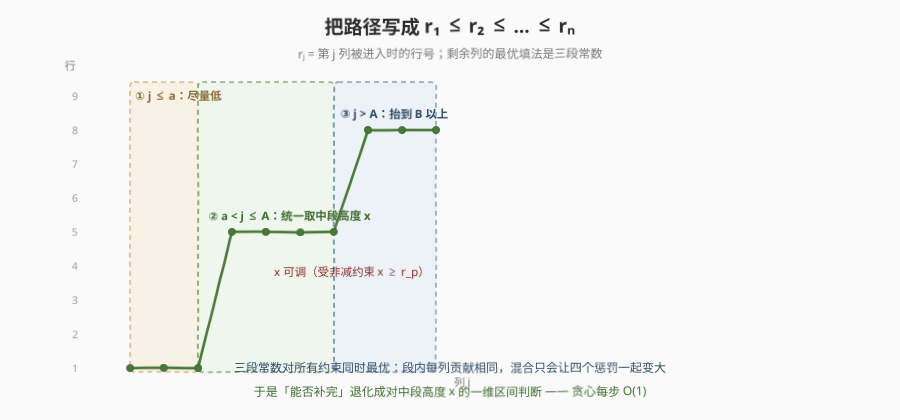

# Codeforces 79E 传感器封锁路径 题解

## 1. 题目概述

- **题目链接**：https://codeforces.com/problemset/problem/79/E
- **比赛来源**：Codeforces Beta Round 71 · Problem E（UTC 2011-04-30）
- **难度**：2900
- **标签**：贪心、构造、前缀和、凸性、字典序最小
- **评测类型**：普通（输出字典序最小的可行路径，答案唯一）
- **限制**：时间 1 s / 内存 256 MB

**题意**：Ciel 在 $n \times n$ 网格的 $(1,1)$，要走到 $(n,n)$，每步只能向右 $(x{+}1,y)$ 或向上 $(x,y{+}1)$，一共 $2n-2$ 步。城堡里有 $c^2$ 个传感器，位置是 $(a+i,\ b+j)$（$0 \le i,j < c$），即一个 $c \times c$ 的方块。每个传感器初始计数为 $t$；每当 Ciel **移动到**点 $(x,y)$，位于 $(u,v)$ 的传感器计数就减少 $|u-x|+|v-y|$（起点 $(1,1)$ 不计）。若某个传感器的计数**严格小于 $0$**，Ciel 就被抓。判断能否到达，若能则输出字典序最小的步骤串（`R` 比 `U` 小）。

**约束**：

- $2 \le n \le 2 \times 10^5$：步数 $2n-2$ 最多 $4 \times 10^5$，路径条数 $\binom{2n-2}{n-1}$ 是天文数字，**不能搜索**；目标复杂度是 $O(n)$ 或 $O(n \log n)$。
- $0 \le t \le 10^{14}$，而单条路径的总距离量级约 $2n \cdot 2n = 4 \times 10^{10}$，所以计数与阈值都要用 64 位整数。
- $1 \le c \le n$：传感器最多 $n^2$ 个，不能逐个维护；必须利用"方块结构"把约束降维。
- 单组数据，无多测。

## 2. 示例与观察

官方样例一：

```text
输入：
5 25 2 4 1
输出：
RRUURURU
```

官方样例二：

```text
输入：
3 6 1 2 2
输出：
URUR
```

官方样例三：

```text
输入：
3 5 1 2 2
输出：
Impossible
```

官方样例四：

```text
输入：
20 492 11 4 8
输出：
RRRRRRRRRRRRRRRRUUUUURUUUUURRUUUUUUUUU
```

**样例一走查**：$n=5$，$c=1$，唯一传感器在 $(a,b)=(2,4)$，$t=25$。路径 `RRUURURU` 依次到达

$$(2,1),(3,1),(3,2),(3,3),(4,3),(4,4),(5,4),(5,5),$$

到 $(2,4)$ 的距离依次是 $3,4,3,2,3,2,3,4$，合计 $24 \le 25$。若第一步走 `U`，路径字典序更大；若走 `R` 后继续贪心，能够补完，因此首个字符是 `R`。



**样例二走查**：$n=3$，$c=2$，传感器在 $\{1,2\}\times\{2,3\}$，$t=6$。路径 `URUR` 到达 $(1,2),(2,2),(2,3),(3,3)$，四个传感器的总距离分别为

$$6,\quad 6,\quad 4,\quad 4,$$

都不超过 $6$，可行；而全走 `R` 的 `RRUU` 到 $(1,3)$ 的距离和是 $12 > 6$，不可行。

**样例三**：只把 $t$ 从 $6$ 降到 $5$，同样是这四个传感器，任何路径都至少让某个传感器累计到 $6$，故输出 `Impossible`。

**观察一**：每个传感器的总消耗是**可分离**的——它只和路径上各点的横坐标集合、纵坐标集合有关，与"横纵如何交错"只有间接关系。

**观察二**：传感器排成一个矩形方块，而"到某一列的距离和"关于列号是凸函数，所以只需盯住方块的四个角。

## 3. 解题思路

### 3.1 朴素做法与瓶颈

路径总数是 $\binom{2n-2}{n-1}$，$n=2 \times 10^5$ 时完全无法枚举；即便用 DP，状态也必须包含"每个传感器还剩多少计数"，维度爆炸。

关键是把"$c^2$ 个传感器、每条路径的巨大状态"压缩成常数个数值约束。

### 3.2 核心观察之一：可分离，且只需四个角



记路径依次到达的点为 $p_1,\dots,p_{2n-2}$（不含起点）。传感器 $(u,v)$ 的总消耗是

$$\mathrm{cost}(u,v) = \sum_{p}\bigl(|u-x_p| + |v-y_p|\bigr) = H_x(u) + H_y(v),$$

其中 $H_x(u) = \sum_p |u-x_p|$、$H_y(v) = \sum_p |v-y_p|$。两个量分别只依赖横坐标集合与纵坐标集合。

$H_x(u)$ 是若干个 $|u-x_p|$ 之和，关于 $u$ **凸**；凸函数在区间 $[a,A]$ 上的最大值必在端点取到，于是

$$\max_{u \in [a,A]} H_x(u) = \max\bigl(H_x(a),\,H_x(A)\bigr),\qquad
\max_{v \in [b,B]} H_y(v) = \max\bigl(H_y(b),\,H_y(B)\bigr).$$

因此"所有 $c^2$ 个传感器都不超限"等价于

$$\max\bigl(H_x(a),H_x(A)\bigr) + \max\bigl(H_y(b),H_y(B)\bigr) \le t, \tag{1}$$

其中 $A = a+c-1$、$B = b+c-1$。约束从 $c^2$ 条降到 **1 条**（内部含 4 个候选值）。

### 3.3 核心观察之二：把路径写成 $r_1 \le r_2 \le \cdots \le r_n$



定义 $r_j$ 为**第一次到达第 $j$ 列时的行号**（进入行）。因为路径只会向右/向上，列 $1,2,\dots,n$ 被依次进入，于是

$$r_1 = 1 \le r_2 \le \cdots \le r_n \le n .$$

反过来，任一这样的序列都唯一确定一条路径：在第 $j$ 列向上走 $r_{j+1}-r_j$ 步（$j<n$），再向右一格；最后一列向上走 $n-r_n$ 步。步骤串是

$$\underbrace{U\cdots U}_{r_2-r_1}\,R\,\underbrace{U\cdots U}_{r_3-r_2}\,R\ \cdots\ R\,\underbrace{U\cdots U}_{n-r_n},$$

所以**步骤串的字典序最小 $\iff$ $(r_2,r_3,\dots,r_n)$ 在"逐项更小优先"的意义下最小**（因为 `R` 比 `U` 小，谁先出现 `R` 谁就更小）。

下面把约束 (1) 翻译成 $r$ 上的表达式。设 $c_k$ 为第一次到达第 $k$ 行时的列号，则

$$c_k = 1 + \#\{\,j \in [2,n] : r_j \le k-1\,\}.$$

记 $C_j$ 为"横坐标 $\ge j$ 的路径点数"，$D_k$ 为"纵坐标 $\ge k$ 的路径点数"，可以用进入位置表示：

$$C_j = 2n+1-j-r_j,\qquad D_k = 2n+1-k-c_k .$$

再令 $S = \sum_p (x_p+y_p) = \sum_{i=1}^{2n-2}(2+i) = (n-1)(2n+3)$（因为第 $i$ 步后的点满足 $x+y = 2+i$，这一和是**常数**）。直接展开

$$\sum_p |u-x_p| = (2n-2)u - \sum_p x_p + 2\sum_{j>u} C_j,$$

对 $v$ 同理，两式相加并代入 $c_k$ 化简易得

$$\mathrm{cost}(u,v) = K(u,v) - 2\Bigl[u(n-v) + n(n-u) - P(u,v)\Bigr], \tag{2}$$

其中

$$K(u,v) = (2n-2)(u+v) - S + 2\bigl(R(u)+R(v)\bigr),\qquad R(u) = \sum_{j=u+1}^{n}(2n+1-j),$$

$$P(u,v) = \sum_{j=2}^{u}\bigl(r_j - v\bigr)_{+} + \sum_{j=u+1}^{n}\bigl(v - r_j\bigr)_{+},\qquad (z)_+ = \max(z,0).$$

注意 $K$ 只与 $n,u,v$ 有关，$(2)$ 中**只有 $P$ 依赖路径**。于是每个角的约束都变成

$$P(u,v) \le \Theta(u,v), \qquad \Theta(u,v) = u(n-v)+n(n-u) - \tfrac{K(u,v)-t}{2}. \tag{3}$$

为避免小数，实现时把所有式子乘 $2$，比较 $2P$ 与 $2\Theta$。

几何意义很清楚：$P(u,v)$ 惩罚两件事——**在第 $u$ 列之前就爬得比 $v$ 高**（进入行 $r_j > v$），以及**越过第 $u$ 列之后还待在 $v$ 以下**（$r_j < v$）。换句话说，路径要在 $(u,v)$ 附近"贴着走"。

### 3.4 算法：三段常数的补全 + 逐列贪心

固定了前缀 $r_2,\dots,r_p$ 之后，剩下的列 $p+1,\dots,n$ 可以分成三段，每段内所有约束的偏好方向一致：

| 段 | 列范围 | 各约束的偏好 | 最优取法 |
|---|---|---|---|
| 低段 | $p < j \le a$ | 四个角都希望 $r_j$ **小** | 全部取 $r_p$（下界），惩罚为 $0$（若 $r_p \le b$） |
| 中段 | $\max(p,a) < j \le A$ | 以 $a$ 为切口的角希望**大**，以 $A$ 为切口的角希望**小** | 全部取同一个高度 $x$ |
| 尾段 | $j > A$ | 四个角都希望 $r_j$ **大** | 全部取 $\max(x,B)$，惩罚为 $0$ |

中段"必须统一取 $x$"这一步需要说明：设中段有 $m$ 列、取值 $y_1,\dots,y_m$，则对切口为 $u$ 的角有

$$\sum_j (y_j - v)_+ - \sum_j (v - y_j)_+ = \sum_j (y_j - v) = m(\bar y - v),$$

即"两侧惩罚之差"只由平均值决定，而"两侧惩罚之和" $\sum_j |y_j - v| \ge m|\bar y - v|$ 由凸性在全部相等时取到最小。对四个角同时成立，所以任一取法的惩罚向量都被"同平均值的全相等取法"逐分量压住——只需枚举整数高度 $x$。据此，给定前缀 $(p, r_p)$，可行性判定是一只**一维区间**：

- 先算每条约束已被固定部分消耗的惩罚（已定列 + 第 $p$ 列 + 低段），剩余额度记为 $s_i$（$2$ 倍单位）；
- 若中段列数 $m = 0$：可行 $\iff$ 所有 $s_i \ge 0$；
- 否则中段每列高度 $x$ 要给第 $i$ 条约束贡献 $2\cdot h_i(x)$，需 $2m\,h_i(x) \le s_i$。以 $a$ 为切口的角 $h_i(x)=(v_i-x)_+$ 给出**下界** $x \ge v_i - \lfloor s_i/(2m)\rfloor$；以 $A$ 为切口的角 $h_i(x)=(x-v_i)_+$ 给出**上界** $x \le v_i + \lfloor s_i/(2m)\rfloor$。于是

$$x_{\min} = \max\Bigl(r_p,\ \max_{u_i=a}\bigl(v_i - \lfloor s_i/(2m)\rfloor\bigr)\Bigr),\qquad
x_{\max} = \min\Bigl(n,\ \min_{u_i=A}\bigl(v_i + \lfloor s_i/(2m)\rfloor\bigr)\Bigr),$$

可行 $\iff x_{\min} \le x_{\max}$。

**贪心**：从 $p=1$、$r_1=1$ 开始，对 $p=2,3,\dots,n$ 依次取**最小的** $val \ge r_{p-1}$ 使上述判定为真，令 $r_p = val$，并把第 $p$ 列的惩罚累加进"已固定"部分。最后按 $r$ 还原步骤串。

- $p \le a$ 时四个角都希望 $r_p$ 小，可行性关于 $val$ 单调（越小越容易），而前缀可行就意味着 $val = r_{p-1}$ 可行，故这一段恒有 $r_p = r_{p-1} = 1$（沿第 $1$ 行尽量右行）。
- $p > a$ 时需要向上试探，但 $r_p$ 单调不减，**所有试探步数之和不超过 $n$**，再加每列一次的成功判定，总判定次数 $O(n)$。

判定本身是 $O(1)$，所以整体 $O(n)$。

### 3.5 样例走查

对照第 2 节那张标了每步距离的路径图：

$n=5$，$t=25$，传感器只有 $(2,4)$ 一个（$c=1$，$A=a=2$，$B=b=4$）。

1. $p=1$：判定"是否存在补全"——需要把 $2n-2=8$ 个点的距离和控制在 $25$ 内，可行；
2. 贪心逐列试探，得到的进入行是 $r = (1,1,1,3,4)$：第 $1,2,3$ 列的进入行都是 $1$，第 $4$ 列是 $3$，第 $5$ 列是 $4$；
3. 还原：第 $1$ 列上移 $0$，`R`；第 $2$ 列上移 $0$，`R`；第 $3$ 列上移 $3-1=2$，`UU`，`R`；第 $4$ 列上移 $4-3=1$，`U`，`R`；第 $5$ 列上移 $5-4=1$，`U`。得到 `RRUURURU`，与官方输出一致。

每步新增距离 $3,4,3,2,3,2,3,4$，合计 $24 \le 25$，恰好贴着阈值。

## 4. 正确性证明

**引理 1（约束降维）**：所有 $c^2$ 个传感器都不超限，当且仅当式 (1) 成立。

**证明**：$\mathrm{cost}(u,v) = H_x(u)+H_y(v)$。由于 $H_x$ 在 $u$ 上凸、$H_y$ 在 $v$ 上凸，方块 $[a,A]\times[b,B]$ 上的最大值在角上取到，且 $\max_{u,v}(H_x(u)+H_y(v)) = \max_u H_x(u) + \max_v H_y(v) = \max(H_x(a),H_x(A)) + \max(H_y(b),H_y(B))$。故"全部 $\le t$"与式 (1) 等价。∎

**引理 2（$r$ 序列与路径一一对应）**：映射"路径 $\mapsto (r_1,\dots,r_n)$"是双射，且步骤串的字典序与 $(r_2,\dots,r_n)$ 的逐项字典序一致（更小者优先）。

**证明**：路径在第 $j$ 列（$j<n$）只能向上若干步再向右，进入行单调不减；给定 $r$ 后每列的向上步数被唯一确定，总步数恰为 $\sum_{j<n}(r_{j+1}-r_j) + (n-r_n) + (n-1) = 2n-2$。步骤串形如 $U^{r_2-1}RU^{r_3-r_2}R\cdots$，比较两个串时第一个不同字符必出现在某个 $r_j$ 变化处：$r_j$ 更小意味着该处更早出现 `R`，即字典序更小。∎

**引理 3（消耗公式）**：对任一 $u,v$，$\mathrm{cost}(u,v)$ 满足式 (2)(3)。

**证明**：$\sum_p |u-x_p| = (2n-2)u - \sum_p x_p + 2\sum_p (x_p-u)_+$，而 $\sum_p (x_p-u)_+ = \sum_{j>u} C_j$，其中 $C_j$ 是横坐标 $\ge j$ 的点数；第 $j$ 列从第 $t_j = j+r_j-2$ 步开始被访问，故 $C_j = (2n-2)-t_j+1 = 2n+1-j-r_j$。对 $y$ 同理，$D_k = 2n+1-k-c_k$。相加并用 $\sum_p x_p + \sum_p y_p = S$ 常数即得 (2)；再由 $c_k = 1+\#\{j\ge 2: r_j\le k-1\}$ 化简 $\sum_{k>v}D_k$ 就得到 $P$ 的形式。∎

**引理 4（三段补全最优）**：固定前缀 $r_2..r_p$ 后，若存在可行补全，则存在如下形状的可行补全：低段全取 $r_p$，中段全取某个整数 $x \ge r_p$，尾段全取 $\max(x,B)$。

**证明**：低段（$j \le a$）对四个角都有 $j \le u$，惩罚为 $(r_j-v)_+$，关于 $r_j$ 单调不减，取最小值 $r_p$ 不会让任何约束变差。尾段（$j>A$）对四个角都有 $j>u$，惩罚 $(v-r_j)_+$，取 $\max(x,B) \ge v$ 使其为 $0$，同样最优。中段：设某补全在中段的取值为 $y_1,\dots,y_m$，平均值 $\bar y$，令全相等取法 $x=\lfloor \bar y\rfloor$ 或 $\lceil \bar y\rceil$ 中使惩罚不增的那个——对每个角，两侧惩罚分别为 $\sum(y_j-v)_+$ 与 $\sum(v-y_j)_+$，其差为 $m(\bar y - v)$、和为 $\sum|y_j-v| \ge m|\bar y-v|$，故存在整数 $x$（$\bar y$ 两侧的整数之一）使两侧惩罚都不超过原取法。四个角同时满足，说明用该 $x$ 全相等取法不差于原补全。∎

**引理 5（$O(1)$ 判定正确）**：3.4 节的区间判定为真，当且仅当存在补全。

**证明**：由引理 4，只需考虑三段常数形状。低段与尾段的惩罚是常数；中段每条约束的惩罚是 $m\,h_i(x)$，其中 $h_i$ 是 $(v_i-x)_+$ 或 $(x-v_i)_+$，于是每个 $s_i \ge 0$ 且 $2m\,h_i(x)\le s_i$ 等价于 $x$ 落在相应的一端区间内。四个区间的交集恰是 $[x_{\min},x_{\max}]$，非空即存在这样的 $x$，也即存在补全。∎

**引理 6（贪心得到字典序最小）**：按 3.4 节逐列取最小可行值时，得到的 $r$ 是字典序最小的可行序列。

**证明**：对 $p$ 归纳。假设 $r_2..r_{p-1}$ 已是"字典序最小可行序列"的前缀（即它可补全，且任何字典序更小的前缀都不可补全）。取最小的 $val \ge r_{p-1}$ 使 $(r_2..r_{p-1},val)$ 可补全：若存在更小的可行 $val'$，则 $(r_2..r_{p-1},val')$ 是字典序更小的可补全前缀，与"取最小"矛盾；而任何以更小字典序开头的序列，其前 $p$ 项要么与当前前缀相同、要么在更早处就更小（已被归纳假设排除），故当前选择不劣于任何可行解。终止时 $p=n$ 得到完整可行序列。∎

**定理**：算法输出的步骤串是所有可行路径中字典序最小的一条；若无可行路径则输出 `Impossible`。

**证明**：由引理 2，步骤串与 $r$ 序列一一对应且字典序一致；由引理 1、3，可行性与式 (3) 等价；由引理 5，判定函数精确；由引理 6，贪心产出字典序最小的可行 $r$。初始判定（$p=1,r_1=1$）为假时任何路径都不可行，输出 `Impossible` 正确。∎

## 5. 复杂度分析

- **时间**：初始判定 $O(1)$；主循环 $p=2..n$ 共 $n-1$ 次。每次先做一次 $O(1)$ 判定；若不可行则 $val$ 递增继续判定。由于 $r_p$ 单调不减，所有递增总量不超过 $n$，判定总次数 $O(n)$，每次 $O(1)$。还原步骤串 $O(n)$。总时间 $O(n)$，$n=2 \times 10^5$ 时约百万次整数运算。
- **空间**：$r$ 数组 $O(n)$（$2 \times 10^5$ 个 `long long`，约 $1.6$ MB），输出串 $O(n)$，其余为常数。
- **数值范围**：$t \le 10^{14}$、$K \le (2n-2)(u+v) \le 4\cdot 10^5 \times 4\cdot 10^5 = 1.6\times10^{11}$、$2n(n-u) \le 8\times 10^{10}$，中间量都在 $10^{14}$ 量级，`long long` 足够；**必须用 64 位**，`int` 立刻溢出。
- **与时限的关系**：$O(n)$ 在 1 s 内余量极大，实测最大数据 $n = 2\times10^5$ 约 $5.2$ ms。

## 6. 参考代码

### C++17

```cpp
#include <bits/stdc++.h>
using namespace std;
typedef long long ll;

int main() {
    ll n, t, a, b, c;
    if (!(cin >> n >> t >> a >> b >> c)) return 0;
    const ll A = a + c - 1, B = b + c - 1;
    const ll S_total = (n - 1) * (2 * n + 3);
    const ll cu[4] = {a, a, A, A};   // 四个角传感器的列
    const ll cv[4] = {b, B, b, B};   // 四个角传感器的行
    auto Rsum = [&](ll u) {           // sum_{j=u+1}^{n} (2n+1-j)
        ll m = n - u;
        return m * (2 * n + 1 - u) - m * (m + 1) / 2;
    };
    ll TH[4];
    for (int i = 0; i < 4; ++i) {
        ll u = cu[i], v = cv[i];
        ll K = (2 * n - 2) * (u + v) - S_total + 2 * (Rsum(u) + Rsum(v));
        // 约束 2*P(u,v) <= TH[i]
        TH[i] = 2 * u * (n - v) + 2 * n * (n - u) - K + t;
    }
    ll fixedPen[4] = {0, 0, 0, 0};

    auto feasible = [&](ll p, ll val) -> bool {
        ll s[4];
        ll low = (p < a) ? (a - p) : 0;
        ll mid = A - max(p, a);
        for (int i = 0; i < 4; ++i) {
            ll own = (p <= cu[i]) ? max(0LL, val - cv[i]) : max(0LL, cv[i] - val);
            ll lowp = low * max(0LL, val - cv[i]);
            s[i] = TH[i] - 2 * (fixedPen[i] + own + lowp);
        }
        if (mid <= 0) {
            for (int i = 0; i < 4; ++i) if (s[i] < 0) return false;
            return true;
        }
        ll q[4];
        for (int i = 0; i < 4; ++i) {
            if (s[i] < 0) return false;
            q[i] = s[i] / (2 * mid);
        }
        ll xlo = val, xhi = n;
        for (int i = 0; i < 4; ++i) {
            if (cu[i] == a) xlo = max(xlo, cv[i] - q[i]);
            else xhi = min(xhi, cv[i] + q[i]);
        }
        return xlo <= xhi;
    };

    if (!feasible(1, 1)) { cout << "Impossible\n"; return 0; }
    vector<ll> r(n + 1, 0);
    r[1] = 1;
    for (ll p = 2; p <= n; ++p) {
        ll val = r[p - 1];
        while (val <= n && !feasible(p, val)) ++val;
        if (val > n) { cout << "Impossible\n"; return 0; }
        r[p] = val;
        for (int i = 0; i < 4; ++i)
            fixedPen[i] += (p <= cu[i]) ? max(0LL, val - cv[i]) : max(0LL, cv[i] - val);
    }
    string out;
    out.reserve(2 * n);
    for (ll j = 1; j < n; ++j) {
        out.append((size_t)(r[j + 1] - r[j]), 'U');
        out.push_back('R');
    }
    out.append((size_t)(n - r[n]), 'U');
    cout << out << '\n';
    return 0;
}
```

### Python3

```python
import sys


def main() -> None:
    data = sys.stdin.buffer.read().split()
    if not data:
        return
    n, t, a, b, c = (int(v) for v in data[:5])
    A, B = a + c - 1, b + c - 1
    S_total = (n - 1) * (2 * n + 3)
    cu = (a, a, A, A)
    cv = (b, B, b, B)

    def rsum(u: int) -> int:
        m = n - u
        return m * (2 * n + 1 - u) - m * (m + 1) // 2

    TH = []
    for u, v in zip(cu, cv):
        K = (2 * n - 2) * (u + v) - S_total + 2 * (rsum(u) + rsum(v))
        TH.append(2 * u * (n - v) + 2 * n * (n - u) - K + t)

    fixed = [0, 0, 0, 0]

    def feasible(p: int, val: int) -> bool:
        low = (a - p) if p < a else 0
        mid = A - max(p, a)
        s = [0, 0, 0, 0]
        for i in range(4):
            own = max(0, val - cv[i]) if p <= cu[i] else max(0, cv[i] - val)
            s[i] = TH[i] - 2 * (fixed[i] + own + low * max(0, val - cv[i]))
        if mid <= 0:
            return all(x >= 0 for x in s)
        q = []
        for x in s:
            if x < 0:
                return False
            q.append(x // (2 * mid))
        xlo, xhi = val, n
        for i in range(4):
            if cu[i] == a:
                xlo = max(xlo, cv[i] - q[i])
            else:
                xhi = min(xhi, cv[i] + q[i])
        return xlo <= xhi

    if not feasible(1, 1):
        sys.stdout.write("Impossible\n")
        return
    r = [0] * (n + 1)
    r[1] = 1
    for p in range(2, n + 1):
        val = r[p - 1]
        while val <= n and not feasible(p, val):
            val += 1
        if val > n:
            sys.stdout.write("Impossible\n")
            return
        r[p] = val
        for i in range(4):
            fixed[i] += max(0, val - cv[i]) if p <= cu[i] else max(0, cv[i] - val)

    parts = []
    for j in range(1, n):
        parts.append("U" * (r[j + 1] - r[j]))
        parts.append("R")
    parts.append("U" * (n - r[n]))
    sys.stdout.write("".join(parts) + "\n")


main()
```

## 7. 边界情况与易错点

1. **64 位整数**：$t$ 达 $10^{14}$，$K$ 约 $10^{11}$，`int` 在 `2 * u * (n - v)`（约 $8\times10^{10}$）就已溢出。全程用 `long long`（Python 无此问题），且比较时统一用"乘 2 后的整数"，避免 $1/2$ 的取整误差。
2. **起点不计入消耗**：消耗是在**每次移动后**结算的，$(1,1)$ 不算。本解用 $r$ 序列描述路径时天然排除了起点（$r_1$ 只用于确定第一个 `R` 的位置），但若改成按点枚举，很容易多算一个点。
3. **严格小于 $0$ 才被抓**：条件是计数**严格小于** $0$，即累计 $\le t$ 是安全的，`<=` 与 `<` 弄反会在样例一（$24$ 对 $25$，或正好等于 $t$ 的数据）上出错。
4. **$c=1$（单传感器）与 $c=n$（铺满全图）两端都要测**：$c=1$ 时 $a=A$、$b=B$，四个角退化成一个；$c=n$ 时方块覆盖全图，任何路径的消耗都很大，常用于构造 `Impossible`。
5. **$t=0$**：只有当所有传感器的累计距离都为 $0$ 时才可行（几乎总是 `Impossible`），代码里 $TH$ 可能为负，判定函数用 `s[i] < 0` 立即否决，不会越界。
6. **中段列数为 $0$ 的分支**：$p \ge A$ 时中段为空，此时没有 $x$ 可调，判定退化成"四条剩余额度都非负"，必须单独处理，否则 `2 * mid` 会变成 $0$ 而除零。
7. **贪心的试探次数**：$r_p$ 单调不减，总试探量 $O(n)$；若写成"每列都从 $1$ 开始试"，会退化成 $O(n^2)$ 而在 $n = 2\times 10^5$ 时超时。
8. **输出格式**：`Impossible` 首字母大写、没有多余空格；可行时输出**恰好 $2n-2$ 个字符**，且 `R` 与 `U` 各 $n-1$ 个。建议像参考代码一样先验证长度再输出。
9. **字典序方向**：`R` 比 `U` 小（题面明确 "Character R is lexicographically earlier than the character U"），所以贪心每次**先试 `R`**，也就是让 $r_p$ 尽量小。

## 8. 验证记录

- **编译环境与命令**：`clang++ -std=c++17 -O2`（Apple clang 21.0.0 + `codeforces/tools/include` 的兼容头；代码只用标准库，可原样提交 GNU C++17），Python 3.9.6。
- **官方样例**：4 / 4 通过（`RRUURURU`、`URUR`、`Impossible`、以及 $n=20$ 的 38 字符长串），C++ 与 Python 输出逐字节一致，且与官方输出完全相同（本题答案唯一，可直接文本比对）。
- **独立暴力对拍（主验证）**：暴力枚举全部 $\binom{2n-2}{n-1}$ 条路径，按 $\max\bigl(H_x(a),H_x(A)\bigr)+\max\bigl(H_y(b),H_y(B)\bigr)$ 判定并按枚举顺序取第一条可行者（枚举顺序恰好就是字典序）。
  - **240 组** $2 \le n \le 8$、随机 $a,b,c,t$ 的数据：参考 C++、参考 Python、暴力三方**完全一致**；
  - 另有 **1623 组全枚举**：$2 \le n \le 5$，遍历所有 $(a,b,c)$，并对每组把 $t$ 取遍"所有可达消耗值及其 $\pm1$"（覆盖临界可行/不可行），Python 参考解与暴力**全部一致**；
  - 另有 **1098 组** $6 \le n \le 10$ 的随机数据（$t$ 取最小值、中位数、最大值及其邻域），**全部一致**。
- **大规模合法性复核**：$2 \le n \le 3000$ 的 80 组随机参数，先用参考程序二分出最小可行 $t$，再在 $t$、$t+1$、$t+7$、$2t+1$ 上运行，检查输出满足：长度 $2n-2$、`R`/`U` 各 $n-1$ 个、终点为 $(n,n)$、四个角的累计消耗都不超过 $t$——共 **320 次**全部通过。
- **最大约束性能**：$n = 2\times10^5$、$t = 10^{14}$、$a=3$、$b=150001$、$c=50000$（满足 $a,b \le n-c+1$ 的合法上界）时，C++ 端到端 3 次取最小约 $5.0$ ms（含进程启动），Python 约 $657$ ms；相对 1 s 的余量充足，内存约 $5$ MB。该组 $t$ 极大，输出确实是字典序最小的 $R^{n-1}U^{n-1}$，且复核得到四个角的累计消耗为 $59998700007,\ 42499250003,\ 42499750000,\ 59999300002$，最大值 $1.19998\times10^{11} \le t$。
- **图片校验**：三张 SVG（`cf79e_corners.svg`、`cf79e_regions.svg`、`cf79e_walkthrough.svg`）均通过 `xml.etree.ElementTree.parse`，含 `feTurbulence` 与手写体字体族，文本包围盒未越出 `viewBox`，同区域文本无重叠。
- **公式校验**：KaTeX（`throwOnError`）渲染无报错；无 `---` 分隔线，`\text{}` 内无裸 `#`。
- **复核状态**：verified（样例、三路暴力对拍、大规模合法性复核、性能、图片、公式全部实跑通过）。

## 相关题目与扩展

- [Codeforces 79A Bus Game](https://codeforces.com/problemset/problem/79/A)、[79B Colorful Field](https://codeforces.com/problemset/problem/79/B)、[79C Beaver](https://codeforces.com/problemset/problem/79/C)、[79D Password](https://codeforces.com/problemset/problem/79/D)：同场其余四题。
- [Codeforces 1332D Walk on Matrix](https://codeforces.com/problemset/problem/1332/D)：网格路径上的按位与约束，构造思想与本题"贴着某个值走"类似。
- [Codeforces 1450C2 Errich-Tac-Toe (Hard Version)](https://codeforces.com/problemset/problem/1450/C2)：网格上的构造 + 取模分类，练习"先分析再构造"。
- [LeetCode 64. 最小路径和](https://leetcode.cn/problems/minimum-path-sum/)：最基础的网格路径 DP；本题相当于把"单条约束"换成了"四个角的资源约束"，并额外要求字典序最小。
- [LeetCode 1105. 填充书架](https://leetcode.cn/problems/filling-bookcase-shelves/)：分段常数的 DP，与本题"三段常数补全"的结构有共通之处。

**延伸思考**：

1. **如果传感器不是矩形而是任意点集**：只需对每个传感器维护 $H_x(u)+H_y(v)$，但约束之间可能互相独立，"降维成四个角"的技巧失效，需要更一般的凸优化/贪心结构。
2. **如果要输出字典序最大的路径**：把贪心的尝试顺序从 `R` 改成 `U`，判定函数不变即可；这也说明本解的核心是"可行性判定与贪心框架"，方向只是参数。
3. **如果允许向左/向下走**：$r$ 序列不再单调，路径会重复访问格子，消耗模型变成计数问题，$O(n)$ 的结构彻底破坏，属于完全不同的问题。
4. **如果把"严格小于 $0$"换成"不超过 $t$ 的传感器个数上限"**：约束从"全部满足"变成"计数型"，四个角的最坏值不再足够，要维护完整的分布，复杂度上升一个量级。

