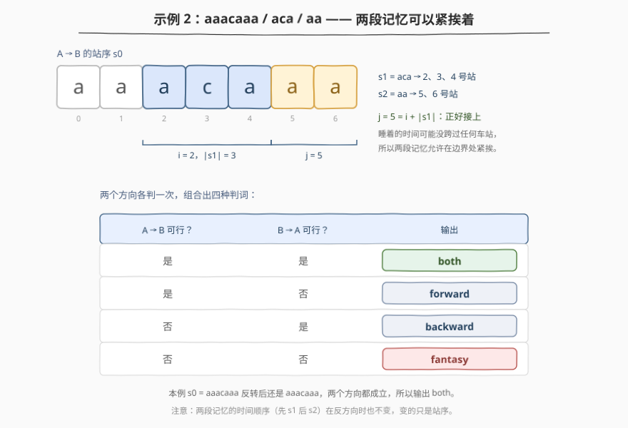
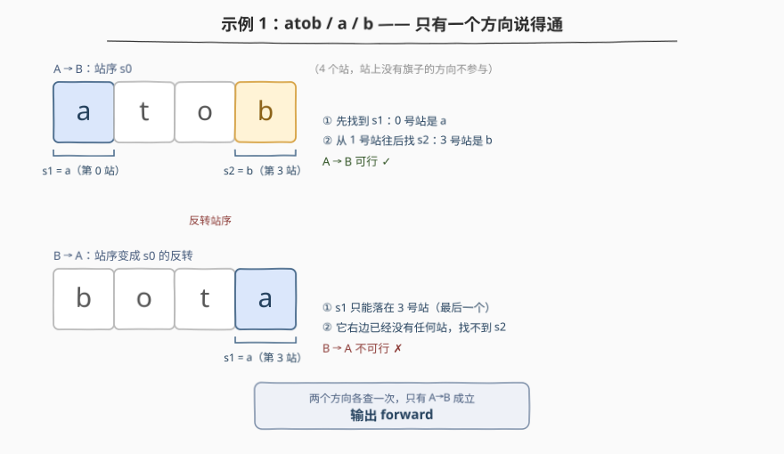

# Codeforces 8A 彩旗序列判方向 题解

## 1. 题目概述

- **题目链接**：https://codeforces.com/problemset/problem/8/A
- **比赛来源**：Codeforces Beta Round 8 · Problem A（2010-04-08）
- **难度**：1200
- **标签**：字符串
- **评测类型**：普通
- **限制**：时间 1 s / 内存 64 MB

**题意**：Peter 坐火车从 A 城到 B 城，途中醒过两次，分别按时间顺序记下了醒着时连续看到的彩旗颜色序列 $s_1$ 和 $s_2$。给出列车沿 A→B 方向依次经过的站台彩旗串 $s_0$（每个站一面旗，颜色用小写字母表示），问他这两段记忆有没有可能是这趟旅途中真实看到的：

- 若只可能出现在 A→B 方向，输出 `forward`；
- 若只可能出现在 B→A 方向（B→A 经过同样的站，只是顺序相反），输出 `backward`；
- 两个方向都可能，输出 `both`；
- 两个方向都不可能，输出 `fantasy`。

**约束**：

- $|s_0| \le 10^5$，$|s_1|, |s_2| \le 100$。两重枚举"$s_1$ 的起点 × $s_2$ 的起点"是 $O(|s_0|^2)$，在 $10^5$ 上不可能（$10^{10}$ 级）；只枚举 $s_1$ 的起点、每次线性找 $s_2$ 是 $O(|s_0| \cdot |s_2|) \le 10^7$，1 s 内可行；正解把它压到两次 `find`，$O(|s_0|)$。
- 输入只有**一组**（三行），没有测试组数 $t$，也不是读到 EOF。
- 输出是四个固定单词之一，必须逐字一致（全小写）。

**一个容易读漏的细节**：两段记忆之间 Peter 在睡觉，但他完全可能一面旗都没错过——"没睡多久"。所以 $s_2$ 允许**紧接**在 $s_1$ 后面出现；但两段不能重叠，也不能颠倒顺序（时间顺序固定为先 $s_1$ 后 $s_2$）。

## 2. 示例与观察

官方样例 1（输入 / 输出原样）：

```text
输入：
atob
a
b

输出：
forward
```

**样例 1 演算**：$s_0 = $ `atob`，站序是 `a`(0)、`t`(1)、`o`(2)、`b`(3)。

- A→B：$s_1 = $ `a` 在 0 号站出现；$s_2 = $ `b` 在它之后（1 号站起）首次出现在 3 号站。$j = 3 \ge i + |s_1| = 1$，成立。
- B→A：站序反转成 `bota`。$s_1 = $ `a` 只出现在 3 号站（最后一位），它右边已经没有站，找不到 `b`，不成立。

只有一个方向成立，输出 `forward`。

官方样例 2：

```text
输入：
aaacaaa
aca
aa

输出：
both
```

**样例 2 演算**：$s_0 = $ `aaacaaa`，下标 0…6 依次是 `a a a c a a a`。

- $s_1 = $ `aca` 唯一的出现位置是 $i = 2$（占 2、3、4 号站）。
- $s_2 = $ `aa` 必须从 $i + |s_1| = 5$ 开始找，正好在 5、6 号站出现，$j = 5$。
- 于是 A→B 成立；而 `aaacaaa` 反转后还是 `aaacaaa`（回文），B→A 同样成立，输出 `both`。

**观察 1（两个窗口）**：能在旅途中看到 $s_1, s_2$，等价于在站序串 $t$ 里存在两个"窗口"

$$t[i \ldots i+|s_1|-1] = s_1, \qquad t[j \ldots j+|s_2|-1] = s_2, \qquad j \ge i + |s_1| .$$

**观察 2（允许紧挨）**：样例 2 里 $j = i + |s_1|$ 恰好取等号，说明两个窗口可以首尾相接。若错误地要求"中间至少隔一个站"，样例 2 的 A→B 就会被判死，输出会从 `both` 变成 `backward`。

**观察 3（反方向）**：B→A 只是把 $s_0$ 整体反转；$s_1$ 仍然是先发生的那一段，$s_2$ 仍然是后发生的那一段，角色不能互换。

自造样例（标注"自造"）：

| 输入 | 输出 | 说明 |
|------|------|------|
| `a`<br>`a`<br>`a` | fantasy | 只有 1 面旗，$s_2$ 无处落脚（且反转后同样） |
| `ab`<br>`a`<br>`b` | forward | 正方向两个窗口各占一站；反方向 `ba` 里 `a` 后面没有 `b` |
| `ba`<br>`a`<br>`b` | backward | 与上一条左右对称 |
| `aba`<br>`a`<br>`ba` | both | 正方向 $i=0$、$j=1$；反转后仍是 `aba` |
| `aaa`<br>`aa`<br>`aa` | fantasy | 两段不能重叠：$s_1$ 占 0、1 后只剩一个 `a` 给 `s_2` |
| `abc`<br>`abc`<br>`a` | fantasy | $s_1$ 用完了整串，$s_2$ 没有位置；反转 `cba` 也找不到 `abc` |
| `abc`<br>`b`<br>`c` | forward | 正方向 $i=1$、$j=2$；反转 `cba` 里 `c` 在 0 号站，`b` 之后只剩 `a`，找不到 `c` |

## 3. 解题思路

### 3.1 朴素做法与瓶颈

最直白的写法是两重循环：枚举 $s_1$ 的所有起点 $i$（$O(|s_0|)$ 个），对每个 $i$ 再枚举 $s_2$ 的所有起点 $j \ge i+|s_1|$，逐字符比较。最坏 $O(|s_0|^2 \cdot |s_2|)$，$|s_0| = 10^5$ 时是 $10^{12}$ 量级，1 s 内绝无可能。

退一步，只枚举 $s_1$ 的起点、每个起点用一次线性匹配找 $s_2$，是 $O(|s_0| \cdot |s_2|) \le 10^7$，可以过，但仍是"枚举"的思路。正解只需要**两次** `find`。

### 3.2 核心观察：最左的 $s_1$ 就是最优的 $s_1$



固定一个方向后，问题变成：在串 $t$ 中找两个不重叠、有先后次序的模式。关键观察是：

> 如果存在任何一对合法的 $(i, j)$，那么把 $i$ 换成**最左边**的那个出现位置 $i_0$，也一定还有解。

理由很直接：$i_0 \le i$，所以 $i_0 + |s_1| \le i + |s_1| \le j$，原来那个 $j$ 对 $i_0$ 依然合法。左端点越靠左，右端点可用的空间只会更大，绝不会更小。

于是判定一个方向只需要三步：

1. $p \leftarrow t$ 中 $s_1$ 第一次出现的起点；找不到就判该方向不可行；
2. 从 $p + |s_1|$ 开始找 $s_2$ 的第一次出现，找到就可行，找不到就不可行。

两处"第一次出现"都可以用标准库的 `find`（Python 是 `str.find`），各扫一遍串。

### 3.3 算法流程

1. 读入 $s_0, s_1, s_2$；
2. 在 $s_0$ 上按 3.2 的三步判 A→B 是否可行，记 `fwd`；
3. 把 $s_0$ 反转，同样判一次，记 `bwd`；
4. 按组合输出：

   | `fwd` | `bwd` | 输出 |
   |-------|-------|------|
   | 真 | 真 | `both` |
   | 真 | 假 | `forward` |
   | 假 | 真 | `backward` |
   | 假 | 假 | `fantasy` |

两个方向互不影响，所以"四种判词"其实就是两个布尔值的四种组合。

### 3.4 样例走查：`atob` / `a` / `b`



以官方样例 1 为例：

- A→B 方向站序 `a t o b`：$s_1 = $ `a` 落在 0 号站（蓝色窗口），从 1 号站往后找 $s_2 = $ `b`，在 3 号站命中（黄色窗口）。$0 + 1 \le 3$ ✓，`fwd = true`。
- B→A 方向站序 `b o t a`：$s_1 = $ `a` 只能落在 3 号站，往后已经没有字符，找不到 `b` ✗，`bwd = false`。
- 组合 $(真, 假)$ → `forward`。

## 4. 正确性证明

固定一个方向，设该方向的站序串为 $t$（$|t| = n$），$m = |s_1|$，$k = |s_2|$。

**引理 1（可行性的等价刻画）**：该方向可行，当且仅当存在整数 $i, j$ 满足

$$0 \le i,\quad i + m \le j,\quad j + k \le n,\quad t[i..i+m) = s_1,\quad t[j..j+k) = s_2 .$$

**证明**：若这样的 $i, j$ 存在，就让 Peter 在列车经过第 $i$ 个站时醒来，连看 $m$ 面旗后睡着，再在第 $j$ 个站醒来连看 $k$ 面旗——两次醒来之间他可能一面旗都没看到，符合"睡的时间很短"的设定，于是这段记忆可能发生。反之，真实发生的两段记忆必然对应这样一对窗口。∎

**引理 2（贪心取最左的 $s_1$ 不丢解）**：令 $i_0$ 为 $s_1$ 在 $t$ 中最小的出现起点，$j_0$ 为 $s_2$ 在区间 $[i_0 + m, n]$ 中最小的出现起点。若该方向可行，则 $i_0, j_0$ 都存在且 $(i_0, j_0)$ 满足引理 1 的全部条件。

**证明**：设 $(i, j)$ 是一对可行解，则 $s_1$ 在 $i$ 处出现，故 $i_0$ 存在且 $i_0 \le i$。由 $i + m \le j$ 得 $i_0 + m \le i + m \le j$，所以 $j$ 落在 $[i_0 + m, n]$ 内且该处 $t[j..j+k) = s_2$，故 $j_0$ 存在且 $j_0 \le j$，进而 $j_0 + k \le j + k \le n$。于是 $(i_0, j_0)$ 满足 $0 \le i_0$、$i_0 + m \le j_0$、$j_0 + k \le n$ 以及两个串匹配条件。∎

**引理 3（算法与判据一致）**：`seenInOrder` 返回真，当且仅当该方向可行。

**证明**：函数先求 $s_1$ 的最小出现位置 $p$（$p = i_0$），再从 $p + m$ 开始求 $s_2$ 的最小出现位置；两者都存在就返回真。由引理 2，这一对 $(\text{最左 } s_1, \text{其后的最左 } s_2)$ 与"存在解"等价。∎

**定理**：程序输出的四个判词与题面一致。

**证明**：由引理 3，`fwd`、`bwd` 分别是"A→B 可行""B→A 可行"的真值。题面对四种情形的定义正是这两个布尔值的四种组合（只 A→B、只 B→A、两者都可、都不可），3.3 节的组合表逐一对应，故输出正确。∎

## 5. 复杂度分析

- **时间**：$O(|s_0| + |s_1| + |s_2|)$。两次 `find` 是线性扫描（标准库实现带 `memchr` 加速；最坏 $O(|s_0| \cdot |s_1|)$，在 $10^5 \times 100$ 的上限下也只有 $10^7$ 次字符比较）。反转串是一次 $O(|s_0|)$ 的拷贝。
- **空间**：$O(|s_0|)$，用于存放反转后的串（C++ 与 Python 都各多一份 $10^5$ 字节）；除此之外只有常数个变量。
- **与时限的关系**：实测 $|s_0| = 10^5$、$|s_1| = |s_2| = 100$ 的三组极端输入，C++ 端到端 $8.70 \sim 10.45$ ms（含进程启动），Python $20.4 \sim 22.9$ ms，相对 1 s 的余量在 95 倍以上。

## 6. 参考代码

### C++17

```cpp
#include <bits/stdc++.h>
using namespace std;

// 在一个方向的颜色串 t 里，按时间顺序找 Peter 的两段记忆：
// s1 必须完整出现，s2 必须从 s1 结束之后的位置开始（两段之间可以没有间隔）
static bool seenInOrder(const string& t, const string& s1, const string& s2) {
    size_t p = t.find(s1);
    if (p == string::npos) return false;
    return t.find(s2, p + s1.size()) != string::npos;
}

static string solve(const string& s, const string& s1, const string& s2) {
    bool fwd = seenInOrder(s, s1, s2);
    string rev(s.rbegin(), s.rend());          // B 到 A 时站序整体反转
    bool bwd = seenInOrder(rev, s1, s2);
    if (fwd && bwd) return "both";
    if (fwd)        return "forward";
    if (bwd)        return "backward";
    return "fantasy";
}

int main() {
    ios::sync_with_stdio(false);
    cin.tie(nullptr);

    string s, s1, s2;
    if (!(cin >> s)) return 0;                 // 题面只有一组数据
    cin >> s1 >> s2;

    cout << solve(s, s1, s2) << '\n';
    return 0;
}
```

### Python3

```python
import sys


def seen_in_order(t: str, a: str, b: str) -> bool:
    """在方向串 t 里按时间顺序找两段记忆：a 完整出现，b 从 a 结束之后开始"""
    p = t.find(a)
    if p < 0:
        return False
    return t.find(b, p + len(a)) >= 0


def solve(t: str, a: str, b: str) -> str:
    fwd = seen_in_order(t, a, b)
    bwd = seen_in_order(t[::-1], a, b)         # B 到 A 时站序整体反转
    if fwd and bwd:
        return 'both'
    if fwd:
        return 'forward'
    if bwd:
        return 'backward'
    return 'fantasy'


def main() -> None:
    data = sys.stdin.buffer.read().split()
    if len(data) < 3:
        return
    t, a, b = data[0].decode(), data[1].decode(), data[2].decode()
    sys.stdout.write(solve(t, a, b) + "\n")


main()
```

两份代码都只用标准库，可原样提交。注意 `size_t p = t.find(s1)` 之后必须先判 `p == string::npos` 再算 `p + s1.size()`，否则无符号回绕会把起点算成一个很小的数。

## 7. 边界情况与易错点

1. **只查一个方向**：漏掉 `both` 与 `fantasy` 的区分。必须 A→B、B→A 各查一次。
2. **要求两段之间必须隔站**：错。样例 2 的 $j = i + |s_1|$ 恰好相接，如果写成 `t.find(s2, p + s1.size() + 1)` 会把它判成 `backward`。
3. **允许两段重叠**：也错。`aaa / aa / aa` 若允许重叠会判 `forward`，实际两段共需 4 个字符而只有 3 个，正确答案是 `fantasy`。
4. **反转时把 $s_1, s_2$ 也调换**：错。反方向只是站序反转，两段记忆的时间顺序不变，$s_1$ 仍在前。
5. **`size_t` 回绕**：`p = t.find(s1)` 失败时 `p = npos`，此时 `p + s1.size()` 会回绕成很小的数，`find` 反而可能命中。必须先判 `npos`。
6. **用 `getline` 读三行**：若数据带 `\r\n` 行尾，读进来的串会多一个 `\r`，长度和字符都对不上。用 `cin >> s`（自动跳过空白）或先 `split()` 去空白更稳。
7. **以为 $s_1$ 必须从第一站开始**：不必。Peter 是中途醒来的，两段都可以出现在任意位置。
8. **`|s_1| > |s_0|` 或 `|s_2| > |s_0|`**：直接找不到，程序要能自然处理（`find` 返回失败），不能越界访问。
9. **输出词拼写**：`forward`、`backward`、`both`、`fantasy`，全小写、无空格；`backward` 不是 `backwards`。
10. **Python 的 `find` 起点**：`t.find(b, p + len(a))` 的第二个参数是起始下标，当它大于 `len(t)` 时返回 `-1`，不会抛异常，可以直接用。

## 8. 验证记录

- **编译环境与命令**：本机只有 `Apple clang 21.0.0`（`/usr/bin/g++` 是 clang 的软链），没有 GNU `g++` 与 libstdc++，由 `codeforces/tools/verify_solution.py` 用 `clang++ -std=c++17 -O2` 搭配本地 `bits/stdc++.h` 兼容头编译（代码只用标准库，可原样提交 GNU C++17）。Python 侧为 `Python 3.9.6`。
- **官方样例**：2 / 2 通过。`python3 codeforces/tools/verify_solution.py codeforces/contests/0001-0100/8/A_彩旗序列判方向.md` 输出 `CF8A: samples 2 / C++ 编译 OK, 样例 2/2 / Python 语法 OK, 样例 2/2`。
- **暴力对拍**：另写一份"完全不贪心"的暴力 `/tmp/cf8_verify/a/brute.py`——枚举 $s_1$ 的**每一个**起点与 $s_2$ 的**每一个**起点，逐字符比较，不做任何最左假设。
  - 穷举：$s_0$ 取字母表 $\{a,b\}$ 上长度 $1 \sim 7$ 的全部串（254 个），$s_1, s_2$ 各取长度 $1 \sim 3$ 的全部串（14 个），共 $254 \times 14 \times 14 = 49784$ 组，与主程序逐组比对，**0 处不符**。
  - 随机：字母表 $\{a,b,c\}$，$|s_0| \le 40$，$|s_1|, |s_2| \le 6$，共 **3000 组**，**0 处不符**。
  - 上述 52784 组同时用"同一份源码编译出的批量驱动"与主程序比对；另外用真实可执行文件（C++ 与 Python 各一次进程调用）跑了 **300 组**随机用例，**0 处不符**。
- **最大约束性能**：$|s_0| = 10^5$，$|s_1| = |s_2| = 100$，三组输入分别是"全 `a` + `a*100`/`a*100`"（命中）、"全 `a` + `a*99+b` 两次"（几乎失配）、"全 `a` + `a*100`/`b*100`"（第二次失配）。C++ 200 次均值分别为 $9.78$、$10.45$、$8.70$ ms（都含进程启动），Python 约 $20.4 \sim 22.9$ ms；峰值常驻内存 C++ 约 $2.2$ MB、Python 约 $10$ MB，远低于 64 MB。
- **图片校验**：两张 SVG（`cf8a_two_directions.svg`、`cf8a_windows.svg`）通过 `xml.etree.ElementTree.parse`；按字符宽度逐字估算的包围盒脚本检查了 24 / 41 个文本块，**0 处越出 viewBox 或所在方框**；headless Chrome 渲染成 PNG 后按像素统计墨迹范围（$x \in [47, 759]$ / $y \in [19, 482]$ 与 $x \in [79, 769]$ / $y \in [19, 581]$，两张图的 viewBox 分别为 $880 \times 510$、$880 \times 600$），确认未被裁切。
- **公式校验**：正文公式为 `$...$` 行内与 `$$...$$` 块级；星号直接写 `*`；`\text{}` 内没有裸 `#`；`node codeforces/tools/katex_check.cjs` 的 KaTeX `throwOnError` 渲染无报错。
- **复核状态**：verified（样例、穷举 + 随机对拍、性能、图片、公式五项均实跑通过；唯一环境差异是本机无 GNU g++，已用 clang++ 等价验证）。

## 相关题目与扩展

- [Codeforces 8B Obsession with Robots](https://codeforces.com/problemset/problem/8/B)：同场 B 题，同样是把"记录下来的走法"与"真实几何"对照，只是从字符串匹配换成了网格路径判定。
- [LeetCode 28. 找出字符串中第一个匹配项的下标](https://leetcode.cn/problems/find-the-index-of-the-first-occurrence-in-a-string/)：`find` 的语义与边界（返回 -1、空模式）在这里练熟，本题只是把它用了两次。
- [LeetCode 686. 重复叠加字符串匹配](https://leetcode.cn/problems/repeated-string-match/)：同样是"窗口能否落在串里"的判定，但允许拼接，需要额外处理跨边界的情况。
- [Codeforces 32B Borze](https://codeforces.com/problemset/problem/32/B)：同为字符串扫描题，可作为本题之前的热身。

**延伸思考**：

1. **如果 Peter 醒过 $k$ 次**：只需把"查一次 $s_2$"换成"依次查 $s_2, s_3, \dots, s_k$"，每次的起点是上一次的终点，复杂度仍是 $O(|s_0| + \sum |s_i|)$——贪心"尽早匹配"对任意段数都成立。
2. **如果允许 $s_2$ 与 $s_1$ 重叠**（比如 Peter 记错了）：判据会变成 $j \ge i$，此时"最左 $s_1$"仍是最优的吗？是，因为左端更靠左只会让 $j$ 的下界更小。这说明贪心的正确性只依赖"左端点越小、可行区间越大"这一单调性。
3. **最坏复杂度**：标准库 `find` 的最坏情形是 $O(nm)$（例如 `aaaa...a` 配 `aaa...ab`）。若把 $|s_0|$ 提到 $10^7$、$|s_1|$ 提到 $10^5$，就该换 KMP 或 Z 函数，把匹配压到严格 $O(n + m)$。
4. **两个方向的站序并不总是互为反转**：如果线路是环线（A→B 与 B→A 走的不是同一批站），就要准备两份站序串分别匹配，而不是简单反转。
5. **如果第一段必须从旅途一开始就看**：即 $s_1$ 必须落在 $t$ 的最前面，那么第一步的 `find` 换成一次 `t.compare(0, m, s1)`，其余不变——约束变强时，往往只是把"找位置"换成"检查固定位置"。
