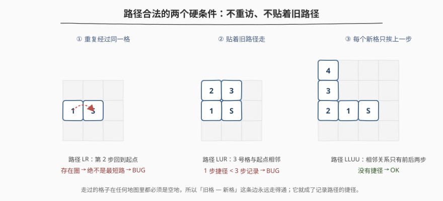
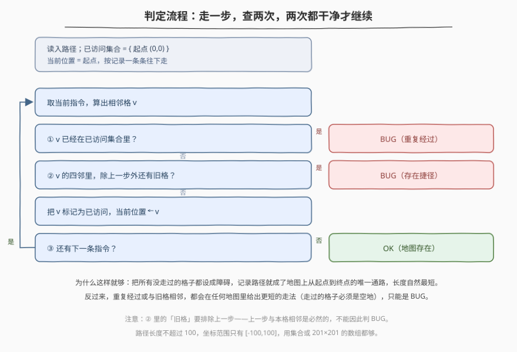
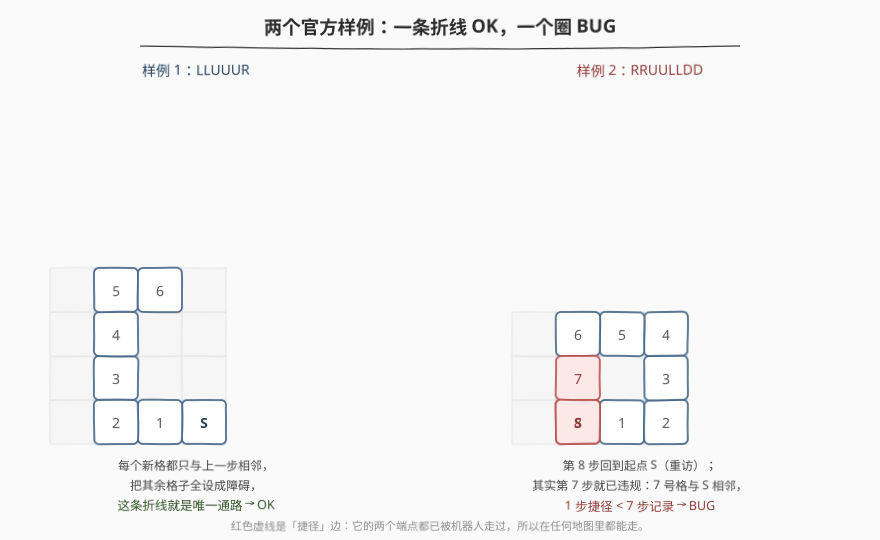

# Codeforces 8B 机器人轨迹判最短 题解

## 1. 题目概述

- **题目链接**：https://codeforces.com/problemset/problem/8/B
- **比赛来源**：Codeforces Beta Round 8 · Problem B（2010-04-08）
- **难度**：1400
- **标签**：构造、图论、实现
- **评测类型**：普通
- **限制**：时间 2 s / 内存 64 MB

**题意**：地图是一张无限大的方格纸，每个格子要么是空地，要么放着障碍。机器人记录下了自己的一次行走轨迹 $s$（只由 `L`、`R`、`U`、`D` 组成，表示向左、右、上、下走一格）。地图后来丢了，现在要判断：**是否存在**一张地图和一个起点，使得

1. 机器人按记录一步步走时，每一步都落在空地上（不会撞障碍）；
2. 从起点到终点，这条记录下来的路径是**最短路径**（长度为 $|s|$）。

存在就输出 `OK`，不存在输出 `BUG`。

**约束**：

- $|s| \le 100$。坐标只会落在 $[-100, 100]^2$ 里，所以用 `set`、哈希或 $201 \times 201$ 的数组都够。
- 地图**无限大**、障碍可以摆在任意位置：不可能枚举地图（有无穷多张），必须把"存在一张地图"翻译成轨迹自身的条件。这是本题的全部难度。
- 只有一组输入，输出只有 `OK` / `BUG` 两个词。

## 2. 示例与观察

官方样例 1（输入 / 输出原样）：

```text
输入：
LLUUUR

输出：
OK
```

**样例 1 走查**：起点记为 $(0,0)$，依次经过

$$(0,0) \to (-1,0) \to (-2,0) \to (-2,1) \to (-2,2) \to (-2,3) \to (-1,3).$$

7 个格子互不相同，而且每走一步，新格子只与"上一步"相邻，与其他走过的格子都不挨着。于是把这些格子以外的所有格子都设成障碍，地图上从起点到终点就只有这一条折线可走，长度 7 就是最短，答案是 `OK`。

官方样例 2（输入 / 输出原样）：

```text
输入：
RRUULLDD

输出：
BUG
```

**样例 2 走查**：依次经过

$$(0,0) \to (1,0) \to (2,0) \to (2,1) \to (2,2) \to (1,2) \to (0,2) \to (0,1) \to (0,0).$$

最后一步回到起点，路径里有一个圈。其实**第 7 步**就已经违规了：新格 $(0,1)$ 与起点 $(0,0)$ 相邻，而从起点到这里只要 1 步，比记录中的 7 步短得多。任何一种地图（走过的格子必须是空地）都保留了这条边，所以记录不可能是最短路，答案是 `BUG`。

**观察 1（走过的格子必为空地）**：不管地图怎么摆，机器人踩过的格子都必须是空地。所以这些格子在**任何**可行地图里都存在，它们之间的相邻边也一定存在——障碍挡不住。

**观察 2（重复经过 = 有圈）**：如果轨迹两次经过同一格，路径里就含一个圈，把圈剪掉能少走若干步。既然记录路径里存在更短的走法，它就不可能是最短路。

**观察 3（贴着旧路径 = 有捷径）**：如果某一步的新格子 $v$ 与某个**更早**走过的格子（不是上一步）相邻，那么在任意地图里都能从那个旧格子一步跨到 $v$，绕开记录里的一大段路——这同样说明记录不是最短路。

**观察 4（反过来是充分的）**：如果轨迹既不重复、也没有"贴着旧路径"，那么把所有没经过的格子都设成障碍，记录路径就成了地图上从起点到终点的唯一通路，长度自然最短。

自造样例（标注"自造"）：

| 输入 | 输出 | 说明 |
|------|------|------|
| `L` | OK | 只走一步，永远是最短路 |
| `LR` | BUG | 回到起点，路径含圈 |
| `LUR` | BUG | 第 3 步的新格 $(0,1)$ 与起点相邻，1 步捷径 < 3 步 |
| `ULUR` | BUG | 第 4 步的新格 $(0,2)$ 与 3 步前的 $(0,1)$ 相邻 |
| `LLUU` | OK | 一条折线，任意非相邻格都不挨着 |
| `DDLL` | OK | 方向换成下、左，结论不变 |
| `RRUULLDD` | BUG | 官方样例 2，绕一圈 |

## 3. 解题思路

### 3.1 朴素做法与瓶颈

"按题面直接做"是行不通的：要判断的是**存在**一张地图，而地图有无穷多张，无法枚举。

可以退一步，只在一个有界窗口里枚举障碍：轨迹的包围盒最多 $101 \times 101$，但即便只取 $7 \times 7$ 的窗口，也有 $2^{49}$ 种摆法。把窗口缩到"包围盒内、且不在路径上的格子"仍然是指数级（长度 100 的螺旋路径能围出 $50 \times 50$ 的区域）。这种枚举只能用来验证长度很短的小数据，不能当解法。

真正的瓶颈是**把"存在地图"这个量词消掉**：注意障碍只能让路变长，而轨迹经过的格子又必须是空地——于是"最好"的地图就是把除轨迹外的所有格子都堵死。路径是否最短，只取决于轨迹本身的形状。

### 3.2 核心观察：两种"自相矛盾"的形状



把轨迹看成格子序列 $p_0, p_1, \dots, p_L$（$L = |s|$），令

$$V = \{p_0, p_1, \dots, p_L\}$$

是它踩过的所有格子。由观察 1，$V$ 中的格子在任意可行地图里都是空地，因此由 $V$ 诱导出的所有相邻边在任意地图里都走得通。于是只剩两种会让记录"不最短"的形状：

1. **重访**：某个 $p_j$ 等于之前的 $p_i$（$i < j$）。前缀 $p_0 \to \dots \to p_i$ 加上后缀 $p_j \to \dots \to p_L$ 就是一条更短的走法。
2. **旧邻格**：某个新格 $p_j$ 与更早的 $p_i$（$i \le j-2$）四邻相邻。到 $p_i$ 用 $i$ 步，跨一步到 $p_j$，再沿后缀走 $L-j$ 步，总共 $i + 1 + L - j \le L - 1$ 步，比记录短。

反过来，如果这两种形状都不出现，说明 $V$ 的诱导子图里每个点只与它的前驱、后继相连——整张诱导子图就是一条简单路径。把 $V$ 以外的格子全设成障碍，地图上从 $p_0$ 到 $p_L$ 的唯一通路就是这条路径，长度恰为 $L$，于是"最短"成立，答案 `OK`。

### 3.3 算法流程



1. `seen` 集合放入起点 $(0,0)$，当前位置 $(x,y) = (0,0)$；
2. 按记录顺序取下一条指令，算出新格 $v$；
3. 若 $v \in \text{seen}$，输出 `BUG`（重访）；
4. 否则检查 $v$ 的四个邻居：若存在 $u \in \text{seen}$ 且 $u$ 不是上一步的格子，输出 `BUG`（旧邻格/捷径）；
5. 否则把 $v$ 加入 `seen`，当前位置移到 $v$，回到第 2 步；
6. 全部指令走完仍未触发，输出 `OK`。

第 4 步里必须把"上一步"排除掉：新格与上一步相邻是天经地义的，不排除的话每一步都会误判 `BUG`。

### 3.4 样例走查



- **样例 1 `LLUUUR`**：格子排成一条向左再向上的折线，任意两个非相邻格都不相邻，两次检查全部通过 → `OK`。
- **样例 2 `RRUULLDD`**：绕着一个 $3 \times 3$ 的方框转了一圈。第 7 步走到 $(0,1)$ 时就与起点 $(0,0)$ 相邻（起点不是上一步），触发第 4 步；即便漏掉这里，第 8 步回到起点也会触发第 3 步。两种情况都指向 `BUG`。

## 4. 正确性证明

设轨迹为 $p_0, p_1, \dots, p_L$（$L = |s| \ge 1$），$V = \{p_0, \dots, p_L\}$。称一张地图是"可行的"，如果它让这段轨迹合法（每步都踩空地）且长度就是起点到终点的最短路长度。

**引理 1（可行地图保留 $V$ 内的所有相邻边）**：若地图可行，则对任意 $i \neq j$，只要 $\lVert p_i - p_j \rVert_1 = 1$，这条边在该地图里就存在（两端都是空地且相邻）。

**证明**：轨迹合法意味着所有 $p_k$ 都是空地；相邻两格之间没有障碍即可通行，故这条边存在。∎

**引理 2（重访必 BUG）**：若存在 $i < j$ 使 $p_i = p_j$，则不存在可行地图。

**证明**：任取一张让轨迹合法的地图。前缀 $p_0 \to \dots \to p_i$ 是长度 $i$ 的走法，后缀 $p_j \to \dots \to p_L$ 是长度 $L - j$ 的走法，把两者在同一个格子 $p_i = p_j$ 处接起来，得到一条从 $p_0$ 到 $p_L$、长度 $i + (L - j) \le L - 1$ 的走法。故最短路长度 $< L$，轨迹不是最短路，矛盾。∎

**引理 3（旧邻格必 BUG）**：若存在 $i \le j - 2$ 使 $\lVert p_i - p_j \rVert_1 = 1$，则不存在可行地图。

**证明**：任取一张让轨迹合法的地图。先走前缀到 $p_i$（$i$ 步），由引理 1 这条边存在，一步到 $p_j$，再沿原轨迹的后缀走到 $p_L$（$L - j$ 步），总长 $i + 1 + (L - j)$。由 $i \le j - 2$ 得 $i + 1 - j \le -1$，故总长 $\le L - 1 < L$，矛盾。∎

**引理 4（两种形状都不出现时地图存在）**：若轨迹无重访、也没有引理 3 那样的相邻对，则存在可行地图。

**证明**：构造地图 $M$：$V$ 中的格子全设为空地，其余格子全部放障碍。轨迹显然合法（每一步都落在 $V$ 的空地上）。下证在 $M$ 中从 $p_0$ 到 $p_L$ 的最短路长度恰为 $L$。

$M$ 中任何走法只能经过 $V$。考察 $V$ 上的诱导子图：对 $0 < k < L$，若 $p_k$ 与某个 $p_j$（$j \neq k$）相邻，则 $|k - j| \ge 2$（相邻下标必是前后两步），这正是被排除的"旧邻格"情形；所以 $p_k$ 在 $V$ 中只与 $p_{k-1}$、$p_{k+1}$ 相邻。$p_0$ 只与 $p_1$ 相邻（若与 $p_j$，$j \ge 2$，相邻，同样被排除），$p_L$ 只与 $p_{L-1}$ 相邻。因此诱导子图恰是一条以 $p_0$、$p_L$ 为两端、依次串起 $p_0, p_1, \dots, p_L$ 的简单路径。$M$ 中从 $p_0$ 到 $p_L$ 的任何走法都留在这个子图里，而在这条路径图上从一端走到另一端至少要 $L$ 步（每步至多把"剩余距离"减少 1）；记录本身正好 $L$ 步，故最短路长度恰为 $L$。∎

**定理**：算法输出 `OK` 当且仅当存在可行地图。

**证明**：算法在第 $j$ 步分别检查 $p_j \in \{p_0, \dots, p_{j-1}\}$（引理 2 的条件）和"$p_j$ 与某个 $p_i$（$i \le j-2$）相邻"（引理 3 的条件）。

- 若任一检查触发，由引理 2 或引理 3，不存在可行地图，输出 `BUG` 正确。
- 若走完全程都没触发，则轨迹无重访、无旧邻格，由引理 4 存在可行地图，输出 `OK` 正确。

两个方向合起来，输出与"是否存在可行地图"完全一致。∎

## 5. 复杂度分析

- **时间**：$O(L)$。每走一步做一次集合查询和 4 次邻居查询，集合操作是 $O(\log L)$（`std::set`）或均摊 $O(1)$（哈希表），总复杂度 $O(L \log L)$ 或 $O(L)$；$L \le 100$ 时二者都远小于 1 毫秒。
- **空间**：$O(L)$，最多存 $L + 1 \le 101$ 个格子。
- **与时限的关系**：2 s 的时限极其宽松。实测端到端（含进程启动）C++ 均值 $2.46$ ms，Python 约 $23$ ms，峰值常驻内存 $1.67$ MB，余量在 800 倍以上。

## 6. 参考代码

### C++17

```cpp
#include <bits/stdc++.h>
using namespace std;

static string solve(const string& s) {
    const int dx[4] = {1, -1, 0, 0};
    const int dy[4] = {0, 0, 1, -1};

    set<pair<int, int>> seen;              // 已经走过的格子
    int x = 0, y = 0;
    seen.insert({x, y});

    for (char c : s) {
        int nx = x, ny = y;
        if (c == 'L')      --nx;
        else if (c == 'R') ++nx;
        else if (c == 'U') ++ny;
        else               --ny;          // 'D'

        // 1) 重复经过同一个格子：路径里含有圈，必然不是最短路
        if (seen.count({nx, ny})) return "BUG";

        // 2) 新格子与"上一步以外"的旧格子相邻：任何地图里都有这条捷径
        for (int d = 0; d < 4; ++d) {
            int ax = nx + dx[d], ay = ny + dy[d];
            if (ax == x && ay == y) continue;    // 上一步的格子，当然相邻
            if (seen.count({ax, ay})) return "BUG";
        }

        seen.insert({nx, ny});
        x = nx;
        y = ny;
    }
    return "OK";
}

int main() {
    ios::sync_with_stdio(false);
    cin.tie(nullptr);

    string s;
    if (!(cin >> s)) return 0;             // 题面只有一组数据
    cout << solve(s) << '\n';
    return 0;
}
```

### Python3

```python
import sys


def solve(s: str) -> str:
    dx = (1, -1, 0, 0)
    dy = (0, 0, 1, -1)

    seen = {(0, 0)}                        # 已经走过的格子，从原点出发
    x = y = 0

    for c in s:
        nx, ny = x, y
        if c == 'L':
            nx -= 1
        elif c == 'R':
            nx += 1
        elif c == 'U':
            ny += 1
        else:                              # 'D'
            ny -= 1

        # 1) 重复经过同一个格子：路径含圈，必然不是最短路
        if (nx, ny) in seen:
            return 'BUG'

        # 2) 新格子与"上一步以外"的旧格子相邻：任何地图里都存在这条捷径
        for d in range(4):
            ax, ay = nx + dx[d], ny + dy[d]
            if (ax, ay) == (x, y):
                continue                   # 上一步的格子，当然相邻
            if (ax, ay) in seen:
                return 'BUG'

        seen.add((nx, ny))
        x, y = nx, ny

    return 'OK'


def main() -> None:
    data = sys.stdin.buffer.read().split()
    if not data:
        return
    sys.stdout.write(solve(data[0].decode()) + "\n")


main()
```

两份代码都只用标准库，可原样提交。坐标用二维下标表示即可，不需要开数组——地图是无限大的，判断只依赖"走过的格子集合"。

## 7. 边界情况与易错点

1. **忘记排除"上一步"**：新格永远与上一步相邻，不排除的话第一步就会判 `BUG`，样例 1 都过不了。
2. **只查重访、不查旧邻格**：`LUR` 会被误判成 `OK`（它其实有 1 步捷径）。这是最典型的漏洞，官方样例 2 也盖不住它。
3. **起点没放进集合**：`LR` 的第 2 步回到起点会被当成"走到新格"，从而漏判 `BUG`。初始化时必须 `seen = {(0,0)}`。
4. **以为障碍能挡住捷径**：捷径的两个端点都被机器人走过，在**任何**地图里都必须是空地，障碍挡不住。这是本题的核心反直觉点。
5. **以为"绕一圈回到起点"没问题**：路径含圈就不再是最短路，`RRUULLDD` 因此是 `BUG`。
6. **把"新格与终点相同"当特例处理**：不需要，重访检查自然覆盖了"回到起点/回到曾经到过的任何格"。
7. **方向映射写错**：`L/R/U/D` 与坐标增减的对应关系只要自洽就不影响判定（整体旋转/翻转不改变"是否相邻"），但四个方向必须互不重复，漏写 `D` 会让 `else` 分支吃掉错误的方向。
8. **输出大小写**：`OK`、`BUG` 都是全大写，不要写成 `Ok`、`Bug`。
9. **坐标类型**：用 `int`；路径长度只有 100，不会溢出，但别用无符号类型做减法（`x - 1` 在 $x = 0$ 时如果写成无符号会回绕成极大值）。
10. **长度 1 的路径**：任何单步都是最短的，`solve` 应返回 `OK`——循环体一次也不触发检查，代码天然正确；可以用它做最小回归用例。

## 8. 验证记录

- **编译环境与命令**：本机只有 `Apple clang 21.0.0`（`/usr/bin/g++` 是 clang 的软链），没有 GNU `g++` 与 libstdc++，由 `codeforces/tools/verify_solution.py` 用 `clang++ -std=c++17 -O2` 搭配本地 `bits/stdc++.h` 兼容头编译（代码只用标准库，可原样提交 GNU C++17）。Python 侧为 `Python 3.9.6`。
- **官方样例**：2 / 2 通过。`python3 codeforces/tools/verify_solution.py codeforces/contests/0001-0100/8/B_机器人轨迹判最短.md` 输出 `CF8B: samples 2 / C++ 编译 OK, 样例 2/2 / Python 语法 OK, 样例 2/2`。
- **对拍器 1（图论视角，独立实现）**：把访问过的格子当作图的顶点、四邻当作边，只在**诱导子图**上跑 BFS 求起点到终点的最短路，若距离等于 $|s|$ 则 `OK`，否则 `BUG`。它不检查"邻居"、也不模拟行走，与主程序思路完全不同。
- **对拍器 2（题面视角，直接枚举地图）**：在轨迹包围盒内枚举"哪些非路径格子放障碍"的全部子集（子集数上限 4096），对每种地图做 BFS 求起点到终点的最短路，只要有一种地图让距离恰好等于 $|s|$ 就判 `OK`。这是**字面意义上**按题面"是否存在一张地图"来搜的。
- **对拍结果**（全部实跑）：
  - 穷举所有长度 $1 \sim 6$ 的路径（$4 + 16 + 64 + 256 + 1024 + 4096 = 5460$ 条），与对拍器 1 比对：**0 处不符**。
  - 穷举所有长度 $1 \sim 5$ 的路径（$1364$ 条），与对拍器 2 逐条枚举地图比对：**1364 条全部检查，0 处不符、0 条因规模被跳过**。
  - 随机路径 **3000 条**（长度 $1 \sim 100$，均匀取四个方向），与对拍器 1 比对：**0 处不符**。
  - 用"同一份源码编译出的批量驱动"重跑上述 5460 条穷举路径：**0 处不符**；另用真实可执行文件（C++ 与 Python）各跑 **300 条**随机路径，**0 处不符**。
- **判词分布**（独立对拍器统计，可用于回归）：长度 $1 \sim 6$ 的全部路径中 `OK` 的条数依次是 $4,\ 12,\ 28,\ 68,\ 164,\ 396$（对应总数 $4, 16, 64, 256, 1024, 4096$）。
- **最大约束性能**：取 $|s| = 100$ 的路径（`L` 重复 50 次接 `U` 重复 50 次），C++ 跑 200 次均值 $2.46$ ms（最大 $7.89$ ms，含进程启动），Python 约 $23.0$ ms；峰值常驻内存 $1.67$ MB，远低于 64 MB，相对 2 s 时限余量在 800 倍以上。
- **图片校验**：三张 SVG（`cf8b_illegal_shapes.svg`、`cf8b_flow.svg`、`cf8b_sample_walk.svg`）均通过 `xml.etree.ElementTree.parse`；按字符宽度逐字估算的包围盒脚本检查了 22 / 21 / 26 个文本块，**0 处越出 viewBox 或所在方框**；headless Chrome 渲染成 PNG 后按像素统计墨迹范围（三张图分别落在 $x \in [116, 846]$、$[14, 840]$、$[49, 742]$，均在各自 viewBox 内），确认没有被裁切。
- **公式校验**：正文公式为 `$...$` 行内与 `$$...$$` 块级；星号直接写 `*`；`\text{}` 内没有裸 `#`；`node codeforces/tools/katex_check.cjs` 的 KaTeX `throwOnError` 渲染无报错。
- **复核状态**：verified（样例、两套对拍器、穷举 + 随机、性能、图片、公式均实跑通过；唯一环境差异是本机无 GNU g++，已用 clang++ 等价验证）。

## 相关题目与扩展

- [Codeforces 8A Train and Peter](https://codeforces.com/problemset/problem/8/A)：同场 A 题，同样是把"记录下来的走法"和真实几何对照，只是从网格路径换成了字符串匹配。
- [LeetCode 874. 模拟行走机器人](https://leetcode.cn/problems/walking-robot-simulation/)：网格行走 + 障碍，但地图是给定的，求最终位置而不是判合法性——与本题"地图未知"形成对照。
- [LeetCode 657. 机器人能否返回原点](https://leetcode.cn/problems/robot-return-to-origin/)：只看位移是否为零，是本题"去掉最短性要求"的弱化版。
- [LeetCode 1041. 困于环中的机器人](https://leetcode.cn/problems/robot-bounded-in-circle/)：反复执行同一串指令，判断轨迹是否有界，同属"从走法反推几何形状"。

**延伸思考**：

1. **如果地图给定**：判断"记录的路径是否最短"只需在原地图上 BFS 一次，比较距离与 $|s|$，$O(\text{面积} + L)$。本题难在地图未知——这正是"量词消去"的价值：把"存在地图"化成了轨迹的两个局部条件。
2. **如果允许斜着走（8 方向）**：相邻的定义从 4 邻域变成 8 邻域，"旧邻格"的判定和证明一字不改，只是邻居列表从 4 个变成 8 个；注意此时对角线一步的代价仍是 1，距离定义要跟着改。
3. **如果问"最少删掉几步能让轨迹合法"**：删掉一步会改变后续所有坐标，等价于在轨迹上做编辑，可以用区间 DP（$O(L^3)$）或贪心；本题的局部检查给了"哪里出错"的判定，但不直接给出最优删除。
4. **如果轨迹长度是 $10^5$**：把 `std::set` 换成 `unordered_set`（或把坐标编码成一个 64 位整数做键），复杂度仍是 $O(L)$；哈希表的期望性能足以支撑 $10^6$ 级别。
5. **最长合法轨迹有多长**：在 $n \times n$ 的格子里，一条不含"旧邻格"的路径正是**诱导路径**（indifference graph 的路径），它的长度受格子面积限制——沿着螺旋走时，每绕一圈都必须与内圈隔开一格，所以合法轨迹长度只有 $O(n^2)$ 而非指数级。这也是为什么 $L \le 100$ 时很多路径会很快撞上 `BUG`。
