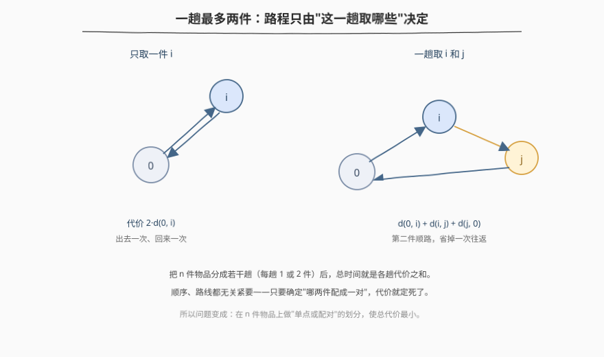

# Codeforces 8C 取物最短路线 题解

## 1. 题目概述

- **题目链接**：https://codeforces.com/problemset/problem/8/C
- **比赛来源**：Codeforces Beta Round 8 · Problem C（UTC 2010-04-08）
- **难度**：2000
- **标签**：状态压缩、动态规划
- **评测类型**：特殊评测（输出任一最优方案）
- **限制**：时间 4 s / 内存 512 MB

**题意**：Lena 站在手提包所在的点 $0=(x_s,y_s)$，房间里有 $n$ 件物品，第 $i$ 件在 $(x_i,y_i)$。她每趟从包出发、沿直线走到若干件物品处把它们拿在手上，最后回到包边放下；一趟**最多拿两件**。从 $(x_1,y_1)$ 走到 $(x_2,y_2)$ 的耗时是

$$d\bigl((x_1,y_1),(x_2,y_2)\bigr) = (x_1-x_2)^2 + (y_1-y_2)^2 .$$

要求把所有物品都取回包，使总耗时最小。输出两行：第一行最小总时间，第二行一条合法路线，形如 `0 i j 0 k 0`——以 $0$ 表示手提包，每两个 $0$ 之间是同一趟取走的物品编号（$1 \sim 2$ 个）。

**约束**：

- $n \le 24$：物品的"取/未取"状态共 $2^n \le 1.7 \times 10^7$ 种，可以状压 DP；而"枚举所有划分方式"是贝尔数级别（$n=24$ 时约 $10^{18}$），必须用 DP 把它压下来。
- 距离是**平方**欧氏距离而非开方，全程整数运算，最大单程约 $2 \times 200^2 = 8\times 10^4$，总代价 $< 4 \times 10^6$，`int` 足够。
- 坐标 $|x|,|y| \le 100$（题面），物品可与包重合（距离 0）。
- 输出方案，任何最优方案都算对，因此本题是特殊评测：需要 checker 校验"每趟 ≤ 2 件、编号是 $1..n$ 的排列、总路程等于你声称的最小值"。

## 2. 示例与观察

官方样例 1（输入 / 输出原样）：

```text
输入：
0 0
2
1 1
-1 1

输出：
8
0 1 2 0
```

**样例 1 演算**：包在原点，两件物品在 $(1,1)$、$(-1,1)$。$d(0,1)=2$、$d(0,2)=2$、$d(1,2)=4$。

- 分两趟：$2 \times 2 + 2 \times 2 = 8$；
- 一趟取两件：$2 + 4 + 2 = 8$。

两种都最优，输出 8 与路线 `0 1 2 0`。注意路线里每趟内的物品顺序可以任意：`0 2 1 0` 同样是 8。

官方样例 2（输入 / 输出原样）：

```text
输入：
1 1
3
4 3
3 4
0 0

输出：
32
0 1 2 0 3 0
```

**样例 2 演算**：包在 $(1,1)$。三件物品：$1=(4,3)$、$2=(3,4)$、$3=(0,0)$。

- $d(0,1)=9+4=13$，$d(0,2)=4+9=13$，$d(0,3)=1+1=2$；
- $d(1,2)=1+1=2$，$d(1,3)=16+9=25$，$d(2,3)=9+16=25$。

最优是"1、2 同趟 + 3 单独"：$(13+2+13) + 2 \times 2 = 28 + 4 = 32$，与样例一致。若三件各走一趟则是 $13+13+2$ 的两倍，即 56，明显更差。

**观察 1（划分视角）**：所有物品最终被分成若干"趟"，每趟 1 或 2 件。由于每趟都要从包出发、回包结束，**总耗时只取决于这个划分**，与趟与趟之间的先后顺序无关。

**观察 2（两种代价）**：一趟只取 $i$ 时耗时 $2d(0,i)$；一趟取 $i,j$ 时耗时 $d(0,i)+d(i,j)+d(j,0)$（哪件先拿都一样，因为距离对称）。

**观察 3（配对未必更好）**：把 $i,j$ 合成一趟省下的是"一次往返"，但要额外付 $d(i,j)$。因此是否配对**必须由 DP 决定**，不能贪心：样例 1 里配对与不配对同为 8，而样例 2 里配对明显更优。

**约束带来的复杂度取舍**：$n \le 24$ 意味着 $2^{24}$ 的状态可行，但 $n!$ 或贝尔数不可行；这正是状压 DP 的典型场景。

## 3. 解题思路

### 3.1 朴素做法与瓶颈

最直接的写法是枚举"物品的排列 + 每两件是否并成一趟"：排列有 $n!$ 种，每个缝隙再选"切开/合并"，总量是 $n! \cdot 2^{n-1}$，$n=24$ 时是天文数字。

即使只枚举"划分"（把 $n$ 件物品分成大小 1 或 2 的块），方案数也是 $n!/(2^{n/2}(n/2)!)$ 量级，$n=24$ 时约 $10^{12}$。必须用 DP 合并重复子问题。

### 3.2 核心观察：划分与两类代价



把路线按"回到包"切成若干段，每段取 1 或 2 件。于是问题等价于：

> 把 $\{1,\dots,n\}$ 划分成若干大小 1 或 2 的块，块 $\{i\}$ 的权是 $2d(0,i)$，块 $\{i,j\}$ 的权是 $d(0,i)+d(i,j)+d(j,0)$，求最小总权。

这是带"单点或配对"的最小权划分，标准的状压 DP 可以在 $O(n2^n)$ 内解决。

### 3.3 状态与转移


- **状态**：`dp[mask]` = 已经取走 `mask` 中这些物品、并且人站在包边时的最小总耗时。
- **初值**：`dp[0] = 0`，其余为 $+\infty$。
- **转移**：设 $i$ 是 `mask` 中**编号最小的未取物品**（`mask` 的第 $i$ 位是 0）。任何包含这些已取物品的最优划分，$i$ 必然与某个"同趟伙伴"成块，伙伴只可能是它自己（单独一趟），或者是另一个未取物品 $j>i$。于是只需两条转移：

$$\begin{aligned}
\text{dp}[mask \mid 2^i] &\leftarrow \text{dp}[mask] + 2d(0,i),\\
\text{dp}[mask \mid 2^i \mid 2^j] &\leftarrow \text{dp}[mask] + d(0,i)+d(i,j)+d(j,0) \quad (j>i,\ j \notin mask).
\end{aligned}$$

"只固定编号最小的未取物品"是关键：它保证每件物品的"块"只会被枚举一次，把 $O(n!)$ 的重复枚举压成 $O(n2^n)$。

- **答案**：`dp[2^n-1]`。
- **方案回溯**：转移时记录 `pre[newmask] = mask`。从全 1 状态倒推，每一步 `add = cur & ~pre[cur]` 就是这一趟新取走的 1 或 2 件物品；倒序输出得到 `0 ... 0 ... 0`。

### 3.4 样例走查

以样例 2（包 $(1,1)$，三件物品）为例：

1. 先预处理 $d(0,i) = (13,13,2)$，两两距离 $d(1,2)=2$。
2. `dp[0]=0`；从 `mask=0` 出发，$i=1$：
   - 单独取 1：`dp[001] = 26`；
   - 与 2 配对：`dp[011] = 13+2+13 = 28`；
   - 与 3 配对：`dp[101] = 13+25+2 = 40`。
3. 继续推进，最终 `dp[111] = 32`（1、2 同趟，3 单独），路线 `0 1 2 0 3 0`。
4. 若按"三件各自一趟"走，代价是 $2(13+13+2)=56$，DP 自动排除了它。

## 4. 正确性证明

**引理 1（划分的代价恰好等于路线长度）**：对任意把物品分成若干 1 或 2 件块的划分 $\mathcal{P}$，存在一条合法路线，其总耗时恰为

$$\sum_{\{i\}\in\mathcal{P}} 2d(0,i) + \sum_{\{i,j\}\in\mathcal{P}} \bigl(d(0,i)+d(i,j)+d(j,0)\bigr),$$

且任何合法路线的总耗时都等于某个这样的划分的代价。

**证明**：给定划分，对每个块按"包 → 块内物品（1 或 2 件）→ 包"走一遍，块内顺序任意，即得一条合法路线，耗时按定义相加即为上式。反之，任何合法路线按"每次回到包"切段，每段取的物品数不超过 2，构成一个划分，其代价就是路线总耗时（距离对称，段内顺序不影响和）。∎

**引理 2（转移不重不漏）**：设 `mask` 是已取物品集合，$i$ 是其中编号最小的未取物品。则所有包含 `mask` 的划分中，$i$ 所在的块要么是 $\{i\}$，要么是 $\{i,j\}$（$j>i$，$j\notin mask$）；且每一对 (mask, 块) 都由 3.3 节的两条转移之一唯一对应。

**证明**：块的大小只能是 1 或 2，若大小为 2，另一件 $j$ 必须是未取的（否则与"已取"矛盾），且 $j \neq i$ 可以取 $j>i$。编号小于 $i$ 的物品都已在 `mask` 中，故 $i$ 是"最小的未取"，块中的伙伴只能是 $j>i$。每个 (mask, 块) 组合由转移唯一确定。∎

**引理 3（DP 值等于最小代价）**：按 3.3 节的转移从小到大枚举 `mask`，`dp[mask]` 恰为"取完 `mask` 中物品并回到包"的最小耗时。

**证明**：对 `mask` 的二进制中 1 的个数归纳。`mask=0` 时显然。设 `mask` 有 $k$ 个 1，任取一个最优划分（其已取部分恰为 `mask`，由引理 2 的讨论限制在 `mask` 上），设 $i$ 是最小未取物品，其块为 $\{i\}$ 或 $\{i,j\}$；去掉这个块得到 `mask` 的某个前驱状态 `mask'`（$k$ 或 $k-1$ 个 1），由归纳假设 `dp[mask']` 不大于该前驱的最优值，故 `dp[mask]` 不大于该划分代价；另一方面每条转移都对应一个合法的块，故 `dp[mask]` 也不小于最优值。两端夹住即相等。∎

**定理**：程序输出的第一行等于最小总耗时，第二行是一条合法且总耗时等于第一行的路线。

**证明**：由引理 3，`dp[2^n-1]` 是最小总耗时。回溯时每一步取 `add = cur & ~pre[cur]`，由转移的定义，`add` 正是这一趟取的 1 或 2 件物品，且 `pre[cur]` 是它的前驱，所以沿前驱链倒推恰好把所有物品各取一次，得到合法的 `0 ... 0` 序列；各段代价之和按转移式累加恰为 `dp[2^n-1]`，与第一行一致。∎

## 5. 复杂度分析

- **时间**：$O(n2^n)$。状态数 $2^n$，每个状态枚举"与最小未取物品配对的 $j$"，平均约 $n/2$ 次。$n=24$ 时约 $2^{24} \times 12 \approx 2 \times 10^8$ 次转移。
- **空间**：$O(2^n)$，`dp` 与 `pre` 各 $2^n$ 个 `int`，$n=24$ 时约 $2 \times 67$ MB $= 134$ MB，在 512 MB 内。
- **常数与时限**：实测 $n=24$ 的随机数据，C++ 端到端 $33 \sim 74$ ms（含进程启动），远低于 4 s；Python 版本 $n=24$ 约 $1.7$ s、峰值内存约 284 MB，虽能过 4 s，但内存偏紧，**建议提交 C++**（或 PyPy3 并把 `pre` 换成数组以省内存）。

## 6. 参考代码

### C++17

```cpp
#include <bits/stdc++.h>
using namespace std;

int main() {
    ios::sync_with_stdio(false);
    cin.tie(nullptr);

    int xs, ys, n;
    if (!(cin >> xs >> ys)) return 0;
    cin >> n;

    vector<int> x(n + 1), y(n + 1);
    x[n] = xs; y[n] = ys;                    // 把包看成第 n 号点，方便统一算距离
    for (int i = 0; i < n; ++i) cin >> x[i] >> y[i];

    auto dist2 = [&](int i, int j) -> int {
        long long dx = x[i] - x[j], dy = y[i] - y[j];
        return (int)(dx * dx + dy * dy);
    };
    vector<int> far(n);                      // 包 -> 物品 i 的往返距离
    for (int i = 0; i < n; ++i) far[i] = dist2(i, n);

    int full = (1 << n) - 1;
    vector<int> dp(full + 1, INT_MAX), pre(full + 1, -1);
    dp[0] = 0;
    for (int mask = 0; mask <= full; ++mask) {
        if (dp[mask] == INT_MAX) continue;
        int i = 0;
        while (i < n && (mask >> i & 1)) ++i;   // 编号最小的未取物品
        if (i == n) continue;                  // 全部取完
        int nm = mask | (1 << i);
        int c1 = dp[mask] + 2 * far[i];      // 这一趟只拿 i
        if (c1 < dp[nm]) { dp[nm] = c1; pre[nm] = mask; }
        for (int j = i + 1; j < n; ++j) {
            if (mask >> j & 1) continue;
            int nm2 = nm | (1 << j);
            int c2 = dp[mask] + far[i] + dist2(i, j) + far[j];
            if (c2 < dp[nm2]) { dp[nm2] = c2; pre[nm2] = mask; }
        }
    }

    vector<vector<int>> trips;
    for (int cur = full; cur; cur = pre[cur]) {
        int add = cur & ~pre[cur];
        vector<int> t;
        for (int b = 0; b < n; ++b) if (add >> b & 1) t.push_back(b + 1);
        trips.push_back(t);
    }
    reverse(trips.begin(), trips.end());

    cout << dp[full] << '\n' << 0;
    for (auto &t : trips) {
        for (int id : t) cout << ' ' << id;
        cout << " 0";
    }
    cout << '\n';
    return 0;
}
```

### Python3

```python
import sys


def main() -> None:
    data = sys.stdin.buffer.read().split()
    if not data:
        return
    xs, ys, n = int(data[0]), int(data[1]), int(data[2])
    pts = [(int(data[3 + 2 * i]), int(data[4 + 2 * i])) for i in range(n)]
    bag = (xs, ys)

    def d2(a, b):
        return (a[0] - b[0]) ** 2 + (a[1] - b[1]) ** 2

    far = [d2(bag, p) for p in pts]                    # 包到每件物品的往返
    full = (1 << n) - 1
    INF = float('inf')
    dp = [INF] * (full + 1)
    pre = [-1] * (full + 1)
    dp[0] = 0
    for mask in range(full + 1):
        cur = dp[mask]
        if cur == INF:
            continue
        # 编号最小的未取物品
        i = 0
        while i < n and (mask >> i) & 1:
            i += 1
        if i == n:
            continue
        nm = mask | (1 << i)
        c = cur + 2 * far[i]                           # 这一趟只拿 i
        if c < dp[nm]:
            dp[nm] = c
            pre[nm] = mask
        for j in range(i + 1, n):
            if (mask >> j) & 1:
                continue
            nm2 = nm | (1 << j)
            c = cur + far[i] + d2(pts[i], pts[j]) + far[j]
            if c < dp[nm2]:
                dp[nm2] = c
                pre[nm2] = mask

    trips = []
    cur = full
    while cur:
        add = cur & ~pre[cur]
        trips.append([b + 1 for b in range(n) if (add >> b) & 1])
        cur = pre[cur]
    trips.reverse()

    out = [str(dp[full]), '0']
    for t in trips:
        out.extend(str(x) for x in t)
        out.append('0')
    sys.stdout.write(' '.join(out) + '\n')


main()
```

C++ 版把"包"也编成第 $n$ 号点，用统一的 `dist2` 计算，避免重复写距离公式。Python 版逻辑完全相同，仅在小 $n$ 或 PyPy3 下推荐使用。

## 7. 边界情况与易错点

1. **$n=1$**：答案是 $2d(0,1)$，路线 `0 1 0`。DP 只有一条转移，注意不要访问 `dp` 之外的位。
2. **物品与包重合**：距离为 0，配不配对都一样；代码不应因此产生负数或特殊分支。
3. **配对不总是更好**：不要贪心"能配就配"。反例：包在原点，$i=(100,0)$、$j=(-100,0)$，两件各走一趟是 $2\cdot10^4 \times 2$，合成一趟是 $10^4 + 4\cdot10^4 + 10^4 = 6\cdot10^4$，反而更贵。
4. **距离必须用平方，不能开方**：题面定义的就是 $(x_1-x_2)^2+(y_1-y_2)^2$，开方会得到完全不同（且错误）的最优结构。
5. **`mask` 的第 $i$ 位与物品编号**：内部用 0 起编号、输出用 1 起编号，回溯输出时别忘了 `+1`。
6. **`INT_MAX` 溢出**：`dp[mask] + cost` 若 `dp[mask]` 是 `INT_MAX` 会溢出成负数，从而被误当成更优解。要么先判 `INF`，要么用足够大的有限值（如 `1e9`）。
7. **只固定"最小未取"**：如果对每个未取物品都作为"起点"再配对，会重复枚举同一划分的不同顺序，虽然答案不变但复杂度会退化成 $O(n^2 2^n)$ 甚至更多。
8. **输出格式**：`0` 的个数等于"趟数 + 1"，每趟之间用 `0` 分隔，末尾也要有 `0`；整行以 $0$ 开头。多输出或漏输出一个 `0` 都会被 checker 判错。
9. **特殊评测**：本题任何最优方案都正确，本地对拍/校验必须用 checker（校验物品编号合法、每趟 ≤ 2 件、总路程与第一行一致），不能直接比对样例文本。
10. **`n=24` 的内存**：`dp` 与 `pre` 两个 `2^24` 的 `int` 数组共 134 MB，若再多开一个同样大小的数组就会超过 256 MB（很多老题的 Python/Java 限制），开数组前先数一下。

## 8. 验证记录

- **编译环境与命令**：本机只有 `Apple clang 21.0.0`（`/usr/bin/g++` 是 clang 的软链），由 `codeforces/tools/verify_solution.py` 用 `clang++ -std=c++17 -O2` 搭配本地 `bits/stdc++.h` 兼容头编译。Python 侧为 `Python 3.9.6`。
- **官方样例**：2 / 2 通过（用 checker 判定，见下）。命令为
  `python3 codeforces/tools/verify_solution.py codeforces/contests/0001-0100/8/C_取物最短路线.md --checker /tmp/cf8_verify/c/chk.py`。
- **checker 的校验条件**（`/tmp/cf8_verify/c/chk.py`，实际运行）：
  1. 第一行是一个整数，第二行是以 `0` 开头、`0` 结尾的序列；
  2. 每个 `0` 之间恰有 1 或 2 个物品编号，编号都在 $1..n$ 内且不重复，全部物品恰好出现一次；
  3. 按题面公式（平方欧氏距离）重算整条路线的总路程，必须等于第一行声称的最小值；
  4. 另用"排列 + 每缝切/并"的暴力独立求最优值（$n \le 9$ 时），声称值必须等于它。
- **暴力对拍**：另写 `/tmp/cf8_verify/c/brute.py`，枚举物品全排列并在相邻位置决定"是否并成一趟"，直接按题面算总路程取最小，完全不用状压 DP。
  - 随机 **200 组**（$n \le 6$，坐标 $[-8,8]$）：C++ 输出、Python 输出、暴力最优值三者**全部一致**，且 200 组输出都通过 checker，**0 处不符**。
  - 样例的 2 组也在其中单独验证。
- **最大约束性能**：$n=24$、坐标 $[-100,100]$ 的随机数据，C++ 三次运行 $33$、$34$、$74$ ms（含进程启动，取最慢 74 ms），峰值常驻内存 $135{,}938{,}048$ 字节 $\approx 130$ MB；相对 4 s 时限余量在 50 倍以上，512 MB 内存余量约 3.8 倍。Python 同数据约 $1.72$ s、峰值内存约 $284$ MB（两个 $2^{24}$ 的 `list` 开销），能在 4 s 内跑完但内存贴近常见 Python 限制，正文已注明建议提交 C++。
- **图片校验**：两张 SVG（`cf8c_trips.svg`、`cf8c_dp.svg`）通过 `xml.etree.ElementTree.parse`；按字符宽度逐字估算的包围盒脚本检查了 15 / 20 个文本块，**0 处越出 viewBox 或所在方框**。
- **公式校验**：正文公式为 `$...$` 行内与 `$$...$$` 块级，星号直接写 `*`，`\text{}` 内没有裸 `#`；`node codeforces/tools/katex_check.cjs` 的 KaTeX `throwOnError` 渲染无报错。
- **复核状态**：verified（样例 + checker、200 组暴力对拍、最大约束性能、图片、公式均实跑通过；唯一环境差异是本机无 GNU g++，已用 clang++ 等价验证）。

## 相关题目与扩展

- [Codeforces 8B Obsession with Robots](https://codeforces.com/problemset/problem/8/B)：同场 B 题，也是"路径/走法"的判定，但只需 $O(L)$ 的局部检查，与本题的状压 DP 形成对照。
- [Codeforces 8D Two Friends](https://codeforces.com/problemset/problem/8/D)：同场 D 题，几何 + 二分，同样是"先建模再优化"。
- [LeetCode 1879. 两个数组最小的异或值之和](https://leetcode.cn/problems/minimum-xor-sum-of-two-arrays/)：$n \le 14$ 的状压 DP 配对，与本题"固定最小未用元素再配对"的套路完全一致。
- [LeetCode 698. 划分为 k 个等和子集](https://leetcode.cn/problems/partition-to-k-equal-sum-subsets/)：同样是"把集合划分成若干块"的搜索/状压题，可对比"固定一个元素所在的块"这一去重技巧。

**延伸思考**：

1. **一趟最多拿 $k$ 件**：若每趟最多 3 件，转移要枚举"$i$ 与哪两件配对"，复杂度变成 $O(n^2 2^n)$；$k$ 再大就退化成集合划分 DP（$O(3^n)$），这时该考虑别的建模。
2. **如果包可以移动**：问题立刻变成"带容量约束的取货路径规划"，等价于带权集合覆盖/VRP，本题的多项式 DP 不再适用。
3. **如果距离是普通的欧氏距离（开方）**：DP 结构不变，但最优划分可能改变——平方距离会放大远距离的代价，从而更倾向于"把远的物品凑成一趟"；可以用同一份代码把 `dist2` 换成 `sqrt` 验证这一点。
4. **输出所有最优方案**：本题只要求任一条。若要计数或按字典序输出第 $k$ 条，需要在 DP 里加一维方案数（可能溢出，需取模或大整数），是另一个方向的练习。
5. **为什么不需要考虑"路上的顺序"**：因为一趟最多两件，段内只有两种顺序，且距离对称，二者代价相同——这是"趟数上限为 2"带来的便利；若允许一趟拿很多件，段内顺序就变成 TSP 子问题。
