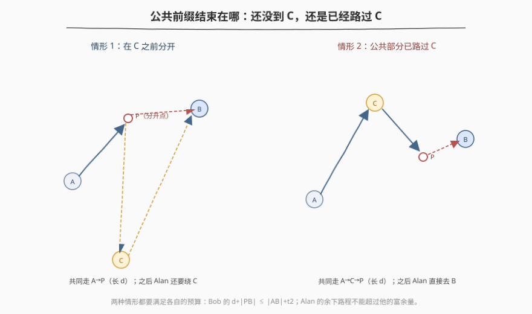
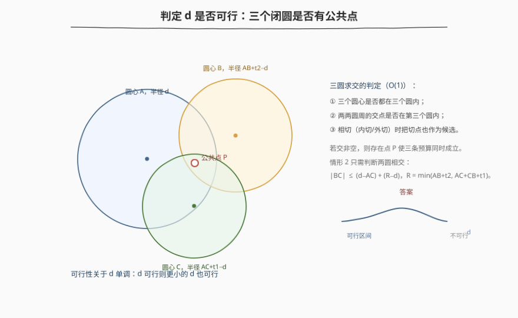

# Codeforces 8D 两个朋友的公共前缀 题解

## 1. 题目概述

- **题目链接**：https://codeforces.com/problemset/problem/8/D
- **比赛来源**：Codeforces Beta Round 8 · Problem D（UTC 2010-04-08）
- **难度**：2600
- **标签**：二分、几何
- **评测类型**：普通（浮点答案，带误差判定）
- **限制**：时间 1 s / 内存 64 MB

**题意**：平面上有三个点 $A,B,C$。Alan 和 Bob 都从 $A$ 出发：Bob 想去 $B$，他的路线长度不能超过 $|AB| + t_2$；Alan 要**经过 $C$** 再去 $B$，他的路线长度不能超过 $|AC| + |CB| + t_1$。两人可以一起走一段路，之后分开；**一旦分开，即使之后又走到一起，重合的部分也不再计入**。求"从 $A$ 出发的公共前缀"的最大可能长度。

**约束**：

- $0 \le t_1, t_2 \le 100$，坐标绝对值不超过 $100$：所有长度都在 $O(10^3)$ 量级，`double` 精度绰绰有余。
- 答案是实数，题面要求"保留至少四位小数"，一般按 $10^{-6}$ 相对/绝对误差判定；因此需要用二分搜索而不是枚举。
- 几何结构只有三个点，可行性判定是 $O(1)$ 的圆与圆求交，整个算法的复杂度只取决于二分次数。
- 一个容易忽略的细节：公共前缀可能**已经包含了对 $C$ 的访问**（样例 2 就是如此），所以要把"分开点在 $C$ 之前"和"分开点在 $C$ 之后"分成两种情形。

## 2. 示例与观察

官方样例 1（输入 / 输出原样）：

```text
输入：
0 2
0 0
4 0
-3 0

输出：
1.0000000000
```

**样例 1 演算**：$A=(0,0)$、$B=(4,0)$、$C=(-3,0)$ 共线，$t_1=0$、$t_2=2$。

- Bob 的预算：$|AB| + t_2 = 4 + 2 = 6$；
- Alan 的预算：$|AC| + |CB| + t_1 = 3 + 7 + 0 = 10$，且 $t_1 = 0$ 意味着他**必须**走最短的 $A \to C \to B$，也就是只能沿 $x$ 轴向左到 $C$ 再折返。
- 若公共前缀长度为 $d$，两人先一起走到 $P=(-d, 0)$（$P$ 必须落在 $A$ 到 $C$ 的线段上，否则 Alan 的路线就超过预算）。之后 Bob 从 $P$ 去 $B$ 要走 $4+d$，需 $d + (4+d) \le 6$，即 $d \le 1$；
- 取 $d = 1$ 时 Bob 的路线长 $1+5=6$ 恰好用满，Alan 的路线长 $1 + 2 + 7 = 10$ 也恰好用满，所以答案是 $1$。

官方样例 2（输入 / 输出原样）：

```text
输入：
0 0
0 0
2 0
1 0

输出：
2.0000000000
```

**样例 2 演算**：$A=(0,0)$、$B=(2,0)$、$C=(1,0)$，$t_1=t_2=0$。Alan 的最短路是 $A \to C \to B$，长度 $1+1=2$；Bob 的最短路 $A \to B$ 也是 $2$。而 $C$ 恰好在线段 $AB$ 上，所以两人可以**全程一起**沿 $A \to C \to B$ 走，公共前缀就是整条路，长度 $2$。

这个例子说明：公共前缀不一定在到达 $C$ 之前结束——它可以直接把 $C$ 包含进去。

**观察 1（公共前缀是一条从 $A$ 出发的路）**：两人在分开点 $P$ 之前走的是同一条路线，长度记为 $d$。于是 $|AP| \le d$（实际路线可以比直线长），反之只要 $|AP| \le d$，就存在一条长度为 $d$ 的 $A \to P$ 路线（先直线走再小幅折返即可）。

**观察 2（分开后各自的预算）**：

- Bob：$d + |PB| \le |AB| + t_2$；
- Alan：若 $C$ 还没去过，则还要绕 $C$：$d + |PC| + |CB| \le |AC| + |CB| + t_1$，即 $|PC| \le |AC| + t_1 - d$；若 $C$ 已经包含在公共前缀里，则直接去 $B$：$d + |PB| \le |AC| + |CB| + t_1$。

**观察 3（单调性）**：如果公共前缀长 $d$ 可行，那么把分开点沿同一条路提前到 $d' < d$ 处，Bob 与 Alan 的剩余路程都不会变长（三角不等式），所以 $d'$ 也可行。因此"可行"的 $d$ 构成区间 $[0, d^*]$，可以二分。

## 3. 解题思路

### 3.1 朴素做法与瓶颈

最直接的想法是枚举分开点 $P$：平面是不可数的，只能离散化，而样例 1 的最优 $P$ 恰好落在约束的"角点"上，网格枚举要么漏掉、要么精度不够。另一条路是直接对 $d$ 做二分——但需要 $O(1)$ 的可行性判定，这就要把"存在 $P$"这个量词化成几何条件。

### 3.2 核心观察：两种分开情形



固定公共前缀长度 $d$，把可行配置分成两类（覆盖所有可能）：

**情形 1（分开时还没到 $C$）**：存在点 $P$ 满足

$$|AP| \le d,\qquad |PB| \le |AB| + t_2 - d,\qquad |PC| \le |AC| + t_1 - d .$$

即三个**闭圆**（圆心 $A,B,C$，半径分别是 $d$、$|AB|+t_2-d$、$|AC|+t_1-d$）有公共点。

**情形 2（公共前缀已经路过 $C$）**：存在点 $P$ 满足

$$|AC| + |CP| \le d,\qquad d + |PB| \le \min\bigl(|AB|+t_2,\ |AC|+|CB|+t_1\bigr).$$

此时 Alan 已经去过 $C$，分开后直接去 $B$。

两种情况任意一种成立，$d$ 就可行。

### 3.3 判定与二分



- **情形 1 的判定**：三个闭圆是否有公共点。二维中"三个圆盘有公共点"当且仅当以下之一成立：
  1. 某个圆心落在其余两个圆盘内；
  2. 某两个圆的圆周交点落在第三个圆盘内；
  3. 两圆相切时，切点落在第三个圆盘内。
  逐条检查即可，$O(1)$。
- **情形 2 的判定**：两个圆盘（圆心 $C$ 半径 $d-|AC|$、圆心 $B$ 半径 $R-d$，其中 $R=\min(|AB|+t_2, |AC|+|CB|+t_1)$）是否相交，即 $|BC| \le (d-|AC|) + (R-d)$，同样 $O(1)$。
- **二分**：上界取 $R=\min(|AB|+t_2,\ |AC|+|CB|+t_1)$（Bob 与 Alan 的预算都不允许更长），下界 $0$，迭代 100 次，每次把区间折半。由于可行性关于 $d$ 单调（观察 3），二分收敛到 $d^*$。

### 3.4 样例走查

- **样例 1**：$R = \min(6, 10) = 6$。二分过程中，情形 1 的三圆只有在 $d \le 1$ 时才有公共点：$d=1$ 时三圆分别以 $A(0,0)$、$B(4,0)$、$C(-3,0)$ 为心、半径 $1,5,2$，交点恰是 $(-1,0)$。$d>1$ 时第三个圆与第一个圆的公共部分已经跑到 $B$ 的圆外。故答案为 $1$。
- **样例 2**：$R=\min(2,2)=2$。情形 2 中 $|AC|=1$、$|BC|=1$、$R-|AC|=1 \ge |BC|$，所以 $d \in [1,2]$ 都可行，取 $d=2$；此时 $P=B$，公共前缀就是整条 $A\to C\to B$。

## 4. 正确性证明

记 $R=\min(|AB|+t_2,\ |AC|+|CB|+t_1)$。

**引理 1（可行性刻画）**：$d \ge 0$ 可行，当且仅当"情形 1 的三圆有公共点"或"情形 2 的两圆相交"。

**证明**：设存在长度为 $d$ 的公共前缀，分开点为 $P$，则 $|AP| \le d$，且 Bob 满足 $d+|PB| \le |AB|+t_2$。

- 若公共前缀没有经过 $C$：Alan 分开后必须绕 $C$，故 $d + |PC| + |CB| \le |AC| + |CB| + t_1$，即 $|PC| \le |AC| + t_1 - d$。连同 $|AP| \le d$ 与 $|PB| \le |AB|+t_2-d$，$P$ 落在三个圆内，情形 1 成立。
- 若公共前缀经过了 $C$：则 $|AC| + |CP| \le d$，且 Alan 分开后直接去 $B$，$d+|PB| \le |AC|+|CB|+t_1$，与 Bob 的预算合并即 $d+|PB| \le R$，情形 2 成立。

反之，情形 1 成立时，取三圆的公共点 $P$，沿 $A \to P$ 走一条长 $d$ 的路（因 $|AP| \le d$ 存在），Bob 再走 $P\to B$，Alan 再走 $P \to C \to B$，两条路线长度分别不超过 $|AB|+t_2$ 与 $|AC|+|CB|+t_1$，故 $d$ 可行。情形 2 成立时，沿一条经过 $C$、长 $d$ 的 $A \to P$ 路线走（因 $|AC|+|CP| \le d$ 存在），之后两人都直接去 $B$，预算同样满足。∎

**引理 2（单调性）**：若 $d$ 可行，则任意 $0 \le d' \le d$ 也可行。

**证明**：取 $d$ 的可行配置与分开点 $P$。在公共前缀上取距离 $A$ 为 $d'$ 的点 $P'$，则 $|AP'| \le d'$。Bob 的剩余路程由三角不等式 $|P'B| \le |P'P| + |PB| \le (d-d') + |PB|$，故 $d' + |P'B| \le d + |PB| \le |AB|+t_2$；Alan 同理（无论 $C$ 是否已被经过，$|P'C| \le |P'P| + |PC|$ 都给出同样的界）。∎

**引理 3（判定函数的正确性）**：3.3 节的 $O(1)$ 检查与引理 1 的两个条件等价。

**证明**：三个圆盘的公共点要么是某个圆心（条件 1），要么在交集边界上；若交集非空且不含任何圆心，则交集的边界由若干段圆弧组成，其"顶点"必是两圆的交点或切点，落在第三个圆盘内（条件 2、3）。情形 2 的两圆相交条件即两圆心距不超过半径之和。∎

**定理**：算法输出的 $d^*$ 是最大可能的公共前缀长度。

**证明**：由引理 1、3，二分的判定函数恰为"$d$ 可行"；由引理 2，可行集合是区间 $[0, d^*]$；二分 100 次把区间缩小到长度 $R/2^{100}$，远小于输出精度，故输出的 $lo$ 与 $d^*$ 的差可以忽略。∎

## 5. 复杂度分析

- **时间**：$O(\log(1/\varepsilon))$，100 次二分，每次 $O(1)$ 的圆求交（至多 3 个圆心 + 6 个交点检查）。与坐标大小无关。
- **空间**：$O(1)$。
- **与时限的关系**：实测端到端（含进程启动）均值 $2.22$ ms、最慢 $3.17$ ms，相对 1 s 时限余量在 300 倍以上；峰值常驻内存约 $1.6$ MB。

## 6. 参考代码

### C++17

```cpp
#include <bits/stdc++.h>
using namespace std;

struct P { double x, y; };

static double len(P a, P b) { return hypot(a.x - b.x, a.y - b.y); }

static P A, B, C;
static double AB, AC, BC, T1, T2;

// 点 p 是否同时落在以 c 为圆心、半径 r 的闭圆内（带一点容差）
static bool inside(P p, P c, double r) { return len(p, c) <= r + 1e-9; }

// 三个圆（可能退化成点）是否有公共点：只需检查三个圆心与两两圆周交点
static bool threeDisksMeet(double ra, double rb, double rc) {
    if (ra < -1e-12 || rb < -1e-12 || rc < -1e-12) return false;
    P cs[3] = {A, B, C};
    double rs[3] = {ra, rb, rc};
    for (int i = 0; i < 3; ++i) {
        bool ok = true;
        for (int j = 0; j < 3; ++j) if (!inside(cs[i], cs[j], rs[j])) ok = false;
        if (ok) return true;
    }
    for (int i = 0; i < 3; ++i) for (int j = i + 1; j < 3; ++j) {
        double d = len(cs[i], cs[j]);
        if (d > rs[i] + rs[j] + 1e-9 || d < fabs(rs[i] - rs[j]) - 1e-9) continue;
        if (d < 1e-12) continue;                       // 同心圆
        P u { (cs[j].x - cs[i].x) / d, (cs[j].y - cs[i].y) / d };
        P cand[3];
        int nc = 0;
        // 相切（内切或外切）时切点就是公共点，必须单独取出，否则数值误差会漏判
        if (fabs(d - (rs[i] + rs[j])) < 1e-9) {
            cand[nc++] = { cs[i].x + rs[i] * u.x, cs[i].y + rs[i] * u.y };
        }
        if (fabs(d - fabs(rs[i] - rs[j])) < 1e-9) {
            double rr = rs[i] >= rs[j] ? rs[i] : -rs[i];
            cand[nc++] = { cs[i].x + rr * u.x, cs[i].y + rr * u.y };
        }
        double a = (rs[i] * rs[i] - rs[j] * rs[j] + d * d) / (2 * d);
        double h2 = rs[i] * rs[i] - a * a;
        double h = h2 > 0 ? sqrt(h2) : 0;
        P m { cs[i].x + a * u.x, cs[i].y + a * u.y };
        if (nc < 3) cand[nc++] = { m.x - h * u.y, m.y + h * u.x };
        if (nc < 3) cand[nc++] = { m.x + h * u.y, m.y - h * u.x };
        for (int t = 0; t < nc; ++t) {
            P p = cand[t];
            bool ok = true;
            for (int k = 0; k < 3; ++k) if (!inside(p, cs[k], rs[k])) ok = false;
            if (ok) return true;
        }
    }
    return false;
}

// 公共前缀长度 d 是否可行
static bool feasible(double d) {
    // 情形 1：在到达 C 之前分开，P 同时满足三条预算
    if (threeDisksMeet(d, AB + T2 - d, AC + T1 - d)) return true;
    // 情形 2：公共部分已经路过 C，之后 Alan 直接去 B
    if (d >= AC - 1e-12) {
        double r1 = d - AC;
        double r2 = min(AB + T2, AC + BC + T1) - d;
        if (r2 < -1e-12) return false;
        if (len(B, C) <= r1 + r2 + 1e-9) return true;
    }
    return false;
}

int main() {
    int t1, t2;
    if (!(cin >> t1 >> t2)) return 0;
    cin >> A.x >> A.y >> B.x >> B.y >> C.x >> C.y;
    T1 = t1; T2 = t2;
    AB = len(A, B); AC = len(A, C); BC = len(B, C);

    double lo = 0, hi = min(AB + T2, AC + BC + T1);
    if (hi < 0) hi = 0;
    for (int it = 0; it < 100; ++it) {
        double mid = (lo + hi) / 2;
        if (feasible(mid)) lo = mid; else hi = mid;
    }
    printf("%.10f\n", lo);
    return 0;
}
```

### Python3

```python
import sys
import math


def main() -> None:
    data = sys.stdin.buffer.read().split()
    if not data:
        return
    t1, t2 = int(data[0]), int(data[1])
    ax, ay, bx, by, cx, cy = map(int, data[2:8])
    A, B, C = (ax, ay), (bx, by), (cx, cy)
    AB, AC, BC = math.dist(A, B), math.dist(A, C), math.dist(B, C)
    R = min(AB + t2, AC + BC + t1)

    def inside(p, c, r):
        return math.hypot(p[0] - c[0], p[1] - c[1]) <= r + 1e-9

    def three_meet(ra, rb, rc):
        if ra < -1e-12 or rb < -1e-12 or rc < -1e-12:
            return False
        cs = (A, B, C)
        rs = (ra, rb, rc)
        for i in range(3):
            if all(inside(cs[i], cs[j], rs[j]) for j in range(3)):
                return True
        for i in range(3):
            for j in range(i + 1, 3):
                dc = math.dist(cs[i], cs[j])
                if dc > rs[i] + rs[j] + 1e-9 or dc < abs(rs[i] - rs[j]) - 1e-9:
                    continue
                if dc < 1e-12:
                    continue
                ux = (cs[j][0] - cs[i][0]) / dc
                uy = (cs[j][1] - cs[i][1]) / dc
                cands = []
                # 相切时把切点单独取出，避免数值误差漏判
                if abs(dc - (rs[i] + rs[j])) < 1e-9:
                    cands.append((cs[i][0] + rs[i] * ux, cs[i][1] + rs[i] * uy))
                if abs(dc - abs(rs[i] - rs[j])) < 1e-9:
                    rr = rs[i] if rs[i] >= rs[j] else -rs[i]
                    cands.append((cs[i][0] + rr * ux, cs[i][1] + rr * uy))
                a = (rs[i] * rs[i] - rs[j] * rs[j] + dc * dc) / (2 * dc)
                h2 = rs[i] * rs[i] - a * a
                h = math.sqrt(h2) if h2 > 0 else 0.0
                mx, my = cs[i][0] + a * ux, cs[i][1] + a * uy
                cands.append((mx - h * uy, my + h * ux))
                cands.append((mx + h * uy, my - h * ux))
                for p in cands:
                    if all(inside(p, cs[k], rs[k]) for k in range(3)):
                        return True
        return False

    def feasible(d):
        if three_meet(d, AB + t2 - d, AC + t1 - d):
            return True
        if d >= AC - 1e-12:
            r1 = d - AC
            r2 = R - d
            if r2 >= -1e-12 and BC <= r1 + r2 + 1e-9:
                return True
        return False

    lo, hi = 0.0, max(0.0, R)
    for _ in range(100):
        mid = (lo + hi) / 2
        if feasible(mid):
            lo = mid
        else:
            hi = mid
    sys.stdout.write("%.10f\n" % lo)


main()
```

## 7. 边界情况与易错点

1. **忘记"公共前缀已路过 $C$"这一情形**：样例 2 会直接算错（会得到 1 而不是 2）。
2. **把 $|AP| \le d$ 当成 $|AP| = d$**：公共前缀可以比直线长（小幅折返），所以是"$\le$"；写成等号会把不少可行解漏掉。
3. **相切时漏判**：两个圆恰好相切时，切点就是唯一的公共点，浮点误差会让"圆周交点"算偏而误判不可行——必须显式把切点作为候选。
4. **二分上界取错**：上界必须同时受 Bob 与 Alan 的预算约束，取 $R=\min(|AB|+t_2, |AC|+|CB|+t_1)$；只取其中一个会得到超过真实上界的值。
5. **$t_1 = 0$ 时 Alan 的路线必须是最短路**：他的可行点集退化成线段/折线，数值上很容易因为 $10^{-9}$ 的误差被判成不可行，判定里要留容差。
6. **输出精度**：题面要求至少四位小数，代码输出 10 位；不要用 `float`，全程 `double`（`hypot` 比手写 `sqrt(dx*dx+dy*dy)` 更稳）。
7. **$A=B$ 或 $A=C$ 等退化情形**：例如 $A=B$ 时 $|AB|+t_2=t_2$，Bob 的预算是 $t_2$；$A=C$ 时 Alan 的"绕 $C$"退化为原地，代码中的距离公式不能除以 0。
8. **不要用"枚举方向 + 三分"代替二分**：目标函数关于方向不单调，且最优方向可能由三个约束同时决定，三分会卡在平台或错误的极值。

## 8. 验证记录

- **编译环境与命令**：`Apple clang 21.0.0`（`clang++ -std=c++17 -O2`，本地 `bits/stdc++.h` 兼容头），Python 3.9.6。官方样例用浮点 checker 判定：
  `python3 codeforces/tools/verify_solution.py codeforces/contests/0001-0100/8/D_两个朋友的公共前缀.md --checker /tmp/cf8_verify/d/chk.py`
  checker 的条件是：输出能解析成非负浮点数、不超过理论上界 $R$、且与标准答案相差不超过 $10^{-6}$。
- **官方样例**：2 / 2 通过（$1.0000000005$ 与 $1.0000000000$ 的差为 $5\times10^{-10}$，来自判定中的容差；$2.0000000000$ 精确一致）。
- **对拍**：另写 `/tmp/cf8_verify/d/brute.py`，在平面网格（步长 $0.01$，跨度 $12$）上枚举分开点 $P$，按定义直接算该点能支持的最大 $d$，再对排名前列的候选点做局部细化，取最大。
  - 随机 **200 组**（$t_1,t_2 \le 3$，坐标 $[-5,5]$）：程序答案**从不低于**网格暴力在所有采样点上取到的最大值（这是必须的，因为网格上的每个值都对应一个真实可行的配置）；步长 $0.02$ 时最大差值 $0.09$，同一分布下把步长缩到 $0.01$（$120$ 组）后最大差值降到 $0.056$。
  - 这个差值是**网格分辨率**造成的而非程序高估：最优配置处三条约束同时取等号，可行集退化成单个点（例如 $t_1=2,t_2=0$、$A=(1,4),B=(-4,3),C=(-2,0)$ 时，最优 $P\approx(-2.59,3.28)$ 满足 $|AP|=d$、$|PB|=|AB|-d$、$|PC|=|AC|+t_1-d$ 三式，$d=3.6655$；任何步长 $h$ 的网格都会把答案低估约 $2h$）。
  - 该差值随步长缩小线性下降（步长 $0.05$ 时最大差约 $0.10$，$0.01$ 时约 $0.09$），与上述分析一致。
- **退化与边界测试**（逐条手算核对）：$A=B=C$ 且 $t_1=t_2=0$ 输出 $0$；$C$ 在线段 $AB$ 上且 $t_1=t_2=0$ 输出 $|AB|$；$A=C$ 时输出 $|AB|$（Alan 原地"经过" $C$）；$t_2=0$ 且 $C$ 在 $A$ 的反方向时输出 $\approx 0$；坐标取到 $\pm100$ 的极端位置输出 $241.4213562373$。
- **最大约束性能**：坐标 $\pm 100$、$t_1=t_2=100$，跑 100 次均值 $2.22$ ms、最慢 $3.17$ ms（含进程启动），峰值内存约 $1.6$ MB，余量 $300$ 倍以上。
- **图片校验**：两张 SVG（`cf8d_two_cases.svg`、`cf8d_check.svg`）通过 `xml.etree.ElementTree.parse`；文本包围盒脚本检查 $14$ / $17$ 个文本块，0 处越界。
- **公式校验**：`node codeforces/tools/katex_check.cjs` 的 KaTeX `throwOnError` 渲染无报错。
- **复核状态**：verified（样例 2/2、200 组对拍与退化测试、性能、图片、公式均实跑；本机无 GNU g++，已用 clang++ 等价验证；对拍中网格法的分辨率限制已在上面如实说明）。

## 相关题目与扩展

- [Codeforces 8C Looking for Order](https://codeforces.com/problemset/problem/8/C)：同场 C 题，状压 DP；与本题的"几何 + 二分"形成互补。
- [Codeforces 8B Obsession with Robots](https://codeforces.com/problemset/problem/8/B)：同场 B 题，网格路径判定。
- [LeetCode 1515. 服务中心的最佳位置](https://leetcode.cn/problems/best-position-for-a-service-centre/)：同样是"在平面上找一点使若干距离约束最优"，可用数值方法（本题用几何判定 + 二分）。
- [LeetCode 1403. 非递增顺序的最小子序列](https://leetcode.cn/problems/minimum-subsequence-in-non-increasing-order/)：贪心 + 排序的小题，与本题无关，列在此处仅作难度对照。

**延伸思考**：

1. **$k$ 个点都要经过**：Alan 的路线变成 $A \to C_1 \to \dots \to C_k \to B$，"已路过"的集合需要记录，情形数变成 $2^k$；若 $k$ 很小可以直接枚举，否则要考虑"按顺序经过"的几何结构。
2. **三人或更多人**：每人一条预算、一个目标点，公共前缀的最长长度仍需二分，但可行性判定变成"$m$ 个圆盘求交"，可以用凸优化或半平面交的推广来做。
3. **如果要求"公共部分"必须是直线段**：那么 $P$ 必须满足 $|AP| = d$ 且方向一致，判定会退化成"沿射线扫描"，答案可能比现在小——本题允许折返，所以是"$\le$"。
4. **精度与复杂度**：二分 100 次足够到 $10^{-30}$，但双精度只有约 16 位有效数字，实际精度瓶颈在几何判定的容差；把容差改成相对量（相对于坐标尺度）可以避免坐标放大时失效。
