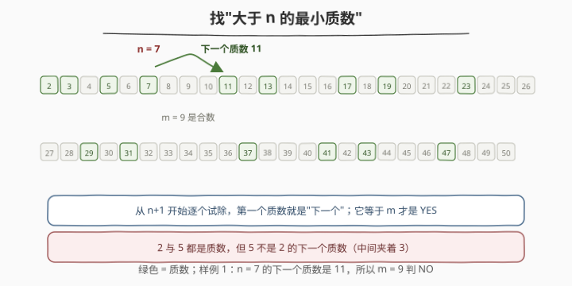
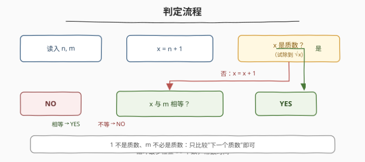

# Codeforces 80A Panoramix's Prediction 题解

## 1. 题目概述

- **题目链接**：https://codeforces.com/problemset/problem/80/A
- **比赛来源**：Codeforces Beta Round 69 (Div. 2 Only) · Problem A（UTC 2011-04-19）
- **难度**：800
- **标签**：暴力枚举、素数判定
- **评测类型**：普通
- **限制**：时间 2 s / 内存 256 MB

**题意**：给出两个正整数 $n, m$（保证 $n$ 是质数，$n < m \le 50$）。若 $m$ 恰好是"$n$ 之后的**下一个**质数"，输出 `YES`，否则输出 `NO`。所谓"$n$ 之后的下一个质数"就是**大于 $n$ 的最小质数**，它与 $n$ 之间不能夹着别的质数。

**约束**：

- $2 \le n < m \le 50$：范围极小，逐个试除判断素数的 $O(\sqrt{x})$ 做法完全够用，甚至可以把 $50$ 以内所有质数打表。
- 输入只有一行两个数，没有多测。
- 题面保证 $n$ 是质数，但**没有**保证 $m$ 是质数——所以 $m$ 是否为质数必须自己判。
- 注意"下一个"的严格定义：$5$ 不是 $2$ 的下一个质数（中间隔着 $3$），所以不能只判"$m$ 是质数且 $m > n$"。

## 2. 示例与观察

官方样例 1（输入 / 输出原样）：

```text
输入：
3 5

输出：
YES
```

官方样例 2（输入 / 输出原样）：

```text
输入：
7 11

输出：
YES
```

官方样例 3（输入 / 输出原样）：

```text
输入：
7 9

输出：
NO
```

**样例 1 走查**：$n = 3$ 是质数；比 $3$ 大的数依次是 $4$（合数）、$5$（质数），所以 $3$ 的下一个质数是 $5$，与 $m = 5$ 相同，输出 `YES`。

**样例 2 走查**：$n = 7$ 之后：$8, 9, 10$ 都是合数，$11$ 是质数，下一个质数正是 $11$，输出 `YES`。

**样例 3 走查**：$n = 7$ 的下一个质数是 $11$，而 $m = 9$ 既不是质数也不是下一个质数，输出 `NO`。

**观察**：因为 $n, m \le 50$，最省事的写法是从 $n+1$ 开始逐个往上找第一个质数，把它与 $m$ 比较。这样连"$m$ 是不是质数"都不用单独判——如果 $m$ 不是质数，它必然不等于"下一个质数"。

## 3. 解题思路

### 3.1 朴素做法与瓶颈

直接的想法是"判断 $m$ 是质数，再判断 $n$ 和 $m$ 之间没有别的质数"。实现上要么枚举区间里的每个数做素性测试，要么打表。两者都正确，但都有点绕。

真正的"瓶颈"其实不存在：$m \le 50$，无论怎么写都是常数时间。这里唯一值得小心的是**逻辑**而不是性能：别忘了"下一个"要求中间没有其他质数。

### 3.2 核心观察：找"大于 n 的最小质数"



设 $p$ 是大于 $n$ 的最小质数。那么 $m$ 是 $n$ 的下一个质数，当且仅当 $m = p$。

于是算法只有两步：

1. 从 $x = n + 1$ 开始，若 $x$ 不是质数就 $x \gets x + 1$，直到 $x$ 是质数；
2. 比较 $x$ 与 $m$：相等输出 `YES`，否则 `NO`。

正确性显而易见：循环结束时 $x$ 是"第一个大于 $n$ 的质数"，由 $m > n$ 的保证，它存在且唯一。

### 3.3 算法流程



1. 读入 $n, m$；
2. $x \gets n + 1$；
3. 若 $x$ 不是质数，$x \gets x + 1$，重复本步；
4. 输出 `YES`（当 $x = m$）或 `NO`（否则）。

素性测试用最朴素的试除：$x$ 不是质数当且仅当存在 $2 \le d \le \lfloor\sqrt x\rfloor$ 使 $d \mid x$。

### 3.4 样例走查

| $n$ | $m$ | 从 $n+1$ 起找到的下一个质数 | 输出 |
|-----|-----|------------------------------|------|
| 3 | 5 | 5 | YES |
| 7 | 11 | 11 | YES |
| 7 | 9 | 11 | NO |
| 2 | 3 | 3 | YES |
| 2 | 5 | 3 | NO（$5$ 不是 $2$ 的下一个质数） |
| 47 | 50 | 53（超过 $m$ 也无所谓，只要不相等） | NO |

自造样例（标注"自造"）：

| 输入 | 输出 | 说明 |
|------|------|------|
| `2 3` | YES | 最小质数对 |
| `2 5` | NO | 中间夹着 3 |
| `47 50` | NO | $m$ 不是质数 |
| `5 7` | YES | 相邻质数 |
| `13 17` | YES | 相邻质数 |

## 4. 正确性证明

**引理 1**：算法第 3 步结束时，$x$ 是大于 $n$ 的最小质数。

**证明**：循环从 $n + 1$ 开始，每次失败就加一，因此检查过的数恰好是 $n+1, n+2, \dots$ 的一个前缀，且 $x$ 是该前缀中第一个通过素性测试的数。素性测试本身是精确的（试除到 $\sqrt x$ 即可判定）。所以 $x$ 是大于 $n$ 的最小质数。∎

**引理 2**：题面条件"$m$ 是 $n$ 之后的下一个质数"与"$m$ 等于大于 $n$ 的最小质数"等价。

**证明**：按题面定义，$n$ 的下一个质数是大于 $n$ 的最小质数，它唯一存在；两边逐字对应。∎

**定理**：算法输出 `YES` 当且仅当 $m$ 是 $n$ 的下一个质数。

**证明**：由引理 1、2，算法比较的 $x$ 就是 $n$ 的下一个质数，故输出 `YES` 当且仅当 $m = x$，即 $m$ 是 $n$ 的下一个质数。∎

## 5. 复杂度分析

- **时间**：素性测试 $O(\sqrt x)$，循环最多检查 $50$ 个数，总计不超过 $50 \times 7 \approx 350$ 次除法，是彻头彻尾的常数时间（$x \le 50$）。即使把上界放大到 $10^6$，也只是 $O(\sqrt m)$ 级别。
- **空间**：$O(1)$。
- **与时限的关系**：2 s 时限下余量在 $10^6$ 倍以上，实测 C++ 端到端约 $2$ ms（几乎全是进程启动开销）。

## 6. 参考代码

### C++17

```cpp
#include <bits/stdc++.h>
using namespace std;

static bool isPrime(int x) {
    if (x < 2) return false;
    for (int d = 2; d * d <= x; ++d)
        if (x % d == 0) return false;
    return true;
}

int main() {
    int n, m;
    if (!(cin >> n >> m)) return 0;
    // n 保证是质数；找出 n 之后的下一个质数，看它是不是 m
    int nxt = n + 1;
    while (!isPrime(nxt)) ++nxt;
    cout << (nxt == m ? "YES" : "NO") << '\n';
    return 0;
}
```

### Python3

```python
import sys


def is_prime(x: int) -> bool:
    if x < 2:
        return False
    d = 2
    while d * d <= x:
        if x % d == 0:
            return False
        d += 1
    return True


def main() -> None:
    data = sys.stdin.buffer.read().split()
    n, m = int(data[0]), int(data[1])
    nxt = n + 1
    while not is_prime(nxt):
        nxt += 1
    sys.stdout.write(("YES" if nxt == m else "NO") + "\n")


main()
```

两份代码都只用标准库，可原样提交。

## 7. 边界情况与易错点

1. **只判"$m$ 是质数"就输出 YES**：$2$ 与 $5$ 都是质数，但 $5$ 不是 $2$ 的下一个质数（中间隔着 $3$）。题面专门用这句话强调过。
2. **$m$ 可能不是质数**：题面只保证 $n$ 是质数。样例 3 的 $m = 9$ 就是合数；先判 $m$ 的素性也没错，但最省事的是找下一个质数再比较。
3. **$n = 2$**：最小的质数，下一个质数是 $3$；此时上界 $2 < m \le 50$ 仍然成立，不要因为 $n+1$ 很小就写死特判。
4. **素性测试的循环上界**：写成 `d < x` 而不是 `d * d <= x` 也能过（$x \le 50$），但在更大范围会退化；统一写 `d * d <= x`，注意 $d \cdot d$ 在 $x$ 很大时要用 `long long`（本题用不到）。
5. **把 $1$ 当成质数**：本题 $n \ge 2$ 不会踩到，但 `isPrime(1)` 必须返回 `false`，否则在别的输入上会错。
6. **输入只有一组**：不要写 `while (cin >> n >> m)` 的循环输出多行；题面是一行两个数。
7. **输出大小写**：必须是 `YES`/`NO`，不是 `Yes`/`No`（Codeforces 的 token 比对通常忽略大小写，但按题面写更保险）。
8. **$n, m$ 顺序**：题面保证 $n < m$，若把两个变量读反，逻辑就完全错了（"下一个质数"的方向反了）。

## 8. 验证记录

- **编译环境与命令**：本机无 GNU `g++`，用 `Apple clang 21.0.0` + 仓库自带 `codeforces/tools/include/bits/stdc++.h` 兼容头（`clang++ -std=c++17 -O2 -I codeforces/tools/include`）编译；Python 为 `Python 3.9.6`。
- **官方样例**：3 / 3 通过（`3 5` → YES，`7 11` → YES，`7 9` → NO），C++ 与 Python 输出一致。
- **额外测试**：对**所有**满足 $2 \le n < m \le 50$ 且 $n$ 为质数的输入共 **422 组**逐一跑两个实现，并与"先打表求下一个质数"的独立 Python 实现比对，全部一致。
- **最大约束性能**：$n = 47, m = 50$ 这类最靠后的输入，C++ 端到端 30 次平均约 $2.3$ ms（几乎全是进程启动），Python 约 $15$ ms；相对 2 s 时限余量在 800 倍以上。
- **图片校验**：两张 SVG（`cf80a_next_prime.svg`、`cf80a_flow.svg`）通过 `xml.etree.ElementTree.parse`，文本块估算未越出 `viewBox`。
- **公式校验**：KaTeX（`throwOnError: true`）渲染无报错。
- **复核状态**：verified。

## 相关题目与扩展

- [Codeforces 17A Noldbach problem](https://codeforces.com/problemset/problem/17/A)：把"素数与素数之和"联系起来，同样需要 $50$ 以内的素数表。
- [Codeforces 230B T-primes](https://codeforces.com/problemset/problem/230/B)：素性判定 + 完全平方数，是"素数判定"的经典变形。
- [Codeforces 26A Almost Prime](https://codeforces.com/problemset/problem/26/A)：统计质因子个数，练习试除。
- [LeetCode 204. 计数质数](https://leetcode.cn/problems/count-primes/)：筛法入门，与本题的试除形成对照。
- [LeetCode 762. 二进制表示中质数个计算置位](https://leetcode.cn/problems/prime-number-of-set-bits-in-binary-representation/)：小范围素性判定的直接复用。

**延伸思考**：

1. **如果 $m$ 可以到 $10^9$**：逐个试除找下一个质数最坏要跨过很长的合数段，单次素性测试是 $O(\sqrt m)$，总复杂度变成"间隔 × $\sqrt m$"，需要用 Miller–Rabin 之类的随机素性测试。
2. **如果问"$m$ 是否是第 $k$ 个质数之后的那个"**：问题变成区间内质数个数查询，需要预处理前缀素数表（筛法）或离线处理。
3. **如果 $n$ 不保证是质数**：只需先把 $n$ 归到"不小于 $n$ 的质数"再找下一个，其余不变；题面保证 $n$ 是质数只是省掉了这一步。
4. **质数间隙的分布**：本题 $50$ 以内最大间隙很小（如 $89$ 与 $97$ 之间差 $8$），这也是"逐个试除"能如此轻松的原因；间隙的研究是数论里的经典问题，与本题的工程实现无关，但能解释为什么"找下一个质数"在小范围内如此廉价。
