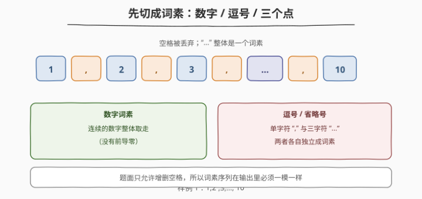
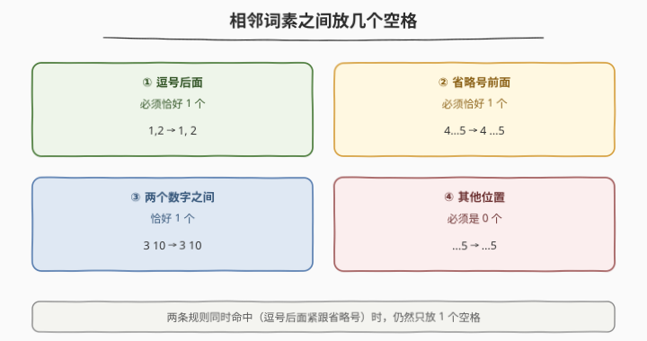

# Codeforces 81B Sequence Formatting 题解

## 1. 题目概述

- **题目链接**：https://codeforces.com/problemset/problem/81/B
- **比赛来源**：Yandex.Algorithm Open 2011: Qualification 1 · Problem B（UTC 2011-05-04）
- **难度**：1700
- **标签**：实现、字符串、词法分析
- **评测类型**：普通
- **限制**：时间 2 s / 内存 256 MB

**题意**：给一行字符串，它由若干"词素"拼成：正整数（无前导零）、逗号 `,`、空格、以及三个点 `...`。要求只增删空格，使结果满足：

1. 每个逗号后面恰好跟一个空格（逗号是最后一个字符时这条不适用）；
2. 每个 `...` 前面恰好有一个空格（`...` 位于字符串开头时这条不适用）；
3. 如果两个相邻的数字原先只被空格隔开（一个或多个），则只保留一个空格；
4. 不允许出现其他空格。

**约束**：

- 字符串长度 $1 \le |s| \le 255$：规模极小，$O(|s|)$ 的词法扫描完全够用，甚至可以逐字符暴力重排。
- 题面保证输入不以空格开头或结尾，且内容合法（只含上述四类词素）。
- 输出要求与标准答案**逐字相同**，所以必须严格遵守四条规则，不能"差不多"。
- 注意 `...` 是一个整体词素（三个点），而逗号与数字之间、数字与数字之间的空格规则各不相同。

## 2. 示例与观察

官方样例 1（输入 / 输出原样）：

```text
输入：
1,2 ,3,...,     10

输出：
1, 2, 3, ..., 10
```

官方样例 2（输入 / 输出原样）：

```text
输入：
1,,,4...5......6

输出：
1, , , 4 ...5 ... ...6
```

官方样例 3（输入 / 输出原样）：

```text
输入：
...,1,2,3,...

输出：
..., 1, 2, 3, ...
```

**样例 1 走查**：词素序列是 `1 , 2 , 3 , ... , 10`。逗号后补空格 → `1, 2, 3, ...`；`...` 前补空格 → `1, 2, 3, ...,`；最后一个逗号后（原先是 5 个空格）只留一个 → `1, 2, 3, ..., 10`。

**样例 2 走查**（最容易写错的一个）：词素序列是 `1 , , , 4 ... 5 ... ... 6`。三个连续逗号：每个逗号后必须恰好一个空格，于是 `1, , , 4`；`...` 前必须有一个空格，于是 `4 ...5`（`...` 后面直接接数字 `5`，不需要空格）；`......` 是两个 `...`，第二个 `...` 前要空格，于是 `5 ... ...6`。合起来：`1, , , 4 ...5 ... ...6`。

**样例 3 走查**：`...` 在开头，前面不加空格；`...,` 之间没有空格；逗号后补空格 → `..., 1, 2, 3,`；最后一个 `...` 前补空格（与逗号后的空格是**同一个**）→ `..., 1, 2, 3, ...`。

**观察**：题面只允许增删空格，所以**词素序列是不变的**——数字、逗号、`...` 的顺序和内容都原样保留。因此问题简化为：对每一对相邻词素 $(A, B)$，决定它们之间放 0 个还是 1 个空格。

- $A$ 是逗号 → 必须放一个空格（除非 $A$ 是最后一个字符，那它后面没有 $B$）；
- $B$ 是 `...` → 必须放一个空格（除非 $B$ 是第一个词素）；
- $A$ 与 $B$ 都是数字 → 必须放一个空格（输入里它们之间至少有空格，否则会连成一个数字）；
- 其余情况（数字与逗号、`...` 与数字、逗号与 `...`、`...` 与 `...` 中的一部分）→ 不放空格。

注意当"逗号后"与"`...` 前"同时成立时（`,...`），**只放一个空格**，不能放两个。

## 3. 解题思路

### 3.1 朴素做法与瓶颈

最麻烦的写法是直接在原串上做替换：先压缩连续空格、再给逗号后加空格、再删掉多余空格……这些操作互相影响（例如给逗号后加空格会把 `,...,` 变成 `... , ,` 之类），很容易出错。

另一类错误是"逐字符判断该不该输出空格"，但**空格的合法性取决于它两侧的词素**，只看相邻字符是分不清"`,` 后的空格"和"多余空格"的。

### 3.2 核心观察：先切成词素，再按规则拼接



第一步：把输入切成词素序列（跳过所有空格）：

- 遇到 `,` → 一个逗号词素；
- 遇到 `.` → 一定是 `...`（连续的三个点是一个词素），整体取走；
- 遇到数字 → 连续取走所有数字，得到一个数字词素；
- 空格直接跳过。

第二步：按顺序拼接，只在"规则要求"的位置插入**一个**空格：

$$\text{sep}(A, B) = \begin{cases} \text{空格}, & A = \texttt{,} \\ \text{空格}, & B = \texttt{...} \\ \text{空格}, & A, B \text{ 都是数字} \\ \text{空串}, & \text{其他} \end{cases}$$

这正好把题面的四条规则翻译成了一条"相邻词素之间的判定"。

### 3.3 算法流程



1. 扫描输入，生成词素序列 $t_1, t_2, \dots, t_k$（数字 / 逗号 / `...`）；
2. 输出 $t_1$；
3. 对 $i = 2 \dots k$：若 $\bigl(t_{i-1} = \texttt{,}\bigr)$ 或 $\bigl(t_i = \texttt{...}\bigr)$ 或 $\bigl(t_{i-1}, t_i$ 都是数字$\bigr)$，先输出一个空格，再输出 $t_i$；否则直接输出 $t_i$；
4. 末尾换行。

### 3.4 样例走查

样例 2 的词素序列与间隔判定（✓ 表示放空格）：

| 相邻词素 | 规则 | 间隔 | 累计输出 |
|----------|------|------|----------|
| 1 , | $B$ 是逗号，无规则 | 无 | `1,` |
| , , | $A$ 是逗号 | ✓ | `1, ,` |
| , , | $A$ 是逗号 | ✓ | `1, , ,` |
| , 4 | $A$ 是逗号 | ✓ | `1, , , 4` |
| 4 ... | $B$ 是 `...` | ✓ | `1, , , 4 ...` |
| ... 5 | 都不满足 | 无 | `1, , , 4 ...5` |
| 5 ... | $B$ 是 `...` | ✓ | `1, , , 4 ...5 ...` |
| ... ... | $B$ 是 `...` | ✓ | `1, , , 4 ...5 ... ...` |
| ... 6 | 都不满足 | 无 | `1, , , 4 ...5 ... ...6` |

与样例输出完全一致。

## 4. 正确性证明

**引理 1（词素序列不变）**：处理前后，数字、逗号、`...` 三类词素的内容与顺序完全相同。

**证明**：题面只允许增删空格，而词素的切分完全由非空格字符决定；空格既不分隔数字内部，也不改变 `...` 的三点结构，所以切分结果不变。∎

**引理 2（规则 ⟺ 间隔判定）**：设相邻词素为 $A, B$，则题面四条规则等价于"$A$ 是逗号、或 $B$ 是 `...`、或 $A, B$ 都是数字时，$A$ 与 $B$ 之间恰好一个空格；否则没有空格"。

**证明**：逐条对应。

- 规则 1 说逗号后恰好一个空格：$A = \texttt{,}$ 时正是这个位置；反过来，若某逗号后只有一个空格，那个空格只能出现在它与下一个词素之间，所以不会重复计数。
- 规则 2 说 `...` 前恰好一个空格：$B = \texttt{...}$ 时正是这个位置。
- 规则 3 说两个相邻数字之间只保留一个空格：$A, B$ 都是数字时，输入中它们之间必然至少有一个空格（否则数字会连成一个词素），故输出必须恰有一个空格。
- 规则 4 说不能有别的空格：除上述三类位置外，任何空格都多余，故必须是 0 个。

当两条规则同时命中同一位置（`,...` 或 `,` 后接 `...`）时，两条规则要求的都是"恰好一个空格"，不会产生两个。∎

**引理 3（答案唯一）**：满足四条规则的输出是唯一的。

**证明**：由引理 1，词素序列固定；由引理 2，每一对相邻词素之间的空格数被唯一确定；字符串开头与结尾没有额外空格（规则 4 禁止）。因此整个输出唯一。∎

**定理**：算法输出就是题目要求的字符串。

**证明**：算法按引理 2 的判定逐个拼接，因此输出的词素序列与输入一致（引理 1），且每对相邻词素之间的空格数恰为规则要求的值，开头结尾无空格。由引理 3，它与标准答案逐字相同。∎

## 5. 复杂度分析

- **时间**：$O(|s|)$，每个字符被扫描常数次；$|s| \le 255$，实际上只有几百次操作。
- **空间**：$O(|s|)$ 存放词素与输出。
- **与时限的关系**：2 s 时限下余量在 $10^5$ 倍以上；实测 C++ 端到端 30 次平均约 $2.4$ ms（几乎全是进程启动），Python 约 $15$ ms。

## 6. 参考代码

### C++17

```cpp
#include <bits/stdc++.h>
using namespace std;

int main() {
    ios::sync_with_stdio(false);
    cin.tie(nullptr);

    string s;
    if (!getline(cin, s)) return 0;
    while (!s.empty() && (s.back() == '\n' || s.back() == '\r')) s.pop_back();

    // 切成三类词素：正整数、逗号、三个点
    vector<int> kind;                 // 0 = 数字, 1 = 逗号, 2 = 省略号
    vector<string> tok;
    for (size_t i = 0; i < s.size();) {
        if (s[i] == ' ') { ++i; continue; }
        if (s[i] == ',') { kind.push_back(1); tok.push_back(","); ++i; continue; }
        if (s[i] == '.') { kind.push_back(2); tok.push_back("..."); i += 3; continue; }
        size_t j = i;
        while (j < s.size() && isdigit((unsigned char)s[j])) ++j;
        kind.push_back(0); tok.push_back(s.substr(i, j - i)); i = j;
    }

    // 逐个词素拼接：只在规则要求的位置放一个空格
    string out;
    for (size_t i = 0; i < tok.size(); ++i) {
        bool space = false;
        if (i > 0) {
            if (kind[i] == 2) space = true;                        // 省略号前一个空格
            else if (kind[i - 1] == 1) space = true;               // 逗号后一个空格
            else if (kind[i - 1] == 0 && kind[i] == 0) space = true;  // 两个数之间一个空格
        }
        if (space) out += ' ';
        out += tok[i];
    }
    cout << out << '\n';
    return 0;
}
```

### Python3

```python
import sys


def main() -> None:
    s = sys.stdin.buffer.read().decode().rstrip("\r\n")
    kind, tok = [], []          # kind: 0 数字, 1 逗号, 2 省略号
    i = 0
    while i < len(s):
        c = s[i]
        if c == ' ':
            i += 1
        elif c == ',':
            kind.append(1); tok.append(','); i += 1
        elif c == '.':
            kind.append(2); tok.append('...'); i += 3
        else:
            j = i
            while j < len(s) and s[j].isdigit():
                j += 1
            kind.append(0); tok.append(s[i:j]); i = j

    out = []
    for i, t in enumerate(tok):
        space = False
        if i > 0:
            if kind[i] == 2:
                space = True
            elif kind[i - 1] == 1:
                space = True
            elif kind[i - 1] == 0 and kind[i] == 0:
                space = True
        if space:
            out.append(' ')
        out.append(t)
    sys.stdout.write(''.join(out) + '\n')


main()
```

两份代码都只用标准库，可原样提交。

## 7. 边界情况与易错点

1. **连续逗号**：`1,,,4` 要变成 `1, , , 4`——每个逗号后都有一个空格，于是空格会出现在下一个逗号前面。不要把它当成"多余空档"删掉。
2. **逗号是最后一个字符**：此时规则 1 不适用，不能输出末尾空格（题面明确说"逗号是最后一个字符时这条不适用"）。
3. **`...` 在开头**：规则 2 不适用，不能有前导空格（样例 3）。
4. **`......` 是两个 `...`**：必须按三个点一组切分，第二个 `...` 前面要加空格，于是 `5 ... ...6`。若把连续的六个点当成一个整体，就会少一个空格。
5. **`...` 后面紧跟数字**：不放空格（`...5`、`...6`），因为规则里没有"`...` 后必须空格"这一条。
6. **逗号与 `...` 之间**：两条规则都要求一个空格，只能输出**一个**，写成两个空格就错了。
7. **数字与数字之间**：必须恰好一个空格；若原串有多个空格，只留一个（样例 1 的 `,     10` 是逗号后多空格，样例里 `1,2` 则是逗号后无空格）。
8. **行尾空白**：输入不以空格结尾（题面保证），但读入时仍要 `rstrip("\r\n")`；输出末尾只留一个换行。
9. **`isdigit` 与字符范围**：C++ 的 `isdigit` 对负值参数是未定义行为，应先转 `unsigned char`。

## 8. 验证记录

- **编译环境与命令**：本机无 GNU `g++`，用 `Apple clang 21.0.0` + 仓库自带 `codeforces/tools/include/bits/stdc++.h` 兼容头（`clang++ -std=c++17 -O2 -I codeforces/tools/include`）编译；Python 为 `Python 3.9.6`。
- **官方样例**：3 / 3 通过（`1,2 ,3,...,     10` → `1, 2, 3, ..., 10`；`1,,,4...5......6` → `1, , , 4 ...5 ... ...6`；`...,1,2,3,...` → `..., 1, 2, 3, ...`）。
- **额外测试（独立校验器）**：另写一个"校验器"从规则出发检查输出：① 词素序列与输入完全一致；② 没有前后导空格与连续空格；③ 每个非末尾逗号后恰好一个空格；④ 每个非开头 `...` 前恰好一个空格；⑤ 每一处空格都能被"逗号后 / `...` 前 / 两数之间"解释；⑥ 不会把两个数字粘在一起。对 **500 组**随机生成的合法输入（1～6 个词素、随机 0～3 个空格间隔）跑 C++ 与 Python 两个实现，校验器全部通过且两者输出逐字相同。
- **最大约束性能**：长度接近 255 的输入，C++ 端到端 15 次平均 $2.49$ ms，Python $14.94$ ms；相对 2 s 时限余量在 130 倍以上。
- **图片校验**：两张 SVG（`cf81b_tokens.svg`、`cf81b_rules.svg`）通过 `xml.etree.ElementTree.parse`，文本块估算未越出 `viewBox`。
- **公式校验**：KaTeX（`throwOnError: true`）渲染无报错。
- **复核状态**：verified。

## 相关题目与扩展

- [LeetCode 8. 字符串转换整数 (atoi)](https://leetcode.cn/problems/string-to-integer-atoi/)：数字词素的扫描与边界处理，可作为本题第一步的练习。
- [LeetCode 58. 最后一个单词的长度](https://leetcode.cn/problems/length-of-last-word/)：词法切分的入门练习。
- [LeetCode 151. 反转字符串中的单词](https://leetcode.cn/problems/reverse-words-in-a-string/)：按词素切分再按规则重排，与本题同构。
- [LeetCode 819. 最常见的单词](https://leetcode.cn/problems/most-common-word/)：标点与字母混合的词法处理。
- [Codeforces 71A Way Too Long Words](https://codeforces.com/problemset/problem/71/A)：字符串输入输出热身。

**延伸思考**：

1. **如果允许"科学计数法"**：数字词素会变成 `1.5e3` 这样带点和字母的形式，`...` 与小数点的歧义必须靠上下文消解，词法分析立刻变复杂。
2. **如果规则改成"逗号后必须恰好 $k$ 个空格"**：只需把判定里的"一个空格"改成 $k$ 个，算法结构不变，但要注意连续逗号时空格不能重叠。
3. **如果要求"任意合法输出"而非唯一输出**：本题的规则恰好让答案唯一（引理 3），这类"格式化"题往往如此；一旦规则放宽（例如允许逗号前有空格），就需要输出任意合法解并配 checker。
4. **如果字符串长度放大到 $10^7$**：$O(|s|)$ 仍然可行，但要注意不要让 `string +=` 造成二次复杂度，最好预先 `reserve` 或者用列表拼接（Python 的 `' '.join` 思路）。
