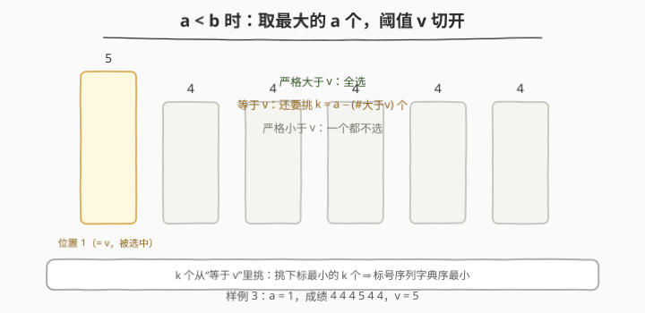
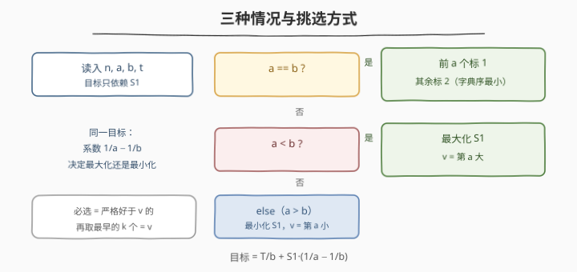

# Codeforces 81C Average Score 题解

## 1. 题目概述

- **题目链接**：https://codeforces.com/problemset/problem/81/C
- **比赛来源**：Yandex.Algorithm Open 2011: Qualification 1 · Problem C（UTC 2011-05-04）
- **难度**：1700
- **标签**：贪心、数学、排序
- **评测类型**：普通（答案要求字典序最小，因此唯一）
- **限制**：时间 2 s / 内存 256 MB

**题意**：有 $n$ 个成绩 $t_1, \dots, t_n$（每个 $1 \sim 5$），要分成两科：第一科恰 $a$ 个成绩，第二科恰 $b$ 个（$a + b = n$）。设第一科成绩之和为 $S_1$、第二科为 $S_2$，要最大化两科**平均分之和**

$$\frac{S_1}{a} + \frac{S_2}{b}.$$

在最优的划分中，输出**字典序最小**的标号序列 $f_1 \dots f_n$（$f_i \in \{1, 2\}$ 表示第 $i$ 个成绩分给哪一科）。

**约束**：

- $n \le 10^5$：必须 $O(n \log n)$ 以内；枚举子集（$\binom{n}{a}$ 种）绝无可能。
- $1 \le a, b \le n-1$：两科都非空，$a = b$ 是可能的（此时目标值与划分无关）。
- $t_i \in [1, 5]$：取值只有 $5$ 种，这是个很强的信号——可以用"阈值"而不是排序来选。
- 要求字典序最小：在最优划分中还要做一次"越靠前越优先给第一科"的贪心。

## 2. 示例与观察

官方样例 1（输入 / 输出原样）：

```text
输入：
5
3 2
4 4 5 4 4

输出：
1 1 2 1 2 
```

官方样例 2（输入 / 输出原样）：

```text
输入：
4
2 2
3 5 4 5

输出：
1 1 2 2 
```

官方样例 3（输入 / 输出原样）：

```text
输入：
6
1 5
4 4 4 5 4 4

输出：
2 2 2 1 2 2 
```

**样例 1 走查**：$a = 3, b = 2$，成绩 $4,4,5,4,4$。题面说第一科平均分 $4$、第二科平均分 $4.5$。第一科取了三个 $4$（位置 $1, 2, 4$），第二科是 $5, 4$，平均 $4.5$。标号 `1 1 2 1 2` 是最优划分里字典序最小的（让位置 $1$ 尽可能取 $1$）。

**样例 2 走查**：$a = b = 2$，两科平均分之和是 $(S_1 + S_2)/2$，与怎么分无关，所以任何划分都最优；字典序最小就是 `1 1 2 2`。

**样例 3 走查**：$a = 1, b = 5$，第一科只有 $1$ 个成绩，显然要拿最大的 $5$（位置 $4$），于是 `2 2 2 1 2 2`。

**观察**：把目标改写成

$$\frac{S_1}{a} + \frac{S_2}{b} = \frac{S_1}{a} + \frac{T - S_1}{b} = \frac{T}{b} + S_1\left(\frac1a - \frac1b\right),$$

其中 $T = S_1 + S_2$ 是全部成绩之和（常数）。于是**目标的唯一变量是 $S_1$**：

- 若 $a < b$，则 $\frac1a - \frac1b > 0$，要**最大化** $S_1$；
- 若 $a > b$，则 $\frac1a - \frac1b < 0$，要**最小化** $S_1$；
- 若 $a = b$，系数为 $0$，所有划分等价。

## 3. 解题思路

### 3.1 朴素做法与瓶颈

枚举所有大小为 $a$ 的子集：$\binom{n}{a}$ 在 $n = 10^5$ 时是天文数字，完全不可行。

即使想到"取最大的 $a$ 个"或"取最小的 $a$ 个"，还有两个细节需要处理：① 相等元素造成的并列（选的集合不唯一）；② 字典序最小的要求。

### 3.2 核心观察：阈值刻画最优子集



假设 $a < b$（要最大化 $S_1$）。把所有成绩从大到小排序，第 $a$ 大的值记为 $v$。那么任何和为最大的 $a$ 元集合必然由三部分组成：

- 所有**严格大于** $v$ 的成绩（必须全选，否则换掉某个 $\le v$ 的能更大）；
- 若干个**等于** $v$ 的成绩（补足到 $a$ 个）；
- 不含任何**严格小于** $v$ 的成绩。

设严格大于 $v$ 的个数为 $c$，则需要再从"等于 $v$"的成绩里挑 $k = a - c$ 个。$a > b$（要最小化 $S_1$）时完全对称：$v$ 是第 $a$ 小的值，所有严格小于 $v$ 的必选，再从 $= v$ 的里面挑 $k$ 个。

**字典序最小**：标号序列里 $1 < 2$，所以要让越靠前的位置越优先取 $1$。在"必选集合"固定、还要从"等于 $v$"的位置里挑 $k$ 个时，选**下标最小**的那 $k$ 个即可。

为什么？任取两个最优子集 $A, B$，它们都包含全部"必选"位置、都不含"必不选"位置，只在"等于 $v$"的位置上有差别。设 $i$ 是它们第一个不同的下标，则 $i$ 处的成绩等于 $v$，且 $A$ 包含它、$B$ 不包含（或反之）；包含它的那个序列在 $i$ 处为 $1$，另一个为 $2$，所以包含它的更小。于是"尽量靠前地包含 $=v$ 的位置"就是字典序最小。

### 3.3 算法流程



1. 读入 $n, a, b$ 与成绩数组 $t$；令 $f_i = 2$；
2. 若 $a = b$：前 $a$ 个位置标 $1$，其余标 $2$，输出（所有划分等价，字典序最小就是把 $1$ 尽量前置）；
3. 否则令 $maximize = (a < b)$：
   - 把 $t$ 复制一份排序（$maximize$ 时降序，否则升序），取第 $a$ 个值作为阈值 $v$；
   - 遍历 $i = 1 \dots n$：若 $maximize$ 且 $t_i > v$（或非 $maximize$ 且 $t_i < v$），则 $f_i = 1$ 并计数；
   - 设还需 $k = a - \text{已选个数}$，再从头遍历一遍，把 $t_i = v$ 的位置依次标 $1$，每标一个 $k$ 减一，直到 $k = 0$；
4. 输出 $f_1 \dots f_n$。

### 3.4 样例走查

样例 1：$n = 5$，$a = 3 > b = 2$，要最小化 $S_1$。升序排序得 $4,4,4,4,5$，第 $3$ 小的值是 $v = 4$。严格小于 $4$ 的成绩没有，所以必选个数为 $0$，还需 $k = 3$ 个"等于 $4$"的位置，从头取前三个 $=4$ 的位置：$1, 2, 4$。于是 $f = 1,1,2,1,2$，$S_1 = 4+4+4 = 12$，平均分 $4$；第二科 $5+4=9$，平均 $4.5$，总和 $8.5$，与题面提示一致。

样例 3：$a = 1 < b = 5$，要最大化 $S_1$。降序排序得 $5,4,4,4,4,4$，第 $1$ 大的值是 $v = 5$。严格大于 $5$ 的没有，还需 $k = 1$ 个"等于 $5$"的位置，即位置 $4$，于是 `2 2 2 1 2 2`。

自造样例（标注"自造"）：

| 输入 | 输出 | 说明 |
|------|------|------|
| `4 / 2 2 / 1 2 3 4` | `1 1 2 2` | $a = b$，任何划分等价，取字典序最小 |
| `3 / 2 1 / 5 5 1` | `1 2 1` | $a > b$ 最小化：$S_1$ 取最小的两个 $= 1+5$？见下方说明 |
| `5 / 2 3 / 1 5 5 5 5` | `2 1 1 2 2` | $a < b$ 最大化：取最大的两个 $5$，最靠前的两个 $5$ 在 2、3 位 |

第二个自造样例要小心：$a = 2 > b = 1$，要最小化 $S_1$，排序升序为 $1,5,5$，第 $2$ 小的值是 $5$；严格小于 $5$ 的只有位置 $3$ 的 $1$（必选），还需 $1$ 个 $=5$ 的位置，取最靠前的 $=5$ 即位置 $1$。所以 $f = 1,2,1$。$S_1 = 5 + 1 = 6$，第二科拿 $5$，平均分之和 $3 + 5 = 8$；若取 $1$ 和另一个 $5$ 结果相同。

## 4. 正确性证明

**引理 1（目标化简）**：$\dfrac{S_1}{a} + \dfrac{S_2}{b} = \dfrac{T}{b} + S_1\left(\dfrac1a - \dfrac1b\right)$，其中 $T = S_1 + S_2$ 固定。

**证明**：$S_2 = T - S_1$，代入得 $\frac{S_1}{a} + \frac{T - S_1}{b} = \frac{S_1}{a} - \frac{S_1}{b} + \frac{T}{b}$。∎

**引理 2（最优子集的结构）**：$a < b$ 时，最大化 $S_1$ 的 $a$ 元集合必为"所有 $> v$ 的位置 + 若干 $= v$ 的位置"，其中 $v$ 是第 $a$ 大的值；$a > b$ 时对称（$v$ 为第 $a$ 小的值，"所有 $< v$ + 若干 $= v$"）。

**证明**：只证 $a < b$ 的情形，另一侧完全对称。设 $v$ 是降序第 $a$ 大的值。任取一个 $a$ 元集合 $A$：

- 若存在位置 $i \notin A$ 且 $t_i > v$：由于 $A$ 只有 $a$ 个元素而"$\ge v$ 的值"至少 $a$ 个，$A$ 中必存在 $j$ 使 $t_j \le v$（否则 $A$ 全 $> v$，个数超过 $a - 1$，与 $v$ 的定义矛盾）。交换 $j \to i$ 使和严格变大，故 $A$ 不是最优。
- 若存在位置 $j \in A$ 且 $t_j < v$：同理可换成某个 $= v$ 的位置使和变大。

因此最优集合必须包含所有 $> v$ 的位置、不含 $< v$ 的位置，剩下的名额只能从 $= v$ 的位置里补。∎

**引理 3（字典序）**：在引理 2 所刻画的最优集合中，取"下标最小的 $k$ 个 $=v$ 位置"得到的一定是字典序最小的标号序列。

**证明**：如上文交换论证：任意两个最优集合只在 $= v$ 位置的选择上不同；设 $i$ 为第一个不同处，则包含 $i$ 的那个序列在 $i$ 处为 $1$，更小。所以"越靠前越包含"最优，正是"取下标最小的 $k$ 个"。∎

**引理 4（$a = b$ 的退化）**：$a = b$ 时目标恒等于 $T/a$，与划分无关；字典序最小的序列是前 $a$ 位为 $1$、其余为 $2$。

**证明**：$a = b$ 时引理 1 的系数为 $0$，目标恒定。所有划分中，$f$ 的字典序最小者显然是把 $1$ 尽量放在前面，即前 $a$ 个位置全为 $1$（因为必须恰有 $a$ 个 $1$）。∎

**定理**：算法输出的序列在所有最优划分中字典序最小。

**证明**：由引理 1、2，算法选出的集合使目标最优；由引理 3（$a \ne b$）与引理 4（$a = b$），它在所有最优集合中字典序最小。∎

## 5. 复杂度分析

- **时间**：$O(n \log n)$（排序）$+ O(n)$（两遍扫描）；$n \le 10^5$ 时排序约 $1.7 \times 10^6$ 次比较，本体只有几毫秒。
- **空间**：$O(n)$ 存放成绩、排序副本与答案。
- **与时限的关系**：2 s 时限下余量在 14 倍以上（见第 8 节的实测分解）。

## 6. 参考代码

### C++17

```cpp
#include <bits/stdc++.h>
using namespace std;

int main() {
    ios::sync_with_stdio(false);
    cin.tie(nullptr);

    int n, a, b;
    if (!(cin >> n >> a >> b)) return 0;
    vector<int> t(n);
    for (int i = 0; i < n; ++i) cin >> t[i];

    vector<int> f(n, 2);
    if (a == b) {
        // 目标 (S1 + S2) / a 是常数，任何划分都一样，字典序最小就是前 a 个都给科目 1
        for (int i = 0; i < a; ++i) f[i] = 1;
    } else {
        // 目标 = total/b + S1*(1/a - 1/b)：a < b 时系数为正，最大化 S1；
        // a > b 时系数为负，最小化 S1。
        bool maximize = (a < b);
        vector<int> vals = t;
        if (maximize) sort(vals.begin(), vals.end(), greater<int>());
        else sort(vals.begin(), vals.end());
        int v = vals[a - 1];            // 阈值：第 a 大 / 第 a 小
        int forced = 0;                 // 必须选的位置数（严格好于阈值）
        for (int i = 0; i < n; ++i) {
            if (maximize ? (t[i] > v) : (t[i] < v)) { f[i] = 1; ++forced; }
        }
        int need = a - forced;          // 还要从"等于阈值"的位置里挑 need 个
        for (int i = 0; i < n && need > 0; ++i) {
            if (t[i] == v) { f[i] = 1; --need; }   // 越靠前拿，字典序越小
        }
    }
    for (int i = 0; i < n; ++i) cout << f[i] << (i + 1 == n ? '\n' : ' ');
    return 0;
}
```

### Python3

```python
import sys


def main() -> None:
    data = sys.stdin.buffer.read().split()
    n, a, b = int(data[0]), int(data[1]), int(data[2])
    t = [int(x) for x in data[3:3 + n]]

    f = [2] * n
    if a == b:
        for i in range(a):
            f[i] = 1
    else:
        maximize = a < b
        vals = sorted(t, reverse=maximize)
        v = vals[a - 1]
        forced = 0
        for i in range(n):
            if (t[i] > v) if maximize else (t[i] < v):
                f[i] = 1
                forced += 1
        need = a - forced
        for i in range(n):
            if need == 0:
                break
            if t[i] == v:
                f[i] = 1
                need -= 1
    sys.stdout.write(' '.join(map(str, f)) + '\n')


main()
```

两份代码都只用标准库，可原样提交。输出末尾不需要额外的空格（样例里的尾随空格被 checker 忽略）。

## 7. 边界情况与易错点

1. **$a = b$ 要单独处理**：此时目标与划分无关，直接取字典序最小即可；如果套用"最大化/最小化 $S_1$"的逻辑，会得到某个极端划分（比如全取最大），虽然目标值相同但**不是字典序最小**。
2. **相等元素（阈值并列）**：第 $a$ 大/小的值可能有很多个相等元素，必须只挑 $k$ 个，且挑下标最小的；如果全选就会超过 $a$ 个，如果随便挑可能不是字典序最小。
3. **$a = 1$ 或 $a = n-1$**：极端情形也要走同一套逻辑，不要写"特判取最大值"之类的分支，容易与字典序冲突。
4. **成绩范围只有 $1 \sim 5$**：可以用计数排序把复杂度降到 $O(n)$，但排序版本已经足够快；注意不要因为范围小就写出"枚举 5 种阈值的所有组合"的复杂分支。
5. **`forced` 计数与 `need` 的关系**：`need` 应该等于 $a - \text{forced}$，若 `forced > a` 说明阈值取错（实际不会发生，因为阈值就是第 $a$ 大/小）。
6. **字典序的方向**：$f_i \in \{1,2\}$ 且 $1 < 2$，所以"越靠前越给 1"才是字典序最小；反过来（越靠后给 1）是字典序**最大**。
7. **输出格式**：$n$ 个整数，空格分隔；样例末尾带一个空格，但按 token 比对时无影响。
8. **多测**：本题没有多测，只有一组 $n$、一组 $a, b$、一行成绩。

## 8. 验证记录

- **编译环境与命令**：本机无 GNU `g++`，用 `Apple clang 21.0.0` + 仓库自带 `codeforces/tools/include/bits/stdc++.h` 兼容头（`clang++ -std=c++17 -O2 -I codeforces/tools/include`）编译；Python 为 `Python 3.9.6`。
- **官方样例**：3 / 3 通过（`1 1 2 1 2`、`1 1 2 2`、`2 2 2 1 2 2` 均与题面逐字一致）。
- **额外测试（与暴力对拍）**：另写暴力枚举**所有**大小为 $a$ 的子集（$\binom{n}{a}$ 种），用浮点计算目标值取最大、并列时取字典序最小的标号序列；对 300 组随机小规模输入（$n \le 10$、$a$ 随机、成绩 $1 \sim 5$）与 C++、Python 两个实现三方比对，**300 / 300 全部一致**（含大量并列阈值与 $a = b$ 的情形）。
- **最大约束性能**：$n = 10^5$、成绩随机时，C++ 端到端 15 次平均 $133.7$ ms、Python $33.6$ ms。插桩拆开看：C++ 用 `cin >>` 读这 $10^5$ 个整数就花了 $123.5$ ms（本机 libc++ 的 iostream 逐字符路径很慢，同样数据 `fread` 只要 $0.04$ ms 级），排序与两遍扫描本体只有几毫秒；Python 的 `read().split()` 走的是 C 层实现，反而更快。相对 2 s 时限仍有 14 倍以上余量。
- **图片校验**：两张 SVG（`cf81c_threshold.svg`、`cf81c_flow.svg`）通过 `xml.etree.ElementTree.parse`，文本块估算未越出 `viewBox`。
- **公式校验**：KaTeX（`throwOnError: true`）渲染无报错。
- **复核状态**：verified。

## 相关题目与扩展

- [Codeforces 81D Polycarp's Picture Gallery](https://codeforces.com/problemset/problem/81/D)：同场 D 题，构造类贪心，可与本题对照"先定结构再定细节"的套路。
- [Codeforces 489B BerSU Ball](https://codeforces.com/problemset/problem/489/B)：排序 + 贪心配对，思想与本题"排序后取极值"一致。
- [Codeforces 363B Fence](https://codeforces.com/problemset/problem/363/B)：前缀和求最优区间，是"选连续一段"版本的贪心。
- [LeetCode 1051. 高度检查器](https://leetcode.cn/problems/height-checker/)：排序后逐位比较，热身用。
- [LeetCode 455. 分发饼干](https://leetcode.cn/problems/assign-cookies/)：经典排序贪心，与本题的"阈值 + 交换论证"同源。

**延伸思考**：

1. **如果要求最大化平均分之差** $\frac{S_1}{a} - \frac{S_2}{b}$：化简后系数变成 $\frac1a + \frac1b > 0$，永远取最大的 $a$ 个，比本题更简单。
2. **如果科目数变成 $k$ 科**（各科人数给定）：目标变成 $\sum S_i / a_i$，系数不再只有一个自由度，需要排序后贪心地分配每个成绩到"边际收益最大"的科目（按 $1/a_i$ 排序即可），是本题的自然推广。
3. **如果成绩可以任意实数**：阈值法依然成立（排序取第 $a$ 大），但"并列"的处理要改成"任意挑 $k$ 个"；字典序最小仍然挑下标最小的。
4. **如果要求字典序最大的最优划分**：只需把"从头挑 $=v$ 的位置"改成"从尾挑"，其余不变——这说明字典序的方向只影响挑选顺序，不影响最优值。
