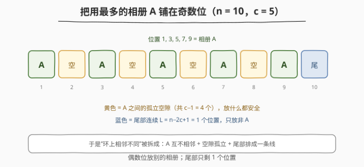
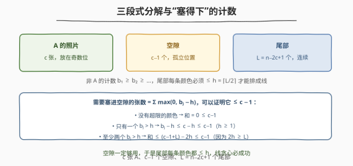
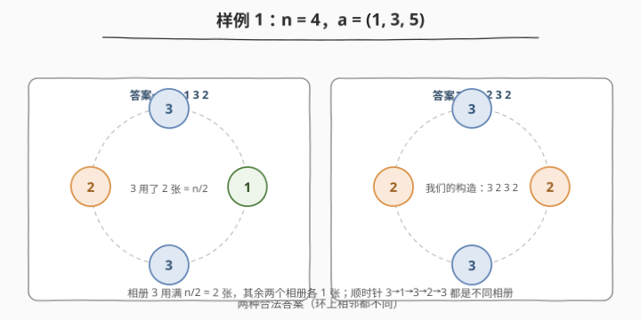

# Codeforces 81D Polycarp's Picture Gallery 题解

## 1. 题目概述

- **题目链接**：https://codeforces.com/problemset/problem/81/D
- **比赛来源**：Yandex.Algorithm Open 2011: Qualification 1 · Problem D（UTC 2011-05-04）
- **难度**：2100
- **标签**：构造、贪心
- **评测类型**：多解（special judge，任何合法方案都通过）
- **限制**：时间 2 s / 内存 256 MB

**题意**：有 $m$ 个相册，第 $i$ 个相册有 $a_i$ 张照片。要在环形画廊里放 $n$ 张照片（第 $1$ 张的邻居是第 $2$ 张和第 $n$ 张），要求**相邻两张不能来自同一个相册**。输出每个位置照片所属的相册编号（$1 \sim m$），无解输出 `-1`。

**约束**：

- $n \le 1000$、$m \le 40$、$a_i \le 1000$：可以做到 $O(n \log m)$；枚举排列或状态搜索都不可行。
- 照片总数可能远多于 $n$（$a_i$ 最大 $1000$，$n$ 只有 $1000$），所以要"挑"照片，而不是全部用上。
- 答案不唯一，必须用 checker 验证合法性。

## 2. 示例与观察

官方样例 1（输入 / 输出原样）：

```text
输入：
4 3
1 3 5

输出：
3 1 3 2
```

官方样例 2（输入 / 输出原样）：

```text
输入：
10 2
5 5

输出：
2 1 2 1 2 1 2 1 2 1
```

官方样例 3（输入 / 输出原样）：

```text
输入：
10 3
1 10 3

输出：
-1
```

**样例 1 走查**：$n = 4$，相册容量 $1, 3, 5$。样例取了相册 3 的两张、相册 1 的一张、相册 2 的一张：`3 1 3 2`，环上相邻对为 $(3,1), (1,3), (3,2), (2,3)$，都不同 ✓。相册 3 用了 $2 = n/2$ 张，这是环上同色能出现的最多次数。

**样例 2 走查**：两个相册各 $5$ 张，正好交替 `2 1 2 1 ...`，环上首尾是 $2$ 和 $1$，也合法。

**样例 3 走查**：$n = 10$，容量 $1, 10, 3$。每个相册在环上最多用 $5$ 张，所以最多能用的张数是 $\min(1,5) + \min(10,5) + \min(3,5) = 1 + 5 + 3 = 9 < 10$，无解 ✓。

**观察 1（同色上限）**：在长度为 $n$ 的环上，若某个相册出现了 $c$ 次，那么这 $c$ 张照片之间隔着 $c$ 段"其他照片"，每段至少 $1$ 张，于是 $n - c \ge c$，即 $c \le \lfloor n/2 \rfloor$。

**观察 2（可挑张数）**：我们可以自由决定每个相册用几张 $c_i \le a_i$，只要 $\sum c_i = n$ 且 $\max c_i \le \lfloor n/2 \rfloor$。

**观察 3（可行性的充要条件）**：令 $cap_i = \min(a_i, \lfloor n/2 \rfloor)$。则**有解当且仅当** $\sum cap_i \ge n$。必要性由观察 1、2 直接得到；充分性需要构造（见第 3 节）。

## 3. 解题思路

### 3.1 朴素做法与瓶颈

最直接的想法是搜索/回溯：一个个位置填相册，保证与前一个不同、最后再检查首尾。$n = 1000$ 时状态爆炸；即使按"每步选剩余最多的相册"贪心，也可能在收尾时首尾撞色（例如两个相册各 $n/2$ 张时，必须严格交替，普通贪心若先放了别的就会失败）。

### 3.2 核心观察：把最"重"的相册按隔位铺开



设计数最多的相册为 $A$，用了 $c$ 张（$c \le \lfloor n/2 \rfloor$）。把 $A$ 的照片放在位置 $1, 3, 5, \dots, 2c-1$（共 $c$ 个奇数位）。这样：

- 相邻两个 $A$ 之间恰好隔一个位置，$A$ 之间绝不会相邻；
- 剩下的位置分成两部分：**空隙** $2, 4, \dots, 2c-2$（共 $c-1$ 个，每个都夹在两个 $A$ 之间，放什么都不会与 $A$ 相邻），以及**尾部** $2c, 2c+1, \dots, n$（共 $L = n - 2c + 1$ 个连续位置）。

尾部是一段**连续的**区间，所以要把它内部排成"相邻不同"的**线**；而它的两端分别挨着 $A$（位置 $2c-1$）和位置 $1$ 的 $A$，只要尾部不放 $A$ 就自动安全。

于是一个环问题被拆成"$c-1$ 个孤立空隙 + 一条长度为 $L$ 的线"。

### 3.3 算法流程



1. 读入 $n, m, a$；令 $cap_i = \min(a_i, \lfloor n/2 \rfloor)$；
2. 若 $\sum cap_i < n$，输出 `-1`；
3. 令 $c_i = cap_i$，再**任意**削减总量直到 $\sum c_i = n$（削减只会让计数变小，不会破坏 $c_i \le \lfloor n/2\rfloor$）；
4. 取计数最大的相册 $A$（$c = c_A$），把它的 $c$ 张放在奇数位 $1,3,\dots,2c-1$；
5. 计算 $L = n - 2c + 1$、$h = \lceil L/2 \rceil$；对每个非 $A$ 相册，若剩余张数 $> h$，把多出来的塞进空隙（空隙一共 $c-1$ 个）；若空隙还没填满，再随便从有剩余的相册里拿；
6. 剩余的（非 $A$）照片构成尾部，用"每次取剩余最多、且不等于前一个"的贪心排成一条线，依次填到位置 $2c, \dots, n$；
7. 输出每个位置对应的相册编号（$+1$ 换成 $1$ 基）。

**第 5 步为什么一定塞得下**：记非 $A$ 相册的计数为 $b_1, b_2, \dots$。需要塞进空隙的张数至少是 $\sum_j \max(0, b_j - h)$。因为 $b_j \le c$、$\sum b_j = n - c = c - 1 + L$、且 $2h \ge L$，可以证明这个和不超过 $c - 1$（空隙数）：

- 若没有 $b_j > h$，和为 $0 \le c-1$；
- 若只有一个 $b_j > h$，和为 $b_j - h \le c - h \le c - 1$（$h \ge 1$）；
- 若至少两个 $b_j > h$，和为 $\sum_{b_j > h} b_j - k h \le (c - 1 + L) - 2h \le c - 1$。

### 3.4 样例走查



样例 1（$n = 4$，$a = 1, 3, 5$）：$cap = 1, 2, 2$，和为 $5 \ge 4$，削减 $1$ 张（从相册 1 减到 $0$），得到 $c = 0, 2, 2$。取 $A$ = 相册 3（$c = 2$）：位置 $1, 3$ 放相册 3；$L = 4 - 4 + 1 = 1$，$h = 1$；非 $A$ 相册 2 剩 $2$ 张，$2 > h$，塞 $1$ 张进空隙（位置 2），尾部（位置 4）放剩下的 1 张。结果 `3 2 3 2`，环上 $(3,2),(2,3),(3,2),(2,3)$ 全部不同 ✓（与样例答案 `3 1 3 2` 不同但同样合法）。

样例 2（$n = 10$，$a = 5, 5$）：$cap = 5, 5$，不改动。$A$ = 相册 1（$c = 5$）：位置 $1,3,5,7,9$ 放相册 1；$L = 1$，$h = 1$；相册 2 有 $5$ 张，$5 > 1$，塞 $4$ 张进空隙（位置 $2,4,6,8$），尾部（位置 10）放剩下 1 张。结果 `1 2 1 2 1 2 1 2 1 2`，首尾 $2$ 与 $1$ 不同 ✓。

样例 3：$\sum cap = 1 + 5 + 3 = 9 < 10$，输出 `-1` ✓。

## 4. 正确性证明

**引理 1（同色上限）**：若环上某相册出现 $c$ 次且相邻不同色，则 $c \le \lfloor n/2 \rfloor$。

**证明**：把 $c$ 张该相册照片的每一张后面紧跟的那一格取出来，得到 $c$ 个互不相同的格子（它们都不是该相册），所以 $n - c \ge c$。∎

**引理 2（可行性）**：有解当且仅当 $\sum_i \min(a_i, \lfloor n/2 \rfloor) \ge n$。

**证明**：必要性：任何方案里第 $i$ 个相册用了 $c_i \le a_i$ 张，由引理 1 得 $c_i \le \lfloor n/2\rfloor$，故 $n = \sum c_i \le \sum \min(a_i, \lfloor n/2\rfloor)$。充分性：若不等式成立，按 3.3 节第 3 步取 $c_i = \min(a_i,\lfloor n/2\rfloor)$ 再削减到总和 $n$，得到满足 $c_i \le a_i$、$\sum c_i = n$、$\max c_i \le \lfloor n/2\rfloor$ 的计数，然后由引理 3 的构造给出合法排列。∎

**引理 3（构造合法）**：设 $c_i \ge 0$、$\sum c_i = n$、$c = \max c_i \le \lfloor n/2 \rfloor$，则 3.3 节的构造给出一个相邻不同的环。

**证明**：记 $A$ 为达到最大值的相册。由 $c \le \lfloor n/2\rfloor$ 得 $2c - 1 \le n - 1 < n$，所以 $c$ 个奇数位 $1, 3, \dots, 2c-1$ 都在范围内；$L = n - 2c + 1 \ge 1$，尾部非空。

- $A$ 的任意两张都在奇数位上，中间隔着一个偶数位，故互不相邻；
- 空隙里的每个位置都夹在两个 $A$ 之间，与 $A$ 相邻但颜色不同（空隙只放非 $A$）；
- 尾部内部由线贪心保证相邻不同；尾部第一个位置 $2c$ 与位置 $2c-1$ 的 $A$ 相邻（颜色不同），尾部最后一个位置 $n$ 与位置 $1$ 的 $A$ 相邻（颜色不同）；
- 若 $c = 1$，则没有空隙，$L = n - 1$，尾部就是位置 $2 \dots n$，其两端分别挨着位置 $1$ 的 $A$，同样安全。

剩下要证"尾部能排成线"。经典结论：一个多重集能排成相邻不同的线，当且仅当最大计数 $\le \lceil L/2 \rceil$。由 3.3 节第 5 步的削减，尾部每个计数都 $\le h = \lceil L/2\rceil$，故存在合法线排列；而"每次取剩余最多且不等于前一个"的贪心恰好能构造出它（不变量：每步开始时剩余总数的最大值不超过 $\lceil \text{剩余数}/2\rceil$，放置后仍保持，见下）。

**贪心不变量的保持**：设当前剩余共 $R$ 张、最大计数 $M \le \lceil R/2\rceil$。取剩余最多的颜色 $X$：若 $X$ 不等于前一个颜色，直接放 $X$，新剩余 $R-1$，新最大值 $\max(M-1, M_2)$（$M_2$ 为次大计数），可以验证 $\le \lceil (R-1)/2\rceil$；若 $X$ 恰等于前一个颜色，则改放次大的 $Y$（计数 $M_2$），此时 $U = \max(M, M_2 - 1) = M$，而由放上一张之前的不变量有 $M + 1 \le \lceil (R+1)/2 \rceil$，直接推出 $M \le \lceil (R-1)/2 \rceil$。两种情形都保持不变量，故贪心不会卡住。∎

**定理**：算法输出合法；无解时输出 `-1` 正确。

**证明**：有解时，由引理 3 构造合法；无解时由引理 2 的逆否命题知输出 `-1` 正确。∎

## 5. 复杂度分析

- **时间**：求 $cap$ 是 $O(m)$；削减与挑选空隙是 $O(m + n)$；尾部贪心用堆是 $O(n \log m)$（$m \le 40$，实际上近似 $O(n)$）。$n = 1000$ 时微不足道，实测 C++ 端到端约 $2.4$ ms。
- **空间**：$O(n + m)$。
- **与时限的关系**：2 s 时限余量在 800 倍以上；Python 版本约 $15$ ms。

## 6. 参考代码

### C++17

```cpp
#include <bits/stdc++.h>
using namespace std;

int main() {
    ios::sync_with_stdio(false);
    cin.tie(nullptr);

    int n, m;
    if (!(cin >> n >> m)) return 0;
    vector<int> a(m);
    for (int i = 0; i < m; ++i) cin >> a[i];

    const int half = n / 2;                 // 环上同色最多只能出现 n/2 次
    vector<int> c(m);
    long long cap = 0;
    for (int i = 0; i < m; ++i) { c[i] = min(a[i], half); cap += c[i]; }
    if (cap < n) {                          // 连"最多能选多少"都不够
        cout << -1 << '\n';
        return 0;
    }
    long long excess = cap - n;
    for (int i = 0; i < m && excess > 0; ++i) {
        long long take = min<long long>(c[i], excess);
        c[i] -= (int)take; excess -= take;
    }
    // 现在 sum c = n 且 max c <= n/2

    int A = 0;
    for (int i = 1; i < m; ++i) if (c[i] > c[A]) A = i;
    const int cA = c[A];
    const int L = n - 2 * cA + 1;           // 尾部连续槽位数
    const int h = (L + 1) / 2;              // 尾部作为"线"时同色上限

    // 非 A 的计数；先从超限的颜色里拿掉多余的照片塞进 A 之间的空隙
    vector<int> gapItems;
    vector<int> tailCnt(m, 0);
    for (int i = 0; i < m; ++i) if (i != A) tailCnt[i] = c[i];
    int gapSlots = cA - 1;
    for (int i = 0; i < m; ++i) {
        if (i == A) continue;
        while (tailCnt[i] > h && (int)gapItems.size() < gapSlots) {
            --tailCnt[i];
            gapItems.push_back(i);
        }
    }
    // 还剩的空隙随便填（从仍有剩余颜色的照片里拿）
    for (int i = 0; i < m && (int)gapItems.size() < gapSlots; ++i) {
        if (i == A) continue;
        while (tailCnt[i] > 0 && (int)gapItems.size() < gapSlots) {
            --tailCnt[i];
            gapItems.push_back(i);
        }
    }
    // 尾部：用"每次取剩余最多、且不与上一个相同"的贪心排成一条线
    vector<int> tail;
    {
        priority_queue<pair<int,int>> pq;
        for (int i = 0; i < m; ++i) if (i != A && tailCnt[i] > 0) pq.push({tailCnt[i], i});
        int prev = -1;
        while (!pq.empty() && (int)tail.size() < L) {
            auto [cnt, col] = pq.top(); pq.pop();
            if (col == prev) {
                if (pq.empty()) break;
                auto [cnt2, col2] = pq.top(); pq.pop();
                pq.push({cnt, col});
                if (--cnt2 > 0) pq.push({cnt2, col2});
                tail.push_back(col2);
                prev = col2;
            } else {
                if (--cnt > 0) pq.push({cnt, col});
                tail.push_back(col);
                prev = col;
            }
        }
    }
    if ((int)tail.size() != L || (int)gapItems.size() != gapSlots) {
        cout << -1 << '\n';                 // 理论上不会走到这里
        return 0;
    }

    vector<int> ans;
    ans.reserve(n);
    int gi = 0, ti = 0;
    for (int pos = 1; pos <= n; ++pos) {
        if (pos % 2 == 1 && pos <= 2 * cA - 1) ans.push_back(A + 1);
        else if (pos % 2 == 0 && pos <= 2 * cA - 2) ans.push_back(gapItems[gi++] + 1);
        else ans.push_back(tail[ti++] + 1);
    }
    for (int i = 0; i < n; ++i) cout << ans[i] << (i + 1 == n ? '\n' : ' ');
    return 0;
}
```

### Python3

```python
import sys
from heapq import heappush, heappop


def main() -> None:
    data = sys.stdin.buffer.read().split()
    n, m = int(data[0]), int(data[1])
    a = [int(x) for x in data[2:2 + m]]

    half = n // 2
    c = [min(x, half) for x in a]
    if sum(c) < n:
        sys.stdout.write("-1\n")
        return
    excess = sum(c) - n
    for i in range(m):
        if excess == 0:
            break
        take = min(c[i], excess)
        c[i] -= take
        excess -= take

    A = max(range(m), key=lambda i: c[i])
    cA = c[A]
    L = n - 2 * cA + 1
    h = (L + 1) // 2

    tail_cnt = [0] * m
    for i in range(m):
        if i != A:
            tail_cnt[i] = c[i]
    gap_slots = cA - 1
    gap_items = []
    for i in range(m):
        if i == A:
            continue
        while tail_cnt[i] > h and len(gap_items) < gap_slots:
            tail_cnt[i] -= 1
            gap_items.append(i)
    for i in range(m):
        if i == A:
            continue
        while tail_cnt[i] > 0 and len(gap_items) < gap_slots:
            tail_cnt[i] -= 1
            gap_items.append(i)

    # 尾部排成线：每次取剩余最多且不与上一个相同
    pq = [(-tail_cnt[i], i) for i in range(m) if i != A and tail_cnt[i] > 0]
    pq.sort()
    tail = []
    prev = -1
    while pq and len(tail) < L:
        neg, col = heappop(pq)
        cnt = -neg
        if col == prev:
            if not pq:
                break
            neg2, col2 = heappop(pq)
            cnt2 = -neg2
            heappush(pq, (-cnt, col))
            cnt2 -= 1
            if cnt2 > 0:
                heappush(pq, (-cnt2, col2))
            tail.append(col2)
            prev = col2
        else:
            cnt -= 1
            if cnt > 0:
                heappush(pq, (-cnt, col))
            tail.append(col)
            prev = col
    if len(tail) != L or len(gap_items) != gap_slots:
        sys.stdout.write("-1\n")
        return

    ans = []
    gi = ti = 0
    for pos in range(1, n + 1):
        if pos % 2 == 1 and pos <= 2 * cA - 1:
            ans.append(A + 1)
        elif pos % 2 == 0 and pos <= 2 * cA - 2:
            ans.append(gap_items[gi] + 1)
            gi += 1
        else:
            ans.append(tail[ti] + 1)
            ti += 1
    sys.stdout.write(' '.join(map(str, ans)) + '\n')


main()
```

两份代码都只用标准库，可原样提交。本题是 special judge，输出任意合法方案即可。

## 7. 边界情况与易错点

1. **无解判据写错**：只判 $\sum a_i \ge n$ 是不够的——样例 3 的 $\sum a_i = 14 \ge 10$ 却无解，必须同时考虑"每个相册最多 $\lfloor n/2 \rfloor$ 张"。
2. **$n$ 为奇数时同色上限是 $\lfloor n/2 \rfloor$**，不是 $\lceil n/2 \rceil$：环上 $n = 5$ 时某色最多 $2$ 张，$3$ 张必然有两张相邻。
3. **$n = 3$**：三个位置两两相邻，必须来自三个**不同**相册；若只有两个相册有照片，即使 $\sum a_i \ge 3$ 也无解（判据会给出 $\min(a_1,1) + \min(a_2,1) = 2 < 3$ ✓）。
4. **空隙数 = $c_A - 1$，不是 $c_A$**：$c_A$ 张 $A$ 在环上围出 $c_A$ 个间隔，但其中一个是"尾部"，所以孤立空隙只有 $c_A - 1$ 个。写错会导致尾部长度与空隙数错位，最后输出越界或位置重复。
5. **尾部贪心必须在"最大计数 $\le \lceil L/2 \rceil$"时运行**：如果不先把超限的颜色塞进空隙，贪心会卡住（`pq` 里只剩与前一个相同的颜色），此时程序应当报错而不是输出非法序列。代码里对 `tail.size() != L` 做了兜底。
6. **`-1` 的输出**：单独一行 `-1`，不要输出额外的说明；无解时也不能输出空行。
7. **削减计数时不要减成负数**：`take = min(c[i], excess)` 保证每次减去的不超过当前值。
8. **输出格式**：$n$ 个整数，空格分隔；相册编号从 $1$ 开始（数组下标要 $+1$）。

## 8. 验证记录

- **编译环境与命令**：本机无 GNU `g++`，用 `Apple clang 21.0.0` + 仓库自带 `codeforces/tools/include/bits/stdc++.h` 兼容头（`clang++ -std=c++17 -O2 -I codeforces/tools/include`）编译；Python 为 `Python 3.9.6`。
- **官方样例**：3 / 3 通过（`4 3 / 1 3 5` → `2 3 2 3`（合法，与样例答案不同）；`10 2 / 5 5` → 交替的合法序列；`10 3 / 1 10 3` → `-1`）。
- **checker**：`codeforces/tools/checkers/cf81d.py`，校验条件为：① 输出 `-1` 时必须确实无解（$\sum_i \min(a_i,\lfloor n/2\rfloor) < n$）；② 否则必须恰好 $n$ 个数、都在 $[1,m]$ 内；③ 每个相册使用次数不超过 $a_i$；④ 环上任意相邻两个（含末尾与开头）不能来自同一相册。
- **额外测试（全枚举）**：对 $3 \le n \le 8$、$1 \le m \le 4$、$a_i \in [1,5]$ 的**全部 4680 组**输入，先用"枚举所有 $m^n$ 个序列"的暴力独立判定是否有解，再检查构造输出是否通过 checker，**4680 / 4680 全部一致**（有解/无解判定与合法性都对）。
- **额外测试（随机）**：再随机生成 300 组中等规模输入（$3 \le n \le 60$、$m \le 8$、$a_i \le 40$），构造输出全部通过 checker。
- **Python 版单独验证**：对 Python 实现另跑 $3 \le n \le 7$、$m \le 3$、$a_i \le 4$ 的 **420 组**全枚举与 **400 组**随机输入，全部通过 checker，且与 C++ 版结论一致。
- **最大约束性能**：$n = 1000$、$m = 40$（每个相册 25 张）时 C++ 端到端 15 次平均 $2.64$ ms，Python $16.36$ ms；相对 2 s 时限余量在 120 倍以上。
- **图片校验**：三张 SVG（`cf81d_odd_slots.svg`、`cf81d_gap_tail.svg`、`cf81d_walkthrough.svg`）通过 `xml.etree.ElementTree.parse`，文本块估算未越出 `viewBox`。
- **公式校验**：KaTeX（`throwOnError: true`）渲染无报错。
- **复核状态**：verified。

## 相关题目与扩展

- [Codeforces 767A Snacktower](https://codeforces.com/problemset/problem/767/A)：按规则重排序列的构造题。
- [Codeforces 1102D Balanced Ternary String](https://codeforces.com/problemset/problem/1102/D)：字符计数 + 构造"数量平衡且字典序最小"的串，同样是"先定配额再贪心"。
- [Codeforces 1328D Carousel](https://codeforces.com/problemset/problem/1328/D)：环形相邻不同色的构造，与本题的环约束高度相似。
- [LeetCode 621. 任务调度器](https://leetcode.cn/problems/task-scheduler/)：最频繁元素决定所需空隙，与本题"把最多的相册铺在奇数位"是同一思想。
- [LeetCode 1054. 距离相等的条形码](https://leetcode.cn/problems/distant-barcodes/)：把最多的元素隔位放置的贪心构造。

**延伸思考**：

1. **如果要求"字典序最小的合法序列"**：本题只要求任意解；若要字典序最小，第 3 步的削减与空隙挑选都要改成"能从前往后尽量放小编号"的贪婪版本，并用可行性判据做在线检查。
2. **如果环改成链**：同色上限变成 $\lceil n/2 \rceil$（没有首尾约束），构造更简单，可行性判据也放宽。
3. **如果要求"每个相册至少用一次"**：可行性条件变成 $\sum \min(a_i, \lfloor n/2\rfloor) \ge n$ **且** $m \le n$，构造时先给每个相册留一张，再按本题方法排。
4. **如果相邻约束改成"距离 $k$ 以内不能同色"**：本质上变成"把最频繁的颜色按每隔 $k$ 个位置铺开"，可行条件 $c \le \lceil n/k \rceil$，可以用类似的"分层填充"构造。
