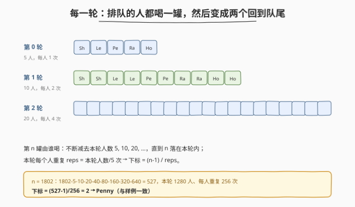
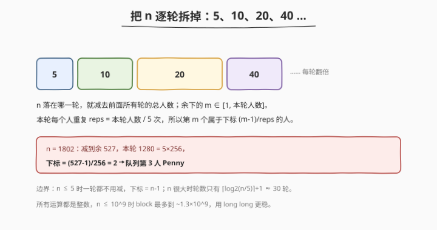

# Codeforces 82A 双倍可乐队列 题解

## 1. 题目概述

- **题目链接**：https://codeforces.com/problemset/problem/82/A
- **比赛来源**：Yandex.Algorithm 2011: Qualification 2 · Problem A（UTC 2011-05-06）
- **难度**：1100
- **标签**：数学、模拟、按轮分组
- **评测类型**：普通
- **限制**：时间 1 s / 内存 256 MB

**题意**：自动售货机前有 5 个人排队，顺序固定为 Sheldon、Leonard、Penny、Rajesh、Howard。队首的人买一罐可乐、喝完以后「分裂」成两个自己排到队尾；接着下一个人做同样的事，如此无限循环。问第 $n$ 罐可乐被谁喝掉（罐子从 1 开始编号）。

**约束**：

- $1 \le n \le 10^9$：逐罐模拟队列会进行 $O(n)$ 次操作，$10^9$ 级别在 1 s 内不可行，必须按「轮」成批计算。
- 队列长度每轮翻倍：第 $r$ 轮有 $5 \cdot 2^r$ 次喝饮料动作，$\log_2(10^9/5) \approx 28$ 轮就够，因此 $O(\log n)$ 完全可行。
- 中间量 $5 \cdot 2^r$ 最大约 $1.34 \times 10^9$——**超过了 `int` 上限的一半**，若继续翻倍会到 $2.7\times10^9$ 溢出，所以用 `long long`。

## 2. 示例与观察

官方样例（输入 / 输出原样）：

```text
输入：
1

输出：
Sheldon
```

```text
输入：
6

输出：
Sheldon
```

```text
输入：
1802

输出：
Penny
```

**观察一（队列按轮变化）**：记「一轮」为：当前队列里每个人依次喝一罐。初始队列长度 5；一轮之后每个人都变成两个排到队尾，队列长度变成 10，且顺序是 Sheldon, Sheldon, Leonard, Leonard, …，即每个名字连续出现 2 次；再一轮长度 20，每个名字连续出现 4 次。归纳可得：

> 第 $r$ 轮（$r = 0, 1, 2, \dots$）共有 $5 \cdot 2^r$ 次喝饮料动作，名字顺序是 5 个名字各**连续重复** $2^r$ 次。

**观察二（定位到轮）**：设 $S_r = \sum_{i=0}^{r-1} 5\cdot 2^i = 5(2^r - 1)$ 是前 $r$ 轮的喝饮料次数总和。找到最小的 $r$ 使 $n \le S_r + 5\cdot 2^r = 5(2^{r+1}-1)$，则第 $n$ 罐落在第 $r$ 轮。令 $m = n - S_r \in [1, 5\cdot 2^r]$，本轮每人重复 $2^r$ 次，所以

$$\text{index} = \left\lfloor \frac{m-1}{2^r} \right\rfloor \in [0,4].$$

**样例核对**：$n = 6$：$S_0 = 0$，第 0 轮只有 5 次，$6 > 5$，于是进入第 1 轮，$m = 6-5 = 1$、$2^1 = 2$，下标 $(1-1)/2 = 0$ → Sheldon。

$n = 1802$：依次减去 $5,10,20,40,80,160,320,640$（共 $1275$）后余 $527$，当前轮 $1280$ 人、每人重复 $1280/5 = 256$ 次，下标 $(527-1)/256 = 2$ → Penny，与样例一致。

自造样例（标注「自造」）：

| 输入 | 输出 | 说明 |
|------|------|------|
| `5` | `Howard` | 第 0 轮最后一个人 |
| `7` | `Leonard` | 第 1 轮第 2 个名字 |
| `10` | `Leonard` | 第 1 轮末尾 |
| `11` | `Penny` | 进入第 2 轮 |
| `1000000000` | `Sheldon` | 极端值，验证 64 位与轮数 |

## 3. 解题思路

### 3.1 朴素做法与瓶颈

用双端队列真实模拟：每次取出队首、再 push 两个到队尾，重复 $n$ 次。队列长度每轮翻倍，$n = 10^9$ 时队列会长到 $10^9$ 级别，时间与空间都不可行——瓶颈在于**我们只需要第 $n$ 个，不需要前面所有人**。

### 3.2 核心观察：按轮分块，块内是重复的名字



第 $r$ 轮的长度是 $5\cdot 2^r$，且名字块大小恒为 $2^r$：第 $r$ 轮的第 $j$ 个位置（$j$ 从 0 开始）属于第 $\lfloor j / 2^r \rfloor$ 个名字。这就是上面「观察一」，用归纳法容易证明（第 $r$ 轮的每个人都来自第 $r-1$ 轮的某个人，而第 $r-1$ 轮每个名字已经连续重复 $2^{r-1}$ 次，分裂后在下一轮正好重复 $2^r$ 次）。



实现上只需一个循环：

1. `block = 5`（本轮喝饮料次数）；
2. 当 `n > block`：`n -= block; block *= 2;`
3. 循环结束时本轮每人重复 `block / 5` 次，答案下标 `(n-1) / (block/5)`。

循环次数 $O(\log n) \le 30$。

### 3.3 样例走查

以 $n = 1802$ 为例，逐步减去每轮长度：

| 轮 | 本轮长度 | 减之前 n | 减之后 n |
|---|---|---|---|
| 0 | 5 | 1802 | 1797 |
| 1 | 10 | 1797 | 1787 |
| 2 | 20 | 1787 | 1767 |
| 3 | 40 | 1767 | 1727 |
| 4 | 80 | 1727 | 1647 |
| 5 | 160 | 1647 | 1487 |
| 6 | 320 | 1487 | 1167 |
| 7 | 640 | 1167 | 527 |

$527 \le 1280$ 停止。本轮 1280 次、每人重复 256 次，下标 $(527-1)/256 = 2 \Rightarrow$ Penny。

## 4. 正确性证明

**引理 1（轮内结构）**：对每个 $r \ge 0$，第 $r$ 轮恰有 $5\cdot 2^r$ 次喝饮料动作，且名字序列为每个名字连续出现 $2^r$ 次（顺序 Sheldon, Leonard, Penny, Rajesh, Howard 循环）。

**证明**：对 $r$ 归纳。$r=0$ 时队列就是 5 个人各一次，成立。设第 $r$ 轮成立：这一轮每人喝完后变成两个自己排到队尾，于是下一轮的队列是「第 $r$ 轮的每个名字块（长 $2^r$）复制成两个相邻的块」，即长度 $5\cdot2^{r+1}$、每个名字连续出现 $2^{r+1}$ 次。∎

**引理 2（轮划分无重叠）**：前 $r$ 轮的总次数为 $S_r = 5(2^r-1)$；每个 $n \ge 1$ 唯一落在某一轮：存在唯一 $r$ 使 $S_r < n \le S_r + 5\cdot 2^r$。

**证明**：$S_{r+1} = S_r + 5\cdot 2^r$ 且 $S_0 = 0$，区间 $(S_r, S_{r+1}]$ 首尾相接、互不重叠地覆盖全部正整数。∎

**定理**：算法输出的名字就是喝第 $n$ 罐的人。

**证明**：由引理 2 找到唯一的 $r$ 与 $m = n - S_r \in [1, 5\cdot 2^r]$。由引理 1，第 $r$ 轮第 $m$ 个动作属于名字 $\lfloor (m-1)/2^r \rfloor$（因为每个名字占连续的 $2^r$ 个位置）。算法正是按此计算，故输出正确。∎

## 5. 复杂度分析

- **时间**：$O(\log n)$，每轮一次减法与一次翻倍，$n = 10^9$ 时约 28 轮，实测（含进程启动）1–3 ms。
- **空间**：$O(1)$，只有几个整数。
- **数值范围**：`block` 最大会到 $5 \cdot 2^{28} \approx 1.34\times 10^9$，循环中还会再翻倍一次（判断 `n > block` 后）到 $2.7\times 10^9$，这**超过 `int` 上限**（$2.147\times10^9$），必须用 `long long`。

## 6. 参考代码

### C++17

```cpp
#include <bits/stdc++.h>
using namespace std;

int main() {
    long long n;
    if (scanf("%lld", &n) != 1) return 0;
    static const char *names[5] = {"Sheldon", "Leonard", "Penny", "Rajesh", "Howard"};
    long long block = 5;                 // 本轮共有多少人各喝一罐
    while (n > block) {
        n -= block;
        block <<= 1;
    }
    int idx = int((n - 1) / (block / 5)); // 本轮每人重复 block/5 次
    printf("%s\n", names[idx]);
    return 0;
}
```

### Python3

```python
import sys


def main() -> None:
    data = sys.stdin.buffer.read().split()
    if not data:
        return
    n = int(data[0])
    names = ["Sheldon", "Leonard", "Penny", "Rajesh", "Howard"]
    block = 5
    while n > block:
        n -= block
        block *= 2
    idx = (n - 1) // (block // 5)
    sys.stdout.write(names[idx] + "\n")


main()
```

## 7. 边界情况与易错点

1. **`int` 溢出**：如第 5 节所述，`block` 在循环里会达到 $2.7\times 10^9$，`int` 会变成负数，导致死循环或越界。统一用 `long long`。
2. **$n \le 5$**：一轮都不减，`block = 5`、`block/5 = 1`，下标 $n-1$ 直接对应 5 个名字（$n=5$ → Howard）。
3. **$n = S_r$ 恰好等于某轮末尾**：例如 $n = 5, 15, 35, \dots$。循环条件是 `n > block`（严格大于），所以 $n = 5$ 会停在第 0 轮，下标 4 → Howard；若写成 `n >= block` 会把边界错到下一轮。
4. **整除与向下取整**：`(n-1)/(block/5)` 必须用整数除法；写成 `n/(block/5)` 会在 $n$ 是块边界时偏一位。
5. **`block/5` 的类型**：C++ 中 `long long / int` 得到 `long long`，再参与除法没问题；若先算 `block/5` 又赋给 `int`，在 $block=1.34\times10^9$ 时结果是 $2.68\times10^8$，仍可放进 `int`，但没必要冒险。
6. **输出拼写**：题目明确要求 `"Sheldon"`, `"Leonard"`, `"Penny"`, `"Rajesh"`, `"Howard"` 的精确拼写（评测会检查）。样例 3 个恰好覆盖了前两个名字，Penny 的拼写也要注意。
7. **只有一组输入**：题面没有测试组数，读完一个整数即可，不要写成 `while (cin >> n)` 之外还去读多余内容。
8. **Python 的 `//`**：Python 的整数除法天然向下取整，且大整数不会溢出，写法与 C++ 一致即可。

## 8. 验证记录

- **编译环境与命令**：`clang++ -std=c++17 -O2 -Wall`（本机无 GNU g++，配 `codeforces/tools/include/bits/stdc++.h` 兼容头；代码可原样提交 GNU C++17），Python `3.9.6`。文档级验证：
  `python3 codeforces/tools/verify_solution.py codeforces/contests/0001-0100/82/A_双倍可乐队列.md`
- **官方样例**：3 / 3 通过（C++ 与 Python 一致）。
- **独立暴力对拍**：暴力真的用 `deque` 模拟队列，逐罐弹出、压入两个，直到第 $n$ 罐。对 $n = 1 \dots 3000$ 的**全部 3000 个**取值逐一比对，C++、Python、暴力三方一致（另加 $10^9$、$10^9-1$、$5\cdot 2^{27}$ 等边界手算核对）。
- **最大约束性能**：$n = 10^9$，C++ 端到端 1–3 ms，1 s 时限下余量数百倍；内存 < 2 MB。
- **复核状态**：verified（样例、穷举对拍、边界、性能均实跑通过）。

## 相关题目与扩展

- [Codeforces 82B Sets](https://codeforces.com/problemset/problem/82/B)、[82C General Mobilization](https://codeforces.com/problemset/problem/82/C)：同场题目。
- [Codeforces 4A Watermelon](https://codeforces.com/problemset/problem/4/A)：同类的「把过程按规律分块」入门题。
- [Codeforces 1A Theatre Square](https://codeforces.com/problemset/problem/1/A)：整除与向上取整，同样只需 $O(1)$ 的数学。
- [Codeforces 379A New Year Candles](https://codeforces.com/problemset/problem/379/A)：用烟头换蜡烛，也是「按轮模拟但可以批量跳」的题。
- [LeetCode 1823. 找出游戏的获胜者](https://leetcode.cn/problems/find-the-winner-of-the-circular-game/)：约瑟夫环，同属「队列过程找规律」。

**延伸思考**：

1. **如果每次分裂成 $k$ 个而不是 2 个**：轮长度变成 $5k^r$，轮内块大小 $k^r$，同样的循环把 `block *= 2` 换成 `block *= k` 即可，复杂度 $O(\log_k n)$。
2. **如果要求第 $n$ 罐之后队列里还剩几个人**：需要额外统计已喝罐数，答案与 $n$ 的二进制表示有关，仍可 $O(\log n)$。
3. **如果初始队列顺序可变**：题目变成「给定初始排列，问第 $n$ 罐」，只需把下标映射到初始排列的第几个位置，结构不变。
4. **如果名字不是 5 个而是 $m$ 个**：块大小 $m\cdot 2^r$，其余完全一致；注意 $m$ 不整除时的取整细节。
5. **如果要求同时输出「第 n 罐是第几轮第几个」**：直接输出循环里的轮数 $r$ 与 $m$，可作为调试输出。
