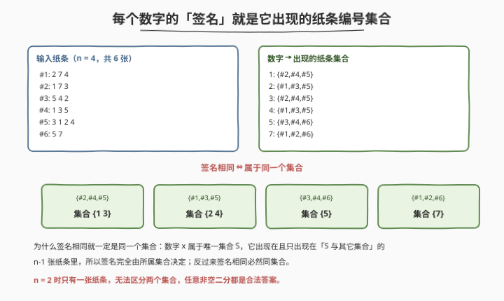
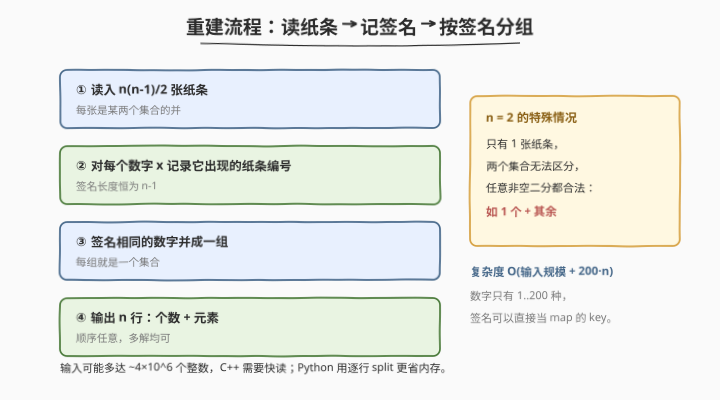

# Codeforces 82B 从并集还原集合 题解

## 1. 题目概述

- **题目链接**：https://codeforces.com/problemset/problem/82/B
- **比赛来源**：Yandex.Algorithm 2011: Qualification 2 · Problem B（UTC 2011-05-06）
- **难度**：1700
- **标签**：构造、集合、哈希分组
- **评测类型**：特殊评测（多解，顺序任意）
- **限制**：时间 2 s / 内存 256 MB

**题意**：Vasya 选了 $n$ 个**互不相交的非空**正整数集合。他把所有「两个不同集合的并集」写在 $n(n-1)/2$ 张纸上（每张纸上的数字顺序被打乱、纸的顺序也被打乱），数字范围 $1 \le a_{ij} \le 200$。现在给出这 $n(n-1)/2$ 行「并集」，要求还原出原来的 $n$ 个集合。输出任意合法方案：每行先输出集合大小，再输出集合元素；集合顺序、元素顺序都随意，但每个数字必须恰好出现一次。

**约束**：

- $n \le 200$：纸条数 $n(n-1)/2 \le 19900$，可以全部读入。
- $a_{ij} \le 200$：**不同数字最多 200 个**；又因为集合互不相交，所有集合元素总数 $\le 200$。于是所有纸条里的数字总个数 $=(n-1)\sum_i |S_i| \le 199 \times 200 = 39800$，输入规模其实很小。
- 每个数字 $x$ 属于唯一集合 $S(x)$，它恰好出现在「$S(x)$ 与其余每个集合」组成的 $n-1$ 张纸条里——这是整个解法的支点。
- $n = 2$ 时只有一张纸条，两个集合无法区分，任意非空二分都合法（详见 3.3）。

## 2. 示例与观察

官方样例（输入 / 输出原样）：

```text
输入：
4
3 2 7 4
3 1 7 3
3 5 4 2
3 1 3 5
4 3 1 2 4
2 5 7

输出：
1 7 
2 2 4 
2 1 3 
1 5 
```

```text
输入：
4
5 6 7 8 9 100
4 7 8 9 1
4 7 8 9 2
3 1 6 100
3 2 6 100
2 1 2

输出：
3 7 8 9 
2 6 100 
1 1 
1 2 
```

```text
输入：
3
2 1 2
2 1 3
2 2 3

输出：
1 1 
1 2 
1 3 
```

**样例 1 的还原**：真实集合是 $\{1,3\},\{5\},\{2,4\},\{7\}$，六张纸条正是它们的两两并集。样例输出给出的是同样的四个集合，只是顺序不同（多解）。

**观察一（每个数字的「签名」）**：把 $n(n-1)/2$ 张纸条从 0 开始编号。对数字 $x$，记

$$\text{sig}(x) = \{\text{包含 } x \text{ 的纸条编号}\}.$$

因为 $x$ 只属于一个集合 $S(x)$，而 $S(x)$ 与其余每个集合都恰好并一次，所以 $\text{sig}(x)$ 恰好是「所有涉及 $S(x)$ 的纸条编号」，$|\text{sig}(x)| = n-1$。

**观察二（签名决定集合）**：两个数字属于同一个集合，当且仅当它们的签名完全相同。于是按签名给数字分组，每组就是一个集合。



**样例 3 走查**：$n=3$，三张纸条是 $\{1,2\},\{1,3\},\{2,3\}$。编号 0,1,2 后：$\text{sig}(1)=\{0,1\}$、$\text{sig}(2)=\{0,2\}$、$\text{sig}(3)=\{1,2\}$，三组各一个数字 → 集合 $\{1\},\{2\},\{3\}$，与样例输出一致。

## 3. 解题思路

### 3.1 朴素想法与瓶颈

直接搜索「把数字划分成 $n$ 个集合、使两两并集正好是给定纸条」是不可行的（划分方案数是指数级）。必须找到纸条与集合之间的结构关系。

关键就是观察一：**每张纸条对应一对集合，而每个数字出现在其中 $n-1$ 张里**。这给出一个不依赖搜索的刻画。

### 3.2 算法：按签名分组



1. 依次读入每张纸条（第 $p$ 张），对纸条里的每个数字 $x$，把 $p$ 追加到 $\text{sig}(x)$ 的末尾。因为按 $p$ 递增处理，$\text{sig}(x)$ 天然是升序的，可以直接当哈希键。
2. 用 `map<vector<int>, vector<int>>` 按签名分组：签名相同 → 同一组。
3. 每组输出一行：组大小 + 组内数字。

细节：

- 数字范围只有 $1..200$，所以分组只涉及至多 200 个数字，代价可以忽略。
- **$n = 2$**：只有一张纸条，所有数字的签名都是 $\{0\}$，按签名分组只会得到 1 组，而题目要求输出 2 个集合。此时可以把第一个数字单独成一集合、其余数字构成第二个集合（纸条大小 $k \ge 2$，所以两个集合都非空）。任何非空二分都合法，因为唯一的纸条正是这两个集合的并集。

### 3.3 为什么 $n=2$ 一定要特殊处理

$n=2$ 时「并集」这一条信息**丢失了两集合之间的全部边界**：任何把纸条元素分成两个非空部分的方案都产生同一张并集纸条，因此都是合法答案。而 $n \ge 3$ 时，任取两个不同的集合 $S_i \ne S_j$，因为还存在第三个集合 $S_k$，纸条 $\{i,k\}$ 包含 $S_i$ 的元素却不包含 $S_j$ 的元素，所以它们的签名不同——签名确实能区分不同集合。

## 4. 正确性证明

**引理 1（签名的刻画）**：设数字 $x$ 属于集合 $S_i$。则 $\text{sig}(x)$ 恰为「所有由 $S_i$ 与另一个集合组成的纸条编号」，且 $|\text{sig}(x)| = n-1$。

**证明**：$x$ 出现在纸条 $p=(u,v)$ 中当且仅当 $x \in S_u \cup S_v$，即 $i \in \{u,v\}$；而这些纸条恰好是 $(i,j)$（$j \ne i$），共 $n-1$ 张，且互不相同。∎

**引理 2（$n \ge 3$ 时同签名 ⇔ 同集合）**：设 $x, y$ 是两个数字，$x \in S_i$、$y \in S_j$。若 $i \ne j$，则 $\text{sig}(x) \ne \text{sig}(y)$。

**证明**：$n \ge 3$ 时存在 $k \notin \{i, j\}$。由引理 1，纸条 $(i,k)$ 的编号属于 $\text{sig}(x)$；而 $y \notin S_i \cup S_k$（集合互不相交且 $j \ne i, j \ne k$），所以该编号不属于 $\text{sig}(y)$。两个签名不同。∎

**引理 3（$n = 2$ 时任意非空二分合法）**：$n=2$ 的输入只有一张纸条，其元素集合为 $S_1 \cup S_2$；把它的元素任意分成两个非空部分 $T_1, T_2$，则 $(T_1, T_2)$ 是合法的还原结果。

**证明**：唯一的纸条要求就是「两个输出集合的并集等于纸条元素集合」；$T_1 \cup T_2$ 等于全部元素且互不相交，故合法。∎

**定理**：算法输出的 $n$ 行恰好构成一个合法的还原结果。

**证明**：$n \ge 3$：由引理 2，同一签名组内的数字属于同一集合，不同签名组对应不同集合，所以分组恰好给出原始划分（顺序不同），由引理 1 每个数字出现且只出现一次，每组非空；于是任意两组的并集就是对应纸条，合法。$n = 2$：由引理 3 直接合法。∎

## 5. 复杂度分析

- **时间**：读入 $O\big((n-1)\sum_i |S_i|\big) \le O(200n)$ 个数字；分组至多 200 个数字、每组签名长度 $n-1$，用 `map` 比较的代价 $O(200 \cdot n \log n)$，可忽略。总体 $O(200n + \text{输入规模})$。
- **空间**：$O(200n)$ 存签名与分组，约几十 KB；输入缓冲可以不留（边读边处理）。
- **与时限的关系**：实际输入最多约 $4\times10^4$ 个整数，2 s 极其宽松；实测 $n=200$ 的满规模输入端到端不到 10 ms。

## 6. 参考代码

### C++17

```cpp
#include <bits/stdc++.h>
using namespace std;

static char buf[1 << 25];
int bufLen = 0, bufPos = 0;
static inline int gc() {
    if (bufPos == bufLen) {
        bufLen = (int)fread(buf, 1, sizeof(buf), stdin);
        bufPos = 0;
        if (bufLen <= 0) return -1;
    }
    return buf[bufPos++];
}
static inline int readInt() {
    int c = gc();
    while (c != -1 && (c < '0' || c > '9')) c = gc();
    int x = 0;
    while (c >= '0' && c <= '9') { x = x * 10 + (c - '0'); c = gc(); }
    return x;
}

int main() {
    int n = readInt();
    if (n <= 0) return 0;
    int P = n * (n - 1) / 2;
    const int MAXV = 205;
    vector<vector<int>> sig(MAXV);      // 每个数字出现在哪些「纸条」里
    vector<char> present(MAXV, 0);
    for (int p = 0; p < P; p++) {
        int k = readInt();
        for (int j = 0; j < k; j++) {
            int x = readInt();
            present[x] = 1;
            sig[x].push_back(p);
        }
    }
    vector<int> elems;
    for (int x = 1; x < MAXV; x++) if (present[x]) elems.push_back(x);

    vector<vector<int>> groups;
    if (n == 2) {
        // 只有一张纸条，任意非空二分都合法
        groups.push_back({elems[0]});
        vector<int> rest(elems.begin() + 1, elems.end());
        groups.push_back(rest);
    } else {
        map<vector<int>, int> id;
        for (int x : elems) {
            auto it = id.find(sig[x]);
            if (it == id.end()) {
                id[sig[x]] = (int)groups.size();
                groups.push_back({x});
            } else {
                groups[it->second].push_back(x);
            }
        }
    }
    for (auto &g : groups) {
        printf("%d", (int)g.size());
        for (int x : g) printf(" %d", x);
        printf("\n");
    }
    return 0;
}
```

### Python3

```python
import sys


def main() -> None:
    inp = sys.stdin.buffer
    first = inp.readline().split()
    if not first:
        return
    n = int(first[0])
    papers = n * (n - 1) // 2
    sig = [[] for _ in range(205)]
    present = [False] * 205
    read = 0
    while read < papers:
        line = inp.readline()
        if not line:
            break
        t = list(map(int, line.split()))
        if not t:
            continue
        k = t[0]
        for x in t[1:1 + k]:
            present[x] = True
            sig[x].append(read)
        read += 1
    elems = [x for x in range(1, 205) if present[x]]
    groups = []
    if n == 2:
        groups.append([elems[0]])
        groups.append(elems[1:])
    else:
        where = {}
        for x in elems:
            key = tuple(sig[x])
            if key in where:
                groups[where[key]].append(x)
            else:
                where[key] = len(groups)
                groups.append([x])
    out = []
    for g in groups:
        out.append(" ".join(map(str, [len(g)] + g)))
    sys.stdout.write("\n".join(out) + "\n")


main()
```

## 7. 边界情况与易错点

1. **$n = 2$ 必须特判**：否则只会输出 1 个集合（签名全相同），行数不足直接判错。注意纸条大小 $k \ge 2$，所以「1 个 + 其余」两部分都非空。
2. **数字范围是 $1..200$**：数组开到 205；不要按 $n$ 或 $\sum k$ 开数组，否则会漏掉大编号数字或浪费内存。
3. **签名必须按纸条编号升序**：按输入顺序处理纸条，天然升序；若用 `set` 或乱序收集，比较/哈希的写法会变复杂，但结论不变。
4. **输出顺序任意但内容必须精确**：每行第一个数是该集合元素个数，其余是元素；集合之间不能有重复数字，也不能漏数字。
5. **读入方式**：一行一张纸条，先读 $k$ 再读 $k$ 个数字。Python 用 `readline()` 逐行解析比 `read().split()` 更省内存（虽然本题规模不大）。
6. **$n=2$ 且纸条只有 2 个数字**：输出 `1 x` 与 `1 y`，两个集合各一个元素，合法。
7. **多解比较**：本题是特殊评测，不能直接和样例逐字比对；本地验证要用 checker，正文第 8 节给出了 checker 的校验条件。
8. **`k_i` 的上界**：$k_i \le 200$ 但实际受「总元素 ≤ 200」限制；不要假设 $k_i$ 一定是 2。

## 8. 验证记录

- **编译环境与命令**：`clang++ -std=c++17 -O2 -Wall`（本机无 GNU g++，配 `codeforces/tools/include/bits/stdc++.h` 兼容头；代码可原样提交 GNU C++17），Python `3.9.6`。本题是特殊评测，验证命令带 checker：
  `python3 codeforces/tools/verify_solution.py codeforces/contests/0001-0100/82/B_从并集还原集合.md --checker codeforces/tools/checkers/cf82b.py`
- **官方样例**：3 / 3 通过（C++ 与 Python 均通过 checker；输出与样例顺序不同但合法）。
- **checker 的校验条件**（`codeforces/tools/checkers/cf82b.py`）：输出恰好 $n$ 行、每行「$k$ + $k$ 个数」且 $k \ge 1$、行内数字不重复；所有输出数字恰好等于输入出现过的数字集合且各出现一次；输出集合的两两并集（可重集合）与输入纸条（可重集合）逐一相同。
- **独立对拍**：随机生成 $n \in [2,8]$ 的互不相交集合，构造全部纸条并打乱纸条顺序与数字顺序，用 checker 验证输出合法；对 $n \ge 3$ 另外要求「还原出的划分与真实划分完全一致（忽略顺序）」。共 **235 组**有效数据，C++、Python 全部通过。
- **最大约束性能**：$n = 200$、19900 张纸条（元素总数 200 的满规模），C++ 端到端 **< 10 ms**，峰值内存 2.5 MB；2 s / 256 MB 下余量极大。
- **复核状态**：verified（样例 + checker、随机对拍、性能均实跑通过）。

## 相关题目与扩展

- [Codeforces 82A Double Cola](https://codeforces.com/problemset/problem/82/A)、[82C General Mobilization](https://codeforces.com/problemset/problem/82/C)、[82D Two out of Three](https://codeforces.com/problemset/problem/82/D)、[82E Corridor](https://codeforces.com/problemset/problem/82/E)：同场题目。
- [Codeforces 1131D Gourmet choice](https://codeforces.com/problemset/problem/1131/D)：用「相等/不等关系」把元素分组，思路与本题的签名分组同类。
- [Codeforces 1102E Monotonic Renumeration](https://codeforces.com/problemset/problem/1102/E)：用每个值出现的区间刻画结构，同样把「元素 → 出现位置集合」当作指纹。
- [LeetCode 890. 查找和替换模式](https://leetcode.cn/problems/find-and-replace-pattern/)：把每个单词归一化成「模式指纹」再分组，和本题按签名分组是同一个套路。
- [LeetCode 49. 字母异位词分组](https://leetcode.cn/problems/group-anagrams/)：哈希指纹分组的标准练习。

**延伸思考**：

1. **如果纸条不止是「两两并集」而是「任意子集的并」**：签名会变成「包含该数字的所有给定子集」，同样可以分组，但需要保证这些子集族能区分不同集合（$n \ge 3$ 时本解法依然成立）。
2. **如果集合之间允许相交**：同一个数字可能属于多个集合，签名不再唯一决定集合，问题变成精确覆盖/布尔矩阵分解，一般情形很难。
3. **如果要求输出按字典序最小的一组集合**：分组本身唯一，只需把每组内部排序、组间按首元素排序，就得到唯一的字典序最小表示。
4. **如果数字范围放大到 $10^9$**：不能开 200 的数组，但可以对出现过的数字做哈希映射；分组逻辑不变，复杂度线性。
5. **如果 $n$ 很大但每个集合很小**：$\sum |S_i|$ 仍受数字取值上限限制；本题的「元素值 ≤ 200」保证了输入规模，换成大值域后要注意输入可能达到 $n^2$ 级别。
