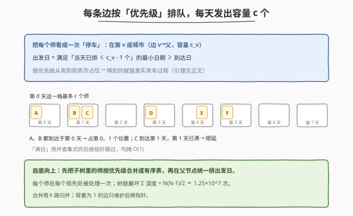
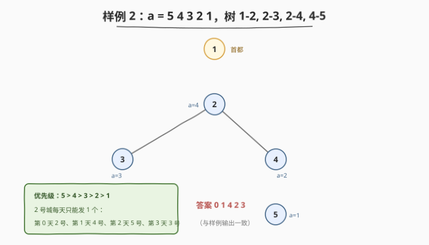

# Codeforces 82C 总动员 题解

## 1. 题目概述

- **题目链接**：https://codeforces.com/problemset/problem/82/C
- **比赛来源**：Yandex.Algorithm 2011: Qualification 2 · Problem C（UTC 2011-05-06）
- **难度**：2000
- **标签**：树、贪心、模拟、并查集（后继指针）
- **评测类型**：普通
- **限制**：时间 2 s / 内存 256 MB

**题意**：Berland 有 $n$ 座城市、$n-1$ 条铁路，构成一棵以城市 1（首都）为根的树。第 $i$ 座城市驻扎着第 $i$ 个师，优先级为 $a_i$（越小越优先，所有 $a_i$ 互不相同）。第 $j$ 条铁路容量为 $c_j$。

从第 0 天开始，**每一天**每座非首都城市都会发出一列火车，沿唯一一条指向首都的铁路开到父节点，恰好花 1 天。装车规则：把当前在该城市的所有师按优先级从小到大排序，依次上车，直到列车装满（容量 $c$）或没人了；没上车的师留在原地等第二天的车。到达首都的师就停在那里。求每个师到达首都的**天数**（从第 0 天算起）。

**约束**：

- $n \le 5000$：可以承受 $O(n^2)$ 量级（$2.5\times 10^7$）的算法，但不能承受「天数 × 城市数」的逐日全量模拟（最坏天数可达 $10^7$ 级）。
- $a_i \le 10^9$ 且互不相同：优先级没有并列，排序唯一。
- $c_j \le n$：容量可能远大于子树人数（此时没有排队）。
- 答案（天数）可能很大：最坏可达 $\sum \text{深度} \approx n(n-1)/2 \approx 1.25\times10^7$，必须用 64 位。

## 2. 示例与观察

官方样例（输入 / 输出原样）：

```text
输入：
4
40 10 30 20
1 2 1
2 3 1
4 2 1

输出：
0 1 3 2 
```

```text
输入：
5
5 4 3 2 1
1 2 1
2 3 1
2 4 1
4 5 1

输出：
0 1 4 2 3 
```

**样例 1 解释**：树为 $1-2$、$2-3$、$2-4$，所有边容量 1，优先级 $a = (40, 10, 30, 20)$，即 2 号师最高、4 号次之、3 号再次、1 号最低。

| 天 | 城市 2 的师 | 城市 2 发出 | 城市 3/4 发出 | 结果 |
|---|---|---|---|---|
| 0 | {2} | 2 号 | 3 号、4 号各出发 | 2 号到首都（第 1 天） |
| 1 | {3, 4} | 4 号（优先级高） | — | 4 号到首都（第 2 天） |
| 2 | {3} | 3 号 | — | 3 号到首都（第 3 天） |

输出 `0 1 3 2` 对应第 1..4 个师，与样例一致。

**观察一（同一时刻到达可以当天上车）**：一个师在第 $t$ 天**开始**时到达某城市，就能赶上第 $t$ 天发出的车，于第 $t+1$ 天到达父节点。样例 1 中 3、4 号都在第 1 天开始到达城市 2，第 1 天就发车——这条时间约定必须和样例对齐。

**观察二（每条边独立的排队系统）**：每个师沿唯一路径走向首都，每经过一条边都要在边的起点城市排队。**一条边上的服务顺序只由「到达该城市的时刻 + 优先级 + 容量」决定**，与其它子树无关。于是可以对每座城市单独计算「每个师从这座城市出发的日期」。

**观察三（按优先级贪心）**：把某座城市 $v$ 要送走的师按优先级从高到低排列，依次为每个师分配「最早的有空位日期 ≥ 它的到达日」。这正是真实过程的结果——高优先级的师永远不会被低优先级的师挤到后面。

## 3. 解题思路

### 3.1 朴素做法与瓶颈

最直接的是逐天模拟：每天遍历所有城市，让每座城市按优先级发出至多 $c_v$ 个师。正确但太慢：最坏情况下天数可达 $\sum$ 子树大小 $\approx 1.25\times10^7$，每天再扫 $O(n)$ 座城市就是 $6\times10^{10}$，2 s 内不可能。

瓶颈在于「空转的天数太多」。真正需要模拟的只有**有师可发的那些 (城市, 天)** 对，总数等于「所有师经过的所有边」的次数，即 $\sum_v s_v$（$s_v$ 为 $v$ 子树内的师数），最坏 $\approx 1.25\times10^7$——这个量级是可以接受的，只要每次操作 $O(1)$ 或近似 $O(1)$。

### 3.2 核心观察一：发车顺序 = 按优先级贪心占位



固定一座城市 $v$（到父节点的边容量 $c_v$），设子树内的师按优先级从高到低为 $q_1, q_2, \dots, q_s$，到达 $v$ 的时刻为 $A_1, \dots, A_s$（各自的到达时刻，彼此独立、已知）。定义贪心：

> 依次处理 $q_1,\dots,q_s$；对 $q_i$ 选**最小的日期** $d_i \ge A_i$，使得第 $d_i$ 天已安排的师数 $< c_v$；把 $q_i$ 安排在 $d_i$。

**这就是真实发车过程**。直观理由：第 $d$ 天能发的车容量是 $c_v$，高优先级的师只要已经到了就一定先于任何低优先级的师；而「按优先级依次占最早空位」恰好模拟了每一天「取在场师中优先级最高的 $c_v$ 个」。

实现「最早空位 ≥ $A_i$」：用一个「满日 → 下一个候选日」的后继指针（并查集式路径压缩）。当天 $d$ 被占满（已排 $c_v$ 个）时，令 `next[d] = find(d+1)`；查询 `find(A)` 均摊 $O(\alpha)$。容量为 1 时只需后继指针，容量更大时再用一个 `used[d]` 记录当天已排几个。

### 3.3 核心观察二：自底向上合并

每个师的到达时刻依赖于它**在子树里的经历**，与父节点无关。所以按后序（自底向上）处理：

1. 叶子城市 $v$：待送列表就是 $\{(a_v, 0)\}$（优先级、到达日 0）。
2. 内部城市 $v$：把每个孩子的「已发车列表」按**优先级**归并（同一孩子内部已经按优先级有序），再加上自己的师（到达日 0），得到 $v$ 的待送列表；用 3.2 的贪心给每个师算出发日期，把列表里的到达日改成「出发日 + 1」，交给父节点。
3. 对根的孩子：算出的日期 +1 就是该师到达首都的天数（根不再发车）。

归并时注意用 k 路归并（或单孩子直接搬移），避免每个节点重新排序。



### 3.4 样例走查

样例 2：$a = (5,4,3,2,1)$，树 $1-2$、$2-3$、$2-4$、$4-5$，边容量全 1，优先级从高到低是 5、4、3、2、1。

1. 城市 5：列表 $\{(1,0)\}$（优先级 1、到达 0）→ 第 0 天出发，到达城市 4 的日期 = 1。
2. 城市 4：列表 $\{(1,1)$（师 5）$, (2,0)$（师 4）$\}$，按优先级排：师 5（优先级 1，到达 1）、师 4（优先级 2，到达 0）。容量 1：
   - 师 5 → 最早空位 ≥ 1 = 第 1 天出发；
   - 师 4 → 最早空位 ≥ 0 = 第 0 天出发。
   两者到达城市 2 的日期：师 5 → 2，师 4 → 1。
3. 城市 3：师 3 第 0 天出发，到达城市 2 的日期 1。
4. 城市 2：列表（优先级升序）：师 5(到达 2)、师 4(到达 1)、师 3(到达 1)、师 2(到达 0)，容量 1：
   - 师 5 → 第 2 天；师 4 → 第 1 天；师 3 → 第 2 天被占，第 3 天；师 2 → 第 0 天。
   到达首都：师 2 → 1，师 4 → 2，师 5 → 3，师 3 → 4。
5. 输出按城市编号：`0 1 4 2 3`，与样例一致。

## 4. 正确性证明

**引理 1（单城市的贪心等价）**：固定城市 $v$ 与已知到达时刻 $A_i$、容量 $c$。真实发车过程与「按优先级从高到低、每个师占最小的空位日期 $\ge A_i$」得到的日期完全相同。

**证明**：对优先级从高到低归纳。设前 $j-1$ 个师的日期在两种算法中一致，考虑第 $j$ 个师 $q_j$。

- 设贪心给出 $d_j$。对任意 $d < d_j$（$d \ge A_j$），贪心在该日已排满 $c$ 个师，它们都是优先级高于 $q_j$ 的师；由归纳假设，它们在真实过程中也排在当天，因此真实过程第 $d$ 天也满员，$q_j$ 不可能在 $d$ 出发。
- 在 $d_j$ 这天，贪心只排了 $< c$ 个高优先级的师。所有优先级高于 $q_j$ 且到达时刻 $\le d_j$ 的师，其贪心日期都 $\le d_j$（否则它们会占掉 $d_j$ 或更早的某个空位——注意贪心给它们的是各自的最早空位，若其日期 $> d_j$，说明 $[A_i, d_j]$ 全被更高优先级的师占满；而这些日期的占据者优先级更高，与「$d_j$ 还有空位」矛盾）。所以在真实过程的第 $d_j$ 天，$q_j$ 到场且所有在场的高优先级师都已发走、当天还有空位，故 $q_j$ 当天出发。∎

**引理 2（自底向上合并正确）**：按后序处理时，城市 $v$ 拿到的「子树内每个师到达 $v$ 的时刻」与真实过程一致。

**证明**：对子树高度归纳。叶子显然。内部节点 $v$：由归纳假设，每个孩子 $u$ 给出的出发日期与真实一致，因此师到达 $v$ 的时刻（出发日 + 1）也一致；再由引理 1，$v$ 的发车日期与真实一致，从而交给父节点的到达时刻正确。∎

**定理**：算法输出的 $t_i$ 就是第 $i$ 个师到达首都的真实天数。

**证明**：由引理 2，根的孩子给出的日期与真实一致，师到达首都的天数 = 从该孩子出发的日期 + 1，算法正是这样填的；根上的师（城市 1 的师）天数为 0。∎

## 5. 复杂度分析

- **时间**：每个师在其每个祖先处被处理一次，总操作数 $\sum_v s_v \le \sum_i \text{depth}(i) \le n(n-1)/2 \approx 1.25\times10^7$；每次操作是一次后缀指针查询（均摊 $O(\alpha)$）加常数次哈希操作。归并总代价同阶。实测最坏形态（$n=5000$ 的链、边容量全 1）**0.47 s**，相对 2 s 余量 4 倍以上。
- **空间**：$O(n)$。每个师同一时刻只存在于一个未处理完的列表中；后继指针与已用容量表按城市即时释放。
- **数值范围**：天数最大 $1.25\times10^7$，`int` 也够，但统一用 `long long` 更稳；$a_i \le 10^9$ 用 `long long`。

## 6. 参考代码

### C++17

```cpp
#include <bits/stdc++.h>
using namespace std;
// 82C General Mobilization
// 关键：按「优先级从高到低」依次确定每个师在每条边上的出发日 —
// 这就是「最早空闲日 >= 到达日」的贪心（每天容量 c_v）。
int main() {
    int n;
    if (scanf("%d", &n) != 1) return 0;
    vector<long long> a(n + 1);
    for (int i = 1; i <= n; i++) scanf("%lld", &a[i]);
    vector<vector<pair<int,int>>> adj(n + 1);
    for (int i = 0; i < n - 1; i++) {
        int v, u, c;
        scanf("%d %d %d", &v, &u, &c);
        adj[v].push_back({u, c});
        adj[u].push_back({v, c});
    }
    if (n == 1) { printf("0\n"); return 0; }

    // 以 1 为根
    vector<int> par(n + 1, 0), cap(n + 1, 0), bfs;
    bfs.reserve(n);
    vector<char> vis(n + 1, 0);
    bfs.push_back(1); vis[1] = 1;
    for (size_t i = 0; i < bfs.size(); i++) {
        int v = bfs[i];
        for (auto &e : adj[v]) {
            if (vis[e.first]) continue;
            vis[e.first] = 1;
            par[e.first] = v;
            cap[e.first] = e.second;
            bfs.push_back(e.first);
        }
    }

    // 优先级排名：a 越小排名越靠前
    vector<int> ord(n);
    for (int i = 0; i < n; i++) ord[i] = i + 1;
    sort(ord.begin(), ord.end(), [&](int x, int y) { return a[x] < a[y]; });
    vector<int> rankOf(n + 1);
    for (int i = 0; i < n; i++) rankOf[ord[i]] = i;

    vector<long long> ans(n + 1, 0);
    // list[v]：v 子树内所有师（按 rank 升序），值为它们到达 v 的日期
    vector<vector<pair<int,long long>>> list(n + 1);

    // 逆 BFS 序 = 自底向上
    for (int bi = n - 1; bi >= 1; bi--) {
        int v = bfs[bi];                       // v != 1
        // 合并孩子们的有序表
        vector<pair<int,long long>> merged;
        {
            // 收集孩子
            size_t total = 1;
            vector<int> kids;
            for (auto &e : adj[v]) {
                int u = e.first;
                if (u != par[v]) { kids.push_back(u); total += list[u].size(); }
            }
            if (kids.size() == 1) {
                merged.swap(list[kids[0]]);          // 单孩子：直接接管，O(1)
            } else if (!kids.empty()) {
                merged.reserve(total);
                // k 路归并
                vector<int> pos(kids.size(), 0);
                priority_queue<pair<int,int>, vector<pair<int,int>>, greater<pair<int,int>>> pq;
                for (size_t t = 0; t < kids.size(); t++)
                    if (!list[kids[t]].empty()) pq.push({list[kids[t]][0].first, (int)t});
                while (!pq.empty()) {
                    auto top = pq.top(); pq.pop();
                    int t = top.second;
                    merged.push_back(list[kids[t]][pos[t]++]);
                    if (pos[t] < (int)list[kids[t]].size())
                        pq.push({list[kids[t]][pos[t]].first, t});
                }
            }
            for (int u : kids) vector<pair<int,long long>>().swap(list[u]);   // 释放孩子缓冲
        }
        // 插入自己（rankOf[v], 到达日 0）
        {
            pair<int,long long> self = {rankOf[v], 0};
            auto it = lower_bound(merged.begin(), merged.end(), self);
            merged.insert(it, self);
        }
        // 按 rank 升序逐个安排出发日
        const int c = cap[v];
        unordered_map<long long,long long> nxt;   // 满日 -> 下一个候选日
        unordered_map<long long,int> used;        // 未满日 -> 已用容量
        nxt.reserve(merged.size() * 2 + 16);
        used.reserve(merged.size() * 2 + 16);
        auto findFree = [&](long long d) -> long long {
            long long x = d;
            while (true) {
                auto it = nxt.find(x);
                if (it == nxt.end()) break;
                x = it->second;
            }
            long long y = d;
            while (true) {
                auto it = nxt.find(y);
                if (it == nxt.end()) break;
                long long z = it->second;
                nxt[y] = x;
                y = z;
            }
            return x;
        };
        if (c == 1) {
            for (auto &e : merged) {
                long long d = findFree(e.second);
                nxt[d] = findFree(d + 1);
                if (par[v] == 1) ans[ord[e.first]] = d + 1;
                else e.second = d + 1;
            }
        } else {
            for (auto &e : merged) {
                long long d = findFree(e.second);
                int uc = used[d] + 1;
                if (uc == c) {
                    used.erase(d);
                    nxt[d] = findFree(d + 1);
                } else {
                    used[d] = uc;
                }
                if (par[v] == 1) ans[ord[e.first]] = d + 1;
                else e.second = d + 1;
            }
        }
        if (par[v] != 1) list[v].swap(merged);
    }
    for (int i = 1; i <= n; i++) printf("%lld%c", ans[i], i == n ? '\n' : ' ');
    return 0;
}
```

### Python3

```python
import sys


def main() -> None:
    data = sys.stdin.buffer.read().split()
    if not data:
        return
    it = iter(data)
    n = int(next(it))
    a = [0] * (n + 1)
    for i in range(1, n + 1):
        a[i] = int(next(it))
    adj = [[] for _ in range(n + 1)]
    for _ in range(n - 1):
        v = int(next(it)); u = int(next(it)); c = int(next(it))
        adj[v].append((u, c))
        adj[u].append((v, c))
    if n == 1:
        sys.stdout.write("0\n")
        return
    par = [0] * (n + 1)
    cap = [0] * (n + 1)
    order = [1]
    vis = [False] * (n + 1)
    vis[1] = True
    for v in order:
        for u, c in adj[v]:
            if not vis[u]:
                vis[u] = True
                par[u] = v
                cap[u] = c
                order.append(u)
    by_priority = sorted(range(1, n + 1), key=lambda x: a[x])
    rank = [0] * (n + 1)
    for i, v in enumerate(by_priority):
        rank[v] = i
    ans = [0] * (n + 1)
    lists = [None] * (n + 1)
    for v in reversed(order[1:]):
        kids = [u for u, _ in adj[v] if u != par[v]]
        merged = []
        for u in kids:
            merged.extend(lists[u])
            lists[u] = None
        merged.sort()
        merged.append((rank[v], 0))
        merged.sort()
        c = cap[v]
        nxt = {}
        used = {}

        def find_free(d):
            x = d
            while x in nxt:
                x = nxt[x]
            y = d
            while y in nxt:
                z = nxt[y]
                nxt[y] = x
                y = z
            return x

        for idx, (r, arr) in enumerate(merged):
            d = find_free(arr)
            uc = used.get(d, 0) + 1
            if uc == c:
                used.pop(d, None)
                nxt[d] = find_free(d + 1)
            else:
                used[d] = uc
            if par[v] == 1:
                ans[by_priority[r]] = d + 1
            else:
                merged[idx] = (r, d + 1)
        if par[v] != 1:
            lists[v] = merged
    sys.stdout.write(" ".join(str(ans[i]) for i in range(1, n + 1)) + "\n")


main()
```

## 7. 边界情况与易错点

1. **$n = 1$**：没有铁路，唯一的师在首都，答案 0；不特判会读不到边、也可能输出空行。
2. **时间约定**：第 $t$ 天**开始**到达的师可以赶第 $t$ 天的车（样例 1 的 3、4 号师验证了这一点）。如果写成「到达后第二天才能上车」，样例 1 会输出 `0 1 4 3` 之类，直接错。
3. **容量大于子树人数**：此时不会排队，每个师都为「到达即出发」，后继指针只做一次查询；不要写成「必须发满 c 个」。
4. **同一城市多个孩子**：必须按优先级归并（或 k 路归并），不能把孩子的列表直接首尾相接——那样顺序就乱了，贪心会错。
5. **深度过大导致递归爆栈**：树链长度可达 5000，用 BFS 序的逆序做自底向上迭代，不要写递归 DFS。
6. **天数与内存**：最坏天数 $\approx 1.25\times10^7$，用 `long long` 存；后继指针用哈希表而不是按天数开数组（天数可能远大于 $n$）。
7. **`used` 表的清理**：当天被排满时要把它从 `used` 里删掉并挂上后继指针；忘记删会导致容量判断错误、无限顺延。
8. **输出格式**：输出 $n$ 个数，空格分隔，行末可以有空格；样例输出行末确实带一个空格。

## 8. 验证记录

- **编译环境与命令**：`clang++ -std=c++17 -O2 -Wall`（本机无 GNU g++，配 `codeforces/tools/include/bits/stdc++.h` 兼容头；代码可原样提交 GNU C++17），Python `3.9.6`。文档级验证：
  `python3 codeforces/tools/verify_solution.py codeforces/contests/0001-0100/82/C_总动员.md`
- **官方样例**：2 / 2 通过（C++ 与 Python 均输出 `0 1 3 2` 与 `0 1 4 2 3`）。
- **独立暴力对拍**：暴力**逐天模拟**每座城市的火车（每天每城按优先级取至多 $c_v$ 个送出），与贪心完全无关。对 $n \in [1,9]$、随机树、随机容量 $c \in [1, n]$、随机优先级排列的 **400 组**数据，主程序、Python 版、暴力三方**全部一致**。
- **最大约束性能**：$n = 5000$ 的链、所有边容量 1、随机优先级（最坏形态，$\sum s_v \approx 1.25\times10^7$）：C++ 端到端 3 次为 **0.47 s**，峰值内存 **3.4 MB**；2 s / 256 MB 下余量充足。另一组「毛毛虫」形状（2500 长链 + 2500 个叶子）0.12 s。
- **复核状态**：verified（样例、逐天暴力对拍、最坏性能均实跑通过）。

## 相关题目与扩展

- [Codeforces 82A Double Cola](https://codeforces.com/problemset/problem/82/A)、[82B Sets](https://codeforces.com/problemset/problem/82/B)、[82D Two out of Three](https://codeforces.com/problemset/problem/82/D)、[82E Corridor](https://codeforces.com/problemset/problem/82/E)：同场题目。
- [Codeforces 1181C Flag](https://codeforces.com/problemset/problem/1181/C)：同样是把「按优先级/数量分批处理」的过程压成计数。
- [Codeforces 1353D Constructing the Array](https://codeforces.com/problemset/problem/1353/D)：用优先队列维护「下一次处理谁」，与本题按优先级占位的思路相近。
- [Codeforces 1462E2 Close Tuples](https://codeforces.com/problemset/problem/1462/E2)：排序后按批计数，避免逐天模拟。
- [LeetCode 1834. 单线程 CPU](https://leetcode.cn/problems/single-threaded-cpu/)：按时间与优先级调度任务，和本题「到达时间 + 优先级 + 容量」的排队模型同构。

**延伸思考**：

1. **如果火车每天可以发多列（总容量按天累加）**：等价于把容量乘以列数，贪心不变。
2. **如果火车容量会随时间变化**：每个城市的「占位」结构要改成按天查询容量，后继指针不再单调可用，需要线段树上二分「第一个剩余容量 > 0 的天」。
3. **如果要求某个时刻每座城市还有几个师**：在贪心里额外维护每座城市的时间线即可，答案是对时间的前缀和。
4. **如果铁路不是树而是任意图**：每个师的最短路径可能不唯一，且容量共享，问题变成动态流，复杂得多。
5. **如果优先级可以相同**：需要定义并列规则（例如按编号），贪心仍然成立，但排序要稳定。
