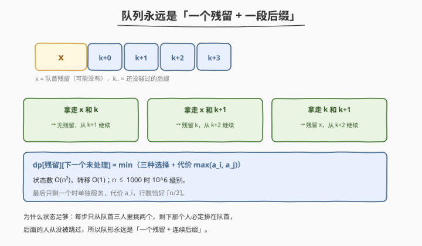
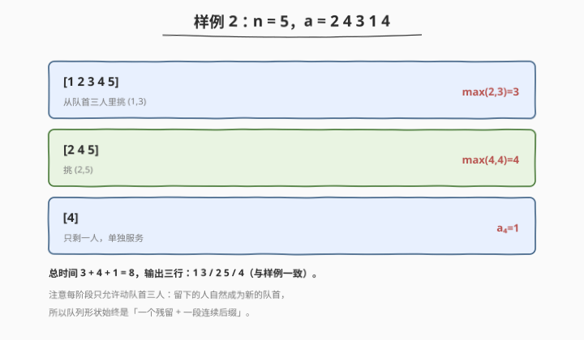

# Codeforces 82D 三人中取两人 题解

## 1. 题目概述

- **题目链接**：https://codeforces.com/problemset/problem/82/D
- **比赛来源**：Yandex.Algorithm 2011: Qualification 2 · Problem D（UTC 2011-05-06）
- **难度**：2000
- **标签**：动态规划、构造
- **评测类型**：特殊评测（最优值唯一，方案多解）
- **限制**：时间 2 s / 内存 256 MB

**题意**：队列里有 $n$ 个人，第 $i$ 个人单独服务需要 $a_i$ 时间。收银台可以同时服务两个人：若两人需要 $a_i, a_j$，则一起服务需要 $\max(a_i,a_j)$ 时间（两人同时开始、同时结束，中途不可打断）。

Vasya 的启发式是：只要队列里还有多于一个人，就从**队首三人**中任选两人同时服务；若只剩一个人，就单独服务他。注意总阶段数必然是 $\lceil n/2 \rceil$。求把所有人服务完的**最短总时间**，并输出一种最优的服务顺序。

**约束**：

- $n \le 1000$：可以承受 $O(n^2)$ 的 DP（$10^6$ 状态），但不能承受对方案数的指数枚举。
- $a_i \le 10^6$：总时间最大 $10^9$ 量级，`int` 也能装，用 `long long` 更稳。
- 每阶段只允许动队首三人，且被留下的人自然成为新的队首——这决定了状态空间的大小。
- 方案不唯一（同样的最优值可能有多种配对顺序），因此是特殊评测；本地验证需要 checker。

## 2. 示例与观察

官方样例（输入 / 输出原样）：

```text
输入：
4
1 2 3 4

输出：
6
1 2
3 4
```

```text
输入：
5
2 4 3 1 4

输出：
8
1 3
2 5
4
```

**样例 1 解释**：队列 $[1,2,3,4]$。从队首三人 $\{1,2,3\}$ 里挑两人：

- 选 $(1,2)$：代价 $\max(1,2) = 2$，队列变 $[3,4]$，再服务 $(3,4)$ 代价 4，总 6；
- 选 $(1,3)$：代价 3，队列变 $[2,4]$，再服务代价 4，总 7；
- 选 $(2,3)$：代价 3，队列变 $[1,4]$，再服务代价 4，总 7。

最小是 6，对应输出 `1 2` / `3 4`。

**样例 2 解释**：$[1,2,3,4,5]$，输出方案 $(1,3)$、$(2,5)$、剩下 $4$：$3 + 4 + 1 = 8$。注意 $(2,5)$ 是在队列变成 $[2,4,5]$ 之后从队首三人里取的，合法。

**关键观察（队形不变量）**：把「还没处理过的人」记成一段连续后缀 $k, k+1, \dots, n$。每次只从队首三人中取两人，剩下那人一定排在队首；而后面的人从未被跳过。于是**任意时刻队列的形状都是**

$$[x] \;+\; [k, k+1, \dots, n],$$

其中 $x$ 是某次「三选二」被留下的那个人（可能没有），且 $x < k$。



## 3. 解题思路

### 3.1 朴素做法与瓶颈

每阶段从队首三人选两人，最多 3 种选择，阶段数 $\lceil n/2\rceil$，枚举所有方案是 $3^{\lceil n/2\rceil}$——$n=1000$ 时是天文数字。

但策略的「记忆」很短：做完若干阶段后，有用的信息只有「队首残留的是谁」和「下一个没碰过的人是谁」。其余人都在后面按原顺序排着。

### 3.2 状态与转移

状态 $(x, k)$：$x$ 是队首残留的人（$0$ 表示没有），$k$ 是下一个没处理过的人；约定 $x < k$ 或 $x = 0$。队列 = $[x] + [k..n]$。

- $k > n$：队列只剩 $x$（或空），代价 $0$（$x=0$）或 $a_x$。
- $x = 0$、$k = n$：只剩一个，代价 $a_n$。
- $x = 0$、$k \le n-1$：队首三人是 $k, k+1, k+2$，三种取法：

$$
\begin{aligned}
&(k,k+1) &&\Rightarrow \text{残留 } k+2,\ \text{下一个 } k+3,\\
&(k,k+2) &&\Rightarrow \text{残留 } k+1,\ \text{下一个 } k+3,\\
&(k+1,k+2) &&\Rightarrow \text{残留 } k,\ \text{下一个 } k+3.
\end{aligned}
$$

- $x > 0$、$k = n$：只剩两人 $x, n$，只能成对，代价 $\max(a_x, a_n)$。
- $x > 0$、$k \le n-1$：队首三人是 $x, k, k+1$，三种取法：

$$
\begin{aligned}
&(x,k) &&\Rightarrow \text{无残留},\ \text{下一个 } k+1,\\
&(x,k+1) &&\Rightarrow \text{残留 } k,\ \text{下一个 } k+2,\\
&(k,k+1) &&\Rightarrow \text{残留 } x,\ \text{下一个 } k+2.
\end{aligned}
$$

转移的代价都是 $\max(a_i,a_j)$。状态数 $O(n^2)$，每个状态 3 种转移，倒序枚举 $k$ 即可，同时记录选择以便还原方案。

### 3.3 样例走查



$n=5$、$a = (2,4,3,1,4)$：

| 阶段 | 队列 | 选择 | 代价 |
|---|---|---|---|
| 1 | $[1,2,3,4,5]$ | $(1,3)$（队首三人中取第 1、3 个） | 3 |
| 2 | $[2,4,5]$ | $(2,5)$ | 4 |
| 3 | $[4]$ | 单独服务 4 | 1 |

总计 8。DP 从 $(0,1)$ 出发会选到同样的（或等价的）最优路径，输出 $\lceil 5/2\rceil = 3$ 行，最后一行是单个编号。

## 4. 正确性证明

**引理 1（队形不变量）**：从初始队列 $[1..n]$ 开始，任意次「从队首三人取两人」之后，队列必为 $[x] + [k..n]$ 形式（$x=0$ 表示无残留，$x < k$）。

**证明**：初始时 $(x,k) = (0,1)$。设当前为 $[x] + [k..n]$（$x=0$ 时就是 $[k..n]$）。队首三人是（$x$ 存在时）$x, k, k+1$ 或（$x=0$ 时）$k, k+1, k+2$。任取其中两人去掉后，剩下那个人要么是 $x$（仍是残留）、要么是 $k$ 或 $k+1$（新的残留，仍小于新的 $k$），而后面的人保持连续后缀。故形式不变。∎

**引理 2（状态足够）**：两个不同的历史如果到达同一个 $(x,k)$，则从该状态往后的所有选择与代价完全相同。

**证明**：由引理 1，队列内容只由 $(x,k)$ 决定（$[x] + [k..n]$），且每阶段的合法选择只取决于队首三人，即只取决于 $(x,k)$。所以未来与历史无关。∎

**定理（DP 正确）**：设 $f(x,k)$ 为上述转移的最小值，则 $f(0,1)$ 就是最短总时间，且沿记录的选择还原出的方案合法且达到该时间。

**证明**：对 $k$ 从大到小归纳。$k > n$ 与 $k = n$ 的基情形显然。对 $k \le n-1$，任何合法策略的第一步只能是 3.2 列出的三种取法之一，且由引理 2 之后的最优代价正是对应子状态的 $f$；三种取法取最小即为最优，故转移方程正确。还原时每一步都按记录的选择走，最终 $k > n$ 且无残留，恰好用掉所有人，阶段数自然为 $\lceil n/2\rceil$。∎

## 5. 复杂度分析

- **时间**：状态数 $(n+1)(n+2) \approx 10^6$（$n=1000$），每个状态 3 次转移，$O(n^2)$；实测 $n=1000$ 端到端 < 10 ms。
- **空间**：DP 值与选择各 $O(n^2)$，用 `int` 存代价与两个选择编号，约 $1002 \times 1003 \times 12$ 字节 $\approx 12$ MB（实测峰值 18 MB），远小于 256 MB。
- **数值范围**：最大总时间 $\le \lceil n/2 \rceil \cdot 10^6 = 5\times10^8$，`int` 够；用 `long long` 更保险。

## 6. 参考代码

### C++17

```cpp
#include <bits/stdc++.h>
using namespace std;
// 82D Two out of Three: 队列状态永远是 [x] + 后缀 [k..n]，在此状态上做 DP
int main() {
    int n;
    if (scanf("%d", &n) != 1) return 0;
    vector<long long> a(n + 2, 0);
    for (int i = 1; i <= n; i++) scanf("%lld", &a[i]);

    const long long INF = (long long)4e18;
    // dp[x][k]：队首残留 x（0 表示没有残留），下一个未处理的人是 k
    vector<vector<long long>> dp(n + 2, vector<long long>(n + 3, INF));
    // 选择：-1 = 单独服务 x；否则记录这一阶段服务的两人
    vector<vector<int>> c1(n + 2, vector<int>(n + 3, -1));
    vector<vector<int>> c2(n + 2, vector<int>(n + 3, -1));

    for (int k = n + 1; k >= 1; k--) {
        for (int x = 0; x <= n; x++) {
            if (x != 0 && x >= k) continue;              // 合法状态要求 x < k（x=0 表示无残留）
            long long best = INF;
            int p1 = -1, p2 = -1;
            if (k == n + 1) {
                best = (x == 0 ? 0 : a[x]);
                p1 = -1;
            } else if (x == 0) {
                if (k == n) {
                    best = a[k];
                    p1 = 0; p2 = k;                       // 单人
                } else if (k == n - 1) {
                    best = max(a[k], a[k + 1]) + dp[0][n + 1];
                    p1 = k; p2 = k + 1;
                } else {
                    long long v1 = max(a[k], a[k + 1]) + dp[k + 2][k + 3];
                    long long v2 = max(a[k], a[k + 2]) + dp[k + 1][k + 3];
                    long long v3 = max(a[k + 1], a[k + 2]) + dp[k][k + 3];
                    best = v1; p1 = k; p2 = k + 1;
                    if (v2 < best) { best = v2; p1 = k; p2 = k + 2; }
                    if (v3 < best) { best = v3; p1 = k + 1; p2 = k + 2; }
                }
            } else {
                if (k == n) {
                    best = max(a[x], a[n]) + dp[0][n + 1];
                    p1 = x; p2 = n;
                } else {
                    long long v1 = max(a[x], a[k]) + dp[0][k + 1];
                    long long v2 = max(a[x], a[k + 1]) + dp[k][k + 2];
                    long long v3 = max(a[k], a[k + 1]) + dp[x][k + 2];
                    best = v1; p1 = x; p2 = k;
                    if (v2 < best) { best = v2; p1 = x; p2 = k + 1; }
                    if (v3 < best) { best = v3; p1 = k; p2 = k + 1; }
                }
            }
            dp[x][k] = best;
            c1[x][k] = p1;
            c2[x][k] = p2;
        }
    }
    printf("%lld\n", dp[0][1]);
    // 还原方案
    int x = 0, k = 1;
    while (k <= n + 1) {
        if (k == n + 1 && x == 0) break;
        int p1 = c1[x][k], p2 = c2[x][k];
        if (p1 < 0) {                    // 只剩 x 一个人
            printf("%d\n", x);
            x = 0; k = n + 1;
            continue;
        }
        if (p1 == 0) {                   // 单人服务 k
            printf("%d\n", p2);
            x = 0; k = n + 1;
            continue;
        }
        printf("%d %d\n", p1, p2);
        // 计算下一个状态
        if (x == 0) {
            if (p1 == k && p2 == k + 1) { x = (k + 2 <= n ? k + 2 : 0); k = k + 3; }
            else if (p1 == k && p2 == k + 2) { x = k + 1; k = k + 3; }
            else { x = k; k = k + 3; }
            if (x > n) x = 0;
        } else {
            if (p1 == x && p2 == k) { x = 0; k = k + 1; }
            else if (p1 == x && p2 == k + 1) { x = k; k = k + 2; }
            else { x = x; k = k + 2; }
        }
    }
    return 0;
}
```

### Python3

```python
import sys


def main() -> None:
    data = sys.stdin.buffer.read().split()
    if not data:
        return
    n = int(data[0])
    a = [0] * (n + 2)
    for i in range(1, n + 1):
        a[i] = int(data[i])
    INF = float('inf')
    dp = [[INF] * (n + 3) for _ in range(n + 2)]
    ch = [[None] * (n + 3) for _ in range(n + 2)]
    for k in range(n + 1, 0, -1):
        for x in range(0, n + 1):
            if x != 0 and x >= k:
                continue
            if k == n + 1:
                dp[x][k] = 0 if x == 0 else a[x]
                ch[x][k] = None
            elif x == 0:
                if k == n:
                    dp[x][k] = a[k]
                    ch[x][k] = ('alone', k)
                elif k == n - 1:
                    dp[x][k] = max(a[k], a[k + 1]) + dp[0][n + 1]
                    ch[x][k] = (k, k + 1)
                else:
                    opts = [
                        (max(a[k], a[k + 1]) + dp[k + 2][k + 3], (k, k + 1)),
                        (max(a[k], a[k + 2]) + dp[k + 1][k + 3], (k, k + 2)),
                        (max(a[k + 1], a[k + 2]) + dp[k][k + 3], (k + 1, k + 2)),
                    ]
                    best = min(opts)
                    dp[x][k] = best[0]
                    ch[x][k] = best[1]
            else:
                if k == n:
                    dp[x][k] = max(a[x], a[n]) + dp[0][n + 1]
                    ch[x][k] = (x, n)
                else:
                    opts = [
                        (max(a[x], a[k]) + dp[0][k + 1], (x, k)),
                        (max(a[x], a[k + 1]) + dp[k][k + 2], (x, k + 1)),
                        (max(a[k], a[k + 1]) + dp[x][k + 2], (k, k + 1)),
                    ]
                    best = min(opts)
                    dp[x][k] = best[0]
                    ch[x][k] = best[1]
    out = [str(dp[0][1])]
    x, k = 0, 1
    while k <= n + 1:
        if k == n + 1 and x == 0:
            break
        c = ch[x][k]
        if c is None:
            out.append(str(x))
            break
        if c[0] == 'alone':
            out.append(str(c[1]))
            break
        p1, p2 = c
        out.append(f"{p1} {p2}")
        if x == 0:
            if p1 == k and p2 == k + 1:
                x = k + 2 if k + 2 <= n else 0
                k = k + 3
            elif p1 == k and p2 == k + 2:
                x = k + 1
                k = k + 3
            else:
                x = k
                k = k + 3
        else:
            if p1 == x and p2 == k:
                x = 0
                k = k + 1
            elif p1 == x and p2 == k + 1:
                x = k
                k = k + 2
            else:
                k = k + 2
    sys.stdout.write("\n".join(out) + "\n")


main()
```

## 7. 边界情况与易错点

1. **$n = 1$**：直接输出 `a_1` 和一行 `1`；DP 里 `dp[0][1] = dp[0][2]` 走「单人」分支，也要保证还原循环能正确停在 `k > n`。
2. **奇数 $n$ 的最后一行**：只能有一个编号；校验器会检查行数恰为 $\lceil n/2 \rceil$、且单人阶段必须是队列里仅剩的人。
3. **$k = n-1$ 的特殊状态**：此时队首三人只剩两个（$n-1, n$），不能再套用「三选二」的三分支；代码里单独处理，否则会访问到不存在的 $k+2$。
4. **残留 $x$ 索引越界**：还原时若 $x = k+2 > n$ 表示没有残留，必须置 0；DP 里也要跳过 $x \ge k$ 的非法状态。
5. **$x = 0$ 与 $x > 0$ 的转移不同**：$x = 0$ 时「下一个」一次前进 3，$x > 0$ 时按选择前进 1 或 2——写反会导致方案错位。
6. **输出多解**：最优值唯一但方案不唯一，本地比对必须用 checker（`codeforces/tools/checkers/cf82d.py`），不能直接 diff 样例。
7. **代价取 `max` 不是求和**：两人同时服务的时间是 $\max(a_i,a_j)$，不是 $a_i + a_j$。
8. **多测/重置**：本题只有一组数据；若改成多测，DP 与选择数组都要按当前 $n$ 重新初始化。

## 8. 验证记录

- **编译环境与命令**：`clang++ -std=c++17 -O2 -Wall`（本机无 GNU g++，配 `codeforces/tools/include/bits/stdc++.h` 兼容头；代码可原样提交 GNU C++17），Python `3.9.6`。本题是特殊评测，验证命令带 checker：
  `python3 codeforces/tools/verify_solution.py codeforces/contests/0001-0100/82/D_三人中取两人.md --checker codeforces/tools/checkers/cf82d.py`
- **官方样例**：2 / 2 通过（C++ 与 Python 输出都与样例一致，且 checker 通过）。
- **checker 的校验条件**（`codeforces/tools/checkers/cf82d.py`）：第一行总时间必须等于 checker 内独立 DP 算出的最优值；后续每行 1 或 2 人，2 人时必须都在当前队首三人内、1 人时必须是队列仅剩的人；行数必须为 $\lceil n/2\rceil$；所有人恰好服务一次，累加代价等于第一行。
- **独立对拍**：另写**记忆化搜索**暴力：直接对「剩余队列元组」枚举三选二的所有分支求最小值（与本题 DP 的写法完全无关）。对 $n \in [1,10]$、随机 $a \in [1,20]$ 的 **300 组**数据，C++/Python 输出的最优值都与暴力一致，且输出方案都通过 checker。
- **最大约束性能**：$n = 1000$、随机 $a \le 10^6$，C++ 端到端 < 10 ms，峰值内存 18 MB；2 s / 256 MB 余量极大。
- **复核状态**：verified（样例 + checker、暴力对拍、性能均实跑通过）。

## 相关题目与扩展

- [Codeforces 82A Double Cola](https://codeforces.com/problemset/problem/82/A)、[82B Sets](https://codeforces.com/problemset/problem/82/B)、[82C General Mobilization](https://codeforces.com/problemset/problem/82/C)、[82E Corridor](https://codeforces.com/problemset/problem/82/E)：同场题目。
- [Codeforces 1105D Kilo](https://codeforces.com/problemset/problem/1105/D)：队列/多源扩展类的模拟，状态压缩思路相近。
- [Codeforces 1197D Yet Another Subarray Problem](https://codeforces.com/problemset/problem/1197/D)：按「块」压缩状态做 DP。
- [Codeforces 1389B Array Walk](https://codeforces.com/problemset/problem/1389/B)：每步只在少数局部动作中选择，DP 状态很小。
- [LeetCode 188. 买卖股票的最佳时机 IV](https://leetcode.cn/problems/best-time-to-buy-and-sell-stock-iv/)：状态机 DP，和本题「状态 = 局部未处理信息」的思路一致。

**延伸思考**：

1. **如果每次可以从队首前 $m$ 个人里选 $r$ 个**：状态会变成「前 $m-1$ 个人的残留组合」，规模 $O(n^{m-1})$，需要更强的压缩（例如只保留位置差）。
2. **如果服务时间是 $a_i + a_j$ 而不是 $\max$**：总代价与分组无关（等于所有 $a_i$ 之和），只需构造合法方案，问题退化。
3. **如果要求字典序最小的最优方案**：DP 值不变，还原时在并列最优的转移里取编号字典序最小即可。
4. **如果要求输出每个阶段的开始/结束时间**：在还原时累加代价即可，等价于输出前缀和。
5. **如果 $n$ 放大到 $10^5$**：$O(n^2)$ 不行，需要观察最优解的结构（例如总是优先消掉较大的 $a$），这属于另一类贪心/交换论证问题。
