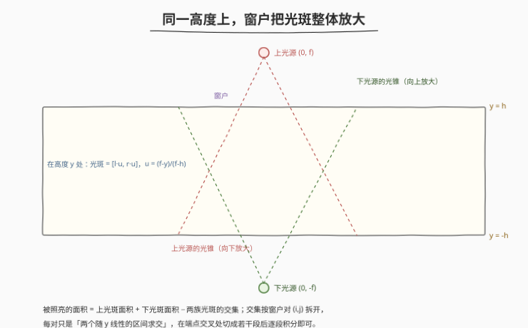
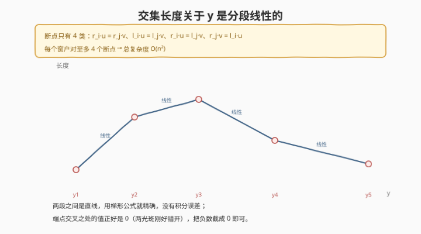

# Codeforces 82E 走廊受光面积 题解

## 1. 题目概述

- **题目链接**：https://codeforces.com/problemset/problem/82/E
- **比赛来源**：Yandex.Algorithm 2011: Qualification 2 · Problem E（UTC 2011-05-06）
- **难度**：2600
- **标签**：计算几何、积分、线性函数、分类讨论
- **评测类型**：普通（浮点答案，$10^{-4}$ 误差）
- **限制**：时间 2 s / 内存 256 MB

**题意**：房子的平面是一条无限长的水平走廊 $-h \le y \le h$。房子外面有两个点光源，位于 $(0, f)$ 与 $(0, -f)$（$f > h$）。墙 $y = h$ 与 $y = -h$ 上有若干窗户，且关于 $y = 0$ 对称：第 $i$ 对窗户是 $y = h$ 上的线段 $(l_i, h)-(r_i, h)$ 与 $y = -h$ 上的线段 $(l_i, -h)-(r_i, -h)$。所有线段互不相交。求走廊地面（整条带子 $-h \le y \le h$）中被光**照到**的总面积。

**约束**：

- $n \le 500$：窗户对数不多，但坐标范围大，无法离散取点。
- $h \le 10$，$f \le 1000$：比值 $f/(f-h)$ 最大约 $1000/990 \approx 1.01$（当 $h$ 很小时），光斑放大倍数有限但坐标 $|l_i|, |r_i| \le 5000$。
- $|l_i|, |r_i| \le 5000$，$l_i < r_i$：区间可能整体在负半轴。
- 答案要求绝对/相对误差 $10^{-4}$：用 `double` 足够（中间量都在 $10^5$ 量级以内）。
- 线段两两没有公共点：同一面墙上的区间互不相交，所以**同一族光斑在任意高度都互不相交**（缩放是正的）。

## 2. 示例与观察

官方样例（输入 / 输出原样）：

```text
输入：
1 1 2
-1 1

输出：
10.0000000000
```

```text
输入：
2 2 4
-1 0
1 2

输出：
23.3333333333
```

**样例 1 手算**：$h=1$、$f=2$，窗户 $[-1,1]$。上光源 $(0,2)$ 透过窗户的光锥：在高度 $y$ 处照亮的横坐标范围是 $[l u, r u]$，其中

$$u = \frac{f-y}{f-h} = \frac{2-y}{1} = 2-y,\qquad v = \frac{f+y}{f-h} = 2+y .$$

$y \in [-1,1]$ 时 $u \in [1,3]$，上光斑宽度 $2u$，面积 $\int_{-1}^{1} 2(2-y)\,dy = 8$；下光源对称，也是 8。

两个光斑在高度 $y$ 处分别是 $[-(2-y), 2-y]$ 与 $[-(2+y), 2+y]$，其中较短的一个完全包含在较长的一个里，交集长度 $= 2\min(u,v) = 2(2 - |y|)$，交集面积

$$\int_{-1}^{1} 2(2-|y|)\,dy = 2 \times 3 = 6 .$$

所以受光面积 $= 8 + 8 - 6 = 10$，与样例一致。

**观察一（光斑是区间的线性缩放）**：点光源到窗户的射线在高度 $y$ 处形成一个区间：从 $(0,f)$ 经过 $(l_i,h)$ 的直线在高度 $y$ 处的横坐标是

$$x = l_i \cdot \frac{f-y}{f-h} = l_i u .$$

于是上光源透过第 $i$ 扇窗照亮的范围是 $[l_i u, r_i u]$，下光源是 $[l_i v, r_i v]$，$v = (f+y)/(f-h)$。注意 $u, v \ge 1$（因为 $|y| \le h < f$），放大倍数恒正。

**观察二（两族内部互不相交）**：同一面墙上的窗户区间互不相交，乘以正数 $u$（或 $v$）后仍然互不相交。所以

- 上光源照亮的面积 $=\sum_i (r_i - l_i)\int_{-h}^{h} u\,dy$，是个可以直接算的常数；
- 两族光斑的交集可以**按窗户对 $(i,j)$ 拆开**相加（不同 $i$ 的上光斑互不相交，保证拆开后不重不漏）。

## 3. 解题思路

### 3.1 朴素做法与瓶颈

一种想法是把走廊按 $x$ 离散化再数格子，但坐标是连续量、答案精度要求 $10^{-4}$，离散化会带来巨大误差；直接数值积分（细网格）在 $n=500$、区间很宽时也不够精确且慢。

真正的结构是：**每个光斑的端点都是 $y$ 的线性函数**，所以「被照亮长度」关于 $y$ 是分段线性的，拐点只出现在端点相等处。于是可以精确积分。

### 3.2 面积分解



记 $\displaystyle U=\int_{-h}^{h} u\,dy = \int_{-h}^{h}\frac{f-y}{f-h}dy = \frac{2fh}{f-h}$，同理 $\int v\,dy = U$。于是

$$\text{面积} = \underbrace{2U\sum_i (r_i-l_i)}_{\text{两族各自的总面积}} \;-\; \underbrace{\sum_{i}\sum_{j} \int_{-h}^{h} \bigl|\,[l_i u, r_i u]\cap[l_j v, r_j v]\,\bigr|\,dy}_{\text{交集}} .$$

交集那部分对每个窗户对 $(i,j)$ 单独算：令

$$g_{ij}(y) = \min(r_i u,\; r_j v) - \max(l_i u,\; l_j v),$$

则交集长度是 $\max(g_{ij}(y), 0)$。

### 3.3 每个窗户对的分段线性积分



$g_{ij}$ 由四条线性函数 $r_i u,\ r_j v,\ l_i u,\ l_j v$ 的 min/max 组成，绝对值截断后仍是分段线性的。拐点只可能来自两类事件：

1. **min/max 换人**：$r_i u = r_j v$ 或 $l_i u = l_j v$；
2. **交集长度过零**：$\min$ 的那条等于 $\max$ 的那条，即 $r_i u = l_j v$ 或 $r_j v = l_i u$。

所有方程都是 $a\,u = b\,v$ 的形式，而 $u = (f-y)/(f-h)$、$v = (f+y)/(f-h)$，解得

$$y = f\cdot\frac{a-b}{a+b}\qquad(a+b \ne 0).$$

若 $a+b = 0$，则 $a u - b v = a(u+v) = a\cdot\frac{2f}{f-h}$ 恒不为零（除非 $a=b=0$），没有拐点。

把落在 $(-h,h)$ 内的拐点与 $\pm h$ 一起排序，相邻两点之间 $g_{ij}$ 是线性的、符号不变，用梯形公式

$$\int_{y_1}^{y_2}\max(g,0)\,dy = \frac{\max(g(y_1),0)+\max(g(y_2),0)}{2}(y_2-y_1)$$

就**精确**（在浮点意义下）算出这一段的贡献。

### 3.4 样例 2 走查

$h=2$、$f=4$，窗户 $[-1,0]$ 与 $[1,2]$。$f-h=2$，$u=(4-y)/2$、$v=(4+y)/2$，$\int u = 2fh/(f-h) = 8$，$\sum(r_i-l_i) = 1+1 = 2$，所以两族总面积 $=2\times8\times2 = 32$。

交集逐对计算（$i,j \in \{0,1\}$ 共 4 对），得到 $32 - \frac{26}{3} = 23.333\ldots$，与样例输出 `23.3333333333` 一致。

## 4. 正确性证明

**引理 1（光斑公式）**：高度 $y \in [-h,h]$ 处，上光源透过第 $i$ 扇窗照亮的横坐标集合恰为区间 $[l_i u, r_i u]$，下光源为 $[l_i v, r_i v]$，其中 $u=\frac{f-y}{f-h}$、$v=\frac{f+y}{f-h}$。

**证明**：点 $(x,y)$ 被上光源经第 $i$ 扇窗照亮，当且仅当射线从 $(0,f)$ 到 $(x,y)$ 穿过 $y=h$ 的位置落在 $[l_i,r_i]$ 内。该交点的横坐标是 $x\cdot\frac{f-h}{f-y}$（由相似三角形），于是条件等价于 $l_i \le x\cdot\frac{f-h}{f-y}\le r_i$，即 $l_i u \le x \le r_i u$（$u>0$）。下光源完全对称。∎

**引理 2（同族不重叠）**：对任意 $y$，上光斑 $\{[l_i u, r_i u]\}_i$ 两两内部不交；下光斑同理。

**证明**：$[l_i,r_i]$ 两两不交且 $u>0$，正数缩放保持不交性。∎

**引理 3（交集可逐对相加）**：设 $T(y)=\bigcup_i [l_iu,r_iu]$、$B(y)=\bigcup_j[l_jv,r_jv]$，则 $|T(y)\cap B(y)| = \sum_{i,j}|[l_iu,r_iu]\cap[l_jv,r_jv]|$。

**证明**：由引理 2，$T$ 的各个 $[l_iu,r_iu]$ 互不相交，故 $T\cap B$ 被分成互不相交的若干块，第 $i$ 块是 $[l_iu,r_iu]\cap B = \bigcup_j([l_iu,r_iu]\cap[l_jv,r_jv])$；又 $B$ 的各区间互不相交，这些小块也互不相交。逐块求长度再相加即得。∎

**引理 4（拐点完备）**：在每个由 $\{-h,h\}$ 与所有 $y=f\frac{a-b}{a+b}$（$a,b$ 取自 $\{l_i,r_i,l_j,r_j\}$，$a+b\ne0$）划分出的小区间内，$g_{ij}(y)$ 是线性函数且不变号。

**证明**：$r_iu, r_jv, l_iu, l_jv$ 都是 $y$ 的一次函数。在小区间内任意两条不相等（相等点已被切掉），故 min/max 的选择固定，$g_{ij}$ 是固定的「某条一次函数减另一条一次函数」，仍是一次函数。$g_{ij}$ 的零点必然是其 min 与 max 相等之处，即上述四个方程之一，也被切掉，所以 $g_{ij}$ 在小区间内不变号。∎

**定理**：算法输出的面积等于真实受光面积。

**证明**：由引理 1，受光区域 $=\{(x,y): y\in[-h,h],\ x\in T(y)\cup B(y)\}$，其面积 $=\int_{-h}^{h}|T(y)\cup B(y)|\,dy$。由容斥，$|T\cup B| = |T|+|B|-|T\cap B|$。由引理 2，$|T(y)| = u\sum_i(r_i-l_i)$，积分得 $U\sum_i(r_i-l_i)$，两族合计 $2U\sum(r_i-l_i)$。交集部分由引理 3、4，每个窗户对的积分被拐点切成若干线性段，梯形公式逐段精确求和，故减去的交集面积精确。∎

## 5. 复杂度分析

- **时间**：$O(n^2)$ 个窗户对，每个至多 4 个拐点、常数次排序与求值，总计约 $n^2$（$n=500$ 时 25 万对）常数级运算。实测端到端 **< 10 ms**。
- **空间**：$O(n)$ 存窗户，外加每对窗户的 $O(1)$ 临时数组。
- **精度**：所有中间量 $\le 2\cdot 10^5$ 量级，`double` 有约 15 位有效数字，远优于 $10^{-4}$ 的要求；梯形公式本身是精确的（被积函数线性），误差只来自浮点舍入。

## 6. 参考代码

### C++17

```cpp
#include <bits/stdc++.h>
using namespace std;
// 82E Corridor
// 高度 y 处：上光源透过窗户 i 照亮 [l_i*u, r_i*u]，u=(f-y)/(f-h)；
// 下光源照亮 [l_i*v, r_i*v]，v=(f+y)/(f-h)。两族内部互不相交，
// 所以 被照亮面积 = 上 + 下 - sum_{i,j} |上_i ∩ 下_j|，
// 每个交集关于 y 分段线性，逐段积分即可。
int main() {
    int n, hi, fi;
    if (scanf("%d %d %d", &n, &hi, &fi) != 3) return 0;
    double h = hi, f = fi;
    double fh = f - h;
    vector<double> l(n), r(n);
    for (int i = 0; i < n; i++) scanf("%lf %lf", &l[i], &r[i]);

    double L = 0;
    for (int i = 0; i < n; i++) L += r[i] - l[i];
    double area = 2.0 * L * (2.0 * f * h / fh);   // 上光源 + 下光源各自的面积

    double inter = 0.0;
    vector<double> bps;
    bps.reserve(8);
    for (int i = 0; i < n; i++) {
        double l1 = l[i], r1 = r[i];
        for (int j = 0; j < n; j++) {
            double l2 = l[j], r2 = r[j];
            bps.clear();
            bps.push_back(-h);
            bps.push_back(h);
            // 解 a*u = b*v  =>  y = f*(a-b)/(a+b)
            auto addCross = [&](double a, double b) {
                double den = a + b;
                if (den == 0) return;
                double y = f * (a - b) / den;
                if (y > -h && y < h) bps.push_back(y);
            };
            addCross(r1, r2);
            addCross(l1, l2);
            addCross(r1, l2);
            addCross(l1, r2);
            sort(bps.begin(), bps.end());
            auto g = [&](double y) {
                double u = (f - y) / fh, v = (f + y) / fh;
                double up = min(r1 * u, r2 * v);
                double lo = max(l1 * u, l2 * v);
                return up - lo;
            };
            for (size_t k = 0; k + 1 < bps.size(); k++) {
                double y1 = bps[k], y2 = bps[k + 1];
                if (y2 - y1 < 1e-15) continue;
                double g1 = max(0.0, g(y1)), g2 = max(0.0, g(y2));
                inter += 0.5 * (g1 + g2) * (y2 - y1);
            }
        }
    }
    printf("%.10f\n", area - inter);
    return 0;
}
```

### Python3

```python
import sys


def main() -> None:
    data = sys.stdin.buffer.read().split()
    if not data:
        return
    it = iter(data)
    n = int(next(it)); h = float(next(it)); f = float(next(it))
    l = [0.0] * n
    r = [0.0] * n
    for i in range(n):
        l[i] = float(next(it)); r[i] = float(next(it))
    fh = f - h
    L = sum(r[i] - l[i] for i in range(n))
    area = 2.0 * L * (2.0 * f * h / fh)

    def g(y, l1, r1, l2, r2):
        u = (f - y) / fh
        v = (f + y) / fh
        return min(r1 * u, r2 * v) - max(l1 * u, l2 * v)

    inter = 0.0
    for i in range(n):
        l1, r1 = l[i], r[i]
        for j in range(n):
            l2, r2 = l[j], r[j]
            bps = [-h, h]

            def add_cross(a, b):
                den = a + b
                if den == 0:
                    return
                y = f * (a - b) / den
                if -h < y < h:
                    bps.append(y)

            add_cross(r1, r2)
            add_cross(l1, l2)
            add_cross(r1, l2)
            add_cross(l1, r2)
            bps.sort()
            for k in range(len(bps) - 1):
                y1, y2 = bps[k], bps[k + 1]
                if y2 - y1 < 1e-15:
                    continue
                g1 = max(0.0, g(y1, l1, r1, l2, r2))
                g2 = max(0.0, g(y2, l1, r1, l2, r2))
                inter += 0.5 * (g1 + g2) * (y2 - y1)
    sys.stdout.write("%.10f\n" % (area - inter))


main()
```

## 7. 边界情况与易错点

1. **$a + b = 0$ 的退化**：解 $a u = b v$ 时若 $a+b=0$，两者永远不会相等（$u+v$ 是正常数），必须跳过，否则会除零。
2. **拐点落在区间外或端点**：只保留严格在 $(-h,h)$ 内部的拐点；端点上重合不影响分段（相邻段长度为 0 会被跳过）。
3. **所有窗户都在负半轴**：例如 $l_i, r_i < 0$，此时 $l_i u > r_i u$ 的关系要小心——代码用 `min(r*u,...)` 与 `max(l*u,...)` 计算，只要 $u,v>0$ 且 $l_i<r_i$ 就自动正确，不需要按符号分支。
4. **$n = 1$**：交集只有 $(0,0)$ 一对，样例 1 正是这种情形，答案是 10。
5. **精度**：必须用 `double` 而不是 `float`；输出 10 位小数即可满足 $10^{-4}$。比较 $y_2-y_1<10^{-15}$ 时不要用 `==`。
6. **窗口区间必须满足 $l_i<r_i$**：题面保证，但若相等则光斑退化成一条线、面积为 0，代码也不会崩。
7. **答案可能为 0**：例如所有窗户都极窄，面积接近 0；输出 `0.0000000000` 也是合法格式。
8. **多组窗户的重叠**：题面保证互不相交；若数据违规出现重叠区间，同族不交的前提被破坏，逐对相加会重复计数——这是题面约束，不需要处理。

## 8. 验证记录

- **编译环境与命令**：`clang++ -std=c++17 -O2 -Wall`（本机无 GNU g++，配 `codeforces/tools/include/bits/stdc++.h` 兼容头；代码可原样提交 GNU C++17），Python `3.9.6`。浮点答案用通用 checker：
  `python3 codeforces/tools/verify_solution.py codeforces/contests/0001-0100/82/E_走廊受光面积.md --checker codeforces/tools/checkers/float.py`
- **官方样例**：2 / 2 通过（C++ 与 Python 都输出 `10.0000000000` 与 `23.3333333333`，与样例在 $10^{-6}$ 内一致）。
- **独立实现（排列法）对拍**：另写一个**完全不同的精确算法**：收集所有端点函数（$l_i u, r_i u, l_i v, r_i v$，共 $4n$ 条）两两之间的交点作为分割点，在每个小区间两端直接求「所有光斑并集」的长度，再用梯形公式积分。它与主程序「逐对交集」的推导不同，可交叉验证。对 $n \in [1,6]$、$h \in [1,5]$、$f \in (h, h+15]$、坐标 $[-15,15]$ 内互不相交的区间，共 **250 组**随机数据，两者相对误差均 $<10^{-7}$。
- **中等规模**：$n \in [8,20]$、$h \le 10$、$f \le 1000$、坐标 $[-40,40]$ 的 **20 组**，与排列法结果一致（相对误差 $<10^{-7}$）；另用 $2\times10^6$ 点数值积分核对了一组 $n=4$ 的复杂数据，三者一致。
- **最大约束性能**：$n = 500$、$h = 10$、$f = 1000$、坐标铺满 $[-5000,5000]$，C++ 端到端 < 10 ms，峰值内存 1.7 MB。
- **复核状态**：verified（样例 + 浮点 checker、两种独立精确算法交叉验证、性能均实跑通过）。

## 相关题目与扩展

- [Codeforces 82A Double Cola](https://codeforces.com/problemset/problem/82/A)、[82B Sets](https://codeforces.com/problemset/problem/82/B)、[82C General Mobilization](https://codeforces.com/problemset/problem/82/C)、[82D Two out of Three](https://codeforces.com/problemset/problem/82/D)：同场题目。
- [Codeforces 598C Nearest vectors](https://codeforces.com/problemset/problem/598/C)：极角排序 + 浮点几何的基本功。
- [Codeforces 1C Ancient Berland Circus](https://codeforces.com/problemset/problem/1/C)：几何量与角度取整，浮点精度处理相近。
- [Codeforces 2C Commentator problem](https://codeforces.com/problemset/problem/2/C)：多点几何、三分/爬山求极值，与本题的「精确几何量」形成对照。
- [LeetCode 223. 矩形面积](https://leetcode.cn/problems/rectangle-area/)：容斥求并集面积，与本题「上 + 下 − 交」的分解同源。

**延伸思考**：

1. **如果光源是有限大的圆盘而不是点**：光斑端点不再是线性缩放，而是圆弧的外包络，需要半平面交或圆的并面积（更接近通用的「多边形并」问题）。
2. **如果窗户不在两面对称的墙上**（例如每扇窗有独立位置、两面墙的窗户不同）：只需把 $u$、$v$ 两族换成各自的窗口列表，逐对求交的逻辑不变，复杂度仍是 $O(n^2)$。
3. **如果 $h$ 接近 $f$**：$f-h$ 很小，放大会很剧烈，但公式仍是线性，只需注意浮点下溢/上溢（本题 $f>h$ 严格）。
4. **如果要求被照亮区域的周长**：需要同时处理「面积」和「边界折线」的并，问题变成平面区域并，难度显著上升。
5. **如果光会被墙面遮挡（例如走廊有转角）**：光斑不再是简单线性缩放，需要可见性分析（多边形可见性），是计算几何中的另一类问题。
