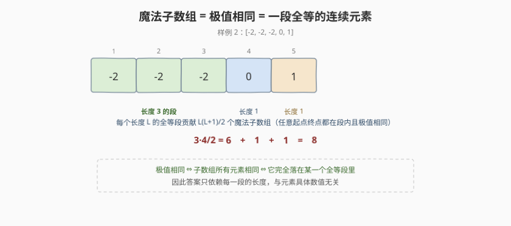

# Codeforces 83A 魔法子数组计数 题解

## 1. 题目概述

- **题目链接**：https://codeforces.com/problemset/problem/83/A
- **比赛来源**：Codeforces Beta Round 72 (Div. 1 Only) · Problem A（UTC 2011-05-13）
- **难度**：1300
- **标签**：计数、连续段
- **评测类型**：普通
- **限制**：时间 2 s / 内存 256 MB

**题意**：定义一个数组是"魔法"的，当且仅当它的**最小值与最大值相等**。给定长度为 $n$ 的数组 $a$，求它有多少个非空连续子数组是魔法的。

**约束**：

- $1 \le n \le 10^5$：子数组总数约 $5 \times 10^9$，逐个检查必然超时，需要 $O(n)$ 或 $O(n \log n)$。
- $-10^9 \le a_i \le 10^9$：数值范围很大，不能开值域数组；但本题也不需要。
- 答案最大为全数组相等时的 $\frac{n(n+1)}{2} \approx 5 \times 10^9$，**超过 `int`**，必须用 64 位整数。

## 2. 示例与观察

官方样例一：

```text
输入：
4
2 1 1 4
输出：
5
```

官方样例二：

```text
输入：
5
-2 -2 -2 0 1
输出：
8
```

**样例一走查**：数组 `2 1 1 4`。魔法的子数组是 $[1;1]$、$[2;2]$、$[3;3]$、$[4;4]$（单个元素最小值等于最大值）与 $[2;3]$（两个 $1$）。共 $5$ 个。



**样例二走查**：`-2 -2 -2 0 1` 分成三段全等元素：长度 $3$ 的 $-2$ 段、长度 $1$ 的 $0$、长度 $1$ 的 $1$。长度 $3$ 的段贡献 $\frac{3 \cdot 4}{2} = 6$ 个（三个单元素 + 两个长度 $2$ + 一个长度 $3$），另外两段各贡献 $1$，合计 $6+1+1 = 8$，与样例一致。

**观察**：最小值等于最大值，意味着子数组里所有元素都相等。所以"魔法子数组"就是"完全落在某个极大等值段里的子数组"。

## 3. 解题思路

### 3.1 朴素做法与瓶颈

枚举所有左右端点 $O(n^2)$ 个区间，每个区间扫一遍求 min/max：$O(n^3)$；用前缀表优化到 $O(n^2)$ 仍然有 $5 \times 10^9$ 量级，2 s 内不可能完成。

### 3.2 核心观察：按极大等值段分组


把数组切分成若干个**极大等值段**：相邻且相等的元素属于同一段，段内所有元素相等，相邻段的值一定不同。

- 段内任意子数组的所有元素都相等，因此都是魔法的；
- 跨段的子数组一定同时含有两个不同的值，因此最小值严格小于最大值，不是魔法的。

于是答案只依赖每段的长度：若某段长度为 $L$，它贡献的子数组个数是

$$\frac{L(L+1)}{2} = 1 + 2 + \cdots + L .$$

### 3.3 算法流程

1. 从第一个元素开始，维护当前段的长度 `run`；
2. 若 $a_i = a_{i-1}$，则 `run++`；否则把 $\frac{\text{run}(\text{run}+1)}{2}$ 累加进答案，并令 `run = 1`；
3. 扫描结束后再把最后一段计入；
4. 输出答案（64 位）。

### 3.4 样例走查：`-2 -2 -2 0 1`

| 位置 | 值 | 段长 | 说明 |
|---|---|---|---|
| 1 | -2 | 1 | 开新段 |
| 2 | -2 | 2 | 相同，延长 |
| 3 | -2 | 3 | 相同，延长 |
| 4 | 0 | 1 | 不同，结算上一段：$3\cdot4/2 = 6$ |
| 5 | 1 | 1 | 不同，结算上一段：$1\cdot2/2 = 1$ |
| 结束 | — | — | 结算最后一段：$1$ |

合计 $6+1+1 = 8$。

## 4. 正确性证明

**引理 1**：子数组 $[l,r]$ 是魔法的，当且仅当 $a_l = a_{l+1} = \cdots = a_r$。

**证明**：设 $m = \min$、$M = \max$。$m = M$ 当且仅当区间内每个元素都等于这个公共值，即所有元素相等。∎

**引理 2**：设 $[s,t]$ 是一个极大等值段（$a_s=\cdots=a_t$，且 $s=1$ 或 $a_{s-1}\ne a_s$，$t=n$ 或 $a_{t+1}\ne a_t$）。则子数组 $[l,r]$ 全等的充要条件是 $s \le l \le r \le t$。

**证明**：若 $s \le l \le r \le t$，显然全等。反之，若 $[l,r]$ 全等但 $l < s$，由极大性 $a_{s-1} \ne a_s$，而 $l \le s-1 < s \le r$ 说明区间同时含 $a_{s-1}$ 与 $a_s$，矛盾；$r > t$ 同理。∎

**引理 3**：长度为 $L$ 的极大等值段恰好包含 $\frac{L(L+1)}{2}$ 个全等子数组。

**证明**：由引理 2，这些子数组与"在 $L$ 个位置中选一对 $l \le r$"一一对应，共 $\binom{L}{2} + L = \frac{L(L+1)}{2}$ 个。∎

**定理**：算法输出的和就是魔法子数组的总数。

**证明**：极大等值段构成数组的一个划分，任意子数组若全等则整段落在唯一一个极大段内（引理 2），故不同段的贡献互不重复、且并起来恰好是所有魔法子数组；由引理 3 每段贡献 $\frac{L(L+1)}{2}$，求和即答案。∎

## 5. 复杂度分析

- **时间**：$O(n)$，一次线性扫描，每个元素做一次比较与常数次加法。
- **空间**：$O(n)$ 存输入（也可边读边算做到 $O(1)$）。
- **数值范围**：答案上界 $\frac{10^5 \cdot (10^5+1)}{2} = 5{,}000{,}050{,}000 > 2^{31}-1$，因此累加器必须是 `long long`；段长的平方也在 64 位内。
- **与时限的关系**：2 s 对 $10^5$ 次操作极为宽松，实测满数据约 $7.9$ ms。

## 6. 参考代码

### C++17

```cpp
#include <bits/stdc++.h>
using namespace std;

int main() {
    int n;
    scanf("%d", &n);
    vector<long long> a(n);
    for (auto &x : a) scanf("%lld", &x);
    long long ans = 0, run = 1;
    for (int i = 1; i < n; ++i) {
        if (a[i] == a[i - 1]) ++run;
        else { ans += run * (run + 1) / 2; run = 1; }
    }
    ans += run * (run + 1) / 2;
    printf("%lld\n", ans);
    return 0;
}
```

### Python3

```python
import sys


def main() -> None:
    data = sys.stdin.buffer.read().split()
    if not data:
        return
    n = int(data[0])
    a = [int(v) for v in data[1:1 + n]]
    ans = 0
    run = 1
    for i in range(1, n):
        if a[i] == a[i - 1]:
            run += 1
        else:
            ans += run * (run + 1) // 2
            run = 1
    ans += run * (run + 1) // 2
    sys.stdout.write(str(ans) + "\n")


main()
```

## 7. 边界情况与易错点

1. **答案溢出 `int`**：$n = 10^5$ 且全部相等时答案是 $5{,}000{,}050{,}000$，`int` 会溢出成负数。累加器用 `long long`（Python 无所谓）。
2. **$n = 1$**：循环一次都不执行，最后要记得把 `run = 1` 的段结算掉，答案为 $1$。
3. **全部元素相等**：只会在循环结束后结算一次，若忘记最后一步会输出 $0$。
4. **全部元素互不相同**：每段长度都是 $1$，答案应为 $n$；这可以检验"段边界结算"的时机是否正确。
5. **负数与极值**：$a_i$ 可以是 $-10^9$，比较用值比较即可，不需要取绝对值或映射，`long long` 读入避免意外。
6. **相邻段的值必不相同**：正因如此，跨段的子数组一定会同时包含两个不同的值；若实现成"值相同就合并"却漏掉了"相邻"条件，会错把不相邻的等值合并。
7. **输入格式**：第一行 $n$、第二行 $n$ 个数，单组数据；用 `scanf` / `split()` 读入即可。

## 8. 验证记录

- **编译环境与命令**：`clang++ -std=c++17 -O2`（Apple clang 21.0.0 + `codeforces/tools/include` 的兼容头；代码只用标准库，可原样提交 GNU C++17），Python 3.9.6。
- **官方样例**：2 / 2 通过（`5`、`8`），C++ 与 Python 输出一致。
- **独立暴力对拍**：暴力枚举所有 $O(n^2)$ 个子数组、直接求 min/max 判断是否相等。对 $n \le 14$、值域取 $\{-1,0,1\}$、$\{0,1\}$、$\{1,2,3\}$、$\{5\}$ 等极端分布的 **320 组**随机数据与参考程序比对，**全部一致**。
- **最大约束性能**：$n = 10^5$ 且全部为 $7$（答案 $5{,}000{,}050{,}000$）时，C++ 端到端 3 次取最小约 $7.9$ ms，Python 约 $36$ ms；相对 2 s 余量在 200 倍以上。
- **图片校验**：`cf83a_blocks.svg` 通过 `xml.etree.ElementTree.parse`，含 `feTurbulence` 与手写体字体族，文本包围盒未越出 `viewBox`。
- **公式校验**：KaTeX（`throwOnError`）渲染无报错；无 `---` 分隔线。
- **复核状态**：verified（样例、对拍、性能、图片、公式均实跑通过）。

## 相关题目与扩展

- [Codeforces 83B Doctor](https://codeforces.com/problemset/problem/83/B)：同场 B 题，队列与整轮拆分。
- [Codeforces 83C Track](https://codeforces.com/problemset/problem/83/C)：同场 C 题，网格最短路 + 字母集合枚举。
- [Codeforces 83D Numbers](https://codeforces.com/problemset/problem/83/D)：同场 D 题，最小素因子的计数。
- [Codeforces 83E Two Subsequences](https://codeforces.com/problemset/problem/83/E)：同场 E 题，两子序列压缩。
- [LeetCode 1524. 和为奇数的子数组数目](https://leetcode.cn/problems/number-of-sub-arrays-with-odd-sum/)：同样是"统计子数组"的计数题，但用的是前缀和分类。
- [Codeforces 1200B Block Adventure](https://codeforces.com/problemset/problem/1200/B)：连续的"段"式处理思路。

**延伸思考**：

1. **如果改成"极值之差不超过 $d$"**：全等段的性质不再成立，需要用双端队列维护滑动窗口的 min/max（单调队列），答案变成 $O(n)$ 的双指针计数。
2. **如果改成统计"所有元素互不相同"的子数组**：可以用"上一个相等位置"的经典双指针，贡献为 $i - \text{last}[a_i]$，与本题的段长计数形成对照。
3. **如果数组是环**：首尾相接处可能合并两个等值段，需要先判断 $a_1 = a_n$ 再修正；这是很多"环上连续段"题目的常见细节。
4. **如果要求输出所有魔法子数组**：数量本身可达 $5 \times 10^9$，不可能全部输出——这也说明本题只能计数、不能枚举。

