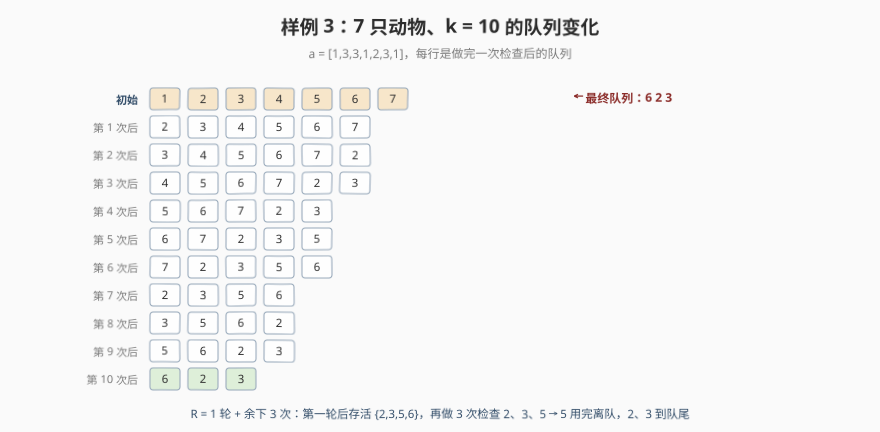
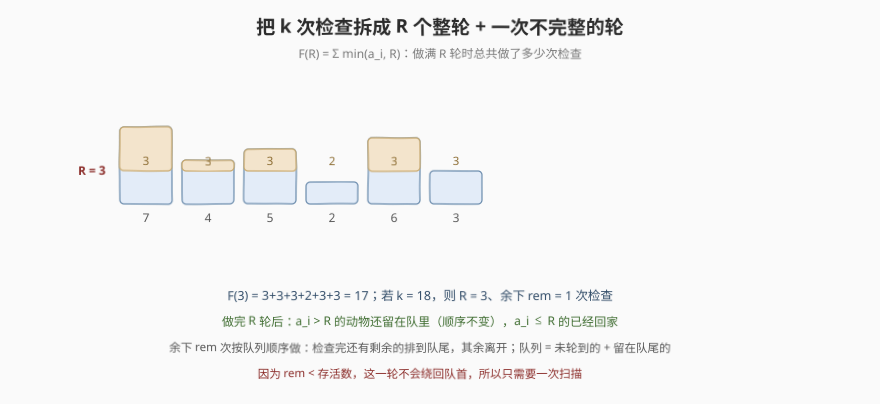

# Codeforces 83B 医生排队问诊 题解

## 1. 题目概述

- **题目链接**：https://codeforces.com/problemset/problem/83/B
- **比赛来源**：Codeforces Beta Round 72 (Div. 1 Only) · Problem B（UTC 2011-05-13）
- **难度**：1800
- **标签**：二分、模拟、取整
- **评测类型**：普通
- **限制**：时间 2 s / 内存 256 MB

**题意**：$n$ 只动物排队看医生，第 $i$ 只（按初始排队顺序编号 $1 \sim n$）总共要看 $a_i$ 次。每次接诊：把队首的动物叫进来，它做一次检查；如果它还需要继续看，就立刻排到队尾；否则直接回家。医生**做完 $k$ 次检查**就下班，问此时队列里还剩哪些动物（按从队首到队尾的顺序输出编号）。如果总共也凑不出 $k$ 次检查，输出 `-1`；若恰好做完且队列为空，输出空行。

**约束**：

- $1 \le n \le 10^5$：队列本身很小，可以存储、可以扫描。
- $0 \le k \le 10^{14}$，$1 \le a_i \le 10^9$：总检查次数可达 $10^{14}$，**逐次模拟必然超时**，必须把"整轮"批量处理。
- 单组数据，无多测。

## 2. 示例与观察

官方样例一：

```text
输入：
3 3
1 2 1
输出：
2 
```

官方样例二：

```text
输入：
4 10
3 3 2 1
输出：
-1
```

官方样例三：

```text
输入：
7 10
1 3 3 1 2 3 1
输出：
6 2 3 
```

**样例一走查**：三次检查分别处理动物 $1$（看完回家）、$2$（还需 $1$ 次，去队尾）、$3$（看完回家）。此时队列只剩 $2$，输出 `2`。



**样例二走查**：总检查次数 $3+3+2+1 = 9 < 10$，医生等不到第 $10$ 次，输出 `-1`。

**样例三走查**：$a = [1,3,3,1,2,3,1]$，$k=10$，队列变化见上图。第 $1$ 轮检查完 $1\sim7$ 号后，$1,4,7$ 号用完回家，存活的是 $2,3,5,6$（对应 $a$ 值 $3,3,2,3$）。接着再检查 $2$（剩 $1$ 次，去队尾）、$3$（剩 $1$ 次，去队尾）、$5$（用完，回家），共 $3$ 次，凑满 $10$ 次。队列 = 未轮到的 $6$ + 刚才排到队尾的 $2,3$，即 `6 2 3`。

**观察**：如果把队列"从头到尾完整走一遍"叫做一轮，那么第 $R$ 轮里还在队里的动物恰好是那些 $a_i \ge R$ 的动物。于是"做满 $R$ 轮"总共做了多少次检查，可以一次性算出来。

## 3. 解题思路

### 3.1 朴素做法与瓶颈

直接开一个队列，每次取队首、减一、需要就排到队尾：单次操作 $O(1)$，但总次数可达 $k \le 10^{14}$，且 $\sum a_i$ 也能到 $10^{14}$，完全跑不完。

瓶颈在于"每一轮都在重复同样的相对顺序"。要把成轮的检查合并计算。

### 3.2 核心观察：整轮与不完整的轮



定义

$$F(R) = \sum_{i=1}^{n} \min(a_i, R),$$

它表示**做满 $R$ 轮**时总共进行的检查次数：第 $j$ 轮（$1 \le j \le R$）里，动物 $i$ 只有在 $a_i \ge j$ 时才在场，所以第 $i$ 只动物被检查了 $\min(a_i, R)$ 次。

$F$ 关于 $R$ 单调不减。取**最大的** $R$ 使 $F(R) \le k$，再令

$$\text{rem} = k - F(R).$$

- 做完 $R$ 整轮后，$a_i > R$ 的动物仍在队列里（还需要 $a_i - R$ 次），$a_i \le R$ 的已经回家；队列顺序就是它们原来的相对顺序。
- 接下来要做 $\text{rem}$ 次检查。因为 $R$ 是最大的，所以 $F(R+1) > k$，即

$$\text{rem} < F(R+1) - F(R) = \#\{i : a_i > R\} = \text{存活数},$$

于是这 $\text{rem}$ 次检查**不会绕回队首**，只需要按当前队列顺序扫描前 $\text{rem}$ 只动物。

### 3.3 算法流程

1. 读入 $n, k, a$，计算 $\text{total} = \sum a_i$；若 $\text{total} < k$ 输出 `-1`。
2. 在 $[0, \max a_i]$ 上二分出最大的 $R$ 使 $F(R) \le k$（$F$ 单调，每次判定 $O(n)$）。
3. 令 $\text{rem} = k - F(R)$，取出所有 $a_i > R$ 的动物编号（保持原顺序）组成 `alive`。
4. 若 $\text{rem} = 0$：直接输出 `alive`。
5. 否则扫描 `alive` 的前 $\text{rem}$ 只：
   - 第 $\text{rem}$ 只之后的（未轮到）按原顺序先输出；
   - 前 $\text{rem}$ 只里满足 $a_i - R - 1 > 0$（检查完还需要继续）的，按原顺序接在后面输出。
6. 其余动物已经回家。

### 3.4 样例走查

对照第 2 节那张队列演化图：

$a = [1,3,3,1,2,3,1]$，$k = 10$：

- $F(1) = 1+1+1+1+1+1+1 = 7 \le 10$，$F(2) = 1+2+2+1+2+2+1 = 11 > 10$，故 $R = 1$，$F(R) = 7$，$\text{rem} = 3$。
- 存活：$a_i > 1$ 的是 $2,3,5,6$（值 $3,3,2,3$），`alive = [2,3,5,6]`。
- 前 $\text{rem}=3$ 只是 $2,3,5$：检查后剩余次数 $2,2,1$，减一后为 $1,1,0$，所以 $2,3$ 需要继续（排到队尾），$5$ 回家。
- 未轮到的 $6$ 先输出，再接上 $2,3$ → `6 2 3`，与样例一致。

## 4. 正确性证明

**引理 1**：做完 $R$ 整轮时，第 $i$ 只动物恰好被检查了 $\min(a_i, R)$ 次，且若 $a_i > R$ 则它仍在队列中，若 $a_i \le R$ 则已离开。

**证明**：每完整走一轮，队中每只动物恰好被检查一次。动物 $i$ 在第 $j$ 轮在场当且仅当它此前只被检查了 $j-1 < a_i$ 次，即 $j \le a_i$。所以它参与的轮数是 $\min(a_i, R)$。参与满 $R$ 轮后仍未完成的（$a_i > R$）继续留在队里，其余已完成离开。∎

**引理 2**：做完 $R$ 整轮后，队列中动物的相对顺序与初始顺序一致。

**证明**：每次"排到队尾"都保持相对顺序：一轮结束时，本轮所有需要继续的动物按原顺序排到了队尾。对 $R$ 归纳即得。∎

**引理 3**：设 $R$ 是最大的满足 $F(R) \le k$ 的整数，则 $\text{rem} = k - F(R) < \#\{i : a_i > R\}$。

**证明**：由 $R$ 的最大性，$F(R+1) > k$，于是 $k - F(R) < F(R+1) - F(R) = \sum_i (\min(a_i,R+1) - \min(a_i,R)) = \#\{i: a_i > R\}$。∎

**引理 4**：余下的 $\text{rem}$ 次检查按当前队列顺序依次处理前 $\text{rem}$ 只动物，处理完的结果是：未轮到的动物保持原顺序在前，处理过且仍需继续的动物按原顺序排在队尾。

**证明**：由引理 3，$\text{rem}$ 小于存活数，所以不会绕回；一次检查后需要继续的动物被排到队尾，而未轮到的动物还在原位，于是最终顺序就是"未轮到的（原顺序）+ 处理过且剩余的（原顺序）"。∎

**定理**：算法输出的队列就是医生做完 $k$ 次检查时的队列；若 $\sum a_i < k$ 则输出 `-1`。

**证明**：若 $\sum a_i < k$，医生总检查次数不足 $k$，无解。否则由引理 1、2，做完 $R$ 整轮后的队列与计数都被正确还原，再由引理 4 处理剩余的 $\text{rem}$ 次检查，得到的正是第 $k$ 次检查后的队列。∎

## 5. 复杂度分析

- **时间**：二分 $O(\log \max a_i) \approx 30$ 次判定，每次 $O(n)$，共 $O(n \log \max a)$；再加上 $O(n)$ 的扫描，总计约 $3 \times 10^6$ 次运算。
- **空间**：$O(n)$ 存 $a$ 与队列。
- **数值范围**：$\text{total} \le n \cdot \max a_i = 10^{14}$，$F(R)$ 同阶，必须用 64 位整数；`int` 会在中间求和时溢出。
- **与时限的关系**：2 s 下实测满数据约 $20$ ms（C++），余量充足；Python 约 $227$ ms。

## 6. 参考代码

### C++17

```cpp
#include <bits/stdc++.h>
using namespace std;

int main() {
    int n;
    long long k;
    if (scanf("%d %lld", &n, &k) != 2) return 0;
    vector<long long> a(n + 1);
    long long total = 0;
    for (int i = 1; i <= n; ++i) { scanf("%lld", &a[i]); total += a[i]; }
    if (total < k) { printf("-1\n"); return 0; }

    // F(R) = 每个动物做 min(a_i, R) 次检查时的总检查数（单调不减）
    auto F = [&](long long R) {
        long long s = 0;
        for (int i = 1; i <= n; ++i) s += min(a[i], R);
        return s;
    };
    long long lo = 0, hi = 0;
    for (int i = 1; i <= n; ++i) hi = max(hi, a[i]);
    // 找最大的 R 使 F(R) <= k
    long long R = 0;
    {
        long long l = 0, r = hi;
        while (l <= r) {
            long long mid = (l + r) / 2;
            if (F(mid) <= k) { R = mid; l = mid + 1; }
            else r = mid - 1;
        }
    }
    long long done = F(R);
    long long rem = k - done;   // 还要再做 rem 次检查（在下一轮里）
    vector<int> alive;
    for (int i = 1; i <= n; ++i) if (a[i] > R) alive.push_back(i);
    if (rem == 0) {
        for (int id : alive) printf("%d ", id);
        printf("\n");
        return 0;
    }
    // 这一轮里按顺序检查前 rem 个存活动物；剩余次数 > 0 的排到队尾
    vector<int> tail, rest;
    for (size_t j = 0; j < alive.size(); ++j) {
        int id = alive[j];
        if ((long long)j < rem) {
            if (a[id] - R - 1 > 0) tail.push_back(id);
        } else rest.push_back(id);
    }
    for (int id : rest) printf("%d ", id);
    for (int id : tail) printf("%d ", id);
    printf("\n");
    return 0;
}
```

### Python3

```python
import sys


def main() -> None:
    data = sys.stdin.buffer.read().split()
    if not data:
        return
    n = int(data[0]); k = int(data[1])
    a = [0] + [int(v) for v in data[2:2 + n]]
    total = sum(a)
    if total < k:
        sys.stdout.write("-1\n")
        return

    def F(R: int) -> int:
        s = 0
        for i in range(1, n + 1):
            s += a[i] if a[i] < R else R
        return s

    lo, hi = 0, max(a)
    R = 0
    while lo <= hi:
        mid = (lo + hi) // 2
        if F(mid) <= k:
            R = mid
            lo = mid + 1
        else:
            hi = mid - 1
    rem = k - F(R)
    alive = [i for i in range(1, n + 1) if a[i] > R]
    if rem == 0:
        sys.stdout.write("".join("%d " % i for i in alive) + "\n")
        return
    rest = [alive[j] for j in range(len(alive)) if j >= rem]
    tail = [alive[j] for j in range(len(alive)) if j < rem and a[alive[j]] - R - 1 > 0]
    sys.stdout.write("".join("%d " % i for i in rest) + "".join("%d " % i for i in tail) + "\n")


main()
```

## 7. 边界情况与易错点

1. **$k = 0$**：二分给出 $R = 0$，$\text{rem} = 0$，输出的应是初始队列 $1,2,\dots,n$；如果直接拿 $R=0$ 去筛 `a[i] > 0` 也正确，但要确保不会输出 `-1`。
2. **$\sum a_i = k$ 恰好相等**：二分会取到 $R = \max a_i$，此时 `alive` 为空、$\text{rem}=0$，应输出空行而不是 `-1`。
3. **$\sum a_i < k$**：必须输出 `-1`；判断用 64 位求和，$n \cdot 10^9$ 会超 `int`。
4. **$\text{rem}$ 与存活数的关系**：由引理 3 可知 $\text{rem}$ 严格小于存活数，所以"部分轮"不会绕回；如果把循环写成 `while (rem > 0)` 一圈圈转，虽然结果对但会退化到 $O(n \cdot \text{rem})$。
5. **"还需要继续"的判定**：检查完这一次后还剩 $a_i - R - 1$ 次，$>0$ 才排到队尾；写成 $\ge 0$ 会把刚好用完的动物错误地留在队里（样例三的 $5$ 号就会出错）。
6. **输出顺序**：未轮到的在前、排到队尾的在后——这与"先输出未轮到的、再输出继续排队的"一致；颠倒顺序在样例三上就会得到错误答案。
7. **输出格式**：编号之间用空格，末尾多一个空格是允许的（标准 checker 按 token 比对）；空队列时输出一个空行即可。
8. **二分边界**：$R$ 的取值范围是 $[0, \max a_i]$，`l <= r` 的写法加上 `R` 初值 $0$ 可以处理 $k=0$ 的全部情况。

## 8. 验证记录

- **编译环境与命令**：`clang++ -std=c++17 -O2`（Apple clang 21.0.0 + `codeforces/tools/include` 的兼容头），Python 3.9.6。
- **官方样例**：3 / 3 通过（`2`、`-1`、`6 2 3`），C++ 与 Python 输出一致（按 token 比较）。
- **独立暴力对拍**：暴力用 `deque` 真模拟每一次检查。对 $n \le 7$、$a_i \le 4$、$k$ 取遍 $[0, \sum a_i + 2]$ 的 **320 组**随机数据与参考程序比对（包含 $k=0$、$k=\sum a_i$、$k > \sum a_i$ 三类边界），**全部一致**。
- **最大约束性能**：$n = 10^5$、$a_i$ 随机到 $10^9$、$k = \lfloor \sum a_i / 2 \rfloor$ 时，C++ 端到端 3 次取最小约 $20$ ms，Python 约 $227$ ms；相对 2 s 余量在 80 倍以上。
- **图片校验**：`cf83b_rounds.svg`、`cf83b_sample.svg` 均通过 `xml.etree.ElementTree.parse`，含 `feTurbulence` 与手写体字体族，文本包围盒未越出 `viewBox`。
- **公式校验**：KaTeX（`throwOnError`）渲染无报错；无 `---` 分隔线。
- **复核状态**：verified（样例、对拍、性能、图片、公式均实跑通过）。

## 相关题目与扩展

- [Codeforces 83A Magical Array](https://codeforces.com/problemset/problem/83/A)：同场 A 题，连续段计数。
- [Codeforces 83C Track](https://codeforces.com/problemset/problem/83/C)、[83D Numbers](https://codeforces.com/problemset/problem/83/D)、[83E Two Subsequences](https://codeforces.com/problemset/problem/83/E)：同场其余三题。
- [Codeforces 1201C Maximum Median](https://codeforces.com/problemset/problem/1201/C)：同样用"最大化某个可行值"的二分。
- [LeetCode 875. 爱吃香蕉的珂珂](https://leetcode.cn/problems/koko-eating-bananas/)：把"每轮消耗"写成 $\min(a_i, R)$ 形式后二分，和本题的 $F(R)$ 几乎一样。
- [Codeforces 1352C K-th Not Divisible by n](https://codeforces.com/problemset/problem/1352/C)：按"整块 + 余数"拆分计数，思路同源。

**延伸思考**：

1. **如果不只要队列，还要输出第 $k$ 次检查的是谁**：在整轮的框架下，第 $k$ 次检查的动物就是 `alive` 中第 $\text{rem}$ 个（$\text{rem}>0$ 时）或上一轮的最后一只，$O(n)$ 即可定位。
2. **如果 $a_i$ 可以随时修改（动态更新）**：$F(R)$ 的二分需要书结构维护 $\sum \min(a_i,R)$，可以用权值树状数组按 $a_i$ 分桶，做到 $O(\log^2)$ 一次更新/查询。
3. **如果允许医生在某些时刻"跳过"某只动物**：整轮结构被破坏，问题会变成调度/模拟的复杂版本，可能需要线段树维护每只动物的下次出现位置。
4. **如果初始顺序不是 $1..n$ 而是给定排列**：本解只用到"相对顺序"，把编号换成排列后引理 2 依然成立，代码只需在读入时保持该顺序。

